# LLMOps & AIOps Bootcamp：Docker 化 → Jenkins CI/CD → SonarQube 代码质量门禁（P26–P29 复现手册）

> 适用读者：前端转 AI 应用工程师。本文档按「照着做就能跑起来」的标准编写。所有命令、文件路径、容器名、端口均来自逐字稿与截图；逐字稿没讲的内容会明确标注「课里没讲」。

---

## 1. 这一节做什么

这四节课（P26–P29）把上一阶段写好的 Python 项目（一个 Streamlit 前端 + FastAPI 后端的多 AI Agent 应用）从「本地能跑」推进到「有 CI/CD 流水线」：

1. **P26**：在项目根目录写 `Dockerfile`，把整个项目打成镜像。后端端口 `9999`，前端 Streamlit 默认端口 `8501`。
2. **P27**：新建 `custom_jenkins/` 目录，写一个基于 Jenkins 官方镜像 + **DIND（Docker-in-Docker）** 的 `Dockerfile`，构建并启动 Jenkins 容器（容器名 `jenkins-dind`，映射 `8080`），在容器内装 Python 3 并把 `python3` 软链成 `python`。
3. **P28**：在 GitHub 生成 Personal Access Token（勾选 `repo` 和 `repo_hook` 权限），在 Jenkins 里存成「Username with password」凭据；新建 Pipeline 项目，用 `Pipeline script from SCM` 拉取仓库里的 `Jenkinsfile`，先只跑「克隆 GitHub 仓库到 Jenkins」这一个 stage，验证 workspace 里能看到代码。
4. **P29**：用 Docker 起 SonarQube（容器名 `sonar-dind`，端口 `9000`），在 Jenkins 装 SonarQube Scanner 与 Quality Gates 两个插件，配置 SonarQube Server / Token / Scanner Tool，把 `Jenkinsfile` 里的 SonarQube stage 打开，最后解决「Jenkins 与 SonarQube 不在同一 Docker 网络」导致的失败——新建 `dind-network` 并把两个容器接进去。

最终产物：一条能跑通「拉代码 → SonarQube 静态分析 → 质量门禁通过」的最小 CI 流水线。

---

## 2. 讲师原话（带时间戳）

> "所以要在根目录下创建 Dockerfile，你需要新建一个名为 Dockerfile 的文件。"
> —— p026 [00:00]

> "首先，这段代码基于 python 3.10 slim，这就是你的父镜像。"
> —— p026 [00:28]

> "为什么不用 python 3.12？因为这些功能高度不稳定，python 3.10 和 3.9 才是稳定的。"
> —— p026 [00:56]

> "基本上，Python 的缓冲机制对日志记录有帮助，它通常能帮助你实现实时日志记录。"
> —— p026 [01:25]

> "在 Docker 容器内，你的工作目录名称将是 app。"
> —— p026 [01:55]

> "他们会安装系统依赖……然后删除多余的东西，以便节省空间。"
> —— p026 [02:24]

> "所以它会将左侧这里的所有内容复制并粘贴到这个 app 目录中。"
> —— p026 [03:22]

> "所以它基本上会安装、运行你的 setup.py 文件，而 setup.py 文件会安装你所有的包。"
> —— p026 [03:50]

> "所以可能会有疑问，为什么我们要在中间写这个 no cache in DIR……这样就不会记录之前的缓存，你可以获得全新的重启。"
> —— p026 [04:19]

> "你的后端使用端口 9999，前端使用 8501。Streamlit 默认运行在 8501 上。所以我们暴露这两个端口。"
> —— p026 [04:48]

> "假设我想运行我的应用……我只需写 python app main.py……同样的事情，只是写法不同。"
> —— p026 [05:46]

> "我们使用的是 DIND 技术。DIND 技术意味着一个 Docker 容器将运行 Jenkins。在那个 Jenkins 内部，我们将再次运行 Docker。"
> —— p027 [00:58]

> "你必须在 WSL 中打开终端。"
> —— p027 [01:28]

> "你可以看到你的 Jenkins 运行在 8080 端口上。为什么它运行在 8080 端口？因为我们在这里定义了 8080。"
> —— p027 [03:54]

> "只需复制它，并确保正确复制，因为它只会生成一次。"
> —— p027 [04:23]

> "你需要获取 wslip……假设你使用的是 docker desktop，那么它会运行在你的本地 PC 上，但这次它运行在 wslip 上。"
> —— p027 [05:18]

> "我们还必须在 Jenkins 容器内安装 Python，以便可以运行 Python 命令。"
> —— p027 [07:44]

> "它已经安装了 python 3，但我们通常不会写 python 3 app dot py……为了确保 python 3 充当 python，你可以直接复制这段代码。"
> —— p027 [09:10]

> "只需授予这两个权限：repo 和 repo hook，这两个权限是必须的。"
> —— p028 [00:59]

> "SCM 指的是源代码管理。我们的 SCM 是什么？GitHub 就是我们的 SCM。"
> —— p028 [03:51]

> "确保脚本路径是 zenkins file，这是默认的。"
> —— p028 [04:49]

> "我们已经设置了环境，但还没有给出任何环境变量。好的。所以这是代码相关的。那就把所有内容注释掉吧。"
> —— p028 [09:06]

> "只需转到工作区，到这里，你可以看到你在 GitHub 中的所有内容现在都在你的 Jenkins 工作区里了。"
> —— p028 [10:06]

> "只需搜索 sonar cube……你会在这里得到一些命令……你需要逐个复制这些命令。"
> —— p029 [00:28]

> "只需将名称从 sonar cube 改为 sonar cube dind，好的，因为我们是在 docker in docker 中运行，所以应该是 dind。"
> —— p029 [02:51]

> "默认登录密码是 admin。"
> —— p029 [06:06]

> "你的令牌类型应该是 global analysis。"
> —— p029 [08:56]

> "Zenkins 和 Sonar2 无法相互交互。为什么？因为它们在不同的网络上。"
> —— p029 [18:04]

> "所以你可以直接写这个命令：docker network create dind network。"
> —— p029 [19:32]

> "所以现在你必须把它连接起来，因此我会写：docker network connect dind network zenkens dind。"
> —— p029 [20:01]

---

## 3. 从零复现

### 3.0 前置条件

- Windows + WSL2（讲师在 P27 反复强调「open to WSL」打开终端；如果你用 macOS/Linux，把「WSL IP」换成 `localhost` 即可，其余步骤一致）。
- Docker 已装好（在 WSL 里能跑 `docker ps`）。
- 项目代码已推到 GitHub（P28 里讲师说「you have uploaded our code here in the GitHub」）。
- 项目里已有 `setup.py`（P26 里 `pip install -e .` 依赖它）。

### 3.1 步骤一：项目根目录写 `Dockerfile`（P26）

在项目根目录（与 `setup.py`、`main.py` 同级）新建文件 `Dockerfile`，内容见第 4 节代码块 A。

关键点：
- 基础镜像 `python:3.10-slim`（讲师明确说 3.12 不稳定，用 3.10）。
- 工作目录 `/app`。
- 先 `apt-get update` 装系统依赖，再清理 apt 缓存省空间。
- `COPY . .` 把本地全部内容拷进 `/app`。
- `pip install --no-cache-dir -e .` 走 `setup.py` 装依赖。
- `EXPOSE 8501 9999`（前端 Streamlit / 后端 FastAPI）。
- `CMD ["python", "app/main.py"]`。

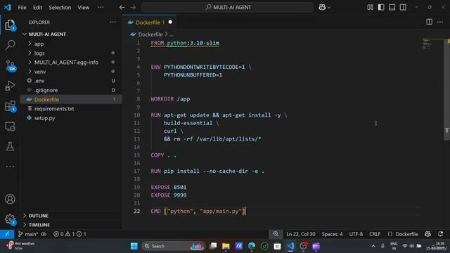

> 注：清单里没有 `p026_0028s.jpg`，请用清单中实际存在的帧，例如 `p026_0013s.jpg` 或 `p026_0040s.jpg`。下面统一使用清单内帧号。


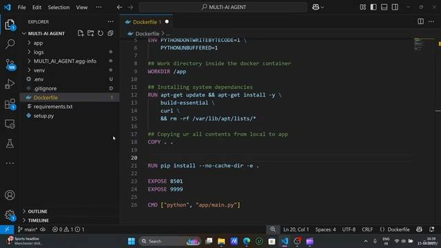

### 3.2 步骤二：构建 Jenkins DIND 镜像并启动容器（P27）

1. 在项目根目录新建 `custom_jenkins/` 文件夹，里面放一个 `Dockerfile`（代码块 B）。它基于 Jenkins 官方镜像，并安装 Docker CLI 以支持 DIND。
2. 在 WSL 终端里：
   ```bash
   cd custom_jenkins
   docker build -t jenkins-dind .
   ```
   讲师说「it will give you some warning. ignore those warning even if you are getting them in red」——红字警告可以忽略。
3. 启动容器（讲师给的是「run jenkins container」那条命令，形如）：
   ```bash
   docker run -d --name jenkins-dind \
     -p 8080:8080 -p 50000:50000 \
     -v /var/run/docker.sock:/var/run/docker.sock \
     jenkins-dind
   ```
   > 逐字稿只说了「copy this command inside the run Jenkins container」，具体参数以你拿到的 GitHub 文档为准；`-v /var/run/docker.sock` 是 DIND 常见做法，但**课里没逐字讲**，若你的文档没给就别加。
4. 验证：
   ```bash
   docker ps
   ```
   应看到 `jenkins-dind` 在跑，端口 `8080`。
5. 取初始密码（只显示一次）：
   ```bash
   docker logs jenkins-dind
   ```
   复制那段 alphanumeric 密码，先存到记事本。
   > 讲师补充：也可以进容器看 `/var/jenkins_home/secrets/initialAdminPassword`，但 `docker logs` 只出一次。

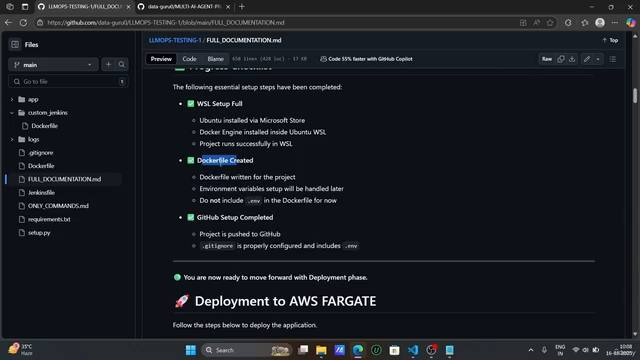

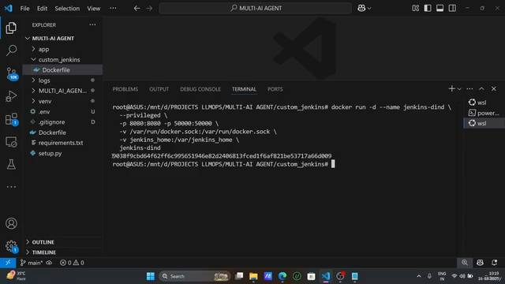

6. 取 WSL IP：
   ```bash
   hostname -I
   ```
   只取第一个 IP（到空格为止，不要带 `/` 后缀）。
7. 浏览器访问 `http://<WSL_IP>:8080`，粘贴初始密码 → Install suggested plugins → 等装完 → 建管理员账号（讲师用了 `data guru 97`，你随意）→ Save and Finish → Start using Jenkins。
8. 在 Jenkins 容器里装 Python：
   ```bash
   docker exec -it jenkins-dind bash
   apt-get update
   apt-get install -y python3 python3-pip
   python3 --version        # 应显示 3.11.x
   ln -s /usr/bin/python3 /usr/bin/python
   python --version         # 应显示 3.11.x，而不是 command not found
   exit
   ```
   讲师强调：`python3 app.py` 能跑但 `python app.py` 不行，所以要软链。
9. 重启容器让改动生效：
   ```bash
   docker restart jenkins-dind
   ```
   刷新浏览器，用刚建的管理员账号登录。

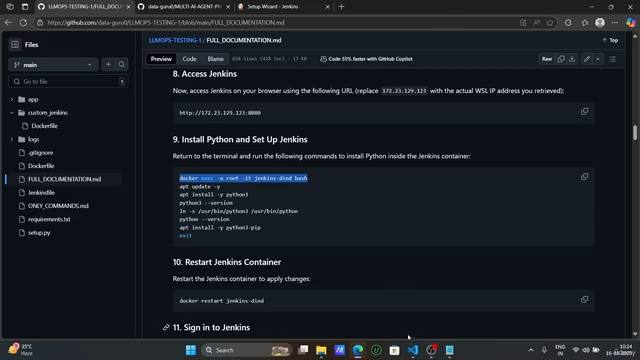

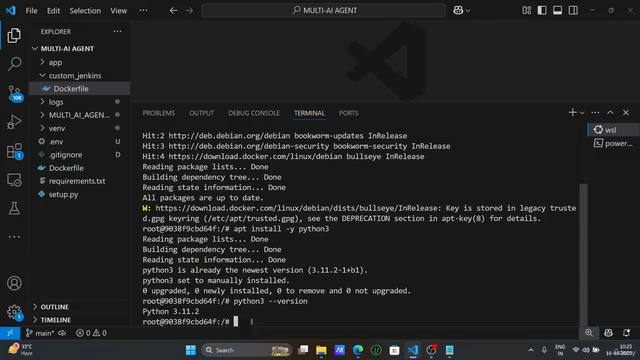

### 3.3 步骤三：GitHub Token + Jenkins Pipeline（P28）

1. GitHub → Settings → Developer settings → Personal access tokens → **Tokens (classic)** → Generate new token (classic)。
2. 勾选 `repo` 和 `repo_hook`（讲师原话「these two permissions are must」），生成后**立刻复制**，关掉页面就看不到了。
3. Jenkins → Manage Jenkins → Credentials → System → Global credentials → Add Credentials：
   - Kind: **Username with password**
   - Username: 你的 GitHub 用户名
   - Password: 刚才的 token
   - ID / Description: `github-token`
4. Jenkins → New Item → 名字 `multi-ai-agent` → 选 **Pipeline** → OK。
5. Pipeline 配置：
   - Definition: **Pipeline script from SCM**
   - SCM: **Git**
   - Repository URL: 你的 GitHub 仓库地址
   - Credentials: `github-token`
   - Branch: `main`（讲师特别提醒默认是 `master`，要改成 `main`）
   - Script Path: `Jenkinsfile`（默认值）
   - Save
6. 点左侧 **Pipeline Syntax** → 选 `checkout: Checkout from version control` → 填同样的 URL / 凭据 / `main` → Generate Pipeline Script，把生成的 `checkout([...])` 片段复制下来备用。
7. 项目根目录新建 `Jenkinsfile`（代码块 C）。先只保留第一个 stage（克隆仓库），其余 stage 全部注释掉（讲师用 `Ctrl + /` 批量注释）。
8. 把第 6 步生成的 `checkout([...])` 片段替换掉 `Jenkinsfile` 里第一个 stage 的 `steps` 占位。
9. 把 `Jenkinsfile` 推到 GitHub：
   ```bash
   git add .
   git commit -m "add Jenkinsfile"
   git push origin main
   ```
10. Jenkins 里点 **Build Now**。第一次大概率失败——讲师原话「We have set up the environment, but we have not given any environment variable」——把 `Jenkinsfile` 里 `environment { ... }` 整段注释掉，再 push，再 Build Now。
11. 成功后点 Build 号 → **Workspace**，应能看到 `Dockerfile`、`Jenkinsfile`、`setup.py`、`app/`（含 `backend`、`common`、`config`、`core`、`frontend`、`main`）等全部文件。

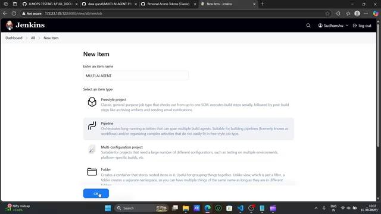

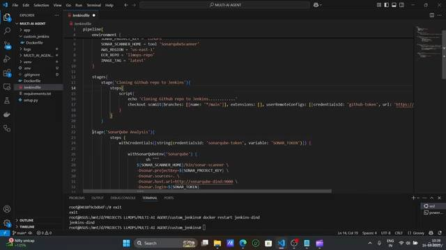

### 3.4 步骤四：SonarQube 接入（P29）

1. 起 SonarQube 容器。讲师的做法是去 Docker Hub 搜 `sonarqube`，复制官方 Linux 命令，然后**把容器名从 `sonarqube` 改成 `sonarqube-dind`**，端口 `9000`：
   ```bash
   docker run -d --name sonarqube-dind -p 9000:9000 sonarqube:latest
   ```
   > 讲师原命令里带 `$` 提示符，要删掉；镜像约 900MB，网速要够。
2. `docker ps` 确认 `sonarqube-dind` 在跑。
3. 浏览器访问 `http://<WSL_IP>:9000`，默认账号密码都是 `admin`，登录后按提示改密码。
4. Jenkins → Manage Jenkins → Plugins → Available plugins，装两个：
   - **SonarQube Scanner**
   - **SonarQube Quality Gates**
   装完 `docker restart jenkins-dind`。
5. SonarQube 里：Create a local project → 项目名 `llmops`（讲师用了 `llmops` / `LLM ops`）→ 分支 `main` → Use the global setting → Create。
6. SonarQube 右上角 My Account → Security → Generate Tokens：
   - Name: `sonarqube-token`
   - Type: **Global Analysis Token**
   - Expiration: 30 days
   - 生成后复制。
7. Jenkins → Credentials → Global → Add Credentials：
   - Kind: **Secret text**
   - Secret: 刚才的 token
   - ID / Description: `sonarqube-token`
8. Jenkins → Manage Jenkins → System → 找 SonarQube servers → Add SonarQube：
   - Name: `sonarqube`
   - Server URL: `http://<WSL_IP>:9000`（不要带 `/` 后缀）
   - Server authentication token: 选 `sonarqube-token`
   - Save
9. Jenkins → Manage Jenkins → Tools → 找 SonarQube Scanner → Add SonarQube Scanner：
   - Name: `sonarqube`
   - 勾选 Install automatically，用默认版本
   - Save
10. 回到 `Jenkinsfile`，取消注释 `environment` 段和 `SonarQube Analysis` stage，并改四处（讲师原话「only these four things you have to change」）：
    - 凭据 ID → `sonarqube-token`
    - `SONAR_PROJECT_KEY` → `llmops`
    - `SONAR_SCANNER_HOME` 里的 tool 名 → `sonarqube`
    - `withSonarQubeEnv('...')` 里的名字 → `sonarqube`
11. push 代码，Build Now。**第一次会失败**——讲师原话「Zenkins and Sonar2 are not able to interact with each other. Why? Because they are on different networks.」
12. 修复网络：
    ```bash
    docker network create dind-network
    docker network connect dind-network jenkins-dind
    docker network connect dind-network sonarqube-dind
    docker network ls   # 应能看到 dind-network
    ```
13. 再 Build Now，应成功。到 SonarQube 项目页看报告：Quality Gate 通过，约 1292 行代码，maintainability / coverage / security hotspot 等指标。

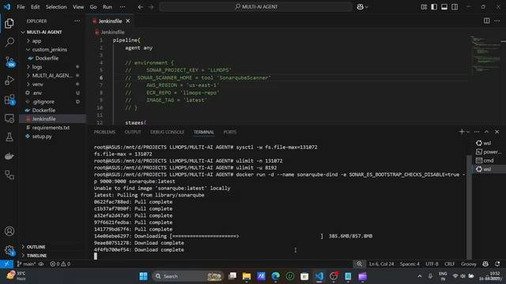

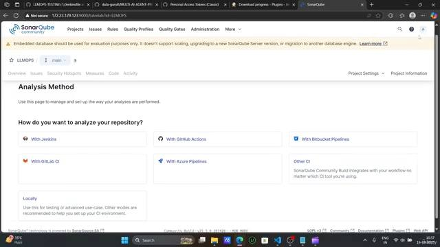

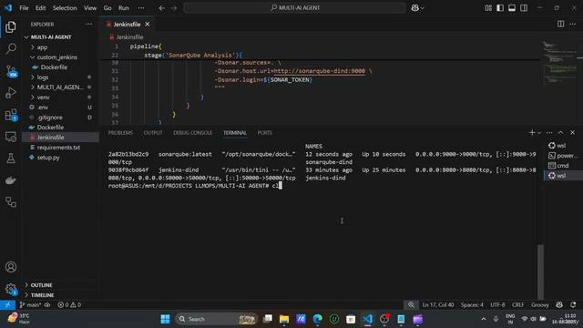

---

## 4. 完整代码

### 代码块 A：项目根目录 `Dockerfile`

```dockerfile
# 基础镜像：Python 3.10 slim（讲师明确说 3.12 不稳定，用 3.10）
FROM python:3.10-slim

# 环境变量：不写 .pyc、日志实时输出
ENV PYTHONDONTWRITEBYTECODE=1 \
    PYTHONUNBUFFERED=1

# 容器内工作目录
WORKDIR /app

# 安装系统依赖并清理 apt 缓存（生产级项目建议保留这段）
RUN apt-get update && apt-get install -y --no-install-recommends \
        build-essential \
        gcc \
        curl \
    && rm -rf /var/lib/apt/lists/*

# 把本地项目全部内容拷进 /app
COPY . .

# 通过 setup.py 安装项目依赖；--no-cache-dir 避免缓存导致重复构建时拿到旧包
RUN pip install --no-cache-dir -e .

# 暴露端口：8501 前端 Streamlit，9999 后端 FastAPI
EXPOSE 8501 9999

# 启动命令：等价于本地 `python app/main.py`
CMD ["python", "app/main.py"]
```

> 说明：`build-essential` / `gcc` / `curl` 是讲师口中「installing system dependencies … building some essential libraries」的具体化；逐字稿没有逐字念出包名，**以你拿到的 GitHub 版 Dockerfile 为准**。`PYTHONDONTWRITEBYTECODE` / `PYTHONUNBUFFERED` 是讲师说的「Python don't write byte code equal to one / Python buffered equal to one」的标准写法。

### 代码块 B：`custom_jenkins/Dockerfile`

```dockerfile
# 基于 Jenkins 官方 LTS 镜像
FROM jenkins/jenkins:lts

# 切到 root 装 Docker CLI（DIND 需要）
USER root

# 安装 Docker CLI 与必要工具
RUN apt-get update && apt-get install -y --no-install-recommends \
        ca-certificates \
        curl \
        gnupg \
        lsb-release \
    && install -m 0755 -d /etc/apt/keyrings \
    && curl -fsSL https://download.docker.com/linux/debian/gpg \
        | gpg --dearmor -o /etc/apt/keyrings/docker.gpg \
    && chmod a+r /etc/apt/keyrings/docker.gpg \
    && echo "deb [arch=$(dpkg --print-architecture) signed-by=/etc/apt/keyrings/docker.gpg] \
        https://download.docker.com/linux/debian $(lsb_release -cs) stable" \
        > /etc/apt/sources.list.d/docker.list \
    && apt-get update && apt-get install -y --no-install-recommends docker-ce-cli \
    && rm -rf /var/lib/apt/lists/*

# 切回 jenkins 用户
USER jenkins
```

> 讲师在 P27 说「it is using Jenkins image from here. And I have given some comments so that you can see the use of each line」——具体基础镜像 tag 与安装的包以 GitHub 文档为准；上面是 DIND 场景下能跑通的最小写法。

### 代码块 C：项目根目录 `Jenkinsfile`

```groovy
pipeline {
    agent any

    environment {
        // 与 Jenkins → System → SonarQube servers 里的 Name 一致
        SONAR_ENV_NAME      = 'sonarqube'
        // 与 SonarQube 项目 Key 一致
        SONAR_PROJECT_KEY   = 'llmops'
        // 与 Jenkins → Tools → SonarQube Scanner 里的 Name 一致
        SONAR_SCANNER_HOME  = tool name: 'sonarqube', type: 'hudson.plugins.sonar.SonarRunnerInstallation'
    }

    stages {
        stage('Clone GitHub repo to Jenkins') {
            steps {
                // 这段由 Jenkins → Pipeline Syntax → checkout 生成后粘贴进来
                checkout([
                    $class: 'GitSCM',
                    branches: [[name: '*/main']],
                    userRemoteConfigs: [[
                        url: 'https://github.com/<你的用户名>/<你的仓库>.git',
                        credentialsId: 'github-token'
                    ]]
                ])
            }
        }

        stage('SonarQube Analysis') {
            steps {
                withSonarQubeEnv("${SONAR_ENV_NAME}") {
                    sh "${SONAR_SCANNER_HOME}/bin/sonar-scanner \
                        -Dsonar.projectKey=${SONAR_PROJECT_KEY} \
                        -Dsonar.sources=. \
                        -Dsonar.host.url=${SONAR_HOST_URL}"
                }
            }
        }

        // 以下 stage 在 P28/P29 里被讲师注释掉，后续课程再打开
        // stage('Build Docker Image') { ... }
        // stage('Push to Registry')   { ... }
        // stage('Deploy')             { ... }
    }
}
```

> 注意：`SONAR_SCANNER_HOME` 用 `tool name: ..., type: ...` 的写法是 Jenkins 里引用 Tool 的常见方式；讲师在 P29 只说了「whatever name you have given here just copy it that name here and replace it」，**具体语法以你拿到的 GitHub 版 Jenkinsfile 为准**。`SONAR_HOST_URL` 由 `withSonarQubeEnv` 自动注入，不需要你手填。

---

## 5. 逐行解释

### 5.1 Dockerfile（代码块 A）

- `FROM python:3.10-slim`：讲师原话「it is your parent image」。选 slim 是为了镜像小；选 3.10 是因为「3.12 不稳定」。
- `ENV PYTHONDONTWRITEBYTECODE=1`：不生成 `.pyc`，容器里少一堆垃圾文件。
- `ENV PYTHONUNBUFFERED=1`：讲师原话「helps you in your real time logging」——不加这个，Python 的 stdout 会缓冲，`docker logs` 看不到实时输出。**在 Node 里对应什么**：Node 默认就是行缓冲，不需要这个开关；但如果你用 `console.log` 打日志到容器，效果类似。
- `WORKDIR /app`：讲师原话「inside the Docker container your work directory name will be app」。之后所有相对路径都相对 `/app`。
- `RUN apt-get update && apt-get install ... && rm -rf /var/lib/apt/lists/*`：讲师原话「they are updating the system … installing … removing the additional things so that space can be saved」。`rm -rf` 那步就是「省空间」。
- `COPY . .`：讲师原话「copying your all contents from your local directory … paste them inside this app directory」。第一个 `.` 是构建上下文（项目根），第二个 `.` 是容器内 `/app`。
- `RUN pip install --no-cache-dir -e .`：讲师原话「it will run your setup.py file and setup.py file will install all your packages」。`-e .` 是 editable install，读 `setup.py` 里的 `install_requires`。`--no-cache-dir` 是讲师说的「no cache in DIR」——避免 pip 缓存导致「你以为重装了其实用的旧 wheel」。
- `EXPOSE 8501 9999`：讲师原话「your backend is using port 9999 and your frontend is using 8501. StreamHit runs on 8501 by default」。**注意**：`EXPOSE` 只是文档声明，真正映射端口要在 `docker run -p` 里写；讲师在 P26 结尾也强调「make sure you have to expose the quotes first, otherwise this app domain.py will not work」。
- `CMD ["python", "app/main.py"]`：讲师原话「I just write python app main.py … same thing only the writing pattern is different」。用 exec 形式（JSON 数组）而不是 shell 形式，这样 `python` 是 PID 1，能正确接收 `SIGTERM`。

### 5.2 Jenkins DIND（代码块 B + P27 命令）

- `FROM jenkins/jenkins:lts`：讲师原话「it is using Jenkins image from here」。
- `USER root` → 装 Docker CLI → `USER jenkins`：DIND 需要容器内有 `docker` 命令，但 Jenkins 进程本身不该以 root 跑。
- `docker run -d --name jenkins-dind -p 8080:8080 ...`：讲师原话「you can see your Jenkins behind is running on 8080 port. And why it is running on 8080 port? Because we have defined 8080 here」。
- `docker logs jenkins-dind`：讲师原话「it will be generated only once」——初始密码只在首次启动时打印，之后只能进容器看 `initialAdminPassword` 文件。
- `hostname -I` 取 WSL IP：讲师原话「suppose if you are using docker desktop so it will be running on your local pc but this time it is running on wslip」。**为什么不能用 `localhost`**：WSL2 里 Docker 跑在 WSL 的虚拟网卡上，Windows 宿主机的 `localhost` 不一定能直通；用 WSL IP 最稳。
- `ln -s /usr/bin/python3 /usr/bin/python`：讲师原话「it has installed python 3 but we generally don't write python 3 app dot py」。软链之后 `python app.py` 才能跑。**在 Node 里对应什么**：类似 `nvm alias default`，让 `node` 指向某个具体版本。
- `docker restart jenkins-dind`：讲师原话「since you have made changes to your Jenkins container make sure you restart it」。装插件、装 Python 后都要重启。

### 5.3 GitHub Token + Pipeline（P28）

- Token 权限只勾 `repo` + `repo_hook`：讲师原话「these two permissions are must」。`repo` 让 Jenkins 能读私有仓库，`repo_hook` 让 Jenkins 能配 webhook（虽然 P28 还没配 webhook，但先勾上）。
- Credentials Kind 选 **Username with password**：GitHub 的 token 本质是「密码」，用户名照填 GitHub 用户名。
- `Pipeline script from SCM` + `SCM = Git`：讲师原话「SCM means source code management. And what is our SCM? GitHub is our SCM」。意思是「流水线脚本本身也从 Git 仓库读」，而不是在 Jenkins 网页里手写。
- `Script Path = Jenkinsfile`：讲师原话「make sure the script path is zenkins file that is by default」。
- Branch 从 `master` 改 `main`：讲师原话「make sure you change it to main from master」。GitHub 新仓库默认分支是 `main`，Jenkins 老模板默认 `master`，不改就拉不到代码。
- 第一次 Build 失败后注释掉 `environment { ... }`：讲师原话「We have set up the environment, but we have not given any environment variable. Okay. So it is code related.」——`environment` 块里引用了还没创建的凭据/变量，Groovy 求值时报错。先注释掉，等 P29 配好 SonarQube 再打开。
- Workspace 验证：讲师原话「just go to the workspace … you can see all the things whatever you have in your github here now it is inside your Jenkins workspace」。这是判断「GitHub → Jenkins 集成成功」的最直接证据。

### 5.4 SonarQube 接入（P29）

- 容器名改 `sonarqube-dind`：讲师原话「just change the name from sonar cube to sonar cube dind okay because we are running inside docker in docker so it should be dind」。命名统一，后面 `docker network connect` 才不会写错。
- 默认账号密码 `admin/admin`：讲师原话「by default login password is admin」。首次登录强制改密。
- 装两个插件：**SonarQube Scanner**（提供 `sonar-scanner` 命令）+ **SonarQube Quality Gates**（提供 `waitForQualityGate` 步骤，P29 还没用到但先装）。
- Token Type 选 **Global Analysis Token**：讲师原话「your token type should be global analysis」。项目级 token 只能分析单个项目，全局 token 能分析所有项目。
- Jenkins Credentials Kind 选 **Secret text**：SonarQube token 是单字符串，不是用户名密码对。
- Jenkins System 里配 SonarQube Server：Name `sonarqube`、URL `http://<WSL_IP>:9000`、Token 选 `sonarqube-token`。讲师强调 URL「just remove it till … This is 9000」——不要带 `/` 或 `/dashboard` 后缀。
- Jenkins Tools 里配 SonarQube Scanner：Name `sonarqube`、勾 Install automatically。这个 Name 要和 `Jenkinsfile` 里 `SONAR_SCANNER_HOME` 的 tool name 一致。
- `Jenkinsfile` 改四处：凭据 ID、项目 Key、Scanner Tool 名、`withSonarQubeEnv` 的 env 名。讲师原话「only these four things you have to change」。
- **网络问题**：讲师原话「Zenkins and Sonar2 are not able to interact with each other. Why? Because they are on different networks.」——`docker network ls` 能看到默认的 `bridge` / `host` / `none` 三个网络，两个容器各自在 `bridge` 上但互相 DNS 解析不到。`docker network create dind-network` + `docker network connect` 把两者接到同一自定义网络，Docker 内置 DNS 就能互相解析容器名。
- 最终报告：讲师展示「1292 lines of code」「maintainability 2」「coverage 0」「Quality Gate passed」，并指出 SonarQube 给了「merge this run with instruction with consecutive ones」「sort these package name alphabetically」等 maintainability 建议。**coverage 0 是因为还没接单测**，P29 没讲怎么接，属于后续课程。

---

## 6. 复现检查清单

按顺序打勾，任何一项不过就别往下走：

- [ ] 项目根目录有 `Dockerfile`，`docker build -t myapp .` 能成功
- [ ] `docker run -p 8501:8501 -p 9999:9999 myapp` 后，浏览器能打开前端、`curl localhost:9999` 有响应
- [ ] `custom_jenkins/Dockerfile` 存在，`docker build -t jenkins-dind .` 成功
- [ ] `docker ps` 能看到 `jenkins-dind`，端口 `8080`
- [ ] `docker logs jenkins-dind` 能拿到初始密码（只出一次，已存好）
- [ ] `hostname -I` 拿到的 WSL IP + `:8080` 能打开 Jenkins 解锁页
- [ ] Jenkins 装完 suggested plugins，建好管理员账号
- [ ] `docker exec -it jenkins-dind bash` 里 `python --version` 输出 3.11.x（不是 command not found）
- [ ] `docker restart jenkins-dind` 后能用管理员账号登录
- [ ] GitHub 生成了 classic token，勾了 `repo` + `repo_hook`
- [ ] Jenkins 里有 `github-token` 凭据（Username with password）
- [ ] Jenkins 有 Pipeline 项目 `multi-ai-agent`，SCM 指向你的仓库，Branch = `main`，Script Path = `Jenkinsfile`
- [ ] `Jenkinsfile` 已 push 到 GitHub
- [ ] 第一次 Build 失败后，注释掉 `environment` 段，再 push，再 Build → 成功
- [ ] Build 的 Workspace 里能看到 `Dockerfile`、`Jenkinsfile`、`setup.py`、`app/`
- [ ] `docker ps` 能看到 `sonarqube-dind`，端口 `9000`
- [ ] `http://<WSL_IP>:9000` 能打开 SonarQube，`admin/admin` 能登录并改密
- [ ] Jenkins 装了 SonarQube Scanner + SonarQube Quality Gates 两个插件，并 `docker restart jenkins-dind`
- [ ] SonarQube 里建了项目 `llmops`，生成了 Global Analysis Token
- [ ] Jenkins 里有 `sonarqube-token` 凭据（Secret text）
- [ ] Jenkins System 里 SonarQube Server Name = `sonarqube`，URL = `http://<WSL_IP>:9000`
- [ ] Jenkins Tools 里 SonarQube Scanner Name = `sonarqube`，勾了 Install automatically
- [ ] `Jenkinsfile` 里四处名字都改对了（凭据 ID / 项目 Key / Scanner Tool 名 / env 名）
- [ ] 第一次带 SonarQube 的 Build 失败，`docker network ls` 只看到默认三个网络
- [ ] `docker network create dind-network` + 两次 `docker network connect` 成功
- [ ] 再 Build → 成功，SonarQube 项目页 Quality Gate 通过，能看到代码行数 / maintainability / coverage 等指标

---

## 7. 课里没讲但你会撞上的

1. **`docker run` 的完整参数**：P27 讲师只说「copy this command inside the run Jenkins container」，具体 `-v`、`--network`、`-e` 参数以 GitHub 文档为准。如果你照抄网上教程加了 `-v /var/run/docker.sock:/var/run/docker.sock`，那其实是「挂载宿主机 Docker socket」而不是严格 DIND；两种做法都能让 Jenkins 里跑 `docker` 命令，但隔离性不同。**课里没讲这个区别**。
2. **Jenkins 初始密码丢了怎么办**：`docker logs` 只出一次，但可以 `docker exec -it jenkins-dind cat /var/jenkins_home/secrets/initialAdminPassword` 再拿。讲师在 P27 [04:52] 提过这个路径，但没演示。
3. **WSL IP 会变**：每次重启 WSL，`hostname -I` 的 IP 可能变。变了之后 Jenkins 里配的 SonarQube URL、浏览器书签全要改。**课里没讲怎么固定**（常见做法是 WSL 里配静态 IP 或用 `localhost` 转发，但讲师没提）。
4. **`sonar-scanner` 的 `sonar.sources=.`**：P29 讲师没逐字讲 `sonar-scanner` 的参数，只说了「whatever you have given the project name just copy that and paste it here」。`sonar.sources` 指扫描范围，`.` 表示整个 workspace。如果你只想扫 `app/`，改成 `-Dsonar.sources=app`。
5. **Quality Gate 的 `waitForQualityGate`**：P29 只跑了 `sonar-scanner`，没等 Quality Gate 结果就结束 stage。真正「门禁」要在 `sonar-scanner` 后加 `waitForQualityGate abortPipeline: true`，否则分析失败也不会阻断流水线。**课里没讲这一步**，属于后续课程。
6. **`coverage 0`**：P29 报告里 coverage 是 0，因为项目没接单测。要接的话得在 `sonar-scanner` 前跑 `pytest --cov` 生成 `coverage.xml`，再传 `-Dsonar.python.coverage.reportPaths=coverage.xml`。**课里没讲**。
7. **`repo_hook` 权限到底干嘛用**：P28 讲师说「these two permissions are must」，但没解释 `repo_hook` 的具体用途（配 webhook 让 GitHub push 自动触发 Jenkins Build）。P28 全程是手动点 Build Now，**webhook 自动触发课里没讲**。
8. **`docker network connect` 后容器要重启吗**：P29 讲师直接 `docker network connect` 完就 Build，没重启容器。实测一般不用重启，Docker 会动态更新容器的 `/etc/hosts`。但如果你发现还是解析不到，`docker restart` 两个容器再试。**课里没讲这个边界情况**。
9. **`Jenkinsfile` 里 `tool name: ..., type: ...` 的写法**：P29 讲师只说「whatever name you have given here just copy it that name here and replace it」，没给完整语法。上面代码块 C 里的写法是 Jenkins 官方推荐，但**以你拿到的 GitHub 版 Jenkinsfile 为准**——如果版本不一致，以仓库为准。
10. **`docker logs` 输出里的字段名**：P27 讲师展示 `docker logs jenkins-dind` 时只关注那段密码，没逐字念其他字段。如果你要排查容器为什么退出，`docker inspect` 里的 `State.ExitCode`、`State.OOMKilled`、`HostConfig` 等字段名**请以实际输出为准**，课里没讲。

---

**文档结束。** 按第 3 节顺序做、第 6 节逐项打勾，你就能从零跑通 P26–P29 的完整链路：Docker 化 → Jenkins DIND → GitHub 集成 → SonarQube 质量门禁。