## 1. 这一节做什么

本节覆盖 P003–P007，目标不是做出聊天页面，而是先把 RAG 的“数据侧”跑通：建立 Python 项目骨架、读取 `data/` 下的 PDF、把 PDF 切成 chunk、加载 embedding 模型、创建并保存 FAISS 向量库，以及下次启动时加载已有向量库。换句话说，这一节先把“资料如何进入系统、如何变成可检索的向量、如何落盘保存”这条链路走完；只有这条链路稳定，后面的检索链、对话链和 Flask 页面才有可靠的数据基础。

本节结束的验收标志是：你运行一个验证脚本后，终端能打印出文档数、chunk 数，并且项目根目录下出现 `vectorstore/db_faiss/`；再调用 `load_vector_store()` 能返回 FAISS 对象。这里要特别区分“代码写完”和“链路跑通”：代码写完只代表文件存在，链路跑通要求 PDF 能被读到、chunk 能生成、embedding 能下载并加载、FAISS 能保存，保存后还能再次加载。Flask 页面、Mistral 对话调用、检索链等内容不在 P003–P007 里，课里是在后续视频继续做的。

最终目录结构如下。`vectorstore/` 和 `logs/` 是运行后生成的：

```text
rag-medical-chatbot/
├── .env
├── requirements.txt
├── setup.py
├── build_once.py
├── data/
│   └── medical.pdf
├── vectorstore/
│   └── db_faiss/              # 运行 build_once.py 后生成
├── logs/
│   └── app.log                # 运行后生成
└── app/
    ├── __init__.py
    ├── common/
    │   ├── __init__.py
    │   ├── logger.py
    │   └── custom_exception.py
    ├── components/
    │   ├── __init__.py
    │   ├── PDFLoader.py
    │   ├── embeddings.py
    │   └── vector_store.py
    ├── config/
    │   ├── __init__.py
    │   └── config.py
    └── templates/
```

对前端转 AI 应用的人来说，可以这样类比：`venv/` 类似项目的 `node_modules`，`requirements.txt` 类似 `package.json` 的依赖清单，`__init__.py` 是 Python 识别“这个文件夹是一个包”的标记，`setup.py` 负责把 `app` 作为本地包安装，`pip install -e .` 类似 `npm link` 的本地可编辑安装。进一步说，`app/common/` 更像公共工具层，放日志和异常；`app/components/` 更像业务组件层，放 PDF 加载、embedding、向量库；`app/config/` 更像全局配置层，集中放路径、chunk 参数和 token；`templates/` 则对应前端页面模板目录。这个分层不是装饰，而是为了让后面的 Flask 入口、检索链和对话链都能复用同一套组件。

从执行顺序看，本节的数据流是：`.env` 提供 token 等环境变量；`config.py` 读取环境变量并集中定义路径和参数；`PDFLoader.py` 从 `data/` 读取 PDF 并切 chunk；`embeddings.py` 加载 Hugging Face embedding 模型；`vector_store.py` 把 chunk 转成向量并保存到 `vectorstore/db_faiss/`，同时提供加载已有索引的函数；`build_once.py` 作为本地验证脚本按顺序调用这些组件。理解这条顺序，后面排查问题时就不会把“PDF 没读到”“chunk 为 0”“embedding 没下载成功”“FAISS 没保存成功”混在一起。

---

## 2. 讲师原话（带「—— pNNN [MM:SS]」）

讲师在 P003 先强调虚拟环境和依赖清单：

> "首先，你要做的是创建一个虚拟环境……只要写 python -m venv……之后你就能在这个环境里工作了。"
> —— p003 [00:55]

这段原话对应的动作是先在项目根目录创建独立虚拟环境，再在激活后的环境里安装依赖。这样做的目的不是形式主义，而是避免本机全局 Python 里已有包版本与课程依赖互相污染。对前端同学来说，这相当于不要在系统全局 Node 里乱装包，而是在项目内用独立依赖环境。

> "基本上，你会在这里列出所有依赖项……也就是你整个项目里想用的所有库。"
> —— p003 [02:23]

这段原话对应 `requirements.txt`。课里讲师口述成了 `requirements.pxt`，实际文件名必须是 `requirements.txt`；这个拼写错误是复现时非常常见的第一个坑。依赖清单的作用是让 `setup.py` 读取，并让 `pip install -e .` 一次性安装项目需要的库。

项目结构是 P003 的核心动作，讲师明确要求 `app` 下面分出四个目录：

> "你需要四个目录……第一个目录是 common 目录……app 目录下的另一个文件夹是 components……这个 app 目录下的另一个文件夹是 config……再一个文件夹是 templates。"
> —— p003 [04:47]

这段原话说明 `app` 不是把所有文件平铺在一起，而是按职责拆成 `common`、`components`、`config`、`templates`。复现时不要只建目录不建 `__init__.py`，否则 Python 包识别和 `find_packages()` 都可能出问题。

P004 配置 chunk 参数时，讲师给了具体数值：

> "我们把分块重叠设为 50，分块大小设为 500。"
> —— p004 [02:52]

这段原话对应 `CHUNK_SIZE = 500` 和 `CHUNK_OVERLAP = 50`。它们的含义是每个文本块目标长度为 500 个字符，相邻块之间保留 50 个字符重叠，用来降低句子被硬切断后语义丢失的概率。

P005 写 PDF 加载器时，讲师解释了 `DirectoryLoader` 的 `glob` 和 `loader_cls`：

> "你要在这里给出从哪里加载的路径……然后写 glob……在 glob 里写 *，接着写 .，再写 PDF……加载器类就用 pypdf loader。"
> —— p005 [06:18]

这段原话对应 `DirectoryLoader(DATA_PATH, glob="*.pdf", loader_cls=PyPDFLoader)`。`DATA_PATH` 告诉加载器去哪个目录找文件，`glob="*.pdf"` 表示只匹配 PDF，`loader_cls=PyPDFLoader` 表示每个 PDF 交给 `PyPDFLoader` 解析。

P005 后半段解释为什么要切 chunk：

> "现在我们已经加载了所有 PDF 文件……现在需要取出文档内容，并把它转换成分块。"
> —— p005 [11:04]

这段原话说明加载 PDF 只是第一步，后面还要把文档内容切成 chunk。复现时如果 `documents` 有数量但 `chunks` 为 0，就要回到切分函数和 PDF 文本提取能力上排查。

P006 解释 embedding 的作用：

> "嵌入模型有什么用？现在你已经有了分块……接下来你要把这些分块转换成嵌入向量。因为你的大语言模型只能理解嵌入向量，理解不了分块。"
> —— p006 [01:56]

这段原话说明 chunk 不能直接作为向量库的检索基础，必须先由 embedding 模型转成向量。复现时模型名必须准确，讲师口述的 “all mini llm l6 v2” 实际对应 `sentence-transformers/all-MiniLM-L6-v2`，拼错会导致模型下载失败或加载失败。

P007 解释向量库为什么要拆成“加载已有”和“新建”两个函数：

> "第一个函数用来加载已有的向量存储……另一个用来新建向量存储……假设你已经有向量存储了……你不希望每次运行应用都重新创建向量存储。"
> —— p007 [01:56]

这段原话对应 `load_vector_store()` 和 `save_vector_store()` 的拆分。加载函数负责判断本地是否已有索引并读取，新建函数负责把 chunk 转成 FAISS 索引并保存。这样应用启动时可以先尝试加载已有向量库，避免每次运行都重新 embedding。

---

## 3. 从零复现

### 步骤 1：创建项目目录并进入虚拟环境

在任意项目目录下创建文件夹，名字可以叫 `rag-medical-chatbot`。进入该文件夹，打开终端。Windows 下：

```bat
cd rag-medical-chatbot
python -m venv venv
venv\Scripts\activate
```

macOS / Linux 下：

```bash
cd rag-medical-chatbot
python3 -m venv venv
source venv/bin/activate
```

激活成功后，终端提示符前面会出现 `(venv)`。讲师在 P003 就是通过这个括号判断虚拟环境是否激活成功。命令的完整解释是：`python -m venv venv` 表示用当前 Python 解释器创建一个名为 `venv` 的虚拟环境目录；`venv\Scripts\activate` 是 Windows cmd 下的激活脚本；`source venv/bin/activate` 是 macOS/Linux 下的激活脚本。前端对照可以理解为：你不在系统全局 Node 下装依赖，而是在项目目录里生成一个独立依赖环境，后续所有 `pip install` 和 `python` 命令都应该在这个环境里执行。

常见错误与排查：如果 Windows 下输入 `python -m venv venv` 弹出 Microsoft Store，说明 `python` 命令被指向了商店别名，可以改用 `py -3.11 -m venv venv` 这类明确版本的方式；如果 PowerShell 下 `venv\Scripts\activate` 不生效，通常要用 `.\venv\Scripts\Activate.ps1`；如果提示符前没有 `(venv)`，先用 `python -c "import sys; print(sys.prefix)"` 确认当前解释器路径是否指向项目下的 `venv`。不要在虚拟环境没激活时直接安装依赖，否则包装到全局环境，后面运行时仍可能报找不到包。

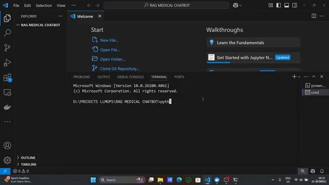

### 步骤 2：写 `requirements.txt`

在项目根目录创建 `requirements.txt`。课里讲师口述成了 `requirements.pxt`，这是口误，实际文件名必须是 `requirements.txt`。

```text
langchain==0.3.7
langchain-community==0.3.7
langchain-huggingface==0.1.2
langchain-text-splitters==0.3.2
faiss-cpu==1.9.0
pypdf==5.1.0
huggingface-hub==0.26.2
flask==3.1.0
python-dotenv==1.0.1
sentence-transformers==3.3.1
```

说明：逐字稿没有给版本号；上面是一组可复现的锁定版本。`langchain-text-splitters` 是课里没有单独列、但 `RecursiveCharacterTextSplitter` 导入需要的包，所以补进依赖。这里的 `==` 是锁定版本，目的是让复现结果尽量稳定；前端对照类似 `package.json` 里写死版本号，避免今天装和明天装出现不同行为。常见错误是文件名拼错、把依赖写进别的目录、或者版本冲突后只删一行不重新安装；排查时先确认当前目录是项目根目录，再执行 `pip install -e .`，如果报某个包找不到，先检查包名和版本是否写错。

### 步骤 3：创建 `app` 包和四个目录

在项目根目录创建：

```text
app/
├── __init__.py
├── common/
│   ├── __init__.py
│   ├── logger.py
│   └── custom_exception.py
├── components/
│   ├── __init__.py
│   ├── PDFLoader.py
│   ├── embeddings.py
│   └── vector_store.py
├── config/
│   ├── __init__.py
│   └── config.py
└── templates/
```

`templates/` 本节先空着，后面 Flask 页面会用到。所有 `__init__.py` 都可以是空文件，但必须存在。讲师在 P003 和 P005 都强调：每次新增 `__init__.py` 或新增依赖后，要重新运行 `pip install -e .`，让包信息更新。前端对照可以理解为：`__init__.py` 像告诉构建工具“这个目录是一个模块边界”，没有它时 Python 可能不把子目录当成包；`pip install -e .` 像把当前项目以可编辑方式链接到环境里，新增包目录后要重新链接一次，否则导入路径可能仍旧是旧的。常见错误是只建了目录但没建 `__init__.py`，或者建完 `__init__.py` 后忘记重跑安装命令，结果 `from app.components...` 报 `ModuleNotFoundError`。

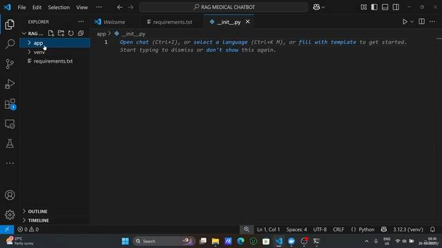

### 步骤 4：创建 `setup.py`

在项目根目录创建 `setup.py`。讲师在 P003 解释了它的作用：读取 `requirements.txt` 安装依赖，并通过 `find_packages()` 把带 `__init__.py` 的 `app` 当作包处理。具体代码逐字稿没有逐行展示，下面按这个作用给出最小可运行实现。`setup.py` 不是前端里的 `package.json` 本身，而更像一个安装入口：它把依赖清单读出来交给 `pip`，同时告诉安装器哪些目录是包。常见错误是把 `setup.py` 放到 `app/` 里面，或者 `find_packages()` 找不到包；排查时确认 `setup.py` 在项目根目录，且 `app/` 下各级目录都有 `__init__.py`。

### 步骤 5：安装依赖

确保虚拟环境已激活，在项目根目录执行：

```bash
pip install -e .
```

这条命令会触发 `setup.py`，把 `requirements.txt` 里的库逐个安装。首次安装会比较久，尤其是 `sentence-transformers` 会拉取 `torch` 相关依赖。`-e` 表示 editable，项目代码改动后不需要重新安装整个包，但新增 `__init__.py` 或修改依赖清单后仍应重新执行一次。常见错误是没激活虚拟环境就安装、在错误目录执行、或者安装中断后直接继续运行；排查时先看终端是否有 `(venv)`，再执行 `python -c "import langchain; print(langchain.__version__)"` 这类导入检查。前端对照：安装依赖失败时不要急着改业务代码，先确认依赖解析和 Node/Python 环境本身是否正常。

### 步骤 6：准备 `.env`

在项目根目录创建 `.env`，写入 Hugging Face token。讲师在 P003 让你去 Hugging Face 的 Access Tokens 页面创建 token，并提醒在创建时选择正确权限；P004 又让你把第二个变量名改成 “hugging face hub API token”。

环境变量名不能带空格。下面用 `HF_TOKEN` 和 `HUGGINGFACEHUB_API_TOKEN` 两个常用名字：

```dotenv
HF_TOKEN=你的_hugging_face_token
HUGGINGFACEHUB_API_TOKEN=你的_hugging_face_token
```

不要把 `.env` 提交到 Git。常见错误是 `.env` 放在子目录、变量名拼错、token 前后有空格、或者代码里没有 `load_dotenv()` 导致读不到；排查时可以用 `python -c "from dotenv import load_dotenv; load_dotenv(); import os; print(bool(os.environ.get('HF_TOKEN')))"` 验证是否读入。前端对照：`.env` 类似前端的 `.env.local`，属于本地环境配置，不应进入版本库。

### 步骤 7：放医学 PDF

在项目根目录创建 `data/`，把医学 PDF 放进去，例如 `data/medical.pdf`。讲师在 P003 说他在 GitHub 资源里放了医学百科 PDF，大小约 10 MB。你也可以先用一个几页的小 PDF 做测试，避免第一次 embedding 太慢。常见错误是 PDF 放在 `data/` 外面、文件名大小写不匹配、或者 PDF 是扫描图片版导致 `pypdf` 提不到文字；排查时先调用 `load_pdf_files()` 看文档数，再调用 `create_text_chunks()` 看 chunk 数。前端对照：这类似静态资源目录，路径要相对项目根目录统一，不要一会儿写 `./data` 一会儿写 `../data`。

### 步骤 8：写配置、组件、验证脚本

依次写入本文第 4 节的完整代码文件。然后运行验证脚本：

```bash
python build_once.py
```

预期会看到类似输出（具体数字取决于你的 PDF）：

```text
documents: 1
chunks: 1234
vector store loaded: True
```

同时项目根目录会出现 `vectorstore/db_faiss/` 和 `logs/app.log`。如果输出 `documents: 0`，先查 PDF 路径和 `glob`；如果 `documents` 有数但 `chunks: 0`，先查 PDF 是否可提取文字；如果保存后 `vector store loaded: False`，先查 `DB_FAISS_PATH` 是否与保存路径一致，以及 `FAISS.load_local` 是否传了 `allow_dangerous_deserialization=True`。验证脚本的作用是把各组件串起来，避免单独测试都正常、组合起来却失败。

---

## 4. 完整代码

下面每个文件都可以直接保存。标注“课里没展示完整代码”的文件，是按讲师在逐字稿里说明的作用写成的最小可运行版本；如果你要严格对齐讲师 GitHub，请以讲师资源为准。代码本身不要随意改路径和参数，尤其是 `CHUNK_SIZE`、`CHUNK_OVERLAP`、`DB_FAISS_PATH` 和 embedding 模型名，这些是最容易因为手误导致链路中断的地方。

### 4.1 `requirements.txt`

```text
langchain==0.3.7
langchain-community==0.3.7
langchain-huggingface==0.1.2
langchain-text-splitters==0.3.2
faiss-cpu==1.9.0
pypdf==5.1.0
huggingface-hub==0.26.2
flask==3.1.0
python-dotenv==1.0.1
sentence-transformers==3.3.1
```

### 4.2 `setup.py`

```python
from setuptools import setup, find_packages


def read_requirements():
    with open("requirements.txt", "r", encoding="utf-8") as f:
        lines = []
        for line in f:
            line = line.strip()
            if line and not line.startswith("#"):
                lines.append(line)
        return lines


setup(
    name="ragmedicalchatbot",
    version="0.1.0",
    description="RAG medical chatbot bootcamp project",
    packages=find_packages(),
    install_requires=read_requirements(),
    python_requires=">=3.10",
)
```

### 4.3 `.env`

```dotenv
HF_TOKEN=你的_hugging_face_token
HUGGINGFACEHUB_API_TOKEN=你的_hugging_face_token
```

### 4.4 `app/__init__.py`

```python
# 空文件即可。它的存在让 Python 把 app 当作包。
```

### 4.5 `app/common/__init__.py`

```python
# 空文件即可。
```

### 4.6 `app/common/logger.py`

课里没有逐行展示 `logger.py` 的完整代码，只说明它会提供日志。下面是可运行的最小实现。

```python
import logging
import os


def get_logger(name: str) -> logging.Logger:
    logger = logging.getLogger(name)
    logger.setLevel(logging.INFO)

    if logger.handlers:
        return logger

    formatter = logging.Formatter(
        "%(asctime)s - %(name)s - %(levelname)s - %(message)s"
    )

    console_handler = logging.StreamHandler()
    console_handler.setFormatter(formatter)
    logger.addHandler(console_handler)

    os.makedirs("logs", exist_ok=True)
    file_handler = logging.FileHandler("logs/app.log", encoding="utf-8")
    file_handler.setFormatter(formatter)
    logger.addHandler(file_handler)

    return logger


# 兼容讲师口述的 getLogger 写法
getLogger = get_logger
```

### 4.7 `app/common/custom_exception.py`

课里同样没有逐行展示 `custom_exception.py`，只说明它用于自定义异常。下面是可运行的最小实现。

```python
class CustomException(Exception):
    def __init__(self, message: str, original_exception: Exception | None = None):
        self.message = message
        self.original_exception = original_exception
        super().__init__(self._build_message())

    def _build_message(self) -> str:
        if self.original_exception:
            return (
                f"{self.message} | "
                f"{type(self.original_exception).__name__}: {self.original_exception}"
            )
        return self.message


# 兼容讲师口述的 customException 写法
customException = CustomException
```

### 4.8 `app/config/__init__.py`

```python
# 空文件即可。
```

### 4.9 `app/config/config.py`

```python
import os
from dotenv import load_dotenv

load_dotenv()

HF_TOKEN = os.environ.get("HF_TOKEN")
HUGGINGFACE_REPO_ID = "mistralai/Mistral-7B-Instruct-v0.3"

DATA_PATH = "data"
DB_FAISS_PATH = "vectorstore/db_faiss"

CHUNK_SIZE = 500
CHUNK_OVERLAP = 50
```

### 4.10 `app/components/__init__.py`

```python
# 空文件即可。
```

### 4.11 `app/components/PDFLoader.py`

```python
import os

from langchain_community.document_loaders import DirectoryLoader, PyPDFLoader
from langchain_text_splitters import RecursiveCharacterTextSplitter

from app.common.logger import get_logger
from app.common.custom_exception import CustomException
from app.config.config import DATA_PATH, CHUNK_SIZE, CHUNK_OVERLAP

logger = get_logger(__name__)


def load_pdf_files():
    try:
        if not os.path.exists(DATA_PATH):
            raise CustomException("Data path doesn't exist")

        logger.info(f"Loading files from {DATA_PATH}")

        loader = DirectoryLoader(
            DATA_PATH,
            glob="*.pdf",
            loader_cls=PyPDFLoader,
        )

        documents = loader.load()

        if not documents:
            logger.warning("No PDFs were found")
        else:
            logger.info(f"Successfully fetched {len(documents)} documents")

        return documents

    except Exception as e:
        error_message = CustomException("Failed to load PDFs", e)
        logger.error(str(error_message))
        return []


def create_text_chunks(documents):
    try:
        if not documents:
            raise CustomException("No documents were found")

        logger.info(f"Splitting {len(documents)} documents into chunks")

        text_splitter = RecursiveCharacterTextSplitter(
            chunk_size=CHUNK_SIZE,
            chunk_overlap=CHUNK_OVERLAP,
        )

        text_chunks = text_splitter.split_documents(documents)

        logger.info(f"Generated {len(text_chunks)} text chunks")
        return text_chunks

    except Exception as e:
        error_message = CustomException("Failed to generate chunks", e)
        logger.error(str(error_message))
        return []
```

### 4.12 `app/components/embeddings.py`

```python
from langchain_huggingface import HuggingFaceEmbeddings

from app.common.logger import get_logger
from app.common.custom_exception import CustomException

logger = get_logger(__name__)


def get_embedding_model():
    try:
        logger.info("Initializing Hugging Face embedding model")

        model = HuggingFaceEmbeddings(
            model_name="sentence-transformers/all-MiniLM-L6-v2"
        )

        logger.info("Hugging Face embedding model loaded successfully")
        return model

    except Exception as e:
        error_message = CustomException(
            "Error occurred while loading embedding model", e
        )
        logger.error(str(error_message))
        raise error_message
```

### 4.13 `app/components/vector_store.py`

```python
import os

from langchain_community.vectorstores import FAISS

from app.components.embeddings import get_embedding_model
from app.common.logger import get_logger
from app.common.custom_exception import CustomException
from app.config.config import DB_FAISS_PATH

logger = get_logger(__name__)


def load_vector_store():
    try:
        embedding_model = get_embedding_model()

        if os.path.exists(DB_FAISS_PATH):
            logger.info("Loading existing vector store")
            return FAISS.load_local(
                DB_FAISS_PATH,
                embedding_model,
                allow_dangerous_deserialization=True,
            )

        logger.warning("New vector store found")
        return None

    except Exception as e:
        error_message = CustomException("Failed to load vector store", e)
        logger.error(str(error_message))
        return None


def save_vector_store(text_chunks):
    try:
        if not text_chunks:
            raise CustomException("No chunks")

        logger.info("Generating your new vector store")

        embedding_model = get_embedding_model()

        db = FAISS.from_documents(text_chunks, embedding_model)

        logger.info("Saving vector store")
        db.save_local(DB_FAISS_PATH)
        logger.info("Vector store saved successfully")

        return db

    except Exception as e:
        error_message = CustomException("Failed to create new vector store", e)
        logger.error(str(error_message))
        return None
```

### 4.14 `build_once.py`（课里没讲，验证用）

```python
from app.components.PDFLoader import load_pdf_files, create_text_chunks
from app.components.vector_store import save_vector_store, load_vector_store


def main():
    documents = load_pdf_files()
    print(f"documents: {len(documents)}")

    chunks = create_text_chunks(documents)
    print(f"chunks: {len(chunks)}")

    if not chunks:
        raise SystemExit("No chunks generated. Check data/*.pdf")

    db = save_vector_store(chunks)
    if db is None:
        raise SystemExit("Vector store save failed")

    loaded = load_vector_store()
    print("vector store loaded:", loaded is not None)


if __name__ == "__main__":
    main()
```

---

## 5. 逐行解释

### 5.1 `setup.py` 和 `pip install -e .`

`find_packages()` 会扫描当前目录下带 `__init__.py` 的文件夹，把 `app`、`app.common`、`app.components`、`app.config` 识别为包。`read_requirements()` 逐行读取 `requirements.txt`，跳过空行和注释，再传给 `install_requires`。`pip install -e .` 的 `-e` 是 editable，项目代码改了不用重新安装，但新增 `__init__.py` 或改了依赖清单后要重新执行一次，这是讲师在 P003/P004/P005 反复提醒的点。与前端对照，`find_packages()` 类似构建工具自动扫描模块入口，`install_requires` 类似依赖声明；如果扫描不到包，通常不是业务代码问题，而是目录标记缺失或安装命令没在根目录执行。常见排查是先运行 `python -c "from setuptools import find_packages; print(find_packages())"`，看输出里是否包含 `app` 及其子包。

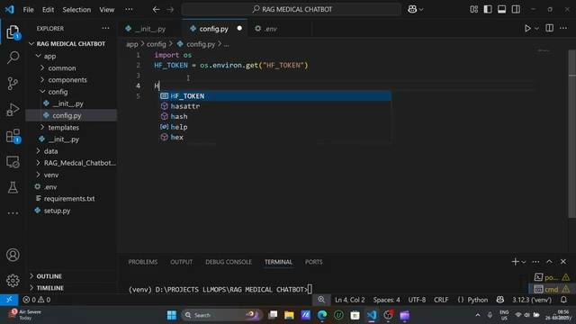

### 5.2 `config.py`

`load_dotenv()` 负责把 `.env` 里的键值读进环境变量。逐字稿只写了 `os.environ.get("HF_TOKEN")`，但没有这行时，Python 进程通常读不到 `.env` 文件，`HF_TOKEN` 会是 `None`；所以复现时必须加。`DATA_PATH = "data"` 是相对项目根目录的 PDF 目录；`DB_FAISS_PATH = "vectorstore/db_faiss"` 是 FAISS 保存目录；`CHUNK_SIZE = 500`、`CHUNK_OVERLAP = 50` 对应讲师在 P004 给的具体数值。`HUGGINGFACE_REPO_ID` 是 P004 让复制的 Mistral 模型名，但本节没有调用它；它属于后面 LLM 对话部分。常见错误是把相对路径理解成相对 `config.py` 文件本身，实际上它通常相对你运行命令的当前工作目录，所以验证脚本要在项目根目录运行。前端对照：配置集中化类似前端项目里的环境变量和构建配置，不要让每个组件各写一份路径。

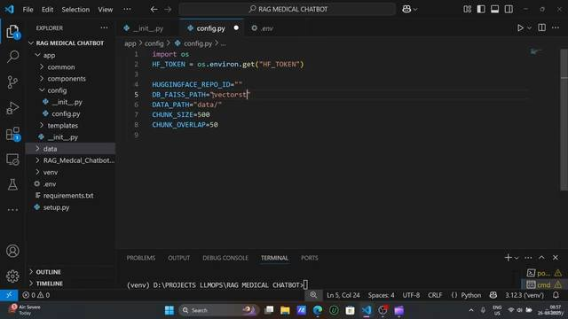

### 5.3 `PDFLoader.load_pdf_files()`

先判断 `data/` 是否存在。不存在就抛自定义异常，避免后面 `DirectoryLoader` 报一个不直观的路径错误。`DirectoryLoader(DATA_PATH, glob="*.pdf", loader_cls=PyPDFLoader)` 的意思是：扫描 `data/`，只匹配 `.pdf` 结尾的文件，每个文件交给 `PyPDFLoader` 解析。`loader.load()` 返回 document 列表。没有文档时打 warning，有文档时打数量。异常时返回空列表，让上层用 `if not documents` 判断，而不是直接崩溃。常见错误是 PDF 放在 `data` 外、文件名后缀不是小写 `.pdf`、或者目录存在但里面没有 PDF；排查时先看日志里的 `Loading files from data` 和 `Successfully fetched N documents`，再看 `glob` 是否匹配。前端对照：这类似静态资源加载器，先校验目录，再按扩展名过滤文件，最后返回资源列表。

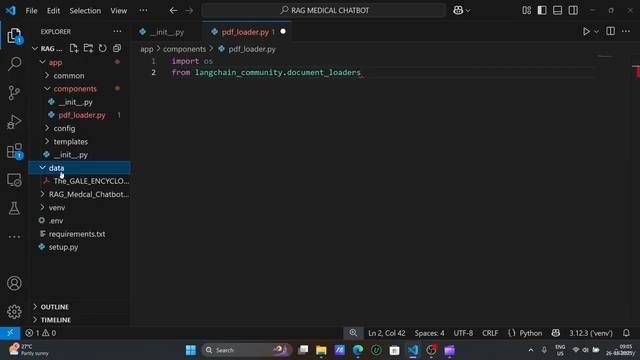

### 5.4 `PDFLoader.create_text_chunks()`

先检查 `documents` 是否为空。`RecursiveCharacterTextSplitter(chunk_size=500, chunk_overlap=50)` 表示每块目标 500 个字符，相邻块重叠 50 个字符。重叠的作用是避免一句话被切断后语义丢失。`split_documents(documents)` 会把每个 document 切分成多个 chunk，返回 `text_chunks`。最后打印生成数量并返回。常见错误是 `documents` 为空却继续切分，或者 PDF 是扫描图片导致文本为空，最终 `chunks` 为 0；排查时分别打印 `len(documents)` 和 `len(text_chunks)`。前端对照：chunk 类似把长文本切成可检索的片段，`chunk_size` 和 `chunk_overlap` 类似分页大小与重叠区，参数过小会碎片化，过大则检索粒度变粗。

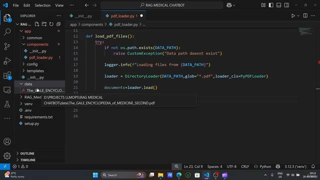

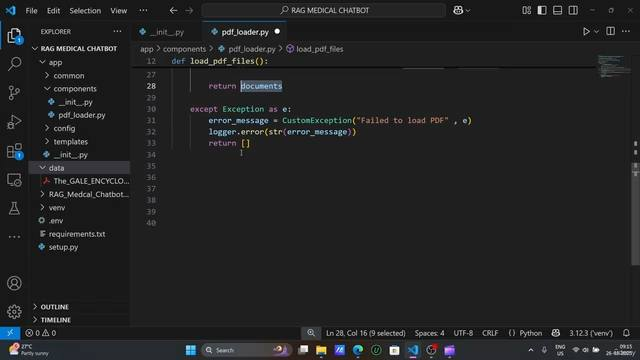

### 5.5 `embeddings.py`

`HuggingFaceEmbeddings(model_name="sentence-transformers/all-MiniLM-L6-v2")` 会加载一个轻量 embedding 模型。讲师在 P006 说 chunks 不能直接给 LLM，必须先转成 embedding；这个模型就是负责把文本转成向量。模型名必须写准确，讲师口述的 “all mini llm l6 v2” 实际对应 `all-MiniLM-L6-v2`，拼错会下载失败。异常时构造 `CustomException` 并 `raise`，让调用方知道 embedding 模型没有加载成功。常见错误是网络无法访问 Hugging Face、token 权限不足、模型名大小写或连字符写错；排查时看日志是否停在 `Initializing Hugging Face embedding model`，再看是否能成功下载模型缓存。前端对照：embedding 模型类似把文本转换成可计算特征的“编译器”，模型名相当于依赖包名，不能靠猜。

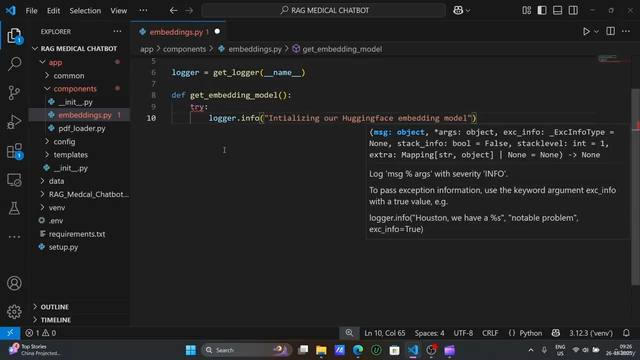

### 5.6 `vector_store.load_vector_store()`

先加载 embedding 模型，因为 FAISS 加载索引时要用同一个 embedding 模型。`os.path.exists(DB_FAISS_PATH)` 判断本地是否已有向量库目录。存在就调用 `FAISS.load_local(DB_FAISS_PATH, embedding_model, allow_dangerous_deserialization=True)`。`allow_dangerous_deserialization=True` 是因为 FAISS 本地加载涉及反序列化，讲师在 P007 明确让你允许这个参数；只加载你自己生成的目录，不要加载来路不明的索引。目录不存在时打 warning 并返回 `None`。常见错误是保存路径和加载路径不一致、索引目录被手动删了一半、或者没有传允许反序列化参数；排查时先确认 `vectorstore/db_faiss/` 是否存在，再看 `DB_FAISS_PATH` 是否被改过。前端对照：这类似从本地缓存恢复状态，缓存不存在时返回空，而不是直接崩溃。

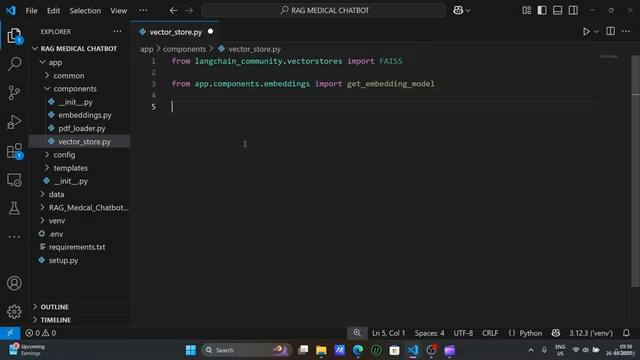

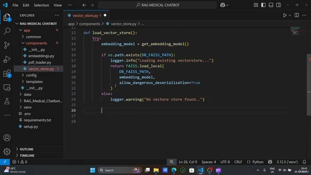

### 5.7 `vector_store.save_vector_store()`

先检查 `text_chunks` 是否为空。然后加载 embedding 模型，调用 `FAISS.from_documents(text_chunks, embedding_model)` 创建索引。`db.save_local(DB_FAISS_PATH)` 把索引写到 `vectorstore/db_faiss/`。最后返回 `db`。异常时返回 `None`，这样 `build_once.py` 可以判断保存是否失败。常见错误是 chunk 为空、embedding 模型未加载、保存目录没有写权限；排查时看日志是否出现 `Generating your new vector store`、`Saving vector store` 和 `Vector store saved successfully`。前端对照：这类似把构建产物写入本地缓存目录，写入后还要能再次读取，才算真正完成。

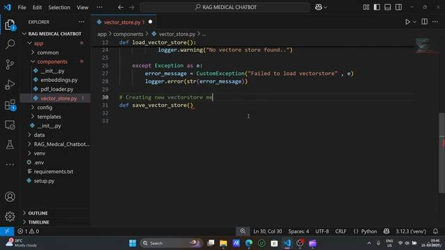

### 5.8 `build_once.py`

这是课里没有的验证脚本。它按顺序调用 `load_pdf_files()`、`create_text_chunks()`、`save_vector_store()`、`load_vector_store()`。如果 chunk 为空或保存失败，用 `SystemExit` 终止，避免你误以为已经成功。打印 `vector store loaded: True` 才说明“保存后还能重新加载”。常见错误是只看到 `chunks` 有数字就认为成功，却没有检查 `load_vector_store()` 的返回值；排查时可以把每个阶段的数量和返回值都打印出来，按数据流逐段定位。前端对照：这类似端到端 smoke test，单独模块测试通过不代表整体链路通过，必须从输入到输出完整跑一遍。

---

## 6. 复现检查清单

- [ ] 项目根目录有 `requirements.txt`，不是 `requirements.pxt`。验证：在项目根目录执行 `ls`（macOS/Linux）或 `dir`（Windows），确认文件名完全一致；如果拼错，`pip install -e .` 会在读取依赖清单时失败。
- [ ] 虚拟环境已激活，终端提示符前有 `(venv)`。验证：看提示符；或执行 `python -c "import sys; print(sys.prefix)"`，输出路径应指向项目下的 `venv`。
- [ ] 已执行 `pip install -e .`，没有报依赖解析失败。验证：重新执行一次并观察最后是否有 `Successfully installed`；再执行 `python -c "import langchain, faiss, pypdf; print('ok')"` 检查关键包可导入。
- [ ] `app/`、`app/common/`、`app/components/`、`app/config/` 下都有 `__init__.py`。验证：用文件管理器或 `find app -name "__init__.py"` 检查每个目录是否都有该文件。
- [ ] 每次新增 `__init__.py` 后重新执行过 `pip install -e .`。验证：执行 `python -c "from app.components.PDFLoader import load_pdf_files; print('import ok')"`，如果能导入说明包路径已更新。
- [ ] `.env` 里 `HF_TOKEN` 已填，且没有提交到 Git。验证：执行 `python -c "from dotenv import load_dotenv; load_dotenv(); import os; print(bool(os.environ.get('HF_TOKEN')))"`，应输出 `True`；再检查 `.gitignore` 是否忽略 `.env`。
- [ ] `data/` 下至少有一个 `.pdf` 文件。验证：执行 `ls data` 或 `dir data`，确认存在 `.pdf` 文件，且路径大小写与 `glob="*.pdf"` 匹配。
- [ ] `python -c "from app.config.config import DATA_PATH; print(DATA_PATH)"` 能打印 `data`。验证：直接运行该命令，输出应为 `data`；如果不是，检查 `config.py` 是否被改过或是否导入了错误模块。
- [ ] `python -c "from app.components.PDFLoader import load_pdf_files; print(len(load_pdf_files()))"` 能打印文档数，且不是 0。验证：运行命令并观察日志；如果为 0，先检查 `data/` 和 PDF 后缀，再检查 PDF 是否可读。
- [ ] `python build_once.py` 能打印 `documents`、`chunks`、`vector store loaded: True`。验证：在项目根目录运行，逐行看输出；`chunks` 为 0 时先查 PDF 文本提取，`loaded` 为 False 时查保存路径和加载参数。
- [ ] 项目根目录出现 `vectorstore/db_faiss/`。验证：执行 `ls vectorstore/db_faiss` 或 `dir vectorstore\db_faiss`，确认目录存在且不是空目录。
- [ ] `logs/app.log` 有日志输出。验证：打开 `logs/app.log`，应能看到加载 PDF、切 chunk、保存向量库等日志；如果没有，检查 `logger.py` 是否创建 `logs` 目录以及是否调用了 `get_logger`。
- [ ] 第二次运行 `python build_once.py` 时，`load_vector_store()` 仍能加载已有索引。验证：第一次运行生成索引后，再运行一次，观察 `vector store loaded: True` 是否仍然成立。

如果 `chunks` 是 0，优先检查 PDF 是否为扫描图片版；`pypdf` 对纯图片 PDF 提取不到文字，课里没有讲 OCR。

---

## 7. 课里没讲但你会撞上的

| 现象 | 原因 | 怎么办 |
| --- | --- | --- |
| 安装 `faiss-cpu` 或 `sentence-transformers` 失败 | 本机 Python 版本过新，可能没有现成 wheel；或依赖解析冲突 | 建议用 Python 3.10 或 3.11 重建虚拟环境，再执行 `pip install -e .`；不要在同一环境里反复混装不同版本 |
| Windows 下 `python -m venv venv` 弹出 Microsoft Store | `python` 命令指向了 Microsoft Store 别名，不是真实解释器 | 改用 `py -3.11 -m venv venv` 这类明确版本命令；建好后用 `py -3.11 -m pip install -e .` 或先激活环境再安装 |
| Windows 下激活命令不生效 | cmd 和 PowerShell 的激活脚本不同；PowerShell 还可能受执行策略限制 | cmd 用 `venv\Scripts\activate`；PowerShell 用 `.\venv\Scripts\Activate.ps1`；激活后再运行 `python build_once.py`，不要跳过激活直接装包 |
| `pip install -e .` 报找不到 `requirements.txt` | 文件名拼成了 `requirements.pxt`，或命令不在项目根目录执行 | 把文件名改回 `requirements.txt`，进入项目根目录后再执行；用 `dir`/`ls` 确认文件位置 |
| 导入 `app` 时报 `ModuleNotFoundError` | 缺少 `__init__.py`，或新增目录后没有重新执行 `pip install -e .` | 补齐各级 `__init__.py`，重新执行 `pip install -e .`，再用 `python -c "import app; print(app)"` 验证 |
| `HF_TOKEN` 读到的是 `None` | `.env` 不在根目录、变量名拼错、token 前后有空格，或 `config.py` 没有调用 `load_dotenv()` | 确认 `.env` 在项目根目录；在 `config.py` 中调用 `load_dotenv()`；用 Python 命令打印 `bool(os.environ.get("HF_TOKEN"))` 验证 |
| Hugging Face 模型下载失败或报权限错误 | token 无效、权限不对、网络无法访问，或模型名拼错 | 重新创建 token 并填入两个变量；确认模型名为 `sentence-transformers/all-MiniLM-L6-v2`；先检查网络和日志中的具体报错 |
| `documents` 为 0 | `data/` 路径不对、目录里没有 PDF、`glob` 不匹配，或 PDF 文件损坏 | 确认在项目根目录运行；检查 `data/` 下是否有 `.pdf`；打印 `DATA_PATH` 和目录内容；必要时换一个小 PDF 测试 |
| `chunks` 为 0 | PDF 是扫描图片版，`pypdf` 提取不到文字；或 documents 本身为空 | 换文字版 PDF 测试；先确认 `documents` 不为 0；课里没有讲 OCR，不要在本节强行处理图片文字 |
| `FAISS.load_local` 报反序列化相关错误 | 没有传 `allow_dangerous_deserialization=True`，或索引目录损坏 | 按代码传该参数；如果索引目录被手动改过，删除 `vectorstore/db_faiss/` 后重新运行 `build_once.py`；只加载自己生成的索引 |
| 第二次运行仍显示未加载向量库 | `DB_FAISS_PATH` 与保存路径不一致，或当前工作目录不对 | 统一使用 `config.py` 里的 `DB_FAISS_PATH`；在项目根目录运行；确认 `vectorstore/db_faiss/` 真实存在 |
| `logs/app.log` 没有生成 | `logs/` 目录没创建、没有调用 `logger.py`，或运行目录不对 | 确认 `logger.py` 中有 `os.makedirs("logs", exist_ok=True)`；在项目根目录运行；检查组件是否调用了 `get_logger(__name__)` |
| 相对路径导致找不到 `data` 或 `vectorstore` | `DATA_PATH`、`DB_FAISS_PATH` 是相对当前工作目录的，不是相对某个源码文件 | 始终在项目根目录执行脚本；如果要从别处运行，可把路径改成基于项目根目录的绝对路径 |
| 第一次 embedding 很慢或内存占用高 | 模型需要下载和加载，FAISS 建索引也需要资源 | 先用几页的小 PDF 跑通链路，再换完整医学 PDF；关闭不必要的程序，观察终端日志确认卡在下载还是建索引 |
| 看到 `allow_dangerous_deserialization` 的安全警告 | FAISS 本地加载涉及反序列化，存在安全风险 | 只加载自己生成的 `vectorstore/db_faiss/`，不要加载来源不明的索引；理解参数含义后再使用 |