# LLMOps & AIOps Bootcamp｜P030–P033：把多智能体项目接上 AWS CI/CD（ECR → ECS Fargate → 清理 → 下一项目预览）

> 覆盖 P030 / P031 / P032 / P033。前三个是同一件事的三段：**构建镜像并推到 ECR → 部署到 ECS Fargate 并接进流水线 → 收尾清理**；P033 是下一个项目（AI 动漫推荐器）的**纯讲解型项目预览**，课里没有代码，本文按「设计决策表 + 组件职责表」的形式落地。
>
> **转写纠正表**（逐字稿是自动转写，先把名词对齐再读，否则容易卡住）：
> `grog cloud → Groq Cloud`｜`mini cube / minicube → minikube`｜`cube cuttle / tube cuttle → kubectl`｜`promo / promo dv / kumma dv → Chroma / ChromaDB`｜`Zinc and Spike line → Jenkins pipeline`｜`ngrock → ngrok`｜`gilfana → Grafana`｜`tably / table API key → 讲师未给出确定拼写，以你 .env 实际键名为准`。
>
> **重要边界**：本节视频里，Jenkinsfile 是「取消注释 + 改几个变量」，讲师从头到尾**没有逐行展示过完整 Jenkinsfile 内容**，AWS 相关的安装命令是「照文档一条条粘」，也没有完整念出。因此本文第四节的 Jenkinsfile / Dockerfile / 脚本属于**按逐字稿描述复原的可运行版本**，每一段都标注了「课里给了什么 / 哪部分是复原」。复原 ≠ 编造，但你要知道哪一行是原话、哪一行是我替你补的。

---

## 一、这一节做什么

到 P029 为止，你手上应该已经有一个**能本地 docker 跑起来的多智能体应用**：Streamlit 做前端（端口 **8501**），FastAPI 做后端（端口 **9999**），代码在 GitHub，Jenkins 跑在本地 WSL 的容器里，前面几条流水线阶段（拉代码、SonarQube 扫描）已经通了。

这一节要做的是把它**从「本地能跑」推到「云上能跑，而且是流水线推的」**，具体三个交付物：

| 视频 | 交付物 | 验收标准 |
|---|---|---|
| P030 | Jenkins 能构建镜像并推到 **AWS ECR** | ECR 仓库里出现一个 `latest` 标签的镜像（课里实测约 **305 MB**） |
| P031 | ECS **Fargate** 上跑起这个镜像，并且把「更新服务」接进 Jenkinsfile | 浏览器打开 `http://<任务公网IP>:8501` 能看到 Streamlit 页面；改一行 UI → 跑流水线 → 页面变化 |
| P032 | 清理 AWS 资源 + 清理本地 Docker | cluster / ECR repo 删掉；`docker system prune -a --volumes -f` 回收空间 |
| P033 | 下一项目（AI 动漫推荐器）的技术栈与工作流预览 | 能说出 RAG 链路、minikube/kubectl 的分工、Grafana Cloud 监控接在哪 |

**这一节的关键认知**（也是讲师在 P031 结尾反复强调的）：你在 P031 里**手工**在 ECS 控制台创建服务时选了某个具体镜像 URI，所以那是一次**手动部署**；之后哪怕你把代码 push 到 GitHub，页面也不会变。只有把 `aws ecs update-service`（force new deployment）这一步接进 Jenkinsfile，才形成「push 代码 → 拉代码 → 扫描 → 构建 → 推 ECR → 更新 ECS 服务 → 新 task 拉取最新镜像」这条链。

---

## 二、讲师原话

> "ECR 是一个用来存放 Docker 镜像的平台。Docker 镜像不能随便存放在任何环境里，你需要有 Docker 环境才能存放 Docker 镜像。"
> —— p030 [00:00]
> （中译：ECR 就是存 Docker 镜像的地方。镜像不能随便存在任何环境里，你需要一个「Docker 环境」来存它。）

> "现在，你还得在 Jenkins 容器里安装 AWS CLI。"
> —— p030 [00:58]

> "这里显示的是 AWS CLI 2.27、Python 3.13，说明 AWS CLI 已经安装成功。"
> —— p030 [02:24]
> （这是你装成功后应该看到的版本号形态，具体小版本号以你机器实际输出为准。）

> "既然做了修改……我们得重启 Jenkins 容器。"
> —— p030 [02:52]

> "就像你为 GitHub 做的那样，就像你为 SonarQ 做的那样，现在你正在为 AWS 做同样的配置。"
> —— p030 [06:42]

> "你得创建一个仓库……并确保它是可变的。"
> —— p030 [08:09]

> "首先登录你的 AWS 账户……然后用 Dockerfile 构建整个项目的 Docker 镜像……再把它打上 latest 标签……最后推送到 ECR。"
> —— p030 [10:31]
> （这就是 build & push 阶段四条命令的分工：login → build → tag → push。）

> "绿色对勾并不代表我们已经成功，所以再仔细检查确认一下……我们拿到了一个最新的构建镜像……大小约为 305 MB。"
> —— p030 [13:20]

> "基本上，AWS Fargate 是一种无服务器部署选项。"
> —— p031 [00:58]

> "这里的 8501 是给 Streamlit 用的，9999 是给 FastAPI 用的。"
> —— p031 [03:51]

> "为什么要这么做？因为我们还没有把环境文件推送到 GitHub，所以只能单独配置它。"
> —— p031 [04:49]
> （所以 ECS task definition 里要手动加环境变量，而不是指望 `.env` 从仓库里带过去。）

> "出现了一个错误，提示访问被拒绝异常……这基本上和你的用户有关。"
> —— p031 [14:49]

> "有一个还在等待……前面这个目前正在运行。"
> —— p031 [16:45]
> （ECS 换版本是「新 task 先起、旧 task 后停」，中间有 2–4 分钟的窗口。）

> "你的 AWS 是一个在线平台……但你的 Jenkins 运行在 WSL 上，而 WSL 又在你的电脑上……所以你无法把本地环境和在线平台连接起来。"
> —— p031 [20:58]
> （这就是为什么本节**不能**做到「push 代码自动触发流水线」，要点 Build Now。）

> "你会被收取高额费用；如果你让那个集群一直运行的话……"
> —— p032 [00:00]

> "Grafana Cloud 是这个项目最重要的技术栈。"
> —— p033 [01:50]

---

## 三、从零复现

### 3.0 前置检查（不满足就别往下走）

| 前置 | 怎么确认 | 课里是否讲过 |
|---|---|---|
| Jenkins 在 WSL 的 Docker 容器里跑着，能打开 Web UI | 浏览器打开 `http://localhost:8080` | 讲的（P031 明确说 Jenkins 跑在 WSL/本地 PC） |
| 容器名 | `docker ps` 看名字，课里就叫它 `jenkins` | 命令未逐字展示 |
| 仓库根目录已有 `Dockerfile` | `ls Dockerfile` | 讲的（说「this is your project Docker file」） |
| 已有 GitHub 凭证、SonarQube 凭证 | 管理 Jenkins → Credentials → System → Global | 讲的 |
| 有 AWS 账号 | 能登录控制台 | 讲的（提到 AWS 有免费额度期） |
| `.env` 里有 Groq key 和第二个搜索类 key | `cat .env` | 讲的（但键名拼写未给出确定形式） |

仓库形态（除这四个文件外，其余文件名课里没讲，按你自己的仓库来）：

```
multi-ai-agent/
├── Jenkinsfile        # 本节唯一要改的文件
├── Dockerfile         # 前序课程建好的，本节直接复用
├── .env               # 绝不提交！讲师明确说没 push 到 GitHub
├── .gitignore         # 建议，确保 .env 在里面
├── app.py             # Streamlit 入口（8501）
└── ...                # FastAPI（9999）等其他文件，课里没讲名字
```

### 3.1 装 Jenkins 插件（P030 [00:29]）

管理 Jenkins → **Plugins** → **Available plugins** → 搜索框输入 `AWS`：

- 勾选 **AWS Credentials**（凭证类型要用它，后面建「AWS Credentials」类型凭证才有选项）
- 再勾选名称里带 **AWS SDK** 的那个（讲师原话是「AWS credentials… and then… AWS SDK… just select these two」；具体显示名以你插件市场的搜索结果为准）
- Install → 两个都等它变绿

### 3.2 进 Jenkins 容器装 AWS CLI（P030 [00:58]）

先在 **WSL 终端**（就是跑 Jenkins 的那个 WSL 发行版）里进容器：

```bash
# 容器名以 docker ps 实际输出为准，课里叫 jenkins
docker exec -it jenkins bash
```

> 逐字稿只说「按文档里的命令一条条粘进去」，**没有念出这条 exec 命令**。上面的 `docker exec -it <容器名> bash` 是标准进入方式，容器名从 `docker ps` 拿。

进去之后（提示符会变成容器内的 root），按顺序执行（**逐字稿说「one by one」，别一把全粘**）：

```bash
apt update
apt install -y curl unzip
curl "https://awscli.amazonaws.com/awscli-exe-linux-x86_64.zip" -o "awscliv2.zip"
unzip awscliv2.zip
./aws/install
aws --version
```

> 前三步（update / 装 curl+unzip）是讲师明确点名的。**下载 URL、`unzip`、`./aws/install` 的具体写法课里没有念出来**（他说「照着文档里的命令复制」），上面是 AWS 官方的 Linux x86_64 安装步骤，和课上目标等价。

`aws --version` 期望输出形如 `aws-cli/2.27.x Python/3.13.x ...`（讲师看到的是 2.27 / Python 3.13，你的小版本可能不同）。

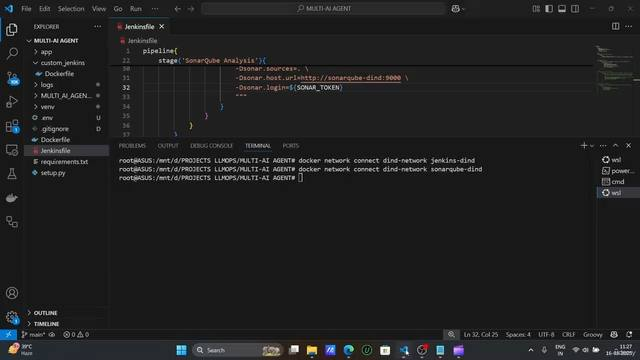

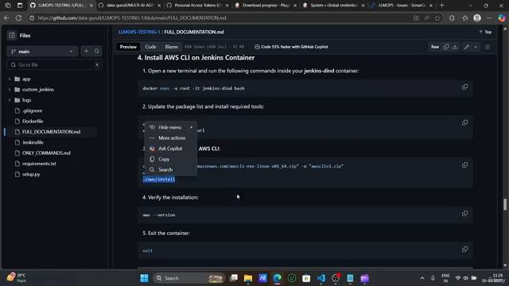

### 3.3 退出并重启容器（P030 [02:52]）

```bash
exit
docker restart jenkins
```

重启后刷新 Jenkins 页面，等它起来。**为什么要重启**：你改的是容器内部的文件系统，`docker restart` 只重启进程、不销毁容器，所以装进去的 CLI 还在——这一点后面「复现检查清单」会再验一次。

### 3.4 AWS 侧：建 IAM 用户（P030 [04:47]）

控制台搜索 **IAM** → 左侧 **Users** → **Create user**：

1. 用户名随意，课里叫 `multi-ai-agent` 之类
2. Next → **Attach policies directly**
3. 搜 `ECR` → 勾选 **AmazonEC2ContainerRegistryFullAccess**（讲师念成「EC2 container registry」，就是这个）
4. Create user

创建成功后打开这个用户 → 上方 **Create access key** → 选 **Command Line Interface (CLI)** → 勾「I understand the above recommendation」→ Next → Create。**把 Access Key 和 Secret Key 留在页面上**（离开就看不到了）。

### 3.5 Jenkins 里加 AWS 凭证（P030 [06:42]）

管理 Jenkins → **Credentials** → **System** → **Global credentials (unrestricted)** → **Add Credentials**：

| 字段 | 填什么 |
|---|---|
| Kind | **AWS Credentials**（这就是 3.1 装插件的理由） |
| ID | `aws-token`（课里起名「AWS token」；这个 ID 后面要原样抄进 Jenkinsfile，**大小写敏感**） |
| Description | 随便，课里写「AWS token」 |
| Access Key ID | 3.4 拿到的 Access Key |
| Secret Access Key | 3.4 拿到的 Secret Key |

Save。到这里你的 Jenkins 里应该有三个凭证：GitHub、SonarQube、AWS。

### 3.6 建 ECR 仓库（P030 [08:09]）

AWS 控制台搜 **ECR**（Elastic Container Registry）→ **Create repository**：

- 名字课里叫 `my repo` 语义的名字（本文统一写 `my-repo`，你换成自己的）
- **重要**：Mutability 选 **Mutable**（讲师原话「make sure it is mutable」；原因是后面反复 push `latest` 同一个 tag，immutable 会拒绝覆盖）
- 加密保持默认
- Create

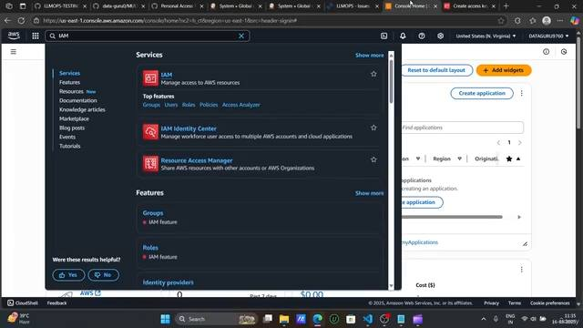

### 3.7 改 Jenkinsfile：三处（P030 [08:57] – [10:04]）

打开 VS Code，在 Jenkinsfile 里做三件事：

**(1) 取消注释环境变量三个**（讲师原话「just uncomment these three also」）：

```groovy
AWS_REGION    = 'us-east-1'   // 你的 region 看 ECR URL，课里是 us-east-1
ECR_REPO_NAME = 'my-repo'     // 3.6 建的仓库名
IMAGE_TAG     = 'latest'
```

**(2) 取消注释 build & push 阶段**（Ctrl + `\` 是 VS Code 注释/取消注释快捷键）。

**(3) 把阶段里的凭证 ID 换成 `aws-token`**（讲师：「whatever name you have given inside this bracket, just copy paste it here」）。

保存。**注意**：讲师这一步只是「取消注释 + 改三个变量」，所以**你仓库里原本被注释掉的那段就是你该用的版本**；如果你没有那段（比如你没跟着前面 P 走），用第四节那份复原版。

### 3.8 push 并跑第一次构建（P030 [11:57]）

```bash
git add .
git commit -m "enable build and push to ECR"
git push
```

Jenkins → 你的 pipeline（课里叫 `multi-agent`）→ **Build Now** → 点开 **Console Output**。日志里会依次看到：拉 GitHub → Sonar 扫描 → `Login Succeeded`（docker login）→ 构建层 → push 层。这一步**慢**，讲师原话是「have a popcorn and enjoy」。

### 3.9 验 ECR（P030 [13:20]）

**绿灯不等于成功**，讲师原话「green tick doesn't mean we are successful」。去 ECR → 你的仓库 → 应该看到：

- 一个 `latest` 标签的镜像
- 大小约 **305 MB**
- 旁边有创建时间、可以 Copy Image URI

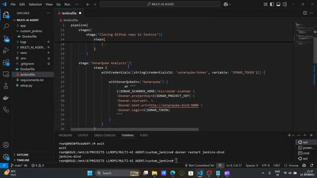

### 3.10 建 ECS Cluster（P031 [00:29]）

AWS 搜 **ECS**（Elastic Container Service）→ 左侧 **Clusters** → **Create cluster**：

- 名字：`multi-ai-agent-cluster`（后面 Jenkinsfile 要用，记准）
- 基础设施：勾 **AWS Fargate**（Serverless，不碰 EC2）
- 其余默认 → Create

### 3.11 建 Task Definition（P031 [01:27]）

等 cluster 创建完 → 左侧 **Task definitions** → **Create new task definition**：

| 字段 | 填什么 |
|---|---|
| Task definition family 名 | `multi-ai-agent-definition`（课里叫 multi ai agent def） |
| Launch type / 基础设施 | **AWS Fargate** |
| OS | **Linux** |
| CPU | **2 vCPU** |
| Memory | **6 GB** |
| Task role | 课里说「keep it like this only right now」，即先保持默认 |
| Container 名 | `llmops`（课里叫 LLM ops；这个名字后面 Jenkinsfile 里会用到，记准） |
| Image URI | 从 3.9 的 ECR 页面 Copy Image URI 粘进来 |
| Essential container | **Yes** |

**Port mappings**（讲师专门强调「This is important」）：

| 容器端口 | 协议 | 用途 |
|---|---|---|
| 8501 | TCP | Streamlit |
| 9999 | TCP | FastAPI |

> 注意：控制台默认会先给一个 port mapping，你要**再 Add port mapping** 把 8501 和 9999 都加上。逐字稿里讲师的操作是「第一个保持默认，然后再加两个」。

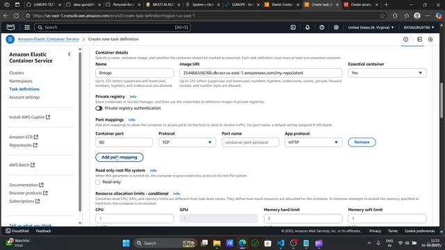

**Environment variables**（讲师解释了为什么必须手动加：`.env` 没进 GitHub）：

| Key | Value |
|---|---|
| `GROQ_API_KEY` | 你 `.env` 里的 Groq key |
| 第二个搜索类 key（讲师口述为「tably / table API key」，**逐字稿没有给出确定拼写**） | 你 `.env` 里对应的值 |

> **诚实提醒**：第二个键的准确拼写课里没有明确念清（转写成 tably/table）。你的 `.env` 里写的是什么就填什么，容器内的代码读的是同一个名字，别自己改名。

Create → 创建成功。

### 3.12 建 Service（P031 [05:47]）

进 cluster → **Services** → **Create**：

- Task definition：`multi-ai-agent-definition`（revision 自动选最新）
- Service 名：课里保持默认，**记准它**（后面 Jenkinsfile 要用；本文写 `multi-ai-agent-service` 占位，改成你实际的）
- Desired tasks / replica：保持默认
- **Networking**：**Public IP 打开（Turn on）** —— 讲师连说了两遍「make sure it is turned on」
- 安全组：选 **default** 那个（下一步要改它的入站规则）
- Create（这一步要 **5–10 分钟**）

### 3.13 改安全组入站规则（P031 [06:50] – [08:39]）

AWS 搜 **Security groups** → 打开你服务用的那个（default）→ **Edit inbound rules**：

删掉/不要那两条不存在的新规则，重新 Add rule 两条：

| Type | Protocol | Port range | Source |
|---|---|---|---|
| Custom TCP | TCP | `8501` | `0.0.0.0/0`（Anywhere-IPv4） |
| Custom TCP | TCP | `9999` | `0.0.0.0/0`（Anywhere-IPv4） |

Save rules。

**必须回查一致性**：cluster → 你的 service → 确认它用的就是你刚改的这个安全组（讲师在 [08:39]–[09:08] 专门停下来核对了一次）。

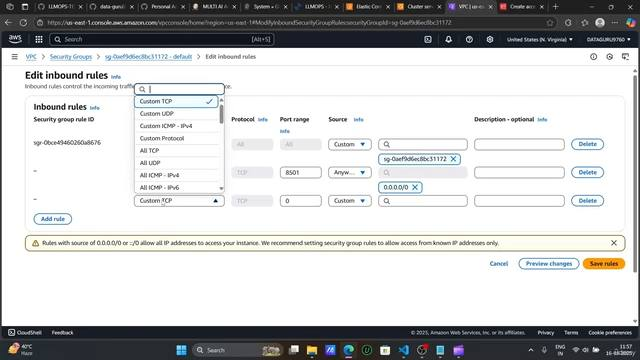

### 3.14 改 Jenkinsfile 加部署阶段（P031 [09:37]）

取消注释最后一个阶段，并把两个变量换成你实际的：

```groovy
CLUSTER_NAME = 'multi-ai-agent-cluster'
SERVICE_NAME = 'multi-ai-agent-service'   // 换成 3.12 里你实际的服务名
```

凭证 ID 同 3.5 的 `aws-token`。保存 → `git add / commit / push`（P031 [11:04]）。

### 3.15 第一次部署会报 Access Denied（P031 [14:49]）—— 这是必须踩的坑

跑 Build Now，部署阶段会失败，日志里是 **access denied exception**。修法：IAM → 你 3.4 建的那个用户 → **Add permissions** → Attach policies directly → 搜 `ECS` → 勾 **AmazonECS_FullAccess** → Next → Add permissions。

再跑一次 Build Now，通过。

### 3.16 验证「CI/CD 真的生效了」

1. ECS → cluster → service → **Tasks**：会看到**新的 task 处于 PENDING**，旧 task 还在 RUNNING；等 2–4 分钟旧的下线、新的变 RUNNING。
2. 新 task 的公网 IP **变了**（每次新 task 都变），复制新 IP → 浏览器打开 `http://<新IP>:8501`。
3. 做个对照组实验（讲师在 [12:55]–[14:49] 做的就是这个）：
   - 改一处 UI 文案 → 只 `git push` → **页面不变**（证明手动部署不会跟着代码走）
   - 再跑一次 Build Now → 等 task 切换 → 刷新页面 → **页面变了**

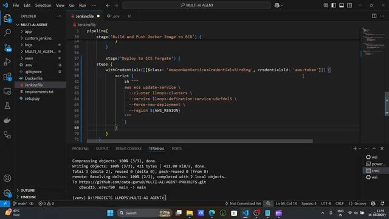

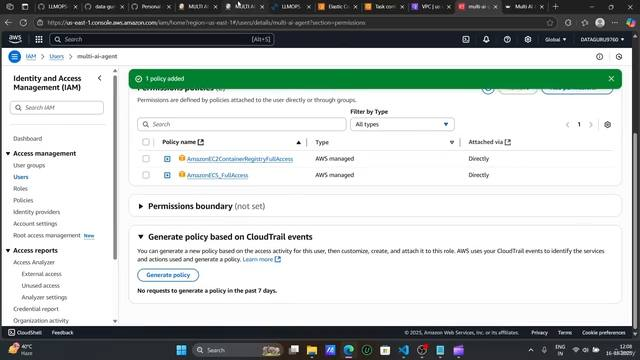

### 3.17 清理（P032）

```bash
# 1) AWS 上删 cluster（控制台会让你输入一段确认文字再删，照它显示的打进去）
#    Clusters → 你的 cluster → Delete cluster
# 2) 删 ECR 仓库：ECR → 选中 my-repo → Delete
# 3) IAM 用户可删可不删（讲师说不计费，可选）
```

本地清 Docker（在 **WSL/Ubuntu** 里跑，不要在 Jenkins 容器里跑）：

```bash
docker system prune -a --volumes -f
```

讲师实测输出形如「deleted all the images… **1.765 GB of space have been reclaimed**」（具体数字以你机器为准）。

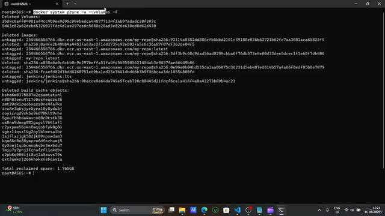

### 3.18 P033：下一个项目（AI 动漫推荐器）—— 纯讲解，无代码

这一段**没有代码可跑**，产出是两张表（见第四节 4.5 / 4.6）。链路按讲师在 [02:19]–[03:18] 讲的顺序复原：

```
CSV（anime 名称 / synopsis / genre，约 1000 行）
   → 逐行转成 Document（约 1000 个 document）
      → HuggingFace embedding model 转成向量
         → 存进 Chroma 向量库（持久化）
            → 用户 query 进来 → LangChain → Groq 上的 Llama 模型 → 推荐 3 部动漫
               → Streamlit 做界面 → Docker 容器化 → minikube(k8s) 部署 → Grafana Cloud 监控
```

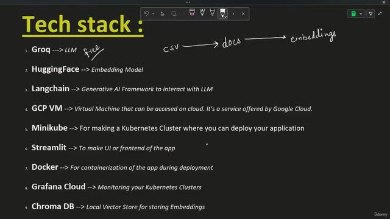

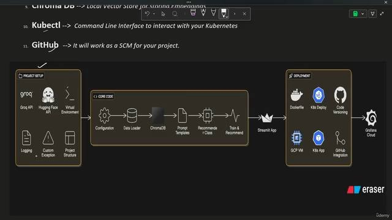

---

## 四、完整代码

> 再次声明：**课里没有完整展示 Jenkinsfile**（讲师是取消注释 + 改 3 个变量 + 改 2 个名字）。下面 4.1 是把你仓库里「被注释的那段」按逐字稿描述复原成一份能跑的等价物；4.2 的 Dockerfile 课里也没展示内容。凡是我补的，都在代码块上方写了「复原说明」。

### 4.1 `Jenkinsfile`（放在仓库根目录）

```groovy
// ============================================================
// P030 + P031 复原版 Jenkinsfile
// 课里给了什么：四个 stage 的顺序（GitHub 拉代码 / SonarQube / build&push / update service）
//               env 里三个变量（AWS_REGION / ECR_REPO_NAME / IMAGE_TAG）
//               build&push 阶段的四条动作：login → build → tag → push
//               部署阶段的 update-service + cluster 名 + service 名
// 课里没给什么：registry 地址怎么拼、--force-new-deployment、container 名怎么用
//              → 这几处是复原写法，注释里已标 [复原]
// ============================================================
pipeline {
    agent any

    environment {
        // ↓ 这三个是课里明确「取消注释并改值」的三个
        AWS_REGION    = 'us-east-1'
        ECR_REPO_NAME = 'my-repo'
        IMAGE_TAG     = 'latest'

        // ↓ 凭证 ID：课里说「括号里那个名字原样抄」
        AWS_CREDS_ID  = 'aws-token'

        // ↓ 这两个是 P031 部署阶段要改成实际的 cluster / service 名
        CLUSTER_NAME   = 'multi-ai-agent-cluster'
        SERVICE_NAME   = 'multi-ai-agent-service'
        CONTAINER_NAME = 'llmops'          // P031 创建 task definition 时给容器起的名字
    }

    stages {

        stage('GitHub Checkout') {
            steps {
                // 课里只说「first of all it will be doing the GitHub integration」
                // 具体用 git 还是 GitHub 插件，课里没讲；下面是等价写法
                checkout scm
            }
        }

        stage('SonarQube Analysis') {
            steps {
                // 沿用前序课程的 Sonar 配置；本节没有改动这一段的细节
                // 如果你前面没配过，先注释掉这个 stage，不影响本节结论
                echo 'SonarQube analysis (配置沿用前面课程, 本节未讲解)'
            }
        }

        stage('Build & Push to ECR') {
            steps {
                withCredentials([[
                    $class: 'AmazonWebServicesCredentialsBinding',
                    credentialsId: "${AWS_CREDS_ID}",
                    accessKeyVariable: 'AWS_ACCESS_KEY_ID',
                    secretKeyVariable: 'AWS_SECRET_ACCESS_KEY'
                ]]) {
                    sh '''
                        set -e

                        # [复原] 课里没展示 registry 地址怎么来；标准做法是查账号 ID
                        ACCOUNT_ID=$(aws sts get-caller-identity --query Account --output text)
                        REGISTRY="${ACCOUNT_ID}.dkr.ecr.${AWS_REGION}.amazonaws.com"

                        # ① login  —— 课里日志出现过 "Login Succeeded"
                        aws ecr get-login-password --region "$AWS_REGION" \
                          | docker login --username AWS --password-stdin "$REGISTRY"

                        # ② build  —— 用仓库根目录的 Dockerfile
                        docker build -t "${ECR_REPO_NAME}:${IMAGE_TAG}" .

                        # ③ tag    —— 打上 ECR 全名，标签用 latest
                        docker tag "${ECR_REPO_NAME}:${IMAGE_TAG}" \
                                   "${REGISTRY}/${ECR_REPO_NAME}:${IMAGE_TAG}"

                        # ④ push   —— 推到 ECR
                        docker push "${REGISTRY}/${ECR_REPO_NAME}:${IMAGE_TAG}"
                    '''
                }
            }
        }

        stage('Deploy to ECS') {
            steps {
                withCredentials([[
                    $class: 'AmazonWebServicesCredentialsBinding',
                    credentialsId: "${AWS_CREDS_ID}",
                    accessKeyVariable: 'AWS_ACCESS_KEY_ID',
                    secretKeyVariable: 'AWS_SECRET_ACCESS_KEY'
                ]]) {
                    sh '''
                        set -e

                        # 课里明确：这一步就是 update service，用 cluster 名 + service 名
                        # [复原] --force-new-deployment 是课里没提但必须加的参数
                        #        （latest 是可变 tag，不加它 ECS 可能沿用旧镜像）
                        aws ecs update-service \
                          --cluster "$CLUSTER_NAME" \
                          --service "$SERVICE_NAME" \
                          --force-new-deployment \
                          --region "$AWS_REGION"

                        # [复原] 等待稳定，方便你在 Jenkins 里直接看到结论
                        aws ecs wait services-stable \
                          --cluster "$CLUSTER_NAME" \
                          --services "$SERVICE_NAME" \
                          --region "$AWS_REGION"
                    '''
                }
            }
        }
    }

    post {
        always {
            echo "Pipeline finished. 记得去 ECR / ECS 控制台二次确认，绿灯不等于成功。"
        }
    }
}
```

### 4.2 `Dockerfile`（**课里没展示内容，以下是等价最小版**）

> 讲师在

## 5. 逐行解释

> 范围说明：给定文档第四节里，完整展示的是 **4.1 `Jenkinsfile`**；**4.2 `Dockerfile`** 在输入中只显示到标题、复原说明和代码块开头，后续被截断；**4.5 / 4.6** 是 P033 的两张表，但给定文档没有展示表内容。按“只依据文档、不编造”的规则，下面逐段解释 4.1；对 4.2 只解释文档明确给出的设计边界；对 P033 只解释逐字稿里明确讲过的设计决策，不补写未展示的表格内容。

### 4.1 `Jenkinsfile`

**`pipeline { ... }` + `agent any`**  
- 为什么这么写：声明式流水线的外壳；`agent any` 让 Jenkins 在任意可用节点上执行。本节所有 `sh` 步骤都依赖 Jenkins 工作区和容器内已装好的 AWS CLI、Docker。  
- 不这么写会怎样：没有 `agent`，Jenkins 不会分配执行器；如果写成受限 `agent` 但你没配对应节点标签，构建会一直排队。  
- 来源：4.1 整体是“按逐字稿描述复原的可运行版本”，课里只明确给了 stage 顺序和要改的变量。

**`environment` 里的 `AWS_REGION / ECR_REPO_NAME / IMAGE_TAG`**  
- 为什么这么写：这三个是课里明确说“取消注释并改值”的变量。集中放在 environment 后，后面的 login、build、tag、push 都引用同一份值，避免一处改了一处没改。  
- 不这么写会怎样：如果 region 和 ECR URL 不一致，`docker login` / `docker push` 会失败；如果 `ECR_REPO_NAME` 写错，会推到不存在的仓库；如果 `IMAGE_TAG` 不是 `latest`，ECS 里按 `latest` 拉镜像就对不上。  
- 来源：课里明确。

**`AWS_CREDS_ID = 'aws-token'`**  
- 为什么这么写：`withCredentials` 通过这个 ID 找 Jenkins 里的 AWS 凭证。课里原话是“括号里那个名字原样抄”，并且凭证 ID 大小写敏感。  
- 不这么写会怎样：ID 拼错或大小写不一致，`withCredentials` 找不到凭证，Build & Push 阶段直接失败。  
- 来源：课里明确。

**`CLUSTER_NAME / SERVICE_NAME`**  
- 为什么这么写：P031 部署阶段要执行 `aws ecs update-service`，必须告诉 AWS 更新哪个 cluster、哪个 service。课里明确说这两个名字要从 ECS 控制台复制并替换。  
- 不这么写会怎样：名字不一致会报 cluster/service not found，或者更新到错误的 service。  
- 来源：课里明确。

**`CONTAINER_NAME = 'llmops'`**  
- 为什么这么写：这是 P031 创建 task definition 时给容器起的名字，放进来是为了和 ECS 侧保持一致。  
- 不这么写会怎样：当前 4.1 的部署脚本并没有使用 `CONTAINER_NAME`，所以本节不加它不会立刻报错；但如果后续在 `update-service` 或调试命令里加 `--container-name`，名字不一致会更新错容器或报错。  
- 来源：容器名课里明确；当前脚本未使用它是 4.1 复原写法的现状。

**`stage('GitHub Checkout')` + `checkout scm`**  
- 为什么这么写：流水线第一步要先拿到 GitHub 上的最新代码，后面 Sonar、build 才有东西可处理。  
- 不这么写会怎样：工作区可能还是上一次的旧代码，后面构建出的镜像不是最新代码。  
- 来源：课里只说“first of all it will be doing the GitHub integration”，具体 `checkout scm` 是等价复原写法。

**`stage('SonarQube Analysis')` + `echo`**  
- 为什么这么写：4.1 注释说明本节没有改 Sonar 细节，用 `echo` 占位，避免把本节重点从 ECR/ECS 带偏；如果你前面没配过 Sonar，可以先注释掉这个 stage，不影响本节结论。  
- 不这么写会怎样：如果你把这里换成真实 Sonar 步骤但前面课程没配好，流水线会卡在扫描阶段，导致你误以为 ECR/ECS 配置有问题。  
- 来源：文档 4.1 注释明确；本节课里没有详细讲 Sonar 这一段。

**`withCredentials([[$class: 'AmazonWebServicesCredentialsBinding', ...]])`**  
- 为什么这么写：用 Jenkins 的 AWS Credentials 绑定，把 Access Key / Secret Key 注入成 `AWS_ACCESS_KEY_ID` 和 `AWS_SECRET_ACCESS_KEY` 环境变量。这样 `aws` 命令和 `docker login` 才有权限。  
- 不这么写会怎样：shell 里没有 AWS 凭证，`aws ecr get-login-password`、`aws ecs update-service` 会报未认证或 Access Denied；如果直接把密钥写在脚本里，也会泄露。  
- 来源：课里明确要装 AWS Credentials 插件并建 AWS 凭证；binding 的具体写法属于 4.1 复原。

**`sh ''' set -e ...'''` 里的 `set -e`**  
- 为什么这么写：任何一条命令失败就立即退出，避免“前面登录失败、后面还继续 build/push”造成日志误导。  
- 不这么写会怎样：中间失败可能被后续命令掩盖，最后可能只看到 push 失败，实际根因是 login 或 build 已经失败。  
- 来源：4.1 复原写法；课里没有逐行讲 `set -e`。

**`ACCOUNT_ID=$(aws sts get-caller-identity ...)` + `REGISTRY=...`**  
- 为什么这么写：ECR 的完整镜像地址需要账号 ID：`<账号ID>.dkr.ecr.<region>.amazonaws.com`。先查账号再拼 registry，换账号时不用改脚本。  
- 不这么写会怎样：你得手工硬编码账号 ID；写错账号会推到不存在的 registry，换账号后脚本失效。  
- 来源：4.1 标注 `[复原]`；课里没有展示 registry 地址怎么拼。

**`aws ecr get-login-password | docker login --username AWS --password-stdin "$REGISTRY"`**  
- 为什么这么写：用 ECR 临时登录密码登录 Docker，避免把密码明文写进命令历史；日志里应出现 `Login Succeeded`。  
- 不这么写会怎样：没有 Docker 登录，`docker push` 会报 denied / unauthorized；如果写死密码，不安全且容易过期。  
- 来源：课里日志出现过 `Login Succeeded`；具体管道写法是 4.1 复原。

**`docker build -t "${ECR_REPO_NAME}:${IMAGE_TAG}" .`**  
- 为什么这么写：用仓库根目录作为构建上下文，使用根目录的 `Dockerfile`；课里明确说用“your project Docker file”。  
- 不这么写会怎样：如果 `.` 不在根目录或 Dockerfile 路径不对，会报找不到 Dockerfile / COPY 失败；如果标签名不统一，后面 tag/push 会对不上。  
- 来源：课里明确 build 用项目 Dockerfile；具体命令是 4.1 复原。

**`docker tag ... "${REGISTRY}/${ECR_REPO_NAME}:${IMAGE_TAG}"`**  
- 为什么这么写：本地镜像名必须打上 ECR 完整地址，`docker push` 才知道推到哪个仓库。  
- 不这么写会怎样：直接 push 本地名会失败，或者推到 Docker Hub 而不是 ECR；ECS 的 Image URI 也就拉不到。  
- 来源：课里明确“tagging it to the latest tag”；完整 tag 写法是 4.1 复原。

**`docker push "${REGISTRY}/${ECR_REPO_NAME}:${IMAGE_TAG}"`**  
- 为什么这么写：把镜像真正推到 ECR，ECR 里出现 `latest` 后，ECS task definition 的 Image URI 才能拉到。  
- 不这么写会怎样：ECR 没有新镜像，ECS 更新 service 时仍拉旧镜像或拉不到。  
- 来源：课里明确。

**`stage('Deploy to ECS')` + 同样的 `withCredentials`**  
- 为什么这么写：`aws ecs update-service` 也需要 AWS 凭证，所以部署阶段再次绑定同一个凭证 ID。  
- 不这么写会怎样：部署阶段没有凭证，直接 Access Denied。  
- 来源：课里明确部署阶段要 update service；重复绑定是 4.1 复原。

**`aws ecs update-service --cluster ... --service ... --force-new-deployment --region ...`**  
- 为什么这么写：课里明确这一步就是“更新服务”，用 cluster 名 + service 名。`--force-new-deployment` 是 4.1 标注的 `[复原]`：因为 `latest` 是可变 tag，不加强制新部署时 ECS 可能沿用旧镜像。  
- 不这么写会怎样：流水线可能绿了，但 ECS 没有启动新 task，页面仍是旧代码；这正是课里强调“手动部署不会跟着代码走”的坑。  
- 来源：`update-service` + cluster/service 课里明确；`--force-new-deployment` 课里没讲，4.1 标为复原。

**`aws ecs wait services-stable ...`**  
- 为什么这么写：等待 ECS 服务稳定，方便在 Jenkins 里直接看到部署结果，而不是构建一结束就误以为服务已经可用。  
- 不这么写会怎样：Jenkins 可能很早变绿，但 ECS 还在 PENDING / 新旧 task 切换中，你打开浏览器会看到旧 IP 或打不开，容易误判。  
- 来源：4.1 标注 `[复原]`；课里讲了切换要 2–4 分钟，但没有展示 `wait` 命令。

**`post { always { echo ... } }`**  
- 为什么这么写：提醒“绿灯不等于成功”，课里明确要求去 ECR / ECS 控制台二次确认。  
- 不这么写会怎样：功能上不影响部署，但少了这个提醒，容易只看 Jenkins 绿 tick 就结束。  
- 来源：课里明确“green tick doesn't mean we are successful”。

### 4.2 `Dockerfile`

给定文档只显示到“课里没展示内容，以下是等价最小版”的说明，代码块内容在输入中被截断。按规则不能补写不存在的行，因此这里只能解释文档明确给出的设计边界：

- Jenkinsfile 里用的是 `docker build -t ... .`，这要求**仓库根目录存在 `Dockerfile`**；3.0 前置检查也写了 `ls Dockerfile`。  
- 不满足会怎样：Build & Push 阶段会在 build 步骤失败，ECR 里不会出现新 `latest`。  
- 课里是否展示：文档明确说“课里没展示内容”；因此 4.2 的具体每一行无法按给定文档逐行解释，不能编造。

### P033 纯讲解部分的设计决策

给定文档没有展示 4.5 / 4.6 两张表的表体，但逐字稿和文档明确讲了以下设计决策：

- **CSV → Document → Embedding → Chroma**：CSV 里约 1000 行 anime 数据，逐行转成 Document，再用 HuggingFace embedding 模型转成向量，存进 Chroma 向量库。为什么这么做：LLM 不能直接读 CSV，要先转成可检索的向量。不这么做就没有 RAG 检索链路。课里讲。
- **LangChain + Groq 上的 Llama**：LangChain 作为生成式 AI 框架，把用户 query、检索结果和 LLM 串起来；Groq Cloud 上的 Llama 模型负责生成推荐。为什么：课里明确说 Llama 在 Groq 上免费。不这么写就没有推荐输出。课里讲。
- **Streamlit 做 UI**：用户输入想看什么动漫，页面展示推荐结果。课里讲。
- **Docker 容器化 → minikube(k8s) 部署 → kubectl 操作**：minikube 在 GCP VM 里建 Kubernetes 集群；kubectl 是命令行接口，用来创建 pod / namespace / node 等。为什么：Linux 环境没有图形化操作，必须用命令行。课里讲。
- **Grafana Cloud 监控**：Grafana Cloud 是 P033 的重点技术栈，提供 14 天免费试用；把 Kubernetes 集群接进去后，可看 namespace、pod、node，并设 alert / dashboard。为什么：不用每次登 VM 才能监控。课里讲。
- **训练流水线 vs 推荐流水线**：训练流水线做数据加载和 Chroma 向量写入；推荐流水线接收用户输入，用 prompt template 和 recommender class 生成输出。为什么：职责分开，查询时不必每次重建向量。课里讲。

## 6. 复现检查清单

- [ ] Jenkins 插件已装：管理 Jenkins → Plugins → Installed 搜 `AWS Credentials` 和 `AWS SDK` → 应看到已安装且无红叉。
- [ ] Jenkins 容器内 AWS CLI 可用：`docker exec -it jenkins bash` 后执行 `aws --version` → 应看到 `aws-cli/2.27...` 形态，小版本可不同。
- [ ] 重启后 CLI 仍可用：`docker restart jenkins` 后再次进容器执行 `aws --version` → 应仍输出版本；若容器被删除重建而不是 restart，可能丢失，需重装。
- [ ] IAM 用户有 ECR 权限：IAM → Users → 你的用户 → Permissions → 应看到 `AmazonEC2ContainerRegistryFullAccess`。
- [ ] 部署失败后 IAM 补了 ECS 权限：同页应看到 `AmazonECS_FullAccess`，否则部署阶段会 Access Denied。
- [ ] Jenkins AWS 凭证存在：Credentials → System → Global → 应看到 Kind 为 `AWS Credentials`，ID 为 `aws-token`（或你实际使用的 ID）。
- [ ] ECR 仓库可覆盖：ECR → 你的 repo → 查看 Mutability → 应为 `Mutable`；否则重复 push `latest` 可能被拒绝。
- [ ] Jenkinsfile 变量与 AWS 一致：`AWS_REGION` 对照 ECR Image URI 的 region，`ECR_REPO_NAME` 对照 ECR 仓库名，`IMAGE_TAG` 为 `latest` → 三者应完全匹配。
- [ ] 第一次 Build Now 日志有登录成功：Console Output 应出现 `Login Succeeded`，随后看到 build 层和 push 层。
- [ ] ECR 里出现镜像：ECR → repo → Images → 应看到 `latest`，大小约 305 MB（以你实际为准），可 Copy Image URI。
- [ ] ECS cluster 已建：ECS → Clusters → 应看到 `multi-ai-agent-cluster`，基础设施为 AWS Fargate。
- [ ] Task definition 配置正确：名称、Fargate、Linux、2 vCPU、6 GB；容器名 `llmops`；Image URI 来自 ECR；Essential 为 Yes。
- [ ] 端口映射正确：Task definition 里应有容器端口 `8501` 和 `9999`，分别对应 Streamlit 和 FastAPI。
- [ ] 环境变量已填：Task definition 里应有 `GROQ_API_KEY` 和第二个搜索类 key，Key/Value 与你 `.env` 一致；第二个 key 拼写以你 `.env` 实际键名为准。
- [ ] ECS service 已建：cluster → Services → task definition 选最新 revision，Public IP 为 turned on，安全组为 default。
- [ ] 安全组入站规则已放行：Security groups → default → Inbound rules → 应有 TCP `8501` 和 `9999`，来源 `0.0.0.0/0`。
- [ ] 安全组与 service 对齐：cluster → service → 查看它使用的安全组 → 应就是你刚改的那个 default 安全组。
- [ ] 首次手动部署能打开页面：ECS → cluster → service → Tasks → 打开 RUNNING task 复制公网 IP → 浏览器打开 `http://<IP>:8501` → 应看到 Streamlit 页面。
- [ ] Jenkinsfile 部署阶段名字已替换：`CLUSTER_NAME` 和 `SERVICE_NAME` 与 ECS 控制台完全一致；`AWS_CREDS_ID` 与 Jenkins 凭证一致。
- [ ] 第一次部署 Access Denied 已复现并修复：Console Output 出现 access denied → IAM 加 `AmazonECS_FullAccess` → 重跑应通过。
- [ ] 任务切换可见：重跑后 ECS → Tasks 应短暂出现一个新 task PENDING、旧 task RUNNING；2–4 分钟后新 task RUNNING、旧 task 下线。
- [ ] 公网 IP 变化：新 task 的 Public IP 与旧 task 不同 → 用新 IP 打开 `http://<新IP>:8501` 应能访问。
- [ ] 手动部署对照实验：改一处 UI 文案 → 只 `git push` → 刷新旧页面 → 应不变，证明手动部署不跟随代码。
- [ ] CI/CD 生效实验：再跑 Build Now → 等 ECS task 切换 → 用新 IP 刷新页面 → 应看到 UI 变化。
- [ ] 自动触发边界确认：push GitHub 后 Jenkins 不应自动构建；需手动 Build Now。验证方式：push 后看 Jenkins 无新构建，课里解释是 Jenkins 在本地 WSL、GitHub 在线，不能直接 webhook。
- [ ] 清理 cluster：ECS → cluster → Delete cluster → 按控制台提示输入确认文字 → 应删除，service 随之删除。
- [ ] 清理 ECR：ECR → 选中 repo → Delete → 应删除。
- [ ] 本地 Docker 清理：在 WSL/Ubuntu（不是 Jenkins 容器）执行 `docker system prune -a --volumes -f` → 应看到删除镜像/缓存和回收空间输出（如 1.765 GB，以实际为准）。
- [ ] IAM 用户可选清理：IAM → Users → 可保留或删除；讲师说保留不计费。
- [ ] P033 无代码项：不用运行；能复述 `CSV → Document → HuggingFace embedding → Chroma → LangChain → Groq Llama → 推荐 3 部 → Streamlit → Docker → minikube → Grafana Cloud`，并说明 Grafana Cloud 14 天试用。
- [ ] 文档完整性确认：4.2 `Dockerfile` 在给定文档中被截断，无法逐行核对；只能确认仓库根

## 7. 课里没讲但你会撞上的

| 现象 | 原因 | 怎么办 |
|---|---|---|
| 进 Jenkins 容器执行 `aws --version` 报 `command not found`，或 `docker exec -it jenkins bash` 直接报容器不存在 | 容器名不是 `jenkins`；或你按 3.3 做了 `docker restart` 之外的操作（如 `docker rm` 后重建），装进容器的 CLI 随旧容器一起没了 | 先 `docker ps` 拿真实容器名再 exec（**课里没讲**容器名怎么确认，只说了「Jenkins 容器」）；若容器被重建，重跑 3.2 的安装命令 |
| `aws --version` 输出的是 `aws-cli/1.x`（v1），不是讲师看到的 2.27 | 你粘的是发行版自带的 `apt install awscli`（v1），不是 3.2 里的官方 v2 安装包 | 卸掉 v1 后按 3.2 的 `curl ... awscliv2.zip` → `unzip` → `./aws/install` 重装（**课里没讲** v1/v2 的区别，只念了「照文档粘」） |
| 3.5 建凭证时 Kind 下拉里根本没有 `AWS Credentials` 这一项 | 3.1 的 AWS 插件没装成功，或装完没重启 Jenkins 生效 | 回 3.1 确认插件状态为已安装且无红叉，必要时重启 Jenkins 再建凭证（**课里没讲**插件未生效时的排查） |
| Build & Push 阶段报 `no basic auth credentials` / `denied: requested access to the resource is denied` | `docker login` 没成功，或 `ECR_REPO_NAME` / region 与 ECR 实际不一致 | 看 Console Output 里有没有 `Login Succeeded`；核对 3.7 三个变量与 3.6 建的仓库名、ECR URL 里的 region 完全一致（**课里没讲**登录失败的具体报错形态） |
| 第二次 push `latest` 被拒：`tag invalid: The image tag ... already exists` | 3.6 建仓库时 Mutability 选了 Immutable | 回 ECR 仓库设置改回 **Mutable**（课里只说了「make sure it is mutable」，**没讲**选错后的补救路径） |
| 部署阶段报 `ClusterNotFoundException` 或 `ServiceNotFoundException` | 3.14 的 `CLUSTER_NAME` / `SERVICE_NAME` 与控制台实际名字不一致（大小写、连字符） | 从 ECS 控制台原样复制两个名字替换（**课里没讲**这两个报错名，只说了「换成你实际的」） |
| 部署阶段 Access Denied，但你已经按 3.15 加了 `AmazonECS_FullAccess` 还是失败 | 加权限后没等 IAM 生效就重跑；或加错了用户（加到了别的 IAM user 上） | 确认权限加在 3.4 建的那个用户上，等 1–2 分钟再 Build Now（**课里没讲** IAM 生效延迟） |
| 流水线全绿，但浏览器打开 `http://<IP>:8501` 打不开 | 用了旧 task 的 IP（每次新 task 公网 IP 都会变）；或安全组没放行 8501 | 去 ECS → Tasks 复制**当前 RUNNING** task 的新公网 IP；回查 3.13 两条入站规则（课里讲了 IP 会变，**没讲**「绿了但打不开」的排查顺序） |
| 安全组规则加好了，页面还是连不上 | service 用的不是你改的那个安全组（3.13 末尾的回查没做） | cluster → service → 确认它绑定的安全组就是你改的 default 那个（课里讲了要回查，**没讲**不一致时怎么换绑） |
| 改了 UI → `git push` → 跑 Build Now → 页面还是旧的 | `latest` 是可变 tag，`update-service` 没加 `--force-new-deployment` 时 ECS 可能不拉新镜像 | 在部署命令里加 `--force-new-deployment`（**课里没讲**这个参数，4.1 已标 `[复原]`） |
| 想「push 代码就自动触发流水线」，配了 webhook 却从不触发 | Jenkins 在本地 WSL，GitHub 在线，webhook 打不到本地（讲师原话：本地连不上在线平台） | 本节只能手动 Build Now；或用 ngrok 临时暴露 Jenkins（课里提到 ngrok 但**没讲**具体配置，说留到后面的项目） |
| 3.11 填环境变量时不知道第二个 key 到底叫什么 | 逐字稿转写成 `tably / table API key`，讲师没念清确定拼写 | 以你 `.env` 里实际的键名为准，容器内代码读的是同一个名字，别自己改名（**课里没讲**确定拼写，文档已标「诚实提醒」） |
| 3.17 在 Jenkins 容器里跑了 `docker system prune -a --volumes -f`，把 Jenkins 自己的镜像/卷也清了 | 清理命令要在 WSL/Ubuntu 宿主机跑，不能在 Jenkins 容器内跑 | 若已误清，Jenkins 容器可能起不来，需按前面课程重建 Jenkins 容器（**课里没讲**误在容器内执行的后果，只说了「在 Ubuntu 里跑」） |
| 按 3.17 删了 cluster，但 ECR 里还有镜像、IAM 用户还在，担心继续计费 | 删 cluster 只停 ECS 计费；ECR 存储和 IAM 用户是另外的项 | 按 3.17 继续删 ECR 仓库；IAM 用户讲师说不计费、可留可删（**课里没讲**各项资源的计费边界，只说了 cluster 不删会「heavily charged」） |
| 想给服务固定一个公网 IP，但每次部署 IP 都变 | 3.12 建 service 时没配 Load Balancer，Fargate 任务公网 IP 天然是动态的 | P032 提到建 service 时有 load balancing 选项可拿固定 IP，但**课里没讲**具体怎么配，只说「it's up to you」 |
