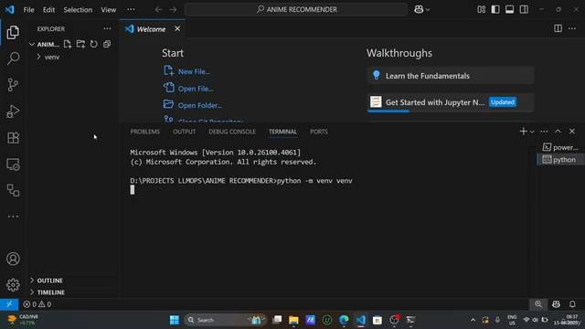
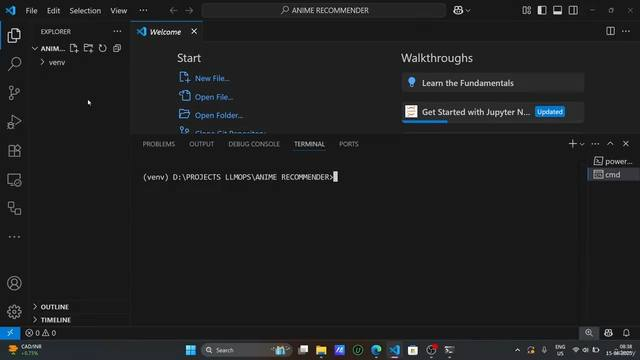
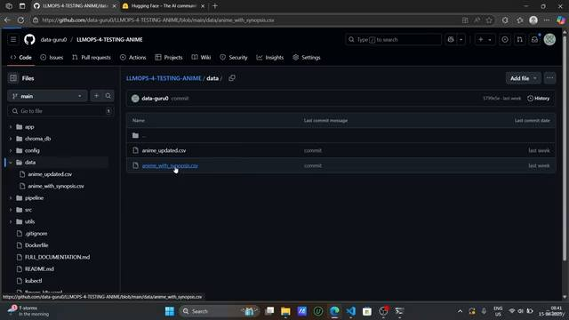
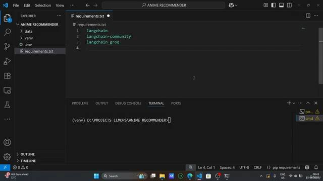
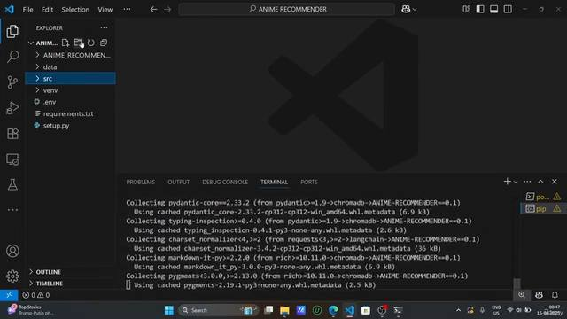
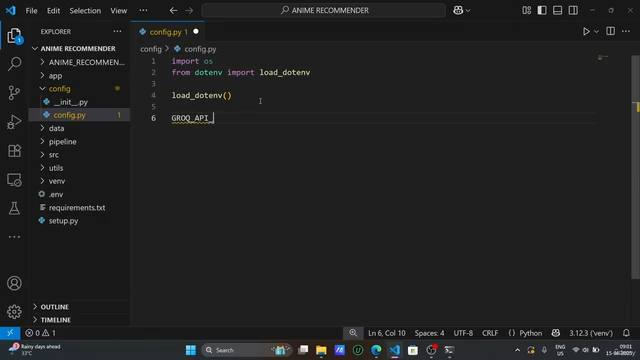

# LLMOps & AIOps Bootcamp P34–P37：把「动漫推荐器」的项目骨架、配置、数据清洗、向量库从零搭起来

> 覆盖视频：BV1gXR4BPERd P34–P37
> 本节结束时的可运行产物：一个能 `import` 的 Python 项目包 + 一份清洗后的 CSV + 一个落在本地磁盘上的 Chroma 向量库。
> 本节**还没有** UI、推荐链、pipeline 编排——那部分课里没讲，见第 7 节。

---

## 1. 这一节做什么

P34–P37 这四集是整门课的「地基」，做的事情按依赖顺序只有四件，一件压着一件：

1. **建项目骨架**（P34）：建根目录 `anime-recommender`、建虚拟环境、建 `.env` 放两个 API key、建 `data/` 放原始 CSV、写 `requirements.txt`、写 `setup.py`，然后 `pip install -e .` 把整个项目装成「可编辑包」。再把 `src / config / utils / app / pipeline` 五个目录建出来，每个目录里放一个 `__init__.py`，让它们都变成包。
2. **写配置**（P35）：`config/config.py` 用 `python-dotenv` 把 `.env` 里的值读成 Python 变量，落到 `GROQ_API_KEY` 和模型名两个常量上。这一步是后面所有组件取 key 的唯一入口。
3. **写数据清洗器**（P36）：`src/data_loader.py` 用 pandas 读原始 CSV，丢掉无关列、丢掉空行、检查必需列是否存在，然后把 `name / genre / synopsis` **拼成一列** `combined_info`，另存为新 CSV。后面的向量库只吃这一列。
4. **写向量库构建器**（P37）：`src/vector_store.py` 用 `CSVLoader` 读清洗后的 CSV → `CharacterTextSplitter` 切块 → `HuggingFaceEmbeddings` 把文本变成向量 → 写进 Chroma，落到本地 `chroma_db/` 目录；再提供一个「只加载、不重建」的方法。

产出物是**四个能独立 import 的模块文件**和一个 `chroma_db/` 目录。也就是说：跑完这四集，你手上应该有一条「原始 CSV → 清洗 CSV → 向量库」的可调用链路，虽然还没有人把这条链路串起来（那是 pipeline 的事，课里没讲）。

一个重要的心理预期先说在前面：P34 里讲师建了 `app/` 和 `pipeline/` 两个空包，但**这四集从头到尾没有往这两个目录里写一行代码**。如果你看完 P34–P37 觉得「这项目跑不起来」，不是你没跟上，是课程确实停在了「组件完成、还没编排」这一步。

---

## 2. 讲师原话（带「—— pNNN [MM:SS]」）

关于项目起点：

> "首先，随便进入你的任意一个文件夹，在这里新建一个文件夹……因为我们要做一个动漫推荐系统，所以就叫它 anime recommender……在文件夹上右键，在终端中打开，然后直接输入 `code .`，这样基本上就会自动启动你的 VS Code。"
> —— p034 [00:00]

关于虚拟环境说法和激活路径：

> "首先，我们创建一个虚拟环境，所以我会输入 `python -m venv`，后面跟上你想给虚拟环境起的名字……那就叫它 `venv`……现在已经创建好了，接下来需要激活……先输入虚拟环境名称，然后输入反斜杠，再输入 `Scripts`……再输入 `activate`……你可以看到括号里出现了 `venv`，这说明虚拟环境已经激活。"
> —— p034 [00:57]

关于两个 key：

> "首先，我们需要 Groq API 密钥……然后在这对引号之间填入 Groq API 密钥……我们还需要 Hugging Face……接着写入 `hugging face hub api token`……确保每个拼写都正确。"
> —— p034 [02:24]

> "创建一个新令牌，并确保它处于写入模式……一共有三种模式：细粒度、只读和写入，它应该处于写入模式。"
> —— p034 [04:19]

关于依赖清单：

> "首先需要哪些库？首先是 LangChain……然后是 LangChain Community……接着是 LangChain Groq……然后需要 Chroma DB……再然后需要 Streamlit……还需要 pandas……还需要 `python-dotenv`……还需要 Sentence Transformers……你已经有 Groq，而要与 Groq 交互，就需要 LangChain Groq……另一个是 LangChain Hugging Face，因此要与 Hugging Face 交互，就需要 LangChain Hugging Face。"
> —— p034 [07:12]

关于 `pip install -e .` 要跑两次：

> "如何触发你的 `setup.py`……你会输入 `pip install -e .`，这样基本上就会自动触发你的 `setup.py` 文件……但我们还会创建包。然后，每当我们创建一个包，就会再次运行同样的命令 `pip install -e .`，反复运行。"
> —— p034 [09:26]

> "你必须再次运行那个 `pip install -e .`……因为我们已经创建了包……每当你看到一个 `__init__` 文件，那个文件夹就是一个包。"
> —— p034 [15:13]

关于配置：

> "`load_dotenv()` 的作用基本上就是加载我们所有的环境变量……我会写 `os.getenv`……这一行基本上就是在获取那个特定的环境变量 Groq API 密钥，并把它的值存到这个普通变量里。"
> —— p035 [00:53]

> "我们就用一个普通模型吧。用一个小的模型。所以会用这个 80 亿参数的模型……复制它的名称……把名称粘贴到这里。"
> —— p035 [02:20]

关于数据清洗的动机：

> "你可以看到，这条带 `synopsis` 的动漫数据还有一些不必要的列……这个 `mal_id` 我们不需要……这个 `score` 我们不需要……我们还可以把 `genre` 和 `synopsis` 合并到同一列里……基本上就是做特征构造。"
> —— p036 [01:00]

关于列检查：

> "假设某个必需的列缺失了……我会抛出一个 ValueError，提示 CSV 文件中缺少该列……因为 `missing` 为空时，它不会进入这个代码块……如果 `missing` 有值，它就为真。"
> —— p036 [05:42]

关于拼列：

> "我们已经把 `name`、`genre`、`synopsis` 合并到单独一列里，所以就不需要单独的列了……我们只会生成一个新的 CSV 文件，里面只有 `combined_info` 这一列。"
> —— p036 [11:00]

关于向量库：

> "你不能直接把切分后的文本保存到这个 Chroma 向量存储里；必须先把切分后的文本转换成嵌入，而做嵌入这部分，我们必须使用 HuggingFace 的嵌入模型。"
> —— p037 [02:26]

> "把 `chunk_size` 设为 1000……把 `chunk_overlap` 设为 0，我们不需要任何重叠。"
> —— p037 [09:11]

> "模型基本上会做什么呢：如果我使用这段文本，它会先做嵌入，然后保存到你的 Chroma 里……这两个步骤都会在这里发生……执行 `db.persist()`……基本上就是把你向量存储保存到磁盘上。"
> —— p037 [10:34]

> "如果你已经创建了向量存储，就不想一遍又一遍地重复创建……所以我们会再写一个方法，用来加载已有的向量存储。"
> —— p037 [07:12]

---

## 3. 从零复现

### 3.0 前置条件

- Windows + **Command Prompt**（讲师明确说「make sure you open the terminal in command prompt」）。PowerShell 也能做，但激活脚本名不一样，见第 7 节。
- 已装 Python（建议 3.10 或 3.11，课里没说版本，见第 7 节）。
- VS Code 已装，且命令行能识别 `code` 命令。
- 能上外网 + 有 Groq 账号 + 有 Hugging Face 账号。

### 3.1 建目录、开编辑器

```bat
mkdir anime-recommender
cd anime-recommender
code .
```

在 VS Code 里新开终端（Terminal → New Terminal），确认终端在**项目根目录**、且是 cmd。

### 3.2 建并激活虚拟环境

```bat
python -m venv venv
venv\Scripts\activate
```

激活成功的标志只有一个：**提示符前面出现 `(venv)`**。讲师原话是「you can see in the bracket you are getting venv，it means your virtual environment have been activated」。没看到 `(venv)` 就不要往下走，后面所有 `pip install` 都会装到系统 Python 里。



> JS/Node 类比：`venv` ≈ 项目自己的 `node_modules`，这一节的 `requirements.txt` ≈ `package.json` 的 `dependencies` 字段。区别是 Python 的虚拟环境还要单独「激活」来切换 PATH，Node 不需要。

### 3.3 建 `.env`，填两个 key

在根目录新建文件，**文件名就叫 `.env`**（没有后缀）。两行，值用双引号包住（讲师原话「in between these quotes we will be placing our key」）：

```
GROQ_API_KEY="gsk_xxxxxxxxxxxxxxxxxxxxxxxx"
HUGGINGFACE_HUB_API_TOKEN="hf_xxxxxxxxxxxxxxxxxxxxxxxx"
```

`GROQ_API_KEY` 的获取：浏览器搜 `groq cloud api` → 注册 → 进 API keys 区 → 新建 key，随便命名（讲师命名 `anime`）→ 复制 → 粘贴进 `.env`（—— p034 [03:50]）。

`HUGGINGFACE_HUB_API_TOKEN` 的获取：搜 Hugging Face → 注册 → 登录 → 点个人头像 → **Access Tokens** → 新建 token（会让你输密码做身份确认）→ **权限必须选 `write`**（三个模式 fine-grained / read / write）→ 复制 → 粘贴进 `.env`（—— p034 [04:19]）。



⚠️ 两个变量名必须和你 `config.py` 里 `os.getenv(...)` 的字符串**逐字符一致**（大小写也算）。这是本课最容易白干半小时的地方。

### 3.4 建 `data/`，放原始 CSV

```bat
mkdir data
```

把课程资源区（讲师说的 `resource` 区，里面有 GitHub 链接 `data` 目录）的 **`anime_with_synopsis.csv`** 下载下来，**拖进 `data/` 目录**。

这个 CSV 的列是 MyAnimeList 风格：`mal_id`、`name`、`genre`、`synopsis`、`score` 等。讲师明确说 `mal_id` 和 `score` 是不要的，`name / genre / synopsis` 是必需的。



### 3.5 写 `requirements.txt`

根目录新建 `requirements.txt`，一行一个包名：

```
langchain
langchain-community
langchain-groq
chromadb
streamlit
pandas
python-dotenv
sentence-transformers
langchain-huggingface
```

**注意：讲师全程没有报版本号**，是把包名念一遍写上去的。所以这里也不写版本号——但这也正是第 7 节第一个坑的来源。



### 3.6 写 `setup.py`（讲师让你从资源区复制）

讲师原话是「go to the GitHub link that I have given. You will see there is `setup.py` file. Just copy it. Paste it here」，然后只把 `name` 改成了 `anime`。**逐字稿里没有这份文件的内容**，所以第 4 节给的是我按 `pip install -e .` 的用法倒推出的最小可用版本，已明确标注。

### 3.7 第一次 `pip install -e .`

```bat
pip install -e .
```

这一步会：读 `setup.py` → 解析依赖 → 从网上下载 langchain / chromadb / sentence-transformers / streamlit 等一大堆包。**耗时较长**，`sentence-transformers` 会连带拉 `torch`，几百 MB 很正常。

### 3.8 建五个包目录（这是 P34 后半段的重点）

在根目录依次新建目录，每个目录里都放一个**空的** `__init__.py`：

```
src/__init__.py
utils/__init__.py
config/__init__.py
app/__init__.py
pipeline/__init__.py
```

再补两个非空文件（讲师说是从前面课程的 `utils` 里复制粘贴的，逐字稿没给内容）：

```
utils/logger.py
utils/custom_exception.py
```

讲师的目录职责划分原话（—— p034 [15:13]）：

| 目录 | 职责 |
|---|---|
| `src/` | 所有组件（data loader、prompt template、recommender、vector store） |
| `pipeline/` | 把 `src` 里的组件**串成** pipeline |
| `utils/` | 通用工具：helper 函数、logger、custom exception |
| `config/` | 所有配置：API setup、Hugging Face setup，将来接数据库也放这里 |
| `app/` | 主应用（本节未写代码） |
| `data/` | 数据（**不是**包，没有 `__init__.py`） |



### 3.9 第二次 `pip install -e .`

**这一步不能省。** 讲师重复强调了两遍：

```bat
pip install -e .
```

原因是他自己解释的那个规则：「Whenever you will get a `__init__` file, that folder is a package」。第一次跑的时候这五个目录还不存在（或还不是包），`setup.py` 的 `find_packages()` 扫不到它们；现在它们有 `__init__.py` 了，要重跑一次让 setuptools 把它们登记进去，否则 `from src.data_loader import ...` 会报 `ModuleNotFoundError`。

### 3.10 写 `config/config.py`

`config/` 下新建 `config.py`，内容见第 4 节。跑通后可以临时验证：

```bat
python -c "from config.config import GROQ_API_KEY, GROQ_MODEL_NAME; print(bool(GROQ_API_KEY), GROQ_MODEL_NAME)"
```

能打印出 `True` 和模型名，说明 `.env` 被正确加载了。打印 `False` 说明变量名对不上或 `.env` 不在**当前工作目录**。



模型名的来源，讲师是打开浏览器搜 `groq cloud models`，进官网 Supported models 页，从生产模型里挑了小的那个（「3.1 8 billion instant」），复制名字粘进 `config.py`（—— p035 [02:20]）。他顺带说了一句「these are production models，then there are preview models also」，本课只用生产模型。

### 3.11 写 `src/data_loader.py`

`src/` 下新建 `data_loader.py`，内容见第 4 节。

### 3.12 写 `src/vector_store.py`

`src/` 下新建 `vector_store.py`，内容见第 4 节。

### 3.13 端到端验证（课里没有这段，是我补的自测脚本）

根目录新建一个临时脚本 `run_check.py`（跑完可删），内容见第 4 节末尾。执行：

```bat
python run_check.py
```

预期现象（按发生顺序）：终端打印 `processed csv -> data/processed_anime.csv` → 首次运行会开始下载 `all-MiniLM-L6-v2` 模型（有进度条）→ 打印 `vector store built` → 打印 `loaded: ...`（`loaded` 后面是 Chroma 对象，具体 repr 以实际输出为准）→ 根目录出现 `chroma_db/` 目录。

---

## 4. 完整代码

### 4.1 最终目录结构

```
anime-recommender/
├── .env                          # 两个 key，不要提交到 Git
├── requirements.txt
├── setup.py
├── run_check.py                  # 【课里没有】自测脚本，跑完可删
├── data/
│   ├── anime_with_synopsis.csv   # 原始数据（你下载的）
│   └── processed_anime.csv       # 运行后自动生成
├── chroma_db/                    # 运行后自动生成
├── src/
│   ├── __init__.py               # 空文件
│   ├── data_loader.py
│   └── vector_store.py
├── config/
│   ├── __init__.py               # 空文件
│   └── config.py
├── utils/
│   ├── __init__.py               # 空文件
│   ├── logger.py                 # 【课里没给内容，见 4.7 示意】
│   └── custom_exception.py       # 【课里没给内容，见 4.8 示意】
├── app/
│   └── __init__.py               # 空文件，本节无代码
└── pipeline/
    └── __init__.py               # 空文件，本节无代码
```

### 4.2 `.env`

```
GROQ_API_KEY="gsk_your_key_here"
HUGGINGFACE_HUB_API_TOKEN="hf_your_token_here"
```

### 4.3 `requirements.txt`

```
langchain
langchain-community
langchain-groq
chromadb
streamlit
pandas
python-dotenv
sentence-transformers
langchain-huggingface
```

### 4.4 `setup.py`

> **课里没讲**：P034 讲师让你从资源区的 GitHub 链接复制 `setup.py`，逐字稿没有给出文件内容。下面是按 `pip install -e .` 的用法倒推出的**最小可用版本**，不是讲师原文件。你有资源区原文件的话，用原文件覆盖它。

```python
from setuptools import setup, find_packages

with open("requirements.txt", "r", encoding="utf-8") as f:
    requirements = [line.strip() for line in f if line.strip()]

setup(
    name="anime-recommender",
    version="0.0.1",
    packages=find_packages(include=["src", "config", "utils", "app", "pipeline", "src.*", "config.*", "utils.*", "app.*", "pipeline.*"]),
    install_requires=requirements,
    python_requires=">=3.9",
)
```

### 4.5 `config/config.py`

```python
import os

from dotenv import load_dotenv

# 把 .env 里的所有键值对加载进环境变量
load_dotenv()

# 环境变量 -> 普通 Python 变量
GROQ_API_KEY = os.getenv("GROQ_API_KEY")

# 讲师从 Groq 官网 Supported models 页复制的生产模型名（"3.1 8 billion instant"）
# 若官网该模型已下线，以官网当前列出的名字为准
GROQ_MODEL_NAME = "llama-3.1-8b-instant"
```

### 4.6 `src/data_loader.py`

```python
import pandas as pd


class AnimeDataLoader:
    def __init__(self, original_csv: str, processed_csv: str):
        self.original_csv = original_csv
        self.processed_csv = processed_csv

    def load_and_process(self):
        # 1) 读原始 CSV，统一 utf-8 编码，跳过格式错误的行
        df = pd.read_csv(self.original_csv, encoding="utf-8", on_bad_lines="skip")

        # 2) 丢掉含空值的行
        df = df.dropna()

        # 3) 只保留这三个必需列
        required_columns = {"name", "genre", "synopsis"}
        missing = required_columns - set(df.columns)

        if missing:
            raise ValueError(f"Missing columns in CSV file: {missing}")

        # 4) 把三列拼成一列，作为后面 embedding 的唯一输入
        df["combined_info"] = (
            "Title: " + df["name"]
            + " Overview: " + df["synopsis"]
            + " Genres: " + df["genre"]
        )

        # 5) 只导出 combined_info 一列，不写行号，编码保持一致
        df[["combined_info"]].to_csv(
            self.processed_csv,
            index=False,
            encoding="utf-8",
        )

        return self.processed_csv
```

### 4.7 `utils/logger.py`

> **课里没讲内容**：讲师说这两个文件「in the starting of the course 已经讲过，直接 copy paste」，逐字稿没有贴出源码。下面是能跑通的**最小示意版**，仅为让 `utils` 包非空、后续 import 不报错。

```python
import logging
import os
from datetime import datetime

LOG_DIR = "logs"
os.makedirs(LOG_DIR, exist_ok=True)

LOG_FILE = os.path.join(LOG_DIR, f"{datetime.now():%Y_%m_%d_%H_%M_%S}.log")

logging.basicConfig(
    filename=LOG_FILE,
    format="[%(asctime)s] %(levelname)s %(module)s %(message)s",
    level=logging.INFO,
)


def get_logger(name: str = __name__) -> logging.Logger:
    return logging.getLogger(name)
```

### 4.8 `utils/custom_exception.py`

> 同上，**课里没讲内容**，示意版。

```python
import sys
import traceback


class CustomException(Exception):
    def __init__(self, error_message, error_detail: sys = sys):
        super().__init__(error_message)
        self.error_message = self._build_message(error_message, error_detail)

    @staticmethod
    def _build_message(error_message, error_detail: sys) -> str:
        _, _, exc_tb = error_detail.exc_info()
        file_name = exc_tb.tb_frame.f_code.co_filename if exc_tb else "<unknown>"
        line_number = exc_tb.tb_lineno if exc_tb else -1
        return (
            f"Error in [{file_name}] at line [{line_number}]: {error_message}"
        )

    def __str__(self):
        return self.error_message
```

### 4.9 `src/vector_store.py`

```python
from langchain.text_splitter import CharacterTextSplitter
from langchain_community.vectorstores import Chroma
from langchain_community.document_loaders import CSVLoader
from langchain_huggingface import HuggingFaceEmbeddings

from dotenv import load_dotenv

# HuggingFaceEmbeddings 会自动读取环境里的 HUGGINGFACE_HUB_API_TOKEN
load_dotenv()


class VectorStoreBuilder:
    def __init__(self, csv_path: str, persist_directory: str = "chroma_db"):
        self.csv_path = csv_path
        self.persist_directory = persist_directory
        self.embedding = HuggingFaceEmbeddings(model_name="all-MiniLM-L6-v2")

    def build_and_save_vector_store(self):
        # 1) 读 CSV，每行变成一条 Document
        loader = CSVLoader(
            file_path=self.csv_path,
            encoding="utf-8",
            metadata_columns=[],
        )
        data = loader.load()

        # 2) 切块
        splitter = CharacterTextSplitter(chunk_size=1000, chunk_overlap=0)
        texts = splitter.split_documents(data)

        # 3) 转 embedding 并写入 Chroma
        db = Chroma.from_documents(
            documents=texts,
            embedding=self.embedding,
            persist_directory=self.persist_directory,
        )

        # 4) 落盘
        db.persist()

        return db

    def load_vector_store(self):
        return Chroma(
            persist_directory=self.persist_directory,
            embedding_function=self.embedding,
        )
```

### 4.10 `run_check.py`（课里没有，仅用于验证 3.10–3.12 是否真跑通）

```python
from src.data_loader import AnimeDataLoader
from src.vector_store import VectorStoreBuilder

RAW_CSV = "data/anime_with_synopsis.csv"
PROCESSED_CSV = "data/processed_anime.csv"

loader = AnimeDataLoader(RAW_CSV, PROCESSED_CSV)
processed_path = loader.load_and_process()
print("processed csv ->", processed_path)

builder = VectorStoreBuilder(csv_path=processed_path, persist_directory="chroma_db")
builder.build_and_save_vector_store()
print("vector store built")

db = builder.load_vector_store()
print("loaded:", db)
```

### 4.11 五个空包文件

`src/__init__.py`、`config/__init__.py`、`utils/__init__.py`、`app/__init__.py`、`pipeline/__init__.py` —— **内容为空**。不要写 `pass` 也无所谓，但不要删掉这些文件。

---

## 5. 逐行解释

### 5.1 为什么先建 venv 再装包

`python -m venv venv` 生成的是一个独立解释器副本 + 独立 `site-packages`。之后所有 `pip install`（包括 `pip install -e .` 拉的那一大堆）都落进 `venv/Lib/site-packages/`，不污染系统 Python。

在 Node 里这件事由 `node_modules` 天然完成，Python 没有「项目内自动隔离」机制，所以必须手动建 + **手动激活**。激活改的是当前 shell 的 `PATH`，所以「换个终端窗口」等于「退回系统 Python」——这是新手最常见的坑，表现为「我明明装了 langchain，怎么又 ModuleNotFound？」

### 5.2 `.env` 为什么用双引号

讲师原话是「in between these quotes we will be placing our key」。`python-dotenv` 对带引号和不带引号都能解析，但 key 里如果混进特殊字符（如 `#`），不带引号会被当成注释截断。带引号更保险，且和讲师的操作一致。

### 5.3 `os.getenv("GROQ_API_KEY")` 这一行到底做了什么

`load_dotenv()` 把 `.env` 的键值对塞进 `os.environ`；`os.getenv("GROQ_API_KEY")` 再从 `os.environ` 里取出来赋给模块级常量。取不到时返回 `None`（不报错），所以你**必须自己验证一次**，否则错误会推迟到真正调 Groq 的时候才炸，而且报的是「invalid api key」，让你怀疑 key 本身。

Node 类比：`load_dotenv()` ≈ `require('dotenv').config()`，`os.getenv` ≈ `process.env.GROQ_API_KEY`。区别是 JS 里取不到是 `undefined`，Python 是 `None`，同理都不会主动报错。

### 5.4 `pd.read_csv(..., encoding="utf-8", on_bad_lines="skip")`

- `encoding="utf-8"`：讲师的理由是「sometimes the CSV can be on some other encoding also like latin encoding ... but we want in utf8 because utf8 is a standard encoding」。统一编码是为了让后面 `to_csv(encoding="utf-8")` 读写的字节一致。
- `on_bad_lines="skip"`：跳过 pandas 解析不了的行（讲师说「suppose in some of the lines you are getting ... these type of lines will get automatically skipped」）。
- 这里有一个隐性风险：如果这个 CSV 原本不是 UTF-8（比如带 BOM 的 UTF-8 或 Latin-1），`encoding="utf-8"` 会直接抛 `UnicodeDecodeError`，`on_bad_lines` **管不了解码错误**。第 7 节给处理办法。

### 5.5 `df.dropna()` 为什么放在列检查之前

讲师的操作顺序是「读 → 丢空行 → 检查列」。先 `dropna()` 可以避免后面拼列时 `None + str` 抛 `TypeError`。注意 `dropna()` 默认是「任意一列为空就丢整行」，对于只有 4–5 列的表，这个策略偏激进但符合讲师「so that our data is clean」的目标。

### 5.6 `required_columns - set(df.columns)` 用的是集合差

`required_columns` 是 `set`（讲师说「why we have done the sets? so that it can ignore duplicate columns」——去重），`set(df.columns)` 把列名也变成集合，两个集合相减得到「必需但缺失」的列名。

- `missing` 为空集合 `set()` 时，`if missing:` 被判为 `False`（讲师原话「missing is equal to false if missing doesn't have any value」），跳过抛错。
- `missing` 有任何元素时为真，走 `raise ValueError`。

Node 类比：`required.filter(c => !columns.includes(c))`，一个 `filter` 就等价于这里的集合差。

### 5.7 `df["combined_info"] = "Title: " + df["name"] + ...` 是向量化拼接

pandas 的 `+` 在 DataFrame 列上不是逐行循环，而是整列逐元素相加（内部是 C 层循环）。语义上等价于：

```js
rows.map(r => `Title: ${r.name} Overview: ${r.synopsis} Genres: ${r.genre}`)
```

顺序是讲师在 [11:30] 亲口描述的顺序：先 `Title` 然后是名字，再 `Overview` 然后是 synopsis，再 `Genres` 然后是 genre。这个顺序很重要——它决定了每个 chunk 的语义结构，也决定了后面 embedding 检索时的匹配质量。

### 5.8 为什么只导出 `combined_info` 一列

讲师的理由：「we have combined name, genre, synopsis into a single column only so that we don't require separate columns」。因为 `CSVLoader` 会把 CSV 的**每一行**变成一个 Document，如果你保留 `name / genre / synopsis` 三列，切块时这三段文本会被混在一起、边界不清；只留一段自然语言文本，chunk 语义最干净。

`index=False` 是为了不写出 `0,1,2...` 这个多余列（讲师原话「since we don't want an extra column」）；`encoding="utf-8"` 必须和读入时一致（讲师原话「whatever encoding you gave inside during reading make sure give the same encoding in the exporting time also」）。

### 5.9 `CSVLoader(file_path=..., encoding="utf-8", metadata_columns=[])`

- `file_path` 是上一步产出的 `data/processed_anime.csv`。
- `encoding="utf-8"` 必须和 data_loader 写出的编码对齐，否则中文/日文 synopsis 会出现乱码。
- `metadata_columns=[]` 讲师原话「metadata columns let's keep it empty only we don't want to create any metadata」。含义是：**没有任何列被拎出来当 metadata**，整行文本全部进 `page_content`。

### 5.10 `CharacterTextSplitter(chunk_size=1000, chunk_overlap=0)`

- `chunk_size=1000`：按字符数切，每块最多 1000 字。一条 anime 的 `combined_info` 通常几百字，所以大多数行是 **1 行 = 1 chunk**，切块主要是为了兜住 synopsis 特别长的那几条。
- `chunk_overlap=0`：不留重叠，讲师原话「we don't want any overlapping」。这样切出来的每个 chunk 不重复，检索结果不会出现「同一条 anime 被返回两次」的情况。

`splitter.split_documents(data)` 返回的是 `Document` 列表（不是字符串列表），因为要保留 `metadata` 结构给 Chroma 用。

### 5.11 `Chroma.from_documents(...)` 一次做两件事

讲师自己点破了这一点：「Both the steps are going to come here only」——**embedding + 入库**在同一个调用里完成。你不需要手写 `embedding.embed_documents(texts)`，`Chroma.from_documents` 内部会调 `self.embedding` 把每个 chunk 转成向量再写进去。

三个参数：
- `documents=texts`：要入库的 chunk
- `embedding=self.embedding`：用哪个 embedding 函数
- `persist_directory=self.persist_directory`：写到哪个目录（默认 `chroma_db`，会在**当前工作目录**下创建）

### 5.12 `db.persist()` 与 `load_vector_store()`

`db.persist()` 讲师原话「basically we will be saving our vector store in our local disk only ... Chroma can be used both，it can be used online also，it can be used locally also，currently we are using locally」。也就是显式刷盘。

`load_vector_store()` 走的是另一条路径：`Chroma(persist_directory=..., embedding_function=...)` **不重新计算任何 embedding**，直接把磁盘上的库挂载回来。讲师的设计意图是「suppose you already created a vector store，you don't want to create it again and again」。

⚠️ `embedding_function` 必须和建库时用的是**同一个模型**（这里都是 `all-MiniLM-L6-v2`）。模型换了，向量空间就变了，检索结果会变成噪声。

### 5.13 `pip install -e .` 为什么跑两次

`-e` 是 editable，装进去的不是拷贝，而是一个指向源码目录的链接。`setup.py` 里 `find_packages()` 在**执行安装的那一刻**扫目录，扫到哪些带 `__init__.py` 的目录就登记哪些。所以：

- 第一次跑：只有根目录，`src/config/utils/app/pipeline` 还没建 → 它们不会被登记
- 建完五个 `__init__.py` 再跑第二次 → 五个包被登记 → `from src.data_loader import ...` 才能解析

Node 类比：接近 pnpm workspace 的 `file:` 依赖 / `npm link`——让「本地目录」被当作「已安装的包」解析，改源码立即生效，不用重装。

---

## 6. 复现检查清单

按顺序打勾，**任一项没勾上就别进下一步**：

- [ ] 根目录名是 `anime-recommender`，VS Code 打开的是这个目录（不是它的父目录）
- [ ] 终端是 **Command Prompt**，且**当前目录就是项目根目录**
- [ ] `venv/` 目录已生成
- [ ] 激活后提示符前面有 `(venv)`
- [ ] `.env` 在**根目录**，两行，变量名逐字符为 `GROQ_API_KEY` 和 `HUGGINGFACE_HUB_API_TOKEN`，值带双引号
- [ ] Hugging Face token 的权限是 **write**
- [ ] `data/anime_with_synopsis.csv` 存在，且列里能看到 `name`、`genre`、`synopsis`
- [ ] `requirements.txt` 九行齐全（漏 `langchain-huggingface` 或 `langchain-groq` 后面必炸）
- [ ] `setup.py` 存在
- [ ] 第一次 `pip install -e .` 成功结束（无红字 ERROR）
- [ ] 五个 `__init__.py` 已创建：`src/`、`config/`、`utils/`、`app/`、`pipeline/`
- [ ] `utils/logger.py`、`utils/custom_exception.py` 已创建（内容可为示意版）
- [ ] **第二次** `pip install -e .` 成功结束
- [ ] `python -c "from config.config import GROQ_API_KEY, GROQ_MODEL_NAME; print(bool(GROQ_API_KEY), GROQ_MODEL_NAME)"` 输出 `True` + 模型名
- [ ] `python -c "import src, config, utils"` 不报 `ModuleNotFoundError`
- [ ] 跑 `run_check.py` 后 `data/processed_anime.csv` 出现，且只有一列 `combined_info`
- [ ] `data/processed_anime.csv` 用记事本打开，中文/日文不乱码
- [ ] `chroma_db/` 目录出现，且里面有文件（不是空目录）
- [ ] 第二次跑 `run_check.py` 时不再重复下载 embedding 模型（说明已缓存）

---

## 7. 课里没讲但你会撞上

下面全部是**我补充的**，不是讲师在 P34–P37 说过的内容。讲师这一节刻意跳过了版本号和异常处理，所以这些坑迟早会撞上。

### 7.1 `from langchain.text_splitter import CharacterTextSplitter` 报 ImportError

课里写的这个 import 路径是讲师当时的环境。较新的 `langchain` 把这个模块拆到了独立包 `langchain-text-splitters`。症状：

```
ModuleNotFoundError: No module named 'langchain.text_splitter'
```

处理：`pip install langchain-text-splitters`，然后把 import 改成

```python
from langchain_text_splitters import CharacterTextSplitter
```

或者干脆降级 langchain 到与你环境匹配的版本。**没有版本号 = 这套代码的可复现性完全取决于你装的版本**，这是讲师这一节最大的隐性债务。

### 7.2 `db.persist()` 报 `AttributeError`

较新的 `langchain-community` 里，`Chroma` 对象在 `from_documents(..., persist_directory=...)` 之后**已经自动持久化**，`.persist()` 方法被移除了。症状：

```
AttributeError: 'Chroma' object has no attribute 'persist'
```

处理：把这行删掉。判断标准很简单——如果去掉后 `chroma_db/` 里仍然有文件、第二次能 `load_vector_store()` 成功加载，那就说明不需要手动 persist。

### 7.3 `metadata_columns=[]` 报参数类型错误

`CSVLoader` 的 `metadata_columns` 类型是「字符串序列」，老版本可能不接受 `list`（只接受 `tuple` 或直接不认这个参数）。症状是构造时就报参数校验类的 `ValueError` / `TypeError`。

处理：先删掉 `metadata_columns` 参数，用默认值跑通；等确认库版本后再加回来。**讲师之所以敢写 `[]`，是因为他的版本认这个值**，你的版本不一定。

### 7.4 `encoding="utf-8"` 直接抛 `UnicodeDecodeError`

`on_bad_lines="skip"` 只处理「能解码但格式坏」的行，处理不了解码失败。如果你下载的 CSV 带 BOM 或原本是 Latin-1：

处理顺序：先试 `encoding="utf-8-sig"`（带 BOM 的 UTF-8），不行再试 `encoding="latin-1"`。改的是 `data_loader.py` 里 `read_csv` 和 `to_csv` **两处**，以及 `vector_store.py` 里 `CSVLoader` 的 `encoding`——三处必须一致，否则中间那一步产出会被下一个组件读错。

### 7.5 首次运行卡在「下载 all-MiniLM-L6-v2」

`HuggingFaceEmbeddings(model_name="all-MiniLM-L6-v2")` 会在**第一次实例化时**从 Hugging Face 拉模型（约 90MB）。如果卡住或超时：

- 确认 `.env` 里的 `HUGGINGFACE_HUB_API_TOKEN` 已生效（在 `vector_store.py` 里 `load_dotenv()` 必须在 `HuggingFaceEmbeddings(...)` **之前**执行——这一点课里的代码顺序是对的，别自己调换）
- 模型会缓存到 `~/.cache/huggingface/`，第二次启动不会再下载
- 某些版本的参数名是 `model_name`，有些是 `model`。如果报 `TypeError: __init__() got an unexpected keyword argument 'model_name'`，改成 `model="all-MiniLM-L6-v2"`

注意课里没有解释这行「模型名从哪来」，只说了「我的个人收藏是 all-MiniLM-L6-v2」。这个名字是讲师在 Hugging Face 页面上搜出来的，属于 sentence-transformers 生态的经典小模型。

### 7.6 PowerShell 下 `venv\Scripts\activate` 不生效

讲师用的是 **Command Prompt**（他明确说了「make sure you open the terminal in command prompt」）。如果你在 PowerShell 里：

- 激活命令是 `.\venv\Scripts\Activate.ps1`（前面要加点斜杠）
- 可能先撞上 `无法加载文件 ... 因为在此系统上禁止运行脚本`，需要改执行策略
- 最省事的办法：直接用 VS Code 右下角的 `Select Default Profile` 切到 Command Prompt，重开终端