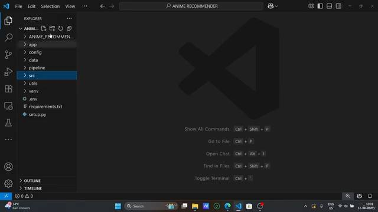
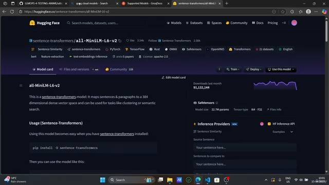
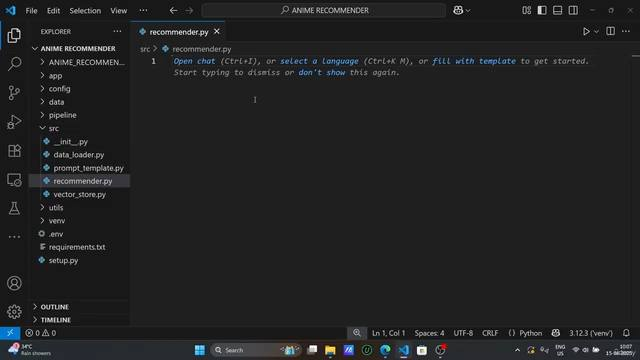
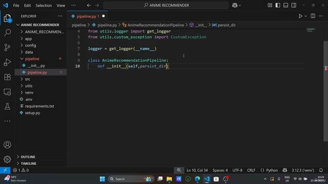
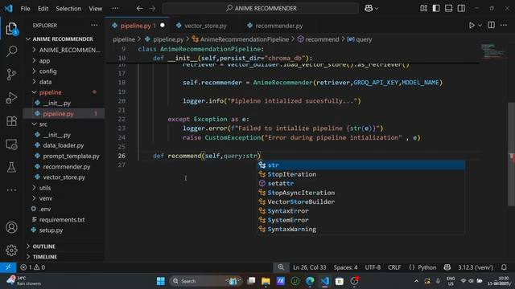
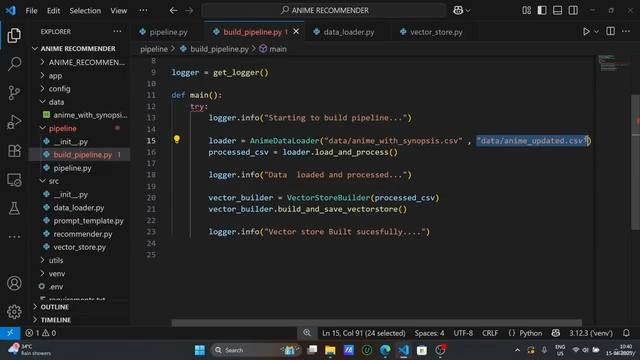
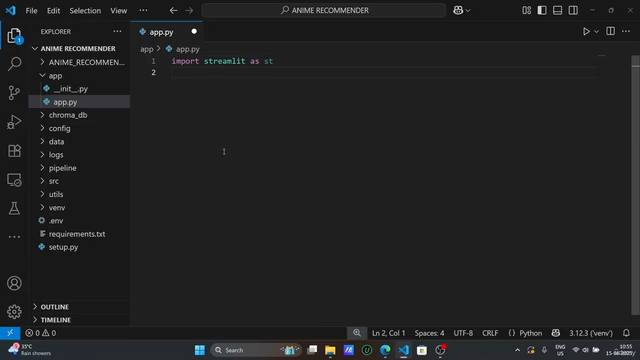
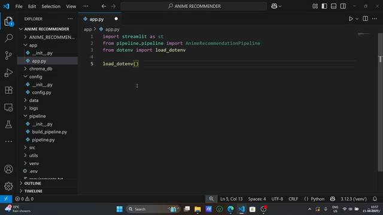
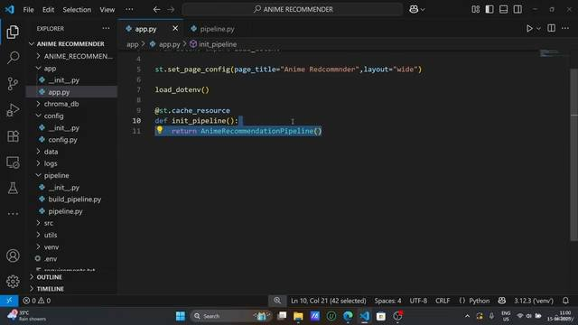
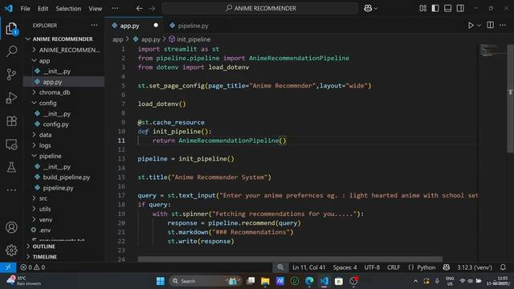

# LLMOps & AIOps Bootcamp P38–P41：从零搭建 Anime RAG 推荐应用

## 1. 这一节做什么

P38–P41 的目标不是继续讲概念，而是把前面拆开的模块组装成一个可运行的 **Anime RAG 推荐应用**。最终你会得到两条命令级入口：

1. `python pipeline/build_pipeline.py`：读取动漫 CSV，生成处理后的 CSV，构建并持久化 Chroma 向量库。复现时要先跑这一条，因为它负责把原始数据变成检索器可用的向量索引；没有这一步，后面的推荐流水线就没有可检索的上下文。
2. `streamlit run app/app.py`：启动 Streamlit 页面，用户输入“类似 Naruto 的动漫”之类的偏好，应用从向量库检索上下文，再让 Groq 上的 LLM 按固定提示词生成推荐。这里的关键不是“页面好不好看”，而是把检索器、提示词和 LLM 串成一次完整调用。

这一节覆盖四个核心文件：`src/prompt_template.py`、`src/recommender.py`、`pipeline/pipeline.py` 与 `pipeline/build_pipeline.py`、`app/app.py`。课里反复强调两条流水线的区别：`build_pipeline.py` 是“训练/建库”流水线，`pipeline.py` 是“预测/推荐”流水线。下面按实际复现顺序重组，不按视频顺序罗列。

从工程角度理解，`build_pipeline.py` 更像前端项目里的构建脚本：先把源数据加工成产物，把产物放到固定目录；`pipeline.py` 更像服务端里的业务服务：启动时只加载产物，不在每次请求里重建产物；`app.py` 则像页面入口，负责接收输入、展示 loading 状态、调用服务并渲染结果。这个对照可以帮助你判断出错位置：建库失败先查 CSV、embedding 和 `chroma_db/`；页面报错先查 import、环境变量和缓存。





---

## 2. 讲师原话（带「—— pNNN [MM:SS]」）

> "本视频中我们将创建提示词模板，因此只需进入 src 目录，新建一个名为 prompt_template.py 的文件。"
> —— p038 [00:00]

> "你是一位动漫推荐专家……你必须使用以下上下文，并给出详细且有吸引力的回答……如果你不知道答案……就如实回答……不要编造。"
> —— p038 [00:54] 到 p038 [01:52] 的提示词口述大意

> "首先我们会设置模板，即 template = template，然后定义两个输入变量：第一个是 context，第二个是 question。"
> —— p038 [02:51]

> "我们将创建动漫推荐器类……从 langchain.chains 导入检索问答链……从 langchain_groq 导入 ChatGroq……把 temperature 参数设为 0。"
> —— p039 [00:00] 到 p039 [02:51]

> "如果把它设为 stuff，就意味着会把所有文档都放进提示词上下文中。"
> —— p039 [04:16]

> "这个构建流水线将用于创建向量存储……这个流水线会在预测时使用……可以说，这个构建流水线就是我们的训练流水线，而这个流水线就是我们的预测流水线。"
> —— p040 [18:48] 到 p040 [19:16]

> "当你为这个 app.py 编写 Dockerfile 时……在 Dockerfile 中，通常只运行一个文件……我们会给出运行 app.py 的命令，而不是配置文件……这就是为什么我们需要它。"
> —— p041 [02:18] 到 p041 [02:47]

读这些原话时要注意两点：第一，讲师口述里的类名和包名不一定和实际代码完全一致，例如 “chat grog / chat grok” 最终要落到 `langchain-groq` 的 `ChatGroq`；第二，讲师反复强调“不要编造”，所以提示词模板里必须保留“不知道就说不知道”的约束。复现时不要为了“让回答更长”删掉这条约束，否则 RAG 应用会退化成普通聊天。

---

## 3. 从零复现

### 3.1 目录结构

在项目根目录创建以下结构。课里只提到 `src`、`pipeline`、`app`、`config`、`utils`、`data` 这些目录；`__init__.py`、`.env.example`、`requirements.txt` 是为了让项目可直接运行而补的工程文件，课里没有逐一讲。

```text
anime-recommender/
├── app/
│   ├── __init__.py
│   └── app.py
├── config/
│   ├── __init__.py
│   └── config.py
├── data/
│   └── anime_with_synopsis.csv
├── pipeline/
│   ├── __init__.py
│   ├── build_pipeline.py
│   └── pipeline.py
├── src/
│   ├── __init__.py
│   ├── dataLoader.py
│   ├── prompt_template.py
│   ├── recommender.py
│   └── vectorStore.py
├── utils/
│   ├── __init__.py
│   ├── customException.py
│   └── logger.py
├── .env
├── .env.example
└── requirements.txt
```

建房时不要把 `app.py` 放到根目录，也不要把 `pipeline.py` 和 `build_pipeline.py` 混在 `src/` 里。课里的分层很清楚：`src/` 放可复用类，`pipeline/` 放流程入口，`app/` 放 Streamlit 页面，`config/` 放环境变量读取，`utils/` 放日志和异常。这样排查问题时可以按层定位：数据问题看 `data/` 和 `dataLoader.py`，向量问题看 `vectorStore.py` 和 `chroma_db/`，模型问题看 `recommender.py`，页面问题看 `app.py`。

前端项目里通常也会把 `components/`、`services/`、`pages/` 分开；这里的目录划分是同一个思路。`__init__.py` 的作用是让 Python 把这些目录当成包，避免 `from pipeline.pipeline import ...` 时出现找不到模块的问题。



### 3.2 Python 环境与依赖

课里没有给依赖版本。下面给一组复现时锁定的版本，安装时如果 pip 解析出兼容版本，以实际安装为准。Groq 的类名在逐字稿里被口述成 “chat grog / chat grok”，实际安装包和类名以 `langchain-groq` 为准；代码里用 `ChatGroq` 保证能跑。

```bash
python -m venv .venv
source .venv/bin/activate        # Windows: .venv\Scripts\activate
pip install -r requirements.txt
```

`requirements.txt` 完整内容：

```text
langchain==0.2.16
langchain-community==0.2.16
langchain-groq==0.1.10
chromadb==0.5.5
sentence-transformers==3.0.1
streamlit==1.37.1
python-dotenv==1.0.1
pandas==2.2.2
```

这三条命令要按顺序执行：先创建虚拟环境，再激活，再安装依赖。不要直接往系统 Python 里装，否则后面 Chroma、Streamlit、LangChain 的版本冲突很难排查。激活成功后，命令行前面通常会出现 `(.venv)`；如果没有出现，说明你还在系统环境里。安装完成后可以用 `python -c "导入 langchain_groq、chromadb 和 streamlit。"` 做一次最小导入检查。若 pip 报版本解析失败，先不要混装多个 LangChain 版本，保留上面的锁定版本重新建环境。

### 3.3 环境变量

创建 `.env`，至少写入：

```env
GROQ_API_KEY=你的_groq_api_key
MODEL_NAME=llama3-8b-8192
```

课里说 API key 和 model name 放在配置里，但没有展示具体变量名。这里用 `GROQ_API_KEY` 和 `MODEL_NAME`，你如果前序课程已经用了别的变量名，以你的 `config/config.py` 为准。模型名课里口述得不清晰，实际到 Groq 控制台选一个当前可用模型填进去即可。

`.env.example`：

```env
GROQ_API_KEY=
MODEL_NAME=llama3-8b-8192
```

`.env` 是本地真实密钥文件，不要提交到仓库；`.env.example` 只保留变量名，方便别人复制。`config.py` 里用 `load_dotenv()` 读取 `.env`，所以运行命令时要在项目根目录，或者保证 `.env` 能被找到。若出现认证失败，先检查 `GROQ_API_KEY` 是否为空；若出现模型不存在，先检查 `MODEL_NAME` 是否是 Groq 当前可用模型。

### 3.4 准备 CSV

课里使用 `data/anime_with_synopsis.csv`，处理后输出 `anime_updated.csv`。课里没有讲 CSV 的列名和 `dataLoader` 内部实现。为了让项目能直接跑，下面给一个最小样例 CSV，列名固定为 `Name,Genres,Synopsis`。你可以替换成完整数据集，只要保留这三列。

CSV 是建库流水线的第一道输入。`dataLoader.py` 会读取这三列，删除缺失值，再拼出一个 `text` 字段；`vectorStore.py` 后续读的是 `text` 列，不是直接读原始三列。因此如果你换了数据集，至少要保持 `Name`、`Genres`、`Synopsis` 存在，或者同步修改 `dataLoader.py` 里的列名和拼接逻辑。常见错误是 CSV 表头有空格、大小写不一致、分隔符不对，导致 `KeyError`；先用文本编辑器或 `pandas.read_csv` 看一眼表头再继续。

### 3.5 先建库，再启动应用

```bash
# 1. 构建向量库，生成 chroma_db/
python pipeline/build_pipeline.py

# 2. 启动 Streamlit
streamlit run app/app.py
```

这两步不能反过来。`app.py` 初始化 `AnimeRecommendationPipeline` 时会调用 `load_vector_store()`，如果 `chroma_db/` 还不存在，推荐流水线就没有检索器可用。建库命令要在项目根目录执行，这样 `data/anime_with_synopsis.csv` 和 `chroma_db/` 的相对路径才一致。若终端没有出现日志，先检查是否漏了 `if __name__ == "__main__": main()`；若 Streamlit 报找不到 `pipeline`，先检查是否从项目根目录启动，以及 `app.py` 开头是否保留了 `sys.path.append(...)`。







---

## 4. 完整代码

下面每个代码块都是完整文件，可直接保存。课里没有讲 `vectorStore.py`、`dataLoader.py`、`config.py`、`logger.py`、`customException.py` 的完整实现，下面给的是为了让 P38–P41 跑起来的最小实现，不是逐字稿原文；关键接口名按逐字稿里出现的 `VectorStoreBuilder`、`AnimeDataLoader`、`getLogger`、`CustomException`、`build_and_save_vector_store`、`load_vector_store`、`load_and_process` 对齐。

### 4.1 `requirements.txt`

```text
langchain==0.2.16
langchain-community==0.2.16
langchain-groq==0.1.10
chromadb==0.5.5
sentence-transformers==3.0.1
streamlit==1.37.1
python-dotenv==1.0.1
pandas==2.2.2
```

这个文件决定复现环境。代码里的 `ChatGroq`、`Chroma`、`HuggingFaceEmbeddings`、`Streamlit` 都依赖这里的包；如果 import 失败，先回到这里检查是否安装成功，而不是先改业务代码。

### 4.2 `.env.example`

```env
GROQ_API_KEY=
MODEL_NAME=llama3-8b-8192
```

这是变量名模板。复制成 `.env` 后填真实 key；不要把真实 key 写进 `.env.example`。

### 4.3 `data/anime_with_synopsis.csv`

```csv
Name,Genres,Synopsis
Naruto,"Action, Adventure, Fantasy","A young ninja seeks recognition and dreams of becoming the Hokage."
Bleach,"Action, Adventure, Supernatural","A teenager gains soul reaper powers and protects the living from evil spirits."
One Piece,"Action, Adventure, Comedy","A pirate crew searches for the legendary treasure known as One Piece."
Attack on Titan,"Action, Drama, Fantasy","Humanity fights giant humanoid creatures behind massive walls."
Black Clover,"Action, Adventure, Fantasy","A boy born without magic aims to become the Wizard King."
My Hero Academia,"Action, Comedy, Superhero","Students train to become professional heroes in a world of superpowers."
Fullmetal Alchemist Brotherhood,"Action, Adventure, Drama","Two brothers search for a philosopher's stone after a failed ritual."
Death Note,"Mystery, Psychological, Supernatural","A student finds a notebook that can kill anyone whose name is written in it."
```

这是最小样例。真实数据集可以更大，但表头至少保留三列；否则先改 `dataLoader.py` 的 `required_columns`，否则建库会直接失败。

### 4.4 `config/config.py`

```python
import os
from dotenv import load_dotenv

load_dotenv()

GROQ_API_KEY = os.getenv("GROQ_API_KEY")
MODEL_NAME = os.getenv("MODEL_NAME", "llama3-8b-8192")
```

配置层只做两件事：加载 `.env`，把 key 和模型名暴露成常量。这样 `pipeline.py` 不需要直接读环境变量，排查时只看这个文件即可。

### 4.5 `utils/logger.py`

```python
import logging


def getLogger(name: str):
    logging.basicConfig(
        level=logging.INFO,
        format="%(asctime)s - %(name)s - %(levelname)s - %(message)s",
    )
    return logging.getLogger(name)
```

日志函数必须接收 `name`。课里出现过的 logger 初始化失败，核心就是没有把名字传进去；复现时保留这个签名，调用处统一写 `getLogger(__name__)`。

### 4.6 `utils/customException.py`

```python
class CustomException(Exception):
    def __init__(self, message: str):
        self.message = message
        super().__init__(self.message)
```

这个类只是把异常信息包一层，方便在 Streamlit 或终端里区分“建库失败”和“推荐失败”。不要在里面吞掉原始异常信息。

### 4.7 `src/prompt_template.py`

```python
from langchain.prompts import PromptTemplate


def get_anime_prompt() -> PromptTemplate:
    template = """
You are an expert anime recommender. Your job is to help the user find the perfect anime based on their preferences.

Use the following context to answer the user's question. Provide a detailed and engaging response.
For each recommendation, you must include:
1. The anime title.
2. A summary of 2-3 sentences.
3. A clear explanation of why this anime matches the user's preference.

Present your recommendations as a numbered list.

If you do not know the answer, or if the context does not contain a related anime, respond honestly by saying that you do not know. Do not fabricate answers.

Context:
{context}

User question:
{question}

Recommendations:
"""
    return PromptTemplate(
        template=template,
        input_variables=["context", "question"],
    )
```

这个文件是“回答规则”的唯一来源。改推荐格式时优先改这里，不要把格式要求散落到 `recommender.py` 或 `app.py` 里。

### 4.8 `src/recommender.py`

```python
from langchain.chains import RetrievalQA
from langchain_groq import ChatGroq

from src.prompt_template import get_anime_prompt


class AnimeRecommender:
    def __init__(self, retriever, api_key: str, model_name: str):
        self.llm = ChatGroq(
            groq_api_key=api_key,
            model_name=model_name,
            temperature=0,
        )
        self.prompt = get_anime_prompt()
        self.qa_chain = RetrievalQA.from_chain_type(
            llm=self.llm,
            chain_type="stuff",
            retriever=retriever,
            return_source_documents=True,
            chain_type_kwargs={"prompt": self.prompt},
        )

    def get_recommendation(self, query: str) -> str:
        result = self.qa_chain.invoke({"query": query})
        return result["result"]
```

这个类只负责三件事：初始化 LLM、拿提示词、把 retriever 和 LLM 组成 `RetrievalQA`。页面层不应该直接碰 `ChatGroq`。

### 4.9 `src/dataLoader.py`

```python
import pandas as pd


class AnimeDataLoader:
    def __init__(self, original_csv: str, processed_csv: str):
        self.original_csv = original_csv
        self.processed_csv = processed_csv

    def load_and_process(self) -> str:
        df = pd.read_csv(self.original_csv, on_bad_lines="skip")
        required_columns = ["Name", "Genres", "Synopsis"]
        for column in required_columns:
            if column not in df.columns:
                raise ValueError(f"Missing required column: {column}")

        df = df.dropna(subset=required_columns)
        df["text"] = (
            "Title: "
            + df["Name"].astype(str)
            + "\nGenres: "
            + df["Genres"].astype(str)
            + "\nSynopsis: "
            + df["Synopsis"].astype(str)
        )
        df.to_csv(self.processed_csv, index=False)
        return self.processed_csv
```

这个文件负责把原始 CSV 变成带 `text` 列的处理后 CSV。注意 `on_bad_lines="skip"` 是新版 pandas 的写法；老写法 `error_bad_lines` 会报参数不存在。

### 4.10 `src/vectorStore.py`

```python
import pandas as pd
from langchain_community.embeddings import HuggingFaceEmbeddings
from langchain_community.vectorstores import Chroma
from langchain_core.documents import Document


class VectorStoreBuilder:
    def __init__(self, csv_path: str, persist_directory: str = "chroma_db"):
        self.csv_path = csv_path
        self.persist_directory = persist_directory
        self.embedding = HuggingFaceEmbeddings(
            model_name="sentence-transformers/all-MiniLM-L6-v2"
        )

    def build_and_save_vector_store(self):
        df = pd.read_csv(self.csv_path, on_bad_lines="skip")
        documents = []
        for _, row in df.iterrows():
            documents.append(
                Document(
                    page_content=str(row["text"]),
                    metadata={"title": str(row["Name"])},
                )
            )
        vector_store = Chroma.from_documents(
            documents=documents,
            embedding=self.embedding,
            persist_directory=self.persist_directory,
        )
        vector_store.persist()
        return None

    def load_vector_store(self):
        return Chroma(
            persist_directory=self.persist_directory,
            embedding_function=self.embedding,
        )
```

这个类有两个职责：建库和加载库。`build_and_save_vector_store()` 只在建库流水线调用；`load_vector_store()` 只在预测流水线调用。两边必须使用同一个 `persist_directory`。

### 4.11 `pipeline/pipeline.py`

```python
from src.vectorStore import VectorStoreBuilder
from src.recommender import AnimeRecommender
from config.config import GROQ_API_KEY, MODEL_NAME
from utils.logger import getLogger
from utils.customException import CustomException

logger = getLogger(__name__)


class AnimeRecommendationPipeline:
    def __init__(self, persist_directory: str = "chroma_db"):
        try:
            logger.info("Initializing recommendation pipeline")
            self.vector_store_builder = VectorStoreBuilder(
                csv_path="",
                persist_directory=persist_directory,
            )
            retriever = self.vector_store_builder.load_vector_store().as_retriever()
            self.recommender = AnimeRecommender(
                retriever=retriever,
                api_key=GROQ_API_KEY,
                model_name=MODEL_NAME,
            )
            logger.info("Pipeline initialized successfully")
        except Exception as e:
            logger.error(f"Failed to initialize pipeline: {str(e)}")
            raise CustomException(f"Error during pipeline initialization: {str(e)}")

    def recommend(self, query: str) -> str:
        try:
            logger.info(f"Received query: {query}")
            recommendation = self.recommender.get_recommendation(query)
            logger.info("Recommendation generated successfully")
            return recommendation
        except Exception as e:
            logger.error(f"Failed to get recommendation: {str(e)}")
            raise CustomException(f"Error during getting recommendation: {str(e)}")
```

这是预测流水线。它在初始化时加载已有向量库，不重新读 CSV；`csv_path=""` 是故意的，因为这里只调用 `load_vector_store()`。

### 4.12 `pipeline/build_pipeline.py`

```python
from src.dataLoader import AnimeDataLoader
from src.vectorStore import VectorStoreBuilder
from dotenv import load_dotenv

from utils.logger import getLogger
from utils.customException import CustomException

load_dotenv()
logger = getLogger(__name__)


def main():
    try:
        logger.info("Starting to build pipeline")
        loader = AnimeDataLoader(
            original_csv="data/anime_with_synopsis.csv",
            processed_csv="data/anime_updated.csv",
        )
        processed_csv = loader.load_and_process()
        logger.info("Data loaded and processed")

        vector_builder = VectorStoreBuilder(csv_path=processed_csv)
        vector_builder.build_and_save_vector_store()
        logger.info("Vector store built successfully")
        logger.info("Pipeline built successfully")
    except Exception as e:
        logger.error(f"Failed to execute pipeline: {str(e)}")
        raise CustomException(f"Error during pipeline: {str(e)}")


if __name__ == "__main__":
    main()
```

这是建库流水线。执行顺序是：加载并处理 CSV，拿到 `anime_updated.csv`，再用它构建 Chroma。`if __name__ == "__main__": main()` 不能漏，否则命令行运行只会定义函数，不会真正执行。

### 4.13 `app/app.py`

```python
import sys
from pathlib import Path

sys.path.append(str(Path(__file__).resolve().parents[1]))

import streamlit as st
from dotenv import load_dotenv

from pipeline.pipeline import AnimeRecommendationPipeline


st.set_page_config(page_title="Anime Recommender", layout="wide")
load_dotenv()


@st.cache_resource
def init_pipeline():
    return AnimeRecommendationPipeline()


pipeline = init_pipeline()

st.title("Anime Recommender")
st.write("You can suggest me some animes in the question answers also. Personally I like the big three: One Piece, Bleach and Naruto.")

query = st.text_input("Enter your anime preferences")

if query:
    with st.spinner("Fetching recommendations for you..."):
        response = pipeline.recommend(query)
    st.markdown("### Recommendations")
    st.write(response)
```

这是页面入口。开头的 `sys.path.append(...)` 解决从 `app/` 目录启动时找不到项目包的问题；`@st.cache_resource` 让流水线只初始化一次，避免每次输入都重新加载模型和向量库。

### 4.14 空包文件

以下文件内容为空即可：

```text
app/__init__.py
config/__init__.py
pipeline/__init__.py
src/__init__.py
utils/__init__.py
```

这些空文件的作用是让目录成为 Python 包。若缺失，某些导入路径在本地可能碰巧能跑，但换到 Docker 或别的启动目录就容易失败。







---

## 5. 逐行解释

### 5.1 `prompt_template.py`：把“推荐规则”固定进模板

`from langchain.prompts import PromptTemplate` 是逐字稿里 `from langchain.prompt import PromptTemplate` 的实际可运行写法；LangChain 的包名是 `prompts`，不是 `prompt`。`template` 里先设定角色 “expert anime recommender”，再要求使用 `{context}`，并强制输出标题、2-3 句摘要、匹配原因、编号列表。最后加上“不知道就说不知道，不要编造”，对应讲师在 p038 [01:52] 反复强调的“don't fabricate”。`input_variables=["context", "question"]` 必须和模板里的两个占位符一致，否则 `RetrievalQA` 传入的 context/question 会找不到变量。

复现时常见错误是：模板里写了 `{context}`，但 `input_variables` 只写 `["question"]`；或者变量名拼成 `{Context}`，大小写不一致。LangChain 会在格式化阶段报缺少变量。另一个常见问题是把花括号用于普通文本，例如直接写 `{推荐}`，这会被当成变量占位符。要避免就把普通花括号转义，或者不要在模板里写无关花括号。前端类比的话，这个模板像服务端渲染页面时的模板文件：占位符必须和传入数据字段一一对应，字段名不一致页面就渲染不出来。

### 5.2 `recommender.py`：LLM、Prompt、Retriever 三件套

`ChatGroq(groq_api_key=api_key, model_name=model_name, temperature=0)` 初始化 LLM。`temperature=0` 对应 p039 [02:51] 的解释：温度越低越不“创作”，避免模型在检索不到时自己编答案。`get_anime_prompt()` 拿到上一文件的模板。`RetrievalQA.from_chain_type(... chain_type="stuff" ...)` 对应 p039 [04:16]：`stuff` 会把检索到的文档全部塞进 prompt 的 context。`retriever=retriever` 是 p040 里 `load_vector_store().as_retriever()` 传进来的检索器。`return_source_documents=True` 让返回值里带来源文档；但 `get_recommendation` 只取 `result["result"]`，因为讲师在 p039 [07:35] 说结果字典里有很多 key，我们只要最终推荐文本。`invoke({"query": query})` 是 LangChain 0.2 的调用方式；旧版本可用 `self.qa_chain({"query": query})`，两者语义一致。

常见排查点：如果 import `ChatGroq` 失败，先确认包名是 `langchain-groq`，不是把类名写成 `ChatGrok`；如果报认证错误，检查 `GROQ_API_KEY`；如果报模型不存在，检查 `MODEL_NAME`；如果报 `RetrievalQA` 找不到，检查是否把 `retrieval` 拼成 `retrival`。前端类比的话，这个类像业务 service：页面只传 query，service 内部组合检索、提示词和模型调用，页面不关心底层是 Chroma 还是别的向量库。

### 5.3 `pipeline.py`：预测流水线只加载、不重建

构造函数里 `VectorStoreBuilder(csv_path="", persist_directory=persist_directory)` 的 `csv_path` 故意传空字符串。p040 [03:50] 解释过：这里只想加载已有向量库，不想重新建库；`load_vector_store()` 不读取 CSV，所以空路径不会影响加载。`load_vector_store().as_retriever()` 把 Chroma 包装成检索器，交给 `AnimeRecommender`。`recommend(query)` 只负责记日志、调用 `get_recommendation`、返回字符串。`CustomException` 把异常包一层，方便在 Streamlit 里看到“pipeline 初始化失败”还是“推荐失败”。

如果初始化失败，优先检查 `chroma_db/` 是否存在、是否和建库时使用同一个目录、是否有权限读写。如果推荐阶段失败，优先检查 Groq key、模型名和网络。前端类比的话，这个类像服务启动时连接数据库：服务启动只建立连接池，不在每次请求时重新建表；建表属于构建/迁移阶段，不应混进请求链路。

### 5.4 `build_pipeline.py`：训练/建库流水线

`AnimeDataLoader(original_csv="data/anime_with_synopsis.csv", processed_csv="data/anime_updated.csv")` 对应 p040 [12:28] 到 [13:25]：原始 CSV 是 `anime_with_synopsis.csv`，处理后输出 `anime_updated.csv`。`loader.load_and_process()` 返回处理后的 CSV 路径，直接传给 `VectorStoreBuilder(csv_path=processed_csv)`。`build_and_save_vector_store()` 读取 `text` 列，生成 `Document`，用 HuggingFace embedding 写入 Chroma，并 `persist()` 到 `chroma_db/`。`if __name__ == "__main__": main()` 是 p040 [20:45] 到 [21:14] 专门修的点：没有这行，`python pipeline/build_pipeline.py` 不会执行 `main()`。

常见错误：CSV 路径写错会报文件不存在；列名不匹配会报 `KeyError`；pandas 版本较新时仍用 `error_bad_lines` 会报参数不存在；第一次运行 embedding 模型需要下载，终端看起来像“卡住”，其实是在下载模型。前端类比的话，这个脚本像 `npm run build`：它产出 `chroma_db/` 这个构建产物，页面运行时应消费产物，而不是每次启动都重新构建。

### 5.5 `app.py`：一次初始化，多次查询

`st.set_page_config(page_title="Anime Recommender", layout="wide")` 对应 p041 [03:15]，Streamlit 要求页面配置先执行。`load_dotenv()` 在 app 入口再加载一次，对应 p041 [02:18] 的解释：Docker 里通常只运行 `app.py`，不会先运行配置文件，所以入口自己要能把 `.env` 读进来。`@st.cache_resource` 对应 p041 [04:11] 到 [05:39]：把 `AnimeRecommendationPipeline` 缓存成单例，避免用户每输入一次就重新初始化 Chroma 和 LLM。这个思路在前端/Node 里类似用模块级单例缓存数据库连接，不要每次请求都 new 一个。`st.text_input` 拿到 query，`if query:` 后显示 spinner，调用 `pipeline.recommend(query)`，最后 `st.markdown("### Recommendations")` 加 `st.write(response)` 展示结果。

常见错误：如果报 `ModuleNotFoundError: No module named 'pipeline'`，检查是否从项目根目录启动，以及开头的 `sys.path.append(...)` 是否保留；如果改了 `.env` 但页面仍旧报旧 key，重启 Streamlit；如果改了代码但页面行为没变，可能是 `cache_resource` 缓存了旧流水线，停止进程再启动即可。前端类比的话，`st.cache_resource` 像模块级单例，不是分布式锁，多用户首次访问仍可能各自触发一次初始化。

### 5.6 关于 `dataLoader.py` 和 `vectorStore.py`

这两个文件在 P38–P41 里只被调用，没有被逐行展开。课里没讲 CSV 列名、embedding 模型名、Chroma 的 `persist()` 细节。上面的实现用 `Name,Genres,Synopsis` 三列拼成 `text`，用 `all-MiniLM-L6-v2` 做 embedding，用 `chroma_db` 做持久化目录。你如果前序课程已经写了自己的 `VectorStoreBuilder`，只要保留 `build_and_save_vector_store()`、`load_vector_store()` 两个方法，`pipeline.py` 和 `build_pipeline.py` 就可以直接对接。

排查时先看 `data/anime_updated.csv` 是否有 `text` 列，再看 `chroma_db/` 是否生成，最后看 `load_vector_store()` 是否能加载。前端类比的话，这两个文件像数据访问层：上层不关心 CSV 怎么拼、embedding 怎么算，只关心“建库方法”和“加载方法”这两个稳定接口。

---

## 6. 复现检查清单

- [ ] 目录结构完整，`app/`、`config/`、`data/`、`pipeline/`、`src/`、`utils/` 都存在。  
  验证方式：在项目根目录执行 `find . -maxdepth 2 -type d`，确认六个目录都在；再检查各目录下是否有 `__init__.py`。
- [ ] `.env` 里 `GROQ_API_KEY` 已填，`MODEL_NAME` 是 Groq 当前可用的模型名。  
  验证方式：打开 `.env` 确认不是空值；运行 `python -c "从 config.config 中导入 GROQ_API_KEY 和 MODEL_NAME；输出 bool(GROQ_API_KEY) 和 MODEL_NAME。"`，确认能读到配置。
- [ ] `data/anime_with_synopsis.csv` 至少有 `Name,Genres,Synopsis` 三列。  
  验证方式：打开 CSV 看表头；或用 pandas 读一次并打印 `df.columns`，确认列名没有空格和大小写差异。
- [ ] `pip install -r requirements.txt` 成功，`langchain-groq` 能 import。  
  验证方式：执行 `python -c "从 langchain_groq 中导入 ChatGroq；输出 ChatGroq。"`，不报 `ModuleNotFoundError` 即可。
- [ ] 执行 `python pipeline/build_pipeline.py` 后，终端出现 `Data loaded and processed`、`Vector store built successfully`、`Pipeline built successfully`。  
  验证方式：观察终端日志顺序；若没有日志，检查 `getLogger(__name__)` 和 `if __name__ == "__main__": main()`。
- [ ] 根目录出现 `chroma_db/`，里面有 Chroma 持久化文件。  
  验证方式：执行 `ls chroma_db`，确认目录非空；若为空，检查 `persist_directory` 和写入权限。
- [ ] `data/anime_updated.csv` 已生成，且包含 `text` 列。  
  验证方式：打开文件或执行 `python -c "以 pd 为别名导入 pandas；输出 'text' 是否在 pd.read_csv('data/anime_updated.csv').columns 中。"`。
- [ ] 执行 `streamlit run app/app.py` 后，页面标题为 `Anime Recommender`，有输入框。  
  验证方式：浏览器打开 Streamlit 给出的本地地址，确认标题和输入框出现；终端不应有 import 报错。
- [ ] 输入 `similar anime to Naruto` 能返回推荐；第一次会慢，后续因为 `cache_resource` 会快。  
  验证方式：先等第一次 loading 结束，再输入第二次相似问题，观察响应时间是否下降；若一直慢，检查是否每次请求都重新初始化。
- [ ] 如果报 `retrival` 相关错误，检查是不是把 `RetrievalQA` 拼成了 `RetrivalQA`；课里 p041 [11:18] 专门修过这个拼写。  
  验证方式：全文搜索 `retrival`，改成 `retrieval`；再确认 import 行是 `RetrievalQA`。
- [ ] 如果报 `error_bad_lines` 废弃，检查 `dataLoader.py` 是否用了 `on_bad_lines="skip"`，对应 p040 [22:10]。  
  验证方式：搜索 `error_bad_lines`，若存在就替换；确认 pandas 版本较新时不再传旧参数。
- [ ] 如果 `build_pipeline.py` 没日志，检查是否漏了 `if __name__ == "__main__": main()`，对应 p040 [20:45]。  
  验证方式：打开文件看最后两行是否存在；执行命令后是否真的进入 `main()`。



---

## 7. 课里没讲但你会撞上的

下表把复现时最容易撞到的问题按“现象 / 原因 / 怎么办”列出来。它们不是新增业务逻辑，而是让 P38–P41 能稳定跑起来的工程排查点。

| 现象 | 原因 | 怎么办 |
|---|---|---|
| `import ChatGrok` 失败，提示找不到类或模块 | 逐字稿口述成 “chat grog / chat grok”，实际包是 `langchain-groq`，类名是 `ChatGroq` | 安装 `langchain-groq`，写 `from langchain_groq import ChatGroq`，并检查 `requirements.txt` 中是否包含该包 |
| `from langchain.prompt import PromptTemplate` 报 `ModuleNotFoundError` | 逐字稿口述的是 `langchain.prompt`，实际包名是 `langchain.prompts` | 改成 `from langchain.prompts import PromptTemplate`，全文搜索 `langchain.prompt` 并修正 |
| 启动时报 `RetrievalQA` 找不到，或日志里出现 `retrival` | 把 `retrieval` 拼成了 `retrival`，课里 p041 [11:18] 也专门修过这个拼写 | 全文搜索 `retrival`，统一改成 `retrieval`；确认 import 是 `from langchain.chains import RetrievalQA` |
| pandas 报 `error_bad_lines` 参数不存在或出现废弃警告 | 新版 pandas 已废弃 `error_bad_lines`，课里 p040 [22:10] 改成 `on_bad_lines="skip"` | 把 `pd.read_csv(..., error_bad_lines=False)` 改成 `pd.read_csv(..., on_bad_lines="skip")` |
| logger 没有按预期输出，或初始化时直接报错 | `getLogger` 没有接收名字，或调用处没有传 `__name__`，课里 p040 [20:16] 遇到过 | 保留 `getLogger(name: str)`，调用处统一写 `logger = getLogger(__name__)` |
| `python pipeline/build_pipeline.py` 没有任何日志，也没有生成文件 | 漏了 `if __name__ == "__main__": main()`，脚本只定义函数不执行，课里 p040 [20:45] 补过 | 在 `build_pipeline.py` 末尾补上 `if __name__ == "__main__": main()` |
| 建库时报 `KeyError: 'Name'` 或 `KeyError: 'Genres'` | CSV 列名和 `dataLoader.py` 里假设的 `Name,Genres,Synopsis` 不一致，或表头有空格、大小写不同 | 打开 CSV 看表头，修改 `required_columns` 和拼接字段；必要时先用 pandas 打印 `df.columns` 确认 |
| 第一次建库或查询很慢，终端像卡住 | `HuggingFaceEmbeddings` 第一次使用 `all-MiniLM-L6-v2` 需要下载模型 | 等待下载完成；若环境不能联网，提前缓存模型或换用本地已缓存的 embedding 模型 |
| 推荐流水线加载不到向量库，查询结果为空或报 Chroma 路径错误 | `build_pipeline.py` 和 `pipeline.py` 指向的 `persist_directory` 不一致，或还没执行建库 | 两边统一使用 `chroma_db`；先执行 `python pipeline/build_pipeline.py`，再启动 Streamlit |
| `streamlit run app/app.py` 报 `ModuleNotFoundError: No module named 'pipeline'` | 从 `app/` 脚本目录启动时，项目根目录不一定在 `sys.path` 中 | 保留 `app.py` 开头的 `sys.path.append(str(Path(__file__).resolve().parents[1]))`；并尽量从项目根目录执行命令 |
| 想找 Dockerfile、Kubernetes deployment 的具体写法，但本节没有 | p041 结尾只是预告下一节会讲 Dockerfile、Kubernetes 和代码版本管理，P38–P41 没有展开具体 Dockerfile 内容 | 本节先完成本地建库和 Streamlit 验证；部署内容按后续课程或你自己的部署规范处理，不要在本节编造 Docker 命令 |
| Streamlit 多用户首次访问仍会重复初始化流水线 | `@st.cache_resource` 是进程级缓存，不是分布式锁；多个首次请求仍可能各自触发初始化 | 单机复现可接受；若要优化，可在部署层做预热或限制并发；课里没有讲分布式并发控制 |
| Groq 报认证失败或模型不存在 | `.env` 中 `GROQ_API_KEY` 为空，或 `MODEL_NAME` 不是当前可用模型 | 检查 `.env` 是否被正确加载；到 Groq 控制台确认 key 和模型名；必要时重启 Streamlit |
| 改了 `.env` 或代码后页面行为没变 | Streamlit 缓存了旧资源，尤其是 `@st.cache_resource` 缓存的流水线 | 停止 Streamlit 进程后重新启动；确认修改的是项目根目录下实际被加载的文件 |
| `data/anime_updated.csv` 没有 `text` 列，或内容为空 | `load_and_process()` 没有成功执行，或 CSV 全被 `dropna` 过滤，或列名不匹配 | 重新运行建库命令；检查原始 CSV 是否为空、三列是否有缺失值；确认 `df["text"]` 拼接逻辑已执行 |