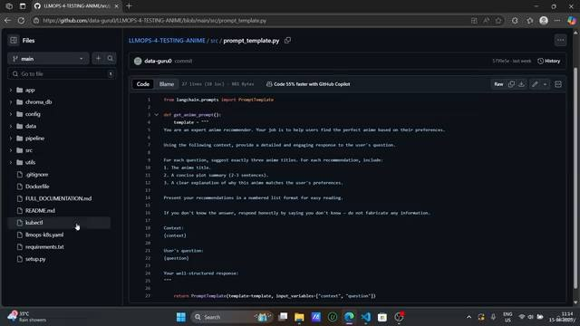
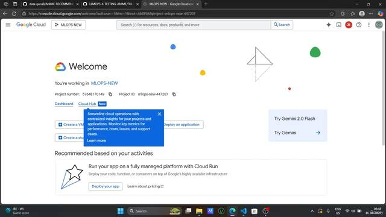
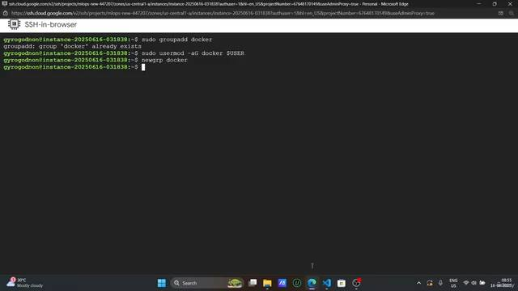
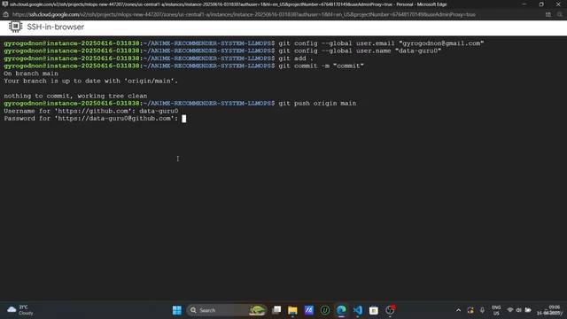
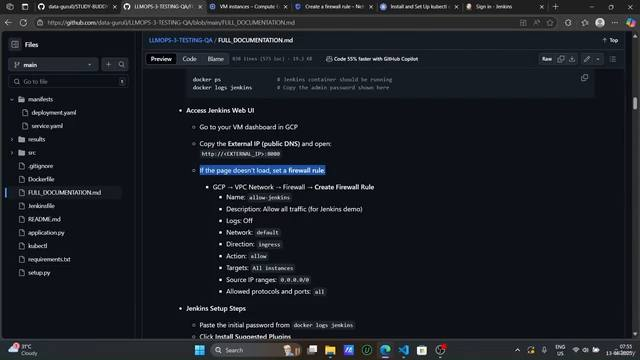
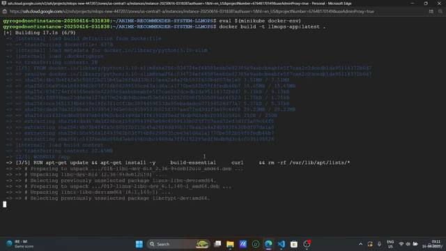
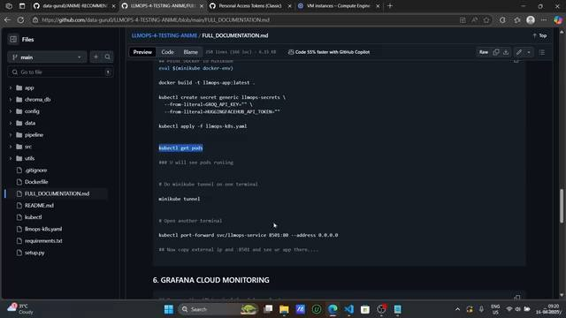
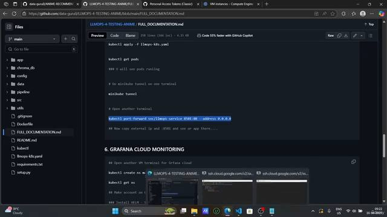

# LLMOps & AIOps Bootcamp（P042–P046）复现文档：把 Streamlit 应用容器化并部署到 GCP + Minikube

> 覆盖范围：P042 Dockerfile / Kubernetes 清单 / GitHub 版本化，P043 GCP VM + Docker + Minikube + kubectl，P044 GitHub 与 VM 互链，P045 GCP 防火墙，P046 构建镜像、注入 Secret、部署并验证。
>
> 阅读前提：你已经有一个能本地跑起来的 Streamlit 应用仓库（课里叫 `anime-recommender-system-llmops`），里面有 `app.py`、`setup.py`、`requirements.txt`、`config/`、`data/`、`pipeline/` 等。本文只复现“把它部署上去”这一段，应用本身的业务代码课里没有重讲。

---

## 1. 这一节做什么

这一节的目标不是再写一个 AI 应用，而是把一个**已经能在本地 `streamlit run app.py` 跑起来的应用**，变成“别人打开浏览器就能用”的在线服务。整条链路是：

1. 在项目根目录写 `Dockerfile`，把 Python 3.10 + 依赖 + 代码打进镜像，暴露 Streamlit 默认的 `8501` 端口。
2. 写一个 `k8s.yaml`，同时包含 `Deployment` 和 `Service`：`Deployment` 负责跑几个副本、用哪个镜像、怎么注入密钥；`Service` 负责把 Pod 的 `8501` 暴露成 `80`，类型选 `LoadBalancer`。
3. 写 `.gitignore`，保证 `.env`、大数据目录、日志、包管理缓存不会进 GitHub。
4. 在 GCP 上开一台 Ubuntu 24.04 LTS 的 VM（4 vCPU / 16 GB / 150 GB），SSH 进去装 Docker Engine、Minikube、kubectl。
5. 把 GitHub 仓库 clone 到 VM，并配置好 git 身份 + Personal Access Token，让“本地 push → VM pull”能跑通。
6. 在 GCP 控制台加一条防火墙规则，允许 `0.0.0.0/0` 访问所有端口。
7. 在 VM 里把 Docker 指向 Minikube 的 Docker daemon，`docker build` 出本地镜像；用 `kubectl create secret` 注入 Groq / Hugging Face 的 key；`kubectl apply -f k8s.yaml`；`minikube tunnel` + `kubectl port-forward` 把服务暴露到 VM 外部 IP，最后在浏览器用 `<VM外部IP>:8501` 验证。

最终产出物是四个文件/对象：`Dockerfile`、`k8s.yaml`、`.gitignore`、Kubernetes 里的 `llmopssecrets` Secret；以及一台装好 Docker + Minikube 的 GCP VM。



---

## 2. 讲师原话（带出处）

下面这些原话决定了后面所有文件为什么长那样，先看再动手：

- 关于 Dockerfile 的位置和用途：
  > “Docker file in the root directory, you will create one Docker file so that you can later dockerize your project and deploy it to your Kubernetes server.”
  > —— p042 [00:00]

- 关于 `pip install` 为什么要加 no-cache：
  > “you are running your setup.py file… because setup.py file will install all your requirements… That's why we are running pip install… but why we have written this? No cache dir. So that we will get a fresh restart. It will not use the cache.”
  > —— p042 [01:25]

- 关于端口 8501：
  > “we will expose our port 8501. You already know streamlit basically runs on port 8501.”
  > —— p042 [01:53]

- 关于 `0.0.0.0` 和 `headless`：
  > “server address 0.0.0.0… means anywhere you can use any IP… when we are doing a production grade project.”
  > “by default it is false… it will automatically open a browser… we don't want it in our production grade… setting it to server headless equal to true.”
  > —— p042 [03:17] / [04:16]

- 关于 Kubernetes 文件由两部分组成：
  > “your Kubernetes file consists of two things. One is deployment, one is service. You can either make a secret file for deployment and separate file for service or you can merge them into one.”
  > —— p042 [05:45]

- 关于 Service 类型：
  > “One is cluster IP, one is node port, one is load balancer. Cluster IP is used when you have to deploy an app internally… Node port and load balancer allows you to access them externally… load balancing works the best.”
  > —— p042 [08:11]

- 关于密钥不能进 GitHub：
  > “we can't push the Groq API or hugging face API on our GitHub… during the Docker file creation, in container creation, we don't have any ENV file inside the Docker image… we will inject these environment variables directly inside our Kubernetes cluster.”
  > —— p042 [09:37]

- 关于 `imagePullPolicy`：
  > “we are not using any container registry… we will be using a local image… so that's why we have written this image pull policy if not present. So it means if you first of all fetch the local image, it will find on the machine list, then it will fetch from outside.”
  > —— p042 [10:33]

- 关于 VM 规格：
  > “select e2… it is low cost… 16 GB memory, 4 CPUs… minikube requires 2 CPUs… 2 will be used by minikube and the rest of the 2 will be for computation.”
  > “Ubuntu… 24.04 LTS… x86_64… 25 version is quite new and it is unstable.”
  > —— p043 [00:58] / [01:27]

- 关于 Docker 权限：
  > “if I run this command only `docker run hello world`… it will give me an error docker permission denied… Docker is installed it cannot run independently. It requires this sudo command.”
  > —— p043 [05:45]

- 关于 GitHub 密码不能用登录密码：
  > “now it's asking for the password. Don't give your normal password… just go to your GitHub… developer settings… personal access token… generate the new token classic.”
  > —— p044 [02:45]

- 关于防火墙：
  > “source IP4 ranges, you have to write 0.0.0.0/0. And you have to allow all the ports.”
  > —— p045 [01:23]

- 关于把 Docker 指向 Minikube：
  > “what this command is basically doing, it is pointing our Docker over Minikube so that our Docker… has to build images for Minikube.”
  > —— p046 [00:00]

- 关于 Secret 和部署：
  > “it will basically inject your environment variables inside your Kubernetes cluster… your llmops secret created… now we have to apply your this file `kubectl apply -f k8s.yaml`… a deployment file has been created, a service has been created.”
  > —— p046 [02:53] / [03:22]

- 关于对外访问：
  > “just write this command `minikube tunnel`… now your this terminal is out of use… now we are forwarding our llmops service… port forwarding it to 8501.”
  > —— p046 [04:49] / [05:47]

---

## 3. 从零复现

下面按“你在哪台机器上做什么”来分阶段。命令里 `<尖括号>` 的部分要替换成你自己的值。

### 阶段 0：前置条件

- 本地已经有一个能跑的 Streamlit 项目目录，根目录下有 `app.py`、`setup.py`、`requirements.txt`。
- 有 GitHub 账号。
- 有 GCP 账号且已开通结算（课里提到新账号有 $300 免费额度，p043 [01:27]）。
- 本地装好 Git；VM 上的操作全部通过浏览器里的 SSH 终端完成。

### 阶段 1：在本地项目根目录创建三个文件

目录结构（只列逐字稿里出现过的条目）：

```text
anime-recommender-system-llmops/
├── Dockerfile          # 本阶段新建
├── .gitignore          # 本阶段新建
├── k8s.yaml            # 本阶段新建
├── app.py              # 已有，内部会 load_dotenv
├── setup.py            # 已有
├── requirements.txt    # 已有
├── config/             # 已有
├── data/               # 已有
└── pipeline/           # 已有
```

三个文件的完整内容见第 4 节。创建完后执行：

```bash
git init
git branch -M main
```

然后去 GitHub 网页新建仓库，**不要勾选** “Add a README file / .gitignore / license”，否则页面上不会直接给你下面这几条命令（p042 [13:26] 讲师特别提醒过）。创建后把仓库地址接上：

```bash
git remote add origin https://github.com/<你的用户名>/anime-recommender-system-llmops.git
git add .
git commit -m "init: dockerfile + k8s manifest + gitignore"
git push origin main
```

### 阶段 2：创建 GCP VM 并 SSH 登录

在 GCP 控制台搜索 “VM instances” → Create instance：

| 配置项 | 课里选的值 |
|---|---|
| 机器系列 | `E2`（低成本的通用型） |
| 机器类型 | 标准，约 4 vCPU / 16 GB 内存 |
| 操作系统 | Ubuntu |
| 版本 | `24.04 LTS` |
| 架构 | `x86_64` |
| 磁盘 | 150 GB |
| 网络 | 勾选允许 HTTP / HTTPS 流量，并启用 IP forwarding |

创建后等状态变绿，点 “SSH” 会在浏览器里打开终端。第一次会传输密钥并要求授权，点 Authorize 即可。



### 阶段 3：在 VM 里安装 Docker Engine

逐字稿的做法是：浏览器打开 Docker 官方 “Install Docker Engine on Ubuntu” 页面，按顺序复制命令到 SSH 终端。课里没有逐字念出命令文本，所以这里给出官网同款命令形态，**以你打开官网当时显示的为准**：

```bash
# 1) 设置 Docker 的 apt 仓库（官网 "Set up the repository" 整段，一次性粘贴）
sudo apt-get update
sudo apt-get install -y ca-certificates curl
sudo install -m 0755 -d /etc/apt/keyrings
sudo curl -fsSL https://download.docker.com/linux/ubuntu/gpg -o /etc/apt/keyrings/docker.asc
sudo chmod a+r /etc/apt/keyrings/docker.asc
echo "deb [arch=$(dpkg --print-architecture) signed-by=/etc/apt/keyrings/docker.asc] https://download.docker.com/linux/ubuntu $(. /etc/os-release && echo "$VERSION_CODENAME") stable" | sudo tee /etc/apt/sources.list.d/docker.list > /dev/null
sudo apt-get update

# 2) 安装 Docker 包（官网第二条命令，问 y/n 时输入 y）
sudo apt-get install -y docker-ce docker-ce-cli containerd.io docker-buildx-plugin docker-compose-plugin
```

安装完直接跑 `docker run hello-world` 会报 `permission denied`，因为当前用户不在 `docker` 组。接着按官网 “Post-installation steps” 的 4 条命令执行（课里 p043 [06:45] 说的是“copy these four commands again and again”）：

```bash
sudo groupadd docker
sudo usermod -aG docker $USER
newgrp docker
docker run hello-world
```

最后一条是验证命令，输出 `Hello from Docker!` 就说明不用 `sudo` 也能跑 Docker 了。再按官网 “Configure Docker to start on boot with systemd” 的两条命令，让 VM 重启后 Docker 自动起来：

```bash
sudo systemctl enable docker.service
sudo systemctl enable containerd.service
```

检查版本：

```bash
docker version
```

能看到 Client 和 Server 两段版本信息即成功。



### 阶段 4：在 VM 里安装 Minikube 和 kubectl

先装 Minikube（讲师强调必须先装 Docker，因为 Minikube 依赖 Docker，p043 [09:04]）。官网选 Linux x86-64 stable binary，两条命令：

```bash
curl -LO https://storage.googleapis.com/minikube/releases/latest/minikube-linux-amd64
sudo install minikube-linux-amd64 /usr/local/bin/minikube
```

然后启动集群：

```bash
minikube start
```

再装 kubectl。课里用的是 Ubuntu 自带的 snap（p043 [11:24] 说 “Ubuntu have this snap by default installed”）：

```bash
sudo snap install kubectl --classic
kubectl version --client
```

`kubectl version --client` 会打印 Client Version，说明 kubectl 可用。

### 阶段 5：把 GitHub 仓库 clone 到 VM，并打通 push/pull

在 VM 的 SSH 终端里：

```bash
git clone https://github.com/<你的用户名>/anime-recommender-system-llmops.git
cd anime-recommender-system-llmops
ls
```

`ls` 应该能看到 `Dockerfile`、`k8s.yaml`、`app.py`、`config`、`data`、`pipeline`、`requirements.txt`、`setup.py`。

配置 git 身份（把邮箱和用户名换成你自己的）：

```bash
git config --global user.email "<你的邮箱>"
git config --global user.name "<你的 GitHub 用户名>"
```

然后随便改一个文件，`git add . && git commit -m "test" && git push`。第一次 push 会要用户名和密码：**用户名填 GitHub 用户名，密码不能填登录密码**，要去 GitHub → Settings → Developer settings → Personal access tokens → Tokens (classic) → Generate new token (classic)，勾选课里说的那几项权限（repo、workflow、admin:org、admin:repo_hook 等），生成后把 token 当密码粘贴进去（输入时不可见）。

验证同步：本地新建 `test.py` → 本地 `git add . && git commit -m "test" && git push origin main` → VM 里 `git pull origin main` → `ls` 能看到 `test.py`。删掉再走一遍，VM 里 `git pull` 后文件消失，说明三端（本地 / GitHub / VM）已经互通。



### 阶段 6：加 GCP 防火墙规则

GCP 控制台搜索 “Firewall” → Create firewall rule：

| 字段 | 值 |
|---|---|
| 名称 | 任意，例如 `allow-all-llmops` |
| 网络 | `default` |
| 方向 | `Ingress` |
| 操作 | `Allow` |
| 目标 | 网络中的所有实例 |
| 来源过滤器 | `IPv4 ranges` |
| 来源 IPv4 范围 | `0.0.0.0/0` |
| 协议和端口 | 全部允许 |

创建后这条规则立即生效。这一步是为了后面从你自己的电脑用 `<VM外部IP>:8501` 访问服务。



### 阶段 7：构建镜像、注入 Secret、部署、暴露端口

以下命令全部在 VM 里、且当前目录是仓库根目录（`cd ~/anime-recommender-system-llmops`）。

**7.1 把 Docker 指向 Minikube 的 daemon**

```bash
eval $(minikube docker-env)
```

这条命令执行后，当前终端里的 `docker` 命令操作的是 Minikube 内部的 Docker，而不是宿主机的 Docker。**每开一个新终端都要重新执行一次**，否则镜像会 build 到宿主机上，K8s 里看不到。

**7.2 构建镜像**

```bash
docker build -t llamalimopsapp:latest .
docker images
```

`docker images` 里应该出现 `llamalimopsapp:latest`，课里显示大小约 6.7 GB（取决于你的依赖）。



**7.3 创建 Secret**

先确认 `app.py` / `config` 里读取的环境变量名到底是什么（课里没有展示 `app.py` 的具体变量名，只说“copy your Groq API”“copy your hugging face token”，并强调粘贴到引号之间）。假设你的代码读的是 `GROQ_API_KEY` 和 `HUGGINGFACE_TOKEN`，命令是：

```bash
kubectl create secret generic llmopssecrets \
  --from-literal=GROQ_API_KEY='<你的 Groq Key>' \
  --from-literal=HUGGINGFACE_TOKEN='<你的 Hugging Face Token>'
```

成功会输出 `secret/llmopssecrets created`。**Secret 名必须和 `k8s.yaml` 里 `secretRef.name` 完全一致**。

**7.4 部署**

```bash
kubectl apply -f k8s.yaml
kubectl get pods
```

因为 YAML 里同时有 `Deployment` 和 `Service`，会看到 `deployment.apps/llmops created` 和 `service/llmops-service created` 两条输出。`kubectl get pods` 里 Pod 状态变成 `Running` 才继续。



**7.5 开隧道并端口转发**

第一个 SSH 终端执行：

```bash
minikube tunnel
```

这个终端会被占住，不能再用。**另开一个 SSH 终端**连到同一台 VM，执行：

```bash
kubectl get service
kubectl port-forward service/llmops-service 8501:8501
```

第二个终端也会被占住。此时在浏览器访问：

```text
http://<VM 的外部 IP>:8501
```

Streamlit 首次启动会跑初始化 pipeline，需要等一会儿。页面出来后，输入 “anime similar to Naruto” 之类的查询，能返回结果就说明 Groq 和 Hugging Face 的 key 都注入成功了。



> 注意：`kubectl port-forward` 默认只绑 `127.0.0.1`，从 VM 外部访问不到。第 7 节会讲怎么改。课里演示时是直接访问 VM 外部 IP:8501 的，如果你照着做打不开，先看第 7 节第一条。

---

## 4. 完整代码

### 4.1 `Dockerfile`

> 说明：讲师在 p042 逐条解释了每一段的作用，但没有逐字念出完整文件；下面按他讲到的要素还原。`PYTHONDONTWRITEBYTECODE` / `PYTHONUNBUFFERED` 这两个变量名课里只说“一些必备环境变量”，没有点名，属于 Python 镜像的常规写法，可按你的仓库实际内容替换。

```dockerfile
FROM python:3.10-slim

# 课里说“some essential environment variables”，未逐字点名；
# 下面是 Python 镜像常用组合，保证日志实时输出、不生成 .pyc。
ENV PYTHONDONTWRITEBYTECODE=1 \
    PYTHONUNBUFFERED=1

# 容器内工作目录，课里称为 app work directory
WORKDIR /app

# 课里点名要装 curl 等基础依赖；build-essential 未在逐字稿中点名，
# 如果你的依赖里有需要编译的包再加，否则可以删掉这一行。
RUN apt-get update && apt-get install -y --no-install-recommends \
    curl \
    build-essential \
    && rm -rf /var/lib/apt/lists/*

# 把本地项目内容复制进容器工作目录
COPY . .

# 课里：运行 setup.py 安装 requirements / packages / dependencies，
# 并且加 no-cache-dir，避免使用已缓存的包。
RUN pip install --no-cache-dir .

# Streamlit 默认端口
EXPOSE 8501

# 课里逐一解释了这三个参数：端口 8501、地址 0.0.0.0、headless=true
CMD ["streamlit", "run", "app.py", \
     "--server.port=8501", \
     "--server.address=0.0.0.0", \
     "--server.headless=true"]
```

### 4.2 `k8s.yaml`

> 说明：课里是从 GitHub 仓库复制现成文件，然后逐段讲解字段。`apiVersion`、`selector.matchLabels` 这类 Kubernetes 必需样板字段讲师没有逐字念，但缺了文件无法 apply，所以按他讲到的 `kind`、名称、端口、副本数、镜像、`imagePullPolicy`、`envFrom.secretRef` 补全。**所有 `app: llmops` 的标签必须一致**，这是讲师反复强调的（p042 [07:13]）。

```yaml
apiVersion: apps/v1
kind: Deployment
metadata:
  name: llmops
  labels:
    app: llmops
spec:
  # 课里：副本数按 VM 配置来，演示时设为 1
  replicas: 1

  selector:
    matchLabels:
      app: llmops

  template:
    metadata:
      labels:
        app: llmops

    spec:
      containers:
        - name: llmops-container
          # 必须和 docker build -t 的名字一致
          image: llamalimopsapp:latest

          # 课里：优先使用本地镜像，本地找不到再去外部 registry 拉
          imagePullPolicy: IfNotPresent

          ports:
            - containerPort: 8501

          # 课里：从 Secret 注入环境变量，Secret 名 llmopssecrets
          envFrom:
            - secretRef:
                name: llmopssecrets

---
apiVersion: v1
kind: Service
metadata:
  name: llmops-service
  labels:
    app: llmops
spec:
  # 课里：ClusterIP 仅内部访问；NodePort / LoadBalancer 可外部访问；
  # LoadBalancer 效果最好，所以这里选 LoadBalancer
  type: LoadBalancer

  selector:
    app: llmops

  ports:
    - protocol: TCP
      # 课里：外部端口 80
      port: 80
      # 课里：目标端口是 Streamlit 的 8501，和 containerPort 一致
      targetPort: 8501
```

### 4.3 `.gitignore`

> 说明：讲师明确点名了 `env`（体积大，GitHub 不收）、`logs`、包管理目录、`.env` 四类。包管理目录的具体路径他说“copy its relative path”，没有念出名字，下面用注释留了位置。

```gitignore
# 数据/虚拟环境目录：体积大，GitHub 不接受（p042 [11:59]）
env/

# 日志：没必要推送
logs/

# 包管理缓存目录：课里说“copy its relative path，give a slash here”
# 具体目录名以你项目实际为准，常见如下，按需保留
*.egg-info/
__pycache__/

# 环境变量文件：绝不能推，推了 key 会被自动禁用（p042 [12:27]）
.env
```

### 4.4 部署命令清单（可直接按顺序粘贴）

> 这些不是“文件”，但复现时按块执行最省事。`<...>` 全部替换成你自己的值；`eval $(minikube docker-env)` 每个新终端都要重跑。

```bash
# ---------- 在 VM 上，仓库根目录 ----------

# 1. 指向 Minikube 的 Docker
eval $(minikube docker-env)

# 2. 构建镜像
docker build -t llamalimopsapp:latest .
docker images

# 3. 创建 Secret（变量名以 app.py / config 实际读取的为准）
kubectl create secret generic llmopssecrets \
  --from-literal=GROQ_API_KEY='<你的 Groq Key>' \
  --from-literal=HUGGINGFACE_TOKEN='<你的 Hugging Face Token>'

# 4. 部署
kubectl apply -f k8s.yaml
kubectl get pods

# 5. 终端 A：开隧道（会占住终端）
minikube tunnel

# 6. 终端 B：端口转发（会占住终端）
kubectl get service
kubectl port-forward service/llmops-service 8501:8501

# 7. 浏览器访问
# http://<VM 外部 IP>:8501
```

---

## 5. 逐行解释

### 5.1 Dockerfile 逐行

- `FROM python:3.10-slim`：课里明确说用 Python 3.10 slim 镜像（p042 [00:27]）。slim 版本体积小，但很多编译工具没有，所以下一段要装 `curl` 等基础包。
- `ENV PYTHONDONTWRITEBYTECODE=1` / `PYTHONUNBUFFERED=1`：课里只说“一些必备环境变量”，没有点名。前者的作用是容器里不生成 `__pycache__`，后者的作用是 Python 日志不缓冲、`docker logs` 能实时看到。这两个不是业务必需，但部署后排错会轻松很多。
- `WORKDIR /app`：容器里的工作目录。后面 `COPY . .` 会把项目复制到这里，`CMD` 里的 `app.py` 也是相对这个目录找。
- `RUN apt-get update && apt-get install -y --no-install-recommends curl ...`：课里说“install all your dependencies like curl, essential libraries”。`--no-install-recommends` 是为了少装推荐包、控制镜像体积；`rm -rf /var/lib/apt/lists/*` 是清 apt 缓存，同样是减体积。
- `COPY . .`：把本地项目根目录所有内容复制进 `/app`。注意这一步会受 `.dockerignore` 影响；课里没有讲 `.dockerignore`，所以默认会把 `env/`、`logs/` 也复制进去，镜像会偏大——这是第 7 节要说的坑。
- `RUN pip install --no-cache-dir .`：课里的原话是“running your setup.py file… pip install… no cache dir”。`.` 表示从当前目录的 `setup.py` 安装，`--no-cache-dir` 保证不使用 pip 缓存，拿到的是全新依赖。如果你的项目只有 `requirements.txt` 没有 `setup.py`，这里要改成 `pip install --no-cache-dir -r requirements.txt`。
- `EXPOSE 8501`：声明容器监听 8501。`EXPOSE` 本身不发布端口，只是文档性质；真正让外部访问的是 K8s 的 `containerPort` / `targetPort` 和 `port-forward`。
- `CMD [...]`：课里说 Dockerfile 里一般只写一条启动命令，并且这条命令就是 `streamlit run app.py`。三个参数的含义他逐个讲了：
  - `--server.port=8501`：Streamlit 默认端口，和 `EXPOSE` 对应。
  - `--server.address=0.0.0.0`：监听所有网卡。如果不写，默认只监听 `localhost`，容器外访问不到。课里原话是“0.0.0.0 means anywhere you can use any IP”。
  - `--server.headless=true`：不自动弹浏览器。默认是 `false`，本地开发时命令一跑就会打开浏览器；生产 Linux 机器上没有浏览器，可能报依赖错误，所以关掉。

> 在 Node 里类比：`--server.address=0.0.0.0` 相当于 Express 的 `app.listen(8501, '0.0.0.0')`，只写 `app.listen(8501)` 时默认绑 `localhost`，容器外一样访问不到。

### 5.2 `k8s.yaml` 逐块

- `apiVersion: apps/v1` + `kind: Deployment`：课里明确说文件由 Deployment 和 Service 两部分组成，这里用 `---` 分隔。他提到也可以拆成两个文件（另一个项目 StudyBuddy AI 里就是这么做的），本项目合并成一个。
- `metadata.name: llmops`：应用名。讲师反复强调：**这个名称要和后面 Pod 模板的 `app` 标签、Service 的 selector 保持一致**，否则 Service 找不到 Pod。
- `spec.replicas: 1`：副本数。课里说按 VM 配置可以设 1、2、3、4，演示时设 1。Kubernetes 会根据这个数字维持对应数量的 Pod。
- `selector.matchLabels.app: llmops`：Deployment 用它来认领自己管理的 Pod。
- `template.metadata.labels.app: llmops`：Pod 被打上这个标签，上面的 selector 和下面的 Service selector 都靠它匹配。
- `containers[0].name: llmops-container`：容器名，课里点名。
- `image: llamalimopsapp:latest`：必须是 `docker build -t` 时用的名字。课里口述的镜像名听写有偏差（“AlalimaOpsAppLatest”），以你实际 build 的 tag 为准，两处必须一致。
- `imagePullPolicy: IfNotPresent`：课里重点解释的一段。默认策略会去外部 registry 拉镜像；但本项目没有用容器 registry，镜像是 build 在 Minikube 内部 Docker 里的本地镜像，所以必须设成“本地有就用本地，没有才去拉”。如果写成 `Always`，K8s 会尝试从 Docker Hub 拉 `llamalimopsapp:latest`，直接 `ImagePullBackOff`。
- `ports.containerPort: 8501`：容器实际监听的端口，和 Dockerfile 的 `EXPOSE` 一致。课里说“whatever you set the target port, same will be the container port”。
- `envFrom.secretRef.name: llmopssecrets`：把名为 `llmopssecrets` 的 Secret 里所有键值对注入成容器环境变量。课里说“we are setting environments from secret reference… we will name that injection as llmopssecrets”。另一种写法是 `env[].valueFrom.secretKeyRef`，只注入指定 key，课里没有用这种写法。
- `kind: Service` + `type: LoadBalancer`：课里比较了 ClusterIP（仅集群内部）、NodePort、LoadBalancer 三种，结论是“LoadBalancer 效果最好”，因为要让所有人从公网访问。
- `selector.app: llmops`：必须和 Pod 标签一致，否则 Service 的 Endpoints 为空。
- `ports.port: 80` / `targetPort: 8501`：外部访问 80，转发到容器 8501。课里原话“keep it TCP port is 80 and target port should be for your streamlit that is 8501”。

> 在 Node 里类比：Deployment 相当于用 PM2 cluster 模式起 N 个相同的 Node 进程；Service 相当于前面挂一个 Nginx 反向代理，把 80 转到 8501；`imagePullPolicy: IfNotPresent` 相当于“优先用本地 `node_modules`，没有再 `npm install`”。

### 5.3 `.gitignore` 逐行

- `env/`：课里说这个目录“quite big in size, GitHub can't accept it”。通常是数据文件或虚拟环境，不能进仓库。
- `logs/`：课里说“unnecessary”，日志不应该进版本库。
- `*.egg-info/`、`__pycache__/`：对应课里“package management”这一类。讲师说“copy its relative path, give a slash here”，没有念出具体目录名，所以这里给的是 Python 项目最常见的两个，按你项目实际补。
- `.env`：课里最关键的一条。原话是“as soon as you push your environment variables to GitHub, automatically disables your particular API key”。所以 `.env` 必须忽略，密钥只能通过 K8s Secret 注入。

### 5.4 关键命令逐条

- `git branch -M main`：把默认分支重命名为 `main`，和 GitHub 新建仓库的默认分支对齐。课里口述听起来像“git branch admin”，实际是 `-M main`。
- `git remote add origin ...`：把本地仓库和 GitHub 远程仓库连起来。
- `git push origin main`：第一次 push 会弹用户名/密码。密码位置填 Personal Access Token，不填登录密码。课里强调 token 要勾 `repo`、`workflow`、`admin:org`、`admin:repo_hook` 等权限，否则 push 会被拒。
- `eval $(minikube docker-env)`：把当前 shell 的 `DOCKER_HOST` 等环境变量指向 Minikube 内部的 Docker daemon。它只影响当前终端；新开终端要重跑。不跑这条，`docker build` 出来的镜像在宿主机 Docker 里，Minikube 的 K8s 看不到。
- `docker build -t llamalimopsapp:latest .`：最后的 `.` 是构建上下文，必须在仓库根目录执行，因为 `Dockerfile` 在这里。
- `kubectl create secret generic llmopssecrets --from-literal=...`：把 key 写进 K8s Secret。Secret 名和 `k8s.yaml` 的 `secretRef.name` 必须一字不差。`--from-literal` 的值里有特殊字符时用单引号包住。
- `kubectl apply -f k8s.yaml`：按文件里的 `---` 依次创建 Deployment 和 Service，所以会看到两条 created 输出。
- `kubectl get pods`：看 Pod 是否 `Running`。如果一直 `ImagePullBackOff`，回去检查 `imagePullPolicy` 和镜像 tag；如果 `CrashLoopBackOff`，用 `kubectl logs <pod名>` 看应用报错。
- `minikube tunnel`：给 `LoadBalancer` 类型的 Service 分配一个可达的 external IP。这个命令会占住终端，关掉隧道就断。
- `kubectl port-forward service/llmops-service 8501:8501`：把本地 8501 转发到 Service 的 8501。默认只绑 `127.0.0.1`，从 VM 外部访问要加 `--address 0.0.0.0`，见第 7 节。

---

## 6. 复现检查清单

按顺序打勾，哪一步不过就停在那里排查，不要往下走。

- [ ] 本地项目根目录有 `Dockerfile`、`k8s.yaml`、`.gitignore` 三个文件。
- [ ] `git push origin main` 成功，GitHub 网页上能看到这三个文件，且**看不到** `.env`。
- [ ] GCP VM 状态为绿色运行中，SSH 能打开浏览器终端。
- [ ] `docker version` 能同时打印 Client 和 Server 两段。
- [ ] 不加 `sudo` 执行 `docker run hello-world` 成功输出 `Hello from Docker!`。
- [ ] `minikube start` 成功，`kubectl version --client` 有输出。
- [ ] VM 里 `git clone` 成功，`ls` 能看到 `Dockerfile` 和 `k8s.yaml`。
- [ ] VM 里 `git pull origin main` 能同步本地新 push 的文件。
- [ ] GCP 防火墙规则已创建：Ingress / Allow / `0.0.0.0/0` / 全部端口。
- [ ] `eval $(minikube docker-env)` 之后 `docker images` 能看到 `llamalimopsapp:latest`（约 6–7 GB）。
- [ ] `kubectl create secret generic llmopssecrets ...` 输出 `secret/llmopssecrets created`。
- [ ] `kubectl apply -f k8s.yaml` 输出 deployment 和 service 两条 created。
- [ ] `kubectl get pods` 中 Pod 为 `Running`，READY 为 `1/1`。
- [ ] `kubectl get service` 能看到 `llmops-service`，类型 `LoadBalancer`。
- [ ] `minikube tunnel` 在一个终端里持续运行。
- [ ] `kubectl port-forward service/llmops-service 8501:8501` 在另一个终端里持续运行。
- [ ] 浏览器访问 `http://<VM 外部 IP>:8501` 能打开 Streamlit 页面。
- [ ] 输入一个查询（如 “anime similar to Naruto”）能返回结果，说明 Groq 和 Hugging Face key 注入成功。

---

## 7. 课里没讲但你会撞上的

1. **`kubectl port-forward` 默认只绑 `127.0.0.1`，从 VM 外部访问不到。**
   课里演示时是直接访问 `<VM 外部 IP>:8501` 的，但标准 `port-forward` 只监听本机回环。如果你照着做浏览器打不开，把命令改成：
   ```bash
   kubectl port-forward --address 0.0.0.0 service/llmops-service 8501:8501
   ```
   或者干脆用 `minikube service llmops-service --url` 拿隧道分配的地址。课里没有讲 `--address` 这个参数。

2. **`eval $(minikube docker-env)` 只对当前终端生效。**
   新开一个 SSH 终端后直接 `docker build`，镜像会 build 到宿主机 Docker，`kubectl get pods` 就会 `ImagePullBackOff`。每开新终端先重跑这一条。

3. **`imagePullPolicy` 和 `:latest` 的组合坑。**
   课里设 `IfNotPresent` 是对的，但如果你改了代码重新 build 了同名 `:latest`，K8s 可能仍用旧镜像。稳妥做法是 `kubectl rollout restart deployment/llmops`，或者每次 build 用不同 tag 并同步改 YAML。

4. **Secret 里的 key 名必须和 `app.py` 读取的变量名一致。**
   课里只说了“copy your Groq API / hugging face token，paste between quotes”，没有展示 `app.py` 里 `os.getenv(...)` 的具体名字。`envFrom` 会把 Secret 的 key 原样变成环境变量名，名字对不上应用就读到 `None`。先去仓库里搜 `getenv` / `os.environ` 确认。

5. **`.dockerignore` 课里没讲。**
   没有它，`COPY . .` 会把 `env/`、`logs/`、`.git/` 全复制进镜像，镜像会比课里说的 6.7 GB 更大，build 也更慢。建议在根目录加一个 `.dockerignore`，内容至少包含 `env`、`logs`、`.git`、`__pycache__`、`.env`。

6. **GCP 的 e2 机型在某些区域可能没有 4 vCPU / 16 GB 的组合。**
   课里让选 e2 + 16 GB + 4 CPU，如果创建时报配额不足，换区域或先申请配额。另外 150 GB 磁盘和 4 vCPU 的机器是按小时计费的，课里提到约 $0.15/小时，练习完记得停机，否则免费额度会烧完。

7. **防火墙规则只对 `default` 网络生效。**
   课里让网络保持 `default`。如果你的 VM 建在自定义 VPC 里，这条规则不会命中，需要把网络改成对应 VPC。

8. **Streamlit 首次启动慢是正常的。**
   课里 p046 [06:45] 说“it is running our init pipeline… because it is running for the first time, it will take some time”。页面白屏或转圈时先等 1–2 分钟，不要急着判定失败；用 `kubectl logs <pod名>` 能看到初始化进度。

9. **`minikube tunnel` 和 `port-forward` 两个终端都不能关。**
   关掉隧道，`LoadBalancer` 的 external IP 就没了；关掉 port-forward，8501 就断了。这是本地演示方案，不是长期生产方案——课里也没有讲 Ingress、域名、HTTPS 这些，属于“课里没讲”的范围。

10. **GitHub 的 classic token 权限勾选。**
    课里说勾 `repo`、`workflow`、`admin:org`、`admin:repo_hook` 等六项。实际最小权限只需要 `repo` 就能 push；勾多了权限更大，练习时够用，但不要把这个 token 提交到任何文件里。

11. **在 Node/前端视角下对应什么。**
    - Docker 镜像 ≈ 把 `node_modules`、代码、启动命令打成一个不可变包；
    - Kubernetes Deployment ≈ PM2 cluster / 多实例进程管理；
    - Service ≈ Nginx 反向代理 + 负载均衡；
    - Secret ≈ Vercel / Netlify 的环境变量面板，只是注入发生在集群侧；
    - `port-forward` ≈ 本地 `ngrok` 或 SSH 端口映射。
    知道这些类比即可，课里没有展开讲 K8s 的其它对象（Ingress、ConfigMap、HPA 等），不要把它们安到这节课上。