# LLMOps & AIOps Bootcamp（P47–P49）：把 Minikube 集群接进 Grafana Cloud，并拆解下一个项目的技术选型

> 本文覆盖 P47（Grafana Cloud 监控实操）、P48（环境清理）、P49（下一个项目 Flipkart 商品推荐系统的选型与工作流总览）。
> 术语约定：逐字稿是英文自动转写，把 **Groq** 转成 “grok”、**Llama 3.3** 转成 “lava 3.3”、**values.yaml** 转成 “values.eml”、**NodePort** 转成 “node code”、**Secret** 转成 “primitive file”。文中一律用正确写法，并在第一次出现处标注转写原文。

---

## 1. 这一节做什么

这一段课程其实是「收尾 + 开局」两件事拼在一起的：

**第一件事（P47，主体）：把已经跑起来的 Minikube 集群，接进 Grafana Cloud 做监控。**
你手上已经有一个 GCP 虚拟机、里面用 Minikube 起了单节点集群、default 命名空间里跑着上一节的 LLMOps 应用。P47 要做的不是自己装一套 Prometheus/Grafana，而是**用 Helm 把 Grafana Cloud 生成的采集器（k8s-monitoring chart）装进集群**，让集群的 namespace、workload、容器、节点数据自动上报到云端 Grafana，然后在浏览器里看面板。这条路线适合「我只想快点看到监控，不想自己维护监控栈」的场景。

**第二件事（P48）：清理。** 删掉 GCP 上的 VM 实例，Grafana Cloud 那边的 Kubernetes 监控会自动失效、回到「Start sending data」的初始引导页。

**第三件事（P49）：下一个项目的总览。** 讲师没有写任何代码，纯讲：Flipkart 商品推荐系统用什么技术栈、为什么要用、整个项目按什么顺序做（API setup → 配置 → 数据转换 → 数据入库 → RAG 链 → 应用 → Dockerfile → K8s 部署文件 → ConfigMap/Secret → Grafana 部署文件 → Prometheus 部署文件 → GitHub → GCP 装环境 → 部署 → 监控）。这一节和 P47 的关系是：**P47 用的是 Grafana Cloud 托管方案，P49 的项目用的是自建 Prometheus + Grafana 方案**，讲师原话说这两块是整个项目里最重要的部分。

学完这一段，你应该能：① 独立把任意一个 K8s 集群接进 Grafana Cloud；② 说清楚下一个项目每一层用什么、为什么这么选；③ 知道每一步的产出物是什么文件。

---

## 2. 讲师原话

> 以下为逐字稿中文译文，括号内保留关键英文原词，方便你对照视频。

**关于为什么要单独开命名空间和终端：**

「首先我们要为监控再建一个命名空间，因为现在所有东西都跑在 default 命名空间里。……我得再开一个终端，因为一个终端被 **minikube tunnel** 占着，另一个被应用的端口转发占着。」—— p047 [00:29]

「你可以看到默认有一个 default 命名空间，你的应用和所有东西都在里面跑，所以我们要另外建一个监控用的命名空间。」—— p047 [00:59]

**关于 Helm：**

「现在你要装 Helm，因为跟 Grafana 打交道的时候一般都需要 Helm。你可以直接谷歌 install helm，进第一个站点，到 **From Script** 那一段，把命令一条一条复制粘贴。」—— p047 [01:28]

**关于 Grafana Cloud 的账号：**

「去搜 Grafana Cloud，我已经注册好了，你要自己注册一个，会拿到大约 **14 天**试用，之后开始收费，但 14 天对我们来说足够用了。」—— p047 [02:54]

**关于接入向导里的集群名和命名空间：**

「在 Grafana Cloud 左边栏有 Observability，里面点 Kubernetes，然后 Start sending data。……在 backend installation 里点 install，然后填你的集群名和命名空间。命名空间就是我们刚在终端建的那个 **monitoring**。」—— p047 [03:45] / [04:11]

「集群名就是 **minikube**，因为你的集群就是用 minikube 建的，minikube 默认集群名就是 minikube。」—— p047 [05:09]

**关于 token：**

「我们要建一个新的 access token，给它起个名字……它创建好之后会把 token 给你，**复制下来存到记事本**，别弄丢了。」—— p047 [06:06]

**关于为什么把 Helm 命令写进文件再执行：**

「这个 Helm chart 生成的这些东西，你其实可以直接复制粘贴到 VM 终端里，但我们不这么做，因为它会给你造成一些麻烦（容易出错）。我们的做法是：在 VM 上建一个文件，把整块内容粘进去，然后再应用那个文件。」—— p047 [06:36] / [07:05]

**关于 values.yaml 的整理规则：**

「把这整块复制下来，贴到记事本里……底部有一个 **EOF**，把它删掉；顶部这一段也切掉、另存到别的地方。文件内容从 cluster 相关字段开始一直到最底部，EOF 之前的部分。」—— p047 [08:03] / [09:02]

「在命令里 `-f values.yaml` 这一句，因为我建的文件叫 values.yaml，所以写 values.yaml；你如果起别的名字，就换成你的文件名。」—— p047 [10:02]

**关于怎么判断装成功了：**

「把整条命令粘到 VM 上回车，你会看到一条 **success** 消息和一条 **revision** 消息，说明成功了。……状态是 **deployed**、revision 是 **1**，说明部署成功。」—— p047 [11:01] / [11:58]

「`kubectl get pods`，你能看到 Grafana 这些 Pod，全都是 2/2、1/1 这样在跑，说明一切正常。」—— p047 [12:26]

**关于看到的结果：**

「现在你已经在 Grafana Cloud 里监控你的 minikube 了，可以看到 **5 个命名空间、13 个 workload、21 个容器**在跑，也能看到我们的 LLMOps 应用也在跑。」—— p047 [13:24]

**关于清理：**

「清理过程很简单：到 VM 实例那里，把它**删掉**。VM 一删，Grafana Cloud 这边的 Kubernetes 监控就会自动失效、回到初始的 Start sending data 页面。」—— p048 [00:00]

「14 天之后是收费的，但费用不算高，公司里一般本来就给 Grafana Cloud，所以不用你自己付。」—— p048 [00:58]

**关于下一个项目里 Prometheus 和 Grafana 的分工：**

「Prometheus 用来抽取你应用里的指标，然后你在 Grafana 里用 dashboard 和可视化把这些指标展示出来。」—— p049 [02:51]

「Prometheus 有两类指标：**内置指标**（比如 CPU 用了多少、内存用了多少、每次抓取的耗时）和**自定义指标**（比如你自己代码里记的某个计数）。」—— p049 [08:27]

「在 Grafana 里做面板时你会有个 query 区，它问你用哪个指标，比如我建了个自定义指标叫 predict count，我就选它，然后取 sum。」—— p049 [11:50]

**关于 Service 类型：**

「Kubernetes 的 Service 有三种类型：ClusterIP、NodePort、LoadBalancer。……我们希望应用能被外网访问，所以把 K8s 文件里的 Service 设成 **LoadBalancer**。」—— p049 [18:34] / [19:04]

---

## 3. 从零复现

### 3.1 P47 部分：把 Minikube 集群接进 Grafana Cloud

#### 前置条件（缺一样都做不下去）

- 一台 Linux（Ubuntu）VM，例如 GCP 的 Compute Engine 实例，能 SSH 进去。
- VM 上已经装好 `docker`、`minikube`、`kubectl`（这三样是 P49 的 “GCP install setup” 阶段装的）。
- Minikube 集群已经启动，上一节的 LLMOps 应用已经部署在 `default` 命名空间，并且你能通过端口转发访问它。
- **至少留出 3 个终端窗口**：按讲师的说法，一个被 `minikube tunnel` 占着、一个被端口转发占着，所以查看/安装命令要用第三个终端。
- 一个 Grafana Cloud 账号（免费试用 14 天）。

> 说明：讲师是在 Windows 上用某个终端工具（逐字稿里叫 “WinniCube Tunnel”，实际应为连接 VM 的终端 + minikube tunnel）连到 VM 上的。你用本地终端 SSH 上去，效果一样。

#### Step 1｜看一眼当前的命名空间

在**新开的第三个终端**里：

```bash
kubectl get ns
```

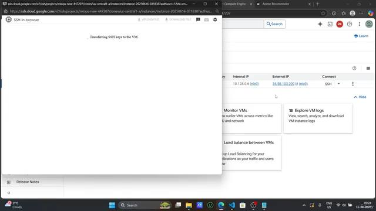

你应该能看到 `default`、`kube-system` 等。讲师强调：目前所有东西（应用、依赖）都在 `default` 里，所以监控要单独开一个命名空间，避免和业务混在一起。

#### Step 2｜建 `monitoring` 命名空间

> 课里没念出这条命令的完整文本——讲师是「打开文档、复制粘贴」过去的，逐字稿只留下「我们建一个叫 monitoring 的命名空间」。等价的标准写法是下面这条；你也可以用 Grafana 文档页里给的那条，效果相同。

```bash
kubectl create namespace monitoring
kubectl get ns
```

执行完再 `kubectl get ns`，列表里应该多出 `monitoring`。

#### Step 3｜装 Helm

讲师的做法：Google 搜 `install helm` → 进官网 → 找到 **From Script** 段落 → 把三条命令**一条一条**复制到终端执行。

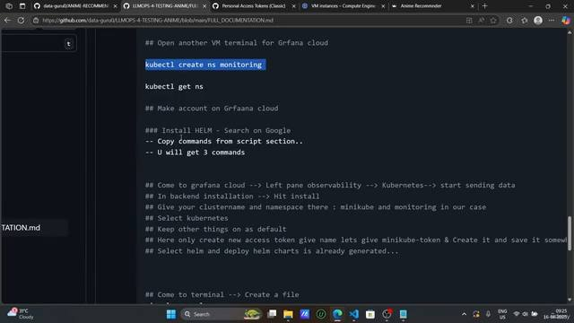

> 下面三条是 Helm 官方 install 页 “From Script” 段的命令形态，**讲师没有逐字念出原文**，请以你打开页面时页面上的实际内容为准：

```bash
curl -fsSL -o get_helm.sh https://raw.githubusercontent.com/helm/helm/main/scripts/get-helm-3
chmod 700 get_helm.sh
./get_helm.sh
```

装完验证：

```bash
helm version
```

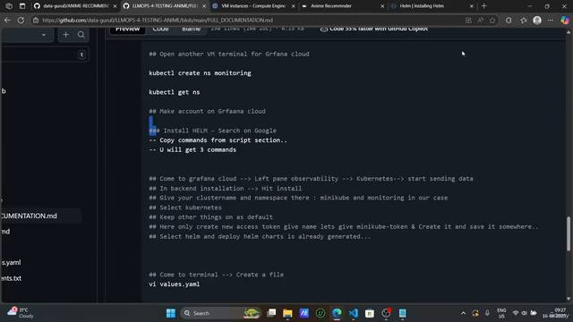

能打印出版本号就说明 Helm 已经在 VM 上了——讲师说「Helm 装到你那边给你的那个路径里了，关键点是它装好了」。

#### Step 4｜注册 / 登录 Grafana Cloud

浏览器打开 Grafana Cloud，注册账号（讲师说免费试用约 14 天，之后收费）。

#### Step 5｜走进接入向导

左侧栏 → **Observability** → **Kubernetes** → **Start sending data**。

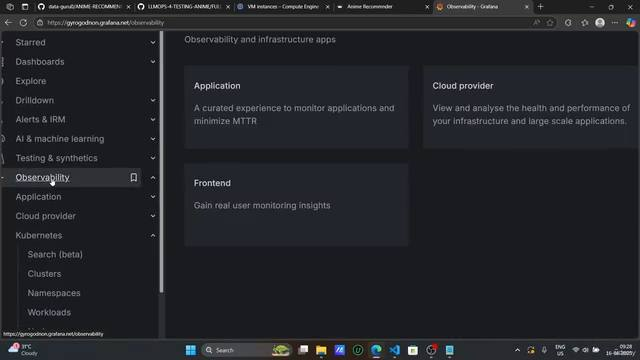

然后在 **backend installation** 卡片里点 **Install**（讲师演示时因为已经装过，所以按钮显示的是 Uninstall，你第一次看到的是 Install）。

接着填两个必填项：

| 字段 | 填什么 | 为什么 |
|---|---|---|
| Cluster name | `minikube` | 集群就是用 minikube 建的，minikube 默认集群名就是 `minikube`（讲师原话） |
| Namespace | `monitoring` | 就是 Step 2 建的那个命名空间 |

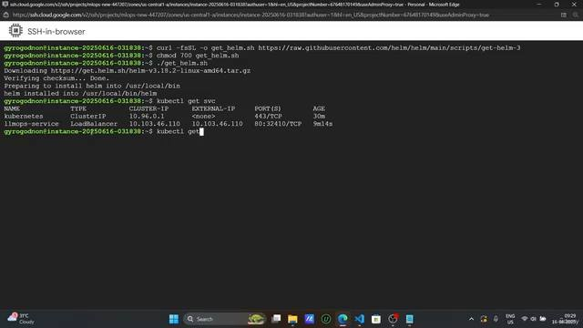

其余选项讲师明确说「**保持默认**」。

#### Step 6｜创建 access token

在向导里点创建新 token，起个名字（讲师试了 `minikube token`，因为已存在，改名成 `Grafana token`），创建后**立刻复制保存到记事本**——讲师反复强调 token 只给你看一次。

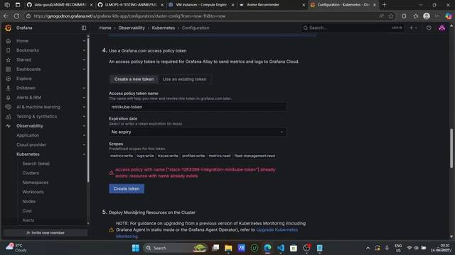

#### Step 7｜生成 Helm 安装命令

到向导第 5 步「deploy monitoring resources on your cluster」，**选择 Helm**（而不是别的安装方式），页面会生成一大段 Helm chart 内容 + 一条安装命令。

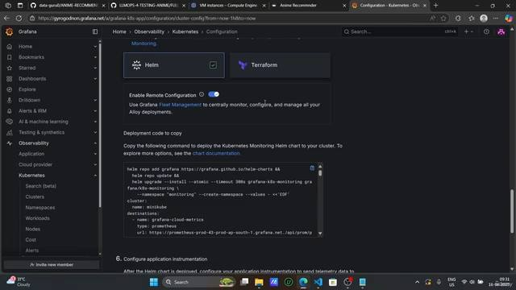

#### Step 8｜把内容落到 VM 上的 `values.yaml`

讲师**没有**直接把整块粘到终端执行，而是：

1. 在 VM 上新建文件：
   ```bash
   vim values.yaml
   ```
2. 把页面上给的整块内容粘进去；
3. **删掉末尾的 `EOF`**（页面上的 heredoc 结束标记，不是文件内容）；
4. **切掉顶部那一段**（那段是 `helm repo add` / `helm install` 的包装层，不是配置本体），另存到别的记事本里，后面还要用；
5. 文件内容应该是从集群相关配置字段开始，一直到最底部、`EOF` 之前；
6. 保存退出：按 `Esc`，输入 `:wq!`，回车。

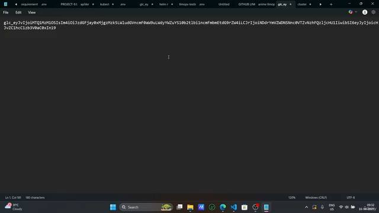

#### Step 9｜改安装命令里的文件名，然后执行

把 Step 8 顶部切下来、另存的那条命令拿出来，把 `-f` 后面的文件名改成你自己的：

```bash
# 讲师原话：如果你文件叫 values.yaml 就写 values.yaml，叫 helm-charts.yaml 就写 helm-charts.yaml
helm upgrade --install <RELEASE_NAME> <CHART_REF> -f values.yaml
```

> ⚠️ `<RELEASE_NAME>`、`<CHART_REF>` 以及 namespace 参数，逐字稿里**没有逐字念出**，它们由 Grafana Cloud 页面生成。**命令正文请以你页面上生成的那一行为准，只改 `-f` 后面的文件名即可。**

粘贴到 VM 终端回车执行。过程会花点时间（讲师说大概 2–5 分钟）。

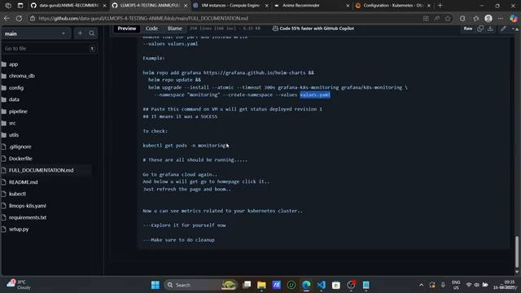

出现 `STATUS: deployed` 和 `REVISION: 1` 一类的回显，说明成功了（讲师原话：状态是 deployed、revision 是 1，说明部署成功）。

#### Step 10｜验证 Pod

```bash
kubectl get pods
```

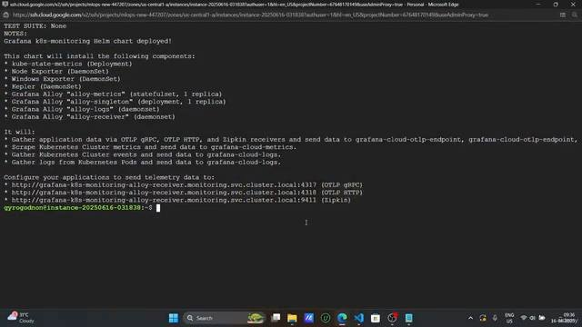

讲师念出的状态是「2/2、2/2、1/1、1/1、2/2、1/1」——即这批 Pod 全部 Running、READY 列都已经满。

> ⚠️ 如果你执行 `kubectl get pods` 什么都没看到，说明你看的是 `default` 命名空间，加上命名空间再试：`kubectl get pods -n monitoring`。这一点**课里没讲**（讲师的环境里命令直接就有输出），但你会撞上。

#### Step 11｜回 Grafana Cloud 看面板

回到 Grafana Cloud → 回首页 → 刷新页面，就能看到集群数据：

- 5 个命名空间
- 13 个 workload
- 21 个容器
- 1 个集群（minikube）、1 个节点
- 能看到你的 `llmops` 应用也在列表里

讲师当时念出的数字是「5 个命名空间、13 个 workload、**17 cores**、21 个容器」——其中这个 “17 cores” 是讲师现场口读，**字段名与具体含义请以你界面上的实际显示为准**。

进去还能看到：workload 列表、容器列表、成本（cost）、告警（alerts）、Configuration 配置页；讲师还演示了在面板上打 debug metrics 看某个 panel 用了哪些指标。

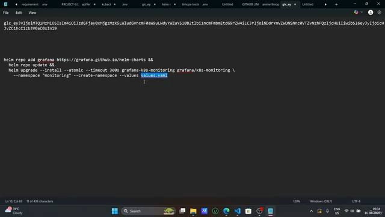

#### Step 12｜清理（P48）

1. 到 GCP 控制台，把 VM 实例**直接删掉**；
2. 回到 Grafana Cloud，Kubernetes 监控会自动失效，页面退回「Start sending data」的初始引导。

### 3.2 P49 部分：把下一个项目的推导过程复现一遍

P49 全程**没有代码**，是项目蓝图。下面按「需求 → 约束 → 估算 → 方案 → 取舍」把讲师的推导复现出来。

#### ① 需求

做一个 **Flipkart 商品推荐系统**：用户用自然语言提问（「我想要一个游戏耳机」「我要 32 寸电视」「我想要这类衣服」），系统返回相关商品。本质是一个 **RAG 应用**：商品数据 → 切块 → 向量化 → 存向量库 → 用户提问时检索 → 交给 LLM 生成回答。

#### ② 约束

- 部署在云上：需要一台能随便折腾的 Linux 机器 → **GCP 虚拟机（Ubuntu）**。
- 需要容器化 + 编排：**Docker** 打镜像，**Minikube** 在单台 VM 里起 K8s 集群，**kubectl** 作为命令行工具操作集群。
- 向量库要能「脱离本机」：讲师反复强调，以前用的 FAISS、Chroma 都是**本地/离线**向量库，这次要一个**在线**向量库 → **AstraDB**，并且对开发测试免费。
- 要能观测：**Prometheus** 抽指标，**Grafana** 做面板。

#### ③ 估算

> 课里没给任何数据规模数字，以下是我替你列的估算公式，用来决定「要开多大机器、要不要分批入库」，不是讲师原话。

- **向量化调用次数** ≈ `ceil(清洗后行数 / batch_size)`。CSV 有 N 行，按 `batch_size` 分批送 Hugging Face embedding 模型，则调用次数 = N / batch_size 向上取整；如果按 chunk 切分，先算 `chunk 数 ≈ 总 token 数 / chunk_size`。
- **向量库容量** ≈ `chunk 数 × 向量维度 × 4 字节`（float32）。例如 1 万个 chunk、768 维 ≈ `10000 × 768 × 4 ≈ 30 MB`，对免费额度来说完全够。
- **Pod 资源**：P49 里讲师说部署文件里要定副本数，但**没给具体数字**；实操上先用 `replicas: 1`（或 2）跑通，后续用 `kubectl top pods` 看实际再调。

#### ④ 方案（讲师给的分层技术栈）

| 层 | 选型 | 讲师给的理由 |
|---|---|---|
| LLM | **Groq**，模型 **Llama 3.3**（逐字稿转写为 “grok / lava 3.3”） | 项目里的「AI 大脑」，负责最终生成 |
| Embedding | **Hugging Face** 上的 embedding 模型 | 把 chunk 转成向量才能存进向量库 |
| GenAI 框架 | **LangChain** | 统一封装「跟 LLM 交互」「跟 embedding 模型交互」 |
| 向量库 | **AstraDB** | 在线向量库，开发测试免费 |
| 后端 | **Flask** | 写路由、处理后台逻辑 |
| 前端 | **HTML / CSS** | 讲师说可以直接让 ChatGPT 生成 |
| 容器 | **Docker** | 把应用打成镜像，方便部署 |
| 编排 | **Minikube + kubectl** | 在 VM 里起 K8s 集群并用命令行操作 |
| 代码托管 | **GitHub**（SCM = source code management） | 代码的「家」，并把改动同步到 VM |
| 云 | **GCP 虚拟机（Ubuntu）** | 「相当于租一台电脑」，可自定义 RAM / 存储 / CPU / GPU |
| 监控 | **Prometheus + Grafana** | Prometheus 抽指标，Grafana 查询并出图 |

#### ⑤ 取舍

- **Grafana Cloud（P47）vs 自建 Prometheus + Grafana（P49）**：前者几分钟接完、不用维护，但 14 天后收费；后者要自己写 deployment 文件、自己配数据源，但完全可控、零订阅费。P49 的项目选后者。
- **离线向量库 vs AstraDB**：离线库（FAISS / Chroma）零成本、纯本地；AstraDB 在线、免费额度够学习用，代价是要管好 token / endpoint / namespace 三个配置。
- **Service 类型**：讲师明说三种类型里，要让应用能被外网访问就用 **LoadBalancer**（NodePort 也行，但他说 LoadBalancer 对外访问「工作得最顺」）。集群内部互相调用的服务才用 ClusterIP。

---

## 4. 完整代码

> 重要说明：P47 的 `values.yaml` 内容是 **Grafana Cloud 页面动态生成的**，逐字稿里没有留下文本，任何人都无法「照抄」出同一份。因此这一节给的是**可直接保存运行的外壳脚本 + 占位符**，你只需要把 Grafana Cloud 生成的两样东西（chart 内容、安装命令）填进标注的位置。P49 部分讲师明确说「这一节不写代码」，所以凡是我补的 YAML 都标注了「课里没有代码，以下为示意」。

### 4.1 `monitoring-setup.sh`（可直接保存执行）

```bash
#!/usr/bin/env bash
# monitoring-setup.sh
# 用途：在已经跑着 minikube 的 GCP VM 上，完成 P47 里可以脚本化的前 3 步。
# 剩下的步骤必须在浏览器里的 Grafana Cloud 向导上点，脚本代替不了。
#
# 用法：
#   chmod +x monitoring-setup.sh
#   ./monitoring-setup.sh

set -euo pipefail

NAMESPACE="monitoring"

echo "==> Step 1: 当前命名空间列表"
kubectl get ns

echo
echo "==> Step 2: 创建命名空间 ${NAMESPACE}（已存在则跳过，可重复执行）"
kubectl create namespace "${NAMESPACE}" --dry-run=client -o yaml | kubectl apply -f -

echo
echo "==> Step 3: 检查 Helm"
if command -v helm >/dev/null 2>&1; then
  helm version
else
  cat <<'TIP'
Helm 未安装。请打开 https://helm.sh/docs/intro/install/
找到 "From Script" 段落，把那里的命令一条一条执行（讲师 P47 [01:28] 就是这么做的）。
TIP
  exit 1
fi

echo
echo "==> 全部完成。接下来请到 Grafana Cloud 完成："
echo "    Observability -> Kubernetes -> Start sending data"
echo "    Cluster name = minikube, Namespace = ${NAMESPACE}, 其余保持默认"
```

### 4.2 `values.yaml` 的整理规则（不是代码，是操作规范）

Grafana Cloud 给你的那块内容，粘进 VM 上的 `values.yaml` 时，按讲师 P47 [08:03]–[09:02] 的规则处理：

```text
[页面给的整块内容]
├── 顶部：helm repo add / helm install 的包装层    ← 切掉，另存到记事本（后面要用）
├── 中部：集群配置（cluster 相关字段 → 一直到最底部） ← 这才是 values.yaml 的内容
└── 底部：EOF（heredoc 结束标记）                  ← 删掉，它不是 YAML 的一部分
```

保存：`Esc` → 输入 `:wq!` → 回车。

### 4.3 Helm 安装命令模板

```bash
# ⚠️ 正文由 Grafana Cloud 第 5 步生成，逐字稿没有念出原文。
# 你只需要保证下面三件事：
#   1) -f 后面的文件名 = 你在 VM 上建的文件名（讲师用的是 values.yaml）
#   2) 命名空间 = monitoring
#   3) 命令是在 VM 上执行的，不是在本地机器上

helm upgrade --install <RELEASE_NAME_FROM_GRAFANA> <CHART_REF_FROM_GRAFANA> \
  --namespace monitoring \
  -f values.yaml
```

### 4.4 `.env` 模板（P49，「课里没有代码，以下为示意」）

P49 [13:45]–[14:09] 讲师只说要把 Groq API key、Hugging Face access token、AstraDB 的 token / endpoint / namespace 注册进环境变量，**没有念出变量名**。下面是业界通用命名，你可以按自己项目改：

```bash
# .env —— 课里没有给出具体变量名，以下为示意的通用命名
GROQ_API_KEY=your_groq_api_key
HUGGINGFACEHUB_API_TOKEN=your_hf_access_token

ASTRA_DB_APPLICATION_TOKEN=your_astra_token
ASTRA_DB_API_ENDPOINT=https://xxxxxxxx-xxxx.astra.datastax.com
ASTRA_DB_NAMESPACE=your_namespace
```

> 记得把 `.env` 写进 `.gitignore`，不要推到 GitHub——这一点**课里没讲**，但你一定会需要。

### 4.5 K8s 部署文件草案（P49，「课里没有代码，以下为示意」）

讲师在 P49 [17:34]–[19:04] 列出的字段是：镜像、副本数、容器端口 5000、Deployment 名、Service 名、Service 类型。把这几项落成 YAML 大致长这样：

```yaml
# k8s/deployment.yaml —— 课里没有代码，以下为示意
apiVersion: apps/v1
kind: Deployment
metadata:
  name: llmops-app
spec:
  replicas: 2
  selector:
    matchLabels:
      app: llmops-app
  template:
    metadata:
      labels:
        app: llmops-app
    spec:
      containers:
        - name: llmops-app
          image: <YOUR_DOCKERHUB_USER>/llmops-app:latest
          ports:
            - containerPort: 5000
          envFrom:
            - secretRef:
                name: llmops-secret      # 对应讲师说的 "primitive file"（应为 Secret）
            - configMapRef:
                name: llmops-config      # 对应讲师说的 config map
---
apiVersion: v1
kind: Service
metadata:
  name: llmops-app-svc
spec:
  type: LoadBalancer
  selector:
    app: llmops-app
  ports:
    - port: 80
      targetPort: 5000
```

对应的 Dockerfile 关键点（讲师 P49 [17:05]–[17:34] 只说了「Flask 跑在 5000 端口、用 `python app.py` 启动」）：

```dockerfile
# Dockerfile —— 课里没有代码，以下为示意
FROM python:3.11-slim
WORKDIR /app
COPY requirements.txt .
RUN pip install --no-cache-dir -r requirements.txt
COPY . .
EXPOSE 5000
CMD ["python", "app.py"]
```

### 4.6 Service 类型决策表（P49 [18:34]）

| 类型 | 谁能访问 | 本项目是否使用 | 讲师原话要点 |
|---|---|---|---|
| ClusterIP | 只有集群内部 | 用于内部互调 | 集群内访问默认用它 |
| NodePort | 通过节点 IP + 高位端口 | 可行但不是首选 | 「或者你设成 NodePort 也行」 |
| **LoadBalancer** | 外网 | **本项目选这个** | 「我们想让应用能从外部访问，所以设成 LoadBalancer」 |

---

## 5. 逐行解释

**`kubectl get ns`**
列出集群里所有命名空间。讲师先看现状再动手，是为了让你确认「应用现在在 default 里」，从而理解为什么监控要单独开一个 `monitoring`——监控组件会创建一堆 CRD 和 Pod，跟业务混在一个 ns 里，出问题时你根本分不清是谁的锅。

**`kubectl create namespace monitoring`**
命名空间就是 K8s 里的「逻辑隔离区」。类比前端：相当于同一个 Node 进程里用不同的环境变量区分 dev/prod，但比环境变量更硬——资源配额、RBAC、网络策略都能按 ns 切。讲师说「建好之后 `kubectl get ns` 就能看到 monitoring」，这就是验收标准。

> 在 JS/Node 里对应什么：命名空间 ≈ 一个独立的运行上下文；你以后写 K8s 清单时，`metadata.namespace` 写错是最常见的「东西部署了但看不见」的原因。

**Helm 安装的三条命令**
第一条下载脚本，第二条给它可执行权限，第三条执行。**逐字稿没有念这三条的内容**，只有「复制粘贴一条一条来」这个动作描述。为什么要用 Helm——讲师的原话是「跟 Grafana 打交道一般都需要 Helm」：Grafana 的采集器不是一两个 YAML，而是一整套带参数的 chart，手写 YAML 容易漏字段，Helm 帮你把模板 + 默认值 + 版本一起管起来。

**填 `Cluster name = minikube`**
这不是随便起的名字。它必须和 `kubectl config current-context` 里的集群名对得上，否则 Grafana Cloud 上报的数据会和错误集群关联。讲师原话：「集群就是用 minikube 建的，minikube 默认集群名就是 minikube」。

**创建 access token 并复制**
这个 token 是采集器向 Grafana Cloud 上报数据时的凭证。讲师强调「复制保存到记事本，别丢」——因为页面刷走后不会再显示明文。**这是安全设计，不是 bug。**

**为什么把 chart 内容写进 `values.yaml` 再执行**
讲师 P47 [06:36] 说得很直接：「你可以直接粘贴到终端，但那样会给你造成一些麻烦。」原因很实际：整块内容里有 heredoc 的 `EOF`、有 `helm repo add`、有 `helm install`，直接贴进终端时，只要漏一行或多一行，shell 就会把后面的 YAML 当成命令解释，报一堆莫名其妙的错。**拆成「文件」+「命令」两部分，是可回滚、可重复的做法。**

> 在 JS/Node 里对应什么：这就像你不在 `package.json` 的 scripts 里塞一长串内联命令，而是写成 `scripts/deploy.sh`——出问题时能 diff、能重跑。

**`-f values.yaml` 里的文件名**
讲师 P47 [10:02] 特意解释了这一句：`-f` 后面必须是**你实际创建的文件名**。这是新手最容易卡住的地方——照着文档抄了 `values.yaml`，但自己建的文件叫 `helm-charts.yaml`，命令就会报 file not found。

**`helm upgrade --install` 里的 revision**
讲师看到 `REVISION: 1` 就判断成功。在 Helm 里，每次 upgrade 都会生成一个新 revision，`1` 表示第一次安装成功。

> 在 JS/Node 里对应什么：`upgrade --install` 的语义是「不存在就创建，存在就更新」，等同于幂等部署，类似 `docker compose up -d` 重复执行不会炸。这也是为什么你装失败了可以原地重跑。

**`kubectl get pods` 看到 `2/2`、`1/1`**
斜杠左边是「已就绪的容器数」，右边是「总容器数」。`2/2` 说明这个 Pod 里定义了两个容器（比如采集 agent + 一个 sidecar），两个都活着。讲师靠这个判断「一切 running，说明没问题」。

**删 VM 就等于关监控**
P48 讲师说：「VM 一删，Grafana Cloud 的 Kubernetes 监控会自动禁用。」因为采集器是跑在集群里的 Pod，集群没了，就没有东西往云端推数据，云端自然回到「Start sending data」的初始态。**注意：删的是 VM，不是 Helm release**——下次重建集群要重新走一遍向导。

**P49 里的 `Prometheus client`**
讲师 P49 [11:21] 说：「这些指标都是用 Prometheus client 做出来的，它是 Python 里的一个库。」这句话是整条监控链路的起点：应用代码里 import 这个库 → 暴露一个 `/metrics` 接口 → Prometheus 来抓 → Grafana 来查。**没有这一步，Grafana 里什么都查不到。**

**两类指标（P49 [08:27]）**
内置指标：CPU 用了多少、内存用了多少、每次抓取耗时——Prometheus 自己就有，你不用写代码。
自定义指标：比如「predict 接口被调用了多少次」——必须你自己在业务代码里埋。讲师说他们项目里就埋了「每次应用打开就记一次」的计数。

**为什么选 LoadBalancer（P49 [19:04]）**
你要让用户从公网打开页面。ClusterIP 出不了集群；NodePort 能出但端口是随机高位、还要拼节点 IP；LoadBalancer 给你一个稳定的外部入口。讲师说「LoadBalancer 对外访问工作得最顺」。

> 提醒（这是从 P47 [00:29] 那句「一个终端被 minikube tunnel 占着」推出来的，讲师没明说）：**在 Minikube 里，`type: LoadBalancer` 的 Service 不会真的拿到云厂商 LB，必须另开一个终端跑 `minikube tunnel` 才会有外部 IP。** 这也是讲师为什么要开第三个终端的原因。

---

## 6. 复现检查清单

**P47 部分**

- [ ] VM 能 SSH 进去，`docker` / `minikube` / `kubectl` 三个命令都有响应
- [ ] `minikube status` 显示集群 Running
- [ ] 至少 3 个终端窗口可用（一个跑 `minikube tunnel`、一个跑端口转发、一个干活）
- [ ] `kubectl get ns` 能看到 `default`
- [ ] `kubectl create namespace monitoring` 执行成功，`kubectl get ns` 里出现 `monitoring`
- [ ] `helm version` 有版本号输出
- [ ] Grafana Cloud 账号已注册（14 天试用）
- [ ] 向导路径走通：Observability → Kubernetes → Start sending data
- [ ] backend installation 的 Install 已点
- [ ] Cluster name = `minikube`，Namespace = `monitoring`，其余默认
- [ ] access token 已创建并保存到记事本
- [ ] 向导里选择的是 **Helm** 方式
- [ ] `values.yaml` 已建好，**末尾 `EOF` 已删**、**顶部包装层已切掉另存**
- [ ] `:wq!` 保存成功
- [ ] 安装命令里 `-f` 后面的文件名 = 你的实际文件名
- [ ] 执行后看到 `STATUS: deployed` / `REVISION: 1` 一类回显
- [ ] `kubectl get pods`（或 `-n monitoring`）里所有 Pod 都是 `2/2` / `1/1` 且 Running
- [ ] Grafana Cloud 首页刷新后能看到集群、命名空间数、workload 数、容器数
- [ ] 能点进 workload 列表看到你的应用

**P48 部分**

- [ ] VM 实例已删除
- [ ] Grafana Cloud 的 Kubernetes 页面回到「Start sending data」

**P49 部分（下一个项目的准备）**

- [ ] Groq 账号 + API key 已拿到
- [ ] Hugging Face 账号 + access token 已拿到
- [ ] AstraDB 实例已建，拿到 token / endpoint / namespace 三个值
- [ ] 这些值已写入 `.env`（并加进 `.gitignore`）
- [ ] 知道项目要产出的文件清单：Dockerfile、K8s Deployment/Service YAML、Secret、ConfigMap、Grafana 部署文件、Prometheus 部署文件

---

## 7. 课里没讲但你会撞上的

**1. `kubectl get pods` 是空的。**
讲师的环境里这条命令直接就有输出，但他没说明是哪个命名空间。你装完 chart 后很可能发现 `default` 里啥也没有——**加 `-n monitoring` 再试一次**。

**2. `helm` 命令找不到（command not found）。**
Helm 安装脚本会把它放到某个路径里，如果该路径不在 `$PATH`，你新开终端就会找不到。讲师 P47 [02:24] 只说了「装到你那边给你的那个路径里了」，**没讲 PATH 的事**。检查一下安装脚本最后打印的路径。

**3. `values.yaml` 整理错，YAML 解析报错。**
最常见的两种错：① `EOF` 没删干净，`helm` 报 `could not find expected ':'`；② 顶部 `helm repo add` 那段没切掉，被当成 YAML 键值对解析。**删完先 `cat values.yaml | head -20` 看一眼开头对不对。**

**4. token 页面关了找不回来。**
Grafana Cloud 的 access token 明文只显示一次，丢了只能删了重建。讲师反复强调这一点，但**没讲怎么重建**——在 Grafana Cloud 的 Access Policies / Tokens 页面里删掉旧的、建新的，然后重新生成安装命令。

**5. Grafana Cloud 14 天到期。**
P48 [00:58] 讲师说：「14 天之后收费，但费用不高，公司里一般本来就给 Grafana Cloud。」**课里没有给具体价格**，也没有讲到期后采集器会不会自动停——按常理推，数据推不上去了但集群里的 Pod 还在跑，**需要你自己 `helm uninstall` 清理**。课里没讲这一条。

**6. Minikube 里 LoadBalancer 一直 `<pending>`。**
`kubectl get svc` 看到 `EXTERNAL-IP` 是 `<pending>`，不是配置写错了，而是 Minikube 没有云厂商的 LB。**需要一个终端一直挂着 `minikube tunnel`**（这个终端会被占住，正是讲师 P47 [00:29] 说「得再开一个终端」的原因）。课里只顺带提了 tunnel 占终端，**没讲这是 LoadBalancer 生效的前提**。

**7. 本地向量库和在线向量库的心智差异。**
讲师 P49 [08:00] 明确对比过：FAISS / Chroma 是本地/离线的，AstraDB 是在线的。撞上的坑是——**在线的意味着每次入库都是网络请求**，第一次 ingestion 会很慢，而且会消耗调用配额。课里没讲重试和幂等怎么做，讲师只提到「应用里会判断数据是否已经入库，入过就不再入」（P49 [16:36]）。

**8. Flask 在容器里监听 `127.0.0.1`，外部访问不到。**
P49 只说了「Flask 跑在 5000 端口、用 `python app.py` 启动」。**课里没讲 host 绑定**。在容器里必须监听 `