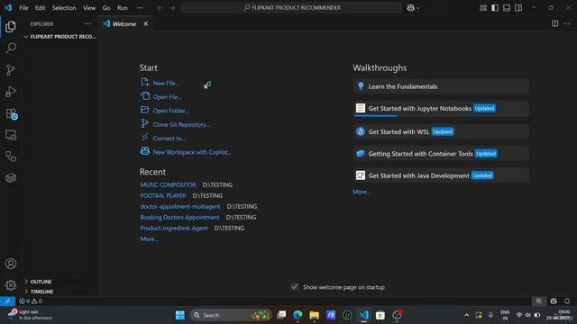
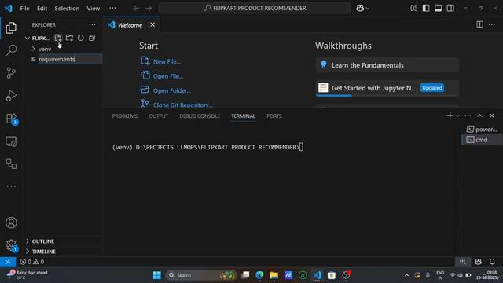
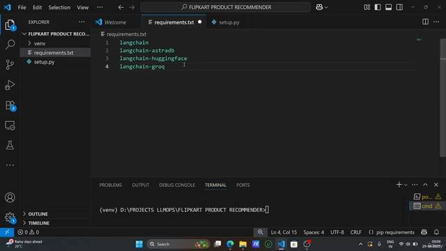
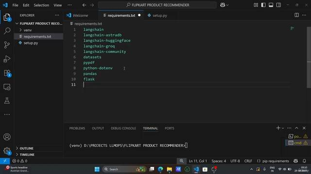
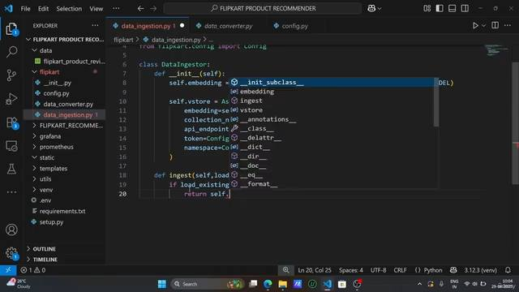
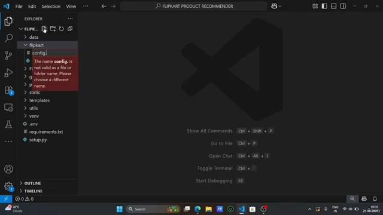
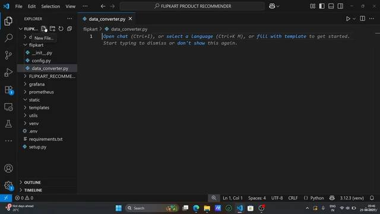
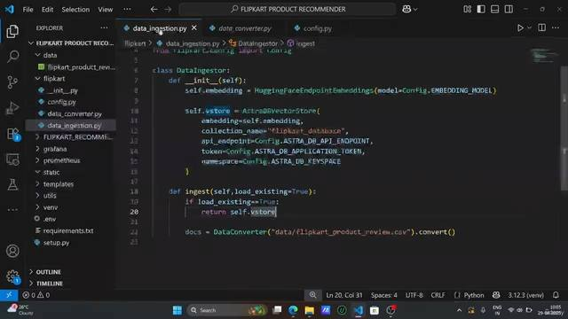
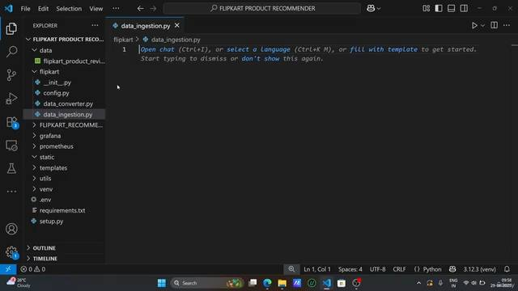

# LLMOps & AIOps Bootcamp（BV1gXR4BPERd）P50–P53 复现文档：Flipkart 商品推荐项目初始化、配置、CSV 转 Document、向量入库

## 1. 这一节做什么

这一节覆盖 P50–P53，目标是把一个「Flipkart 商品评论推荐」项目的**最小可运行骨架**搭起来，并且真正把 CSV 评论数据写进 Astra DB 向量库。这里的「最小可运行骨架」不是指把所有功能都写完，而是先让项目具备后续开发所需的基本条件：目录能打开、虚拟环境能激活、依赖能安装、配置能读取、CSV 能转换成 LangChain 的 Document、Document 能通过 embedding 模型写入 Astra DB。只要这条链路跑通，后面的 RAG chain、Flask 接口、Prometheus 指标、Grafana 面板才有稳定的基础。

具体产出有 4 个：

1. 创建项目目录 `flipkart-product-recommender`，建立 Python 虚拟环境。
2. 写出依赖清单 `requirements.txt`、可编辑安装入口 `setup.py`，并用 `pip install -e .` 安装依赖。
3. 建立项目目录结构：`data/`、`utils/`、`flipkart/`、`templates/`、`static/`、`prometheus/`、`grafana/`。
4. 写 3 个核心 Python 文件：
   - `flipkart/config.py`：读取 `.env` 里的 Groq、Hugging Face、Astra DB 配置；
   - `flipkart/data_converter.py`：把 CSV 的 `product_title` 和 `review` 转成 LangChain `Document` 列表；
   - `flipkart/data_ingestion.py`：用 Hugging Face embedding 模型把 Document 转成向量，写入 Astra DB 的 `flipkart_database` collection。

这 4 个产出之间的关系是顺序依赖的：先有项目和虚拟环境，才能隔离依赖；先有 `requirements.txt` 和 `setup.py`，`pip install -e .` 才有东西可读；先把目录结构建好，Python 才能按包路径导入 `flipkart.config`、`flipkart.data_converter`；最后 `data_ingestion.py` 才能把 `config.py` 的配置、`data_converter.py` 的 Document 列表和 Hugging Face embedding 串起来。复现时不要急着跳到代码，先把环境、目录、数据文件、环境变量逐项确认，后面报错会少很多。

跑通后，Astra DB 控制台应能看到约 450 条记录、768 维向量、cosine 相似度。这个结果就是本节最重要的验收标准：记录数说明 CSV 被读入并写入，768 维说明 embedding 模型正常输出，cosine 说明 collection 的相似度度量符合课程演示。如果只看到空 collection，或者只有配置没有数据，就说明中间某一步没有真正跑通。



## 2. 讲师原话（带「—— pNNN [MM:SS]」）

下面只摘关键原话，方便你对照视频确认「课里到底做到哪一步」。这些原话的作用是定位视频时间点，不是让你逐字背诵；复现时建议一边看时间戳，一边核对自己终端里的目录、文件名和命令是否与课程一致。

- “So first of all, let's create a folder here... Let's name it Flipkart product recommender.”  
  —— p050 [00:00]
  对应复现动作是先建项目目录，再进入目录。目录名可以按课程写成 `flipkart-product-recommender`，注意不要和后续 Python 包名 `flipkart` 混淆：外层是项目根目录，里层才是包目录。

- “we will write the command python -m venv venv”  
  —— p050 [00:28]
  对应复现动作是创建名为 `venv` 的虚拟环境。`python -m venv venv` 里第一个 `venv` 是 Python 标准库模块，第二个 `venv` 是目录名；不要写成别的拼写。

- “you will write pip install -e . ... this command will automatically trigger your setup.py file”  
  —— p050 [05:39]
  对应复现动作是在项目根目录执行可编辑安装。`-e` 表示 editable，`.` 表示当前目录，命令会读取当前目录的 `setup.py`，并把项目以可编辑模式安装到虚拟环境里。

- “you will be needing five environment variables for this project”  
  —— p050 [11:49]  
  注意：讲师口述说「5 个」，但后面实际列了 Groq、HF token、Hugging Face Hub token、Astra DB endpoint、Astra DB application token、Astra DB keyspace，共 6 个 API 相关变量；再加上 embedding model 和 RAG model，`.env` 里实际会有 8 个值。以实际列出的为准。复现时不要因为口述「5 个」就漏填后面的变量，变量名要和 `config.py` 的 `os.getenv()` 完全对应。

- “from lang chain astra db import astra db vector store”  
  —— p053 [00:25]
  对应代码里实际写 `from langchain_astradb import AstraDBVectorStore`。口述时会把包名拆开读，写代码时以已安装包能 import 的路径为准；如果 import 失败，先检查 `langchain-astradb` 是否安装成功。

- “if load existing equal to true you will return self dot vector store”  
  —— p053 [06:37]
  对应 `ingest(self, load_existing=True)` 里的提前返回逻辑。`True` 表示复用已有 vector store，不再重复读 CSV、不再重复写向量；第一次入库时要传 `False`。

- “we have around 450 rows”  
  —— p053 [14:22]
  对应 Astra DB 控制台看到的记录数。这个数字是课程数据跑出来的结果，约等于 CSV 去掉表头和空行后的行数；你本地如果 CSV 文件不同，记录数可能不同，但不应为空。



## 3. 从零复现

下面按「先跑通环境，再写代码，再入库」的顺序来。你照着命令一行行执行即可。每一小节除了命令本身，还会补充命令含义、常见错误和排查顺序；如果命令失败，不要直接改代码，先确认当前目录、虚拟环境、文件名和变量名这四件事。

### 3.1 创建项目目录并打开 VS Code

```bash
mkdir flipkart-product-recommender
cd flipkart-product-recommender
code .
```

`mkdir` 用来创建项目根目录，`cd` 用来进入这个目录，`code .` 用来让 VS Code 以当前目录为工作区打开。这里最关键的是「当前目录」：后面所有命令都应在 `flipkart-product-recommender` 根目录执行。如果你在上一级目录执行 `pip install -e .`，`setup.py` 读不到，就会报错；如果你在 `flipkart/` 子目录执行 `python flipkart/data_ingestion.py`，相对路径 `data/flipkart_product_review.csv` 也会找不到。

如果你在 Windows 的 PowerShell 里，`code .` 打不开，就手动打开 VS Code，再 `File -> Open Folder` 选这个目录。常见排查是：先确认 VS Code 已安装，再确认 `code` 命令是否加入 PATH；如果不想处理 PATH，直接手动打开也可以，不影响后续 Python 命令。前端开发里类似的情况是用终端打开项目根目录再跑 `npm install`，目录错了同样会找不到 `package.json`。

### 3.2 创建并激活虚拟环境

Windows：

```bash
python -m venv venv
venv\Scripts\activate
```

macOS / Linux：

```bash
python3 -m venv venv
source venv/bin/activate
```

激活成功后，终端前面会出现 `(venv)`。课里也是用这个括号判断虚拟环境是否激活。`python -m venv venv` 会在当前目录生成 `venv/` 文件夹，里面是一套独立的 Python 解释器和 `pip`；激活后执行的 `pip install` 会装进这套环境，而不是系统全局环境。这样做的意义和前端项目里的 `node_modules` 类似：项目依赖隔离在项目内部，避免不同项目互相污染。

常见错误一：Windows 下提示「无法加载文件，因为在此系统上禁止运行脚本」。这是 PowerShell 执行策略问题，可以按系统提示调整执行策略，或者改用命令提示符执行激活脚本。常见错误二：激活后终端没有 `(venv)`。先确认你执行的是 `venv\Scripts\activate` 或 `source venv/bin/activate`，再确认当前目录下确实有 `venv` 文件夹。常见错误三：`python` 命令不存在。Windows 可以试 `py -m venv venv`，macOS/Linux 可以试 `python3 -m venv venv`。

### 3.3 创建 `requirements.txt`

在项目根目录新建 `requirements.txt`，内容如下。课里没有给版本号，所以下面**不锁版本**；如果你安装时遇到冲突，再按报错锁版本。不锁版本的好处是容易装上当前可用版本，坏处是不同时间安装可能拿到不同版本；复现时如果遇到 LangChain 相关 import 差异，优先看实际安装版本。

```txt
langchain
langchain-astradb
langchain-huggingface
langchain-groq
langchain-community
datasets
pypdf
python-dotenv
pandas
flask
prometheus-client
```

注意几个包名不要写错：

- `langchain-astradb` 不是 `langchain-astra-db`
- `langchain-huggingface` 不是 `langchain-hugging-face`
- `langchain-groq` 不是 `langchain-grok`
- `python-dotenv` 不是 `python.env`
- `prometheus-client` 不是 `prometheus_client` 以外的拼写
- `pypdf` 不是 `PyPDF2`

这些包名之所以要单独强调，是因为 pip 包名和 import 名经常不完全一样。例如 `python-dotenv` 安装后 import 的是 `dotenv`，`prometheus-client` 安装后 import 的是 `prometheus_client`。前端里也有类似情况：`package.json` 里的包名和代码里 `import` 的路径可能不同。排查时先看 pip 是否安装成功，再看 Python 是否能 import，不要只凭记忆改代码。

### 3.4 创建 `setup.py`

课里让你从 GitHub 仓库复制 `setup.py`，但逐字稿没有展示它的内容。为了让 `pip install -e .` 能直接跑通，下面给一个**最小可运行版本**。这不是讲师原文件，只是等价实现；如果你有课程仓库，优先用仓库原文件。

```python
from setuptools import setup, find_packages

with open("requirements.txt", "r", encoding="utf-8") as f:
    requirements = [
        line.strip()
        for line in f
        if line.strip() and not line.startswith("#")
    ]

setup(
    name="flipkart-product-recommender",
    version="0.0.1",
    packages=find_packages(),
    install_requires=requirements,
)
```

这个 `setup.py` 做了三件事：读取 `requirements.txt`、去掉空行和注释、把依赖列表传给 `install_requires`。`find_packages()` 会查找当前目录下带 `__init__.py` 的包，因此后面创建 `flipkart/__init__.py` 和 `utils/__init__.py` 很重要。如果 `find_packages()` 找不到包，`pip install -e .` 仍可能成功，但项目包不一定按预期安装；所以目录结构建好后，建议再跑一次安装命令。

常见错误：在错误目录执行 `pip install -e .`，报 `FileNotFoundError: requirements.txt` 或 `No such file or directory: setup.py`。这时用 `pwd` 或 `cd` 确认自己在项目根目录。另一个常见错误是 `requirements.txt` 里包名拼错，`pip` 安装阶段就会失败；先修包名，不要改 `setup.py` 去绕过。

### 3.5 安装依赖

```bash
pip install -e .
```

这个命令会读取 `setup.py`，把 `requirements.txt` 里的依赖装进去，并且把当前项目以「可编辑模式」安装。`-e` 的意义是：以后你修改项目源码，不需要重新安装包，Python 会直接引用当前目录的代码；但如果你新增了新的包目录或改了 `setup.py` 的 `packages` 配置，最好再跑一次。后面你新增 `utils`、`flipkart` 包之后，要再跑一次 `pip install -e .`，这样 Python 才能把新目录当包导入。

验证安装是否成功，可以用 `pip list` 查看 `langchain`、`langchain-astradb`、`langchain-huggingface` 等是否出现，也可以用 `python -c "import langchain_astradb"` 做最小 import 检查。如果 `pip install -e .` 报 `No module named setuptools`，说明虚拟环境里缺少基础构建工具，先确认虚拟环境是否正常创建；如果报某个包找不到匹配版本，先把报错包名和版本要求记录下来，再决定是否单独安装或锁版本。不要在没有看报错的情况下同时改多个包版本。

### 3.6 建立项目目录结构

在项目根目录创建下面这些目录和空文件：

```text
flipkart-product-recommender/
├── data/
│   └── flipkart_product_review.csv
├── utils/
│   ├── __init__.py
│   ├── logger.py
│   └── custom_exception.py
├── flipkart/
│   ├── __init__.py
│   ├── config.py
│   ├── data_converter.py
│   └── data_ingestion.py
├── templates/
├── static/
├── prometheus/
├── grafana/
├── .env
├── requirements.txt
└── setup.py
```

说明：

- `data/` 放原始 CSV。
- `utils/` 放通用工具，课里说 `logger.py` 和 `custom_exception.py` 从课程仓库复制；逐字稿没有展示内容，本段代码也不依赖它们。
- `flipkart/` 放项目核心组件。
- `templates/` 后面放 Flask 的 HTML。
- `static/` 后面放 CSS。
- `prometheus/`、`grafana/` 后面放监控配置；P50–P53 还没有写具体文件。

目录结构要与 import 路径对应。`data_ingestion.py` 里写 `from flipkart.config import Config`，就要求从项目根目录运行时能找到 `flipkart` 包；如果缺少 `flipkart/__init__.py`，在某些 Python 版本或安装方式下可能无法按包导入。`utils/__init__.py` 同理。前端项目里 `src/`、`components/` 的目录结构决定 import 路径，这里 Python 的包目录也决定 import 路径，排查 `ModuleNotFoundError` 时先看目录和 `__init__.py`。

### 3.7 放入 CSV 数据

从课程资源区或 Kaggle 下载 `flipkart_product_review.csv`，放到：

```text
data/flipkart_product_review.csv
```

课里说这个 CSV 有 `product_id`、`product_title`、`rating`、`summary`、`review` 等列。我们只取 `product_title` 和 `review` 两列。放好后建议先确认文件名完全一致，包括扩展名和大小写；`flipkart_product_review.csv` 不要写成 `flipkart-product-review.csv`，否则 `pd.read_csv` 会报文件不存在。

验证方法：在项目根目录执行 Python，读取前几行，确认列名存在。如果报 `KeyError: "['product_title'] not in index"`，说明 CSV 表头与代码不一致；先打开 CSV 看表头，再改 `usecols` 里的列名，不要直接删掉 `usecols` 让所有列混进来。CSV 里如果有空行或缺失评论，后续转 Document 时可能产生空 `page_content`，这属于数据质量问题，复现时先保证课程 CSV 原样使用。



### 3.8 创建 `.env`

在项目根目录新建 `.env`。下面变量名你可以自己定，但必须和 `config.py` 里 `os.getenv()` 的字符串完全一致。课里口述有 `grok/grog` 的发音差异，实际是 Groq API。`.env` 只放在本地，不要提交到公开仓库；这和前端项目里 `.env.local` 不提交、只提交 `.env.example` 是同一个道理。

```env
GROQ_API_KEY="你的 Groq API Key"
HF_TOKEN="你的 Hugging Face Read Token"
HUGGINGFACEHUB_API_TOKEN="你的 Hugging Face Read Token"

ASTRA_DB_API_ENDPOINT="你的 Astra DB API Endpoint"
ASTRA_DB_APPLICATION_TOKEN="你的 Astra DB Application Token"
ASTRA_DB_KEYSPACE="default_keyspace"

EMBEDDING_MODEL="BAAI/bge-base-en-v1.5"
RAG_MODEL="llama-3.1-8b-instant"
```

获取方式按课里步骤：

1. Groq Cloud 注册账号，创建 API Key，名字可以叫 `Flipkart`。
2. Hugging Face 登录，进入 Access Tokens，创建 `read` 权限 token；课里把同一个 token 同时填到 `HF_TOKEN` 和 `HUGGINGFACEHUB_API_TOKEN`。
3. Astra DB 注册并登录，创建 Database：
   - 名字：`flipkart_database`
   - 类型选 Vector
   - keyspace 用默认的 `default_keyspace`
   - 创建后复制 API Endpoint
   - 生成 Application Token
4. 把 endpoint 和 token 填进 `.env`。

常见错误是变量名拼写不一致，例如 `.env` 写 `ASTRA_DB_ENDPOINT`，`config.py` 读 `ASTRA_DB_API_ENDPOINT`，结果读出来是 `None`。另一个常见错误是复制 token 时带了多余空格或引号嵌套，导致连接认证失败。前端里读取环境变量同样要求变量名一致，例如 `process.env.REACT_APP_API_URL` 与 `.env` 里的键必须完全对应；这里 `os.getenv()` 的字符串就是唯一依据。



### 3.9 写 `config.py`

在 `flipkart/config.py` 写入完整代码。注意：下面用 `Config` 作为类名；如果你照讲师口述写成 `config`，那么 `data_ingestion.py` 的 import 也要同步改。

```python
import os
from dotenv import load_dotenv

load_dotenv()


class Config:
    ASTRA_DB_API_ENDPOINT = os.getenv("ASTRA_DB_API_ENDPOINT")
    ASTRA_DB_APPLICATION_TOKEN = os.getenv("ASTRA_DB_APPLICATION_TOKEN")
    ASTRA_DB_KEYSPACE = os.getenv("ASTRA_DB_KEYSPACE")

    GROQ_API_KEY = os.getenv("GROQ_API_KEY")
    EMBEDDING_MODEL = os.getenv("EMBEDDING_MODEL")
    RAG_MODEL = os.getenv("RAG_MODEL")
```

验证方式：在项目根目录执行 `python -c "from flipkart.config import Config; print(Config.EMBEDDING_MODEL)"`，应打印 `BAAI/bge-base-en-v1.5` 或你 `.env` 里填的值。如果打印 `None`，优先检查 `.env` 是否在项目根目录、变量名是否一致、`load_dotenv()` 是否执行。如果 import 报 `ModuleNotFoundError: No module named 'flipkart'`，检查是否在项目根目录运行、`flipkart/__init__.py` 是否存在、是否执行过 `pip install -e .`。

### 3.10 写 `data_converter.py`

在 `flipkart/data_converter.py` 写入完整代码：

```python
import pandas as pd
from langchain_core.documents import Document


class DataConverter:
    def __init__(self, file_path: str):
        self.file_path = file_path

    def convert(self):
        df = pd.read_csv(
            self.file_path,
            usecols=["product_title", "review"],
        )

        docs = [
            Document(
                page_content=row["review"],
                metadata={"product_name": row["product_title"]},
            )
            for _, row in df.iterrows()
        ]

        return docs
```

验证方式：构造一个 `DataConverter("data/flipkart_product_review.csv")`，调用 `convert()`，检查返回对象是不是列表、长度是否大于 0、第一个元素的 `page_content` 是否来自 review、`metadata` 里是否有 `product_name`。如果报 `FileNotFoundError`，检查相对路径是否以项目根目录为基准；如果报 `KeyError`，检查 CSV 列名；如果 `docs` 为空，检查 CSV 是否只有表头或路径指错。前端里把 CSV 转 JSON 列表也是类似过程：先读文件，再映射字段，最后得到组件可消费的数组。

### 3.11 写 `data_ingestion.py`

在 `flipkart/data_ingestion.py` 写入完整代码：

```python
from langchain_astradb import AstraDBVectorStore
from langchain_huggingface import HuggingFaceEmbeddings

from flipkart.config import Config
from flipkart.data_converter import DataConverter


class DataIngester:
    def __init__(self):
        self.embedding = HuggingFaceEmbeddings(
            model_name=Config.EMBEDDING_MODEL
        )

        self.vector_store = AstraDBVectorStore(
            embedding=self.embedding,
            collection_name="flipkart_database",
            api_endpoint=Config.ASTRA_DB_API_ENDPOINT,
            token=Config.ASTRA_DB_APPLICATION_TOKEN,
            namespace=Config.ASTRA_DB_KEYSPACE,
        )

    def ingest(self, load_existing=True):
        if load_existing:
            return self.vector_store

        docs = DataConverter(
            file_path="data/flipkart_product_review.csv"
        ).convert()

        self.vector_store.add_documents(docs)
        return self.vector_store


if __name__ == "__main__":
    ingester = DataIngester()
    ingester.ingest(load_existing=False)
```

验证方式：先确认 `Config.EMBEDDING_MODEL`、`Config.ASTRA_DB_API_ENDPOINT`、`Config.ASTRA_DB_APPLICATION_TOKEN`、`Config.ASTRA_DB_KEYSPACE` 都不是 `None`，再运行脚本。`DataIngester()` 初始化时会创建 embedding 对象和 vector store 对象；如果这里报认证错误，问题在 Astra DB endpoint/token；如果报模型下载错误，问题在 Hugging Face 网络或 token；如果 `add_documents` 报错，先检查 `docs` 是否为空、collection 名是否合法。

### 3.12 运行入库脚本

```bash
python flipkart/data_ingestion.py
```

第一次跑会下载 embedding 模型，可能比较慢。跑完后去 Astra DB 控制台刷新 collection，课里看到的结果是：

- collection：`flipkart_database`
- 记录数：约 450 条
- 维度：768
- 相似度：cosine

如果你在项目根目录执行这条命令，`data_ingestion.py` 里的相对路径 `data/flipkart_product_review.csv` 才能正确解析。常见错误是脚本跑完没有报错但 collection 没数据：先确认 `load_existing=False` 是否真的传入；如果传了 `True`，代码会直接返回已有 vector store，不会执行 `add_documents`。另一个常见错误是重复运行 `False` 导致重复写入，排查时先看 collection 记录数是否异常增加。



## 4. 完整代码

下面把本段涉及的文件集中放一遍，方便你直接复制。复制后仍然要按第 3 节的顺序检查目录、虚拟环境和 `.env`；代码本身不能替代环境配置。

### 4.1 `requirements.txt`

```txt
langchain
langchain-astradb
langchain-huggingface
langchain-groq
langchain-community
datasets
pypdf
python-dotenv
pandas
flask
prometheus-client
```

### 4.2 `setup.py`

```python
from setuptools import setup, find_packages

with open("requirements.txt", "r", encoding="utf-8") as f:
    requirements = [
        line.strip()
        for line in f
        if line.strip() and not line.startswith("#")
    ]

setup(
    name="flipkart-product-recommender",
    version="0.0.1",
    packages=find_packages(),
    install_requires=requirements,
)
```

### 4.3 `.env.example`

```env
GROQ_API_KEY=""
HF_TOKEN=""
HUGGINGFACEHUB_API_TOKEN=""

ASTRA_DB_API_ENDPOINT=""
ASTRA_DB_APPLICATION_TOKEN=""
ASTRA_DB_KEYSPACE="default_keyspace"

EMBEDDING_MODEL="BAAI/bge-base-en-v1.5"
RAG_MODEL="llama-3.1-8b-instant"
```

### 4.4 `flipkart/config.py`

```python
import os
from dotenv import load_dotenv

load_dotenv()


class Config:
    ASTRA_DB_API_ENDPOINT = os.getenv("ASTRA_DB_API_ENDPOINT")
    ASTRA_DB_APPLICATION_TOKEN = os.getenv("ASTRA_DB_APPLICATION_TOKEN")
    ASTRA_DB_KEYSPACE = os.getenv("ASTRA_DB_KEYSPACE")

    GROQ_API_KEY = os.getenv("GROQ_API_KEY")
    EMBEDDING_MODEL = os.getenv("EMBEDDING_MODEL")
    RAG_MODEL = os.getenv("RAG_MODEL")
```

### 4.5 `flipkart/data_converter.py`

```python
import pandas as pd
from langchain_core.documents import Document


class DataConverter:
    def __init__(self, file_path: str):
        self.file_path = file_path

    def convert(self):
        df = pd.read_csv(
            self.file_path,
            usecols=["product_title", "review"],
        )

        docs = [
            Document(
                page_content=row["review"],
                metadata={"product_name": row["product_title"]},
            )
            for _, row in df.iterrows()
        ]

        return docs
```

### 4.6 `flipkart/data_ingestion.py`

```python
from langchain_astradb import AstraDBVectorStore
from langchain_huggingface import HuggingFaceEmbeddings

from flipkart.config import Config
from flipkart.data_converter import DataConverter


class DataIngester:
    def __init__(self):
        self.embedding = HuggingFaceEmbeddings(
            model_name=Config.EMBEDDING_MODEL
        )

        self.vector_store = AstraDBVectorStore(
            embedding=self.embedding,
            collection_name="flipkart_database",
            api_endpoint=Config.ASTRA_DB_API_ENDPOINT,
            token=Config.ASTRA_DB_APPLICATION_TOKEN,
            namespace=Config.ASTRA_DB_KEYSPACE,
        )

    def ingest(self, load_existing=True):
        if load_existing:
            return self.vector_store

        docs = DataConverter(
            file_path="data/flipkart_product_review.csv"
        ).convert()

        self.vector_store.add_documents(docs)
        return self.vector_store


if __name__ == "__main__":
    ingester = DataIngester()
    ingester.ingest(load_existing=False)
```

### 4.7 空包文件

下面两个文件保持空文件即可：

```text
utils/__init__.py
flipkart/__init__.py
```

它们的作用是让 Python 把 `utils` 和 `flipkart` 当成包。课里也是这么做的。验证方式是检查文件确实存在、文件名没有多余后缀，例如不要变成 `__init__.py.txt`。如果 import 仍然失败，先看当前工作目录，再看包目录层级，最后再看 `pip install -e .` 是否执行过。



## 5. 逐行解释

### 5.1 `config.py` 为什么这样写

```python
from dotenv import load_dotenv
load_dotenv()
```

`load_dotenv()` 会读取项目根目录的 `.env`，把里面的键值对塞进环境变量。这样代码里就不用把 API Key 写死。写死密钥的风险和前端把 token 写进源码一样：一旦提交到仓库就会泄露。这里把密钥放在 `.env`，代码只读变量名，是更安全的做法。

在 Node/前端里，这相当于你从 `process.env.XXX` 读环境变量；Python 里是 `os.getenv("XXX")`。区别是前端构建工具通常只注入特定前缀的变量，而 Python 的 `load_dotenv()` 会把 `.env` 里的键加载到当前进程环境里。两者共同点是：变量名必须和读取处完全一致，大小写也要一致。

```python
class Config:
    ASTRA_DB_API_ENDPOINT = os.getenv("ASTRA_DB_API_ENDPOINT")
```

这里左边是 Python 类属性，右边是环境变量。课里特别强调「橙色的是环境变量，蓝色的是变量」——意思就是：不要把变量名和环境变量名搞混。你 `.env` 里写的是 `ASTRA_DB_API_ENDPOINT`，这里 `os.getenv()` 里就必须是同一个字符串。左边类属性名可以叫别的，但为了可读性通常保持一致；真正决定能否读到值的是 `os.getenv()` 里的字符串。

```python
    GROQ_API_KEY = os.getenv("GROQ_API_KEY")
    EMBEDDING_MODEL = os.getenv("EMBEDDING_MODEL")
    RAG_MODEL = os.getenv("RAG_MODEL")
```

`GROQ_API_KEY` 是后面调用 Groq LLM 用的；`EMBEDDING_MODEL` 是 Hugging Face 的 embedding 模型名；`RAG_MODEL` 是 Groq 上的对话模型名。课里选的是：

- embedding：`BAAI/bge-base-en-v1.5`
- RAG：`llama-3.1-8b-instant`

课里没有让你单独加载 Hugging Face token，因为 `load_dotenv()` 已经把 `HF_TOKEN` / `HUGGINGFACEHUB_API_TOKEN` 加载进环境变量了。排查时可以用 `python -c "from flipkart.config import Config; print(Config.GROQ_API_KEY is not None)"` 看是否读到；不要直接把密钥打印到日志或截图里。

### 5.2 `data_converter.py` 为什么要把 CSV 转 Document

```python
df = pd.read_csv(
    self.file_path,
    usecols=["product_title", "review"],
)
```

LangChain 的向量库不能直接吃 CSV。课里的做法是先用 pandas 读 CSV，并且只保留两列：

- `product_title`：商品标题，后面放进 metadata；
- `review`：评论正文，后面放进 `page_content`。

`usecols` 的作用就是「只读这两列」，避免把 `product_id`、`rating`、`summary` 也带进来。课里说只保留这两列就够本项目用了。这个选择和前端里只把组件需要的字段传进 props 类似：字段越少，后续序列化和存储越可控；如果后面需要 rating 或 summary，再扩展 `usecols` 和 metadata 即可。

```python
docs = [
    Document(
        page_content=row["review"],
        metadata={"product_name": row["product_title"]},
    )
    for _, row in df.iterrows()
]
```

这段是列表推导式。它遍历 DataFrame 的每一行，把每一行变成一个 `Document`。

- `page_content` 是文档正文，这里放 `review`；
- `metadata` 是附加信息，这里放 `product_name`，值来自 `product_title`。

课里展示过：`docs` 的类型是 `list[Document]`，每一行对应一个 Document。1000 行就是 1000 个 Document。`page_content` 是后面 embedding 的输入，`metadata` 会随向量一起存储，后续检索时可以带出来用于展示商品名。前端里类似把列表项映射成 `{ content, meta }` 对象数组，区别是这里交给 LangChain 的 `Document` 类型。

注意：讲师口述时说的是 `for row in df.iterrows()`，但 `iterrows()` 返回的是 `(index, Series)` 元组。实际写代码要解包成 `for _, row in df.iterrows()`，否则 `row["review"]` 会报错。这是复现时很容易撞上的点。另一个注意点是 pandas 的 `NaN`：如果某行 review 为空，`page_content` 可能不是普通字符串，后续 embedding 可能报错；课程数据按原样使用，遇到异常再检查数据。

### 5.3 `data_ingestion.py` 为什么先初始化 embedding 和 vector store

```python
self.embedding = HuggingFaceEmbeddings(
    model_name=Config.EMBEDDING_MODEL
)
```

`HuggingFaceEmbeddings` 负责把文本转成向量。课里说「embedding 和 vector 是一回事」，意思是文本经过模型后变成一串浮点数，这串数就是向量。`model_name` 从配置读取，避免在代码里硬编码模型名；如果以后换模型，只改 `.env` 即可。第一次运行会下载模型文件，下载来源和权限由 Hugging Face token 与网络环境决定。

```python
self.vector_store = AstraDBVectorStore(
    embedding=self.embedding,
    collection_name="flipkart_database",
    api_endpoint=Config.ASTRA_DB_API_ENDPOINT,
    token=Config.ASTRA_DB_APPLICATION_TOKEN,
    namespace=Config.ASTRA_DB_KEYSPACE,
)
```

`AstraDBVectorStore` 是 LangChain 对 Astra DB 的封装。它需要 5 个东西：

1. `embedding`：用哪个模型把文本转向量；
2. `collection_name`：写到哪个 collection，课里叫 `flipkart_database`；
3. `api_endpoint`：Astra DB 的 API 地址；
4. `token`：Astra DB 的 Application Token；
5. `namespace`：keyspace，免费版就是 `default_keyspace`。

课里说 collection name 用 `flipkart database`，代码里不要带空格，写成 `flipkart_database` 更稳。这个对象初始化时就会尝试连接 Astra DB，因此如果 endpoint、token、keyspace 有一个不对，构造函数阶段就可能报错。排查时不要先怀疑 `add_documents`，先确认连接参数。

```python
def ingest(self, load_existing=True):
    if load_existing:
        return self.vector_store
```

`load_existing` 是一个「是否复用已有向量库」的开关。

- `True`：直接返回已经初始化好的 vector store，不再重复读 CSV、不再重复写向量；
- `False`：重新读 CSV、重新转 Document、重新 `add_documents`。

课里解释得很清楚：第一次跑要 `False`，把数据写进去；以后如果数据没变，就保持默认 `True`，避免每次启动都重复入库。这类似前端缓存开关：缓存命中就直接用已有数据，缓存未命中才重新请求；区别是这里没有自动去重，重复 `False` 可能会重复写入。

```python
docs = DataConverter(
    file_path="data/flipkart_product_review.csv"
).convert()

self.vector_store.add_documents(docs)
```

`DataConverter(...).convert()` 返回 `list[Document]`。`add_documents(docs)` 会做两件事：

1. 调用 embedding 模型，把每个 Document 的 `page_content` 转成向量；
2. 把向量、正文、metadata 一起写进 Astra DB。

课里跑完后看到约 450 条记录，是因为 CSV 有 452 行左右，去掉表头和空行后剩下约 450 条。这里的记录数不是魔法数字，而是数据行数经过转换后的结果；如果你本地 CSV 不同，记录数不同是正常的，但 collection 不应为空，维度也应是模型输出维度。



## 6. 复现检查清单

按下面顺序检查，基本不会卡住。每条都补了「怎么验证」，验证时尽量只改一个变量，避免同时改环境、代码和数据导致无法定位问题。

- [ ] 项目目录名是 `flipkart-product-recommender`，并且已经在 VS Code 打开。  
  验证方式：终端 `pwd` 或 Windows `cd` 查看当前路径，确认路径最后一级是 `flipkart-product-recommender`；VS Code 标题栏和资源管理器根目录也应显示这个目录。

- [ ] 终端前面有 `(venv)`，说明虚拟环境已激活。  
  验证方式：执行 `python -c "import sys; print(sys.prefix)"`，输出路径应包含项目下的 `venv`；如果仍是系统 Python 路径，重新执行激活命令。

- [ ] `requirements.txt` 里的包名拼写正确，尤其是 `langchain-astradb`、`langchain-huggingface`、`langchain-groq`、`prometheus-client`。  
  验证方式：逐行对照第 3.3 节列表，或用 `pip install -e .` 的报错定位；包名错时 pip 会提示找不到包。

- [ ] `setup.py` 能读取 `requirements.txt`，`pip install -e .` 没有报 `No module named setuptools`。  
  验证方式：在项目根目录执行 `pip install -e .`，观察是否成功；再执行 `pip show flipkart-product-recommender` 看是否安装了本项目。如果报 `setuptools` 缺失，先确认虚拟环境正常，再安装构建工具。

- [ ] `data/flipkart_product_review.csv` 存在，且表头里有 `product_title` 和 `review`。  
  验证方式：用文本编辑器或 pandas 读取前几行，确认列名；如果列名不同，按实际列名修改 `usecols`，不要盲目删除 `usecols`。

- [ ] `utils/__init__.py`、`flipkart/__init__.py` 存在。  
  验证方式：在项目根目录执行 `ls flipkart`、`ls utils`（Windows 用 `dir`），确认文件名不是 `__init__.py.txt`；再执行 `python -c "import flipkart"` 看是否报错。

- [ ] `.env` 里 8 个值都填了：`GROQ_API_KEY`、`HF_TOKEN`、`HUGGINGFACEHUB_API_TOKEN`、`ASTRA_DB_API_ENDPOINT`、`ASTRA_DB_APPLICATION_TOKEN`、`ASTRA_DB_KEYSPACE`、`EMBEDDING_MODEL`、`RAG_MODEL`。  
  验证方式：不要打印完整密钥，可以用 `python -c "from flipkart.config import Config; print(bool(Config.GROQ_API_KEY), bool(Config.ASTRA_DB_API_ENDPOINT), Config.EMBEDDING_MODEL)"` 检查是否读到；输出应为 `True True BAAI/bge-base-en-v1.5` 或你配置的值。

- [ ] Astra DB 里 database 已创建，类型是 Vector，keyspace 是 `default_keyspace`。  
  验证方式：登录 Astra DB 控制台，查看 database 类型、keyspace 名称和 API Endpoint；确认 `.env` 里的 endpoint 与控制台一致。

- [ ] `python flipkart/data_ingestion.py` 能跑完，没有 `ModuleNotFoundError`。  
  验证方式：在项目根目录执行脚本；如果报 `ModuleNotFoundError`，先看缺失模块是第三方包还是本地包。第三方包看 `pip list`，本地包看目录和 `__init__.py`、当前工作目录。

- [ ] Astra DB 控制台 collection `flipkart_database` 里能看到约 450 条记录。  
  验证方式：刷新 collection 页面，查看记录数；如果为 0，确认脚本是否执行了 `load_existing=False`，以及 `add_documents` 是否真的被调用。

- [ ] collection 维度是 768，相似度是 cosine。  
  验证方式：在 collection 详情页查看 vector dimension 和 similarity metric；维度由 embedding 模型决定，cosine 是课程演示的度量方式。

- [ ] 如果你改了 CSV 或改了 collection，记得把 `load_existing=False` 再跑一次；否则默认 `True` 不会重新入库。  
  验证方式：改数据后先记录当前 collection 记录数，再运行 `False`，观察记录数是否变化；如果不想重复写入，先清空 collection 或换新 collection 再跑。



## 7. 课里没讲但你会撞上的

下面这些不是讲师在 P50–P53 里展开的内容，但你实际复现时大概率会遇到。为了便于排查，下面把原来容易踩的点整理成表格：现象是你会看到的报错或表现，原因是课里没有展开的背景，怎么办给出最小排查路径。表格里的「前端对照」放在怎么办里，方便你把 Python 侧的问题映射到熟悉的 Node/前端经验。

| 现象 | 原因 | 怎么办 |
|---|---|---|
| Python 版本不兼容，安装依赖或运行时报语法/构建错误 | 课里没有指定 Python 版本，太新的版本可能遇到某些依赖还没发 wheel | 建议用 Python 3.10 或 3.11；以本地能装成功为准。先 `python --version` 确认版本，再决定是否换解释器重建 `venv`。前端对照：类似 Node 版本不匹配导致 `npm install` 失败，先对齐版本再装依赖。 |
| 依赖版本冲突，`langchain` 与 `langchain-astradb` 等包 import 失败 | `requirements.txt` 只有包名没有版本号，不同时间安装可能拿到不同版本 | 先看完整报错，记录冲突包名和版本要求，再按报错锁版本；不要凭记忆乱写版本。验证方式：`pip show 包名` 查看实际版本，最小化 import 测试。 |
| `pip install -e .` 报找不到 `setup.py` 或 `requirements.txt` | 课里让你从 GitHub 仓库复制 `setup.py`，但逐字稿没有展示内容；也可能当前目录不对 | 本文给的是最小可运行版本，不是讲师原文件；有课程仓库优先用原文件。先 `pwd` 确认在项目根目录，再检查 `setup.py` 和 `requirements.txt` 是否存在。 |
| 导入 `utils.logger` 或 `utils.custom_exception` 失败 | 课里说 `logger.py` 和 `custom_exception.py` 从仓库复制，逐字稿没有给内容 | 本文的 `data_converter.py` 和 `data_ingestion.py` 不依赖它们，可以先空着；后面用到再补。验证方式：先确认当前代码是否真的 import 了它们，没有就不要提前编造内容。 |
| `pd.read_csv` 报 `KeyError`，提示列名不在索引中 | CSV 列名可能和本文不同，例如 `product title`、`Product Title` | 打开 CSV 看实际表头，把 `usecols` 改成实际列名；不要直接删除 `usecols` 让所有列混入。前端对照：类似后端字段名从 `product_title` 变成 `productTitle`，映射层要同步改。 |
| `row["review"]` 报错，或 `row` 不是预期的 Series | 课里口述 `for row in df.iterrows()`，但 `iterrows()` 返回 `(index, Series)` 元组 | 实际写 `for _, row in df.iterrows()` 解包。验证方式：先打印一行 `type(row)` 或 `row` 的结构，确认解包正确。 |
| `Config` 读出来是 `None`，连接 Astra DB 认证失败 | 环境变量名大小写或拼写不一致；`.env` 不在项目根目录 | `.env` 里写 `GROQ_API_KEY`，`config.py` 就必须 `os.getenv("GROQ_API_KEY")`。Linux/macOS 区分大小写，Windows 也不要依赖大小写模糊匹配。验证方式：用布尔判断检查关键变量是否读到，不要打印完整密钥。 |
| 安装 `langchain-grok` 失败或 import 找不到 | 课里发音像 `grok/grog`，实际是 Groq API | 包名是 `langchain-groq`，不是 `langchain-grok`；模型名按 `.env` 的 `RAG_MODEL`。前端对照：类似把 `axios` 写成 `axio`，包名错会直接装不上。 |
| 下载 embedding 模型失败或权限错误 | Hugging Face token 权限不对，或网络无法访问模型仓库 | 课里让你选 `read` 权限；检查 token 是否填到 `HF_TOKEN` / `HUGGINGFACEHUB_API_TOKEN`，网络是否可访问 Hugging Face。验证方式：先跑最小 embedding 初始化，看报错是认证还是网络。 |
| Astra DB 连接报 keyspace 不存在 | 免费版默认 keyspace 是 `default_keyspace`；付费版可能自建 keyspace | 课里说免费版默认就是 `default_keyspace`；如果你用了付费版并自建 keyspace，把 `ASTRA_DB_KEYSPACE` 改成自己的。验证方式：控制台核对 keyspace 名称与 `.env` 完全一致。 |
| collection 创建失败或行为异常 | 课里口述 `flipkart database`，但代码里 collection 名带空格容易出问题 | 代码里建议写 `flipkart_database`。Astra DB 对 collection 命名有规则，带空格容易出问题；先改成下划线命名再试。 |
| 重复运行后记录数翻倍 | `ingest(load_existing=False)` 会重复 `add_documents`；课里没有讲事务、幂等、去重 | `add_documents` 不是「有则更新」的 upsert 语义；重复跑 `False` 很可能重复插入。实际项目里要么先清空 collection，要么自己做唯一 ID/去重。前端对照：类似 Mongo/Postgres 里没有唯一索引时重复提交会插入多条，应该加唯一索引或 upsert。 |
| 第一次运行卡很久，看起来像死循环 | `BAAI/bge-base-en-v1.5` 第一次会从 Hugging Face 下载，网络不好时会卡很久 | 先看终端是否有下载进度或网络报错；不要急着重装。验证方式：换网络或配置可访问的下载源后再试，确认不是代码逻辑循环。 |
| `from langchain_core.documents import Document` 失败 | LangChain import 路径会随版本变化；也可能依赖没装好 | 本文用 `langchain_core.documents`；如果版本里没有 `langchain_core`，说明依赖没装好或版本太旧。课里口述是 `langchain.documents`，以实际能 import 为准；先 `pip show langchain` 看版本。 |
| `AstraDBVectorStore` 报 unexpected keyword argument | 参数名可能随版本变，例如 `namespace` 等 | 本文用 `namespace` 传 keyspace；如果报「unexpected keyword argument」，去看当前版本 `AstraDBVectorStore` 的签名。课里没有讲版本差异，排查时以实际安装版本为准，不要同时改多个参数。 |
| 想提前找 Flask、Prometheus、Grafana、Docker、K8s 文件但找不到 | P50–P53 还没写这些文件，课里只建了目录 | 课里只建了目录，后面才会写。不要在这一节提前编造 `app.py`、`Dockerfile`、`deployment.yaml` 的内容；先把当前入库闭环跑通。 |
| `pip install prometheus-client` 失败 | 包名拼写容易错，课里特意强调 `P-R-O-M-E-T-H-E-U-S` | 包名是 `prometheus-client`，不是其他拼写。验证方式：在 `requirements.txt` 中逐字核对，安装后 `pip show prometheus-client` 检查。 |
| 安装 PDF 相关包时混淆 `pypdf` 和 `PyPDF2` | 课里说的是 `pypdf`；`PyPDF2` 也能处理 PDF，但不要混 | `requirements.txt` 写 `pypdf`；import 时按实际包文档使用。验证方式：`pip show pypdf` 看是否安装，不要凭记忆改包名。 |
| `datasets` 安装失败或 import 失败 | 包名是复数 `datasets`，不是 `dataset` | 检查 `requirements.txt` 是否写 `datasets`；安装后 `pip show datasets` 验证。前端对照：类似包名单复数写错，npm 也会找不到包。 |
| `flask` 安装或 import 混淆 | `pip` 包名小写 `flask`，import 时才是 `from flask import Flask` | `requirements.txt` 写 `flask`；代码里按 Flask 官方写法 import。验证方式：`pip show flask` 确认安装，再写最小 `from flask import Flask` 测试。 |



到这里，P50–P53 的最小闭环就完成了：项目骨架有了，依赖装好了，`.env` 配好了，CSV 被转成 Document，Document 被 embedding 后写进 Astra DB。下一节再继续接 RAG chain、Flask 后端和监控。