# LLMOps & AIOps Bootcamp：RAG Chain 与 Flask 应用（P54–P55）复现文档

> 读者定位：前端转 AI 应用工程师。本文档按「照着做就能跑起来」的标准编写。涉及 Python/Flask 的地方会标注与 Node/Express 的对应关系；涉及 Java 语法的地方标注「知道即可」。
>
> 说明：逐字稿是英文口语转写，讲师在视频里是边写边讲，很多变量名/参数名靠口述。本文档把口述内容还原成**完整可运行文件**。凡是逐字稿没讲清楚、需要读者自行确认的地方，都会明确标注「课里没讲」或「以实际输出为准」。

---

## 1. 这一节做什么

这两集（P54、P55）是把前面几集做好的「数据摄取（data ingestion）」和「向量库」串成一个**能对话的 RAG 应用**，分两步：

- **P54：写 `ragchain.py`**。核心是造一个 `RAGChainBuilder` 类，它做四件事：
  1. 把向量库（vector store）转成 retriever，每次检索 top-k 条相关文档；
  2. 用两个 prompt——**context prompt**（把用户的追问改写成独立问题）和 **question-answer prompt**（约束 LLM 怎么回答）；
  3. 用 `create_history_aware_retriever` + `create_stuff_documents_chain` + `create_retrieval_chain` 拼成一条带记忆的 RAG 链；
  4. 用 `RunnableWithMessageHistory` 包一层，让每个 `session_id` 各自维护一份对话历史。
- **P55：写 `app.py`（Flask 后端）+ `templates/index.html` + `static/style.css`（前端）**。把上面这条链挂到两个路由上：`/` 渲染页面、`/get` 接收用户输入并返回答案；再加一个 `/metrics` 路由，用 Prometheus client 暴露自定义指标（HTTP 请求计数）和默认指标。

最终产物是一个能在浏览器里聊天、能记住上下文、并且能被 Prometheus 抓取指标的 Flipkart 商品推荐机器人。

从工程视角看，这一节的重点不是「从零训练模型」，而是把已有组件按 LangChain 的 Runnable 体系组装起来：向量库负责“找资料”，retriever 负责“按问题取资料”，prompt 负责“告诉模型怎么用资料”，`RunnableWithMessageHistory` 负责“记住这个 session 刚才说了什么”。对前端读者来说，可以把它类比成 Express 里的一个“带 session 的业务路由”：`/get` 是接口入口，`session_id` 相当于 cookie/session key，`history_store` 相当于内存版 session store，Prometheus 的 `/metrics` 则相当于一个专门给监控系统抓取的只读接口。这里的区别是：RAG 链内部多了“检索文档”和“拼 prompt”两步，最终回答不是单纯由模型自由生成，而是被要求尽量落在检索到的商品标题与评论上下文里。

本节还隐含了一个重要的复现顺序：先确保前面的 `config.py`、`data_ingestion.py` 和向量库可用，再写 `ragchain.py`，最后写 Flask 入口和页面。如果顺序反过来，`app.py` 一启动就会在 import 或 `DataIngester().ingest(...)` 阶段报错，反而不容易判断问题出在链上还是出在环境上。因此下文会先说明前置条件，再给出目录、依赖、文件创建顺序和启动验证步骤。所有涉及前面几集实现细节的地方，本文档不编造；只要你的 `DataIngester().ingest(load_existing=True)` 能返回 LangChain 兼容的 vector store，后面的链就可以按本文档复现。

---

## 2. 讲师原话（带出处）

> "大家好，在本视频中我们将编写检索增强生成链的代码。首先进入你的 Flipkart 目录，在这里创建一个文件，并将其命名为 rackchain.py。"
> —— p054 [00:00]

> "它基本上用于通过大语言模型生成对话回复，也就是用来与你的 Groq 大语言模型交互。"
> —— p054 [00:29]（讲 `ChatGroq` 的用途）

> "这些检索器链基本上用于获取相关数据，而这个对象则用于创建你的检索器链。"
> —— p054 [01:27]

> "这个 create_stuff_documents_chain 会使用填充策略，把多个文档合并成一个答案。"
> —— p054 [01:56]

> "它本质上是一个特殊包装器，让你可以把对话历史包含进来。"
> —— p054 [04:50]（讲 `RunnableWithMessageHistory`）

> "上下文就在你的向量存储中。"
> —— p054 [07:42]

> "温度表示大语言模型的创造性。温度越高，模型就越有创造性……不要把它设得太高，否则模型会产生幻觉。"
> —— p054 [09:06]

> "它本质上是一个空字典，会为不同会话存储长期历史记录。"
> —— p054 [10:05]（讲 `history_store`）

> "这个上下文提示词会利用之前问题的上下文来重写用户问题。"
> —— p054 [18:08]

> "你是一个电商机器人……要紧扣上下文……不要编造答案。"
> —— p054 [21:54]（讲 question-answer prompt）

> "大家好，在本视频中你将编写你的主应用。"
> —— p055 [00:00]

> "只在根目录中创建一个 app.py。"
> —— p055 [01:58]

> "当你运行 app.py 时，它不会加载环境变量，因为加载环境变量的代码在 config.py 里；我们运行的不是 config.py，而是 app.py，所以这里必须使用相同的代码。"
> —— p055 [04:23]（解释为什么 app.py 里要再 load 一次 .env）

> "如果它为真，就意味着会加载现有数据库。"
> —— p055 [06:40]（讲 `ingest(load_existing=True)`）

> "来到 rackchain.py，在 self.history_store 这里，它本质上是一个方法，所以这里也要传入双方括号。"
> —— p055 [17:08]（现场修 bug：`self.history_store` 少了 `()`）

> "这个 generate_latest 会包含 Prometheus 默认提供的所有内置指标。"
> —— p055 [23:22]（讲 `generate_latest()`）

> "确保你的文件类型是 text/plain。"
> —— p055 [23:49]（`/metrics` 返回 `text/plain`）

这些原话基本覆盖了本节所有关键决策点：`ChatGroq` 对应 LLM 客户端，`create_history_aware_retriever` 对应“带历史检索”，`create_stuff_documents_chain` 对应“把多篇文档塞进一个回答”，`RunnableWithMessageHistory` 对应“会话记忆包装器”，`temperature` 对应“创造性/幻觉风险”，`history_store` 对应“按 session 存历史”，两个 prompt 分别负责“改写问题”和“约束回答”，`app.py` 里再次 `load_dotenv()` 是因为入口文件变了，`/metrics` 的 `text/plain` 是 Prometheus 抓取格式要求。复现时建议把这些原话和代码里的变量一一对照，遇到不符合预期的行为时，先回到对应原话确认自己是否漏了某个参数或 key。

---

## 3. 从零复现

### 3.1 前置条件（来自前面几集，课里没在本集重讲）

本集假设你已经有一个 `flipkart/` 包，里面至少有：

- `flipkart/config.py`：暴露一个 `config` 对象，含 `config.rag_model`（模型名，逐字稿里是 `llama 3.1 8b instant` 一类）和 Groq API key；
- `flipkart/data_ingestion.py`：暴露 `DataIngester` 类，有 `.ingest(load_existing=...)` 方法，返回一个向量库对象；
- 一个已经建好的向量库（逐字稿里提到存在 `ester dv` 里，即 Chroma 的持久化目录，**具体目录名以你前面几集的实际配置为准**）。

> 课里没讲这几集的具体实现细节，本文档不编造。你只要保证 `DataIngester().ingest(load_existing=True)` 能返回一个 LangChain 兼容的 vector store 即可。

这一段是复现的地基。很多读者在这一集失败，不是败在 `ragchain.py` 的语法，而是败在“前面几集的向量库根本没有建好”。建议在写本集代码前，先在 Python REPL 里单独验证一次：`from flipkart.data_ingestion import DataIngester` 能否 import，`DataIngester().ingest(load_existing=True)` 能否返回对象，返回对象是否有 `as_retriever` 方法。这个检查等价于前端项目里先确认 `npm run build` 能过、依赖没有缺失，再去写新页面。若这一步就报错，先回到前面几集修环境和数据摄取，不要继续往下写 Flask，否则错误会混在一起。

### 3.2 目录结构（本集要建的文件）

```
flipkart/
├── config.py            # 前面几集已有
├── data_ingestion.py    # 前面几集已有
├── ragchain.py          # ← P54 新建
├── app.py               # ← P55 新建（放在项目根目录）
├── templates/
│   └── index.html       # ← P55 新建
└── static/
    └── style.css        # ← P55 新建
.env                     # 前面几集已有
```

> 注意：逐字稿说 `app.py` 放在「root directory」，而 `ragchain.py` 放在 `flipkart/` 目录下。所以 `app.py` 里 import 的是 `from flipkart.ragchain import RAGChainBuilder`。

目录结构要特别留意：`ragchain.py` 在 `flipkart/` 包内，`app.py` 在项目根目录，二者不在同一层。`app.py` 里的 `from flipkart.ragchain import RAGChainBuilder` 依赖你从项目根目录启动，或者你的 `PYTHONPATH` 已包含项目根目录。如果你在 `flipkart/` 目录里执行 `python app.py`，但 `app.py` 实际在根目录，就会找不到文件；如果你在根目录执行却 import 失败，先检查 `flipkart/__init__.py` 是否存在、当前工作目录是否正确。Flask 的 `templates/` 和 `static/` 默认按 `app.py` 所在位置或 Flask 应用的 root path 查找，所以本文档把 `app.py` 放根目录，并让 `templates/`、`static/` 与它同级。对前端读者，这相当于 Express 项目里 `views/` 和 `public/` 相对项目根目录的约定；Flask 默认会从 `templates` 找模板、从 `static` 找静态文件。

### 3.3 依赖安装

逐字稿没有逐条念 `pip install`，但从 import 语句可以反推出需要的包。下面这份 `requirements.txt` 是按逐字稿出现的 import 整理的，**版本号课里没讲**，请以你前面几集装好的环境为准：

```txt
flask
python-dotenv
prometheus-client
langchain
langchain-core
langchain-community
langchain-groq
```

安装：

```bash
pip install -r requirements.txt
```

> 在 Node 里这相当于 `npm i express dotenv prom-client`，一一对应：Flask↔Express，python-dotenv↔dotenv，prometheus-client↔prom-client。

这里的 `pip install -r requirements.txt` 会读取当前目录的 `requirements.txt` 并安装其中列出的包。若安装慢，可以临时加镜像源，但课里没讲具体源，按你本机环境处理即可。常见错误是：`langchain` 相关包版本不匹配导致 import 路径变化。本文档代码沿用逐字稿中的 import 路径，例如 `from langchain.chains import create_history_aware_retriever, create_retrieval_chain`、`from langchain.chains.combine_documents import create_stuff_documents_chain`。如果你安装的 LangChain 版本较新或较旧，这些路径可能不同；此时不要盲目改成本文档未验证的路径，先运行 `python -c "导入 langchain；打印 langchain.__version__。"` 记录版本，再对照你前面几集能跑通的环境。与前端的对照是：这类似 `package.json` 里依赖大版本不一致导致 `import` 报错，解决思路是先锁版本或复用已跑通环境，而不是继续堆代码。

### 3.4 第一步：写 `flipkart/ragchain.py`（P54）

按讲师顺序：先 import，再建类，再写构造器，再写 `_get_history`，再写 `build_chain`。完整代码见第 4 节。

实操时建议先只写 import 和空类，运行 `python -c "从 flipkart.ragchain 导入 RAGChainBuilder。"` 确认 import 不报错，再逐步补构造器、`_get_history`、`build_chain`。这样能把“依赖缺失”和“链参数写错”分开排查。构造器里的 `self.vector_store = vector_store`、`self.model = ChatGroq(...)`、`self.history_store = {}` 三行分别对应“上下文来源”“回答模型”“会话存储”。如果你把 `history_store` 写成方法而不是字典，后面 `_get_history` 里按下标访问就会出问题；P55 现场修 bug 说的就是这一类括号/调用问题。写完 `build_chain` 后，不要急着接 Flask，先在 REPL 里用假问题调用一次链，确认能返回 `answer`，再接页面。

### 3.5 第二步：写 `templates/index.html` 和 `static/style.css`（P55）

讲师明确说「we are not here to learn about html.css so you can just go and copy the code from my GitHub repo」，所以**课里没有逐行写 HTML/CSS**。本文档给一份最小可用版本（见第 4 节），保证表单字段名 `message` 与后端 `request.form["message"]` 对得上即可。

前端部分的关键不是样式，而是表单契约：`<form action="/get" method="post">` 会把输入提交到 `/get`，`<input type="text" name="message">` 的 `name` 决定后端用 `request.form["message"]` 能否取到值。对前端读者，这相当于 HTML 表单的 `name` 属性就是后端 `req.body.message` 的字段名；如果写成 `name="msg"`，后端仍取 `"message"`，就会触发 `BadRequestKeyError` 一类错误。模板里用 `{{ url_for('static', filename='style.css') }}` 生成静态文件 URL，这是 Flask/Jinja2 的写法，等价于 Express 里挂载 `express.static` 后引用 `/style.css`。如果你打开页面没有样式，先看浏览器 Network 里 `style.css` 是否 404，再检查文件是否在 `static/style.css`、文件名大小写是否一致。

### 3.6 第三步：写 `app.py`（P55）

顺序：import → load_dotenv → 定义 Prometheus 计数器 → `create_app()` → 三个路由 → `if __name__ == "__main__"` 里 `app.run(host="0.0.0.0", port=5000, debug=True)`。

这里的顺序有实际意义：`load_dotenv()` 要在使用环境变量之前执行，但按逐字稿，`config.py` 被 import 时也可能执行过 load；不过 `app.py` 是入口，讲师强调入口再 load 一次，避免“运行 `app.py` 而不是 `config.py` 时环境变量没加载”的坑。`Counter(...)` 定义在模块级，进程启动时注册一次；如果把 `Counter` 放进请求函数里反复定义，可能触发重复注册错误。`create_app()` 里先加载向量库、再构建链、再注册路由，这样启动时就能发现向量库或链配置问题。最后 `app.run(host="0.0.0.0", port=5000, debug=True)` 让服务监听所有网卡，便于本机浏览器和后续容器访问；`debug=True` 只用于演示，生产要关。

### 3.7 第四步：启动

```bash
python app.py
```

浏览器打开 `http://127.0.0.1:5000/`，输入「suggest me some gaming headphones」，应能看到回答。再打开 `http://127.0.0.1:5000/metrics`，能看到 Prometheus 文本格式的指标。

启动命令要在项目根目录执行，且使用的 Python 环境要已经安装依赖、配置好 `.env`。终端出现 Flask 启动日志后，先访问 `/` 确认页面能渲染，再提交表单确认 `/get` 能返回文本，最后访问 `/metrics` 确认指标端点。常见错误与排查：如果 `python app.py` 报 `ModuleNotFoundError: No module named 'flipkart'`，检查当前目录和包结构；如果报 `KeyError: 'GROQ_API_KEY'` 一类，检查 `.env` 和 `load_dotenv()`；如果页面 404，检查 `templates/index.html` 路径；如果提交后 400，检查表单 `name="message"` 与 `request.form["message"]` 是否一致；如果 `/metrics` 打不开，检查路由是否注册在 `create_app()` 返回的 app 上。对前端读者，这相当于启动 Express 后分别测 `GET /`、`POST /get`、`GET /metrics` 三个 endpoint。

### 3.8 第五步：验证对话记忆

按讲师演示：先问「suggest me one best gaming headphone」，再问「please recommend me the best headphone that you just recommended」，机器人应能引用上一轮推荐（讲师演示里它答出了「Viper Cloud Second」）。

验证时要保持同一个 `session_id`。本文档代码里 `session_id` 写死为 `"user_session"`，所以同一进程内连续提问会共享历史；如果你改了代码按用户生成 session，就要确保两次提问携带同一个 session 标识。若第二轮没有引用上一轮，排查顺序是：`RunnableWithMessageHistory` 是否包在最终链外层、`input_messages_key`/`history_messages_key`/`output_messages_key` 是否与 prompt 和输出对上、`_get_history` 是否按 session_id 返回同一份 `ChatMessageHistory`、是否重启了进程导致内存历史丢失。对前端读者，这相当于检查 session middleware 是否真正挂上、cookie 是否带上、内存 store 是否被重启清空。

---

## 4. 完整代码

### 4.1 `flipkart/ragchain.py`

```python
# flipkart/ragchain.py
from langchain_groq import ChatGroq
from langchain.chains import create_history_aware_retriever, create_retrieval_chain
from langchain.chains.combine_documents import create_stuff_documents_chain
from langchain_core.prompts import ChatPromptTemplate, MessagesPlaceholder
from langchain_core.runnables.history import RunnableWithMessageHistory
from langchain_community.chat_message_histories import ChatMessageHistory
from langchain_core.chat_history import BaseChatMessageHistory

from flipkart.config import config


class RAGChainBuilder:
    def __init__(self, vector_store):
        # 1) 向量库：检索上下文的来源
        self.vector_store = vector_store

        # 2) LLM：用 Groq 托管的模型，模型名来自 config
        self.model = ChatGroq(
            model=config.rag_model,
            temperature=0.3,
        )

        # 3) 会话历史仓库：{session_id: ChatMessageHistory}
        self.history_store = {}

    def _get_history(self, session_id: str) -> BaseChatMessageHistory:
        """按 session_id 取历史；不存在就新建一份。"""
        if session_id not in self.history_store:
            self.history_store[session_id] = ChatMessageHistory()
        return self.history_store[session_id]

    def build_chain(self):
        # 1) 向量库 -> retriever，每次取 top-3 相关文档
        retriever = self.vector_store.as_retriever(
            search_kwargs={"k": 3}
        )

        # 2) context prompt：把追问改写成独立问题
        context_prompt = ChatPromptTemplate.from_messages([
            (
                "system",
                "Given a chat history and the latest user question "
                "which might reference context in the chat history, "
                "formulate a standalone question which can be understood "
                "without the chat history. Do NOT answer the question, "
                "just reformulate it if needed and otherwise return it as is.",
            ),
            MessagesPlaceholder("chat_history"),
            ("human", "{input}"),
        ])

        # 3) question-answer prompt：约束 LLM 怎么答
        qa_prompt = ChatPromptTemplate.from_messages([
            (
                "system",
                "You are an e-commerce bot. Answer product related queries "
                "using only the product titles and reviews provided in the context. "
                "Stick to the context. If the context does not contain the answer, "
                "say you don't know. Do not make up answers. "
                "Be concise and helpful.\n\nContext:\n{context}",
            ),
            MessagesPlaceholder("chat_history"),
            ("human", "{input}"),
        ])

        # 4) history-aware retriever：检索时考虑对话历史
        history_aware_retriever = create_history_aware_retriever(
            self.model,
            retriever,
            context_prompt,
        )

        # 5) question-answer chain：把多篇文档 stuff 成一段上下文再答
        question_answer_chain = create_stuff_documents_chain(
            self.model,
            qa_prompt,
        )

        # 6) 合成最终 RAG 链
        rag_chain = create_retrieval_chain(
            history_aware_retriever,
            question_answer_chain,
        )

        # 7) 包一层会话历史
        return RunnableWithMessageHistory(
            rag_chain,
            self._get_history,
            input_messages_key="input",
            history_messages_key="chat_history",
            output_messages_key="answer",
        )
```

### 4.2 `app.py`

```python
# app.py
from flask import Flask, render_template, request, Response
from prometheus_client import Counter, generate_latest
from dotenv import load_dotenv

from flipkart.data_ingestion import DataIngester
from flipkart.ragchain import RAGChainBuilder

# 在 app.py 里再 load 一次 .env（原因见第 5 节）
load_dotenv()

# 自定义指标：HTTP 请求总数
REQUEST_COUNT = Counter(
    "http_requests_total",
    "Total HTTP requests",
)


def create_app():
    app = Flask(__name__)

    # 1) 加载/构建向量库
    vector_store = DataIngester().ingest(load_existing=True)

    # 2) 构建 RAG 链
    rag_chain = RAGChainBuilder(vector_store).build_chain()

    # 3) 首页
    @app.route("/")
    def index():
        REQUEST_COUNT.inc()
        return render_template("index.html")

    # 4) 问答接口
    @app.route("/get", methods=["POST"])
    def get_response():
        user_input = request.form["message"]
        response = rag_chain.invoke(
            {"input": user_input},
            config={"configurable": {"session_id": "user_session"}},
        )
        return response["answer"]

    # 5) Prometheus 指标端点
    @app.route("/metrics")
    def metrics():
        return Response(generate_latest(), mimetype="text/plain")

    return app


if __name__ == "__main__":
    app = create_app()
    app.run(host="0.0.0.0", port=5000, debug=True)
```

### 4.3 `templates/index.html`（最小可用版）

> 课里没写 HTML，讲师让你去 GitHub 抄。下面是能跑通的最小版本，字段名 `message` 必须与 `app.py` 里 `request.form["message"]` 一致。

```html
<!DOCTYPE html>
<html lang="en">
<head>
  <meta charset="UTF-8" />
  <title>Flipkart Chatbot</title>
  <link rel="stylesheet" href="{{ url_for('static', filename='style.css') }}" />
</head>
<body>
  <h1>Flipkart Chatbot</h1>
  <form action="/get" method="post">
    <input type="text" name="message" placeholder="Ask about products..." required />
    <button type="submit">Send</button>
  </form>
</body>
</html>
```

### 4.4 `static/style.css`（最小可用版）

```css
body {
  font-family: sans-serif;
  max-width: 640px;
  margin: 40px auto;
  padding: 0 16px;
}
input[type="text"] {
  width: 70%;
  padding: 8px;
}
button {
  padding: 8px 16px;
}
```

---

## 5. 逐行解释

### 5.1 `ragchain.py` 关键行

- **`from langchain_groq import ChatGroq`**：Groq 是模型托管方，`ChatGroq` 是 LangChain 对它的封装。讲师原话「to interact with your GROC LLM」（p054 [00:29]）。在 Node 里相当于 `new ChatGroq({...})` 的 SDK 客户端。常见错误是 API key 未配置或模型名不存在，表现为启动后调用链时报鉴权失败/模型不存在；排查时先单独构造 `ChatGroq` 并做一次最小调用，不要和 Flask 混在一起查。
- **`create_history_aware_retriever` / `create_retrieval_chain`**：前者负责「带着历史去检索」，后者把「检索」和「回答」串成一条链。讲师原话「these retriever chains will be used to fetch the relevant data」（p054 [01:27]）。如果最终回答完全没有引用商品上下文，先检查 retriever 是否取到文档，再检查 qa prompt 的 `{context}` 是否被正确填充。
- **`create_stuff_documents_chain`**：把检索到的多篇文档「塞（stuff）」进一个 prompt 里。讲师用 50 个耳机里挑 3 个的例子解释（p054 [02:25]）。`k` 越大，塞入内容越多，越可能超出模型上下文窗口；复现时先用 `k=3` 跑通，再按需调。
- **`ChatPromptTemplate` + `MessagesPlaceholder`**：前者是 prompt 模板，后者是「占位符」，运行时把 `chat_history` 或 `input` 填进去。讲师原话「this message placeholder will be used to define how your model will be instructed」（p054 [03:50]）。占位符名字必须和 `RunnableWithMessageHistory` 的 key 对上，否则会出现缺少变量或历史没注入的问题。
- **`RunnableWithMessageHistory`**：给链套一层「记忆」。讲师原话「a special wrapper so that you can include your conversation history」（p054 [04:50]）。在 Node 里相当于给 Express 中间件加一个 `sessionStore`。它必须包在最终链外层，不能只包 retriever，否则回答阶段拿不到历史。
- **`ChatMessageHistory` / `BaseChatMessageHistory`**：前者是具体实现（内存里存消息列表），后者是类型标注。讲师原话「these two will be responsible for forming your message history」（p054 [06:15]）。常见错误是把类型标注当成实例化对象；实际存历史的是 `ChatMessageHistory()` 实例。
- **`self.vector_store = vector_store`**：讲师强调「the context is inside your vector store」（p054 [07:42]），所以构造器必须收一个 vector store。若传入 `None` 或未建好的库，`as_retriever` 阶段就会失败。
- **`temperature=0.3`**：讲师原话「keep it to minimum around 0.5, 0.3 and 0.2 will work also」（p054 [09:35]）。温度越高越容易幻觉。复现时不要改成很高的值来“让回答更丰富”，商品推荐场景更看重贴着上下文回答。
- **`self.history_store = {}`**：讲师原话「it is an empty dictionary. And it will store long-distance history for your different sessions」（p054 [10:05]）。注意这里是**字典**，不是方法——这正是 P55 [17:08] 现场修 bug 的点：`_get_history` 里访问 `self.history_store[session_id]` 时，如果 `history_store` 被误写成方法（少了 `()`），就会报错。排查时看报错栈里是否出现 `method object is not subscriptable` 一类提示。
- **`_get_history` 里的 `if session_id not in self.history_store`**：讲师原话「if that particular session ID that user is asking for doesn't exist in the history store, we will form a new history」（p054 [11:58]）。这个判断保证首次访问创建历史、后续访问复用历史。若每次请求都新建 `ChatMessageHistory`，记忆就会失效。
- **`as_retriever(search_kwargs={"k": 3})`**：讲师原话「k means number of documents you have to fetch」（p054 [32:19]）。`k=3` 表示每次检索 3 条最相关文档。若回答总是“不知道”，可以临时调大 `k` 观察是否检索不到相关内容，但不要把它当成万能修复。
- **`context_prompt` 的 system 文案**：讲师原话「rewrite the question as a standalone question」（p054 [20:59]）。它**不回答**问题，只改写。若模型在这里直接回答了问题，说明 prompt 约束不够或模型没有按 system 指令执行，需要检查模板内容是否被改动。
- **`qa_prompt` 的 system 文案**：讲师原话「you are an e-commerce bot... stick to the context... don't make up your answers」（p054 [21:54]）。这里把 `{context}` 放在 system 文本里，要求模型只根据商品标题和评论回答；若回答明显编造，先检查检索到的 `context` 是否为空、prompt 是否被截断。
- **`create_history_aware_retriever(self.model, retriever, context_prompt)`**：讲师原话「it only ask for three things your model your retriever your context prompt」（p054 [25:11]）。三个参数顺序不要搞反：模型、retriever、prompt。
- **`create_stuff_documents_chain(self.model, qa_prompt)`**：讲师原话「it will ask for the chain length model... then it ask for the equation answer point」（p054 [26:08]）。这里实际传的是模型和 qa prompt；若把 context prompt 传进来，回答约束会错位。
- **`create_retrieval_chain(history_aware_retriever, question_answer_chain)`**：讲师原话「you have to combine both of them」（p054 [27:05]）。前者产出检索文档，后者把文档和问题合成答案。
- **`RunnableWithMessageHistory(...)` 的四个参数**：`input_messages_key="input"`、`history_messages_key="chat_history"`、`output_messages_key="answer"`——讲师原话「by default it is answer only」（p054 [30:24]）。这三个 key 必须和两个 prompt 里的占位符名字对上。对前端读者，这类似表单字段名必须和后端取值 key 对上：名字错一位，数据就进不去。

### 5.2 `app.py` 关键行

- **`load_dotenv()` 在 app.py 里再调一次**：讲师原话「when you will run the app.py it will not load the environment variables because the environment variables code is inside the config.py and we are not running config.py we are running add.py so we have to use the same code here」（p055 [04:23]）。这是 Python 项目常见坑：`config.py` 里的 `load_dotenv()` 只在 `config.py` 被 import 时执行，而 `app.py` 是入口，所以要在入口再 load 一次。排查环境变量问题时，可在 `load_dotenv()` 后打印 `os.getenv` 的 key 是否存在，但不要把 key 明文打印到日志。
- **`Counter("http_requests_total", "Total HTTP requests")`**：讲师原话「you can just create a variable here that is request count and just name it as a counter」（p055 [20:02]）。这是**自定义指标**，不是 Prometheus 默认的。`Counter` 只增不减，适合请求总数；首页路由里 `REQUEST_COUNT.inc()` 每访问一次加一。
- **`DataIngester().ingest(load_existing=True)`**：讲师原话「if it is true it means it will load the existing database」（p055 [06:40]）。如果前面几集没建过库，这里要改成 `False` 让它重新 ingest。若启动时报找不到持久化目录，先确认前面几集是否已建库，或临时改为 `False` 重新构建。
- **`RAGChainBuilder(vector_store).build_chain()`**：讲师原话「it asks for one thing that is vector store」（p055 [08:04]）。构造器只收 vector store，链的构建在 `build_chain` 内完成；不要把 `build_chain` 的返回值误当成构造器参数。
- **`@app.route("/")` + `render_template("index.html")`**：讲师原话「we are loading our ui page」（p055 [09:02]）。Flask 默认从 `templates/` 找模板；如果 404 或 `TemplateNotFound`，检查文件名和目录。
- **`@app.route("/get", methods=["POST"])`**：讲师原话「let's name this route as get and the methods will be post」（p055 [09:31]）。只允许 POST 时，浏览器直接 GET `/get` 会 405，这是正常现象，用表单提交即可。
- **`request.form["message"]`**：讲师原话「the idea of that particular text ID is this name is message」（p055 [10:55]）。所以 HTML 里 `<input name="message">` 必须一致。若报 400 `BadRequestKeyError`，先看表单字段名。
- **`rag_chain.invoke({"input": user_input}, config={"configurable": {"session_id": "user_session"}})`**：讲师原话「in the config you will be configuring your question IDs... on the basis of session IDs only your chat history will get created」（p055 [12:22]）。这里 `session_id` 写死成 `"user_session"`，意味着所有用户共享一份历史——生产环境要改成按用户/浏览器生成。对前端读者，这相当于所有请求共用同一个 session key，演示可以，上线不可。
- **`response["answer"]`**：讲师原话「I only want the answer to get stored inside this response variable」（p055 [12:52]）。`create_retrieval_chain` 的输出结构中包含 `answer`，若 key 名写错会 `KeyError`；调试时可先打印 `response.keys()`。
- **`@app.route("/metrics")` + `Response(generate_latest(), mimetype="text/plain")`**：讲师原话「make sure your type of file is text plane」（p055 [23:49]）。`generate_latest()` 同时输出默认指标（如 `python_gc_objects_collected_total`）和自定义指标（`http_requests_total`）。若 Prometheus 抓取报格式错误，先检查响应头是否为 `text/plain`，以及响应体是否是 Prometheus 文本格式。
- **`app.run(host="0.0.0.0", port=5000, debug=True)`**：讲师原话「you have to set the host to 0.0.0 basically it will give a store map run anywhere」（p055 [14:47]）。`0.0.0.0` 让容器外也能访问，为后面 Docker 部署做准备。`debug=True` 会开启调试器和自动重载，演示方便，生产要关闭。

### 5.3 关于「锁/事务/并发」

本集没有涉及锁或事务。唯一需要注意的是 `self.history_store` 是一个**进程内字典**：多进程部署（如 gunicorn 多 worker）时，每个 worker 各有一份，会话历史不共享。讲师没讲这一点，属于「课里没讲但你会撞上」的内容，见第 7 节。对前端读者，可以把它理解为“内存版 session store”：单进程开发服务器没问题，多实例部署就会各存各的。若要在本地验证这个限制，可以启动两个不同端口的实例，分别提问，观察历史并不互通；生产要换成 Redis 等外部存储。

---

## 6. 复现检查清单

按顺序打勾，任何一步失败先停下排查：

- [ ] `flipkart/config.py` 里 `config.rag_model` 能取到模型名，Groq API key 已配置。验证：在项目根目录执行 `python -c "从 flipkart.config 导入 config；打印 config.rag_model。"`，能打印出模型名；不要打印 API key。
- [ ] `DataIngester().ingest(load_existing=True)` 能返回 vector store（在 Python REPL 里单独试一次）。验证：执行 `python -c "从 flipkart.data_ingestion 导入 DataIngester；执行 vs=DataIngester().ingest(load_existing=True)；打印 type(vs)。"`，能打印出对象类型且无异常。
- [ ] `flipkart/ragchain.py` 保存后 `python -c "从 flipkart.ragchain 导入 RAGChainBuilder。"` 不报错。验证：重点看是否缺少依赖或 import 路径不符；若报错，先解决 import，不要继续启动 Flask。
- [ ] `app.py` 里 `load_dotenv()` 在 import 之后、`create_app()` 之前调用。验证：检查文件顺序；若环境变量缺失，可在启动日志中看到模型或 API key 相关报错。
- [ ] `templates/index.html` 里 `<input name="message">` 与 `request.form["message"]` 一致。验证：浏览器打开页面后查看元素，或直接提交一次，若 400 则检查字段名。
- [ ] `python app.py` 启动无异常，终端出现 Flask 默认的启动日志。验证：在项目根目录执行，确认没有 `ModuleNotFoundError`、`TemplateNotFound`、向量库路径错误。
- [ ] 浏览器打开 `http://127.0.0.1:5000/` 能看到页面。验证：若 404，检查 `templates/index.html` 是否与 `app.py` 同级目录下的 `templates/` 中；若样式缺失，检查 `static/style.css` 和 Network 404。
- [ ] 输入「suggest me some gaming headphones」能返回答案（讲师演示里返回了 HyperX Cloud 一类结果）。验证：提交表单后页面应显示纯文本答案；若报 500，看终端栈，先查 `rag_chain.invoke` 参数和模型调用。
- [ ] 追问「please recommend me the best headphone that you just recommended」能引用上一轮结果（验证 `RunnableWithMessageHistory` 生效）。验证：不要重启进程，保持同一 `session_id` 连续提交；若没有记忆，检查包装器 key 和 `_get_history`。
- [ ] 打开 `http://127.0.0.1:5000/metrics` 能看到 `http_requests_total` 且数值随刷新首页递增。验证：先记录数值，刷新 `/` 后再看 `/metrics`，计数应增加；同时能看到 Prometheus 默认指标。
- [ ] `/metrics` 响应头 `Content-Type` 是 `text/plain`（讲师强调，否则 Prometheus 抓取会报错）。验证：用浏览器开发者工具 Network 看响应头，或执行 `curl -I http://127.0.0.1:5000/metrics` 查看 `Content-Type`。

---

## 7. 课里没讲但你会撞上的

| 现象 | 原因 | 怎么办 |
| --- | --- | --- |
| 所有访客似乎共享同一段对话历史 | 讲师在 `app.py` 里直接写 `"user_session"`，意味着所有访客共享一份对话历史 | 生产环境要按用户生成 `session_id`，比如用 Flask 的 `session` 或前端传一个 UUID；课里没讲怎么生成，复现演示可先保留写死值 |
| 多 worker 部署后历史丢失或错乱 | `history_store` 是进程内字典：多 worker（gunicorn `-w 4`）时每个 worker 一份，用户刷新可能落到不同 worker | 生产要换成 Redis 等外部存储；课里没讲，单进程 `python app.py` 演示不会触发 |
| `load_existing=True` 启动报找不到数据库/目录 | 讲师假设你前面几集已经建过库；全新环境第一次必须 `False`，否则 `DataIngester` 找不到持久化目录会报错 | 先确认前面几集已建库；若是全新环境，临时改为 `False` 让它重新 ingest；课里没讲这个分支的具体报错长什么样，以实际栈为准 |
| 模型名报不存在或鉴权失败 | `config.rag_model` 的确切值在逐字稿里是口述的「llama 3.1 8b instant」一类，但 Groq 的模型名会变 | **以你 `config.py` 里的实际值为准**，本文档不替你填；先单独验证 `ChatGroq` 能调用，再查 Flask |
| `/metrics` 里默认指标字段名与预期不同 | 讲师演示里出现了 `python_gc_objects_collected_total`、`python_gc_collection_seconds` 一类，但不同 `prometheus-client` 版本会有差异 | **具体字段名请以你实际 `curl /metrics` 的输出为准**；只要 `http_requests_total` 存在且递增，自定义指标就生效 |
| 页面样式与讲师演示不同 | 讲师明确说「go and copy the code from my GitHub repo」，课里没逐行写 HTML/CSS | 本文档给的是最小可用版，样式不同属正常；先保证表单字段名和路由能跑通，再按需美化 |
| 生产环境暴露调试信息或存在安全风险 | 讲师为了演示开了 `debug=True` | 生产要关掉 `debug=True`；课里没讲，部署时按生产配置处理 |
| 调大 `k` 后回答报上下文超限或变慢 | `create_stuff_documents_chain` 有 token 上限；`k=3` 时一般够用，但文档很长、`k` 调大可能超出模型上下文窗口 | 先用 `k=3` 跑通；若必须调大，需要截断文档或减少 `k`；课里没讲怎么处理截断 |
| 改了输出结构后 `response["answer"]` 取不到值 | `RunnableWithMessageHistory` 的 `output_messages_key="answer"` 依赖 `create_retrieval_chain` 的输出结构；讲师说「by default it is answer only」（p054 [30:24]） | 不要随意改链的输出 key；若改了，必须同步 `output_messages_key` 和 `response[...]`；课里没讲怎么改 |
| 表单提交后跳到只显示答案的页面，没有无刷新体验 | `/get` 返回纯文本，前端表单提交后会跳到一个只显示答案的页面（因为没有 JS 拦截） | 讲师演示里就是这样；课里没讲怎么用 fetch 做无刷新。若要改，用 JS 拦截 submit、fetch `/get`、把返回文本写回页面，但不要改变后端路由契约 |

---

## 附：关键截图

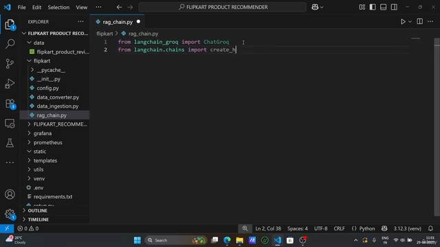

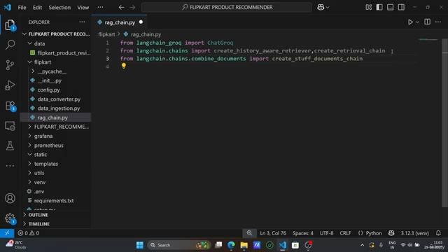

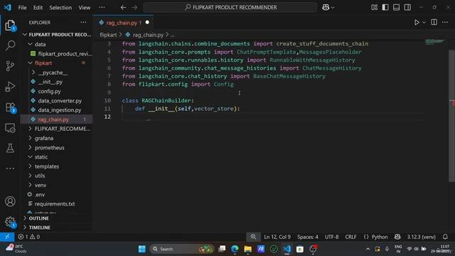

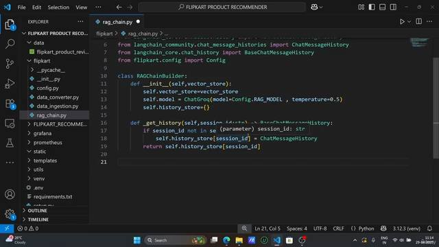

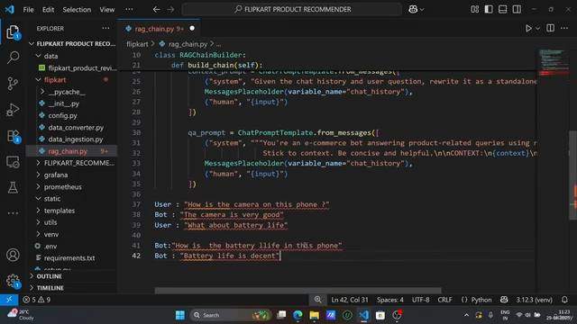

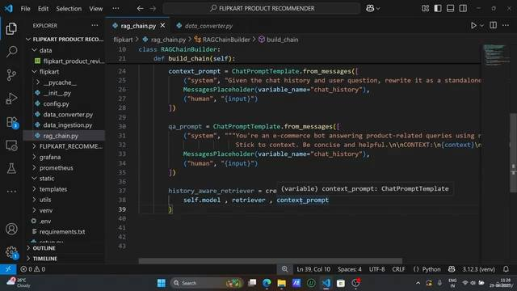

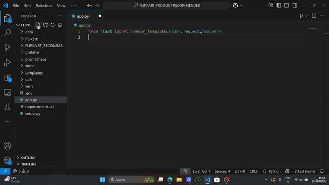

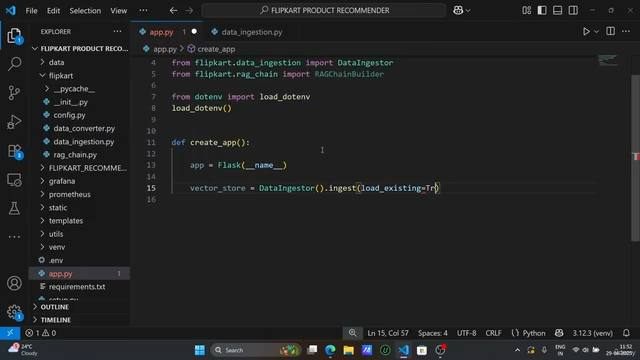

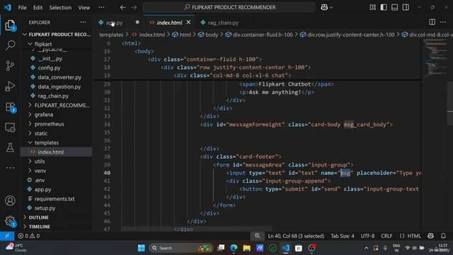

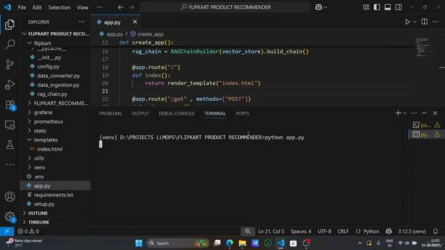

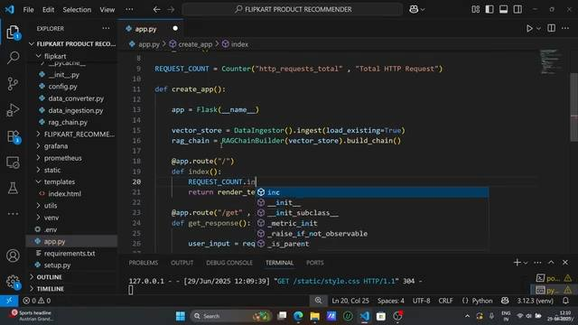

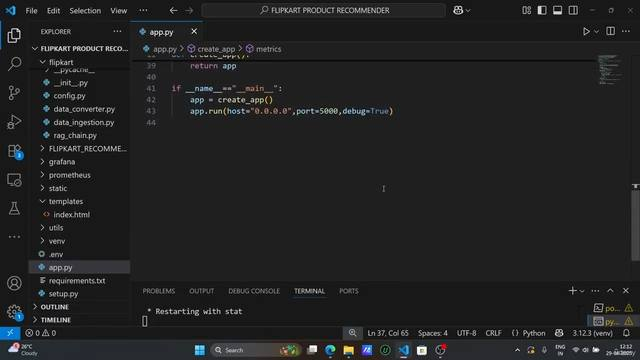