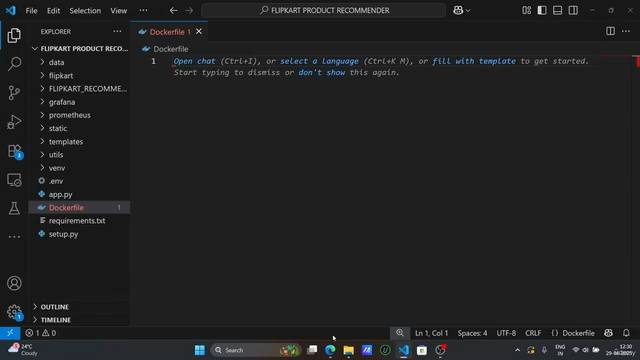
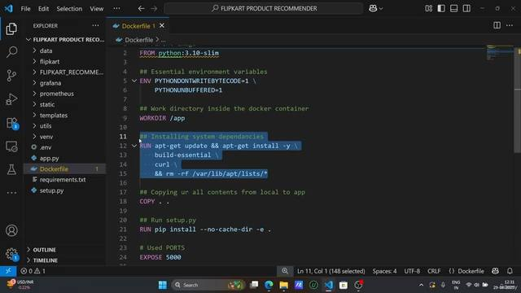
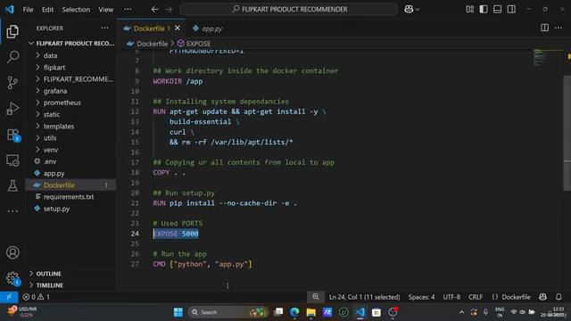
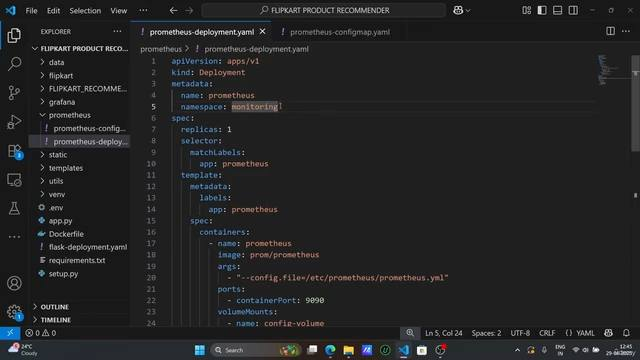
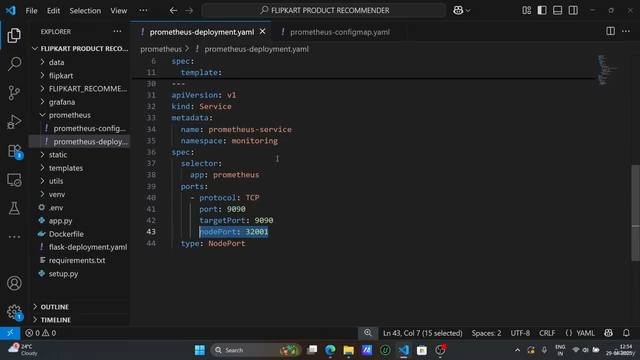
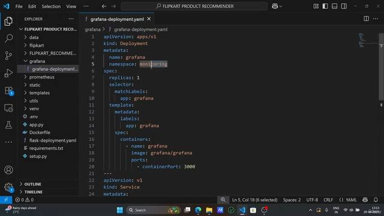
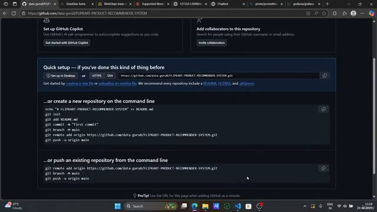
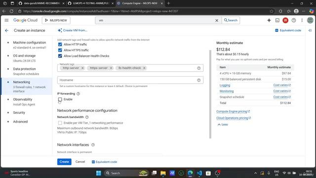
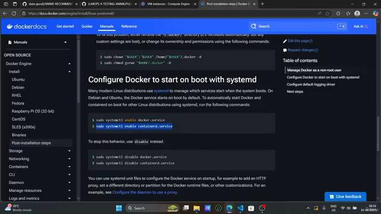

# 1. 这一节做什么

这一节把上一节已经能在本机跑起来的 Flask 推荐系统，推进到「可以放进 Kubernetes 里跑，并且能被 Prometheus / Grafana 监控」的状态。具体产物不是概念图，而是一组可以直接保存、提交、`kubectl apply` 的文件：

- 一个 `Dockerfile`：把 Flask 应用打成 Python 3.10 slim 镜像，工作目录 `/app`，暴露 `5000`，启动命令 `python app.py`。
- 一个 `flask-deployment.yml`：包含 Flask 的 Deployment 和 Service，Service 类型用 `LoadBalancer`，对外 `80` 转到容器 `5000`。
- 一个 `prometheus/prometheus-deployment.yml`：在 `monitoring` 命名空间里跑 Prometheus，容器端口 `9090`，Service 用 `NodePort`，NodePort 为 `32001`。
- 一个 `prometheus/prometheus-configmap.yml`：给 Prometheus 提供自定义 `prometheus.yml`，每 `15s` 抓一次指标，既监控 Prometheus 自己，也监控 Flask 的 `/metrics`。
- 一个 `grafana/grafana-deployment.yml`：在同一个 `monitoring` 命名空间里跑 Grafana，容器端口 `3000`，Service 用 `NodePort`，NodePort 为 `32000`。
- 一套 Git 初始化 / 提交 / 推送命令，把代码推到 GitHub，但忽略 `.env`、虚拟环境和项目管理目录。
- 一台 GCP VM 的创建参数，以及 VM 内安装 Docker、Minikube、kubectl 的顺序。

这一节的重点不是「知道这些名词」，而是「照着文件路径和命令把环境搭起来」。下面的完整文件里，凡是逐字稿明确讲到的字段，我保留；逐字稿没有逐字写出的 `apiVersion`、`selector.matchLabels`、`envFrom` 等，是为了让文件能真正 `kubectl apply` 而补全的，我会在文中标明「补全」或「课里没讲」，不会说成讲师原话。

---

# 2. 讲师原话（带「—— pNNN [MM:SS]」）

下面引用的是逐字稿中的关键句，中文为译文/摘录，时间点按逐字稿标注：

- “首先在根目录创建 Dockerfile，然后去 GitHub 仓库复制 Dockerfile。” —— p056 [00:00]
- “我们使用 Python 3.10 slim 镜像，然后是一些必要的环境变量，你可以自己定义。” —— p056 [00:26]
- “创建工作目录，名字叫 app，这就是 Docker 容器里的工作目录。” —— p056 [00:26]
- “`pip install` 要加 `--no-cache-dir`，它会忽略缓存文件，让你从新的起点安装。” —— p056 [01:51]
- “我们暴露 5000 端口，因为你的 `app.py` 跑在 5000 端口。” —— p056 [02:17]
- “Kubernetes 文件包含两部分：一个是 Deployment，一个是 Service。” —— p056 [03:15]
- “Prometheus 和 Grafana 都放在 `monitoring` 命名空间里。” —— p057 [02:25]
- “ConfigMap 里设置 `scrape_interval` 15 秒，Prometheus 每 15 秒抓一次目标。” —— p057 [13:22]
- “Grafana 从 Docker Hub 拉镜像，容器端口是 3000。” —— p058 [01:25]
- “环境文件不能推到 GitHub，虚拟环境也不能推，项目管理文件夹也不推。” —— p059 [00:57]
- “VM 推荐 16GB 内存、4 CPU，因为 Minikube 需要 2 CPU，剩下 2 CPU 做计算。” —— p060 [00:57]
- “先安装 Docker，再安装 Minikube，因为 Minikube 依赖 Docker。” —— p060 [08:51]

---

# 3. 从零复现

## 3.1 前置条件与目录结构

你需要已经有上一节的 Flask 项目文件：`app.py`、`requirements.txt`，以及 `utils/`、`templates/`、`static/` 等项目内容。逐字稿说 `app.py` 已经绑定 `0.0.0.0:5000`，这是容器外能访问的前提；如果你的 `app.py` 写的是 `127.0.0.1:5000`，在容器里只能容器自己访问，需要改成 `0.0.0.0`。逐字稿原话是 host 已经是 `0.0.0.0`，所以 Dockerfile 里只写 `CMD python app.py`。

建议目录如下，文件名就是后面 YAML 里引用的路径：

```text
flipkart-product-recommender/
├── Dockerfile
├── .gitignore
├── app.py
├── requirements.txt
├── flask-deployment.yml
├── prometheus/
│   ├── prometheus-deployment.yml
│   └── prometheus-configmap.yml
└── grafana/
    └── grafana-deployment.yml
```

`app.py` 和 `requirements.txt` 的具体内容本节没有给，逐字稿也没有列出依赖包，所以不要凭空填包名；沿用你上一节真实能跑的版本即可。



## 3.2 写 Dockerfile

在项目根目录创建 `Dockerfile`。逐字稿的顺序是：Python 3.10 slim → 环境变量 → `WORKDIR /app` → 安装系统依赖（更新、安装、构建必要依赖如 curl、清理）→ `COPY . .` → `pip install --no-cache-dir -r requirements.txt` → `EXPOSE 5000` → `CMD python app.py`。

这里有一个容易误解的点：逐字稿口述的 `pip install hypony full stop` 是转写噪声，实际语义是安装项目依赖，并加上 `--no-cache-dir`。完整写法见第 4 节。



## 3.3 写 Flask 的 Kubernetes 文件

在根目录创建 `flask-deployment.yml`。逐字稿说它由 Deployment 和 Service 两段组成：

- Deployment 名字和 Pod 标签都用同一个应用名，讲师口述为 FlaskApp/Flask；Kubernetes 的 `metadata.name` 和标签实际要求小写 DNS 风格，所以下面统一写 `flask-app`。这是为了让文件能 apply，不是讲师原话。
- `replicas` 先设 `1`。讲师说学习阶段一个或两个就够，不要超过太多。
- 容器名用 `flask-container`，镜像名本节没有明确给出，下面用 `flask-product-recommender:latest` 作为占位；你 `docker build` 成什么名字，这里就改成什么名字。
- `imagePullPolicy` 设为 `IfNotPresent`：讲师解释为「优先从当前 Kubernetes 集群/本机找镜像，然后再去外部源找」。`IfNotPresent` 比 `Never` 更贴近这个描述；`Never` 是完全不拉取。
- 容器端口 `5000`。
- 环境变量通过 Secret 注入，Secret 名按逐字稿的 LLM ops secret 统一写 `llm-ops-secret`。逐字稿没有列 Secret 里的 key，所以 YAML 用 `envFrom.secretRef` 整体注入，不写死 key。
- Service 名字用 `flask-service`，类型 `LoadBalancer`，协议 `TCP`，端口 `80`，`targetPort: 5000`。



## 3.4 写 Prometheus 的 Deployment 与 ConfigMap

在 `prometheus/` 下创建两个文件。

`prometheus-deployment.yml` 的逻辑：

- `namespace: monitoring`，因为讲师明确说 Prometheus 和 Grafana 都放这个命名空间。
- Deployment 名 `prometheus`，`replicas: 1`，Pod 标签 `app: prometheus`。
- 容器镜像从 Docker Hub 拉 Prometheus 官方镜像，下面写 `prom/prometheus:latest`。讲师没有给具体 tag，生产应锁版本，课里没讲。
- `args` 覆盖默认配置：`--config.file=/etc/prometheus/prometheus.yml`。
- 容器端口 `9090`。逐字稿后面出现过 `1990`，结合前面明确说的 `9090` 和 Prometheus 默认端口，按 `9090` 写；第七节会单独说明这个转写冲突。
- 挂载 ConfigMap 到 `/etc/prometheus`，ConfigMap 名 `prometheus-config`。
- Service 名 `prometheus-service`，类型 `NodePort`，`port: 9090`，`targetPort: 9090`，`nodePort: 32001`。

`prometheus-configmap.yml` 的逻辑：

- `kind: ConfigMap`，名字 `prometheus-config`，命名空间 `monitoring`。
- `data` 里放 `prometheus.yml`：`scrape_interval: 15s`。
- 第一个 job 监控 Prometheus 自己，target 是 `localhost:9090`。
- 第二个 job 监控 Flask，`metrics_path: /metrics`，target 是 `REPLACE_WITH_VM_EXTERNAL_IP:5000`。讲师强调这里要换成你 GCP VM 的外部 IP，端口 `5000` 不变。





## 3.5 写 Grafana 的 Kubernetes 文件

在 `grafana/` 下创建 `grafana-deployment.yml`：

- Deployment 名 `grafana`，`replicas: 1`，Pod 标签 `app: grafana`，命名空间 `monitoring`。
- 镜像从 Docker Hub 拉 Grafana，下面写 `grafana/grafana:latest`；讲师没有给 tag。
- 容器端口 `3000`。
- Service 名 `grafana-service`，类型 `NodePort`，`port: 3000`，`targetPort: 3000`，`nodePort: 32000`。



## 3.6 做 Git 版本控制

讲师的做法是：本地装 Git → GitHub 新建 public 仓库（不勾 README）→ VS Code 里创建 `.gitignore` → 终端执行 `git init`、切分支、加 remote、`git add .`、`git commit -m`、`git push origin main`。

`.gitignore` 至少忽略三类：

```gitignore
.env
venv/
project-management/
```

逐字稿原话是环境文件、虚拟环境、项目管理文件夹不推。注意：`.env` 被忽略不代表运行时不需要，后面要在 Kubernetes 里创建同名 Secret。



## 3.7 创建 GCP VM 并安装 Docker / Minikube / kubectl

控制台参数按逐字稿：

- 搜索 `VM instances`，创建实例。
- Machine type 选 `e2`，标准型，约 `16GB` 内存、`4 CPU`。讲师解释 Minikube 要 2 CPU，剩下 2 CPU 做计算。
- OS 选 Ubuntu `24.04 LTS`，`x86_64` 架构；讲师说不要选太新的 25，因为可能不稳定。
- 磁盘约 `150GB`。
- Networking 里把控制台列出的三项允许规则都勾上，并启用 IP forwarding。逐字稿没有给出三项的具体名称，照页面勾选即可。
- 创建后点 SSH，在浏览器终端里操作。

安装顺序必须是 Docker → Minikube → kubectl。讲师说 Minikube 依赖 Docker，所以先装 Docker。Docker 安装按官网 Ubuntu 页面复制命令；装完后还有 post-install 步骤，把当前用户加入 docker 组，否则每次都要 `sudo`。然后用 `docker run hello-world` 验证。再装 Minikube，最后用 snap 装 kubectl：

```bash
sudo snap install kubectl --classic
kubectl version --client
```





---

# 4. 完整代码

> 说明：以下文件是「按逐字稿字段 + 让文件可 apply 的必要补全」整理的完整版本。讲师没有逐字给出 `apiVersion`、`selector.matchLabels`、`envFrom` 等内容；这些是 Kubernetes 文件能运行所需的常规结构。镜像名、Secret 名中逐字稿转写不稳定的部分，我在代码后注明替换点。

## 4.1 `Dockerfile`

```dockerfile
FROM python:3.10-slim

ENV PYTHONUNBUFFERED=1
ENV PORT=5000

WORKDIR /app

RUN apt-get update \
    && apt-get install -y --no-install-recommends curl \
    && rm -rf /var/lib/apt/lists/*

COPY . .

RUN pip install --no-cache-dir -r requirements.txt

EXPOSE 5000

CMD ["python", "app.py"]
```

## 4.2 `flask-deployment.yml`

```yaml
apiVersion: apps/v1
kind: Deployment
metadata:
  name: flask-app
spec:
  replicas: 1
  selector:
    matchLabels:
      app: flask-app
  template:
    metadata:
      labels:
        app: flask-app
    spec:
      containers:
        - name: flask-container
          image: flask-product-recommender:latest
          imagePullPolicy: IfNotPresent
          ports:
            - containerPort: 5000
          envFrom:
            - secretRef:
                name: llm-ops-secret
---
apiVersion: v1
kind: Service
metadata:
  name: flask-service
spec:
  type: LoadBalancer
  selector:
    app: flask-app
  ports:
    - protocol: TCP
      port: 80
      targetPort: 5000
```

## 4.3 `prometheus/prometheus-deployment.yml`

```yaml
apiVersion: apps/v1
kind: Deployment
metadata:
  name: prometheus
  namespace: monitoring
spec:
  replicas: 1
  selector:
    matchLabels:
      app: prometheus
  template:
    metadata:
      labels:
        app: prometheus
    spec:
      containers:
        - name: prometheus
          image: prom/prometheus:latest
          args:
            - "--config.file=/etc/prometheus/prometheus.yml"
          ports:
            - containerPort: 9090
          volumeMounts:
            - name: prometheus-config
              mountPath: /etc/prometheus
      volumes:
        - name: prometheus-config
          configMap:
            name: prometheus-config
---
apiVersion: v1
kind: Service
metadata:
  name: prometheus-service
  namespace: monitoring
spec:
  type: NodePort
  selector:
    app: prometheus
  ports:
    - protocol: TCP
      port: 9090
      targetPort: 9090
      nodePort: 32001
```

## 4.4 `prometheus/prometheus-configmap.yml`

```yaml
apiVersion: v1
kind: ConfigMap
metadata:
  name: prometheus-config
  namespace: monitoring
data:
  prometheus.yml: |
    global:
      scrape_interval: 15s

    scrape_configs:
      - job_name: "prometheus"
        static_configs:
          - targets: ["localhost:9090"]

      - job_name: "flask-app"
        metrics_path: /metrics
        static_configs:
          - targets: ["REPLACE_WITH_VM_EXTERNAL_IP:5000"]
```

## 4.5 `grafana/grafana-deployment.yml`

```yaml
apiVersion: apps/v1
kind: Deployment
metadata:
  name: grafana
  namespace: monitoring
spec:
  replicas: 1
  selector:
    matchLabels:
      app: grafana
  template:
    metadata:
      labels:
        app: grafana
    spec:
      containers:
        - name: grafana
          image: grafana/grafana:latest
          ports:
            - containerPort: 3000
---
apiVersion: v1
kind: Service
metadata:
  name: grafana-service
  namespace: monitoring
spec:
  type: NodePort
  selector:
    app: grafana
  ports:
    - protocol: TCP
      port: 3000
      targetPort: 3000
      nodePort: 32000
```

## 4.6 `.gitignore`

```gitignore
.env
venv/
project-management/
```

## 4.7 Git 命令

```bash
git init
git branch -M main
git remote add origin <YOUR_GITHUB_REPOSITORY_URL>
git add .
git commit -m "commit"
git push origin main
```

## 4.8 VM 内安装命令（按官网命令顺序整理）

> 逐字稿没有逐条抄官网命令，只让去 Docker 官网复制。下面是 Ubuntu 上常用的等价命令，执行前请以 Docker / Minikube / kubectl 官方页面当前命令为准。

```bash
# Docker Engine 安装（Ubuntu）
sudo apt-get update
sudo apt-get install -y ca-certificates curl gnupg
sudo install -m 0755 -d /etc/apt/keyrings
curl -fsSL https://download.docker.com/linux/ubuntu/gpg | sudo gpg --dearmor -o /etc/apt/keyrings/docker.gpg
sudo chmod a+r /etc/apt/keyrings/docker.gpg
echo \
  "deb [arch=$(dpkg --print-architecture) signed-by=/etc/apt/keyrings/docker.gpg] https://download.docker.com/linux/ubuntu \
  $(. /etc/os-release && echo "$VERSION_CODENAME") stable" | \
  sudo tee /etc/apt/sources.list.d/docker.list > /dev/null
sudo apt-get update
sudo apt-get install -y docker-ce docker-ce-cli containerd.io docker-buildx-plugin docker-compose-plugin

# 免 sudo
sudo groupadd docker || true
sudo usermod -aG docker $USER
newgrp docker

# 开机自启
sudo systemctl enable docker
sudo systemctl enable containerd

# 验证
docker run hello-world
```

```bash
# Minikube 安装（Linux x86_64）
curl -LO https://storage.googleapis.com/minikube/releases/latest/minikube-linux-amd64
sudo install minikube-linux-amd64 /usr/local/bin/minikube
minikube start

# kubectl 安装（Ubuntu 用 snap）
sudo snap install kubectl --classic
kubectl version --client
```

## 4.9 部署命令

```bash
# 1. 在项目根目录构建镜像（镜像名必须和 flask-deployment.yml 里的 image 一致）
docker build -t flask-product-recommender:latest .

# 2. 让 Minikube 能看到这个本地镜像（课里没讲这一步，按你的 Minikube driver 二选一）
# 方式 A：如果使用 Docker driver，先 eval minikube docker-env 再 build
# eval $(minikube docker-env)
# docker build -t flask-product-recommender:latest .

# 方式 B：把本地镜像加载进 Minikube
minikube image load flask-product-recommender:latest

# 3. 创建 Secret（课里没给创建命令；.env 的 key 必须和 app.py 读取的变量名一致）
kubectl create secret generic llm-ops-secret --from-env-file=.env

# 4. 创建命名空间
kubectl create namespace monitoring

# 5. 先 ConfigMap，再 Deployment
kubectl apply -f prometheus/prometheus-configmap.yml
kubectl apply -f prometheus/prometheus-deployment.yml
kubectl apply -f grafana/grafana-deployment.yml
kubectl apply -f flask-deployment.yml

# 6. 查看状态
kubectl get pods -A
kubectl get svc -A
```

---

# 5. 逐行解释

## 5.1 Dockerfile

- `FROM python:3.10-slim`：讲师明确说用 Python 3.10 slim。slim 体积小，适合做应用镜像。
- `ENV PYTHONUNBUFFERED=1`：让 Python 日志直接输出，不被缓冲。讲师只说「一些必要环境变量，你可以自己定义」，没有列具体名字；这是为了让容器日志可见的补全。
- `WORKDIR /app`：讲师明确说容器内工作目录叫 `app`。后续 `COPY` 和 `CMD` 都相对这个目录。
- `apt-get update && apt-get install ... curl && rm -rf /var/lib/apt/lists/*`：对应讲师说的「更新包、安装包、构建必要依赖如 curl、然后 remove」。清理 apt 缓存能减小镜像。
- `COPY . .`：对应讲师说的「复制你左侧看到的所有内容到 app 目录」。`utils`、`templates`、`static`、`prometheus`、`grafana`、`data` 都会进镜像；但运行时真正需要的是应用代码，监控 YAML 是否要进镜像由你决定。
- `pip install --no-cache-dir -r requirements.txt`：对应讲师强调的 `--no-cache-dir`。它会忽略 pip 缓存，重新安装依赖。逐字稿的 `hypony` 是转写噪声，不是包名。
- `EXPOSE 5000`：讲师说 `app.py` 跑在 5000，所以暴露 5000。`EXPOSE` 是文档性声明，真正映射由 Kubernetes `containerPort` / Service `targetPort` 决定。
- `CMD ["python", "app.py"]`：和讲师在本机启动应用的命令一致。注意 `app.py` 必须监听 `0.0.0.0`，否则容器外访问不到；讲师说 host 已经是 `0.0.0.0`。

## 5.2 Flask Deployment / Service

- `apiVersion: apps/v1`、`kind: Deployment`：讲师说使用 Kubernetes 的 Deployment API。具体 `apps/v1` 是补全。
- `metadata.name: flask-app`：讲师口述 FlaskApp，但 Kubernetes 名称通常要求小写 DNS label，所以写成 `flask-app`。这就是为什么不能直接照口述写 `FlaskApp`。
- `replicas: 1`：讲师说学习阶段一个副本就够，两个也可以，不要更多。
- `selector.matchLabels` 与 `template.metadata.labels` 必须一致：这是 Deployment 管理 Pod 的匹配规则；讲师用「名字要一样」来解释，实际就是标签一致。
- `containers[].name: flask-container`：讲师说容器名可以叫 `flask-container`，并说这个名称在构建/部署镜像时会用到。
- `image: flask-product-recommender:latest`：本节没有明确给镜像名，这是复现用占位。你 `docker build -t` 成什么，这里必须完全一致。
- `imagePullPolicy: IfNotPresent`：对应讲师说的「优先从当前机器/集群找镜像，再找外部源」。如果你写 `Never`，本地没有镜像时 Pod 会直接失败，不会去 Docker Hub 找。
- `containerPort: 5000`：对应讲师说的容器端口要和应用端口一致。
- `envFrom.secretRef.name: llm-ops-secret`：对应讲师说的「环境变量不能推到 GitHub，所以放到 LLM ops secret」。逐字稿把名字转写成 LLM up / llm of / lmops，这里统一为 `llm-ops-secret`；你的 Secret 叫别的名字就替换。
- Service `type: LoadBalancer`：讲师说 ClusterIP 只能集群内访问，NodePort 和 LoadBalancer 可以对外；LoadBalancer 最适合互联网访问。
- `port: 80`、`targetPort: 5000`：Service 对外 80，转到容器 5000。讲师明确说协议 TCP、目标端口和应用端口一致。

## 5.3 Prometheus Deployment

- `namespace: monitoring`：讲师明确说 Prometheus 和 Grafana 都放 `monitoring`，Flask 用默认命名空间。
- `replicas: 1`：讲师说一个 Prometheus 就够。
- `image: prom/prometheus:latest`：讲师说从 Docker Hub 拉 Prometheus 官方镜像。具体 tag 课里没讲，`latest` 只是复现方便。
- `args: ["--config.file=/etc/prometheus/prometheus.yml"]`：讲师说这是覆盖默认参数，让 Prometheus 不要用默认配置文件，改用我们自定义的 ConfigMap。
- `containerPort: 9090`：讲师前面明确说 Prometheus 跑在 9090；后面转写出现 1990，按 9090 理解。
- `volumeMounts.mountPath: /etc/prometheus`：讲师说把 ConfigMap 挂到 `/etc/prometheus`，让容器里的 `prometheus.yml` 有内容。
- `volumes.configMap.name: prometheus-config`：讲师说 Volume 本身只是「一个空形式」，数据来自 ConfigMap；这里把 Volume 指向 ConfigMap。
- Service `type: NodePort`：讲师说 Prometheus 用 NodePort 暴露，NodePort 设为 `32001`。
- `port: 9090`、`targetPort: 9090`：讲师解释 port 是内部端口，targetPort 是对外/目标端口；这里内外部都保持 9090。

## 5.4 Prometheus ConfigMap

- `kind: ConfigMap`：讲师强调它不是 Deployment、不是 Service，而是 ConfigMap。
- `metadata.name: prometheus-config`、`namespace: monitoring`：和 Prometheus Deployment 在同一个命名空间，名字要和 Volume 里引用的 ConfigMap 名一致。
- `data.prometheus.yml`：这就是挂载进容器后出现的文件名。讲师说 ConfigMap 里的配置会被挂载成 `prometheus.yml`。
- `global.scrape_interval: 15s`：讲师明确说每 15 秒抓一次；也可以改 10 秒、30 秒。
- 第一个 job `prometheus`：让 Prometheus 监控自己，target `localhost:9090`。
- 第二个 job `flask-app`：监控 Flask，`metrics_path: /metrics`，target 写成 `REPLACE_WITH_VM_EXTERNAL_IP:5000`。讲师反复强调要把左边替换成 VM 外部 IP，端口 5000 不动，否则 Prometheus 抓不到。

## 5.5 Grafana Deployment

- `namespace: monitoring`：和 Prometheus 同一个命名空间。
- `replicas: 1`：只要一个 Grafana 实例。
- `image: grafana/grafana:latest`：从 Docker Hub 拉 Grafana 官方镜像。讲师没有给 tag。
- `containerPort: 3000`：讲师明确说 Grafana 跑在 3000，就像 Flask 5000、Prometheus 9090。
- Service `type: NodePort`、`port: 3000`、`targetPort: 3000`、`nodePort: 32000`：讲师说内部外部都 3000，NodePort 给 32000。

## 5.6 Git 与 VM

- `.gitignore` 三行分别对应讲师说的环境文件、虚拟环境、项目管理文件夹。`.env` 不提交，但运行时 Secret 要另外创建。
- `git init` 初始化空仓库；`git branch -M main` 切到 main；`git remote add origin` 绑定 GitHub；`git add .`、`git commit -m`、`git push origin main` 完成推送。
- VM 参数里 16GB / 4CPU 的原因是 Minikube 占 2 CPU，剩下给应用；Ubuntu 24.04 LTS 是讲师推荐的稳定版本；磁盘 150GB 是讲师说「足够」的大小。
- 先 Docker 后 Minikube，是因为 Minikube 依赖 Docker。`docker run hello-world` 用来验证 Docker；`docker version` 能看到 Client 和 Server 信息就说明引擎正常。

---

# 6. 复现检查清单

- [ ] 项目根目录有 `Dockerfile`，基础镜像是 `python:3.10-slim`，`WORKDIR` 是 `/app`。
- [ ] `requirements.txt` 是上一节真实可用的依赖文件，Dockerfile 里用 `--no-cache-dir` 安装。
- [ ] `app.py` 监听 `0.0.0.0:5000`，不是只监听 `127.0.0.1`。
- [ ] `docker build -t flask-product-recommender:latest .` 成功。
- [ ] 镜像名和 `flask-deployment.yml` 里的 `image` 完全一致。
- [ ] `llm-ops-secret` 已在 Flask 所在命名空间创建；Secret 的 key 和 `app.py` 读取的环境变量名一致。
- [ ] `kubectl create namespace monitoring` 已执行。
- [ ] 先 `kubectl apply -f prometheus/prometheus-configmap.yml`，再 apply Prometheus Deployment。
- [ ] `prometheus-configmap.yml` 里的 `REPLACE_WITH_VM_EXTERNAL_IP` 已换成真实 VM 外部 IP。
- [ ] Flask Service 是 `LoadBalancer`，`port: 80`，`targetPort: 5000`。
- [ ] Prometheus Service 是 `NodePort`，`nodePort: 32001`，容器端口 `9090`。
- [ ] Grafana Service 是 `NodePort`，`nodePort: 32000`，容器端口 `3000`。
- [ ] `kubectl get pods -A` 中 Flask、Prometheus、Grafana 的 Pod 不是 `Pending` / `CrashLoopBackOff`。
- [ ] `kubectl get svc -A` 能看到 `flask-service`、`prometheus-service`、`grafana-service`。
- [ ] GitHub 仓库是 public，`.env`、`venv/`、`project-management/` 没有被推上去。
- [ ] GCP VM 是 Ubuntu 24.04 LTS、x86_64、约 16GB 内存、4 CPU、约 150GB 磁盘。
- [ ] VM 上 `docker run hello-world` 不需要 `sudo` 也能成功。
- [ ] `minikube start` 成功，`kubectl version --client` 有输出。
- [ ] 浏览器能打开 Prometheus / Grafana 的 NodePort 地址；如果打不开，先检查 GCP 防火墙和 NodePort 范围。

---

# 7. 课里没讲但你会撞上的

1. **Kubernetes 名称大小写**：讲师口述 `FlaskApp`，但 Kubernetes 的 `metadata.name` 和标签通常要求小写 DNS 风格。直接写 `FlaskApp` 可能 apply 报错。本文统一写 `flask-app`，这是补全，不是讲师原话。
2. **镜像名没有给全**：讲师说「你构建镜像时会知道这个名字」，但没有逐字写出 `image:` 的值。本文用 `flask-product-recommender:latest` 占位；你 build 成别的名字，YAML 必须同步改。
3. **Secret 名转写不稳定**：逐字稿出现 LLM up secret、llm of secrets、lmops secret 等转写。本文统一写 `llm-ops-secret`。你实际创建 Secret 时用哪个名字，YAML 就写哪个。
4. **Secret 的创建命令课里没讲**：本文补了 `kubectl create secret generic llm-ops-secret --from-env-file=.env`。如果你的 `.env` 格式不是 `KEY=VALUE`，要改用 `--from-literal`。
5. **Prometheus 端口 9090 / 1990 的转写冲突**：逐字稿前面明确说 9090，后面出现 1990。按 Prometheus 默认端口和上下文，本文用 9090。若你照 1990 写，Prometheus 自身监控 target 也会对不上。
6. **Minikube 看不到本机 Docker 镜像**：`imagePullPolicy: IfNotPresent` 只会在「它能看到本地镜像」时生效。用 Docker driver 时要 `eval $(minikube docker-env)` 后再 build，或者 `minikube image load`。课里没讲这一步，但你不做就会遇到 `ErrImageNeverPull` 或一直拉不到镜像。
7. **LoadBalancer 在 Minikube 没有外部 IP**：讲师讲的是生产语义。Minikube 里 `LoadBalancer` 通常要 `minikube tunnel` 才有外部 IP；也可以临时用 `kubectl port-forward svc/flask-service 8080:80`。课里没讲。
8. **NodePort 范围**：Kubernetes 默认 NodePort 范围是 `30000-32767`。本文的 `32000`、`32001` 在范围内。你改端口时不要改成 80 或 5000 这种范围外端口。
9. **ConfigMap 改了要重启 Pod**：修改 `prometheus-configmap.yml` 后，已经运行的 Prometheus 不一定会自动重读。需要 `kubectl rollout restart deployment/prometheus -n monitoring` 或删 Pod 重建。课里没讲。
10. **Flask 多副本的会话问题**：`replicas` 大于 1 时，Flask 如果使用内存 session，请求打到不同 Pod 会丢状态。生产要把 session 外置。课里只讲学习阶段 1 个副本，没讲这个。
11. **Grafana 默认登录信息课里没讲**：讲师只讲部署和端口，没有讲默认账号密码。不要凭空写 `admin/admin` 当成讲师原话；以你实际镜像版本的 Grafana 文档为准。
12. **GCP 防火墙三项的具体名称课