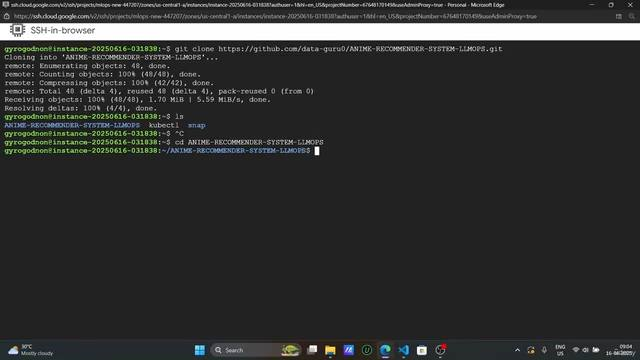
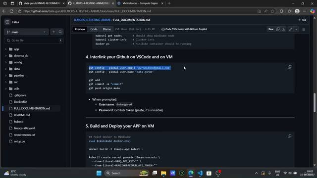
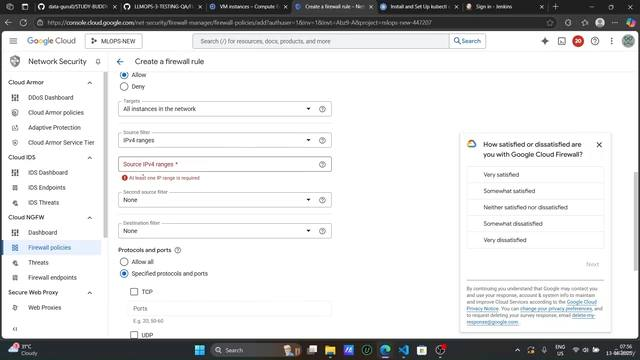
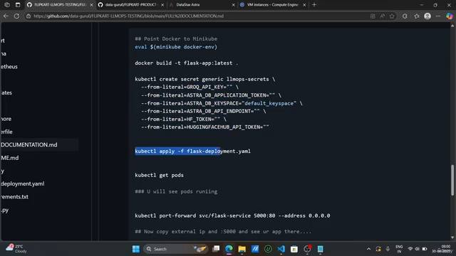
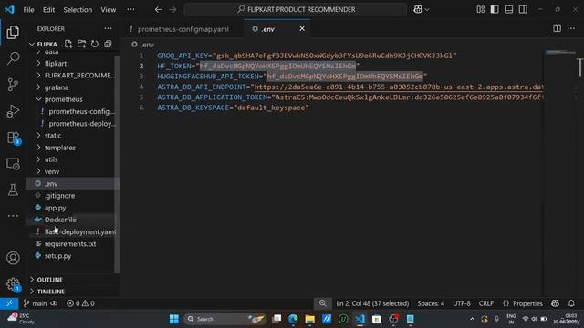
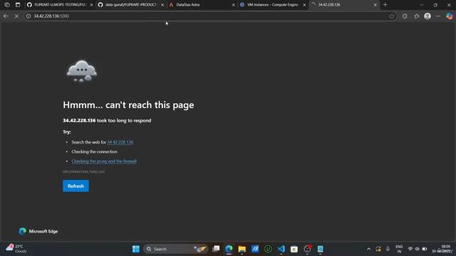
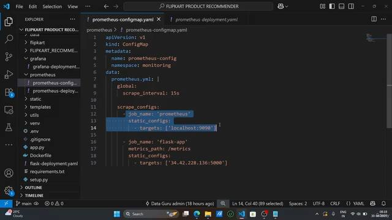
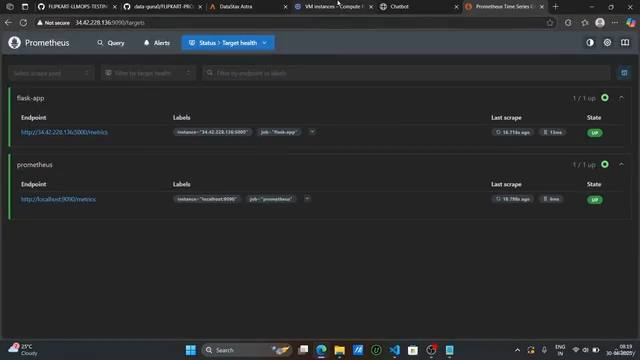
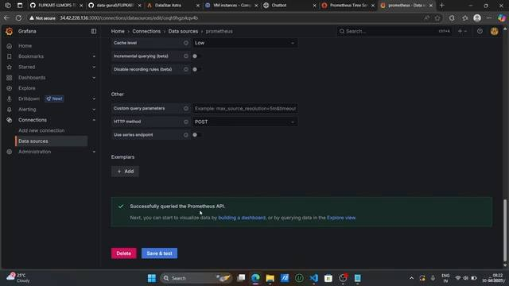
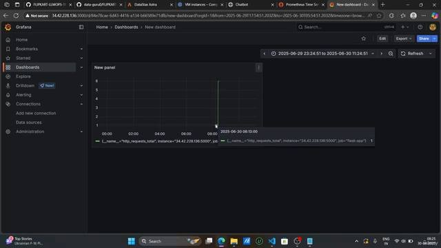

# LLMOps & AIOps Bootcamp P61–P65：GitHub → GCP VM → minikube 部署 → Prometheus/Grafana 监控 → ELK 日志架构

> 说明：本段课程（P61–P65）混合了「动手部署」和「架构讲解」两种内容。P61–P64 是照着终端一步步敲的操作课，P65 是下一个项目（AI Travel Planner）的技术栈与 ELK 工作流讲解课。因此本文第 4 节「完整代码」会按两部分给：前半给可复现的命令脚本与配置文件清单，后半给 P65 的设计决策表与组件职责表（P65 课里没有代码，凡补的示意代码都会明确标注）。逐字稿里讲师多次说「copy this command」，但**没有把命令文本逐字念出来**，凡是这种情况本文都会明确标注「命令文本课里未念出」，并给出等价写法与需要自己填的占位符，不替讲师编造字段名。

---

## 1. 这一节做什么

这一段课解决的是「LLM 应用写完以后怎么真正跑起来、怎么被外面访问到、怎么被监控」这条链路。它不是知识点罗列，而是一条可以照着走的施工顺序：

1. **把三方打通**：本地 VS Code ↔ GitHub ↔ GCP 虚拟机。改本地代码 → push 到 GitHub → 在 VM 上 pull，VM 上的代码就更新了。这一步在 P61 完成。
2. **把门打开**：VM 上跑的服务默认外网访问不到，需要在 GCP 控制台建一条 Ingress 防火墙规则，放行 0.0.0.0/0 的全部端口。这一步在 P62 完成，P63 结尾又因为忘了它而踩了一次坑、现场补建。
3. **把应用装进集群**：让 Docker 指向 minikube 的镜像仓库，构建 `flashcap` 镜像，先把应用需要的一组密钥注入成 Kubernetes Secret，再 `kubectl apply` 部署文件，最后用 `port-forward` 把集群内的服务暴露到 VM 的公网 IP 上。这一步在 P63 完成。
4. **把监控架起来**：新建 `monitoring` namespace，按 configmap → Prometheus deployment → Grafana deployment 的顺序部署，分别 port-forward 到 9090 和 3000，在 Prometheus 里确认两个抓取目标都是绿色，在 Grafana 里把 Prometheus 加为数据源并画出自定义指标 `http_request_total` 的曲线。这一步在 P64 完成。
5. **讲清下一个项目的日志架构**：P65 回到白板模式，交代 AI Travel Planner 的技术栈，并把 Filebeat → Logstash → Elasticsearch → Kibana 这条日志链路每个环节的职责讲了一遍。P65 不产生可运行产物。

做完前四步，你会得到一个「公网 IP:5000 能打开聊天页面、9090 能看到 Prometheus、3000 能登录 Grafana 并画出请求数曲线」的完整环境。

---

## 2. 讲师原话（带出处）

关于三方联动的前提，讲师在 P61 开头先回忆了上一节已经完成的初始状态：

> "在上一个视频里，我们已经完成了初始设置。我们把代码推送到了 GitHub，创建了 Dockerfile，也创建了虚拟机实例；在上面安装了 Docker，安装了 Minikube，还安装了 kubectl。"
> —— p061 [00:00]

然后是这一节的总目标：

> "接下来你要做的是，把你的 GitHub 与本地仓库连接起来；这个本地仓库在 VS Code 里，也在虚拟机实例上。"
> —— p061 [00:28]

关于推送时密码不能用 GitHub 登录密码，讲师说得很直接：

> "现在它要求输入密码。不要输入你平时用于 GitHub 的普通密码，那样不行。你只需打开 GitHub，进入个人资料，再进入 Developer settings，找到 Personal access token，然后生成新的 classic token。"
> —— p061 [02:51]

关于防火墙那一步（P62 与 P63 结尾各出现一次），讲师给的核心参数是：

> "源过滤器要设置为 IPv4 范围；源 IP 要写成 0.0.0.0/0，并且需要允许所有端口。"
> —— p062 [00:57]

P63 里，讲师先补了一个上一节漏掉的提醒——要把 Prometheus configmap 里的 target 改成 VM 的外网 IP：

> "你只需复制外部 IP，然后打开 VS Code，进入 Prometheus 的 configmap.yaml 文件，修改这个目标。"
> —— p063 [00:00]

关于为什么必须先建 Secret 再部署，讲师解释了依赖关系：

> "如果直接应用这个 Flash deployment.yaml，就会遇到错误，因为你在该容器里定义了 Secret 或 Secrets 列表。部署应用时，应用会查找这些 Secrets；如果找不到，就会报类似容器配置错误的错误。"
> —— p063 [04:05]

关于为什么要 `port-forward` 到 0.0.0.0，讲师的原话是：

> "为什么我们写成 0.0.0.0？是为了让它也能从 Minikube 集群外部访问。"
> —— p063 [09:36]

P64 里讲师反复强调命名必须对齐：

> "务必使用相同的 Service 名称，因为我们有 Grafana Service；你可以在 Grafana deployment 文件里看到，这里的名称同样是 Grafana Service。所以务必不要把这些名称弄混。"
> —— p064 [08:07]

关于 Prometheus 两个 target 都绿才算通：

> "进入目标健康状态页面，你会看到两个目标：Prometheus 和 Flash；它们的状态都显示为绿色，说明运行完全正常。"
> —— p064 [06:12]

P65 是纯讲解。讲师对四个日志组件的定位给了一句话概括：

> "Filebeat 负责采集，是日志采集器；Logstash 是一种处理器；Elasticsearch 有两个用途：一是把日志创建成索引，二是存储这些日志；Kibana 则把索引可视化。"
> —— p065 [05:32] / [06:01] / [07:52] / [10:14]

还有一句是关于温度参数的，属于 P65 里唯一带数值的建议：

> "temperature 的取值范围是 0 到 1；建议保持在 0.3 到 0.7，这是一个比较合适的区间。"
> —— p065 [14:59]

---

## 3. 从零复现

### 3.0 前置条件核对

开始前先确认你已经具备以下状态（讲师在 P61 [00:00] 明确说这些是上一节已完成的）：

- 一个 GitHub 仓库，里面至少有 `Dockerfile`、`flash deployment.yaml`（或你叫别的名字的部署文件）、Prometheus 的 configmap 文件、`app.py` / `requirements.txt` 等项目文件；
- 一台 GCP VM，已经装好 Docker、minikube、kubectl；
- 本地 VS Code 里是同一个仓库的克隆。

> 课里没讲这三样东西的**具体安装命令**，安装过程在上一节（VM instance setup 视频）里。本节从「已装好」开始。

### 3.1 步骤一：把 GitHub 仓库克隆到 VM（P61）

在 VM 终端里执行克隆、进入目录、确认文件都在：

```bash
# 1) 克隆（URL 换成你自己的仓库地址）
git clone <你的GitHub仓库URL>

# 2) 列出当前目录，看仓库目录名
ls

# 3) 进入仓库（讲师的做法是复制 ls 输出的目录名再 cd 进去，避免手打错）
cd <仓库目录名>

# 4) 确认文件都在
ls
```

讲师在 [01:25] 的操作就是 `cd` 进去再 `ls`，并说明「you can see all the things are there your docker file app config data deployment file pipeline requirement setup everything」。也就是说克隆成功后你应该能看到 Dockerfile、app.py、deployment 文件、requirements.txt 等。



### 3.2 步骤二：配置 git 身份并打通 push/pull（P61）

讲师说「写这条命令，把 email 换成你自己的」，然后「写这条命令，把 username 换成你的 GitHub 用户名」。**这两条命令的完整文本课里没有逐字念出**，等价写法是标准的两条 `git config`：

```bash
# 配置提交身份（占位符换成你 GitHub 账号的邮箱和用户名）
git config --global user.email "<你的邮箱>"
git config --global user.name  "<你的GitHub用户名>"
```

然后做一次提交并推送，验证链路：

```bash
git add .
git commit -m "test: verify vm-github link"
git push
```

`git push` 时会要求输入用户名和密码。讲师在 [02:51] 特别警告：**密码不能用 GitHub 登录密码**，必须用 Personal Access Token（PAT）。生成 PAT 的路径讲师念得很清楚：

1. GitHub 右上角头像 → Settings
2. 左侧 Developer settings
3. Personal access tokens → Generate new token (classic)
4. 起个名字
5. 勾选权限：讲师提到 `repo`、`workflow`、`admin:org`、`admin:repo_hook`，说「these are basic permission that you have to give every time」
6. Generate token，复制出来（只显示一次）

回到 VM，在密码提示处粘贴这个 token（输入时不可见，直接回车）。



最后做一次「本地改 → push → VM pull」的闭环验证。讲师的做法是在本地新建一个 `test.py`，在本地 `git add / commit / push origin main`，然后到 VM 上：

```bash
git pull origin main
ls          # 应该能看到 test.py
```

再在本地删掉 `test.py`、提交、推送，回 VM 再 `git pull origin main` 并 `ls`，确认 `test.py` 消失。这两个来回跑通，就说明三方联动成立。

> 注意：讲师的 push 命令里出现了 `git push origin to main` 这种口误，标准写法是 `git push origin main`。

### 3.3 步骤三：开防火墙放行外部访问（P62，P63 结尾补做一次）

这一步在 GCP 控制台操作，不走命令行。讲师在 P62 给的参数逐项如下：

| 字段 | 取值 |
|---|---|
| Name | 任意，比如 `allow-all`（不能带空格） |
| Network | `default` |
| Direction | `Ingress` |
| Action on match | `Allow` |
| Targets | `All instances in the network` |
| Source filter | `IPv4 ranges` |
| Source IPv4 ranges | `0.0.0.0/0` |
| Protocols and ports | `Allow all` |

讲师在 [01:23] 卡了一下，原因是输入框不接受他先尝试的写法，最后确认「you have to write 0.0.0.0 slash 0」。填完点 Create。



P63 结尾（[11:53] 起）讲师访问 5000 端口失败，排查后确认是防火墙没放行，于是又现场建了一条同参数的规则，命名 `allow-all`，建完立刻能访问了。这说明：**这条规则如果不建，后面 5000/9090/3000 三个端口全都不通。**

### 3.4 步骤四：构建镜像并部署到 minikube（P63）

#### 4.1 先改 Prometheus configmap 的 target

讲师在 P63 开头补了一个「上一节忘说」的点：把 VM 的外网 IP 填进 Prometheus configmap 的 target 里，否则 Prometheus 抓不到应用指标。操作路径是：VM 上复制 external IP → 回 VS Code 改 `Prometheus config config map` 文件里的 target → push → VM 上 pull。

```bash
# 在 VM 上（改完并 push 之后）
git pull origin main
```

#### 4.2 让 Docker 指向 minikube 的镜像仓库

讲师说「we will point the docker to our mini cube... copy this command」。**命令文本课里未念出**，这一步的标准做法是：

```bash
eval $(minikube docker-env)
```

作用是让当前 shell 里的 `docker` 命令把镜像构建到 minikube 内部的 Docker 守护进程里，这样 Kubernetes 拉镜像时能直接从本地找到，不用去外网 registry 拉。注意它**只对当前 shell 生效**，换终端要重新执行。

#### 4.3 构建镜像

讲师说镜像名必须和部署文件里写的 `image:` 一致——他打开 `flash deployment.yaml` 看到的是 `flashcap`，所以构建时也叫 `flashcap`：

```bash
# 命令文本课里未念出；镜像名 flashcap 来自部署文件
docker build -t flashcap .

# 确认镜像构建成功
docker images
```

`docker images` 的输出里应该能看到 `flashcap`（讲师说「you can see here is your flash cap on the top only」）。



#### 4.4 先建 Secret，再部署

讲师在 [04:05] 解释：部署文件里声明容器要用一个叫 LLMOps Secret 的配置，如果直接 `kubectl apply` 会报 container configuration error，所以必须先建 Secret。

Secret 里要注入的值，讲师列了这几项（**具体的 `--from-literal` key 名课里没有逐个念出**，下面用作用说明代替，key 名以你仓库里部署文件的引用为准）：

- Groq API key
- Extra DB 的 API endpoint（从 DataStax 控制台复制）
- Extra DB 的 application token（在 DataStax 里新生成一个）
- Hugging Face token（HF token）
- 另有与 Hugging Face 相关的第二项 token

命令结构（**文本课里未念出，以下为结构示意，key 名和值都要按你自己的部署文件填**）：

```bash
kubectl create secret generic llmops-secret \
  --from-literal=<GROQ_KEY名>=<你的Groq API Key> \
  --from-literal=<EXTRADB_ENDPOINT名>=<你的DataStax endpoint> \
  --from-literal=<EXTRADB_TOKEN名>=<你新生成的DataStax token> \
  --from-literal=<HF_TOKEN名>=<你的Hugging Face token> \
  --from-literal=<HF_TOKEN2名>=<你的第二个HF token>
```

讲师执行后终端返回「secret LLMOps created」，然后就可以 apply 部署文件了：

```bash
kubectl apply -f "flash deployment.yaml"
```

> 文件名里带空格是讲师仓库里的实际命名，`kubectl apply -f` 后面用引号包住即可。如果你自己的文件名不带空格，直接写就行。

部署完看 Pod：

```bash
kubectl get pods
```

讲师看到的输出是 `flashcap` 这个 Pod 处于 `Running`，且「created 14 seconds ago」，因为部署文件里 `replicas` 设的是 1，所以只有一个副本。



#### 4.5 把服务暴露出去

这时 Pod 虽然在跑，但讲师在浏览器访问 `外网IP:5000` 得到 404 —— 因为服务还在集群内部。做法是 port-forward，并且把 `--address` 指定成 `0.0.0.0`：

```bash
# 服务名必须和部署文件里 service 段的名字完全一致；课里提到名字是 Flask service 相关
kubectl port-forward service/<flask服务名> 5000:5000 --address 0.0.0.0
```

> 命令的服务名和完整语法**课里没有逐字念出**，讲师只说「whatever service you have named, make sure the same service name is written here also」和「we have written this address 0.0.0.0」。端口 5000 是课里明确出现的。

port-forward 会占住当前终端，不能关。要看别的，就再开一个终端。



到这里，在浏览器输入 `http://<VM外网IP>:5000` 就应该能看到应用页面。讲师现场问了「suggest me some gaming headphones」，应用返回了答案，说明链路全通。

### 3.5 步骤五：部署 Prometheus 与 Grafana（P64）

#### 5.1 新建 monitoring namespace

讲师先 `kubectl get ns` 看到只有 `default` 和 minikube 自带的三个系统 namespace，没有 `monitoring`。因为 Prometheus 和 Grafana 的部署文件里都写了 `namespace: monitoring`，所以要先建：

```bash
kubectl get ns
kubectl create namespace monitoring
kubectl get ns          # 确认 monitoring 出现
```

#### 5.2 按顺序应用三个文件

讲师强调了顺序：**configmap → Prometheus deployment → Grafana deployment**，不能乱：

```bash
# 1) Prometheus 的 configmap
kubectl apply -f <prometheus-configmap文件名>

# 2) Prometheus 的 deployment（会同时创建 deployment 和 service）
kubectl apply -f <prometheus-deployment文件名>

# 3) 查看 Pod，应该看到 Prometheus 是 Running
kubectl get pods -n monitoring

# 4) Grafana 的 deployment
kubectl apply -f <grafana-deployment文件名>

# 5) 再查一次，Grafana 一开始是 ContainerCreating，等它变 Running
kubectl get pods -n monitoring
```

讲师在 [04:16] 说 Grafana 一开始显示 `ContainerCreating`，要反复执行 `kubectl get pods -n monitoring` 直到两个都 `Running` 才能继续。



#### 5.3 port-forward Prometheus 到 9090

```bash
# 服务名必须和 Prometheus deployment 文件里 service 段的名字一致
kubectl port-forward service/<prometheus服务名> 9090:9090 -n monitoring --address 0.0.0.0
```

然后浏览器打开 `http://<VM外网IP>:9090`。

#### 5.4 验证两个 target 都绿

Prometheus 页面 → Status → Target health，应该看到两个 target：`prometheus`（抓自己）和 `flash`（抓应用）。两个都是绿色就说明 configmap 里配的两个 job 都通了。讲师说「both are status as the means they are green in color it means it is working perfectly fine」，还提到 last scrape 大约 16–18 秒前，因为 configmap 里 scrape 间隔设的 15 秒。

> 如果在 P63 开头没有把 VM 外网 IP 填进 configmap 的 target，这里就会有一个 target 是红的 —— 这就是讲师在 P63 [00:00] 反复提醒改 target 的原因。



#### 5.5 port-forward Grafana 到 3000 并登录

Prometheus 的 port-forward 占着一个终端，所以讲师又开了一个 VM 终端：

```bash
kubectl port-forward service/<grafana服务名> 3000:3000 -n monitoring --address 0.0.0.0
```

浏览器打开 `http://<VM外网IP>:3000`，登录框默认账号密码都是 `admin` / `admin`。首次登录会要求改密码，讲师选择 skip。

#### 5.6 把 Prometheus 加成数据源

Grafana 左侧 → Data sources → Add data source → Prometheus → 在 URL 里填讲师文档里给的那个集群内地址（形如 `http://<prometheus服务名>.<monitoring namespace>.svc.cluster.local:9090`，**完整字符串以你的部署文件与课程文档为准**），拉到最下面点 Save & test，看到绿色成功提示「Successfully queried the Prometheus API」即可。



#### 5.7 建一个自定义指标看板

讲师用的是应用里埋的 `http_request_total` 这个自定义指标（他提到「custom metrics on the application.py code」）：

1. 左侧 Dashboards → New dashboard → Add visualization → 数据源选 Prometheus
2. Metric 下拉里搜 `http_request_total`，选中
3. Label 选 `instance`
4. Save dashboard

然后去聊天页面刷新几次，回到 Grafana 刷新，曲线会从 1 涨到 6。讲师解释这中间有约 15 秒的 scrape 延迟，所以不是立刻变化。除了自定义指标，也可以 Add 第二个 visualization 选 Prometheus 自带的内置指标（讲师提到 `go_gc` 之类的），说明内置指标和自定义指标都能画。



#### 5.8 清理

P64 结尾讲师做了收尾清理：GCP 控制台 → VM 实例 → 更多操作 → 删除。删 VM 会连带删掉里面的 minikube 和所有 Pod。删除需要 3–4 分钟，期间原终端会报连接错误。

### 3.6 步骤六：P65 的技术栈与 ELK 工作流（纯讲解，无可执行步骤）

P65 是 AI Travel Planner 项目的介绍课，讲师按「技术栈 → 四个日志组件的职责 → 项目工作流」三段讲。因为没有动手操作，这里的「步骤」换成了理解产出，第 4 节会给对应的两张表。

---

## 4. 完整代码

### 4.1 前四步的可复现命令脚本

> 下面是一个把 P61–P64 串起来的 shell 脚本模板。`<...>` 是必须替换的占位符，**其中大写的「课里未念出」项是需要你从课程资源区/GitHub 仓库对应文件里抄回来的命令原文或字段名**，本文不替讲师编造。

```bash
#!/usr/bin/env bash
# 在 GCP VM 上执行。执行前确保：Docker / minikube / kubectl 已安装
set -e

# ========== P61: GitHub ↔ VM ==========
git clone <你的GitHub仓库URL>
cd <仓库目录名>
ls

git config --global user.email "<你的邮箱>"
git config --global user.name  "<你的GitHub用户名>"

# PAT 需先在 GitHub: Settings → Developer settings →
# Personal access tokens → Generate new token (classic) 生成
# 权限至少勾：repo / workflow / admin:org / admin:repo_hook
git add .
git commit -m "test: vm-github link"
git push            # 用户名填 GitHub 用户名，密码粘贴 PAT

# 闭环验证（在本地新建 test.py 并 push 之后）
git pull origin main
ls

# ========== P62: 防火墙（在 GCP 控制台，非命令行） ==========
# Name: allow-all｜Network: default｜Direction: Ingress｜Action: Allow
# Targets: All instances in the network
# Source filter: IPv4 ranges｜Source IPv4 ranges: 0.0.0.0/0
# Protocols and ports: Allow all

# ========== P63: 构建镜像并部署 ==========
# 前提：已把 VM 外网 IP 写进 Prometheus configmap 的 target 并 push，
#       在 VM 上 git pull 拿到最新代码
git pull origin main

eval $(minikube docker-env)        # 课里未念出，这是等价标准命令
docker build -t flashcap .         # 镜像名必须与部署文件 image: 一致
docker images

# 创建 Secret（key 名与值按你的部署文件引用填；命令原文课里未念出）
kubectl create secret generic llmops-secret \
  --from-literal=<GROQ_KEY名>=<值> \
  --from-literal=<EXTRADB_ENDPOINT名>=<值> \
  --from-literal=<EXTRADB_TOKEN名>=<值> \
  --from-literal=<HF_TOKEN名>=<值> \
  --from-literal=<HF_TOKEN2名>=<值>

kubectl apply -f "flash deployment.yaml"
kubectl get pods                   # 期望 flashcap 为 Running

# port-forward 到 0.0.0.0，占住当前终端
kubectl port-forward service/<flask服务名> 5000:5000 --address 0.0.0.0

# ========== P64: Prometheus + Grafana ==========
# 新开一个 VM 终端
kubectl get ns
kubectl create namespace monitoring
kubectl get ns

kubectl apply -f <prometheus-configmap文件名>
kubectl apply -f <prometheus-deployment文件名>
kubectl get pods -n monitoring

kubectl apply -f <grafana-deployment文件名>
kubectl get pods -n monitoring     # 反复执行直到两个都 Running

# 再开一个终端
kubectl port-forward service/<prometheus服务名> 9090:9090 -n monitoring --address 0.0.0.0
# 浏览器: http://<VM外网IP>:9090 → Status → Target health → 两个目标都绿

# 再开一个终端
kubectl port-forward service/<grafana服务名> 3000:3000 -n monitoring --address 0.0.0.0
# 浏览器: http://<VM外网IP>:3000 → 登录 admin/admin
# Data sources → Add Prometheus → 填集群内 URL → Save & test
# Dashboards → New → 选 http_request_total，label=instance → Save
```

### 4.2 需要从仓库里准备好的文件清单

P61 讲师用 `ls` 确认「docker file、app config data、deployment file、pipeline、requirement、setup」这些东西都在。对应到本节要用的文件，至少有下面这些。**这些文件的完整内容课里没有逐字打出**，下面只列「从逐字稿里能确认的字段」和「必须自己核对的地方」：

| 文件 | 从逐字稿能确认的内容 | 必须自己核对 |
|---|---|---|
| `Dockerfile` | 存在，用于构建镜像 | 基础镜像、暴露端口（P65 提到 Streamlit 是 8501，本节 Flask 应用课里用的是 5000，以你的 Dockerfile 为准） |
| `flash deployment.yaml` | `image: flashcap`；容器引用名为 LLMOps Secret 的 k8s secret；`replicas: 1`；有一个 Flask 相关的 service 定义 | service 名、secret 引用名、容器端口 |
| Prometheus configmap 文件 | 有两个 job：一个抓 Prometheus 自身，一个抓 `flashcap`；scrape 间隔 15 秒；target 要填 VM 外网 IP | job 名、target 地址 |
| Prometheus deployment 文件 | `replicas: 1`；`namespace: monitoring`；含 service 定义 | service 名、端口（9090） |
| Grafana deployment 文件 | `namespace: monitoring`；含名为 Grafana service 的 service | service 名、端口（3000） |

### 4.3 P65 的设计产物（纯讲解课，无原始代码）

#### 表 A：技术栈组件职责表

| 组件 | 讲师给的定位 | 在本项目里的作用 |
|---|---|---|
| Groq LLM | 免费、用 Llama 3.3 版本 | 提供应用背后的推理能力 |
| GCP VM | 「renting a Linux machine」，可选 16GB RAM 等配置 | 承载整个运行环境 |
| LangChain | 生成式 AI 框架 | 让应用与 Groq LLM 交互 |
| minikube | 在 VM 里创建 Kubernetes 集群 | 提供容器编排环境 |
| Docker | 容器化 | 把应用打成镜像 |
| Streamlit | UI 框架 | 做聊天/表单界面，默认端口 8501 |
| kubectl | 「command line tool to interact with your Kubernetes」 | 在 Linux 上操作集群 |
| GitHub | SCM，源码管理 | 存代码、做版本 |
| Filebeat | 日志采集器（也叫 elasticbeat） | 从各节点/应用收集日志，转发给 Logstash |
| Logstash | 日志处理器 | 接收 Filebeat 日志，清洗、加标签（讲师举例：在每条日志前加日期）、转成规范格式 |
| Elasticsearch | 日志存储 | 把清洗后的日志存成 index（可搜索格式），便于按日期/容器名/namespace 搜索 |
| Kibana | 日志可视化 | 把 index 做成 dashboard、图表、告警 |

#### 表 B：日志数据流决策表

| 环节 | 输入 | 输出 | 关键决策 |
|---|---|---|---|
| Filebeat | 应用/节点原始日志 | 未处理的原始日志流 | 每个节点都要装一个 Filebeat，才能覆盖该节点上的所有 Pod 日志（讲师在 [19:16] 强调） |
| Logstash | 原始日志 | 清洗后的结构化日志 | 加时间戳、加标签、格式统一，这些都在 Logstash 里配 |
| Elasticsearch | 结构化日志 | 按 index 组织的可搜索数据 | index 要按日期/容器/namespace 组织，否则后面 Kibana 无法按维度筛选 |
| Kibana | index | 看板、图表、告警 | 数据源指向 Elasticsearch |

#### 表 C：AI Travel Planner 的实现顺序（讲师在 P65 [13:35] 起列的 workflow）

| 阶段 | 产出 | 说明 |
|---|---|---|
| 1. 项目与 API 初始化 | 虚拟环境、自定义异常文件、Groq API 封装 | 让应用能调用 Llama 3.3 |
| 2. 配置代码 | 读取环境变量里的 API key，定义模型名与 temperature | temperature 建议 0.3–0.7 |
| 3. itinerary chain（助手代码） | 生成行程的函数 | 被核心类调用 |
| 4. travel planner（核心代码） | 整合 LLM 与 prompts 的核心类 | 「brain of your application」 |
| 5. Streamlit 应用 | UI | 用户输入目的地与偏好，返回行程 |
| 6. Dockerfile | 镜像 | Streamlit 默认 8501 |
| 7. Kubernetes deployment | 部署 | replicas、端口、镜像来源都要写 |
| 8. Filebeat / Logstash / Elasticsearch / Kibana 四个部署文件 | ELK 栈 | 其中 Filebeat 部署文件讲师说是四个里最重要、最长的一个，要逐行看 |
| 9. 代码版本管理 | GitHub 仓库 | 所有代码推上去 |
| 10. VM 环境 | Docker engine + minikube + kubectl | 顺序是先装 Docker，minikube 依赖它 |
| 11. 三方集成 | VS Code ↔ GitHub ↔ VM | 同 P61 |
| 12. 部署并暴露 | 公网可访问的应用 | 通过 port-forward |
| 13. 部署 ELK 四件套 | 日志链路 | 顺序：Filebeat → Logstash → Elasticsearch → Kibana |
| 14. 打开 Kibana | 看日志、建看板、建告警 | — |

> **课里没有代码，以下为示意**：如果要把表 C 第 2 步的「配置代码」写成代码，大致长这样（仅示意思路，不是讲师原代码）：

```python
# 课里没有代码，以下为示意
import os

LLM_MODEL = "<讲师未指定具体模型字符串>"
TEMPERATURE = 0.5          # 讲师建议区间 0.3–0.7
GROQ_API_KEY = os.environ["<你环境变量里的key名>"]
```

---

## 5. 逐行解释

**`git clone <URL>` + `cd` + `ls`**
先把远端仓库整份拉到 VM，再进入目录确认文件齐。讲师特意用「复制 ls 输出再 cd」而不是手打，是因为仓库名长、手打易错，`cd` 失败后面所有命令都会在错误目录执行。`ls` 在这里是自检：能看到 Dockerfile 才说明克隆完整。

**`git config --global user.email / user.name`**
`--global` 是写入当前用户全局配置，不是写进仓库。不配的话 `git commit` 会报「请先告诉我你是谁」。这一步只需做一次。

**`git push` 用 PAT 而不是密码**
GitHub 早就关闭了密码推送，讲师在 [02:51] 专门强调。PAT 相当于一次性生成、可随时吊销的「应用专用密码」，权限按需勾选。讲师说每次都要给的那几个权限（repo / workflow / admin:org / admin:repo_hook）覆盖了「读写代码 + 触发 Actions + 管组织 + 管 Webhook」。多给权限有安全风险，学完项目后建议把 token 吊销。

**`git pull origin main`**
`origin` 是远端仓库的别名，`main` 是分支名。在 VM 上 pull，就是把 GitHub 上的最新提交同步下来。讲师用「新建 test.py → 推 → 拉 → 删 test.py → 推 → 拉」两个来回证明双向都能同步。

**防火墙 `0.0.0.0/0` 与 `Allow all`**
`0.0.0.0/0` 表示任意来源 IP。讲师在 P62 [01:23] 试了几次才确认这个写法，说明输入框对格式挑。`Allow all` 表示所有端口。这是最宽松的配置，只为教学方便；真实生产应该把 source 收窄到你的固定出口 IP，端口收窄到 5000/9090/3000。

**`eval $(minikube docker-env)`**
minikube 自带一个 Docker 守护进程。默认 `docker build` 用的是宿主机 Docker，构建出来的镜像 minikube 看不到；这条命令把当前 shell 的 `DOCKER_HOST` 等环境变量指向 minikube 内部的 Docker，之后 `docker build` 就会构建到 minikube 里。`eval $(...)` 表示把命令输出当环境变量执行。它只对当前 shell 生效，换终端必重跑——这是最常见的「镜像明明构建了但 Pod 里拉不到」的坑。

**`docker build -t flashcap .`**
`-t` 指定镜像 tag，`flashcap` 必须和部署文件里 `image:` 的值完全一致（含大小写）。末尾的 `.` 是构建上下文目录，表示用当前目录的 Dockerfile。

**`kubectl create secret generic ...`**
`generic` 表示通用 secret（非 TLS、非 docker-registry）。`--from-literal` 是键值对形式，值会 base64 存进 etcd。之所以要把 API key 从环境变量挪到 Secret，是因为讲师在 [07:13] 说「you can see we have not pushed these environment variables in our github... that's why we are injecting those environment variables directly into our mini cube cluster」。也就是说 `.env` 不进仓库，密钥通过 Secret 在部署时注入。`kubectl apply` 部署文件里通过 `secretKeyRef` 把 Secret 的键映射成容器的环境变量。

> **在 JS/Node 里对应什么**：Node 里通常用 `dotenv` 从 `.env` 读 `process.env.XXX`；到了 Kubernetes，就是把 `.env` 换成 Secret → 通过 `envFrom` 或 `valueFrom.secretKeyRef` 注入到 `process.env`，应用代码里读法不变。不要用 `dotenv` 把密钥打包进镜像。

**`kubectl apply -f "flash deployment.yaml"`**
`-f` 指定文件，K8s 会声明式地创建/更新资源。一个 YAML 里用 `---` 分隔多个资源时（deployment + service），一条命令全建。

**`kubectl get pods`**
看 Pod 状态。讲师看到 `flashcap` 是 `Running`、14 秒前创建，`replicas: 1` 所以只有一个。`Running` 表示容器已启动；如果是 `ContainerCreating` 表示镜像还在拉/容器还在建；如果是 `CrashLoopBackOff` 表示容器反复挂。后两种状态课里没展开排查方法。

**`kubectl port-forward service/<name> 5000:5000 --address 0.0.0.0`**
把「VM 本机 5000 端口」转发到「Service 的 5000 端口」。不加 `--address 0.0.0.0` 时默认只听 `127.0.0.1`，即只有 VM 自己能访问；加了才能从外网 IP 进来（讲师 [09:36] 原话）。这个命令是前台进程，关掉它就断，所以后面每加一个组件都要另开终端。

**`kubectl create namespace monitoring`**
namespace 是 K8s 的逻辑隔离单元，类似「项目组」。Prometheus 和 Grafana 的部署文件里写死了 `namespace: monitoring`，如果 namespace 不存在，`apply` 会失败。所以先 `get ns` 确认没有，再创建。**在 JS/Node 里对应什么**：namespace 类似 Node 项目的 workspace / monorepo 里的子包，是隔离也是作用域。

**`kubectl get pods -n monitoring`**
`-n` 指定 namespace。不加 `-n` 默认看 `default`，看不到 `monitoring` 里的 Pod。这是另一个高频坑。

**Prometheus 的 configmap**
ConfigMap 是「配置的容器」。这里它装的是 Prometheus 的抓取配置（scrape config），里面有两个 job：一个抓 Prometheus 自己（`prometheus`），一个抓应用（`flash`），间隔 15 秒。**为什么先 apply configmap**：deployment 里的 Pod 启动时要挂这个配置，configmap 不存在会卡在 `ContainerCreating`。

**Target health 两个都绿**
讲师用这个页面做验证：`prometheus` 绿说明 Prometheus 自己活着；`flash` 绿说明它抓得到应用、应用也在暴露指标。任一红都说明配置/网络有问题——最常见的原因是 P63 开头那个 VM 外网 IP 没填对。

**Grafana 数据源 URL 用集群内地址**
Grafana 的 Pod 和 Prometheus 的 Service 在同一个集群，所以数据源 URL 不能填 `localhost:9090`（那是 Grafana Pod 自己），要填 Prometheus 的 Service 名 + namespace + `svc.cluster.local` 的完整域名。讲师强调「it is Prometheus service and it is inside the monitoring namespace... inside that local cluster... running on 9090」。

**`http_request_total` 指标**
这是应用代码里埋的计数器（讲师说是他在 `application.py` 里定义的自定义指标）。Grafana 刷新聊天页 n 次，计数 +n，但因为 scrape 有 15 秒间隔，曲线要等一个周期才动。这解释了讲师说「it takes around 15 seconds to scrape」。

**P65 的 ELK 链路**
四件套是串行的：Filebeat 只负责采集，不做加工；Logstash 只负责加工，不负责存储；Elasticsearch 只负责存储和建索引；Kibana 只负责读 Elasticsearch 做展示。讲师把它们的定位总结成「log collector → log processor → log storage → log visualizer」。用 index 存储而不是直接塞文件，是为了能按日期/容器/namespace 做快速检索——这是日志系统和普通文本日志的本质区别。

---

## 6. 复现检查清单

按顺序逐项打钩，任一项不通过就停下排查，别往下走：

**P61 三方联动**
- [ ] VM 上 `git clone` 成功，`ls` 能看到 Dockerfile、deployment 文件、requirements.txt
- [ ] `git config user.email` 和 `user.name` 已设置
- [ ] PAT 已在 GitHub 生成，且勾了 repo / workflow / admin:org / admin:repo_hook
- [ ] 本地新建文件 → push → VM `git pull origin main` 后 `ls` 能看到新文件
- [ ] 本地删除文件 → push → VM `git pull origin main` 后文件消失

**P62 防火墙**
- [ ] GCP 防火墙规则已建：Direction=Ingress、Action=Allow、Targets=All instances in the network、Source IPv4=0.0.0.0/0、Protocols and ports=Allow all
- [ ] 规则名不含空格

**P63 部署**
- [ ] Prometheus configmap 里的 target 已改成 VM 外网 IP 并 push、VM 已 pull
- [ ] `eval $(minikube docker-env)` 在**当前**终端执行过
- [ ] `docker images` 能看到 `flashcap`
- [ ] `docker build` 的镜像名与部署文件 `image:` 完全一致
- [ ] Secret 先于 deployment 创建，`kubectl create secret` 返回 created
- [ ] `kubectl get pods` 中 flashcap 为 `Running`
- [ ] `port-forward` 服务名与部署文件 service 名一致，且带 `--address 0.0.0.0`
- [ ] 浏览器 `http://<VM外网IP>:5000` 能打开应用并返回答案

**P64 监控**
- [ ] `kubectl get ns` 能看到 `monitoring`
- [ ] apply 顺序为 configmap → Prometheus → Grafana
- [ ] `kubectl get pods -n monitoring` 两个 Pod 都是 `Running`
- [ ] port-forward 都带 `-n monitoring` 和 `--address 0.0.0.0`
- [ ] Prometheus Target health 里 `prometheus` 和 `flash` 都绿
- [ ] Grafana 能用 admin/admin 登录
- [ ] Data source Save & test 返回绿色成功
- [ ] Dashboard 里选 `http_request_total`，刷新聊天页后曲线向上跳
- [ ] 结束实验后已删除 VM（清理）

**P65 理解项（无运行验证）**
- [ ] 能说出 Filebeat / Logstash / Elasticsearch / Kibana 各自的定位
- [ ] 能解释为什么日志要存成 index
- [ ] 知道 temperature 建议区间 0.3–0.7
- [ ] 知道 Streamlit 默认端口 8501

---

## 7. 课里没讲但你会撞上的

**1. `eval $(minikube docker-env)` 的「换终端失效」**
讲师只说「copy this command」并用它成功构建了镜像，但没讲它只对当前 shell 生效。实际操作里你开第二个终端跑 `docker build` 会构建到宿主机 Docker，K8s 拉不到镜像，Pod 卡 `ImagePullBackOff`。**对策**：每次开新终端都先 `eval $(minikube docker-env)`，或者用 `minikube -p minikube docker-env` 确认当前 shell 已生效。

**2. `imagePullPolicy` 导致本地镜像不被使用**
课里没提这个字段。K8s 默认策略是「tag 不是 `latest` 就不从本地找」，可能去外网 registry 拉同名镜像然后失败。**对策**：在部署文件的容器段显式写 `imagePullPolicy: IfNotPresent` 或 `Never`。**该字段名课里没出现，请以你自己的部署文件实际写法为准。**

**3. `port-forward` 一断服务就不可访问**
讲师说「now you can't use this terminal」，但没说这是前台进程、终端一关就断。真实使用要长期暴露，应该用 Service 的 `NodePort` 或 `LoadBalancer` 类型。课里没讲这两种类型的配置。

**4. Secret 名、Service 名、镜像名三处必须一致**
讲师反复强调 service 名要和部署文件一致、镜像名要和部署文件一致，但没把「不一致时会报什么错」讲全。常见现象：secret 名不一致 → Pod `CreateContainerConfigError`；service 名不一致 → port-forward 报 `services "xxx" not found`；镜像名不一致 → `ImagePullBackOff`。**这些错误名课里没有出现，请以 `kubectl describe pod` 的实际输出为准。**

**5. namespace 遗漏 `-n`**
`kubectl get pods` 不写 `-n monitoring` 只看 `default`，会误以为 Prometheus 没起来。这是纯操作习惯问题，课里没单独提醒。

**6. Grafana 数据源 URL 的完整域名**
讲师说「copy it from documentation」，但文档里的字符串依赖你的 service 名和 namespace。如果你改过 service 名，必须同步改 URL，否则 Save & test 会红。**域名格式以你的部署文件实际 service 名为准。**

**7. `0.0.0.0/0` + `Allow all` 的安全风险**
讲师为了教学方便用了最宽松配置。真实环境应把 source 收窄到固定 IP、端口只开必要的那几个。课里没讲如何做最小权限。

**8. 删除 VM 后数据不可恢复**
P64 结尾讲师直接删 VM，课里没讲「删之前要不要备份镜像/日志」。minikube 里的镜像、Pod、ELK 日志全在 VM 磁盘上，删 VM 等于全清。如果后续还要用，删之前先 `docker save` 或把代码推到 GitHub。

**9. P65 的 ELK 四件套部署顺序**
讲师说 deploy 顺序是 Filebeat → Logstash → Elasticsearch → Kibana，但没说「如果顺序反了会怎样」。按数据流方向理解：Logstash 起来时如果 Elasticsearch 还没起，会重试连接；Filebeat 起来时如果 Logstash 还没起，会缓冲后重试。所以顺序不是强制的，但按讲师给的顺序排错成本最低。

**10. P65 的 temperature 不是越高越好**
讲师给了 0.3–0.7 的建议区间，但没说「不同任务要用不同值」。行程规划这类需要事实准确的任务应取低值（0.3 左右）；文案创意类才取高值。课里没按任务类型细分。