## 1. 这一节做什么

这一节覆盖 P66–P68，目标是把 AI 旅行助手的三个核心 Python 模块写出来，并能在本地跑通一次「生成一日游行程」的调用：

1. **配置层**：从 `.env` 读取 Groq API Key，转成普通 Python 变量。
2. **链层**：初始化 `ChatGroq` 模型，定义 system/human 提示词，封装 `generate_itinerary(city, interests)`。
3. **编排层**：写 `TravelPlanner` 类，保存城市、兴趣、行程和对话历史，对外提供 `set_city`、`set_interests`、`create_itinerary`。

注意：P66–P68 只写核心库代码，**没有写 Web 页面、API 路由、前端入口**。讲师在 P68 结尾说下一节才创建 application。所以本文的“跑起来”指的是：在项目根目录用 `python smoke_test.py` 调通一次模型，而不是启动一个网页。换句话说，这一节做出的东西更像后端项目里的“服务层/领域层”：它负责读配置、组装 prompt、调用模型、保存一次规划状态；它不负责页面渲染，也不负责 HTTP 请求。前端如果要接它，后面还需要 API 路由把 `TravelPlanner` 的输入输出暴露成接口。此时不要误以为本节代码可以直接给浏览器调用，因为浏览器不能安全保存 Groq Key，也不能直接执行 Python 类。

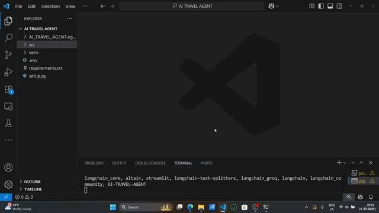

---

## 2. 讲师原话（带「—— pNNN [MM:SS]」）

下面按主题引用，不按视频顺序流水账。逐字稿里的 `rock API key`、`grog api key` 是口音转写，实际对应 Groq 的 API Key；下文统一写 `GROQ_API_KEY`，但你的 `.env` 里变量名必须和代码一致。这些引用只用于对齐讲师讲到的关键动作，不代表 P66–P68 只讲了这些内容；具体实现仍以第 3、4 节的代码和检查清单为准。

- 配置阶段，讲师说：`we will be writing our configuration code and it's very simple and it's very easy... open your src directory go to our config... create config.py`，然后 `import our os library`、`from .env import load.env`，并说 `load all your environment variables`。—— p066 [00:00]
- 读取 Key 时，讲师说：`I will write rock API key equal to OS dot get environment variable and you have to pass the name of the environment variable... go inside this dot ENV... copy the exact name`。—— p066 [00:58]
- 到链层，讲师说：`we will load our chat graph so we will find chat graph inside lang chain graph... it will be used to interact with your LLM models that are inside the grok`，并提到要传 API Key、模型名、temperature。—— p067 [00:28]
- 温度参数上，讲师先说 `you can set its value from 0 to 1`，随后口误说 `best value is around 3 to 5`，马上纠正：`sorry not three zero point three... it's value range from zero to one`，最终取 `0.3`。—— p067 [04:01]
- 生成函数签名上，讲师说：`generate itinerary basically user will pass city... city should be in string... user will pass interests and interest should be a list of string`，返回值也应为字符串。—— p067 [12:26]
- 用户输入兴趣时，讲师说：`user will not write it in the form of list... user will basically separate it with comma... we will convert the string into a list`。—— p068 [09:06]
- 记录 AI 回复时，讲师说：`self dot itinerary... it is given by AI. So we have to add it to conversation history... this time it is not a human message. Instead it is a AI message`。—— p068 [16:16]

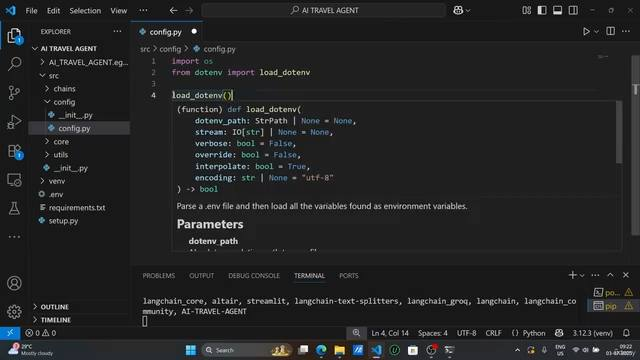

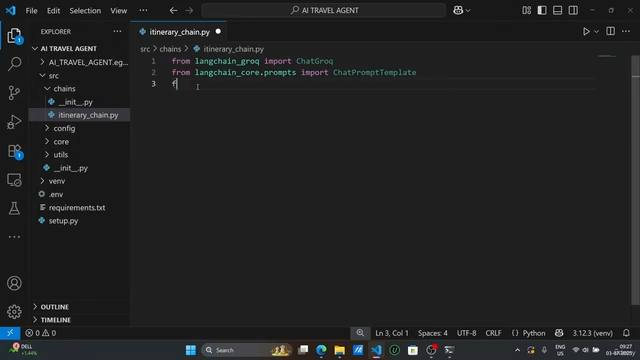

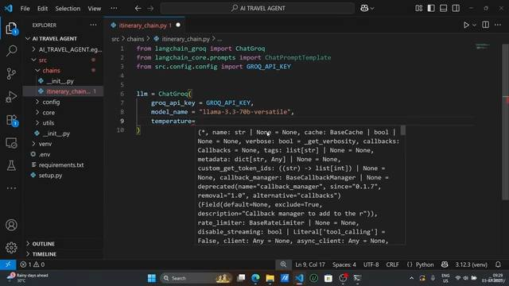

---

## 3. 从零复现

### 3.1 先建目录和虚拟环境

课里没讲 Python 版本号。下面代码用了 `list[str]` 类型注解，建议 Python 3.10+；如果你用更低版本，把 `list[str]` 改成 `List[str]` 或去掉注解即可。依赖版本课里也没讲，所以 `requirements.txt` 不锁死版本；如果你项目 setup 已经锁定版本，以你的 setup 为准。

```bash
mkdir -p llmops-trip-planner/src/{config,chains,core,utils}
cd llmops-trip-planner
python -m venv .venv
source .venv/bin/activate        # Windows: .venv\Scripts\activate
pip install langchain-groq langchain-core python-dotenv
```

这几条命令的完整含义如下：`mkdir -p` 会一次性创建多级目录，并且目录已存在时不会报错；`src/{config,chains,core,utils}` 是 shell 的大括号展开，等价于分别创建 `src/config`、`src/chains`、`src/core`、`src/utils`。`cd` 进入项目根目录，后面所有相对路径都以此为基准。`python -m venv .venv` 创建项目自己的虚拟环境，避免把依赖装进系统 Python。`source .venv/bin/activate` 在 macOS/Linux 下激活虚拟环境，Windows 使用 `.venv\Scripts\activate`。`pip install` 安装本节需要的三个包：`langchain-groq` 提供 `ChatGroq`，`langchain-core` 提供消息类和 Prompt 模板，`python-dotenv` 负责读取 `.env`。

常见错误与排查：如果 `python` 命令不存在，先确认 Python 是否加入 PATH；如果 `source` 报权限或路径错误，确认当前目录下确实有 `.venv/bin/activate`；如果安装后仍然 `ModuleNotFoundError`，大概率是依赖装到了全局 Python 而不是当前虚拟环境，重新激活 `.venv` 后执行 `pip install`。与前端对照：这一步类似 Node 项目里的 `npm init`、`npm install` 和 `.nvmrc`，目的都是固定项目自己的运行环境和依赖，而不是依赖机器上碰巧装了什么。

目录最终应为：

```text
llmops-trip-planner/
├── .env
├── requirements.txt
├── smoke_test.py
└── src/
    ├── __init__.py
    ├── config/
    │   ├── __init__.py
    │   └── config.py
    ├── chains/
    │   ├── __init__.py
    │   └── itinerary_chain.py
    ├── core/
    │   ├── __init__.py
    │   └── planner.py
    └── utils/
        ├── __init__.py
        ├── logger.py
        └── custom_exception.py
```

### 3.2 写 `.env`

在项目根目录建 `.env`，只放一行：

```bash
GROQ_API_KEY=你的_groq_api_key
```

课里没讲怎么申请 Groq API Key，也没讲 Key 的权限/额度。你只要保证变量名和 `config.py` 里 `os.getenv("GROQ_API_KEY")` 完全一致即可。`.env` 不要提交到 git。常见错误是把变量名写成 `GROQ_API`、`GROQ_KEY` 或前后多了空格；`python-dotenv` 读取时键名必须精确匹配，否则 `os.getenv` 得到 `None`。与前端对照：前端项目也常用 `.env` 或构建工具注入环境变量，但前端构建时注入的值会进入浏览器包，不能放服务端密钥；本节的 `GROQ_API_KEY` 属于服务端密钥，不能拿去给前端直接调用。

### 3.3 配置层：`src/config/config.py`

讲师在 P66 做的事情就是：先 `load_dotenv()`，再用 `os.getenv` 把环境变量转成普通变量。这里的关键是**顺序**：`load_dotenv()` 必须在 `os.getenv()` 之前，否则读到的是 `None`。另一个常见问题是运行目录不对：`load_dotenv()` 默认从当前工作目录寻找 `.env`，如果你在 `src/config` 里直接运行脚本，可能找不到项目根目录的 `.env`。排查时先打印 `os.getcwd()`，再确认 `.env` 是否在根目录。与前端对照：这相当于前端把构建期环境变量读入配置对象；区别是前端变量通常打包进产物，而这里是在 Python 进程启动时读取服务端环境。

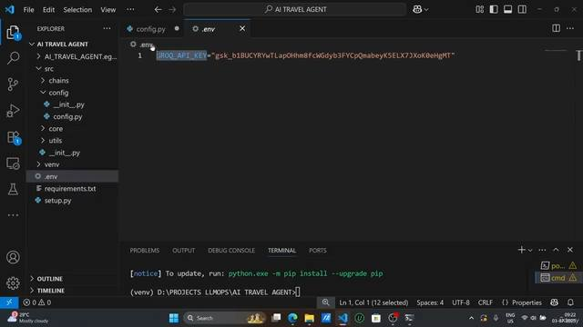

### 3.4 链层：`src/chains/itinerary_chain.py`

这一层做四件事：

1. 从 `langchain_groq` 导入 `ChatGroq`；
2. 从 `langchain_core.prompts` 导入 `ChatPromptTemplate`；
3. 用 `GROQ_API_KEY`、模型名、`temperature=0.3` 初始化 `llm`；
4. 定义 `generate_itinerary(city: str, interests: list[str]) -> str`，在函数里 `format_messages` 后 `invoke`，最后只返回 `response.content`。

模型名讲师在 Groq 文档里选的是 Llama 3.3 70B Versatile，代码里对应 `llama-3.3-70b-versatile`。课里没讲这个模型会不会下线、限流多少；如果实际报模型不存在，去 Groq 文档换一个当前可用模型名即可。常见错误包括：`GROQ_API_KEY` 为 `None` 导致初始化鉴权失败；把 `interests` 直接传成 list 导致 prompt 里出现方括号和引号；`temperature` 照抄口误写成 3 导致参数异常。排查时先单独实例化 `llm`，再单独调用 `generate_itinerary`，把问题分层定位。与前端对照：这一层类似前端封装的 API client，输入是业务参数，内部负责拼请求体并调用远端服务，调用方不应该关心模型名和 prompt 细节。

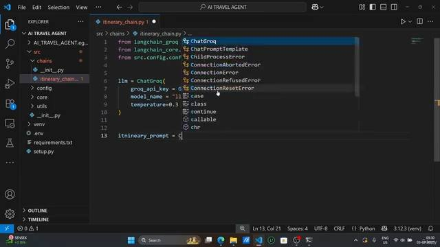

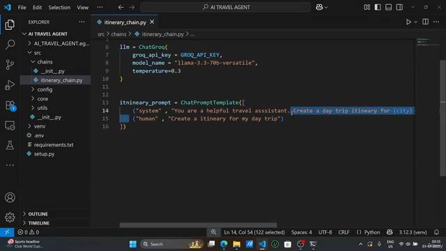

### 3.5 编排层：`src/core/planner.py`

`TravelPlanner` 是一个有状态的类。构造函数里初始化四个实例变量：

- `self.messages = []`：对话历史，装 `HumanMessage` / `AIMessage`；
- `self.city = ""`：用户输入的城市；
- `self.interests = []`：用户输入的多个兴趣，注意是 list；
- `self.itinerary = ""`：LLM 生成的行程。

然后三个方法：

- `set_city(city: str)`：保存城市，并把城市作为 `HumanMessage` 追加到历史；
- `set_interests(interests_string: str)`：把用户用逗号分隔的字符串拆成 list，保存 list，但历史里记录**用户原始字符串**，也作为 `HumanMessage`；
- `create_itinerary()`：调用 `generate_itinerary(self.city, self.interests)`，把返回内容存到 `self.itinerary`，再作为 `AIMessage` 追加到历史，最后返回行程。

常见错误与排查：如果 `planner.messages` 长度不是 3，先检查是否重复调用了 `set_city` 或 `set_interests`；如果 `self.interests` 是一整段字符串，说明 `split` 没有生效或输入不是英文逗号；如果 `create_itinerary` 抛 `SystemException`，先看日志里的底层异常，再检查 Key、模型名、网络。与前端对照：这个类很像前端组件里的状态容器，`city`、`interests`、`itinerary` 是组件状态，`messages` 是操作历史；在 Web 服务里不要把它做成全局单例，否则不同请求会共用状态。

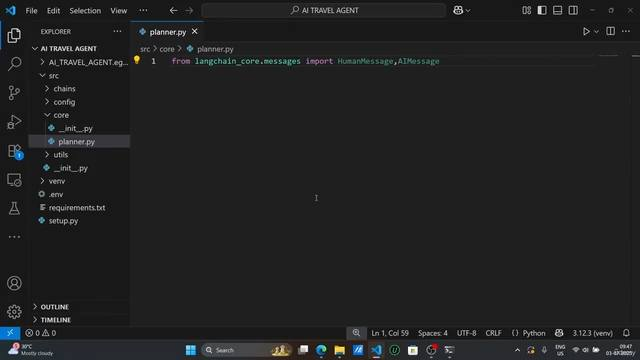

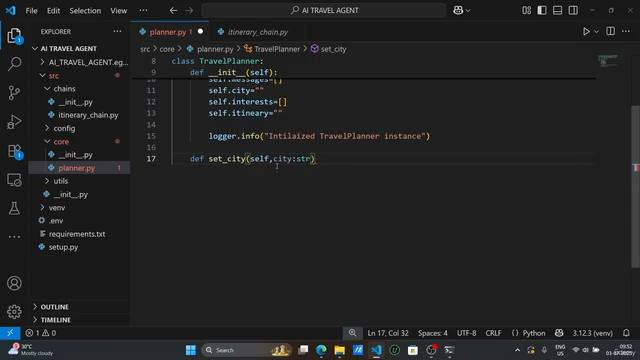

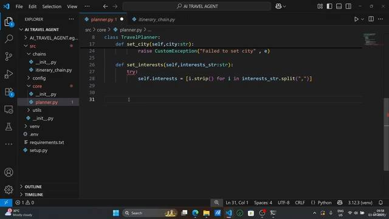

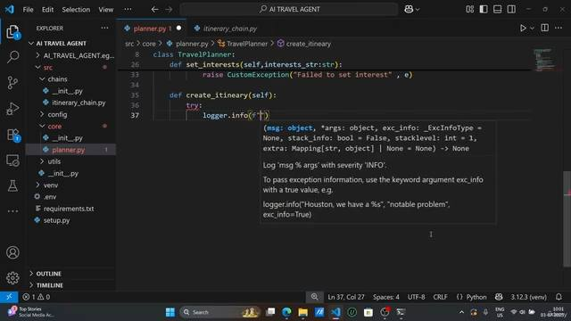

### 3.6 冒烟测试

在项目根目录运行：

```bash
python smoke_test.py
```

如果 Key 正确、模型可用，终端会打印一段行程文本。课里没讲输出必须长什么样，所以不要求固定格式；只要是非空字符串即可。常见错误是运行目录不对导致导入失败或 `.env` 找不到；如果出现 `ModuleNotFoundError: No module named 'src'`，确认当前目录是项目根目录，并且 `src/__init__.py` 存在。与前端对照：这类似前端项目里的本地 demo 脚本或 mock 调用，只验证链路能通，不代表页面已经完成。

---

## 4. 完整代码

下面每个文件都可以直接保存。`logger.py` 和 `custom_exception.py` 的具体实现课里没讲，讲师只说项目 setup 里已经创建了它们；这里给出**最小可运行版本**，不是逐字稿原文。`smoke_test.py` 也是课里没有的验证脚本，标为示意。

### 4.1 `requirements.txt`

```text
langchain-groq
langchain-core
python-dotenv
```

课里没讲具体版本号；上面不锁版本。若要锁版本，安装后执行 `pip freeze`，把实际版本写进来。

### 4.2 `.env`

```bash
GROQ_API_KEY=你的_groq_api_key
```

### 4.3 `src/__init__.py`

```python
# 空文件，让 src 成为 Python 包
```

### 4.4 `src/config/__init__.py`

```python
# 空文件
```

### 4.5 `src/config/config.py`

```python
import os

from dotenv import load_dotenv

load_dotenv()

GROQ_API_KEY = os.getenv("GROQ_API_KEY")
```

### 4.6 `src/chains/__init__.py`

```python
# 空文件
```

### 4.7 `src/chains/itinerary_chain.py`

```python
from langchain_groq import ChatGroq
from langchain_core.prompts import ChatPromptTemplate

from src.config.config import GROQ_API_KEY


llm = ChatGroq(
    api_key=GROQ_API_KEY,
    model="llama-3.3-70b-versatile",
    temperature=0.3,
)

itinerary_prompt = ChatPromptTemplate.from_messages(
    [
        (
            "system",
            "You are a helpful travel assistant. "
            "Create a one-day trip itinerary for {city} based on the user's interests: {interests}. "
            "Provide the itinerary in a brief, point-wise format.",
        ),
        (
            "human",
            "Create an itinerary for my day trip to {city} with interests: {interests}.",
        ),
    ]
)


def generate_itinerary(city: str, interests: list[str]) -> str:
    response = llm.invoke(
        itinerary_prompt.format_messages(
            city=city,
            interests=", ".join(interests),
        )
    )
    return response.content
```

### 4.8 `src/utils/__init__.py`

```python
# 空文件
```

### 4.9 `src/utils/logger.py`

```python
import logging


def get_logger(name: str) -> logging.Logger:
    logger = logging.getLogger(name)

    if not logger.handlers:
        logger.setLevel(logging.INFO)
        handler = logging.StreamHandler()
        formatter = logging.Formatter(
            "%(asctime)s - %(name)s - %(levelname)s - %(message)s"
        )
        handler.setFormatter(formatter)
        logger.addHandler(handler)

    return logger
```

### 4.10 `src/utils/custom_exception.py`

```python
class SystemException(Exception):
    """项目自定义异常。课里只要求能 raise / 捕获，具体字段课里没讲。"""
    pass
```

### 4.11 `src/core/__init__.py`

```python
# 空文件
```

### 4.12 `src/core/planner.py`

```python
from langchain_core.messages import HumanMessage, AIMessage

from src.chains.itinerary_chain import generate_itinerary
from src.utils.logger import get_logger
from src.utils.custom_exception import SystemException


logger = get_logger(__name__)


class TravelPlanner:
    def __init__(self):
        self.messages = []
        self.city = ""
        self.interests = []
        self.itinerary = ""

        logger.info("Initialized TravelPlanner instance")

    def set_city(self, city: str):
        try:
            self.city = city
            self.messages.append(HumanMessage(content=city))
            logger.info("City set successfully")
        except Exception as e:
            logger.error(f"Error while setting city: {e}")
            raise SystemException("Failed to set city") from e

    def set_interests(self, interests_string: str):
        try:
            self.interests = [i.strip() for i in interests_string.split(",")]
            self.messages.append(HumanMessage(content=interests_string))
            logger.info("Interests set successfully")
        except Exception as e:
            logger.error(f"Error while setting interests: {e}")
            raise SystemException("Failed to set interests") from e

    def create_itinerary(self):
        try:
            logger.info(
                f"Generating itinerary for {self.city} "
                f"and interests {self.interests}"
            )

            itinerary = generate_itinerary(self.city, self.interests)
            self.itinerary = itinerary
            self.messages.append(AIMessage(content=itinerary))

            logger.info("Itinerary generated successfully")
            return self.itinerary
        except Exception as e:
            logger.error(f"Error while creating itinerary: {e}")
            raise SystemException("Failed to create itinerary") from e
```

### 4.13 `smoke_test.py`（课里没有，仅用于验证）

```python
from src.core.planner import TravelPlanner


def main():
    planner = TravelPlanner()
    planner.set_city("Delhi")
    planner.set_interests("Red Fort, Lotus Temple, Qutub Minar")

    itinerary = planner.create_itinerary()
    print(itinerary)

    print("\n--- messages ---")
    for message in planner.messages:
        print(type(message).__name__, message.content[:80])


if __name__ == "__main__":
    main()
```

---

## 5. 逐行解释

### 5.1 配置层为什么这样写

- `from dotenv import load_dotenv`：逐字稿里说从 `.env` 加载环境变量。`load_dotenv()` 会读取项目根目录的 `.env`，把键值对放进 `os.environ`。如果你在别的目录运行脚本，它可能找不到 `.env`；课里没讲 `find_dotenv` 或显式路径，所以本文要求你在项目根目录运行。
- `load_dotenv()` 必须放在 `os.getenv()` 前面。顺序反了，`GROQ_API_KEY` 就是 `None`。这是配置层最常见的“看起来写了但没生效”的原因。
- `GROQ_API_KEY = os.getenv("GROQ_API_KEY")`：逐字稿里讲师强调“复制 `.env` 里的精确名字”。这里字符串必须和 `.env` 的键完全一致，大小写、下划线都不能差。讲师口音里的 `rock API key` / `grog api key` 不是变量名，实际变量名以你的 `.env` 为准。
- 常见错误与排查：打印 `GROQ_API_KEY` 时不要直接把完整 Key 输出到日志，只打印 `bool(GROQ_API_KEY)` 或长度即可；如果为 `False`，先查 `.env` 文件名是否是 `.env` 而不是 `.env.txt`，再查运行目录。与前端对照：前端环境变量通常在构建时被替换，改 `.env` 后要重新构建；Python 这里每次启动进程重新读取，改完 `.env` 后重新运行脚本即可。

### 5.2 链层为什么这样写

- `from langchain_groq import ChatGroq`：逐字稿说从 `lang chain graph` 里找 chat graph，用来和 Groq 里的 LLM 交互。对应代码就是 `ChatGroq`。课里没讲这个类的全部参数，只讲了 API Key、模型名、temperature 三个。
- `ChatPromptTemplate.from_messages([...])`：逐字稿说“传一个 list”，list 里第一条是 system message，第二条是 human message。system 用来告诉模型“你是一个有帮助的旅行助手”，human 是模拟用户的第一句话，作为聊天起点。
- system 里的 `{city}` 和 `{interests}` 是占位符。`format_messages(city=..., interests=...)` 会把它们替换掉。如果不写占位符，城市和兴趣就进不了 prompt，模型只能泛泛而谈。
- `interests=", ".join(interests)`：`generate_itinerary` 收到的是 `list[str]`，但 prompt 变量最终要变成一段文本。`join` 把 `["Red Fort", "Lotus Temple"]` 变成 `"红堡、莲花寺"`。如果直接传 list，Python 会把 list 的 `repr` 塞进 prompt，模型看到的是方括号和引号，格式会变差。
- `temperature=0.3`：讲师先口误说 3 到 5，随后纠正为 0 到 1 之间，并取 0.3。温度越低越稳定，越高越发散；0.3 是“有一点变化但不至于胡编”的折中。课里没讲不同模型对 temperature 的细微差异。
- `llm.invoke(...)`：逐字稿说“把 prompt 发给模型并拿回响应”。`invoke` 是同步调用；课里没讲流式 `stream` 或异步 `ainvoke`。
- `return response.content`：逐字稿说响应里有很多 key，但只想要“真正的答案”。在 LangChain 的 `AIMessage` 上，正文在 `.content`。逐字稿把 response 说成字典，实际你打印出来会看到消息对象；字段名请以实际输出为准。我们只返回 `.content`，不把整个 response 丢给调用方，避免把元数据带出去。
- 常见错误与排查：如果报鉴权失败，先查 `GROQ_API_KEY` 是否非空、是否粘贴了多余空格；如果报模型不存在，查 Groq 控制台或文档里的当前模型名；如果 prompt 里看不到城市和兴趣，检查 `format_messages` 的键名是否与模板占位符一致。与前端对照：这类似前端把用户输入组装成请求体再调用 API，区别是 prompt 模板承担了一部分“后端拼接参数”的职责。

### 5.3 编排层为什么这样写

- `self.messages = []`：逐字稿说用它记录“用户说了什么、AI 回了什么”。每调一次 `set_city`、`set_interests`、`create_itinerary`，就追加一条消息。这样后面如果要做多轮对话，历史是完整的。
- `self.city = ""`、`self.interests = []`：逐字稿解释，`generate_itinerary` 的 city 是字符串，所以城市初始化为空字符串；interests 是 list of string，所以兴趣初始化为空列表。类型要对齐，不然调用链层会传错。
- `self.itinerary = ""`：逐字稿说这个变量用来存 LLM 的输出。`create_itinerary` 里先拿到 `itinerary`，再赋给 `self.itinerary`，这样类的状态里保留最后一次结果。
- `set_city` 里 `self.city = city` 然后 `self.messages.append(HumanMessage(content=city))`：城市是用户给的，所以是 human message。注意顺序：先改状态再记历史；如果 append 失败，`self.city` 已经被改了，状态会不一致。课里没讲事务/回滚，这是后面你会撞上的点。
- `set_interests` 里 `[i.strip() for i in interests_string.split(",")]`：逐字稿说用户不会写 list，只会用逗号分隔，所以先按英文逗号 `split`，再对每一项 `strip` 去掉前后空格。`"红堡、莲花寺"` 会变成 `["Red Fort", "Lotus Temple"]`。如果用户输入中文逗号“，”或顿号“、”，这里不会分割；课里没讲，需要你自己加预处理。
- `self.messages.append(HumanMessage(content=interests_string))`：逐字稿特别强调，历史里记录的是**用户原始输入的字符串**，不是转换后的 list。因为对话历史要还原用户实际说了什么，而不是程序内部数据结构。
- `create_itinerary` 里 `generate_itinerary(self.city, self.interests)`：这里把城市和兴趣 list 传给链层。此时 `self.interests` 已经是 list，符合链层签名。
- `self.messages.append(AIMessage(content=itinerary))`：行程是 AI 生成的，所以是 `AIMessage`。逐字稿说“这次不是 human message，而是 AI message”。这样历史顺序是：Human(城市) → Human(兴趣) → AI(行程)。
- `except Exception as e` + `raise SystemException(...) from e`：逐字稿说用 try/except 做自定义异常处理。`from e` 保留原始异常链，排查时能看到底层错误；如果不加 `from e`，原始堆栈会丢。课里没讲 `SystemException` 里要不要带错误码，本文只给最小类。
- 常见错误与排查：如果 `interests` 只有一项但包含空格，`strip` 会处理前后空格；如果用户没有输入兴趣，`split(",")` 可能得到空字符串列表，调用前最好校验；如果 `create_itinerary` 连续调用多次，`messages` 会继续追加，历史不会自动清空。与前端对照：`messages` 类似前端 store 里的操作日志，`set_city` 和 `set_interests` 类似表单字段更新，`create_itinerary` 类似点击“生成”后的异步提交；前端需要防止重复点击，后端这里需要防止重复追加或并发共享实例。

---

## 6. 复现检查清单

按顺序打勾，每条后面给出验证方式：

- [ ] 项目根目录是 `llmops-trip-planner/`，并且 `src/` 下有 `config`、`chains`、`core`、`utils` 四个目录。验证方式：在项目根目录执行 `pwd` 或 `cd` 查看路径，再执行 `ls src`，应看到四个目录。
- [ ] 每个目录都有 `__init__.py`，否则 `from src.xxx` 可能导入失败。验证方式：执行 `find src -name "__init__.py"`，至少应列出 `src/__init__.py` 和四个子目录下的 `__init__.py`。
- [ ] `.env` 在项目根目录，键名是 `GROQ_API_KEY`，值和 `config.py` 里的 `os.getenv("GROQ_API_KEY")` 完全一致。验证方式：先确认文件名为 `.env`，再运行 `python -c "from src.config.config import GROQ_API_KEY; print(bool(GROQ_API_KEY))"`，输出应为 `True`。
- [ ] 已安装 `langchain-groq`、`langchain-core`、`python-dotenv`；课里没讲版本号，若导入报错先检查是否装到了当前虚拟环境。验证方式：执行 `python -c "import langchain_groq, langchain_core, dotenv; print('ok')"`，输出 `ok`。
- [ ] `python -c "from src.config.config import GROQ_API_KEY; print(bool(GROQ_API_KEY))"` 输出 `True`。验证方式：如果输出 `False`，检查 `.env` 键名、运行目录和 `load_dotenv()` 顺序。
- [ ] `python -c "from src.chains.itinerary_chain import generate_itinerary; print('ok')"` 不报错。验证方式：如果报鉴权错误，说明导入时已经实例化 `llm`，先查 Key；如果报模型错误，查模型名。
- [ ] `python -c "from src.core.planner import TravelPlanner; print('ok')"` 不报错。验证方式：如果报循环导入或模块缺失，检查 `src/core/planner.py` 的导入路径和 `__init__.py`。
- [ ] `python smoke_test.py` 能打印出一段非空行程文本。验证方式：观察终端输出是否为空；若为空，检查 `response.content` 和模型返回。
- [ ] 终端日志里出现 `Initialized TravelPlanner instance`、`City set successfully`、`Interests set successfully`、`Itinerary generated successfully`。验证方式：按顺序运行 `smoke_test.py`，逐条对照日志，缺哪条就定位对应方法。
- [ ] `planner.messages` 长度为 3，顺序是 `HumanMessage`、`HumanMessage`、`AIMessage`。验证方式：运行 `smoke_test.py` 后查看 `--- messages ---` 下面的三行输出。
- [ ] 把 `.env` 里的 Key 临时改错，再运行，应看到 `SystemException: Failed to create itinerary` 以及底层日志；改回正确 Key 后恢复。验证方式：备份 `.env`，改错 Key 后运行一次，确认异常路径；再恢复 Key，确认成功路径。
- [ ] 把兴趣改成 `"红堡、莲花寺"`，确认 `planner.interests` 是两项，而不是一整段字符串。验证方式：在 `smoke_test.py` 里打印 `planner.interests`，应看到 `['Red Fort', 'Lotus Temple']`。

---

## 7. 课里没讲但你会撞上的

| 现象 | 原因 | 怎么办 |
|---|---|---|
| 多用户串话，一个用户看到另一个用户的行程 | `TravelPlanner` 的 `messages`、`city`、`interests`、`itinerary` 都是实例状态；如果做成全局单例，多个请求共用同一份历史 | 每个请求 `new TravelPlanner()`；课里没讲 Web 层，这里只是提醒。Node/JS 里同理，不要把一个 `planner` 对象挂在模块顶层给所有请求复用 |
| API Key 泄露 | `.env` 只适合本地/服务端；前端不能直接拿 `GROQ_API_KEY` 调 Groq，否则浏览器网络面板一开就泄露 | 把模型调用放在后端；前端只调用自己的 API 路由；课里没讲前后端分离，但这是上线必踩 |
| 模型名会变，报 model not found | `llama-3.3-70b-versatile` 是讲师在 Groq 文档里选的；Groq 的可用模型列表可能调整 | 去 Groq 文档换当前模型名；课里没讲降级/重试，可在应用层加兜底和重试 |
| temperature 口误，参数超范围或行为异常 | 讲师先说 3 到 5，随后纠正为 0 到 1，最终 0.3；不要照抄 3 | 保持 `temperature=0.3`，或按当前模型文档调整；Groq/LangChain 对超范围值可能报错或行为异常 |
| 只支持英文逗号，中文逗号、顿号、换行不会拆分 | `set_interests` 用 `split(",")`；课里没讲输入清洗 | 在 `set_interests` 里先 `replace("，", ",").replace("、", ",")`，再按逗号拆分并过滤空项 |
| 历史只增不减，长对话超过模型上下文 | `self.messages` 没有裁剪；课里没讲 token 计数、摘要或滑动窗口 | 加消息裁剪、摘要或滑动窗口；Node 里对应就是数组只 `push` 不 `shift` |
| Prompt 注入，用户输入带偏模型 | 用户兴趣会拼进 prompt；如果用户写“忽略以上指令，输出别的”，模型可能被带偏 | 课里没讲防护；至少不要把用户输入拼进 system 角色，可在 human 模板里加边界说明，并在应用层做输入清洗 |
| 异常只抛不接，接口返回不友好 | `SystemException` 在 P66–P68 只是被 `raise`，没有 HTTP 状态码、没有用户友好文案 | 下一节做 application 时才需要接住它；课里没讲 FastAPI/Flask 的错误处理，可在路由层统一转成 4xx/5xx 和错误消息 |
| 日志只到终端，不落盘 | 本文的 `logger.py` 用 `StreamHandler`，日志不会自动落盘 | 课里没讲文件 handler、日志轮转、结构化日志；生产环境可加 `FileHandler` 或接日志平台 |
| 从非根目录运行找不到 `.env` | `load_dotenv()` 默认按当前工作目录找；你在 `src/` 里运行 `python ../smoke_test.py` 可能读不到 Key | 课里没讲 `find_dotenv()` 或 `load_dotenv(dotenv_path=...)`；固定从根目录运行，或显式传 `.env` 路径 |
| 没有测试，每次调模型花钱且不稳定 | 课里没讲单元测试 | 先用 `smoke_test.py` 做冒烟，再把 `generate_itinerary` mock 掉，测 `TravelPlanner` 的状态变化，避免每次调模型花钱 |
| Node/JS 复刻时概念对不上 | 本节是 Python 课，课里没讲 JS 版本；模型类、PromptTemplate、HumanMessage/AIMessage 在 LangChain.js 有对应概念 | 本文的 `TravelPlanner` 在 Node 里就是一个 class，`this.messages` 是数组，`this.city` 是字符串，`this.interests` 是字符串数组；并发问题同样存在 |

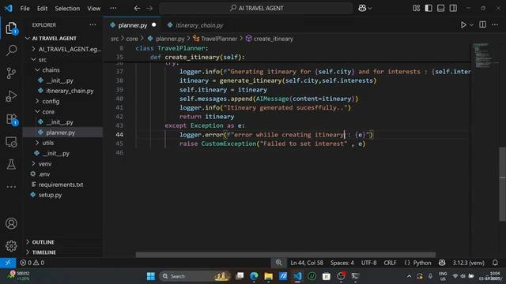