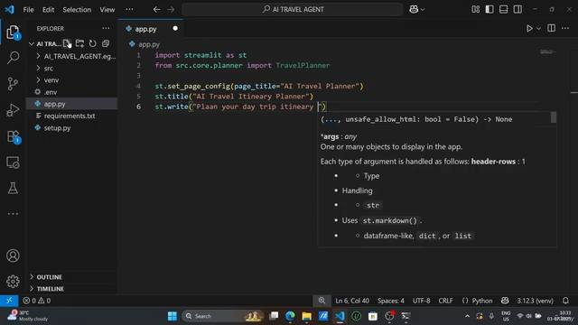
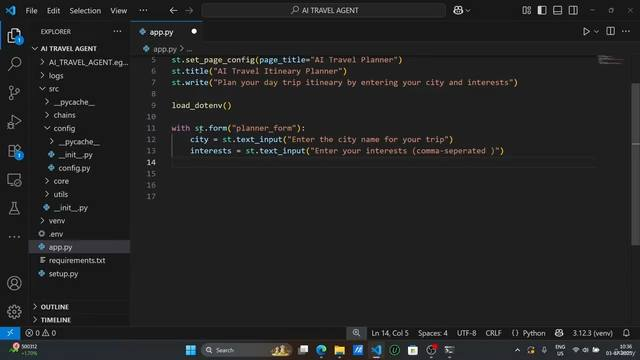
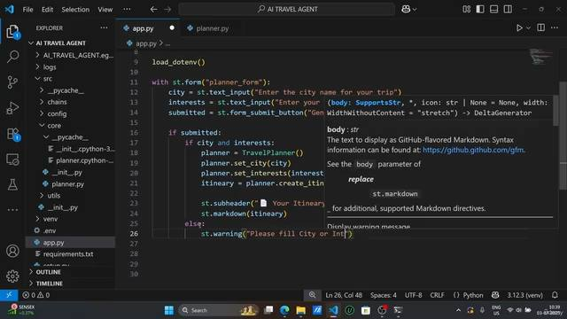
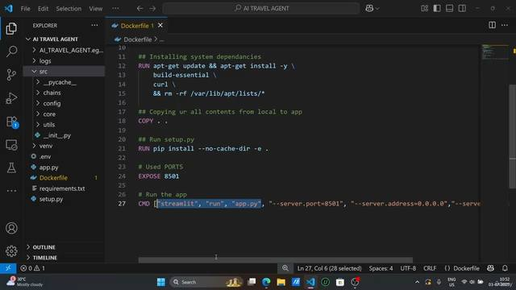
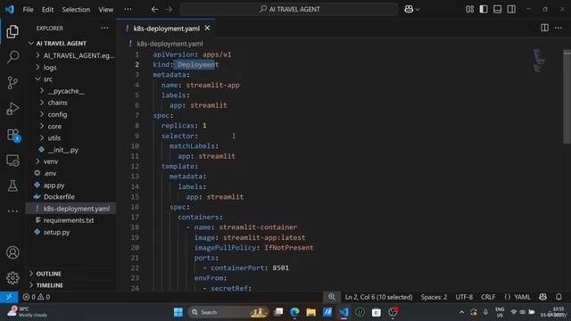
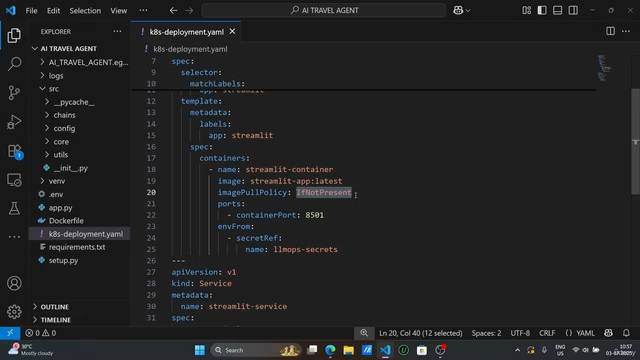
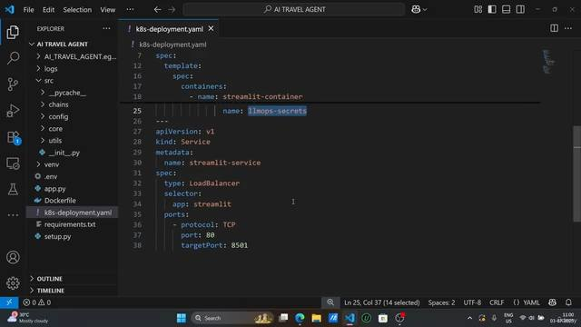
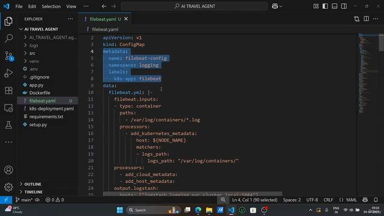
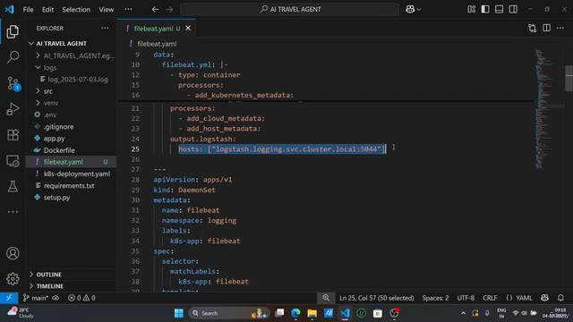
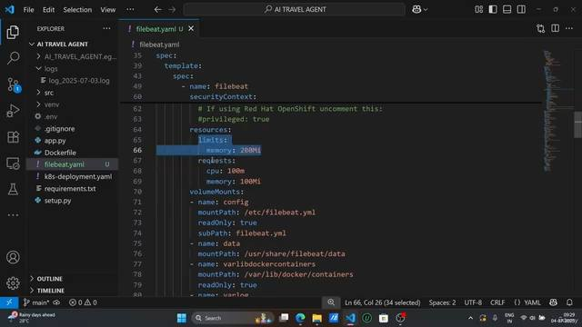

# LLMOps & AIOps Bootcamp：Streamlit 应用 + Docker/K8s 部署 + Filebeat 日志采集（P069–P071）

> 覆盖 P069（Streamlit 主应用）、P070（Dockerfile / k8s deployment / GitHub 版本化）、P071（Filebeat 部署清单）。本文按「把项目跑起来」的顺序重组，不按视频顺序流水账。

---

## 1. 这一节做什么

这三节课把前面写好的 `TravelPlanner` 类（上一节视频里创建的类，课里没讲它的内部实现）包装成一个**能上线的最小 LLMOps 交付物**，一共四件事：

1. **P069**：在项目根目录写 `app.py`，用 Streamlit 做前端表单（城市 + 兴趣），点击按钮后调用 `TravelPlanner` 生成行程，用 `st.markdown` 渲染结果。
2. **P070**：写 `Dockerfile`（Python 3.10 基础镜像、暴露 8501、`streamlit run app.py` 带 `--server.address 0.0.0.0 --server.headless true`），写 `k8s_deployment.yml`（Deployment + LoadBalancer Service），并用 GitHub 做代码版本化（`.gitignore` 排除 `.env`）。
3. **P071**：写 `filebeat.yml`，用 **ConfigMap + DaemonSet + ServiceAccount + ClusterRole/Role + 三种 Binding** 把 Filebeat 装到集群每个节点上，把容器日志送到 Logstash 的 5044 端口。

最终产物目录（根目录下）：

```
ai-travel-itinerary-planner/
├── app.py
├── Dockerfile
├── k8s_deployment.yml
├── filebeat.yml
├── .gitignore
├── .env                  # 不进 Git
├── requirements.txt      # 课里提到但没展示内容
└── src/
    ├── __init__.py
    ├── config.py         # 上一节视频创建，课里说它已 load_dotenv
    ├── chains.py         # 上一节视频创建，prompt 在这里
    └── planner.py        # 上一节视频创建，TravelPlanner 类在这里
```

> 注意：`src/planner.py`、`src/chains.py`、`src/config.py` 是**上一节视频**的产物，本节逐字稿只引用、不重写。本文第 4 节会给出 `app.py` 等本节真正写出的完整文件；对上一节的类，只按逐字稿里出现的方法名（`set_city` / `set_interest` / `create_itinerary`）给出**接口约定**，并明确标注「课里没给实现」。

这一节的目标不是讲一个大而全的平台，而是先跑通一条最小交付链路：前端能提交表单，后端能调用 LLM 生成行程，容器能构建，K8s 能暴露服务，日志能从节点采集并送到 Logstash。每一步都可以单独验证，出了问题也能按层排查。对于前端同学，可以把 `app.py` 理解为一个“单文件页面 + 表单提交 + 服务端渲染结果”的极简应用；对于运维同学，可以把 Docker/K8s/Filebeat 三份文件理解为部署描述和采集描述。课里没有展开 `TravelPlanner` 的内部实现，所以复现时要先把上一节的 `src/` 产物准备好，否则 `app.py` 导入会失败。常见错误是只复制了本节文件、没有上一节类文件，运行时报 `ModuleNotFoundError: No module named 'src'` 或 `ImportError`；排查时先在项目根目录执行 `python -c "从 src.planner 导入 TravelPlanner"`，确认导入链通，再启动 Streamlit。

---

## 2. 讲师原话（带出处）

- 「in the root directory, you will create one app.py file. Basically, this file will contain our logic of our streamlit」—— p069 [00:00]
- 「before making any streamlit app. you have to define the page config. Otherwise your application will not work.」—— p069 [00:29]
- 「why we are loading our .env here, we have already done in the configuration file … because when you will run your application using a docker file … suppose if your app.py is running your configuration file is not running so it will not be able to load your environment variables properly」—— p069 [03:22]
- 「if we have city and interest … then only we will move forward otherwise we will show some warning」—— p069 [06:16]
- 「if you want a more detailed itinerary you can just change up the prompt … if you will say it provide a detailed itinerary So it will give you a detailed identity」—— p069 [10:07]
- 「when we talk about the streamlit application they generally run on 8501 port so we are exposing 8501 port」—— p070 [03:20]
- 「this 0.0.0 means that your app will be accessible from anywhere」—— p070 [03:49]
- 「by default this server headless is false. But we have set it to true … Linux machine don't have any browser … they will try to force open your browser okay that's why they can cause error」—— p070 [04:47]
- 「we will be forming our Docker image inside the virtual machine only … So that's why we have written this if not present」—— p070 [08:38]
- 「we will not push this env file to our github … we will take this api key and inject it … we will name that injection as LLM of C-Gate（LLM_SECRETS）」—— p070 [09:59]
- 「when it is set to cluster ip your app will only be accessible inside the Kubernetes cluster … if you want to expose it to Intimate（internet）, load balancer works the best」—— p070 [10:56]
- 「file bit is your log chipper … it collects logs from each node of your Kubernetes cluster and sends those logs to your logstash」—— p071 [00:28]
- 「if you are integrating a file beat using them demon set so what demon set will do it will install a file beat pod at each node」—— p071 [01:27]
- 「in file bit.inputs you will define where to read the logs and in output you will define where to send the logs」—— p071 [05:34]
- 「we are setting the type as container … it will tell the file bit that file bit have to read the logs produced by each container」—— p071 [06:04]
- 「your logstash will be running on this 5044 port」—— p071 [12:15]
- 「we are running our pod as the root … so we don't want any access permissions issues so that's why we have set it to root user」—— p071 [21:47]
- 「limit meant the maximum memory allowed and the request means the means the minimum memory allowed」—— p071 [23:09]
- 「it will keep the track of all the logs that has already been sent. So that no log can be sent twice」—— p071 [25:04]
- 「RBAC means role based access control」—— p071 [28:55]
- 「get means read … watch means it can watch for changes … list means it can list all the namespaces, ports（pods）and every node」—— p071 [34:31]

这些原话在复现时可以作为“判断依据”：例如看到 `headless`、`0.0.0.0`、`imagePullPolicy`、`envFrom`、`DaemonSet`、`type: container`、`5044`、`runAsUser: 0`、`requests/limits`、`registry data`、RBAC 的 `get/watch/list` 时，要能对应回讲师当时的解释。遇到报错时，先回到这些关键词检查配置是否写偏，而不是盲目改代码。

---

## 3. 从零复现

### 3.1 前置条件

- 已按上一节视频完成 `src/` 下的 `TravelPlanner` 类（本节不重建）。
- Python 3.10（Dockerfile 用的就是 `python:3.10`）。
- 本地能跑 `streamlit`；有 Docker；有一个可用的 Kubernetes 集群（讲师在后续视频里用 GCP VM 自建，本节只写清单）。
- 有 GitHub 账号 + 已安装 Git CLI（讲师原话：「just search for internet on git cli install」——p070 [13:49]，即搜 "install git cli" 按官网 GUI 安装）。

复现前建议先做一次环境自检：`python --version` 确认 3.10；`streamlit --version` 确认命令存在；`docker version` 确认 Docker daemon 可用；`kubectl version --client` 和 `kubectl get nodes` 确认集群可连。常见错误是本地 Python 版本不对导致依赖安装失败，或者 `kubectl` 指向了错误 context，后面 apply 到别的集群。前端对照：这一步类似检查 Node 版本、包管理器、浏览器调试工具是否就绪，环境不对时后面所有页面问题都会被放大。

### 3.2 步骤一：写 `app.py`（P069）

1. 根目录新建 `app.py`。
2. 顶部 `import streamlit as st`，`from src.planner import TravelPlanner`（讲师原话是「from src.I think in code. I think in the planner we have that class」——p069 [00:29]，即从 `src/planner` 导入 `TravelPlanner`）。
3. 先 `st.set_page_config(...)`，再 `st.title(...)`、`st.write(...)`。
4. `from dotenv import load_dotenv` + `load_dotenv()`——**必须在 app.py 里再 load 一次**，理由见第 5 节。
5. `with st.form("planner_form"):` 里放两个 `st.text_input`（city、interests）和一个 `st.form_submit_button("生成行程")`。
6. `if submitted:` 分支里做非空校验 → 实例化 `TravelPlanner` → `set_city` → `set_interest` → `create_itinerary` → `st.subheader` + `st.markdown` 渲染；否则 `st.warning(...)`。
7. 终端执行 `streamlit run app.py` 验证。



上图是讲师第一次跑起来的效果：只有 title 和 description，表单还没加。





常见错误与排查：如果启动时报 `StreamlitAPIException`，优先检查 `st.set_page_config` 是否写在了其他 `st.*` 命令之后；如果表单提交后没有反应，检查 `st.form_submit_button` 的返回值是否赋给了 `submitted`，以及 `if submitted:` 是否在 form 外部；如果点击后报 LLM key 缺失，检查 `.env` 是否在项目根目录、`load_dotenv()` 是否在导入 `TravelPlanner` 之前执行。前端对照：Streamlit 的表单提交不像 React 受控组件那样每次输入都触发前端 state 更新，而是点提交后整段脚本重跑，因此调试时不要用“输入一个字就应该看到 console 变化”的直觉去判断。

### 3.3 步骤二：写 `Dockerfile`（P070）

1. 根目录新建 `Dockerfile`（无扩展名）。
2. 基础镜像 `python:3.10`。
3. 设置环境变量（讲师说「optional … but I think it's good to write these environment variables」——p070 [00:29]）。
4. `WORKDIR /app`。
5. `apt-get update` → 装 `curl`、`build-essential` 等系统依赖 → 清理 apt 缓存。
6. `COPY . .`（讲师原话：「copying your all the contents from your local … to our app work directly」——p070 [01:56]）。
7. `pip install --no-cache-dir -r requirements.txt`——讲师专门解释了 `--no-cache-dir`：「so that we can get a fresh restart … it will ignore these cached files」——p070 [02:25]。
8. `EXPOSE 8501`。
9. `CMD ["streamlit","run","app.py","--server.port=8501","--server.address=0.0.0.0","--server.headless=true"]`。



构建时建议在项目根目录执行 `docker build -t streamlit-app .`，注意最后的 `.` 是构建上下文，不是随便写的点。常见错误：`COPY . .` 把本地虚拟环境或缓存也拷进去导致镜像变大，应该用 `.dockerignore` 或至少确认 `.gitignore` 已排除 `.env`；`pip install` 失败时先看 `requirements.txt` 是否在根目录、包名是否拼错；容器启动后访问不到时检查 `--server.address=0.0.0.0` 和 `-p 8501:8501` 是否都写了。前端对照：Dockerfile 类似前端项目的构建脚本，`WORKDIR` 是工作目录，`COPY` 是拷贝源码，`RUN pip install` 是安装依赖，`CMD` 是启动开发服务器。

### 3.4 步骤三：写 `k8s_deployment.yml`（P070）

1. 根目录新建 `k8s_deployment.yml`（讲师口述文件名是「k8s … .eml」，即 `.yml`）。
2. 文件里放**两个文档**：`Deployment` 和 `Service`，用 `---` 分隔。
3. Deployment：`metadata.name: streamlit-app`；`spec.replicas: 2`（讲师建议「not to take above 3」——p070 [07:40]）；`selector.matchLabels.app: streamlit`；`template.metadata.labels.app: streamlit`；容器 `image: streamlit-app`（**必须与后面 `docker build -t` 的名字一致**）；`imagePullPolicy: IfNotPresent`；`containerPort: 8501`；`envFrom` 引用名为 `llm-secrets` 的 Secret。
4. Service：`type: LoadBalancer`；`port: 80`；`targetPort: 8501`；`selector.app: streamlit`（**必须与 Deployment 的 label 完全一致**）。





应用后先 `kubectl get pods` 看 Pod 是否 Running，再看 `kubectl describe pod` 的 Events。常见错误：`ImagePullBackOff` 通常是 `image` 名字和本地 `docker build -t` 不一致，或者 `imagePullPolicy: Always` 去远端拉不到；`CreateContainerConfigError` 多半是 `llm-secrets` 不存在；Service 外部访问不通时检查 `selector.app` 是否和 Pod label 一致、`targetPort` 是否等于容器实际监听端口。前端对照：Deployment 像“构建并运行前端应用的进程”，Service 像“负载均衡 + 对外域名入口”，label/selector 像前端路由匹配规则，写错就匹配不到。

### 3.5 步骤四：GitHub 版本化（P070）

1. 根目录新建 `.gitignore`，至少写入 `.env`（讲师原话：「we will not push this env file to our github」——p070 [09:59]）。讲师还删掉了 4 个「project management details」文件（IDE 配置类），课里没给具体文件名。
2. GitHub 网页端 New repository，名字 `ai-travel-itinerary-planner`，Public，**不要**勾选自动生成 README/.gitignore。
3. 终端依次执行 GitHub 页面上给出的命令（讲师逐条念的）：
   ```bash
   git init
   git branch -M main
   git remote add origin <你的仓库地址>
   git add .
   git commit -m "initial commit"
   git push origin main
   ```
4. 刷新 GitHub 页面确认文件都在。



常见错误：`git add .` 之前先用 `git status` 确认 `.env` 没被跟踪；如果已经提交过 `.env`，需要从 Git 历史移除并更换 key，而不是只删文件；`git push` 失败先检查 remote 地址和分支名。前端对照：这一步类似把前端项目推到远端仓库，但密钥文件绝不能进版本库，否则等于把 API key 公开。

### 3.6 步骤五：写 `filebeat.yml`（P071）

这是三节课里最长的一个文件，包含 **7 个 Kubernetes 资源**，顺序建议照抄：

1. `ConfigMap`（`filebeat-config`，namespace `logging`）——`data["filebeat.yml"]` 里放 Filebeat 的 inputs/processors/output 配置。
2. `DaemonSet`（`filebeat`，namespace `logging`）——保证每个节点一个 Pod。
3. `ClusterRoleBinding`（全局权限）。
4. `RoleBinding`（namespace 权限）。
5. `RoleBinding`（kubeadm-config 权限）。
6. `ClusterRole`（定义全局规则：get/watch/list namespaces/nodes/pods）。
7. `Role` ×2（namespace 规则、kubeadm-config 只读规则）。
8. `ServiceAccount`（`filebeat`，namespace `logging`）。

> 讲师在 P071 里是**先讲 Binding 再讲 Role**（因为文件里 Binding 写在前面），但逻辑上是「先有 ServiceAccount 和 Role，Binding 才有意义」。复现时按上面 1→8 的顺序理解即可。







常见错误：`namespaces "logging" not found` 说明没先创建 namespace；`DaemonSet` 的 `DESIRED` 小于节点数，检查是否有节点污点导致 Pod 没调度；Filebeat Pod 起来但没日志，先看 `kubectl logs` 是否有配置解析错误，再检查 `paths` 和 volumeMounts 是否挂对；RBAC 报 forbidden 时检查 ServiceAccount 名字、Binding 的 namespace、RoleRef 名字三者是否一致。前端对照：可以把 Filebeat 理解为“每个节点上的日志采集 agent”，ConfigMap 是它的配置文件，DaemonSet 是“每个节点部署一个”的部署策略，RBAC 是它访问 K8s API 的权限白名单。

---

## 4. 完整代码

> 以下 4 个文件是本节视频真正写出的产物，可直接保存。`src/` 下的类属于上一节视频，本节只给接口约定。

### 4.1 `app.py`（P069 完整文件）

```python
import streamlit as st
from dotenv import load_dotenv
from src.planner import TravelPlanner

# 在 app.py 里再 load 一次 .env：
# 用 docker / k8s 启动时只会执行 app.py，config.py 不一定会被导入执行
load_dotenv()

st.set_page_config(
    page_title="AI Travel Planner",
    page_icon="✈️",
)

st.title("AI Travel Itinerary Planner")
st.write("Plan your day trip itinerary by entering your city and interests.")

with st.form("planner_form"):
    city = st.text_input("Enter the city name for your trip")
    interests = st.text_input("Enter your interests (comma separated)")
    submitted = st.form_submit_button("Generate Itinerary")

if submitted:
    if city and interests:
        planner = TravelPlanner()
        planner.set_city(city)
        planner.set_interest(interests)
        itinerary = planner.create_itinerary()

        st.subheader("📄 Your Itinerary")
        st.markdown(itinerary)
    else:
        st.warning("Please fill city or interest to move forward.")
```

### 4.2 `Dockerfile`（P070 完整文件）

```dockerfile
FROM python:3.10

# 可选环境变量（讲师说 optional，但建议写）
ENV PYTHONDONTWRITEBYTECODE=1
ENV PYTHONUNBUFFERED=1

WORKDIR /app

# 系统依赖
RUN apt-get update && apt-get install -y --no-install-recommends \
    curl \
    build-essential \
    && rm -rf /var/lib/apt/lists/*

# 拷贝源码（.env 因 .gitignore 不会进 Git，也就不会进镜像）
COPY . .

# --no-cache-dir：忽略缓存，保证每次全新安装
RUN pip install --no-cache-dir -r requirements.txt

EXPOSE 8501

CMD ["streamlit", "run", "app.py", \
     "--server.port=8501", \
     "--server.address=0.0.0.0", \
     "--server.headless=true"]
```

### 4.3 `k8s_deployment.yml`（P070 完整文件）

```yaml
apiVersion: apps/v1
kind: Deployment
metadata:
  name: streamlit-app
  labels:
    app: streamlit
spec:
  replicas: 2
  selector:
    matchLabels:
      app: streamlit
  template:
    metadata:
      labels:
        app: streamlit
    spec:
      containers:
        - name: streamlit-app
          image: streamlit-app
          imagePullPolicy: IfNotPresent
          ports:
            - containerPort: 8501
          envFrom:
            - secretRef:
                name: llm-secrets
---
apiVersion: v1
kind: Service
metadata:
  name: streamlit-service
  labels:
    app: streamlit
spec:
  type: LoadBalancer
  selector:
    app: streamlit
  ports:
    - port: 80
      targetPort: 8501
```

### 4.4 `filebeat.yml`（P071 完整文件）

> 说明：讲师是「从 GitHub 仓库复制粘贴 + 逐行讲解」，逐字稿里没有逐字念出 YAML 的每一行。下面这份按讲师讲到的**每一个字段**还原，字段名严格取自逐字稿；逐字稿没提到的细节（如 `apiVersion` 的具体字符串、`hosts` 的 IP）用注释标出「课里没讲，按实际集群填」。

```yaml
# ---------- 1. ConfigMap：覆盖 Filebeat 默认配置 ----------
apiVersion: v1
kind: ConfigMap
metadata:
  name: filebeat-config
  namespace: logging
  labels:
    k8s-app: filebeat
data:
  filebeat.yml: |-
    filebeat.inputs:
      - type: container
        paths:
          - /var/log/containers/*.log
        processors:
          - add_kubernetes_metadata:
              host: ${NODE_NAME}
              matchers:
                - logs_path:
                    logs_path: "/var/log/containers/"

    processors:
      - add_cloud_metadata:
      - add_host_metadata:

    output.logstash:
      hosts: ["logstash:5044"]
---
# ---------- 2. DaemonSet：每个节点一个 Filebeat Pod ----------
apiVersion: apps/v1
kind: DaemonSet
metadata:
  name: filebeat
  namespace: logging
  labels:
    k8s-app: filebeat
spec:
  selector:
    matchLabels:
      k8s-app: filebeat
  template:
    metadata:
      labels:
        k8s-app: filebeat
    spec:
      serviceAccountName: filebeat
      terminationGracePeriodSeconds: 30
      hostNetwork: true
      dnsPolicy: ClusterFirstWithHostNet
      containers:
        - name: filebeat
          image: docker.elastic.co/beats/filebeat:8.10.0   # 版本号课里没讲，按实际填
          args: [
            "-c", "/etc/filebeat.yml",
            "-e",
          ]
          env:
            - name: NODE_NAME
              valueFrom:
                fieldRef:
                  fieldPath: spec.nodeName
          securityContext:
            runAsUser: 0
          resources:
            limits:
              memory: 200Mi
            requests:
              memory: 100Mi
          volumeMounts:
            - name: config
              mountPath: /etc/filebeat.yml
              readOnly: true
              subPath: filebeat.yml
            - name: data
              mountPath: /usr/share/filebeat/data
            - name: varlibdockercontainers
              mountPath: /var/lib/docker/containers
              readOnly: true
            - name: varlog
              mountPath: /var/log
              readOnly: true
      volumes:
        - name: config
          configMap:
            name: filebeat-config
            defaultMode: 0640
        - name: data
          hostPath:
            path: /var/lib/filebeat-data
            type: DirectoryOrCreate
        - name: varlibdockercontainers
          hostPath:
            path: /var/lib/docker/containers
        - name: varlog
          hostPath:
            path: /var/log
---
# ---------- 3. ClusterRoleBinding：全局权限 ----------
apiVersion: rbac.authorization.k8s.io/v1
kind: ClusterRoleBinding
metadata:
  name: filebeat
subjects:
  - kind: ServiceAccount
    name: filebeat
    namespace: logging
roleRef:
  kind: ClusterRole
  name: filebeat
  apiGroup: rbac.authorization.k8s.io
---
# ---------- 4. RoleBinding：namespace 权限 ----------
apiVersion: rbac.authorization.k8s.io/v1
kind: RoleBinding
metadata:
  name: filebeat
  namespace: logging
subjects:
  - kind: ServiceAccount
    name: filebeat
    namespace: logging
roleRef:
  kind: Role
  name: filebeat
  apiGroup: rbac.authorization.k8s.io
---
# ---------- 5. RoleBinding：kubeadm-config 权限 ----------
apiVersion: rbac.authorization.k8s.io/v1
kind: RoleBinding
metadata:
  name: filebeat-kubeadm-config
  namespace: logging
subjects:
  - kind: ServiceAccount
    name: filebeat
    namespace: logging
roleRef:
  kind: Role
  name: filebeat-kubeadm-config
  apiGroup: rbac.authorization.k8s.io
---
# ---------- 6. ClusterRole：全局规则 ----------
apiVersion: rbac.authorization.k8s.io/v1
kind: ClusterRole
metadata:
  name: filebeat
  labels:
    k8s-app: filebeat
rules:
  - apiGroups: [""]
    resources: ["namespaces", "pods", "nodes"]
    verbs: ["get", "watch", "list"]
  - apiGroups: ["apps"]
    resources: ["replicasets"]
    verbs: ["get", "list", "watch"]
---
# ---------- 7a. Role：namespace 规则 ----------
apiVersion: rbac.authorization.k8s.io/v1
kind: Role
metadata:
  name: filebeat
  namespace: logging
  labels:
    k8s-app: filebeat
rules:
  - apiGroups: [""]
    resources: ["pods", "namespaces"]
    verbs: ["get", "watch", "list"]
---
# ---------- 7b. Role：kubeadm-config 只读 ----------
apiVersion: rbac.authorization.k8s.io/v1
kind: Role
metadata:
  name: filebeat-kubeadm-config
  namespace: logging
rules:
  - apiGroups: [""]
    resources: ["configmaps"]
    resourceNames: ["kubeadm-config"]
    verbs: ["get"]
---
# ---------- 8. ServiceAccount ----------
apiVersion: v1
kind: ServiceAccount
metadata:
  name: filebeat
  namespace: logging
  labels:
    k8s-app: filebeat
```

### 4.5 `src/planner.py` 的接口约定（上一节视频产物，本节只调用）

```python
# 课里没给实现，以下是逐字稿中出现的方法签名，供你对照自己的上一节代码
class TravelPlanner:
    def set_city(self, city: str) -> None: ...
    def set_interest(self, interests: str) -> None: ...
    def create_itinerary(self) -> str: ...
```

### 4.6 `.gitignore`

```gitignore
.env
__pycache__/
*.pyc
```

---

## 5. 逐行解释

### 5.1 `app.py`

- **`load_dotenv()` 为什么在 app.py 里再来一次？** 讲师给了明确理由（p069 [03:22]）：`config.py` 里虽然已经 load 过，但用 Docker 启动时入口是 `streamlit run app.py`，`config.py` 不保证被执行到，环境变量就丢了。这是「入口文件自己负责自己的依赖」的防御式写法。**在 Node 里对应**：不要指望某个被 import 的模块帮你 `dotenv.config()`，入口 `index.js` 自己调一次。
- **`st.set_page_config` 必须最先调用**：讲师原话「Otherwise your application will not work」（p069 [00:29]）。Streamlit 的约束是它必须是第一个 st 命令。
- **`with st.form(...)` + `st.form_submit_button`**：表单把多个输入打包成一次提交，避免每敲一个字就 rerun。这是 Streamlit 的固定套路，不是讲师自创。
- **`if submitted:` 里的非空校验**：讲师演示了只填城市不填兴趣的情况，会走 `st.warning`（p069 [08:39]）。注意 `st.warning` 在 `else` 分支，即「提交了但没填全」才警告；没提交时页面什么都不显示。
- **`planner.set_city(city)` → `set_interest` → `create_itinerary()`**：三步链式调用，`create_itinerary` 返回字符串，直接喂给 `st.markdown`。讲师说想更详细就改 `src/chains.py` 里的 prompt（p069 [10:07]），**改 prompt 不改 app.py**——这是关注点分离。前端对照：页面只负责收集输入和展示结果，业务逻辑放在 `TravelPlanner`，类似组件只负责渲染、请求逻辑放在 service 层。

### 5.2 `Dockerfile`

- **`python:3.10`**：讲师明确说用 3.10（p070 [00:29]）。
- **`COPY . .`**：讲师强调「whatever content you will have at your github … all will get copied」（p070 [01:28]）。因为 `.env` 在 `.gitignore` 里，所以它**不会**进镜像——这是安全设计，不是 bug。
- **`--no-cache-dir`**：讲师说 SRC 目录里有 cached 文件，加这个参数「ignore these cached files and will give you a free restart」（p070 [02:25]）。副作用是镜像小一点。
- **`--server.address=0.0.0.0`**：讲师解释「your app will be accessible from anywhere」（p070 [03:49]）。如果写 `127.0.0.1`，容器外访问不到。
- **`--server.headless=true`**：这是最容易踩的坑。讲师现场演示：默认 `headless=false` 时 `streamlit run` 会**自动弹浏览器**；Linux 服务器没有浏览器就会报错（p070 [04:47]）。所以容器里必须设 true。
- **`EXPOSE 8501`**：Streamlit 默认端口，讲师对比了 Flask 的 5000（p070 [03:20]）。前端对照：`EXPOSE` 类似声明开发服务器端口，真正对外还要 `docker run -p` 或 K8s Service 映射。

### 5.3 `k8s_deployment.yml`

- **三处 `app: streamlit` 必须一致**：Deployment 的 `selector.matchLabels`、Pod template 的 `labels`、Service 的 `selector`。讲师反复强调「make sure the app name should be same here … here also … in the service」（p070 [07:10]）。不一致的后果是 Service 找不到 Pod，外部访问 502。
- **`image: streamlit-app`**：讲师说这个值「whatever the Docker image name you will set there make sure you change the same name here」（p070 [08:09]）。也就是说你 `docker build -t streamlit-app .` 时用的 tag 必须和这里一字不差。
- **`imagePullPolicy: IfNotPresent`**：讲师解释镜像是在**同一台 VM 本地 build 的**，没推到 Docker Hub / GCR，所以让 K8s 优先用本地镜像（p070 [08:38]）。如果设成 `Always`，K8s 会去远端拉，拉不到就 `ImagePullBackOff`。
- **`envFrom.secretRef.name: llm-secrets`**：讲师说 `.env` 不进 Git，API key 后续「inject it inside your Kubernetes cluster」并命名为 `LLM_SECRETS`（p070 [09:59]）。注意：**Secret 本身的创建命令课里没讲**，只讲了「后面 VM 那节会做」。
- **`type: LoadBalancer`**：讲师对比了 ClusterIP（仅集群内）、NodePort、LoadBalancer，选 LoadBalancer 是为了「expose our application to internet」（p070 [10:56]）。
- **`replicas: 2`**：讲师建议 1–3，别超过 3，取决于 VM 配置（p070 [07:40]）。前端对照：这类似起两个前端实例，但 Streamlit 会话状态默认不在实例间共享，多副本时用户可能落到不同 Pod。

### 5.4 `filebeat.yml`

- **为什么是 DaemonSet 不是 Deployment？** 讲师用一张图解释：5 个节点，DaemonSet 会在每个节点装一个 Filebeat Pod，Pod1 收 App1 的日志、Pod2 收 App2 的……（p071 [01:27]）。Deployment 做不到「每节点恰好一个」。
- **ConfigMap 的 `data["filebeat.yml"]`**：讲师说 Filebeat 自带默认配置，我们要「overriding that default configuration with our custom configuration」（p071 [05:06]）。
- **`filebeat.inputs` vs `output.logstash`**：讲师一句话总结「inputs 定义从哪读，output 定义往哪送」（p071 [05:34]）。
- **`type: container`**：告诉 Filebeat 读的是容器日志（p071 [06:04]）。
- **`paths: /var/log/containers/*.log`**：讲师说「it will search for all the .log files」（p071 [07:57]）。这个目录是 kubelet 把容器 stdout 落盘的地方。
- **`processors`**：讲师说 processor 的作用是「add more details to a log」，比如加上 node name、pod name、namespace（p071 [08:26]）。`add_cloud_metadata` 加云厂商信息，`add_host_metadata` 加宿主机 OS/hostname（p071 [10:52]）。
- **`output.logstash.hosts`**：讲师说 Logstash 跑在 **5044** 端口，下一节视频会讲 Logstash 的部署文件（p071 [12:15]）。
- **`hostNetwork: true` + `dnsPolicy: ClusterFirstWithHostNet`**：讲师说这两个「 interrelated，one cannot be possible without the help of other」（p071 [18:26]）。hostNetwork 让 Pod 用节点 IP，DNS 策略必须跟着改，否则解析不了集群内域名。
- **`serviceAccountName: filebeat`**：DaemonSet 用这个 SA 去调 K8s API 拿元数据（p071 [17:00]）。
- **`terminationGracePeriodSeconds: 30`**：讲师说 Pod 停止前 K8s 等 30 秒（p071 [17:29]）。
- **`args: ["-c", "/etc/filebeat.yml", "-e"]`**：`-c` 指定自定义配置路径（覆盖默认），`-e` 把日志打到 console 方便调试，讲师说「you can bring this domain（remove this）also, it's optional」（p071 [19:55]）。
- **`env.NODE_NAME` 用 `fieldRef.spec.nodeName`**：讲师说这是「dynamic variable」，Pod 在 node1 就自动变成 node1（p071 [20:51]）。ConfigMap 里 `${NODE_NAME}` 就是取这个值。
- **`securityContext.runAsUser: 0`**：讲师说用 root 是为了「don't want any access permissions issues」（p071 [21:47]）。生产环境这是安全风险，但课里就这么设的。
- **`resources.limits.memory: 200Mi` / `requests.memory: 100Mi`**：讲师说 request 是「minimum」，limit 是「maximum」，默认给 100Mi，最多能涨到 200Mi（p071 [23:09]）。
- **`volumeMounts` 四个挂载**（讲师逐个讲，p071 [24:08] 起）：
  1. `config` → `/etc/filebeat.yml`，`readOnly: true`，防止配置被改；
  2. `data` → `/usr/share/filebeat/data`，存 registry，**记录哪些日志已发送，避免重复**（p071 [25:04]）；
  3. `varlibdockercontainers` → `/var/lib/docker/containers`，`readOnly`，读容器日志；
  4. `varlog` → `/var/log`，`readOnly`，读系统日志。
- **RBAC 三件套**：讲师说「we created three roll bindings … one is the cluster roll binding into our normal role binding」（p071 [40:10]）。逻辑是：
  - 1 个 ServiceAccount `filebeat`；
  - 1 个 ClusterRole（全局：get/watch/list namespaces/pods/nodes + replicasets）；
  - 2 个 Role（namespace 权限、kubeadm-config 只读）；
  - 3 个 Binding 把 SA 分别绑到这三个 Role 上。
- **`verbs: ["get","watch","list"]`**：讲师逐个翻译：get=读，watch=监听变化，list=列全部（p071 [34:31]）。
- **kubeadm-config 的 Role 为什么只读？** 讲师说「kubeadm is a setup file so you can't make changes on it as default」（p071 [37:49]）。前端对照：RBAC 类似前端应用请求后端 API 的权限表，先有身份（ServiceAccount），再有权限定义（Role/ClusterRole），最后绑定（Binding）。

---

## 6. 复现检查清单

按顺序打勾，任何一项不过就别往下走：

**P069 应用层**
- [ ] `app.py` 在根目录，`streamlit run app.py` 能起，浏览器出现标题「AI Travel Itinerary Planner」和描述。验证：终端无异常，浏览器页面标题和首屏文案与代码一致。
- [ ] 表单有三个元素：城市输入框、兴趣输入框、Generate Itinerary 按钮。验证：肉眼检查页面，或用浏览器开发者工具确认输入框和按钮存在。
- [ ] 只填城市不填兴趣 → 出现 `Please fill city or interest to move forward.` 警告。验证：只填一个字段提交，观察页面是否出现 warning。
- [ ] 城市填 `Delhi`、兴趣填 `Red Fort, Lotus Temple, Qutub Minar` → 出现 `📄 Your Itinerary` 子标题 + 带时间点的行程。验证：提交后看页面是否渲染 Markdown 结果，若报错先看终端 traceback。
- [ ] 断网/删掉 `.env` 后重启，确认 `load_dotenv()` 在 app.py 里生效（否则 LLM 调用会报 key 缺失）。验证：临时移走 `.env` 再启动，观察是否报环境变量缺失；恢复后应正常。

**P070 容器与 K8s**
- [ ] `Dockerfile` 在根目录，`docker build -t streamlit-app .` 成功。验证：构建日志最后出现 `Successfully tagged` 或类似成功信息。
- [ ] `docker run -p 8501:8501 streamlit-app` 后 `localhost:8501` 可访问，且**没有自动弹浏览器**（验证 headless=true 生效）。验证：容器日志无弹浏览器报错，浏览器手动访问可打开。
- [ ] `k8s_deployment.yml` 里三处 `app: streamlit` 完全一致（grep 一下）。验证：`grep -n "app: streamlit" k8s_deployment.yml` 检查三处一致。
- [ ] `image: streamlit-app` 与 `docker build -t` 的 tag 一致。验证：对比 Dockerfile 构建命令和 YAML 中的 `image` 字段。
- [ ] `kubectl apply -f k8s_deployment.yml` 后 `kubectl get pods` 看到 2 个 Running。验证：`kubectl get pods -w` 观察状态变化，异常时 `kubectl describe pod` 看 Events。
- [ ] `kubectl get svc streamlit-service` 的 `EXTERNAL-IP` 有值（LoadBalancer 生效）。验证：等待云厂商分配外部 IP，浏览器访问该 IP 的 80 端口。
- [ ] `.gitignore` 里有 `.env`；`git status` 看不到 `.env`。验证：执行 `git status --ignored` 看 `.env` 是否在 ignored 列表。
- [ ] GitHub 仓库里能看到 `app.py`、`Dockerfile`、`k8s_deployment.yml`，**看不到** `.env`。验证：打开远端仓库文件列表逐项确认。

**P071 Filebeat**
- [ ] `filebeat.yml` 里 7 类资源齐全：ConfigMap、DaemonSet、ClusterRoleBinding、RoleBinding ×2、ClusterRole、Role ×2、ServiceAccount。验证：`grep -n "^kind:" filebeat.yml` 统计资源类型。
- [ ] `kubectl apply -f filebeat.yml` 后 `kubectl get ds -n logging` 的 `DESIRED` 等于节点数。验证：先 `kubectl get nodes` 数节点，再对比 DaemonSet 的 DESIRED。
- [ ] `kubectl get pods -n logging` 每个节点恰好一个 filebeat Pod。验证：用 `kubectl get pods -n logging -o wide` 看 NODE 列是否覆盖每个节点。
- [ ] `kubectl logs -n logging <filebeat-pod>` 能看到 `-e` 参数带来的 console 输出。验证：查看日志中是否有 Filebeat 启动和配置加载信息。
- [ ] ConfigMap 里 `${NODE_NAME}` 在 Pod 内被替换成实际节点名（`kubectl exec` 进去 `cat /etc/filebeat.yml` 验证）。验证：进入 Pod 后查看挂载的配置文件内容。
- [ ] Logstash 的 5044 端口可达（下一节视频才部署 Logstash，本节只能验证 Filebeat 侧配置正确）。验证：先确认 Filebeat 配置无报错，Logstash 部署后再看连接日志。

---

## 7. 课里没讲但你会撞上的

| 现象 | 原因 | 怎么办 |
|---|---|---|
| 部署 Pod 报环境变量缺失或 `CreateContainerConfigError` | 讲师只说 `llm-secrets` 后面 VM 节会 inject，本节没给创建命令 | 你需要自己 `kubectl create secret generic llm-secrets --from-env-file=.env -n default`（namespace 按 Deployment 所在填）。**课里没讲具体命令** |
| `pip install -r requirements.txt` 失败或容器启动缺包 | 讲师多次提到 `requirements.txt`，但**从没展示文件内容** | 自己把 `streamlit`、`python-dotenv`、以及上一节 `TravelPlanner` 依赖的 LLM SDK 写进去 |
| `app.py` 导入 `TravelPlanner` 报错 | 本节只调用 `set_city` / `set_interest` / `create_itinerary`，**类内部没讲** | 如果上一节没跟上，这三个方法得自己补；先验证 `from src.planner import TravelPlanner` 能否成功 |
| Filebeat 镜像拉取失败 | 讲师说「this is the version」但没念具体数字，代码里的 `8.10.0` 是占位 | 以你实际拉取的 Elastic 官方 tag 为准，改成集群能拉到的版本 |
| Filebeat 送不到 Logstash | 讲师说 hosts 是 Logstash 运行地址，但没给具体值；`logstash:5044` 只是假设同 namespace 有名为 `logstash` 的 Service | 等下一节 Logstash 部署完再填实际 Service 名或 IP，确认 5044 端口可达 |
| `kubectl apply -f filebeat.yml` 报 `namespaces "logging" not found` | `filebeat.yml` 里所有资源都在 `logging` namespace，但**讲师没给创建 namespace 的命令** | 先 `kubectl create namespace logging`，否则 apply 会失败 |
| `hostPath` 目录不存在导致挂载失败 | 讲师讲 volume 时没提 `type: DirectoryOrCreate` | 代码里给 `data` 卷补 `type: DirectoryOrCreate`；**课里没讲** |
| ConfigMap 挂载权限不符合预期 | 讲师没提 `defaultMode` | 代码里补 `defaultMode: 0640`；**课里没讲** |
| Filebeat 无法读取 replicasets 元数据 | 讲师在 ClusterRole 里提了一句「same we have done here also basically this is for the replica sets」，但没展开 | 按这句补 `apps/replicasets` 的 get/list/watch；**课里没展开** |
| K8s 去远端拉镜像失败 | 讲师说「we will be forming our Docker image inside the virtual machine only」，即在 K8s 节点本机 build，不是本地 build 再 push | 保持 `imagePullPolicy: IfNotPresent`；如果你在 Mac 上 build 再推到集群，这个策略要改成 `Always` 并配 registry |
| 每次点按钮都重新调用 LLM，成本或结果不符合预期 | Streamlit 每次点按钮整个脚本从头跑一遍，`TravelPlanner()` 会被重新实例化，课里没讲这对 LLM 调用成本的影响 | 注意这跟 React 的「组件重渲染但 state 保留」不一样，Streamlit 是「脚本重跑，除非用 `st.session_state`」；**课里没提 `session_state`** |
| `.env` 注入后代码读不到对应变量 | `.env` 里 `OPENAI_API_KEY=xxx` 通过 `envFrom.secretRef` 注入后，容器里环境变量名就是 `OPENAI_API_KEY`；如果代码读的是别的名字（比如 `LLM_API_KEY`），要在 Secret 里改 key 名 | 检查 `.env` 的 key 名与代码读取的环境变量名是否一致；**课里没讲这个映射细节** |
| `git commit -m` 命令失败 | 讲师口述「inside these inverted commas give any message」，中文输入法下容易打成全角引号 | 用英文 `"`，例如 `git commit -m "initial commit"` |