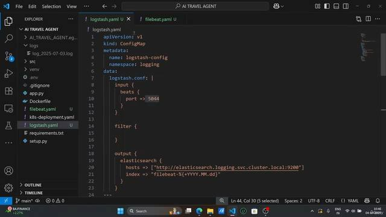
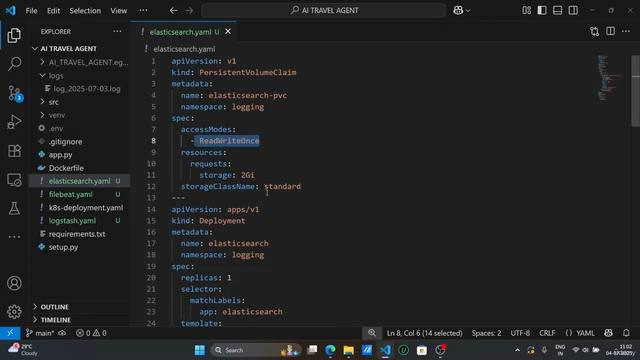
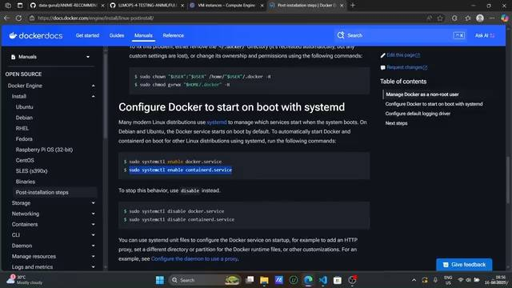
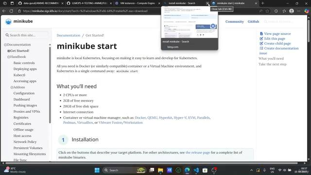
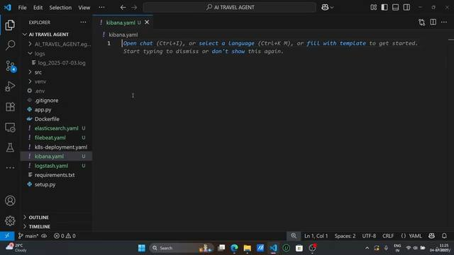
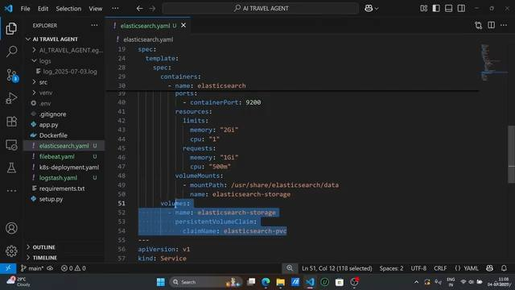
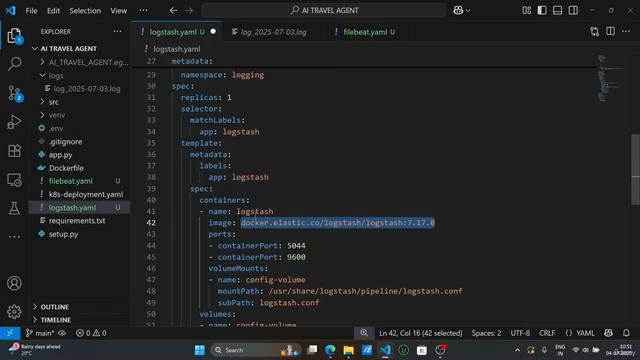

# 1. 这一节做什么

这一节覆盖 P72–P75，目标是把 ELK 日志链路在 Kubernetes 里落成一个可以跑起来的最小项目，并补齐运行它的 VM 环境。

先明确整条链路：

```text
业务节点日志
  -> Filebeat：采集并 ship 日志（上一节已完成，本节不重复写它的完整 YAML）
  -> Logstash：在 5044 端口接收 Filebeat 输入，可过滤清洗，再发到 Elasticsearch
  -> Elasticsearch：在 9200 端口接收 Logstash 输出，把日志存成按日期命名的 index
  -> Kibana：在 5601 端口读取 Elasticsearch 的 index，做可视化
```

P72 写 Logstash 的 Kubernetes 清单，包含 ConfigMap、Deployment、Service。  
P73 写 Elasticsearch 的清单，包含 PVC、Deployment、Service。  
P74 写 Kibana 的清单，包含 Deployment、Service，并做一次 Git 提交。  
P75 讲 GCP VM 创建、Docker Engine 安装、minikube 安装、kubectl 安装。

注意：P75 在视频顺序上靠后，但复现时必须先做。没有 VM、Docker、minikube、kubectl，后面的 `kubectl apply` 没有执行环境。所以本文按“先环境、再清单、再验证”的顺序重组。

最终目录建议如下。逐字稿口述文件名时听起来像 `log stash dot eml`、`elastic search dot eml`、`kibana dot emn`，但 Kubernetes 清单实际应保存为 YAML 文件；下面统一用 `.yaml`：

```text
llmops-aiops-bootcamp/
├── logstash.yaml
├── elasticsearch.yaml
├── kibana.yaml
└── （上一节）filebeat.yaml
```

本节不重建 Filebeat 的完整清单，因为逐字稿明确说 Filebeat 在上一节已经做过；P72 只引用它“向 5044 端口发送日志”这个约定。



# 2. 讲师原话（带「—— pNNN [MM:SS]」）

下面不是逐字翻译全文，而是把与复现直接相关的原话按主题摘出来，并保留时间点。

- “Logstash 是一种 processor；Filebeat 是 shipper，它把各个节点的日志 ship 到 Logstash，Logstash 过滤、清洗，再发到 Elasticsearch。”  
  —— p072 [00:29]

- “这个代码会包含三样东西：ConfigMap、Deployment、Service。ConfigMap 用于自定义配置；默认安装 Logstash 会带默认配置，我们要用自己的自定义配置覆盖它。”  
  —— p072 [01:22]

- “输入在 5044 端口；Filebeat 把日志发到 5044，也就是发给 Logstash。”  
  —— p072 [03:16]

- “输出是发到 Elasticsearch；Elasticsearch 会跑在 9200 端口。”  
  —— p072 [04:14]

- “Index 的格式大致是 `filebeat-年.月.日`，例如 `filebeat-2025.07.04` 这种按日期创建索引的方式。”  
  —— p072 [05:13]

- “Logstash 只要一个 replica；Filebeat 每个节点都会有一个，但 Logstash 只要一个。”  
  —— p072 [07:39]

- “容器端口是 5044 和 9600；5044 接收 Filebeat 输入，9600 是 Logstash monitoring API。”  
  —— p072 [08:34]

- “Elasticsearch 把 Logstash 发来的日志转成 indexes，方便用户搜索、过滤。”  
  —— p073 [00:28]

- “PVC 是 Persistent Volume Claim，用来做存储；indexes 不能随便放，要存到一个磁盘里。”  
  —— p073 [01:27]

- “Access mode 是 ReadWriteOnce，只允许一个 Pod 在同一时间读或写。”  
  —— p073 [02:56]

- “给 2Gi 存储；如果集群是 10GB，就拿 2GB 存 indexes；storage class 用 standard。”  
  —— p073 [03:21]

- “Elasticsearch 镜像版本是 7.17.0；`discovery.type` 设为 `single-node`，因为现在是开发/测试。”  
  —— p073 [04:45] / [05:14]

- “`xms` 是最小，`xmx` 是最大；这里最小 512MB、最大 512MB，给 JVM 用。”  
  —— p073 [06:13]

- “`xpack.security.enabled` 设为 false，开发测试时不用输用户名密码；公司生产不能这样。”  
  —— p073 [06:43]

- “request 是起点，limits 是上限；默认给 1GB 内存、500MB CPU，最多可以到 2GB 内存、1 CPU。”  
  —— p073 [07:38]

- “Kibana 是 dashboard，把 Elasticsearch 里的日志用更图形化、更友好的方式展示。”  
  —— p074 [00:00]

- “Kibana 的环境变量里要告诉它 Elasticsearch 地址，Elasticsearch 在 9200；Kibana 自己在 5601。”  
  —— p074 [02:55] / [03:24]

- “Kibana 的 Service 是 NodePort，nodePort 给了 30601。”  
  —— p074 [03:53]

- “做完这些文件后做代码版本管理：`git add`、`git commit`，消息写 ELK，然后 `git push origin main`。”  
  —— p074 [05:20]

- “VM 用 GCP；machine type 选 e2，因为低成本；建议 16GB 内存、4 CPU，因为 minikube 需要 2 CPU，剩下 2 CPU 做计算。”  
  —— p075 [00:57]

- “OS 选 Ubuntu 24.04 LTS、x86_64；磁盘给 150GB 就足够。”  
  —— p075 [01:51] / [02:20]

- “先安装 Docker Engine；Docker 安装后直接 `docker run hello world` 会 permission denied，需要 sudo；我们不希望一直 sudo，所以做 post-install 步骤。”  
  —— p075 [04:33] / [06:29]

- “还要让 Docker 开机自启，复制两条 systemd 命令，让 docker service 和 container service 随 VM 启动。”  
  —— p075 [07:54]

- “minikube 安装依赖 Docker，所以先装 Docker；然后下载、安装、启动 minikube cluster。”  
  —— p075 [08:51] / [09:49]

- “kubectl 在 Ubuntu 上可以用 snap 安装，然后 `kubectl version --client` 验证。”  
  —— p075 [11:42] / [12:09]



# 3. 从零复现

## 3.1 创建 GCP VM

1. 登录 Google Cloud 控制台，搜索 `VM instances`，进入 Compute Engine 的 VM instances 页面。
2. 点击创建实例。名称、region、zone 可以按控制台默认值填；逐字稿说这些保持默认即可。
3. Machine type 选 `e2` 系列，因为讲师说 e2 是低成本计算。Machine type 选 standard，内存约 16GB，CPU 4 个。讲师原话是“8GB 或 16GB，但我推荐 16GB；4 CPU，因为 minikube 需要 2 CPU，剩下 2 CPU 做计算”。
4. OS 和 storage 点 Change，选 Ubuntu。版本选 `Ubuntu 24.04 LTS`，架构选 `x86_64`。讲师说不要选 25 版本，因为太新、不稳定。
5. 磁盘大小给 150GB。逐字稿说 150GB 足够。
6. Networking 里把讲师说的三项允许规则勾上，并启用 IP forwarding。具体三项在逐字稿里没有逐字念出名称，按控制台默认的三项允许规则勾选即可；名称以你控制台实际显示为准。
7. 点 Create。等状态变成绿色勾，说明实例 running。
8. 点 SSH，使用浏览器终端连接 VM。第一次会传 key、要求授权，点授权即可。


## 3.2 在 Ubuntu VM 里安装 Docker Engine

逐字稿的做法是：在浏览器搜 Docker install on Ubuntu，打开 Docker 官方文档，复制 “set up Docker’s apt repository” 的命令，再复制安装命令，最后做 post-install。逐字稿没有逐字展示命令文本，下面给出等价的官方 Ubuntu 安装步骤。若 Docker 官方页面更新，以页面当前命令为准。

```bash
sudo apt-get update
sudo apt-get install -y ca-certificates curl
sudo install -m 0755 -d /etc/apt/keyrings
sudo curl -fsSL https://download.docker.com/linux/ubuntu/gpg -o /etc/apt/keyrings/docker.asc
sudo chmod a+r /etc/apt/keyrings/docker.asc

echo \
  "deb [arch=$(dpkg --print-architecture) signed-by=/etc/apt/keyrings/docker.asc] https://download.docker.com/linux/ubuntu \
  $(. /etc/os-release && echo "$VERSION_CODENAME") stable" | \
  sudo tee /etc/apt/sources.list.d/docker.list > /dev/null

sudo apt-get update
sudo apt-get install -y docker-ce docker-ce-cli containerd.io docker-buildx-plugin docker-compose-plugin
```

安装后先验证讲师演示的“会报 permission denied”的现象：

```bash
docker run hello-world
```

如果你看到 permission denied，不是 Docker 没装好，而是当前用户没有 docker 组权限。逐字稿接着做 post-install 四步。等价命令如下：

```bash
sudo groupadd docker
sudo usermod -aG docker $USER
newgrp docker
docker run hello-world
```

逐字稿说第四条是验证命令。验证成功后应看到 `hello from Docker` 之类信息；具体输出以实际为准。

然后设置开机自启。逐字稿说复制两条 systemd 命令，让 docker service 和 container service 随 VM 启动：

```bash
sudo systemctl enable docker.service
sudo systemctl enable containerd.service
```

验证 Docker：

```bash
docker version
```

逐字稿在此时能看到 Docker Engine 的版本、API version，以及 Server 端 Docker Engine 的版本、API version。字段名以你实际输出为准。



## 3.3 安装 minikube

逐字稿说：先装 Docker 再装 minikube，因为 minikube 安装依赖 Docker。打开 minikube 官方 install 页面，选 Linux、x86_64、stable binary download，复制两条命令，然后启动 cluster。等价命令：

```bash
curl -LO https://storage.googleapis.com/minikube/releases/latest/minikube-linux-amd64
sudo install minikube-linux-amd64 /usr/local/bin/minikube
minikube start --driver=docker
```

逐字稿只说要启动 minikube cluster，没有展示 `--driver=docker` 参数；因为前面已经装了 Docker，这里用 docker driver 最稳。启动后用下面命令确认：

```bash
minikube status
```

## 3.4 安装 kubectl

逐字稿推荐 Ubuntu 用 snap 安装 kubectl：

```bash
sudo snap install kubectl --classic
kubectl version --client
```

逐字稿说能看到 client version；其他字段以实际输出为准。到这里，VM 上三个基础件齐了：Docker Engine、minikube、kubectl。kubectl 用来执行 Kubernetes 命令，Docker Engine 用来跑容器，minikube 依赖 Docker 形成 Kubernetes cluster。



## 3.5 创建项目目录和 namespace

在 VM 里进入你放项目文件的目录。逐字稿说“在 root directory 创建文件”，这里的 root directory 指项目根目录，不是 Linux 的 `/root`。示例：

```bash
mkdir -p ~/llmops-aiops-bootcamp
cd ~/llmops-aiops-bootcamp
```

创建 `logging` namespace。逐字稿反复说 Filebeat、Logstash、Elasticsearch、Kibana 都放在 `logging` namespace：

```bash
kubectl create namespace logging
```

如果已存在，会提示 AlreadyExists，可以忽略，或先 `kubectl get namespace` 确认。列名以实际输出为准。

## 3.6 保存三个 YAML 文件

把第 4 节的三个完整文件分别保存为：

```text
~/llmops-aiops-bootcamp/logstash.yaml
~/llmops-aiops-bootcamp/elasticsearch.yaml
~/llmops-aiops-bootcamp/kibana.yaml
```

逐字稿口述的 `.eml` 不是 Kubernetes 清单扩展名；保存成 `.yaml`，`kubectl apply -f` 才能按 YAML 解析。若你从讲师 GitHub 仓库复制到的是 `.yml`，也可以直接用 `.yml`，但文件名要和命令一致。

## 3.7 按依赖顺序 apply

先 Elasticsearch，因为 Logstash 的输出地址指向它，Kibana 也要读它。然后 Logstash，最后 Kibana。

```bash
kubectl apply -f elasticsearch.yaml
kubectl rollout status deployment/elasticsearch -n logging

kubectl apply -f logstash.yaml
kubectl rollout status deployment/logstash -n logging

kubectl apply -f kibana.yaml
kubectl rollout status deployment/kibana -n logging
```

查看 Pod：

```bash
kubectl get pods -n logging
```

观察状态是否为 Running；列名和具体状态以实际输出为准。查看 Service：

```bash
kubectl get svc -n logging
```

Kibana 是 NodePort，nodePort 为 30601。访问方式可以用：

```bash
minikube service kibana -n logging --url
```

或浏览器打开 `http://<VM外部IP>:30601`。前提是 GCP 防火墙允许该端口；逐字稿没有讲如何放行 NodePort 的具体防火墙规则，这一步属于你实际会撞上的配置。

## 3.8 验证 Logstash 输入和 Elasticsearch 索引

如果上一节 Filebeat 已经部署，并且它的输出指向 `logstash:5044`，那么 Logstash 会接收日志。验证 Logstash Pod 日志：

```bash
kubectl logs -n logging deployment/logstash
```

验证 Elasticsearch 是否在 9200：

```bash
kubectl port-forward -n logging svc/elasticsearch 9200:9200
```

另开终端：

```bash
curl http://localhost:9200
```

逐字稿没有给出具体 curl 输出字段，这里只确认服务能响应。索引是否出现，取决于 Filebeat 是否真的有日志进来；如果没有 Filebeat，Logstash 有输入端口但不会自动产生日志。课里没讲无 Filebeat 时如何造测试日志，本文不编造。

## 3.9 Git 版本管理

P74 末尾讲师要求把新增文件提交到 GitHub：

```bash
git add .
git commit -m "ELK"
git push origin main
```

讲师原话是 `add`，然后 `git commit` 给任意消息，示例写 `ELK`，然后 `git push origin main`。如果你的分支不是 main，按实际分支改。



# 4. 完整代码

说明：逐字稿没有逐字贴出完整 YAML，只逐项讲了字段含义，并让学员去 GitHub 仓库复制。下面按逐字稿讲到的字段重建为可直接保存的完整清单；标准 Kubernetes 结构字段（如 `apiVersion`、`metadata`、`spec.selector` 等）是为可运行补全的，不是讲师逐字念过的内容。镜像完整仓库地址逐字稿没有念出，下面使用 Elastic 官方 7.17.0 镜像；如果你有讲师 GitHub 仓库，以仓库里的镜像地址为准。

## 4.1 `logstash.yaml`

```yaml
apiVersion: v1
kind: ConfigMap
metadata:
  name: logstash-config
  namespace: logging
data:
  logstash.conf: |
    input {
      beats {
        port => 5044
      }
    }

    filter {
    }

    output {
      elasticsearch {
        hosts => ["http://elasticsearch:9200"]
        index => "filebeat-%{+YYYY.MM.dd}"
      }
    }
---
apiVersion: apps/v1
kind: Deployment
metadata:
  name: logstash
  namespace: logging
spec:
  replicas: 1
  selector:
    matchLabels:
      app: logstash
  template:
    metadata:
      labels:
        app: logstash
    spec:
      containers:
        - name: logstash
          image: docker.elastic.co/logstash/logstash:7.17.0
          ports:
            - containerPort: 5044
            - containerPort: 9600
          volumeMounts:
            - name: logstash-config
              mountPath: /usr/share/logstash/pipeline/logstash.conf
              subPath: logstash.conf
      volumes:
        - name: logstash-config
          configMap:
            name: logstash-config
---
apiVersion: v1
kind: Service
metadata:
  name: logstash
  namespace: logging
spec:
  selector:
    app: logstash
  ports:
    - name: beats
      port: 5044
      targetPort: 5044
```

## 4.2 `elasticsearch.yaml`

```yaml
apiVersion: v1
kind: PersistentVolumeClaim
metadata:
  name: elasticsearch-pvc
  namespace: logging
spec:
  accessModes:
    - ReadWriteOnce
  resources:
    requests:
      storage: 2Gi
  storageClassName: standard
---
apiVersion: apps/v1
kind: Deployment
metadata:
  name: elasticsearch
  namespace: logging
spec:
  replicas: 1
  selector:
    matchLabels:
      app: elasticsearch
  template:
    metadata:
      labels:
        app: elasticsearch
    spec:
      containers:
        - name: elasticsearch
          image: docker.elastic.co/elasticsearch/elasticsearch:7.17.0
          ports:
            - containerPort: 9200
          env:
            - name: discovery.type
              value: single-node
            - name: ES_JAVA_OPTS
              value: "-Xms512m -Xmx512m"
            - name: xpack.security.enabled
              value: "false"
          resources:
            requests:
              memory: "1Gi"
              cpu: "500m"
            limits:
              memory: "2Gi"
              cpu: "1"
          volumeMounts:
            - name: elastic-storage
              mountPath: /usr/share/elasticsearch/data
      volumes:
        - name: elastic-storage
          persistentVolumeClaim:
            claimName: elasticsearch-pvc
---
apiVersion: v1
kind: Service
metadata:
  name: elasticsearch
  namespace: logging
spec:
  selector:
    app: elasticsearch
  ports:
    - name: http
      port: 9200
      targetPort: 9200
```

## 4.3 `kibana.yaml`

```yaml
apiVersion: apps/v1
kind: Deployment
metadata:
  name: kibana
  namespace: logging
spec:
  replicas: 1
  selector:
    matchLabels:
      app: kibana
  template:
    metadata:
      labels:
        app: kibana
    spec:
      containers:
        - name: kibana
          image: docker.elastic.co/kibana/kibana:7.17.0
          ports:
            - containerPort: 5601
          env:
            - name: ELASTICSEARCH_HOSTS
              value: "http://elasticsearch:9200"
---
apiVersion: v1
kind: Service
metadata:
  name: kibana
  namespace: logging
spec:
  type: NodePort
  selector:
    app: kibana
  ports:
    - name: http
      port: 5601
      targetPort: 5601
      nodePort: 30601
```

# 5. 逐行解释

## 5.1 Logstash：为什么是 ConfigMap + Deployment + Service

**ConfigMap 的作用**：讲师说默认安装 Logstash 会带默认配置，我们要用自己的自定义配置覆盖默认配置。ConfigMap 就是放自定义配置的地方。这里用 `data.logstash.conf` 保存 pipeline 内容，然后通过 volume 挂载到容器里。

**`input { beats { port => 5044 } }`**：5044 是 Filebeat 输出日志的端口，也是 Logstash 接收输入的端口。讲师在 P72 反复强调：Filebeat 把日志 ship 到 5044，这个 5044 是给 Logstash 的。这个端口必须和上一节 Filebeat 的输出端口一致，否则 Logstash 收不到。

**`filter {}` 留空**：讲师明确说“我们没有定义 filter，保持简单；你可以自己加 filter 来清洗、修改日志，比如去掉下划线”。所以这里留空不是遗漏，是课程选择。留空时日志基本原样进入 output。

**`output` 指向 `http://elasticsearch:9200`**：讲师说 Logstash 把日志发到 Elasticsearch，Elasticsearch 跑在 9200。这里用 Kubernetes Service 名 `elasticsearch` 做地址，因为同一个 namespace 内可以通过 Service 名解析。若你改过 Service 名，这里也要改。

**`index => "filebeat-%{+YYYY.MM.dd}"`**：讲师口述 index 格式是 `filebeat-年.月.日`，例如 `filebeat-2025.07.04`。这里用 Logstash 的日期格式化表达式达到同样效果。逐字稿没有逐字展示这个表达式，只讲了格式；若你从讲师仓库复制，以仓库为准。

**Deployment 的 `replicas: 1`**：讲师说 Logstash 只要一个 replica。Filebeat 每个节点一个，但 Logstash 不需要每节点一个。多副本会带来配置和消费竞争问题，课程保持单副本。

**容器端口 5044 和 9600**：5044 接 Filebeat 输入；9600 是讲师说的 Logstash monitoring API。Deployment 里声明这两个 containerPort，Service 只暴露 5044，因为业务输入只需要 5044。9600 主要用于监控，课程没有继续配置监控采集。

**volumeMount 的 `subPath: logstash.conf`**：把 ConfigMap 里的一个 key 单独挂成文件，覆盖默认 pipeline 文件。这里挂载路径 `/usr/share/logstash/pipeline/logstash.conf` 是官方 Logstash 镜像的默认 pipeline 路径；逐字稿只说了“用我们的自定义配置替换默认配置”，没有逐字念路径，路径是为可运行补全的。如果你挂错路径，Logstash 仍然会用默认配置，表现就是“Pod 起来了但没按你的 input/output 工作”。

**Service 的 selector `app: logstash`**：Service 通过 label 找到 Deployment 的 Pod。Deployment template 里也写了 `app: logstash`，两边必须一致。讲师在讲 Kibana Service 时也强调“service 要应用在对应 deployment 上，名字要一致”。

在 JS/Node 里的类比：ConfigMap 类似把配置从代码里抽出来，挂成文件或环境变量；Service 类似给一组 Pod 一个稳定的服务名，让别的服务不用记 Pod IP。这个类比不是讲师原话，是帮助前端背景理解。

## 5.2 Elasticsearch：PVC 是存储，不是锁

**PVC 的作用**：讲师说 Elasticsearch 要把日志转成 indexes，indexes 不能随便放，所以要创建一个“磁盘”来存。PVC 就是 Persistent Volume Claim，向集群申请存储。这里申请 2Gi。讲师说如果集群是 10GB，就拿 2GB 存 indexes。

**`accessModes: ReadWriteOnce`**：讲师解释为“只允许一个 Pod 在同一时间读或写”。注意这不是业务代码里的互斥锁，也不是数据库事务锁；它是 Kubernetes 卷的访问模式。在 Node 里没有直接等价物，更接近“这个磁盘同一时间只挂给一个节点/一个 Pod 用”。因为 Elasticsearch 只跑 1 个 replica，所以 RWO 够用。如果你把 replicas 改成多副本，多个 Pod 抢同一个 RWO 卷会出问题。

**`storageClassName: standard`**：讲师说用默认 storage class，minikube 给的是 standard。这个字段依赖你的集群实际 storage class 名称。如果 `kubectl get storageclass` 显示的不是 standard，要改成实际名称；列名以实际输出为准。

**`discovery.type: single-node`**：讲师说设置为 single-node，因为现在是开发/测试，不是多节点生产集群。单节点模式下 Elasticsearch 不要求发现其他节点。

**`ES_JAVA_OPTS: "-Xms512m -Xmx512m"`**：讲师解释 `xms` 是最小、`xmx` 是最大，这里最小 512MB、最大 512MB，给 JVM 用。Elasticsearch 依赖 Java 虚拟机，所以这个环境变量控制 JVM 内存。固定成 512m 是为了在 minikube 里别吃太多内存。

**`xpack.security.enabled: "false"`**：讲师说开发测试时关掉安全，这样打开 Elasticsearch 不用输用户名密码；公司生产不能这样，会有安全问题。这个字段只适合学习环境。

**resources requests/limits**：讲师说 request 是起点，limits 是上限；默认给 1GB 内存、500MB CPU，最多可以扩到 2GB 内存、1 CPU。YAML 里 `requests.memory: 1Gi`、`requests.cpu: 500m`，`limits.memory: 2Gi`、`limits.cpu: "1"`。`500m` 表示 0.5 个 CPU。这个机制类似 Node 里给进程设内存上限，但 Kubernetes 的 requests/limits 是调度和 cgroup 层面的，不是 JS 堆参数。

**volumeMount `/usr/share/elasticsearch/data`**：Elasticsearch 的数据目录。PVC 通过 `volumes.persistentVolumeClaim.claimName: elasticsearch-pvc` 挂到这个目录。讲师说“把 elastic storage 和 PVC 连起来，把收集到的 indexes 存到这个 volume mount 里”。如果路径写错，数据不会落到 PVC，Pod 重启后 indexes 可能丢。

**Service 9200**：讲师说 Elasticsearch 跑在 9200，Logstash 输出也指向 9200。Service 的 `port` 和 `targetPort` 都是 9200，selector 是 `app: elasticsearch`。



## 5.3 Kibana：NodePort 是对外入口

**`ELASTICSEARCH_HOSTS: "http://elasticsearch:9200"`**：讲师说 Kibana 要可视化 indexes，必须知道从哪里取 indexes；Elasticsearch 跑在 9200，所以把地址传给 Kibana。这里用 Service 名 `elasticsearch`，同在 `logging` namespace 内可解析。

**容器端口 5601**：讲师说 5601 是 Kibana 运行的端口。Deployment 的 containerPort 和 Service 的 targetPort 都写 5601。

**Service type `NodePort`**：讲师说这是 node port，可以通过 node IP 访问；nodePort 给了 30601。`port: 5601` 是 Service 自身端口，`targetPort: 5601` 转到 Pod 的 5601，`nodePort: 30601` 是节点上暴露的端口。访问时用 `http://<节点IP>:30601`。如果 30601 被占用，Kubernetes 会报错；可以换一个 30000–32767 范围内的端口，但课程里固定写 30601。

**为什么 Kibana 不需要 PVC**：讲师没有给 Kibana 配 PVC；Kibana 主要是读 Elasticsearch 的 indexes 做展示，不负责持久化日志数据。课里没讲 Kibana 的持久化需求，本文不额外加。



# 6. 复现检查清单

按顺序打勾。命令输出列名和字段名以你实际终端为准；本文不凭记忆写具体字段。

- [ ] GCP VM 已创建，状态为 running，能通过 SSH 打开浏览器终端。
- [ ] VM 规格为 e2、约 16GB 内存、4 CPU、Ubuntu 24.04 LTS、x86_64、约 150GB 磁盘。
- [ ] VM 的 networking 已按控制台勾选允许规则，并启用 IP forwarding。
- [ ] `docker version` 能同时看到 Client 和 Server 信息；逐字稿提到能看到 Docker Engine 版本和 API version。
- [ ] `docker run hello-world` 不加 sudo 能成功，终端出现 hello from Docker 类信息。
- [ ] `sudo systemctl enable docker.service` 和 `sudo systemctl enable containerd.service` 已执行。
- [ ] `minikube status` 显示 cluster 已启动；具体字段以实际输出为准。
- [ ] `kubectl version --client` 能输出 client version。
- [ ] `kubectl create namespace logging` 已执行，或 namespace 已存在。
- [ ] `logstash.yaml`、`elasticsearch.yaml`、`kibana.yaml` 已保存在同一项目目录。
- [ ] `kubectl apply -f elasticsearch.yaml` 成功，`kubectl rollout status deployment/elasticsearch -n logging` 成功。
- [ ] `kubectl apply -f logstash.yaml` 成功，Logstash Pod 状态为 Running。
- [ ] `kubectl apply -f kibana.yaml` 成功，Kibana Pod 状态为 Running。
- [ ] `kubectl get pods -n logging` 中三个 Pod 都处于 Running；列名以实际输出为准。
- [ ] `kubectl get svc -n logging` 中能看到 `elasticsearch`、`logstash`、`kibana`；Kibana 类型为 NodePort。
- [ ] 浏览器能打开 Kibana，地址为 `http://<VM外部IP>:30601`，或通过 `minikube service kibana -n logging --url` 得到地址。
- [ ] 如果上一节 Filebeat 已部署，Logstash 能收到 5044 输入；Elasticsearch 出现按日期命名的 `filebeat-*` index。
- [ ] `git add .`、`git commit -m "ELK"`、`git push origin main` 已执行；分支名按实际改。


# 7. 课里没讲但你会撞上的

以下不是讲师原话，是实际复现时常见问题。写出来是为了让你少卡住，不把这些算作课程内容。

1. **文件名扩展名**：逐字稿口述像 `.eml`，但 Kubernetes 清单是 YAML。保存成 `.yaml` 或 `.yml`。`.eml` 是邮件文件扩展名，`kubectl apply -f` 不会按你期望解析。

2. **镜像完整地址**：逐字稿只说“用这个 Docker Hub 镜像”“版本 7.17.0”，没有逐字念出完整仓库地址。本文用 Elastic 官方镜像。如果你从讲师 GitHub 仓库复制，镜像地址可能不同；以仓库为准。三个组件的 tag 必须一致，都是 7.17.0，不要一个 7.17.0 一个 latest。

3. **storageClassName 可能不是 standard**：讲师说 minikube 默认 storage class 是 standard。但不同 minikube 版本/驱动可能不同。先跑 `kubectl get storageclass` 看实际名称；列名以实际输出为准。如果不是 standard，把 `elasticsearch.yaml` 里的 `storageClassName` 改成实际值。

4. **Elasticsearch 在 Linux 上可能要求 `vm.max_map_count`**：这是 Elasticsearch 官方常见要求，但逐字稿没有讲。如果 Elasticsearch Pod 起不来，先看 `kubectl logs` 和 `kubectl describe pod` 的输出；不要凭印象填字段名，按实际报错处理。常见处理是调大 `vm.max_map_count`，但具体命令请以你环境为准。

5. **NodePort 30601 可能被 GCP 防火墙挡住**：Kubernetes Service 是 NodePort 不等于 GCP 防火墙自动放行。你需要在 GCP 防火墙规则里允许 30601，或者用 `minikube service kibana -n logging --url` 走 minikube 的