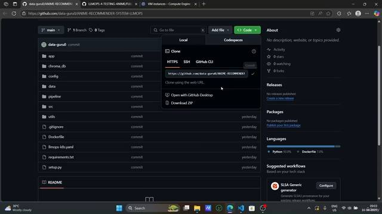
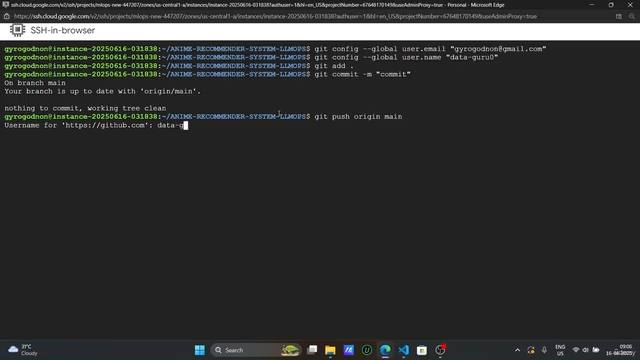
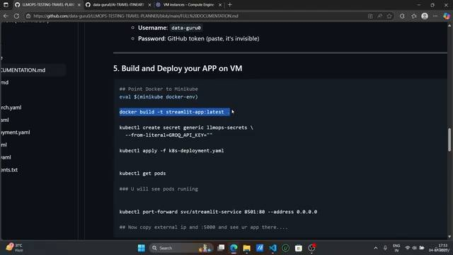
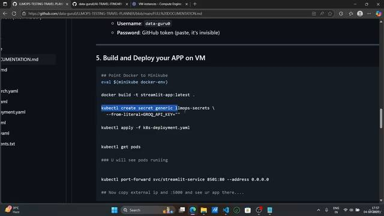
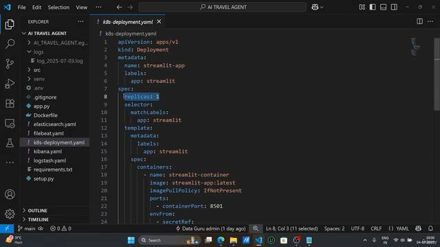
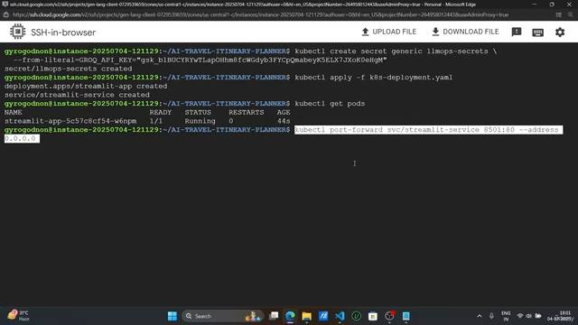
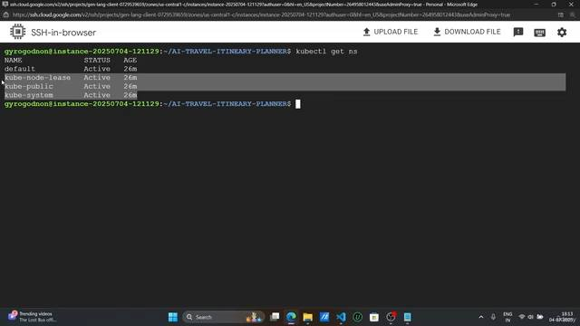
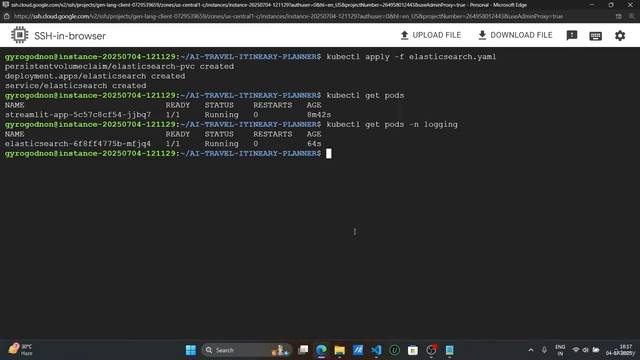
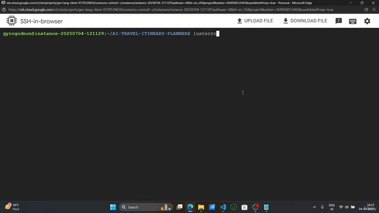
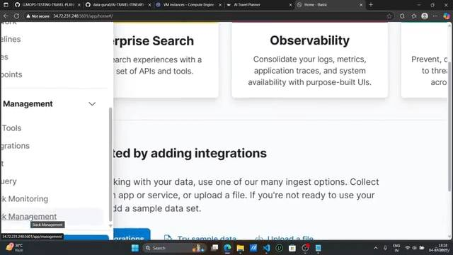

# LLMOps & AIOps Bootcamp：从 GitHub 到公网 —— 应用部署与 ELK 日志栈（P76–P79）

> 读者定位：前端转 AI 应用工程师。命令按顺序复制即可执行；K8s/YAML 里出现的概念会用 JS/Node 的类比说明。
> 说明：本课程是**操作演示型**，讲师在终端里敲命令、在 GCP 控制台点选、在 Kibana 里点菜单。逐字稿没有逐行贴出 YAML 全文，因此本文第 4 节把「讲师实际执行的完整命令序列」原样整理成可复制脚本；YAML 部分只还原讲师明确提到的文件名与字段，并在缺失处标注「课里没讲」。

---

## 1. 这一节做什么

P76–P79 是一条完整的「把本地代码变成公网可访问服务，并接上日志平台」的流水线，共四步：

1. **P76 三端互联**：把本地 VS Code、GitHub 仓库、云上 VM 实例三者打通。做法是先在 VM 上 `git clone`，再配置 GitHub 用户名/邮箱，用 Personal Access Token（PAT）代替密码完成 `git push`，最后验证「本地 push → VM pull」的闭环。
2. **P77 放行流量**：在 GCP 控制台建一条 ingress 防火墙规则，源 `0.0.0.0/0`、放行所有端口，让外部能访问 VM 上的服务。
3. **P78 构建与上线**：在 VM 上把 Docker 指向 minikube 的镜像仓库，`docker build` 出 `streamlit-app:latest`；用 `kubectl create secret` 注入 Groq API Key；`kubectl apply` 部署 Deployment + Service；`kubectl get pods` 确认 Running；最后用 `kubectl port-forward` 把 Pod 暴露到公网 IP 的 8501 端口，在浏览器里实际生成旅行行程。
4. **P79 ELK 日志栈**：新建 `logging` 命名空间，依次部署 Elasticsearch、Kibana、Logstash、Filebeat（Filebeat 用 DaemonSet 采集每个节点日志），全部 Running 后在 Kibana 里创建 `filebeat-*` 索引模式、用 Discover 查看实时日志，最后删除 VM 避免计费。

产出物：一个公网可访问的 Streamlit AI 应用 + 一套能检索容器日志的 ELK 面板。

---

## 2. 讲师原话（带出处）

> "首先，我们会把 GitHub 仓库克隆到虚拟机实例……只需输入 cd paste，这样你现在就进入了这个 anime recommend lmops 目录；可以看到所有内容都在，包括 Dockerfile、应用配置、数据、部署文件、流水线、依赖项和环境配置等。"
> —— p076 [00:57]

> "现在它会要求输入密码，不要输入你的普通密码……只需前往 GitHub，进入你的个人资料页，再进入开发者设置，找到个人访问令牌，生成新的经典令牌；务必选择这些权限：repo、workflow、admin:org、repo_hook。"
> —— p076 [03:21]

> "需要写入 0.0.0.0/0，并允许所有端口，然后创建这条规则。"
> —— p077 [01:23]

> "首先需要让 Docker 指向 Minikube，使 Docker 与 Minikube 连接起来；为此先运行这条命令：eval $(minikube docker-env)。"
> —— p078 [01:27]

> "然后运行这条命令：docker build -t streamlit-app:latest .；务必为 Docker 镜像使用相同的名称。如果我打开 VS Code，给你看我的这个 k8s deployment.yaml，我写的是 streamlit-app:latest。"
> —— p078 [02:26]

> "你已经定义了这一行，基本上需要从这份 Secret 列表中获取环境密钥；所以首先要创建这份 Secret 列表；你会遇到一个错误，我想它叫配置错误。"
> —— p078 [04:19]

> "一旦按下回车，这个终端就会被占用，之后就不能再用它了……至于 ELK 栈部分，你需要另外创建一个 SSH 终端。"
> —— p078 [08:42]

> "需要为这个 ELK 环境单独创建一个命名空间：kubectl create namespace logging；然后用 kubectl get ns 查看。"
> —— p079 [01:55]

> "确保这些资源逐一处理，状态都正常；如果其中任何一个处于 Pending 状态或错误状态，一定要修复对应错误。"
> —— p079 [14:28]

> "需要新建一个索引模式，模式名为 filebeat*；现在需要选择时间戳，即 @timestamp；然后点击“创建索引模式”。"
> —— p079 [15:55]

---

## 3. 从零复现

### 3.1 前置条件

- 已有一台 GCP VM（P76 之前创建），已安装 Docker、minikube、kubectl（讲师在上一节完成，本节不重复）。
- 本地项目已推到 GitHub，仓库根目录有 `Dockerfile` 和 `k8s-deployment.yml`。
- 本地有 `.env`，里面有 Groq API Key。
- 一个 GitHub 账号。

### 3.2 第一步：VM 上克隆仓库

SSH 进 VM，执行：

```bash
git clone https://github.com/<你的用户名>/<你的仓库名>.git
ls
cd <你的仓库名>
ls
```

讲师克隆后 `ls` 看到 `Dockerfile / app / config / data / deployment file / pipeline / requirement / setup` 一整套文件（—— p076 [00:57]）。此时你已位于仓库根目录。



### 3.3 第二步：配置 Git 身份并生成 PAT

在 VM 上先设置提交身份（把邮箱和用户名换成你自己的）：

```bash
git config --global user.email "you@example.com"
git config --global user.name "your-github-username"
```

然后本地改一个文件，执行 `git add . && git commit -m "test" && git push`。push 时会要求输入用户名和密码——**密码处不能填 GitHub 登录密码**，必须用 PAT（—— p076 [03:21]）。

生成 PAT 的路径：GitHub 头像 → Settings → Developer settings → Personal access tokens → Generate new token (classic) → 勾选 `repo`、`workflow`、`admin:org`、`admin:repo_hook` 等权限 → 生成后复制 token。



回到 VM，用户名填 GitHub 用户名，密码处粘贴 token（输入时不可见），回车。

### 3.4 第三步：验证三端闭环

本地新建 `test.py` → `git add` → `git commit` → `git push origin main`；VM 上 `git pull origin main`，`ls` 能看到 `test.py`。再在本地删除该文件并 push，VM 上 pull 后 `ls` 里消失（—— p076 [05:16]）。这说明「本地 → GitHub → VM」链路通了。

### 3.5 第四步：创建防火墙规则（P77）

GCP 控制台搜索 `firewall` → Create firewall rule，按下表填写：

| 字段 | 值 |
|---|---|
| Name | 任意，如 `allow-all-ingress` |
| Network | default |
| Direction | Ingress |
| Action on match | Allow |
| Targets | All instances in the network |
| Source filter | IPv4 ranges |
| Source IPv4 ranges | `0.0.0.0/0` |
| Protocols and ports | Allow all |

讲师特别强调源 IP 要写成 `0.0.0.0/0`，并且放行所有端口（—— p077 [01:23]）。课里是在控制台点选，没有给 `gcloud` 命令；如果你要用命令行，等价命令属于课里没讲的内容，请自行查阅 GCP 文档。

### 3.6 第五步：构建 Docker 镜像（P78）

回到 VM，确保当前目录是仓库根目录（有 `Dockerfile` 的那一层），执行：

```bash
eval $(minikube docker-env)
ls
docker build -t streamlit-app:latest .
docker images
```

`eval $(minikube docker-env)` 的作用是把当前 shell 的 Docker 客户端指向 minikube 内部的 Docker daemon，这样构建出的镜像直接存在于集群能看到的仓库里，不需要 push 到 Docker Hub（—— p078 [01:27]）。

构建大约 2–3 分钟（取决于 VM 配置和网速）。`docker images` 应看到 `streamlit-app`，大小约 949 MB（—— p078 [03:51]）。



**命名必须与 `k8s-deployment.yml` 里的 `image` 字段完全一致**，讲师在 VS Code 里展示过 deployment 文件写的就是 `streamlit-app:latest`（—— p078 [02:26]）。

### 3.7 第六步：创建 LLM Secret

`k8s-deployment.yml` 里引用了名为 `llm-secrets` 的 Secret。如果直接 apply，会报容器配置错误（—— p078 [04:19]）。所以先创建：

```bash
kubectl create secret generic llm-secrets \
  --from-literal=GROQ_API_KEY="<你的 Groq API Key>"
```

Key 从本地 `.env` 里复制（讲师口述为 "grog api key"，具体键名以你 `.env` 为准）。创建成功会提示 secret 已创建。**Secret 名必须和 deployment 里引用的名字一致**（—— p078 [05:18]）。



### 3.8 第七步：部署应用

```bash
kubectl apply -f k8s-deployment.yml
kubectl get pods
```

apply 输出应显示 `deployment.apps/streamlit-app created` 和 `service/streamlit-service created`。因为 deployment 里 `replicas: 1`，所以只会有 1 个 Pod，状态应为 `Running`（—— p078 [06:45]）。



### 3.9 第八步：端口转发到公网

Pod 在 minikube 集群内部，外部访问不到，需要把 Service 映射到 VM 的 0.0.0.0：

```bash
kubectl port-forward --address 0.0.0.0 service/streamlit-service 8501:8501
```

回车后终端会「卡住」并输出 `Forwarding from ...` 字样——这是正常的，**这个终端从此不能再用**（—— p078 [08:42]）。后续所有操作都要另开一个 SSH 终端。

浏览器访问 `http://<VM 外部 IP>:8501`，应看到 Streamlit 页面。讲师实际输入了 Delhi / Goa / Uttarakhand 三个城市验证行程生成正常（—— p078 [09:40]）。



### 3.10 第九步：部署 ELK（P79）

**新开一个 SSH 终端**，进入仓库目录：

```bash
cd <你的仓库名>
kubectl create namespace logging
kubectl get ns
```

`get ns` 原本只有 minikube 自带的三个命名空间，现在多出 `logging`（—— p079 [01:55]）。应用在 `default` 命名空间，ELK 全部放 `logging`，互不干扰。



按顺序部署（讲师建议顺序：Elasticsearch → Kibana → Logstash → Filebeat，先 Logstash 后 Kibana 可以少开终端，但顺序不强制）：

```bash
kubectl apply -f elasticsearch.yml
kubectl get pods -n logging
kubectl get pvc -n logging
kubectl get pv
```

`elasticsearch.yml` 会创建 PVC、Deployment、Service 三样东西。Pod `Running`、PVC 状态 `Bound` 才算成功（—— p079 [05:47]）。



```bash
kubectl apply -f kibana.yml
kubectl get pods -n logging
```

Kibana 启动较慢，会先显示 `ContainerCreating`，约 30–40 秒后变 `Running`（—— p079 [07:42]）。然后开新终端做端口转发（原终端被占用）：

```bash
kubectl port-forward --address 0.0.0.0 -n logging service/kibana 5601:5601
```

浏览器访问 `http://<VM 外部 IP>:5601` 进入 Kibana。

```bash
kubectl apply -f logstash.yml
kubectl get pods -n logging
```

`logstash.yml` 创建 ConfigMap、Deployment、Service 三样；Pod 同样先 `ContainerCreating` 后 `Running`（—— p079 [11:09]）。

```bash
kubectl apply -f filebeat.yml
kubectl get all -n logging
```

`filebeat.yml` 创建的最多：ConfigMap、DaemonSet、ClusterRoleBinding、RoleBinding、ClusterRole、ServiceAccount 等七到八样。Filebeat 用 DaemonSet 而不是 Deployment，所以**查状态要用 `get all` 而不是 `get pods`**（—— p079 [13:04]）。输出的 DaemonSet 行应满足 `desired=1 / current=1 / ready=1 / up-to-date=1`。



### 3.11 第十步：Kibana 建索引模式并查看日志

1. 左侧菜单 → Stack Management → Kibana 区 → Index Patterns → Create index pattern。
2. Pattern 填 `filebeat-*`，时间字段选 `@timestamp`，点 Create（—— p079 [15:55]）。
3. 左侧 Analytics → Discover，即可看到日志流；讲师演示时 hits 从 1672 持续增长到 1606、1608，说明日志在实时写入（—— p079 [19:16]）。



### 3.12 第十一步：清理

GCP 控制台 → VM instances → 删除该 VM，5–6 分钟后所有终端自动断开。讲师强调学习用途要删掉，否则持续计费（—— p079 [24:01]）。

---

## 4. 完整代码

> 本节 4.1–4.6 的 Shell 命令是讲师实际执行的完整序列，可直接保存为脚本按段运行。4.7 的 YAML 只还原讲师提到的文件名和字段；**逐字稿没有逐行展示 YAML 全文，以下为按讲师描述补的最小可用示例，标注「课里未展示全文」，字段名以你仓库里的文件为准**。

### 4.1 三端互联脚本（在 VM 上执行）

```bash
# 1. 克隆仓库
git clone https://github.com/<你的用户名>/<你的仓库名>.git
cd <你的仓库名>
ls

# 2. 配置提交身份
git config --global user.email "you@example.com"
git config --global user.name "your-github-username"

# 3. 验证：本地 push 后，在 VM 上
git pull origin main
ls
```

### 4.2 构建镜像（在 VM 上执行）

```bash
cd <你的仓库名>
eval $(minikube docker-env)
ls                                  # 确认当前目录有 Dockerfile
docker build -t streamlit-app:latest .
docker images                       # 应看到 streamlit-app，约 949MB
```

### 4.3 创建 Secret 并部署（在 VM 上执行）

```bash
kubectl create secret generic llm-secrets \
  --from-literal=GROQ_API_KEY="<你的 Groq API Key>"

kubectl apply -f k8s-deployment.yml
kubectl get pods
```

### 4.4 端口转发（前台阻塞，需独占终端）

```bash
kubectl port-forward --address 0.0.0.0 service/streamlit-service 8501:8501
```

### 4.5 ELK 部署（新开 SSH 终端执行）

```bash
cd <你的仓库名>

kubectl create namespace logging
kubectl get ns

kubectl apply -f elasticsearch.yml
kubectl get pods -n logging
kubectl get pvc -n logging
kubectl get pv

kubectl apply -f kibana.yml
kubectl get pods -n logging
```

Kibana 端口转发（再开一个终端）：

```bash
kubectl port-forward --address 0.0.0.0 -n logging service/kibana 5601:5601
```

Logstash 与 Filebeat（回到非转发终端）：

```bash
kubectl apply -f logstash.yml
kubectl get pods -n logging

kubectl apply -f filebeat.yml
kubectl get all -n logging
```

### 4.6 Kibana 索引模式（界面操作，无命令）

```
Stack Management → Index Patterns → Create index pattern
Pattern: filebeat-*
Time field: @timestamp
→ Create index pattern
Analytics → Discover → 查看日志
```

### 4.7 k8s-deployment.yml 最小示例（课里未展示全文）

讲师只明确提到：镜像名 `streamlit-app:latest`、`replicas: 1`、Secret 名 `llm-secrets`、Deployment 名 `streamlit-app`、Service 名 `streamlit-service`、应用端口 `8501`。以下按这些信息补一个最小结构，**不是课程原文**：

```yaml
apiVersion: apps/v1
kind: Deployment
metadata:
  name: streamlit-app
spec:
  replicas: 1
  selector:
    matchLabels:
      app: streamlit-app
  template:
    metadata:
      labels:
        app: streamlit-app
    spec:
      containers:
        - name: streamlit-app
          image: streamlit-app:latest
          imagePullPolicy: Never        # 课里未展示，用 minikube 本地镜像时通常需要
          ports:
            - containerPort: 8501
          env:
            - name: GROQ_API_KEY
              valueFrom:
                secretKeyRef:
                  name: llm-secrets
                  key: GROQ_API_KEY
---
apiVersion: v1
kind: Service
metadata:
  name: streamlit-service
spec:
  selector:
    app: streamlit-app
  ports:
    - port: 8501
      targetPort: 8501
  type: ClusterIP
```

### 4.8 Elasticsearch / Kibana / Logstash / Filebeat 的 YAML

逐字稿只提到各文件创建了哪些对象：

| 文件 | 创建的对象（讲师原话） |
|---|---|
| `elasticsearch.yml` | PVC、Deployment、Service 三样（p079 [03:51]） |
| `kibana.yml` | 一个 Deployment、一个 Service（p079 [07:12]） |
| `logstash.yml` | 一个 ConfigMap、一个 Deployment、一个 Service（p079 [11:09]） |
| `filebeat.yml` | ConfigMap、DaemonSet、ClusterRoleBinding、RoleBinding、ClusterRole、ServiceAccount 等七到八样（p079 [12:36]） |

**课里没有逐行展示这些 YAML 的完整内容**，讲师在单独的「代码解释」视频里讲过（p079 [03:22] 提到 "我已经逐行深入讲解过了。"）。请直接使用课程资源目录里的原文件，不要手写。

### 4.9 清理

```
GCP Console → VM instances → 选中实例 → Delete
```

---

## 5. 逐行解释

**`git clone <url>`**：把远端仓库完整复制到 VM。对前端来说等价于 `npm install` 拉下整个项目，只不过来源是 GitHub 而不是 npm registry。

**`git config --global user.email / user.name`**：Git 提交必须带作者信息。不配也能 commit，但 push 到 GitHub 后提交记录是匿名的，且部分仓库会拒绝。

**PAT 代替密码**：GitHub 早已禁用密码 push。PAT 是一串一次性生成的字符串，权限按勾选项授予。讲师勾了 `repo`、`workflow`、`admin:org`、`admin:repo_hook`（—— p076 [03:50]）。在 Node 生态里类似 npm 的 access token，同样是「密码不直接用，用 scope 受限的 token」。

**`eval $(minikube docker-env)`**：minikube 跑在自己的 Docker daemon 里（通常是虚拟机或容器）。默认 `docker build` 构建在宿主机 daemon 上，k8s 看不到。这条命令把 `DOCKER_HOST` 等环境变量改成指向 minikube 的 daemon，之后 build 的镜像直接落在集群可见的仓库。对前端类比：相当于把 `npm config set registry` 指到公司内网源，装出来的包只有内网能解析。

**`docker build -t streamlit-app:latest .`**：`-t` 是 tag（镜像名:版本），最后的 `.` 是构建上下文（当前目录，Dockerfile 所在位置）。名字必须和 deployment 里 `image:` 字段完全一致，否则 k8s 会去 Docker Hub 拉一个不存在的镜像，Pod 卡在 `ImagePullBackOff`。

**`kubectl create secret generic llm-secrets --from-literal=GROQ_API_KEY="..."`**：创建一个 key-value 形式的 Secret。`generic` 是类型（普通键值对，区别于 docker-registry、tls）。Pod 里通过 `secretKeyRef` 引用，API Key 不会出现在镜像和 YAML 里。**Secret 名必须和 deployment 里 `secretKeyRef.name` 一致**，否则 apply 时报配置错误（—— p078 [04:19]）。

**`kubectl apply -f k8s-deployment.yml`**：声明式部署。YAML 里写「我要 1 个副本、镜像叫 streamlit-app:latest、Service 叫 streamlit-service」，k8s 负责把集群调成这个状态。和前端声明式 UI（React 的 state → view）是同一思路：你描述目标状态，系统负责收敛。

**`kubectl get pods`**：查看 default 命名空间的 Pod。`Running` 只代表容器起来了，不代表应用健康；真正判断应用可用要看日志或实际访问。

**`kubectl port-forward --address 0.0.0.0 service/streamlit-service 8501:8501`**：把本地（VM）的 8501 端口转发到 Service 的 8501 端口。`--address 0.0.0.0` 表示监听所有网卡，配合 P77 的防火墙规则，外部 IP 才能访问。这条命令是**前台阻塞**的，Ctrl+C 才退出，所以讲师反复强调要另开终端（—— p078 [08:42]）。对前端类比：类似 `ngrok http 3000` 或 Vite 的 `--host 0.0.0.0`，把 localhost 服务暴露到外部。

**`kubectl create namespace logging`**：命名空间是集群内的逻辑隔离。应用在 `default`，ELK 在 `logging`，查资源时要带 `-n logging`。类比：monorepo 里的 workspace，不同 workspace 的同名包互不冲突。

**`kubectl get pvc -n logging` / `kubectl get pv`**：PVC（PersistentVolumeClaim）是「我要一块存储」的申请，PV 是实际存储。状态 `Bound` 表示申请已绑定成功；`Pending` 说明没有可用存储，Elasticsearch 会起不来。

**`kubectl get all -n logging`**：`get all` 会列出 Pod、Service、Deployment、DaemonSet、ReplicaSet 等所有资源。Filebeat 用 DaemonSet（每个节点跑一个 Pod），不是 Deployment，所以必须用 `get all` 才能看到它的状态（—— p079 [13:04]）。

**Kibana Index Pattern `filebeat-*`**：Kibana 需要知道「去哪个索引里查数据、用哪个字段当时间轴」。`filebeat-*` 匹配所有以 `filebeat-` 开头的索引，`@timestamp` 是 Elasticsearch 写入时自动加的时间字段。讲师在 Kibana 里找不到 `filebeat-*` 的定义，最后在 Logstash 配置里确认了这个前缀（—— p079 [17:50]）。

**`replicas: 1`**：副本数。讲师特意说明因为设了 1，所以 `get pods` 只有一行（—— p078 [06:45]）。生产环境通常 ≥2，配合滚动更新。

---

## 6. 复现检查清单

按顺序打勾，任何一项不通过不要往下走：

- [ ] VM 上 `git clone` 成功，`ls` 能看到 `Dockerfile` 和 `k8s-deployment.yml`
- [ ] `git push` 时用 PAT 而非密码，push 成功
- [ ] 本地新建文件 → push → VM `git pull` 能看到；删除后同样能同步
- [ ] GCP 防火墙规则：Direction=Ingress、Action=Allow、Source=`0.0.0.0/0`、Allow all ports
- [ ] `eval $(minikube docker-env)` 无报错
- [ ] `docker build` 成功，`docker images` 里有 `streamlit-app`（约 949MB）
- [ ] 镜像名与 `k8s-deployment.yml` 里 `image:` 字段完全一致
- [ ] `kubectl create secret generic llm-secrets` 返回 created
- [ ] Secret 名与 deployment 里 `secretKeyRef.name` 一致
- [ ] `kubectl apply -f k8s-deployment.yml` 输出 deployment 和 service 均 created
- [ ] `kubectl get pods` 中 `streamlit-app` 为 `Running`
- [ ] `kubectl port-forward --address 0.0.0.0 ... 8501:8501` 输出 `Forwarding from ...`
- [ ] 浏览器 `http://<外部IP>:8501` 能打开页面并成功生成行程
- [ ] `kubectl get ns` 能看到 `logging`
- [ ] Elasticsearch Pod `Running`，PVC 状态 `Bound`
- [ ] Kibana Pod `Running`（首次需等 30–40 秒）
- [ ] Logstash Pod `Running`
- [ ] `kubectl get all -n logging` 中 Filebeat DaemonSet 的 desired/current/ready/up-to-date 全为 1
- [ ] Kibana 中 index pattern `filebeat-*` 创建成功，时间字段 `@timestamp`
- [ ] Discover 能看到日志且 hits 随刷新增长
- [ ] 学习结束后删除 VM

---

## 7. 课里没讲但你会撞上的

1. **`imagePullPolicy` 没提**。minikube 用本地镜像时，如果 deployment 里没写 `imagePullPolicy: Never`（或 `IfNotPresent`），k8s 可能去 Docker Hub 拉 `streamlit-app:latest` 并失败，Pod 卡在 `ImagePullBackOff`。讲师默认镜像就在本地，所以没展开。
2. **`0.0.0.0/0` + 放行所有端口 = 全公网裸奔**。讲师为了演示方便这么配（—— p077 [01:23]），生产环境应只放行 8501/5601 等必要端口，并限制源 IP。这是安全红线，课里没讲。
3. **PAT 会过期**。讲师没提有效期设置。如果 push 突然 401，先检查 token 是否过期或被撤销。
4. **`eval $(minikube docker-env)` 只对当前 shell 生效**。新开终端后要重新执行，否则 `docker build` 又回到宿主机 daemon，镜像 k8s 看不到。
5. **port-forward 断了应用就不可访问**。它只是临时隧道，不是生产级暴露方式。课里没讲 Ingress / LoadBalancer / NodePort 的替代方案。
6. **每个 port-forward 独占一个终端**。应用 8501 一个、Kibana 5601 一个，所以至少要开 3 个 SSH 终端。讲师在 P78/P79 反复开新终端就是这个原因（—— p078 [08:42]）。
7. **Kibana 首次启动慢**。`ContainerCreating` 持续 30–40 秒是正常的，不要以为挂了（—— p079 [07:42]）。反复 `kubectl get pods -n logging` 直到 `Running`。
8. **Filebeat 需要 RBAC**。它要读节点上的 `/var/log/containers`，必须绑定 ClusterRole。所以 `filebeat.yml` 里有 ClusterRoleBinding / ServiceAccount，少一个都采不到日志。课里只提了「创建了这些对象」，没讲每个的作用。
9. **`filebeat-*` 前缀从哪来**。讲师自己在 Kibana 里也找了一阵，最后在 Logstash 配置里确认（—— p079 [17:50]）。如果你的索引名不是这个前缀，Discover 里会空。
10. **VM 不删会持续计费**。讲师明确说暂停也会收硬件费，学习完直接删除（—— p079 [24:01]）。
11. **JS/Node 视角的类比**：K8s 的 Deployment ≈ `pm2` 的进程守护 + 副本管理；Service ≈ 内网负载均衡 + 稳定 DNS；Secret ≈ `.env` 但加密存储且可挂载；Namespace ≈ monorepo workspace；PVC ≈ 挂载卷。涉及「锁/事务/并发」的代码在本课程里没有出现，课里没讲。

---

**一句话总结**：P76 打通代码链路，P77 开网络门，P78 把镜像跑成 Pod 并用 port-forward 暴露到公网，P79 用 ELK 把集群日志收上来可视化。照着第 3、4 节复制命令，配合第 6 节清单逐项打勾，即可完整复现。