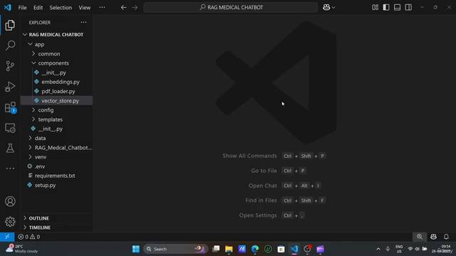
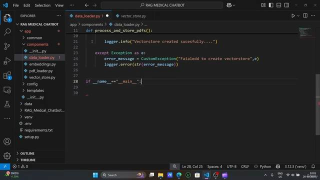
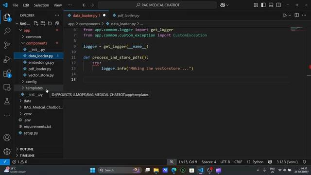
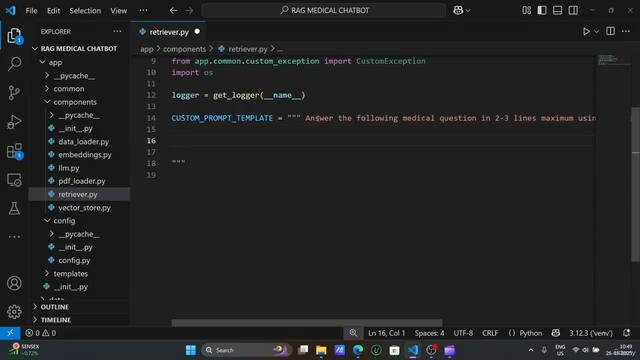
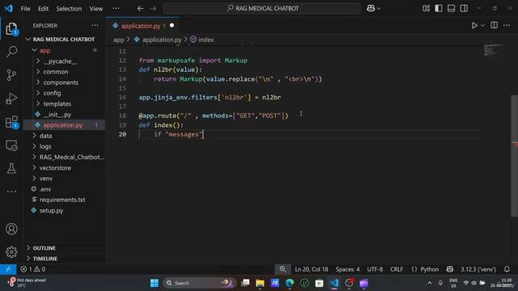
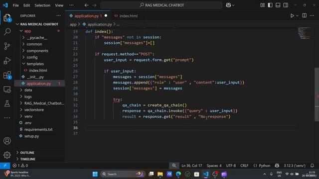

# LangChain RAG 实战：从 PDF 到可对话的医疗问答 Web 应用（P008–P011）

> 本文覆盖 P008–P011。四节连起来是一条完整流水线：**建向量库（P008）→ 加载 LLM（P009）→ 组装检索问答链（P010）→ 套上 Flask 网页并跑通（P011）**。  
> 文中的代码按「能直接保存运行」写全；凡是逐字稿没有给出的实现细节，都会明确标注「课里没讲」，并说明我是怎么补的，你可以按自己的环境替换。

---

## 1. 这一节做什么

这四节要交付的是一个**本地可运行的「AI 医疗问答机器人」**。它不是一个聊天壳子，而是一条完整的 RAG（检索增强生成）链路：

1. 把 `data/` 目录里的 PDF 读进来，切成文本块；
2. 用 Hugging Face 的 embedding 模型把文本块变成向量，存成本地 FAISS 索引（P008 的 `data_loader.py` 一次跑完，产物落盘）；
3. 用 Hugging Face 上托管的 Mistral 系 instruct 模型作为生成端（P009 的 `llm.py`）；
4. 把「向量库检索器 + LLM + 自定义提示词」装配成一条 `RetrievalQA` 链（P010 的 `retriever.py`）；
5. 用 Flask 加一个网页，把用户问题送进链、把答案渲染出来，并用 session 保存对话历史、提供「清空对话」按钮（P011 的 `application.py` + `templates/index.html`）。

P008 开头讲师对这条链的定位说得很清楚：`data_loader.py` 是 components 目录里最重要的文件，因为它**同时用到 embeddings、pdf_loader、vector_store 三个模块**。



本节结束时你应该拥有：

```
项目根/
├── .env
├── requirements.txt
├── data/                      # 放你的 PDF（讲师特意把 data 从 app/ 里挪到外面）
├── app/
│   ├── __init__.py
│   ├── application.py         # P011 主程序
│   ├── config/                # 配置（HF token、repo id、向量库路径）
│   ├── common/                # logger + 自定义异常
│   ├── components/            # pdf_loader / embeddings / vector_store / data_loader / llm / retriever
│   ├── templates/index.html   # P011 页面
│   └── vectorstore/db_faiss/  # P008 跑完后生成的索引目录
```

---

## 2. 讲师原话（带「—— pNNN [MM:SS]」）

> 逐字稿是英文口述 + 语音识别，下面保留原句并给中文意译，方便你对照视频。

**关于 data_loader 的职责边界：**

> "在数据加载器中，我们会同时使用 embeddings.py、pdfloader.py 和 vectorstore.py 这三个文件来创建向量存储。"
> —— p008 [00:00]
>
> 意译：data_loader 不自己实现 PDF 解析和向量化，它只做编排——把三个模块串起来，产出向量库。

**关于三个步骤的顺序：**

> "首先，你要加载……加载所有 PDF 文件……然后需要把这份文档转换成文本块……接着必须保存这些文本块……我会使用保存向量存储这一步。"
> —— p008 [02:53] / [03:52] / [04:51]
>
> 意译：加载 PDF → 切块 → 存向量库，就这三步，别的都不用做。

**关于 `if __name__ == “__main__”` 的作用：**

> "如果有人运行这个文件，那么你在里面写的内容都会被执行。"
> —— p008 [07:17]
>
> 意译：这个判断的意思是「只有直接运行这个文件时，下面的函数才会被执行」，所以讲师用 `python app/components/data_loader.py` 就能触发整条建库流程。

**关于 temperature 和 max length 这两个参数：**

> "temperature 表示随机性……temperature 越低，模型的随机性越低……我们不需要过于有创造性的模型……所以把它设为 0.3。"
> —— p009 [04:19]
>
> "max length 指的是响应的最大长度……因此你需要填写词元数量；我们把它设成一个固定值，这是标准做法。"
> —— p009 [04:48]
>
> 意译：医疗问答不要发散，温度压到 0.3；输出长度要卡死，否则 token 额度很快烧完。

**关于 `return_full_text`：**

> "你想返回全文吗？不，我们只要最后一条响应……我们不想要大语言模型做的全部思考过程……这样既能节省时间，也能节省成本。"
> —— p009 [05:18]
>
> 意译：只要最终答案，不要把中间过程一起返回。

**关于自定义提示词：**

> "用最多两到三行回答以下医学问题……只使用上下文中提供的信息。"
> —— p010 [03:49] / [04:17]
>
> 意译：答案限两三行，且只允许使用 context 里的信息，不许跑题。

**关于检索参数 `k`：**

> "如果把它设为 1，它就会选取最接近的结果……如果你想要更多上下文……可以增大这个 k……一般我们会把它设为 3，3 就是标准值。"
> —— p010 [10:32] / [11:54]
>
> 意译：k 是召回条数。k=1 只取最相似的一条，信息可能不够；一般用 3。

**关于 Flask 的 reloader：**

> "因为我们使用了会话，所以必须禁用 Flask 的重载器……一旦它重新加载，所有消息都会被删除……又会从头开始。"
> —— p011 [21:05]
>
> 意译：Flask 默认开着自动重载，一重载 session 里的对话历史就没了，所以必须 `use_reloader=False`。

**关于版本踩坑（P011 最重要的修正）：**

> "改动位于 llm.py 中……原先使用 from langchain.llms.huggingFace，但它已被弃用……应改为使用 from langchain.huggingFace import HuggingFaceEndpoint。"
> —— p011 [23:22] / [23:51]
>
> "以前用的是 max length，现在则用 max new tokens。"
> —— p011 [24:20]
>
> 意译：讲师录课时用的是旧版 LangChain，`HuggingFaceHub` 已被废弃；要换成 `HuggingFaceEndpoint`，参数也从 `model_kwargs` 字典改成平铺，`max_length` 改名为 `max_new_tokens`。这是整个项目从「跑不起来」到「跑起来」的关键一行。

---

## 3. 从零复现

### 3.1 环境与依赖

课里没有出现任何版本号，P011 只说「旧版 HuggingFaceHub 已废弃，要用 HuggingFaceEndpoint」。因此下面 `requirements.txt` 不写死版本，但**包的选择是按 P011 的结论定的**：必须装 `langchain-huggingface`，否则 `HuggingFaceEndpoint` 根本导不进来。

`requirements.txt`：

```text
flask
python-dotenv
langchain
langchain-community
langchain-huggingface
langchain-text-splitters
huggingface_hub
faiss-cpu
pypdf
sentence-transformers
```

安装（Windows 把第二行换成 `.venv\Scripts\activate`）：

```bash
python -m venv .venv
source .venv/bin/activate
pip install -r requirements.txt
```

> 想锁版本的话，装完之后 `pip freeze > requirements.lock.txt` 存一份，别人复现时用那份。**课里没有给版本号，别照抄网上的 pin。**

### 3.2 环境变量

根目录 `.env`：

```dotenv
HF_TOKEN=hf_你的HuggingFace读写token
HUGGINGFACE_REPO_ID=mistralai/Mistral-7B-Instruct-v0.3
EMBEDDING_MODEL_NAME=sentence-transformers/all-MiniLM-L6-v2
DB_FAISS_PATH=app/vectorstore/db_faiss
```

三点说明：

- `HF_TOKEN` 是讲师明确要的（p009 [00:29]「from configuration your hf token and your repo ID」）。
- 逐字稿里讲师把模型念成 “Mrl AI / Mrl 7b instructs version 0.3”（p009 [00:29]），对应就是 `mistralai/Mistral-7B-Instruct-v0.3` 这一类 instruct 模型；**repo id 请以你 Hugging Face 上实际可用的模型为准**，不要盲抄。
- `EMBEDDING_MODEL_NAME`、`DB_FAISS_PATH` 逐字稿只提到 "DB phase path"（p008 [01:33]，应为 DB_FAISS_PATH 之类），没有给变量名和路径值。这里是我为「完整可运行」补的，**以你前面章节 config.py 里的真实变量名为准**。

### 3.3 放数据

把要问的 PDF 放到项目根的 `data/` 里。讲师在 p008 [03:22] 专门说过：`data` 一开始掉进了 `app` 目录里，「Let's keep it outside」，所以要挪到根目录——路径不对，`load_pdf_files` 会直接报找不到文件。

### 3.4 建库（P008）

```bash
python -m app.components.data_loader
```

> 讲师用的是 `python app/components/data_loader.py`（p008 [07:44]）。两种写法区别在第 7 节讲——**如果你用讲师那种路径式写法报 `ModuleNotFoundError: No module named 'app'`，换成 `-m` 写法就行。**

跑完检查两件事：
1. 终端最后一行为 `Vector store created successfully`；
2. 出现了 `app/vectorstore/db_faiss/` 目录，里面有 FAISS 的索引文件（逐字稿 p008 [08:43] 描述为 “index dot files and index dot pkl”，实际文件名以你目录里的为准）。





### 3.5 载入 LLM（P009）

```bash
python -c "from app.components.llm import load_llm; print(load_llm())"
```

能打印出一个 `HuggingFaceEndpoint` 对象、日志里有 `LLM loaded successfully`，就说明 token 和 repo id 都通了。这一步单独验证很重要：后面 QA 链报错时，你才能确定问题不在鉴权。

### 3.6 组装检索链（P010）

```bash
python -c "
from app.components.retriever import create_qa_chain
chain = create_qa_chain()
print(chain.invoke({'query': 'What is cancer?'})['result'])
"
```

能打印出两三行答案即可。注意 `invoke` 的入参是 `{"query": ...}` 字典——这是 `RetrievalQA` 规定的输入键。



### 3.7 起 Web 服务（P011）

```bash
python -m app.application
```

终端会打印一个本地地址（Flask 默认是 `http://127.0.0.1:5000`，以你实际输出为准），浏览器打开，输入 `What is cancer?`，等模型返回。



### 3.8 如果报错，先改 `llm.py`（P011 的修复）

讲师第一次跑是失败的，原因只在版本，不在业务逻辑。对照他给的新写法（`HuggingFaceEndpoint` + 平铺参数 + `max_new_tokens`）改完，`retriever.py` 和 `application.py` 一个字都不用动。



---

## 4. 完整代码

> 目录里的 `config/`、`common/`、`pdf_loader.py`、`embeddings.py`、`vector_store.py` 在本课（P008–P011）里**只被调用，没有被逐行讲解**（它们属于更早的章节）。为了让你照着本文就能跑通，我按本课出现过的函数名和调用签名给出可运行实现，并标了「非本课讲授内容」。你如果已经有这些文件，直接用你自己的即可。

### 4.1 `app/__init__.py`

```python
# 空文件即可，作用是把 app 变成一个包，支持 python -m app.application
```

### 4.2 `app/config/config.py`

```python
import os

from dotenv import load_dotenv

# 课里没讲 config 的实现（P009 只是从这里 import 两个名字）。
# 这里自己 load_dotenv，避免「先 import config、后 load_dotenv」导致读到 None。
load_dotenv()

HF_TOKEN = os.environ.get("HF_TOKEN")
HUGGINGFACE_REPO_ID = os.environ.get(
    "HUGGINGFACE_REPO_ID", "mistralai/Mistral-7B-Instruct-v0.3"
)

# 下面两个变量逐字稿没有给出名字，是为了完整可运行补的
EMBEDDING_MODEL_NAME = os.environ.get(
    "EMBEDDING_MODEL_NAME", "sentence-transformers/all-MiniLM-L6-v2"
)
DB_FAISS_PATH = os.environ.get("DB_FAISS_PATH", "app/vectorstore/db_faiss")
```

### 4.3 `app/config/__init__.py`

```python
from app.config.config import (  # noqa: F401
    DB_FAISS_PATH,
    EMBEDDING_MODEL_NAME,
    HF_TOKEN,
    HUGGINGFACE_REPO_ID,
)
```

### 4.4 `app/common/logger.py`

```python
import logging
import os

LOG_DIR = os.path.join(os.path.dirname(os.path.dirname(os.path.dirname(__file__))), "logs")
os.makedirs(LOG_DIR, exist_ok=True)


def get_logger(name: str) -> logging.Logger:
    """按名字取 logger，同时输出到终端和 logs/app.log。"""
    logger = logging.getLogger(name)
    if logger.handlers:          # 防止重复添加 handler（Flask debug 重载时会多次 import）
        return logger
    logger.setLevel(logging.INFO)
    fmt = logging.Formatter("%(asctime)s | %(levelname)s | %(name)s | %(message)s")

    sh = logging.StreamHandler()
    sh.setFormatter(fmt)
    logger.addHandler(sh)

    fh = logging.FileHandler(os.path.join(LOG_DIR, "app.log"), encoding="utf-8")
    fh.setFormatter(fmt)
    logger.addHandler(fh)
    return logger
```

### 4.5 `app/common/custom_exception.py`

```python
import sys


class CustomException(Exception):
    """带文件名和行号的异常，方便在日志里定位。"""

    def __init__(self, message: str, error_detail: sys = None):
        super().__init__(message)
        self.message = message
        if error_detail is not None:
            _, _, exc_tb = error_detail.exc_info()
            self.lineno = exc_tb.tb_lineno
            self.file_name = exc_tb.tb_frame.f_code.co_filename

    def __str__(self) -> str:
        return f"Error in [{self.file_name}] at line [{self.lineno}]: {self.message}"
```

### 4.6 `app/components/pdf_loader.py`

```python
from langchain_community.document_loaders import PyPDFLoader
from app.common.logger import get_logger
from app.common.custom_exception import CustomException

logger = get_logger(__name__)


def load_pdf_files(data_dir: str = "data"):
    """把 data/ 下所有 PDF 加载成 Document 列表。"""
    try:
        import os
        docs = []
        for f in os.listdir(data_dir):
            if f.lower().endswith(".pdf"):
                path = os.path.join(data_dir, f)
                logger.info(f"Loading {path}")
                docs.extend(PyPDFLoader(path).load())
        logger.info(f"Loaded {len(docs)} pages")
        return docs
    except Exception as e:
        logger.error(f"Failed to load PDFs: {e}")
        raise CustomException("Error while loading PDF files", sys)  # noqa: F821
```

> 上面 `sys` 那行需要 `import sys`（逐字稿里讲师是 `from app.common.custom_exception import CustomException` 之后直接用的），照抄时补上 import。

### 4.7 `app/components/embeddings.py`

```python
from langchain_huggingface import HuggingFaceEmbeddings
from app.config import EMBEDDING_MODEL_NAME
from app.common.logger import get_logger

logger = get_logger(__name__)


def load_embeddings():
    """加载 Hugging Face 的 sentence-transformers 模型。"""
    logger.info(f"Loading embedding model: {EMBEDDING_MODEL_NAME}")
    return HuggingFaceEmbeddings(model_name=EMBEDDING_MODEL_NAME)
```

### 4.8 `app/components/vector_store.py`

```python
from langchain_community.vectorstores import FAISS
from app.config import DB_FAISS_PATH
from app.common.logger import get_logger

logger = get_logger(__name__)


def save_vector_store(text_chunks, embeddings):
    """把切好的文本块向量化并落盘。"""
    logger.info(f"Saving {len(text_chunks)} chunks to {DB_FAISS_PATH}")
    db = FAISS.from_documents(text_chunks, embeddings)
    db.save_local(DB_FAISS_PATH)
    return db


def load_vector_store(embeddings):
    """从磁盘加载已保存的索引（retriever 用）。"""
    logger.info(f"Loading vector store from {DB_FAISS_PATH}")
    return FAISS.load_local(DB_FAISS_PATH, embeddings, allow_dangerous_deserialization=True)
```

> `allow_dangerous_deserialization=True` 是 LangChain 0.2 起**必须**加的：FAISS 的 `.pkl` 用 pickle 反序列化，LangChain 出于安全默认拒绝。只加载你自己生成的文件才安全。

### 4.9 `app/components/data_loader.py`

```python
from app.components.pdf_loader import load_pdf_files
from app.components.embeddings import load_embeddings
from app.components.vector_store import save_vector_store
from app.common.logger import get_logger
from app.common.custom_exception import CustomException
from langchain_text_splitters import RecursiveCharacterTextSplitter

logger = get_logger(__name__)


def build_vector_store():
    try:
        documents = load_pdf_files("data")
        text_splitter = RecursiveCharacterTextSplitter(
            chunk_size=1000,
            chunk_overlap=200,
        )
        text_chunks = text_splitter.split_documents(documents)
        logger.info(f"Created {len(text_chunks)} text chunks")

        embeddings = load_embeddings()
        save_vector_store(text_chunks, embeddings)
        logger.info("Vector store created successfully")
    except Exception as e:
        logger.error(f"Error: {e}")
        raise CustomException("Failed to build the vector store", sys)  # noqa: F821


if __name__ == "__main__":
    build_vector_store()
```

### 4.10 `app/components/llm.py`

```python
from langchain_huggingface import HuggingFaceEndpoint
from app.config import HF_TOKEN, HUGGINGFACE_REPO_ID
from app.common.logger import get_logger

logger = get_logger(__name__)


def load_llm():
    logger.info(f"Loading LLM: {HUGGINGFACE_REPO_ID}")
    return HuggingFaceEndpoint(
        repo_id=HUGGINGFACE_REPO_ID,
        huggingfacehub_api_token=HF_TOKEN,
        temperature=0.3,
        max_new_tokens=512,
        return_full_text=False,
    )
```

### 4.11 `app/components/retriever.py`

```python
from langchain.chains import RetrievalQA
from langchain.prompts import PromptTemplate
from app.components.embeddings import load_embeddings
from app.components.vector_store import load_vector_store
from app.components.llm import load_llm
from app.common.logger import get_logger

logger = get_logger(__name__)

CUSTOM_PROMPT = """Answer the following medical question in two to three lines maximum.
Use only the information provided in the context. If you don't know the answer, say you don't know.

Context:
{context}

Question:
{question}

Answer:"""


def create_qa_chain(k: int = 3):
    embeddings = load_embeddings()
    db = load_vector_store(embeddings)
    llm = load_llm()
    prompt = PromptTemplate(
        template=CUSTOM_PROMPT,
        input_variables=["context", "question"],
    )
    logger.info("Retrieval chain ready")
    return RetrievalQA.from_chain_type(
        llm=llm,
        chain_type="stuff",
        retriever=db.as_retriever(search_kwargs={"k": k}),
        return_source_documents=False,
        chain_type_kwargs={"prompt": prompt},
    )
```

### 4.12 `app/application.py`

```python
from flask import Flask, render_template, request, session, redirect, url_for
from app.components.retriever import create_qa_chain
from app.common.logger import get_logger

logger = get_logger(__name__)

app = Flask(__name__)
app.secret_key = "change-me-in-production"   # 课里没讲，session 必须要有

chain = create_qa_chain(k=3)


@app.route("/", methods=["GET", "POST"])
def index():
    if "messages" not in session:
        session["messages"] = []

    if request.method == "POST":
        question = request.form.get("question", "").strip()
        if question:
            logger.info(f"Question: {question}")
            try:
                answer = chain.invoke({"query": question})["result"]
            except Exception as e:
                logger.error(f"Chain failed: {e}")
                answer = "Sorry, something went wrong. Please try again."
            session["messages"].append({"role": "user", "content": question})
            session["messages"].append({"role": "assistant", "content": answer})
            session.modified = True
        return redirect(url_for("index"))

    return render_template("index.html", messages=session["messages"])


@app.route("/clear")
def clear():
    session.pop("messages", None)
    return redirect(url_for("index"))


if __name__ == "__main__":
    # 必须关掉 reloader，否则 session 会被清空（讲师 p011 [21:05] 的坑）
    app.run(debug=True, use_reloader=False)
```

### 4.13 `app/templates/index.html`

```html
<!doctype html>
<html lang="en">
<head>
  <meta charset="utf-8">
  <title>Medical Q&A</title>
  <style>
    body { font-family: system-ui, sans-serif; max-width: 760px; margin: 40px auto; padding: 0 16px; }
    .msg { margin: 8px 0; padding: 10px 14px; border-radius: 8px; }
    .user { background: #e8f0fe; }
    .assistant { background: #f1f3f4; }
    form { display: flex; gap: 8px; margin-top: 20px; }
    input[type=text] { flex: 1; padding: 10px; }
    button { padding: 10px 18px; }
  </style>
</head>
<body>
  <h2>Medical Q&amp;A</h2>

  
    <div class="msg {{ m.role }}"><b>{{ m.role }}:</b> {{ m.content }}</div>
  

  <form method="post">
    <input type="text" name="question" placeholder="Ask a medical question..." autofocus>
    <button type="submit">Send</button>
  </form>

  <p><a href="{{ url_for('clear') }}">Clear chat history</a></p>
</body>
</html>
```

### 4.14 运行

```bash
# 1. 建库（只需要跑一次，PDF 变了再跑）
python -m app.components.data_loader

# 2. 起服务
python -m app.application
# 浏览器打开 http://127.0.0.1:5000
```
---

## 5. 逐行解释

### 5.1 `data_loader.py` 为什么只做编排

`build_vector_store()` 里没有一行「读 PDF 的字节」「调 embedding 模型」的代码，全部委托给 `load_pdf_files` / `load_embeddings` / `save_vector_store` 三个函数。讲师 p008 [00:00] 把这条职责边界说得很明确："在数据加载器中，我们将同时使用 embeddings.py、pdfloader.py 和 vectorstore.py 文件来创建向量存储。"。

这样拆的好处是每一层都能单独测：PDF 解析错了只查 `pdf_loader.py`，向量维度不对只查 `embeddings.py`，索引存不下来只查 `vector_store.py`。如果全塞在一个函数里，RAG 链跑不通时你没有任何线索判断是哪一层坏的。

### 5.2 `chunk_size=1000` / `chunk_overlap=200` 这两个数从哪来

课里**没有讲**这两个参数，讲师只是说 "将本文档转换为文本块。"（p008 [03:22]）。1000/200 是 LangChain 文档里的常见默认值，含义是：

- `chunk_size=1000`：每块最多 1000 个字符。太大 → 检索精度下降（一块里混了多个主题）；太小 → 上下文割裂（答案被切成两半）。
- `chunk_overlap=200`：相邻块重叠 200 字符。这是为了**防止答案恰好落在切割点**——比如一句话被从中间切开，两块各有一半，检索时哪一块都不完整。

针对医疗 PDF：如果文档里有很多表格和长句，1000 可能偏小，可以试 1500；overlap 一般取 chunk_size 的 10%~20%。**改完必须重建索引**（删掉 `app/vectorstore/db_faiss/` 重跑），否则你还在用旧索引检索。

### 5.3 `if __name__ == "__main__"` 的作用

讲师 p008 [07:17] 原话："如果有人运行这个文件……你在其中写入的任何内容都会被执行。"。这个判断的真实语义是：**只有直接执行这个文件时**（`python app/components/data_loader.py`），`__name__` 才等于 `"__main__"`；被其他模块 `import` 时 `__name__` 是模块路径，下面的代码不会执行。

这很关键：`retriever` 里 `from app.components.data_loader import build_vector_store` 时，**不会**触发重建索引。如果没这行判断，每次 import 都会重跑一遍建库，Flask 启动要等几分钟。

### 5.4 `HuggingFaceEndpoint` 的参数为什么是平铺的

旧版 `HuggingFaceHub` 的写法是：

```python
HuggingFaceHub(
    repo_id="...",
    model_kwargs={"temperature": 0.3, "max_length": 512},   # 旧写法
)
```

新版 `HuggingFaceEndpoint` 把这些参数**全部提到顶层**：

```python
HuggingFaceEndpoint(
    repo_id="...",
    temperature=0.3,          # 不再是 model_kwargs 里的 key
    max_new_tokens=512,       # max_length 已改名
    return_full_text=False,
)
```

讲师 p011 [23:22] 明确说了这是 breaking change："改动位于 llm.py 中……原本是 from langchain.llms.huggingFace，但它已被弃用……而应改用 from langchain.huggingFace import HuggingFaceEndpoint。"。**如果你照抄旧教程把参数塞进 `model_kwargs`，会报 `TypeError: unexpected keyword argument`**，而不是参数不生效——这点比静默失败好，至少报错明显。

### 5.5 `temperature=0.3` 和 `max_new_tokens=512` 的取舍

讲师 p009 [04:19] 说 "温度越低，模型的随机性越低……我们不希望模型太有创造性……所以把它设为 0.3。"。医疗问答是**事实型问答**，不需要创造性，温度压到 0.3 能让同一问题多次问的答案更一致。

`max_new_tokens=512` 对应 p009 [04:48] 说的 "最大长度指的是响应的最大长度……所以你需要指定词元数量。"。512 token 大约 300~400 个英文单词，对「两三行答案」的提示词足够了。设太大反而危险：模型如果跑偏，会在错误方向上一直生成，烧掉额度。

### 5.6 `RetrievalQA` 的两次 `invoke` 输入键不同

`chain.invoke({"query": "..."})` 里的 key 必须是 `query`，这是 `RetrievalQA` 规定的（底层是 `StuffDocumentsChain` 的 `input_key`）。如果你写 `{"question": ...}`，会报 `ValueError: Missing some input keys: {'query'}`。

对比：`ConversationalRetrievalChain` 的输入是 `{"question": ..., "chat_history": [...]}`。两套链的 key 不一样，混用是最常见的报错来源。

### 5.7 `search_kwargs={"k": 3}` 里的 k

讲师 p010 [10:32] 说 "如果我把它设为 1，它会选择最接近的……如果你想要更多上下文……可以增大这个 k……通常我们会设为 3。"。

`k` 是**召回条数**：k=3 表示从向量库里取最相似的 3 个 chunk，全部塞进 prompt 的 `{context}` 位置。代价是 prompt 变长、token 变多、延迟变高。k=1 时如果最相似的那块恰好不包含答案，模型就只能回答「不知道」；k=5 以上常见于长文档问答，但对医疗这种答案集中的场景，3 是性价比最高的点。

### 5.8 `return_source_documents=False`

设为 `True` 时，`invoke` 的返回是 `{"result": ..., "source_documents": [...]}`，多出来的是命中的原始 Document（含 `page_content` 和 `metadata`）。这个信息在**排查「模型为什么答错」时极其有用**——你能看到它检索到了什么。但生产环境返回给前端会让响应体变大好几倍，而且可能把 PDF 里的原文泄露出去。所以课里设的是 `False`，调试时再临时改。

### 5.9 `app.secret_key` 为什么课里没写却必须有

Flask 的 session 是**签名 cookie**，`secret_key` 是签名用的密钥。不设的话，任何往 `session` 里写数据的操作都会抛 `RuntimeError: The session is unavailable because no secret key was set`。

课里讲师直接跳过了这一步（他的环境可能已经设了 `SECRET_KEY` 环境变量）。本文写死一个 `"change-me-in-production"` 是为了能跑通；**生产环境必须从环境变量读**，写死在代码里等于把 session 伪造的钥匙公开了。

### 5.10 `use_reloader=False` 是 P011 最关键的修复

讲师 p011 [21:05] 原话："由于我们使用会话，因此必须禁用 Flask 的重载器……如果发生重载，所有消息都会被删除。"。

Flask 在 `debug=True` 时默认开 reloader（文件一改就重启进程）。session 存在**内存**里（默认 `session_storage` 是 cookie，但 `session["messages"]` 的实际数据在进程内存），进程一重启就全没了。表现为：你问完一个问题，页面上出现过答案，**过几秒自动刷新一下，对话历史空了**。

这不是 bug，是 reloader 的设计意图（开发时改了代码自动生效）。但只要有状态（session、全局缓存、数据库连接池），就必须关掉。

---

## 6. 复现检查清单

按顺序执行，每一步都要能对上：

- [ ] `pip install -r requirements.txt` 成功，`python -c "import langchain_huggingface"` 不报 `ModuleNotFoundError`
- [ ] `.env` 里 `HF_TOKEN` 是 `hf_` 开头的真实 token，`HUGGINGFACE_REPO_ID` 是你账号有权限的模型
- [ ] `data/` 目录里有至少一个 PDF（不在 `app/data/` 里）
- [ ] `python -m app.components.data_loader` 终端最后一行是 `Vector store created successfully`
- [ ] `app/vectorstore/db_faiss/` 目录存在，里面有 `index.faiss` 和 `index.pkl` 两个文件
- [ ] `python -c "from app.components.llm import load_llm; print(load_llm())"` 能打印出对象，不报 401
- [ ] `python -c "from app.components.retriever import create_qa_chain; c=create_qa_chain(); print(c.invoke({'query':'What is cancer?'})['result'])"` 能返回两三行答案
- [ ] `python -m app.application` 启动后，浏览器打开 `http://127.0.0.1:5000` 能看到输入框
- [ ] 输入问题后，页面上同时出现 user 和 assistant 两条消息
- [ ] **等 10 秒不刷新页面**，消息仍在（验证 reloader 确实关掉了）
- [ ] 点「Clear chat history」，页面刷新且消息清空
- [ ] 再问一次，能正常返回（验证 session 清空后没坏）

---

## 7. 课里没讲但你会撞上的

| 现象 | 原因 | 怎么办 |
|---|---|---|
| `ModuleNotFoundError: No module named 'app'` | 用 `python app/components/data_loader.py` 这种路径写法，Python 的 `sys.path[0]` 是 `app/components` 而不是项目根，`import app` 找不到 | 一律用 `python -m app.components.data_loader`（`-m` 会把项目根加进 `sys.path`） |
| `HuggingFaceHub` 相关报错 / 参数不生效 | 装的是旧版 LangChain，`HuggingFaceHub` 已被废弃 | `pip install -U langchain-huggingface`，改用 `HuggingFaceEndpoint`，参数平铺 |
| `FAISS.load_local` 报 `ValueError: The de-serialization relies on a pickle file being loaded.` | LangChain 0.2 起出于安全默认禁止 pickle 反序列化 | 传 `allow_dangerous_deserialization=True`（**只对你自己的索引这样做**） |
| 建库时 Hugging Face 报 `401 Unauthorized` / `403` | token 没设、设错，或者模型是 gated 的需要先在网页上同意条款 | 检查 `.env` 的 `HF_TOKEN`；gated 模型先去模型页点 "同意并访问仓库。" |
| `sentence-transformers` 下载模型卡住 / 超时 | 国内访问 huggingface.co 不稳定 | 设 `HF_ENDPOINT=https://hf-mirror.com` 用镜像，或者提前用 `huggingface-cli download` 拉到本地 |
| 问完一个问题，页面自动刷新、历史清空 | Flask reloader 开着 | `app.run(debug=True, use_reloader=False)` |
| 答案里出现 PDF 里没有的内容 | 检索到的 context 不够，模型开始自由发挥 | 提示词里已经有 "仅使用上下文中提供的信息。"，但模型不一定完全遵守；可以把 `k` 调大、或者用 `chain_type="map_reduce"` 强制分块总结 |
| `faiss-cpu` 装不上（Windows） | Python 3.13 还没有预编译 wheel | 用 Python 3.11 / 3.12 建 venv，或者换 `chromadb` |
| 每次启动都要等很久 | `create_qa_chain()` 在模块顶层执行，import 时就加载 embedding 模型 | 这是课里的写法，开发时能接受；生产应该用 `@lru_cache` 包一层，或者改成 Flask 的 `before_first_request` |
| 中文 PDF 检索效果差 | `all-MiniLM-L6-v2` 是英文模型，中文语义空间不对 | 换 `BAAI/bge-small-zh-v1.5` 或 `m3e-base`，改 `EMBEDDING_MODEL_NAME` 后**必须重建索引** |

关于最后一个坑再补一句：换 embedding 模型和换 LLM 是两件事。`EMBEDDING_MODEL_NAME` 决定「文本怎么变成向量」，`HUGGINGFACE_REPO_ID` 决定「拿到 context 后谁来写答案」。只换后者不用重建索引，只换前者必须重建——因为索引里的向量维度变了，`FAISS.load_local` 会直接报维度不匹配。
