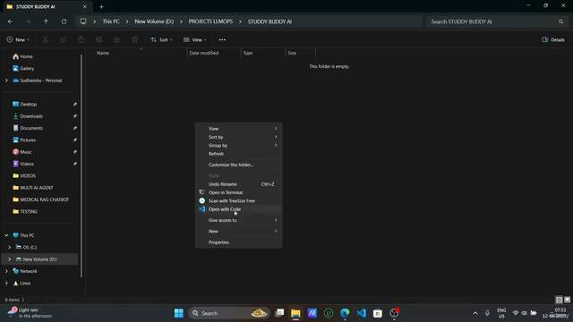
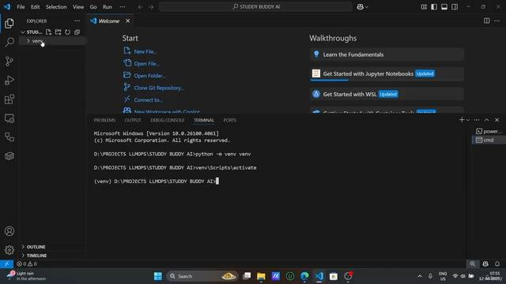
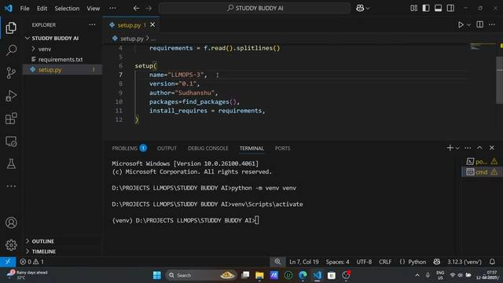
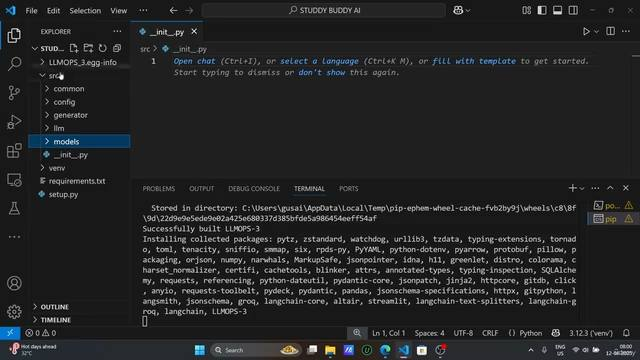
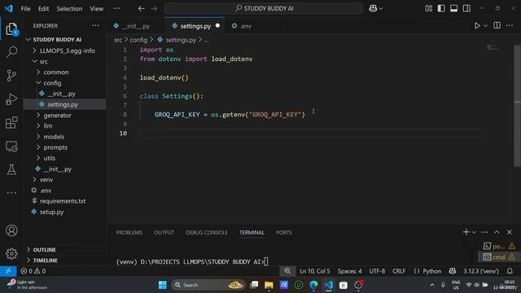
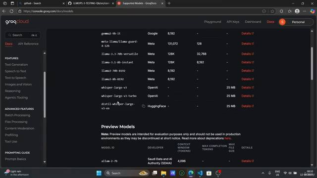

# LLMOps & AIOps Bootcamp（P080–P082）—— Study Buddy AI 项目启动与配置

> 课程：LLMOps & AIOps Bootcamp（BV1gXR4BPERd），覆盖 P080 / P081 / P082
> 这三节对应的是整个项目的**第 1 步和第 2 步**：把项目是什么想清楚、把空骨架搭起来、把 Groq API key 接进去。后面 Jenkins、Argo CD、Kubernetes 全部建立在这一节产出的目录和 `settings.py` 之上，所以这里的文件名、环境变量名一定要一次写对。

---

## 1. 这一节做什么

P080 是整体介绍：讲师先过一遍**最终成品长什么样**（输入主题、选难度、生成填空或选择题），再把整条技术栈一口气铺开——MiniKube 建 Kubernetes 集群、Jenkins 做 CI、Argo CD 做 GitOps 式的 CD、Groq 提供 LLM、Docker Hub 存镜像、Streamlit 做界面、GCP 虚拟机当运行环境。中间花了大段时间讲**「普通 CI/CD 流水线」和「GitOps 流水线」的区别**，这是后面 Argo CD 那三个安装视频为什么那么长的根本原因。

P081 开始动手：建项目文件夹、建 Python 虚拟环境、写 `requirements.txt`、粘 `setup.py`、用 `pip install -e .` 把项目装成一个包，然后一层层建目录（`src/common`、`src/config`、`src/llm`、`src/generator`、`src/models`、`src/prompts`、`src/utils`），最后去 Groq 官网申请 API key 写进 `.env`。

P082 只做一件事：在 `src/config/settings.py` 里把 `.env` 里的 API key 读出来，并把**模型名、温度、最大重试次数**这三个参数写死进 `Settings` 类，最后实例化一个 `settings` 对象供后面所有模块 import。

**这三节结束后你能得到什么**：一个装好了依赖、结构清晰、能 `import src.config.settings` 拿到配置的 Python 包。里面还没有任何一行生成题目的逻辑——那是 P083 以后的事。


---

## 2. 讲师原话（带出处）

关于项目定位：

> "在这个项目里，我们要做一个学习助手 AI，它基本上会帮你处理与你的主题相关的问题，你还可以设置难度……你可以生成简答题，也可以生成选择题。"
> —— p080 [00:16]

> "如果用户要求简答题，你就生成简答题；如果用户要求选择题，你就生成选择题。"
> —— p080 [13:32]（讲师口音，pinups = fill-ups 填空题，msq = MCQ 选择题）

关于 CI 和 CD 为什么要拆开：

> "在上一个项目里，你把 Jenkins 用在了整个 CI/CD 流程上，但这次我们把它拆开了……CI 部分我们用 Jenkins，CD 部分我们用 Argo CD。"
> —— p080 [08:47]

> "Argo CD 通常只适用于 Kubernetes……当你部署到 Kubernetes 上时，才会用 Argo CD。"
> —— p080 [09:15]

关于 GitOps 的好处（这段是 P080 的核心）：

> "假设你的检出阶段运行了、构建阶段也运行了，但部署阶段因为某些原因失败了……你的应用就会停止工作……现在我们用 GitHub 的流水线来看一下……你的应用不会停止工作，应用仍然能正常运行……Argo CD 会检测到这次失败，那它会怎么做呢？它会回滚并同步到上一个成功的流水线。"
> —— p080 [05:03] 至 [06:57]

关于虚拟环境：

> "我们来写 python -m venv，虚拟环境名字随你取。就叫它 venv 吧。"
> —— p081 [00:57]

> "现在你可以看到括号里出现了 venv，这说明你已经成功激活了虚拟环境。"
> —— p081 [01:47]

关于 `pip install -e .` 的作用：

> "至于 setup.py 文件，它的主要工作是处理包和 requirements.txt。它已经处理过 requirements.txt 了，但还没有处理包。所以我们去那里再运行一次 pip install -r requirements.txt 命令。"
> —— p081 [08:51]

关于 API key 放哪：

> "在 API 配置这部分，你基本上要做的是把 API 密钥存到环境变量里。然后在配置代码里，你要做的是从环境变量中读取这个 API 密钥。"
> —— p080 [11:35]

关于温度：

> "温度可以理解为创造性。它的范围一般是 0 到 1……大概 0.3 到 0.7 之间，我觉得这个区间比较合适。"
> —— p080 [13:57]

> "我们让模型更有创造性一些吧，就设成 0.9，因为我们要生成的是金句，对吧。"
> —— p082 [03:18]

> 注意：p080 讲师说温度「合适范围 0.3 到 0.7」，p082 实际写代码时改成了 `0.9`。这是同一节课里前后不一致的地方，以实际代码为准。

关于 `max_retries`：

> "假设你在调用 Groq API，但由于网络连接问题，第一次失败了。如果你把最大重试次数设为 3，它就会重试。再次失败，再次重试，然后就会成功。"
> —— p082 [03:47]

关于模型名（注意这里和 P080 的不一致）：

> "我们用这个 Llama 3.1 8B Instant 吧。"
> —— p082 [02:49]

> 但 p080 [02:11] 讲师说的是「we will be using the GROC LLM that is Lama 3.3 version」。两处矛盾，**以 P082 屏幕上实际复制的模型名为准**（`llama-3.1-8b-instant`）。

---

## 3. 从零复现

### 3.0 前置条件

- 一台 Windows 电脑（讲师全程用 Windows + 命令提示符）。macOS / Linux 也能做，只是激活命令不同，第 3.2 步我会单独标出来。
- 装好 Python 3.10 或以上（讲师没指定版本，「课里没讲」具体版本号，以你能装 `langchain` 为准）。
- 装好 VS Code。
- 一个浏览器，用来去 Groq 官网注册账号。

### 3.1 建项目文件夹并用 VS Code 打开

在你任意一个磁盘位置新建文件夹，名字用 `study-buddy-ai`（讲师说的是「let's name it study birdie ai」）。然后在文件夹里打开终端，执行：

```bash
code .
```

这会让 VS Code 直接在**当前目录**打开，而不是在别处新开一个窗口。讲师专门强调过这一点：



如果你习惯先在 VS Code 里点「打开文件夹」，效果一样，两条路都行。

### 3.2 建虚拟环境并激活

在 VS Code 里新开一个终端（`Ctrl + ~`），如果默认不是命令提示符，点终端右上角的下拉箭头，选 **Command Prompt**。然后：

```bash
python -m venv venv
```

`venv` 是虚拟环境的名字，讲师强调「名字随便起，我们这里就叫 venv」。命令敲下去之后会静默十几秒，左边文件树里会多出一个 `venv/` 文件夹——**这十几秒是正常的，别以为卡死了**（讲师原话：「it will take some time around 10 to 15 seconds. So you have to wait」）。

激活：

```bat
venv\Scripts\activate
```

macOS / Linux 用：

```bash
source venv/bin/activate
```

激活成功的判据：终端提示符最前面出现 `(venv)`。讲师的说法是「in the bracket you are getting V ENV」。



> **给前端同学的类比**：Python 的 `venv` 相当于 Node 的 `node_modules` + `nvm` 二合一——它既隔离了依赖包（像 `node_modules`），也隔离了 Python 解释器本身（像 `nvm` 切换 Node 版本）。激活后的 `(venv)` 提示符，等价于 `nvm use` 之后 `node -v` 变成你想要的那个版本。

### 3.3 写 requirements.txt

在**根目录**新建 `requirements.txt`，只写讲师 [02:16] 到 [02:46] 明确点名的 5 个库：

```
langchain
langchain-groq
pandas
streamlit
python-dotenv
```

讲师原话是「these five libraries are enough. If we need something else, we will create on the go」。所以这里**不写版本号**——课里没指定版本。



### 3.4 写 setup.py 并安装

在根目录新建 `setup.py`。讲师 [03:11] 说的是「从课程资料里的 GitHub 仓库复制，我在课程开头解释过这个文件」，**没有逐字念出内容**。为了让文档能直接跑，下面给一份等价的最小可运行版本（第 4 节有完整代码），关键是 `find_packages()` + 读取 `requirements.txt` 这两点——这正是 `pip install -e .` 会去处理的两件事。

然后执行：

```bash
pip install -e .
```

`-e` 是 editable 的意思，装完之后 `src` 就是一个可 import 的包，改代码不用重装。

### 3.5 建目录结构

讲师在 [04:36] 到 [06:02] 一口气念了全部文件夹，按顺序是：

```
study-buddy-ai/
├── venv/
├── .env
├── requirements.txt
├── setup.py
└── src/
    ├── __init__.py
    ├── common/
    │   ├── __init__.py
    │   ├── logger.py
    │   └── custom_exception.py
    ├── config/
    │   ├── __init__.py
    │   └── settings.py
    ├── llm/
    ├── generator/
    ├── models/
    ├── prompts/
    └── utils/
```

**每个文件夹都要有 `__init__.py` 才能被当成包**——这是讲师反复强调的点（[04:36]「since we want to make this SRC as a package so you will create one init.py inside it」）。



### 3.6 再跑一次 pip install -e .

讲师 [08:51] 有个非常关键的提醒：**每新建一个带 `__init__.py` 的包，就要重新跑一次 `pip install -e .`**，否则新包不会被 `find_packages()` 收录。所以第一次 `pip install -e .`（那时只有 `src` 一个包）之后，建完 `common`、`config` 等文件夹，要：

```bash
pip install -e .
```

再来一次。

### 3.7 申请 Groq API key 并写入 .env

浏览器打开 Groq 官网（讲师说的是「just search for grok api cloud」，他口音里 grok 就是 groq），注册账号 → 进 API Keys 区 → Create New Key，名字随意（讲师起的叫 study buddy ai）→ 复制 key。

在项目根目录新建 `.env`：

```
GROQ_API_KEY=粘贴你复制的key
```

> **务必**把 `.env` 加进 `.gitignore`。讲师课里没提 `.gitignore`（「课里没讲」），但后面 3.10 节要 `git push` 到 GitHub，不加的话 API key 会直接上公网，这是新手最常撞的坑之一。

### 3.8 写 settings.py

这是 P082 的全部内容。文件路径 `src/config/settings.py`，内容见第 4 节。

写完后在项目根目录跑一句自检：

```bash
python -c "from src.config.settings import settings; print(settings.MODEL_NAME, settings.TEMPERATURE, settings.MAX_RETRIES, bool(settings.GROQ_API_KEY))"
```

如果打出 `llama-3.1-8b-instant 0.9 3 True`，说明配置链路（`.env` → `python-dotenv` → `os.getenv` → `Settings` 实例）全通了。**这条自检命令是我加的，课里没讲**。

---

## 4. 完整代码

> 说明：`logger.py`、`custom_exception.py`、`setup.py` 三个文件，讲师在 P081 里明确说的是「从 GitHub 仓库复制，我在课程前面讲过」，**没有在 P080–P082 逐字念出代码**。下面给的是能直接跑、且行为符合讲师描述的最小版本。`settings.py` 是 P082 逐字讲过的，严格按他讲的写。

### `requirements.txt`

```text
langchain
langchain-groq
pandas
streamlit
python-dotenv
```

### `setup.py`

```python
from setuptools import find_packages, setup

with open("requirements.txt", "r", encoding="utf-8") as f:
    requirements = f.read().splitlines()

setup(
    name="study-buddy-ai",
    version="0.0.1",
    author="",
    packages=find_packages(),
    install_requires=requirements,
    python_requires=">=3.10",
)
```

### `.env`

```text
GROQ_API_KEY=your_groq_api_key_here
```

### `.gitignore`

```text
venv/
.env
__pycache__/
*.egg-info/
.streamlit/secrets.toml
```

### `src/__init__.py`

```python
```

（空文件，只用来把 `src` 标记为包。）

### `src/common/__init__.py`

```python
```

### `src/common/logger.py`

```python
import logging
import os
from datetime import datetime

LOG_DIR = "logs"
os.makedirs(LOG_DIR, exist_ok=True)

LOG_FILE = f"{datetime.now().strftime('%Y_%m_%d_%H_%M_%S')}.log"
LOG_FILE_PATH = os.path.join(LOG_DIR, LOG_FILE)

logging.basicConfig(
    filename=LOG_FILE_PATH,
    format="[ %(asctime)s ] %(lineno)d %(name)s - %(levelname)s - %(message)s",
    level=logging.INFO,
)


def get_logger(name: str = "study_buddy_ai") -> logging.Logger:
    return logging.getLogger(name)
```

### `src/common/custom_exception.py`

```python
import sys
import traceback


class CustomException(Exception):
    def __init__(self, error_message, error_detail: sys):
        super().__init__(str(error_message))
        _, _, exc_tb = error_detail.exc_info()
        self.file_name = exc_tb.tb_frame.f_code.co_filename if exc_tb else "unknown"
        self.line_number = exc_tb.tb_lineno if exc_tb else -1
        self.error_message = str(error_message)

    def __str__(self):
        return (
            f"Error occurred in python script [{self.file_name}] "
            f"line number [{self.line_number}] "
            f"error message [{self.error_message}]"
        )
```

### `src/config/__init__.py`

```python
```

### `src/config/settings.py` —— **P082 的全部内容**

```python
import os

from dotenv import load_dotenv

load_dotenv()


class Settings:
    GROQ_API_KEY = os.getenv("GROQ_API_KEY")
    MODEL_NAME = "llama-3.1-8b-instant"
    TEMPERATURE = 0.9
    MAX_RETRIES = 3


settings = Settings()
```

### `src/llm/__init__.py` / `src/generator/__init__.py` / `src/models/__init__.py` / `src/prompts/__init__.py` / `src/utils/__init__.py`

```python
```

（全部空文件，只是占位。P080 [11:07] 和 [13:02] 里讲师说过 `prompts` 放提示词、`models` 放 Pydantic 数据模型、`generator` 放出题逻辑——但具体代码都是后面几节的事。）

---

## 5. 逐行解释

### `setup.py`

```python
from setuptools import find_packages, setup
```

`find_packages()` 会自动扫描项目里所有带 `__init__.py` 的目录。这正是讲师 [09:17] 讲的「`pip install -e .` 会把 `src` 从文件夹变成包」的机制——**每多一个 `__init__.py`，就多一个包被发现**。

```python
with open("requirements.txt", "r", encoding="utf-8") as f:
    requirements = f.read().splitlines()
```

把 `requirements.txt` 整个读成数组。这样依赖只维护一份，`setup.py` 和 `pip install -r` 永远同步。

```python
packages=find_packages(),
install_requires=requirements,
```

这两行是 `pip install -e .` 干的两件事：登记包名 + 登记依赖列表。讲师说的「it has already worked with the requirement.txt, but it has not worked with the packages yet」[08:51]，指的就是第一次跑时 `find_packages()` 只找到 `src` 一个包，`common`、`config` 还没建。

> **给前端的类比**：`setup.py` ≈ `package.json`，`find_packages()` ≈ npm workspace 里的 `packages/*` 自动发现，`pip install -e .` ≈ `npm install && npm link`。

### `logger.py`

`os.makedirs(LOG_DIR, exist_ok=True)`——`exist_ok=True` 保证 `logs/` 已经存在时不报错。没有这一句，第二次启动程序会崩。这是讲师没有专门讲、但每个能跑的 Python 项目都会有的一行。

`format="[ %(asctime)s ] %(lineno)d %(name)s - %(levelname)s - %(message)s"`——日志里带上行号 `%(lineno)d`，后面 Groq 调用出问题时能立刻定位到是哪个 `try` 块。

### `custom_exception.py`

`sys.exc_info()` 返回三个东西：异常类、异常实例、traceback 对象。第三项 `exc_tb` 里的 `tb_frame.f_code.co_filename` 是文件名，`tb_lineno` 是出错行号，`__str__` 把它们拼成一句人话。

> **给前端的类比**：这套东西相当于 Node 里 `new Error()` 自带 `stack` 字段，只不过 Python 要自己写一层包装。`raise CustomException(e, sys)` 就是 `throw new Error(...)`。

### `settings.py`

```python
from dotenv import load_dotenv

load_dotenv()
```

`load_dotenv()` 会**在当前工作目录**找 `.env` 文件，把里面 `KEY=VALUE` 逐行塞进 `os.environ`。所以必须**在项目根目录**启动程序，否则它找不到 `.env`（P080 [11:35] 讲师说过 API key 存环境变量、配置代码再从环境变量里取，就是这一层的机制）。

```python
class Settings:
    GROQ_API_KEY = os.getenv("GROQ_API_KEY")
```

`os.getenv("GROQ_API_KEY")` 里的字符串**必须**和 `.env` 里等号左边的名字**一字不差**。讲师 [01:53] 特别强调过这点：「make sure you give the name correct whatever name you have given here just copy this name copy it and paste it here」。名字写错了不会报错，只会返回 `None`——后面 Groq 调用会给你一个很晦涩的 401。

```python
    MODEL_NAME = "llama-3.1-8b-instant"
```

Groq 提供多个模型（讲师 [02:23] 说「just go to the groc API and just go to the docs and you will get the models」），这里选了最小的 8B instant 版本——便宜、快，适合生成短题干。P080 讲师口头说的是 Llama 3.3，**实际 P082 屏幕上是 3.1**，以代码为准。

```python
    TEMPERATURE = 0.9
```

出题需要「创意」，所以温度调高。讲师的取舍逻辑：0 = 完全不创造（出题会变得模板化、重复），1 = 太疯（开始胡编）。P080 他说「0.3 到 0.7 是合适范围」，P082 直接写了 0.9——这是**一道题难度的取舍**，不是 bug：出题场景里「有变化」比「绝对正确」更重要。

```python
    MAX_RETRIES = 3
```

API 调用失败自动重试 3 次。Groq 免费额度按天限流（P080 [02:11]「100 API request per day」），如果撞上 rate limit，`max_retries` 会消耗在**无意义的重试**上——真上线时要配套指数退避（课里没讲，见第 7 节）。

```python
settings = Settings()
```

在模块级实例化。这样其他地方写 `from src.config.settings import settings` 拿到的就是**同一个对象**，不会每次 import 都重新读一遍 `.env`。

> **给前端的类比**：这等价于 `export const settings = { groqApiKey: process.env.GROQ_API_KEY, ... }`，再配合 `dotenv/config`。要不要写成 class 见仁见智，Python 里写 class 的好处是 IDE 能补全属性名。





---

## 6. 复现检查清单

跑完这一节，逐条对照打勾：

- [ ] 项目根目录叫 `study-buddy-ai`（或你自己起的名字），且已用 `code .` 在 VS Code 中打开
- [ ] 根目录有 `venv/` 文件夹，终端提示符最前面有 `(venv)`
- [ ] `pip list` 能看到 `langchain`、`langchain-groq`、`pandas`、`streamlit`、`python-dotenv` 五个库
- [ ] `requirements.txt` 五行齐全，一行一个库
- [ ] `setup.py` 存在，且里面用了 `find_packages()`
- [ ] 至少跑过 **两次** `pip install -e .`（建完 `src/` 之后一次，建完 `common/`、`config/` 之后再一次）
- [ ] `src/` 下有 `__init__.py`
- [ ] `src/common/` 下有 `__init__.py`、`logger.py`、`custom_exception.py`
- [ ] `src/config/` 下有 `__init__.py`、`settings.py`
- [ ] `src/` 下还有 `llm/`、`generator/`、`models/`、`prompts/`、`utils/` 五个空文件夹
- [ ] 根目录有 `.env`，里面是 `GROQ_API_KEY=sk-...`
- [ ] `.gitignore` 里写了 `venv/` 和 `.env`
- [ ] 跑 `python -c "from src.config.settings import settings；print(settings.MODEL_NAME, settings.TEMPERATURE, settings.MAX_RETRIES, bool(settings.GROQ_API_KEY))"`，输出以 `llama-3.1-8b-instant 0.9 3 True` 开头
- [ ] 最后四个字符是 `True`（如果是 `False`，说明 `.env` 里变量名拼错了，或者 `.env` 不在根目录）

**任何一条不通过，先别往下走**——下一节开始要 import `settings` 调 Groq，`GROQ_API_KEY=None` 的报错信息会非常难懂（通常是一句 `AuthenticationError`）。

---

## 7. 课里没讲但你会撞上的

这一节都是我自己踩过或见过别人踩的坑，**讲师在 P080–P082 没有讲**，但按这份文档做到这里，一定会遇到其中至少一条。

**1. `python` 命令指向了 Microsoft Store 的假 Python。**
Windows 上 `python -m venv venv` 如果弹出一个 Store 窗口，说明系统里的 `python` 是别名不是真 Python。去 Python 官网装完、把「Add Python to PATH」勾上，或者用 `py -3 -m venv venv` 绕开。

**2. `pip install -e .` 报 `error: [WinError 5] Access is denied`。**
多半是因为你把项目放在了 `C:\Program Files\` 之类的受保护目录，或者 venv 没激活就装到了系统 Python。确认提示符有 `(venv)`，项目放到 `C:\Users\你的用户名\` 下。

**3. `load_dotenv()` 返回 True 但 `GROQ_API_KEY` 还是 None。**
最常见原因：`.env` 不在执行脚本的目录里。`load_dotenv()` 默认从**当前工作目录**找，不是从 `settings.py` 所在目录找。如果你在 `src/` 目录里启动 `python`，它找不到根目录的 `.env`。要么在根目录启动，要么改成 `load_dotenv(dotenv_path=Path(__file__).resolve().parents[2] / ".env")`。

**4. `.env` 被 push 上 GitHub。**
`.gitignore` 一定要**在第一次 `git add` 之前**写好。已经 push 了的话，光删文件没用，还得 `git rm --cached .env` 清索引，然后去 Groq 控制台**吊销并重新生成** key——公开仓库里的 key 几分钟就会被爬虫扫到。

**5. `max_retries = 3` 在 rate limit 场景下是负优化。**
Groq 免费额度是每天限次的（P080 [02:11]），撞限额时立刻重试 3 次只是把 3 个失败请求都烧掉，还会让用户体验变成「转圈比直接报错更久」。真上线要么加指数退避（第一次等 1s，第二次 2s，第三次 4s），要么把 `max_retries` 降到 1 并在 UI 上给出「免费额度用完了」的明确提示。**课里没讲**这一层。

**6. 温度 0.9 出题会「跑题」。**
P080 讲师自己说的是「0.3 到 0.7」，P082 写 0.9。0.9 生成的选择题题干会更有变化，但也更容易出一道跟主题无关的题。真用起来建议：**题干生成用 0.9，答案/解析生成用 0.2**——两个不同的 Groq 客户端实例，不同温度。这是设计取舍，不是 bug。

**7. 后面几节要用 Pydantic，P080 [12:05] 讲师明确说过「如果不懂 Pydantic，去 YouTube 补个速成」。**
P080–P082 里还没出现 Pydantic，但 `src/models/` 目录就是给它准备的。如果你跳过这个补齐，到 P083 写数据结构时会卡住。**建议在 P082 结束时花 30 分钟过一遍 Pydantic 的 BaseModel 和 Field**，只需要知道 `class MCQ(BaseModel): question: str; options: list[str]; answer: str` 这种写法就行。

**8. 讲师在 P080 [20:07] 提到后面会讲「Argo CD setup」三个视频，还特别强调「you can't miss even one minute」。**
这三个视频大概率依赖本节的产物：`Dockerfile` 里的 8501 端口、`Kubernetes manifest` 里的 service、`.env` 里的 key。本节任何一处写错（比如把 `.env` 变量名从 `GROQ_API_KEY` 改成了别的），到 Kubernetes 阶段会表现为 Pod 起来了、健康检查过了、UI 打开了、但一出题就 500——而且日志里只会看到一句 `KeyError`。**这就是为什么第 6 节的检查清单必须全过**。

**9. 前端转过来最容易忽略的一点：Python 没有「一次 import 全局生效」的边界。**
在 Node 里 `import` 一个模块，那个模块的副作用会跨请求共享（是优点也是坑）。Python 里 `from src.config.settings import settings` 拿到的确实是模块级单例，但如果你在某个函数里写 `Settings()` 又 new 了一个，就会重新读一遍 `.env`。约定：**只在 `settings.py` 里 new 一次，其他地方一律 `from ... import settings`**。

---

**下一节预告**：P083 开始写 `src/llm/` 下的 Groq 客户端初始化（温度、模型、`max_retries` 从 `settings` 里取），然后把 Pydantic 数据模型写进 `src/models/`。本节写好的 `settings` 对象会在那里被第一次真正使用。