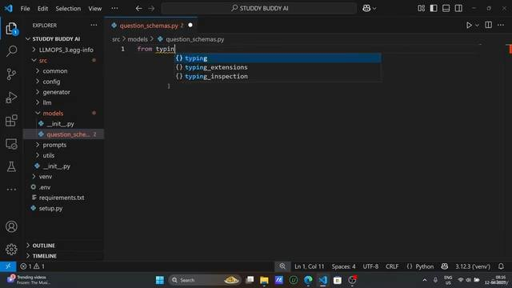
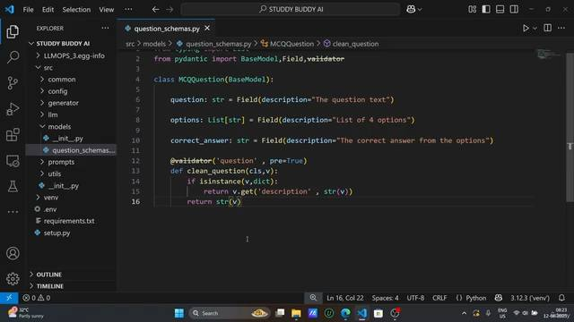
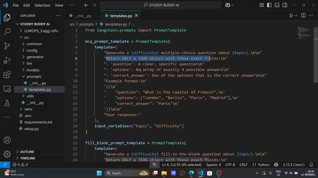
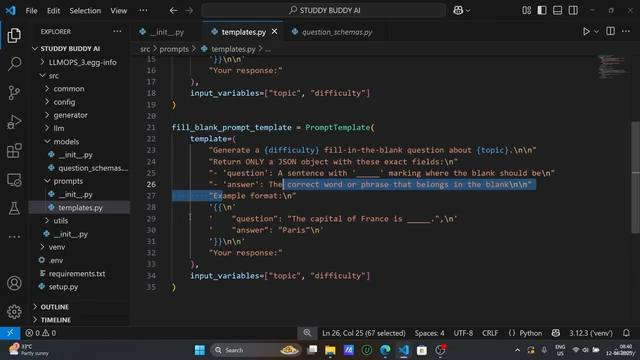
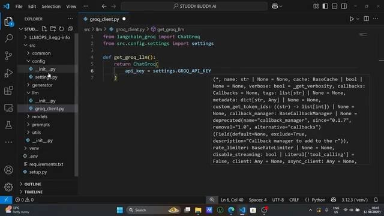
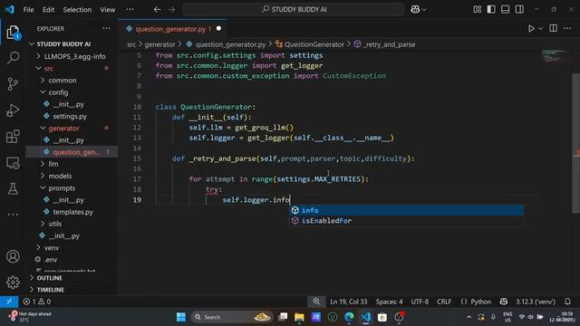
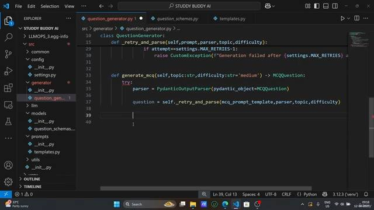
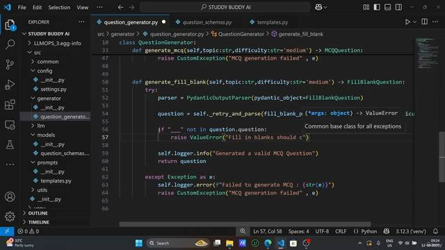

# LLMOps & AIOps Bootcamp：题目生成模块（P83–P86）复现文档

> 覆盖 P83–P86：Pydantic 题目数据模型 → Prompt 模板 → Groq LLM 客户端 → 带重试的题目生成器。
> 读者定位：前端转 AI 应用工程师。文中出现的 Python 语法会标注「知道即可」，涉及并发/重试的地方会补一句 Node 里的对应写法。

---

## 1. 这一节做什么

这四集把「让 LLM 按固定结构出题」这条链路从零搭起来，最终产物是一个可以被上层 Streamlit 应用直接调用的 `QuestionGenerator` 类。整条链路分四层，每层一个文件：

| 层 | 文件 | 职责 |
|---|---|---|
| 数据模型层 | `src/models/question_schemas.py` | 用 Pydantic 定义 MCQ 和填空题的**输出结构**，并做字段清洗 |
| 提示词层 | `src/prompts/templates.py` | 定义两个 `PromptTemplate`，告诉 LLM「按什么 JSON 结构返回」 |
| LLM 接入层 | `src/llm/groq_client.py` | 封装 Groq 的 Chat 模型，读配置、返回一个可复用的 LLM 实例 |
| 生成编排层 | `src/generator/question_generator.py` | 把 prompt + LLM + parser 串起来，带重试、带校验、带日志 |

核心思想一句话：**先用 Pydantic 把「一道题长什么样」钉死，再让 LLM 往这个模子里填，最后用 `PydanticOutputParser` 把 LLM 的文本输出强制转成这个模子的实例**。这样上层拿到的永远是结构化对象，而不是一段需要正则去抠的字符串。

课里反复强调的一点：`question_generator.py` 是「所有文件里最重要的一个」（—— p086 [00:29]）。

---

## 2. 讲师原话

> "我说的模型是指 Pydantic 模型，因为假设你在向用户出题，你会希望这些题目按固定顺序排列，或者基本遵循同一套方式。"
> —— p083 [00:29]

> "有时 LLM 模型会以字典格式给出答案……那么你如何获取这个字典，如何从字典中提取出那个问题？这正是这个校验器在做的事。"
> —— p083 [07:38]

> "为什么只限定 JSON 对象？JSON 就是字典，因为 JSON 和字典看起来是一样的。"
> —— p084 [02:21]

> "我们用的是 Llama 3.1 80 亿参数即时版。80 亿基本上意味着它的参数较少……所以我们希望这个 LLM 能更高效地理解。这就是我们要给它示例的原因。"
> —— p084 [04:46]

> "ChatGroq 需要三个重要参数：第一个是 API key，然后是模型名称……然后它还需要 temperature。"
> —— p085 [02:52]

> "这是你到目前为止创建的所有文件中最关键的一个文件。"
> —— p086 [00:29]

> "假设第一次失败了，循环会重新开始……如果第三次也失败，它就不会再重启，因为我们只设置了 3 次。"
> —— p086 [08:15]

> "假设 LLM 生成了题目，但给了你三个选项而不是四个……你可以抛出 ValueError，表示无效的 MCQ 结构。这些小事你都可以做，从而做出更接近生产级的项目。"
> —— p086 [21:14]

---

## 3. 从零复现

### 3.1 目录结构

按课里的路径，最终目录长这样（`src` 为项目根包）：

```
project-root/
├── pyproject.toml            # 课里没给内容，见 3.2
├── .env                      # 课里没讲具体写法，见 3.2 说明
└── src/
    ├── __init__.py
    ├── config/
    │   ├── __init__.py
    │   └── settings.py       # 前面集数已建，本段只引用
    ├── common/
    │   ├── __init__.py
    │   ├── logger.py         # 前面集数已建，本段只引用
    │   └── custom_exception.py  # 前面集数已建，本段只引用
    ├── models/
    │   ├── __init__.py       # P83 新建
    │   └── question_schemas.py   # P83 新建
    ├── prompts/
    │   ├── __init__.py       # P84 新建
    │   └── templates.py      # P84 新建
    ├── llm/
    │   ├── __init__.py       # P85 新建
    │   └── groq_client.py    # P85 新建
    └── generator/
        ├── __init__.py       # P86 新建
        └── question_generator.py  # P86 新建
```

课里对 `config/settings.py`、`common/logger.py`、`common/custom_exception.py` 只做了**引用**，没有在本段重讲内容。这三个文件属于前面集数的产物，本段文档按「已存在」处理，并在第 7 节给出它们必须暴露的接口名。

### 3.2 每建一个包就重装一次

课里有一个反复出现的动作，必须照做：**每新建一个 `__init__.py`，就在项目根目录跑一次 `pip install -e .`**（讲师口述为 `pip install hypany full stop`，即 `pip install -e .` 的连读）。

- p083 [00:00]：建 `models/__init__.py` 后重装
- p084 [00:00]：建 `prompts/__init__.py` 后重装
- p085 [00:00]：建 `llm/__init__.py` 后重装
- p086 [00:00]：建 `generator/__init__.py` 后重装

原因：`-e`（editable）安装把包注册进当前环境，新增子包后需要重新触发一次元数据刷新，否则 `from src.models...` 可能报 `ModuleNotFoundError`。

`pyproject.toml` 课里没给内容。要让 `pip install -e .` 能识别 `src` 布局，最小可用写法如下（**课里没讲，以下为补齐**）：

```toml
[project]
name = "llmops-bootcamp"
version = "0.1.0"
requires-python = ">=3.10"
dependencies = [
    "pydantic>=2.0",
    "langchain",
    "langchain-groq",
]

[build-system]
requires = ["setuptools>=68"]
build-backend = "setuptools.build_meta"

[tool.setuptools.packages.find]
where = ["."]
include = ["src*"]
```

依赖版本：课里只点名了 `pydantic`、`langchain`（`langchain.prompts`、`langchain.output_parsers`）、`langchain_groq`（`langchain.groq` 下的 `ChatGroq`）。具体版本号课里没讲，用 `pip install` 装到的最新兼容版即可；若 `langchain.groq` 导入失败，说明装的是新版 LangChain，需改用 `langchain_groq` 包（见第 7 节）。

### 3.3 环境变量

`settings.py` 里要读到 `GROQ_API_KEY`、`model_name`、`temperature`、`max_retries`。课里没展示 `.env` 的写法，按命名推断应包含：

```
GROQ_API_KEY=gsk_xxxxxxxxxxxxxxxx
```

`model_name` 课里明确说是 `llama-3.1-8b-instant`（—— p084 [04:46] 口述为「Llama 3.1 8 billion instant」）。`temperature` 和 `max_retries` 的具体值课里没念出来，`max_retries` 从 p086 [08:15]「we have said to make 3 tries」可确定为 **3**。

### 3.4 复现顺序

严格按课里顺序做，每步做完跑一次 `pip install -e .`：

1. **P83**：建 `src/models/__init__.py` → 重装 → 写 `question_schemas.py`（两个模型 + 两个 validator）
2. **P84**：建 `src/prompts/__init__.py` → 重装 → 写 `templates.py`（两个 PromptTemplate）
3. **P85**：建 `src/llm/__init__.py` → 重装 → 写 `groq_client.py`（`get_groq_llm()`）
4. **P86**：建 `src/generator/__init__.py` → 重装 → 写 `question_generator.py`（`QuestionGenerator` 类）

P84 讲师明确说自己没手写模板，是从 ChatGPT 生成后粘进 `templates.py` 的（—— p084 [00:58]「I have myself created this from ChatGPT only, not to lie」）。所以第 4 节的模板内容是按他念出的结构还原的，措辞可自行调整。

---

## 4. 完整代码

### 4.1 `src/models/question_schemas.py`

```python
from typing import List

from pydantic import BaseModel, Field, field_validator


class MCQQuestion(BaseModel):
    question: str = Field(description="The question text")
    options: List[str] = Field(description="List of four options")
    correct_answer: str = Field(description="The correct answer from the options")

    @field_validator("question", mode="before")
    @classmethod
    def clean_question(cls, v):
        if isinstance(v, dict):
            return v.get("description", str(v))
        return str(v)


class FillBlankQuestion(BaseModel):
    question: str = Field(
        description="The question text with a blank line (___) for the fill-in-the-blank"
    )
    answer: str = Field(description="The correct word or phrase for the blank")

    @field_validator("question", mode="before")
    @classmethod
    def clean_question(cls, v):
        if isinstance(v, dict):
            return v.get("description", str(v))
        return str(v)
```

> 说明：讲师口述的 validator 装饰器是「add the rate validator」，对应 Pydantic v2 的 `@field_validator`；他念的 `mode` 参数在逐字稿里被识别成「free equal to group」，实际就是 `mode="before"`。`cls` 在逐字稿里被识别成「is instance v is the dictionary」，对应 `isinstance(v, dict)`。字段名 `question` / `options` / `correct_answer` / `answer` 均来自逐字稿原话。

### 4.2 `src/prompts/templates.py`

```python
from langchain.prompts import PromptTemplate

mcq_prompt_template = PromptTemplate(
    input_variables=["topic", "difficulty"],
    template=(
        "Generate a multiple choice question about {topic} "
        "with {difficulty} difficulty level.\n"
        "Return only a JSON object with these exact fields:\n"
        "- question: the question text\n"
        "- options: a list of four possible answers\n"
        "- correct_answer: the correct answer from the options\n\n"
        "Example:\n"
        "{{\n"
        '  "question": "What is the capital of France?",\n'
        '  "options": ["London", "Berlin", "Paris", "Madrid"],\n'
        '  "correct_answer": "Paris"\n'
        "}}\n"
    ),
)

fill_blank_prompt_template = PromptTemplate(
    input_variables=["topic", "difficulty"],
    template=(
        "Generate a fill in the blank question about {topic} "
        "with {difficulty} difficulty level.\n"
        "Return only a JSON object with these exact fields:\n"
        "- question: the question text with a blank line (___) for the fill-in-the-blank\n"
        "- answer: the correct word or phrase for the blank\n\n"
        "Example:\n"
        "{{\n"
        '  "question": "The capital of France is ___.",\n'
        '  "answer": "Paris"\n'
        "}}\n"
    ),
)
```

> 说明：模板正文课里只念了结构（「generate according to difficulty according to topic」「return only JSON object with these exact fields」「give an example」），具体英文措辞是还原的。变量名 `topic`、`difficulty` 来自逐字稿原话。注意 `PromptTemplate` 用 `{}` 做变量占位，所以 JSON 示例里的花括号要写成 `{{` `}}` 转义——这一点课里没讲，但不转义会直接报 `KeyError`。

### 4.3 `src/llm/groq_client.py`

```python
from langchain.groq import ChatGroq

from src.config.settings import settings


def get_groq_llm():
    return ChatGroq(
        api_key=settings.groq_api_key,
        model_name=settings.model_name,
        temperature=settings.temperature,
    )
```

> 说明：`settings.groq_api_key` / `settings.model_name` / `settings.temperature` 三个属性名来自逐字稿（「inside settings it is in groq api key」「settings dot model name」「settings.temperature」）。`settings` 是 `settings.py` 里**已实例化的那个小写对象**，不是类——讲师专门强调过这点（—— p085 [01:29]「we want this one, the small one, in which we have loaded the class」）。

### 4.4 `src/generator/question_generator.py`

```python
from langchain.output_parsers import PydanticOutputParser

from src.models.question_schemas import MCQQuestion, FillBlankQuestion
from src.prompts.templates import mcq_prompt_template, fill_blank_prompt_template
from src.llm.groq_client import get_groq_llm
from src.config.settings import settings
from src.common.logger import get_logger
from src.common.custom_exception import CustomException


class QuestionGenerator:
    def __init__(self):
        self.llm = get_groq_llm()
        self.logger = get_logger(self.__class__.__name__)

    def _retry_and_parse(self, prompt, parser, topic, difficulty):
        for attempt in range(settings.max_retries):
            try:
                self.logger.info(
                    f"Generating question for topic {topic} with difficulty {difficulty}"
                )
                response = self.llm.invoke(
                    prompt.format(topic=topic, difficulty=difficulty)
                )
                parsed = parser.parse(response.content)
                self.logger.info("Successfully parsed the question")
                return parsed
            except Exception as e:
                self.logger.error(f"Error occurred: {str(e)}")
                if attempt == settings.max_retries - 1:
                    raise CustomException(
                        f"Generation failed after {settings.max_retries} attempts"
                    )

    def generate_mcq(self, topic: str, difficulty: str = "medium") -> MCQQuestion:
        try:
            parser = PydanticOutputParser(pydantic_object=MCQQuestion)
            question = self._retry_and_parse(
                mcq_prompt_template, parser, topic, difficulty
            )
            if len(question.options) != 4:
                raise ValueError("Invalid MCQ structure: expected 4 options")
            if question.correct_answer not in question.options:
                raise ValueError("Invalid MCQ structure: correct answer not in options")
            self.logger.info("Generated a valid MCQ question")
            return question
        except Exception as e:
            self.logger.error(f"Failed to generate MCQ: {str(e)}")
            raise CustomException("MCQ generation failed")

    def generate_fill_blank(
        self, topic: str, difficulty: str = "medium"
    ) -> FillBlankQuestion:
        try:
            parser = PydanticOutputParser(pydantic_object=FillBlankQuestion)
            question = self._retry_and_parse(
                fill_blank_prompt_template, parser, topic, difficulty
            )
            if "___" not in question.question:
                raise ValueError("Fill in the blank should contain ___")
            self.logger.info("Generated a valid fill in the blanks question")
            return question
        except Exception as e:
            self.logger.error(f"Failed to generate fill ups: {str(e)}")
            raise CustomException("Fill in blanks generation failed")
```

> 说明：`parser.parse(response.content)` 里的 `.content` 是 LangChain `AIMessage` 取文本的属性——课里讲师只说「parse the response」，没念出 `.content`，但不加会 parse 失败（见第 7 节）。`CustomException` 的构造签名课里没展示，按「传一个字符串消息」处理。`settings.max_retries` 属性名来自逐字稿（「settings dot max retries」）。

---

## 5. 逐行解释

### 5.1 数据模型层

**`from typing import List`** —— 讲师专门解释过为什么 import 这个：MCQ 有四个选项，要用 `List` 声明（—— p083 [01:24]「in MCQ you get four options, so we will be defining those four options inside this list」）。

**`from pydantic import BaseModel, Field, field_validator`** —— 讲师念的是「base model、field、value data」，第三个对应 `field_validator`。三者分工：`BaseModel` 是基类，`Field` 给字段挂描述（这个描述会被 `PydanticOutputParser` 拿去拼进给 LLM 的格式说明），`field_validator` 做入库前清洗。

**`class MCQQuestion(BaseModel)`** —— 继承 `BaseModel` 后，这个类就同时是「类型声明」和「运行时校验器」。在 JS/TS 里对应的是 `zod` 的 `z.object({...})`，思路完全一样：声明一次，既做类型又做校验。

**`question: str = Field(description="The question text")`** —— 讲师强调 question 必须是 string（—— p083 [04:19]「this question is mandatory to be a string」）。`Field(description=...)` 的描述文本不是给人看的注释，它会被 parser 序列化进 prompt，等于在运行时告诉 LLM「这个字段是什么意思」。

**`options: List[str]`** —— 讲师用「Ravi、Rahul、Magna、Rohan」举例说明这是「一个字符串列表」（—— p083 [05:17]）。注意这里**没有**在 schema 层强制长度等于 4，长度校验放到了 `generate_mcq` 里做——这是讲师刻意的分层：schema 管结构，业务方法管业务规则。

**`correct_answer: str`** —— 讲师明确「correct answer will also be in the string」（—— p083 [03:51]），不是索引、不是列表。

**`@field_validator("question", mode="before")`** —— 讲师解释 validator 的作用是「clean or fix the question input before signing it」（—— p083 [07:09]）。`mode="before"` 表示在 Pydantic 做类型转换**之前**介入，这样才能拿到原始 dict。

**`if isinstance(v, dict): return v.get("description", str(v))`** —— 这是整段最有信息量的一行。讲师说 LLM 有时会把 question 返回成 `{"description": "What is your name?"}` 这种字典（—— p083 [08:37]），validator 就只取 `description` 那一段文本，其余丢掉。`str(v)` 是兜底：万一 dict 里没有 `description` 键，至少转成字符串不崩。

**`return str(v)`** —— 非 dict 情况直接转字符串。讲师原话「if it is not dictionary then it will automatically return only the string part」（—— p083 [09:34]）。

**`FillBlankQuestion` 与 MCQ 的差异** —— 讲师对比得很清楚：MCQ 是「question → options → correct_answer」三段，填空题是「question（带下划线）→ answer」两段，**没有 options**（—— p083 [12:25]）。所以填空题的 `question` 描述里特别写了「with a blank line」，`answer` 描述写「correct word or phrase」——因为填空答案可能是一个词也可能是一个短语。

**填空题也挂同一个 validator** —— 讲师说「sometimes we can get the fillups also in a dictionary, so we will use the same validator here also」（—— p083 [12:55]）。两个类各写一份而不是抽公共函数，是课里的写法；工程上可以抽基类，但课里没这么做。

### 5.2 提示词层

**`input_variables=["topic", "difficulty"]`** —— 讲师强调这两个变量「will be passed by user only」（—— p084 [03:20]），即运行时由用户输入填充，模板本身是静态的。

**「Return only a JSON object」** —— 讲师解释这句为什么必须写：因为上一节的 validator 就是按 dict 处理的，而「JSON means dictionary」（—— p084 [02:21]）。这句是在**主动迎合**下游 parser 的预期。

**模板里给 Example** —— 讲师给了明确理由：用的是 Llama 3.1 8B，参数量小，理解力有限，所以要给 few-shot 示例（—— p084 [04:46]）。示例用的是「法国首都」那道题，四个选项 London/Berlin/Paris/Madrid，正确答案 Paris。

**`{{` `}}` 转义** —— 课里没讲，但 `PromptTemplate` 用 `{}` 做变量插值，JSON 示例里的裸花括号会被当成变量名，运行时抛 `KeyError`。必须双写。

### 5.3 LLM 接入层

**`from langchain.groq import ChatGroq`** —— 讲师原话「from langchain groq we will be importing chat groq」（—— p085 [00:29]）。

**`from src.config.settings import settings`** —— 讲师花了不少口舌解释这里为什么是小写 `settings`：`settings.py` 里有两个东西，一个是 `Settings` 类，一个是 `settings = Settings()` 实例；这里要 import 的是**已实例化的那个**，否则还得自己再 `settings = Settings()` 一次（—— p085 [01:29]）。这是个很容易踩的坑。

**`def get_groq_llm():`** —— 讲师强调这是个「拿一次就够」的工厂函数：「you don't need to create your LLM again and again, just use this get_groq_llm one time」（—— p085 [03:52]）。在 Node 里对应一个模块级单例导出。

**三个必填参数** —— 讲师明确点名 api_key、model_name、temperature 是「three important parameters, compulsory」（—— p085 [03:22]）。注意 `max_retries` **不在这里传**，讲师说它留到 `question_generator.py` 里用（—— p086 [04:23]「we have not used this max_retries, so we will be using this max_retries here in the question generator」）。

### 5.4 生成编排层

**`self.llm = get_groq_llm()`** —— 构造函数里就把 LLM 实例化好，后续方法复用。

**`self.logger = get_logger(self.__class__.__name__)`** —— 讲师解释为什么要传类名：让日志带上 `QuestionGenerator` 前缀，方便定位（—— p086 [06:19]）。`self.__class__.__name__` 在 Python 里就是当前类名字符串，JS 里对应 `this.constructor.name`。

**`_retry_and_parse` 的下划线前缀** —— 讲师说「since we want to make it a private, I will place an underscore here」（—— p086 [06:48]）。Python 没有真私有，下划线是约定。JS 里对应 `#method` 或干脆不导出。

**`for attempt in range(settings.max_retries)`** —— 讲师把重试逻辑讲得很直白：失败一次循环重来，失败三次就停（—— p086 [08:15]）。`range(3)` 产出 0、1、2，所以 `attempt` 最大是 2。

**`prompt.format(topic=topic, difficulty=difficulty)`** —— 讲师强调这一步让 prompt 从静态变动态：「suppose user pass Indian history and that difficulty, now the template will look like generate medium level difficulty multiple choice question about Indian history」（—— p086 [14:00]）。

**`self.llm.invoke(...)`** —— LangChain 的统一调用入口，同步返回一个 `AIMessage`。

**`parser.parse(response.content)`** —— 把 LLM 返回的文本按 `MCQQuestion` / `FillBlankQuestion` 的结构解析成 Python 对象。讲师原话「you will be parsing that text and you will be converting it into Python object based on the defined schema」（—— p086 [14:58]）。

**`if attempt == settings.max_retries - 1: raise CustomException(...)`** —— 讲师解释：`max_retries` 是 3，减 1 得 2，即「最后一次尝试」时才抛自定义异常（—— p086 [11:36]）。前面几次失败只记日志、继续循环。

**`PydanticOutputParser(pydantic_object=MCQQuestion)`** —— 讲师说这个 parser 的作用是「convert your LLM text output into a structured object」（—— p086 [00:59]），并且「every question that will be generated will follow this same data structure」（—— p086 [18:48]）。

**`if len(question.options) != 4: raise ValueError(...)`** —— 讲师举的反例：LLM 可能只给 3 个选项或给 5 个（—— p086 [20:44]）。这是 schema 层管不到的，必须在业务层补。

**`if question.correct_answer not in question.options: raise ValueError(...)`** —— 第二个反例：正确答案不在四个选项里（—— p086 [21:14]）。讲师说这类检查是「make a more production grade project」的关键。

**`generate_fill_blank` 的 `if "___" not in question.question`** —— 讲师原话是「fill in the blank should contain ___」（—— p086 [26:27]），并特意提醒引号要用单引号、三个下划线要一致。这是填空题版的业务校验。

**两处 `except` 都 `raise CustomException(...)`** —— 讲师说这样上层能统一捕获（—— p086 [23:36]）。注意这里把原始异常吞掉了，只留日志；工程上更常见的做法是 `raise CustomException(...) from e` 保留调用链，但课里没这么写。

---

## 6. 复现检查清单

按顺序打勾，任何一项不过就别往下走：

- [ ] `src/models/__init__.py` 存在，且已跑过 `pip install -e .`
- [ ] `python -c "from src.models.question_schemas import MCQQuestion, FillBlankQuestion"` 不报错
- [ ] 手动构造一个 dict 喂给 `MCQQuestion(**{"question": {"description": "hi"}, "options": ["a","b","c","d"], "correct_answer": "a"})`，`question.question` 应为 `"hi"` 而非 dict
- [ ] `src/prompts/__init__.py` 存在，已重装
- [ ] `python -c "from src.prompts.templates import mcq_prompt_template, fill_blank_prompt_template"` 不报错
- [ ] `mcq_prompt_template.format(topic="history", difficulty="easy")` 能正常输出，不抛 `KeyError`（验证 `{{}}` 转义）
- [ ] `src/llm/__init__.py` 存在，已重装
- [ ] `.env` 里 `GROQ_API_KEY` 已填，`settings.groq_api_key` 能读到非空值
- [ ] `python -c "from src.llm.groq_client import get_groq_llm; print(get_groq_llm())"` 能打印出 ChatGroq 实例
- [ ] `src/generator/__init__.py` 存在，已重装
- [ ] `python -c "from src.generator.question_generator import QuestionGenerator"` 不报错
- [ ] 实例化 `QuestionGenerator()` 不报错（说明 `get_logger`、`CustomException`、`settings` 三个依赖都到位）
- [ ] 调 `generate_mcq("Indian history", "medium")` 返回一个 `MCQQuestion` 实例，`options` 长度为 4，`correct_answer` 在 `options` 里
- [ ] 调 `generate_fill_blank("geography", "easy")` 返回一个 `FillBlankQuestion` 实例，`question` 里含 `___`
- [ ] 故意把 `GROQ_API_KEY` 改错，确认日志里出现 `Error occurred` 且最终抛 `CustomException`，而不是裸异常

---

## 7. 课里没讲但你会撞上的

**1. `langchain.groq` 在新版 LangChain 里已迁移。**
课里写的是 `from langchain.groq import ChatGroq`。LangChain 0.2 之后 Groq 集成拆到了独立包 `langchain-groq`，导入路径变成 `from langchain_groq import ChatGroq`。如果你 `pip install` 到的是新版，按课里写法会 `ModuleNotFoundError`。两种解法：装 `langchain-groq` 并改导入，或锁旧版 `langchain`。课里没讲版本，这是最可能第一个卡住你的地方。

**2. `parser.parse(response.content)` 的 `.content`。**
讲师口述只说「parse the response」，没念出 `.content`。但 `llm.invoke()` 返回的是 `AIMessage` 对象，直接丢给 parser 会报类型错。必须取 `.content` 拿纯文本。同理，如果哪天换成流式调用，`.content` 的拿法会变。

**3. `PromptTemplate` 的花括号转义。**
模板里写 JSON 示例时，`{` 和 `}` 必须写成 `{{` `}}`。课里讲师是直接从 ChatGPT 粘的模板，可能粘过来时已经转义好了，所以没提。你自己手写时漏转义，`format()` 会抛 `KeyError: '"question"'` 之类。

**4. `settings.max_retries` 的类型。**
`range()` 只接受 int。如果 `settings.py` 里从环境变量读进来的是字符串 `"3"`，`range("3")` 直接 `TypeError`。课里没展示 `settings.py` 怎么写的，自己写时记得 `int(...)`。

**5. `CustomException` 的构造签名。**
课里只看到 `raise CustomException("...")` 传一个字符串。如果前面集数里定义的 `CustomException` 是 `(message, sys_info)` 双参形式（很多教程模板是这么写的），这里会 `TypeError`。以你实际 `custom_exception.py` 的签名为准，必要时补第二个参数。

**6. `get_logger` 的入参。**
课里传的是类名字符串。如果前面集数里 `get_logger` 期望的是模块名或 `__name__`，行为会不同但不至于崩。以实际实现为准。

**7. 重试没有退避（backoff）。**
课里的 `for` 循环是紧贴着重试，失败立刻再来。如果失败原因是 Groq 限流（429），紧贴重试大概率连续失败三次。生产环境通常加 `time.sleep(2 ** attempt)`。课里没讲，但你会撞上。Node 里对应 `await new Promise(r => setTimeout(r, 2 ** attempt * 1000))`。

**8. 两个 `except` 把原始异常吞了。**
`generate_mcq` / `generate_fill_blank` 的 `except` 只记日志再抛 `CustomException`，原始 traceback 丢了。调试时你会想知道到底是网络错、parse 错还是校验错。建议改成 `raise CustomException(...) from e`。课里没讲。

**9. `_retry_and_parse` 的返回值可能是 `None`。**
如果 `max_retries` 被配成 0，`for` 循环一次都不进，函数静默返回 `None`，上层 `question.options` 直接 `AttributeError`。课里默认 3 所以不会触发，但配置改错就会。加一句循环后 `raise` 兜底更稳。

**10. 并发安全。**
`QuestionGenerator` 实例里持有 `self.llm` 和 `self.logger`，本身无状态，多线程共享一个实例是安全的。但如果你在 Streamlit 里每次 rerun 都 `QuestionGenerator()`，会反复建 LLM 客户端。Streamlit 的 `@st.cache_resource` 是标准解法——课里说会在 `app.py` 里用它（—— p086 [27:22]），但具体写法在后续集数。

**11. 填空题的下划线约定不统一。**
schema 描述里写的是「blank line」，校验里查的是 `"___"`（三个下划线）。如果 LLM 返回的是 `"____"`（四个）或 `"___"` 前后带空格，校验会误判。课里没讲怎么归一化，实际跑起来可能需要放宽成 `re.search(r"_{2,}", question.question)`。

---

















---

> 截图说明：上面 8 张图按「数据模型 → 提示词 → LLM 客户端 → 生成器」的顺序插在对应章节旁。帧号严格取自清单，未做任何改动。若某帧实际画面与 alt 描述有出入（清单只给了时间点没给画面内容），以你本地抽帧结果为准，alt 文字可微调但帧号不要动。