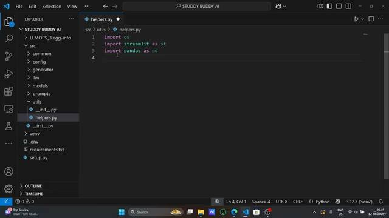
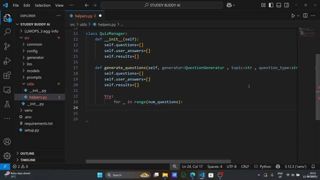
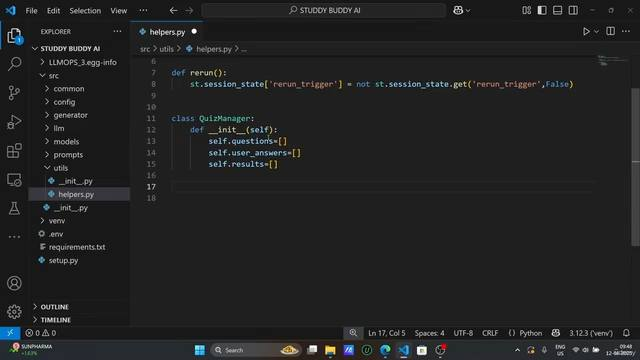
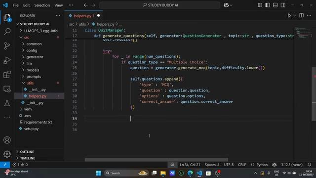
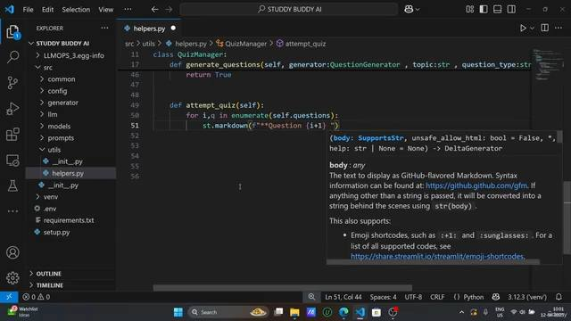
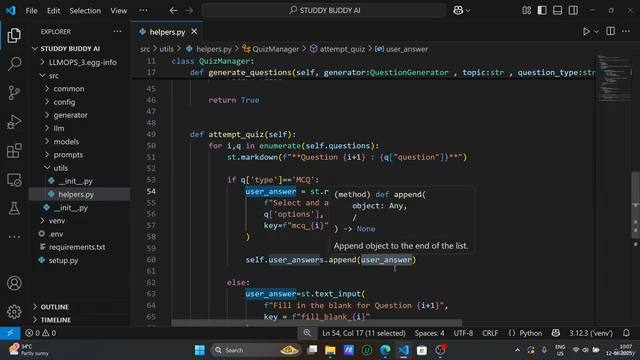
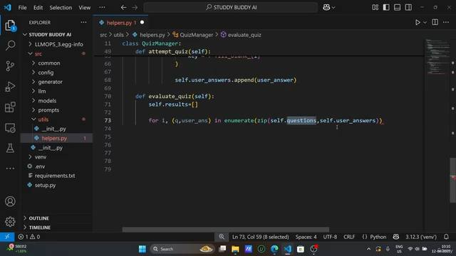
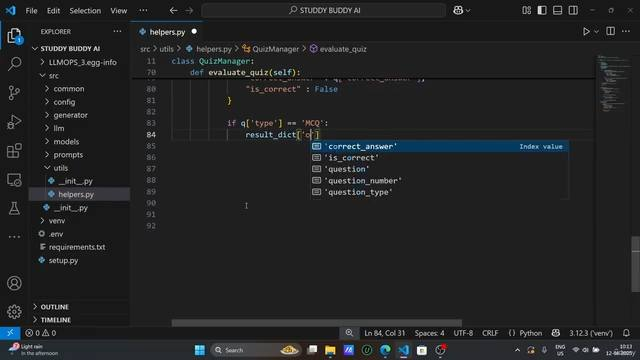

# P087 把业务逻辑抽出来：`utils/helpers.py` 全量实现

> 课程：LLMOps & AIOps Bootcamp（BV1gXR4BPERd）｜本节覆盖 P087
> 本节产物：`utils/__init__.py`（空）+ `utils/helpers.py`（约 90 行），一个 `rerun()` 加一个 `QuizManager` 类（5 个方法）。

---

## 1. 这一节做什么

这一节只做一件事：**把 Quiz 应用的全部业务逻辑，从未来的 `application.py` 里提前抽出来，独立成 `utils/helpers.py`**。

为什么先抽再写 UI？讲师给了很直白的理由：所有东西都塞进 `application.py` 会让主文件「too much clumsy, too much hacked to read and watch」（太臃肿、太乱，读不下去）。所以这一节先把「生成题目 → 收集用户作答 → 判分 → 出报表 → 存 CSV」这条完整链路的函数全部写好，下一节再写一个很薄的 `application.py` 去 `import` 它们。

本节点完，你手上会有 6 个能力：

| 编号 | 名字 | 属于 | 作用 |
|---|---|---|---|
| 1 | `rerun()` | 模块级函数 | 翻转一个 `st.session_state` 上的布尔开关，用来给 Streamlit 一个「该刷新了」的信号 |
| 2 | `QuizManager.__init__()` | 类方法 | 初始化三个空列表：`questions` / `user_answers` / `results` |
| 3 | `QuizManager.generate_questions()` | 类方法 | 按数量循环调 `QuestionGenerator`，把 MCQ 或填空题统一塞进 `self.questions` |
| 4 | `QuizManager.attempt_quiz()` | 类方法 | 把题目渲染到页面上，用 `st.radio` / `st.text_input` 收答案 |
| 5 | `QuizManager.evaluate_quiz()` | 类方法 | 逐题比对，产出带 `is_correct` 的结果字典列表 |
| 6 | `QuizManager.generate_result_dataframe()` + `save_to_csv()` | 类方法 | 结果转 `pandas.DataFrame`，再落盘成带时间戳的 CSV |

**本节结束时，`helpers.py` 还不能独立运行**——它依赖 Streamlit 运行时，真正的入口在下一节的 `application.py`。这一点很重要，别急着在终端里 `python utils/helpers.py`，会看不到任何东西。

目标目录结构（本节只新增标注「新增」的两行）：

```
quiz-app/
├── src/
│   ├── __init__.py
│   ├── generator/
│   │   ├── __init__.py
│   │   └── question_generator.py      # 上一节 P086 的产物，本节从它 import
│   └── models/
│       └── (上一节定义的 Pydantic 模型)
├── utils/
│   ├── __init__.py                    # 新增（空文件）
│   └── helpers.py                     # 新增，本节全部代码在这
├── results/                           # 不需要手建，save_to_csv 会自动建
└── application.py                     # 下一节才写
```

---

## 2. 讲师原话

**为什么先抽 helpers 而不是直接写 application.py：**

> "为什么要创建辅助函数？为什么不直接创建 application.py 文件？基本上，如果把所有内容都写在 application.py 文件里，文件会显得过于笨拙、可读性太差。因此，我们才创建辅助函数。"
> —— p087 [00:00]

（"hyper function" 是 ASR 把 "helper function" 听错了，下文他一路都说 helper。）

**QuizManager 这个类的定位：**

> "你将创建一个类，也就是你的……顾名思义，这个类将用于管理测验工作流，也就是测验如何生成、各个环节如何运作。"
> —— p087 [03:49]

**每次生成新题之前为什么要清空旧数据：**

> "现在你想清除之前的所有数据，以便重新开始，对吧？所以我们在这里也会做同样的处理。"
> —— p087 [06:42]

**题目只有两种类型：**

> "基本上，题目有两类：选择题或填空题。所以首先，你选择选择题……如果用户选择了别的，别的会是什么呢？只有填空题。"
> —— p087 [14:21]

**判分时为什么要 `strip().lower()`：**

> "假设用户写成这样：答案是 deli，但你在左边留了空格……所以我们会用 strip 去掉多余的空格……再用 lower 把它转换成小写，这样更容易判断。否则……你的正确答案是 deli，而用户写成了 Deli，虽然答案相同，但这两者会被当成不同。"
> —— p087 [31:03]

**`rerun()` 存在的原因（讲师的解释）：**

> "首先，它是一个重运行函数，主要用来处理 Streamlit 的会话状态，因为在 Streamlit 中，它有一种过一段时间就自动刷新的倾向。"
> —— p087 [45:30]

**本节之后接什么：**

> "这就是 helpers.py 的主要目的。好，接下来在下一个视频里，我们会使用 helpers.py 创建界面应用；再下一个视频里，你会得到最终产品，之后我们会开始部署流程。"
> —— p087 [46:56]

---

## 3. 从零复现

### 步骤 1：确认上一节的 `QuestionGenerator` 在位

本节所有生成题目的动作都转交给 `QuestionGenerator` 这个类，它在上一节 P086 就写好了。本节只关心它的两件事：

- **两个方法**：`generate_mcq(...)` 和 `generate_fillups(...)`
- **返回值上被用到的字段**（从本节代码反推）：
  - MCQ：`.question`、`.options`、`.correct_answer`
  - 填空：`.question`、`.answer`

如果你手上没有上一节的 `question_generator.py`，又想让本节代码跑通，请用第 4 节结尾那份**最小可跑桩**顶上。那里我做了明确标注：**课里没有给出这个文件的实现，桩代码只是为了让 `import` 不报错**，字段名严格照本节 `helpers.py` 的取法来。

### 步骤 2：建 `utils/` 目录和 `__init__.py`

在项目根目录下：

```bash
mkdir -p utils
touch utils/__init__.py
```

`__init__.py` **留空就行**。讲师原话是「let's create first of all one init.py… now let's close this init file」——打开、创建、关闭，里面什么都没写。

它的作用只有一个：让 `utils` 被 Python 认成一个包，下节 `application.py` 里 `from utils.helpers import QuizManager` 才不报 `ModuleNotFoundError`。（上一节的 `src/` 目录同理也需要 `__init__.py`。）



### 步骤 3：刷新依赖

讲师在这里开了一次终端，原话是：

> "让我打开终端，运行 pip install hypony。因为我们现在已经修改了 utils 里的包。"
> —— p087 [00:27]

这句 ASR 到 "hypony" 就糊了。从上下文（刚在 `utils` 下建了 `__init__.py`、说「因为我们刚改了 utils 里的包」）判断，这条大概率是给本地包做**可编辑安装**，即 `pip install -e .`（"hyphen e dot" 被听成了 "连字符、句号。"）。**具体命令课里没给清楚，别死抠字面。**

你按下面两种情况处理，都能跑通本节：

**情况 A：项目有 `pyproject.toml` / `setup.py`**

```bash
# 项目根目录
pip install -e .
```

**情况 B：没有打包配置（初学者常见）**

本节实际只需三个第三方库：

```bash
pip install streamlit pandas pydantic
```

只装这三个也完全够——因为从项目根目录执行 `streamlit run application.py`（下一节）时，根目录本身就在 `sys.path` 里，`from utils.helpers ...` 和 `from src.generator...` 都能直接解析，不需要把项目装成包。

### 步骤 4：写 `helpers.py`

打开 `utils/helpers.py`，按第 4 节的完整代码整份粘贴保存。**注意顺序**：先 import，再 `rerun()` 函数，再 `QuizManager` 类。讲师就是按这个顺序敲的，`rerun()` 写在类外面、模块顶层——因为他希望下节 `application.py` 里可以直接 `from utils.helpers import rerun` 这样调，不用先实例化对象。



`generate_questions` 的核心就是一个 `for i in range(number_of_questions)`：你要 5 道就转 5 圈，每圈生成一道、append 一道。讲师原话：

> "假设你定义想要 5 道题，那么我们就会一道一道地生成 5 道题。假设你需要找 3 道题，那么我们就会定义 3 道题。这就是我使用 for 的原因。"
> —— p087 [07:37]

### 步骤 5：先做语法检查，别急着上 Streamlit

```bash
python -m py_compile utils/helpers.py
```

没输出＝语法通过。这一步能挡掉 90% 的缩进错误和漏逗号——讲师在录课过程中就现场踩了一个：

> "我忘了在这里加逗号。现在应该改好了。"
> —— p087 [29:07]

以及一次 key 名写错、又回头改了三处：

> "这里也应该是正确答案，好；这里和这里也都应该是正确答案。务必把它改过来。"
> —— p087 [32:59]

### 步骤 6：本节的验收边界

到这里，`helpers.py` 写完就算本节完成。**不要在终端里单独 `python utils/helpers.py`**——文件里没有任何 `if __name__ == "__main__"` 的入口，跑起来只会静默退出，容易让你误以为写错了。

真正的第一次运行发生在下一节：`streamlit run application.py`。如果你现在就想看到效果，可以临时写一个 5 行的小脚本（**这不是课里的代码，只是给你自测用**，自测完删掉）：

```python
# tmp_check.py（课里没有这个文件，纯自测，用完删）
import streamlit as st
from utils.helpers import QuizManager, rerun

st.write("helpers imported ok")
mgr = QuizManager()
st.write(mgr.generate_result_dataframe())
```

然后 `streamlit run tmp_check.py`。页面能正常渲染、终端没红字，说明 `helpers.py` 的 import 链和类定义都没问题。

---

## 4. 完整代码

### 4.1 `utils/__init__.py`

```python
# utils/__init__.py
# 故意留空。作用只有一个：把 utils 目录标记成 Python 包。
```

### 4.2 `utils/helpers.py`（本节全部内容，可直接保存运行）

```python
# utils/helpers.py
import os
from datetime import datetime

import pandas as pd
import streamlit as st

from src.generator.question_generator import QuestionGenerator


def rerun():
    """
    翻转 session_state 上的 rerun_trigger 开关。
    用于给 Streamlit 一个「该刷新了」的信号。
    """
    st.session_state.rerun_trigger = not st.session_state.get("rerun_trigger", False)


class QuizManager:
    """管理整个 quiz 工作流：生成题目 -> 收答案 -> 判分 -> 出报表 -> 存 CSV。"""

    def __init__(self):
        self.questions = []       # 题目列表，每个元素是一个 dict
        self.user_answers = []    # 用户作答列表，和 questions 一一对应
        self.results = []         # 判分结果列表，每个元素是一个 dict

    def generate_questions(
        self,
        generator: QuestionGenerator,
        topic: str,
        question_type: str,
        difficulty: str,
        number_of_questions: int,
    ) -> bool:
        """
        生成 number_of_questions 道题，存进 self.questions。
        成功返回 True，出错返回 False。
        """
        # 清空上一次的结果，保证每次都是全新的一轮
        self.questions = []
        self.user_answers = []
        self.results = []

        try:
            for i in range(number_of_questions):
                if question_type == "multiple choice":
                    question = generator.generate_mcq(topic, difficulty.lower())
                    self.questions.append(
                        {
                            "type": "mcq",
                            "question": question.question,
                            "options": question.options,
                            "correct_answer": question.correct_answer,
                        }
                    )
                else:
                    # 非 multiple choice，一律按 fill in the blanks 处理
                    question = generator.generate_fillups(topic, difficulty.lower())
                    self.questions.append(
                        {
                            "type": "fill in the blank",
                            "question": question.question,
                            "correct_answer": question.answer,
                        }
                    )
        except Exception as e:
            st.error(f"Error generating question: {e}")
            return False

        return True

    def attempt_quiz(self):
        """把 self.questions 渲染到页面上，并把用户作答收进 self.user_answers。"""
        for i, q in enumerate(self.questions):
            st.markdown(f"Question {i + 1}: {q['question']}")

            if q["type"] == "mcq":
                user_answer = st.radio(
                    f"Select an answer for question {i + 1}",
                    q["options"],
                    key=f"mcq_{i}",
                )
            else:
                user_answer = st.text_input(
                    f"Fill in the blank for question {i + 1}",
                    key=f"fill_blank_{i}",
                )

            self.user_answers.append(user_answer)

    def evaluate_quiz(self):
        """逐题比对 self.user_answers 和正确答案，把报告写进 self.results。"""
        self.results = []

        for i, (q, user_answer) in enumerate(zip(self.questions, self.user_answers)):
            result = {
                "question_number": i + 1,
                "question": q["question"],
                "question_type": q["type"],
                "user_answer": user_answer,
                "correct_answer": q["correct_answer"],
                "is_correct": False,
            }

            if q["type"] == "mcq":
                result["options"] = q["options"]
                result["is_correct"] = user_answer == q["correct_answer"]
            else:
                result["options"] = []
                result["is_correct"] = (
                    user_answer.strip().lower()
                    == q["correct_answer"].strip().lower()
                )

            self.results.append(result)

    def generate_result_dataframe(self) -> pd.DataFrame:
        """把 self.results 转成 DataFrame；没有结果时返回空 DataFrame。"""
        if not self.results:
            return pd.DataFrame()
        return pd.DataFrame(self.results)

    def save_to_csv(self, filename_prefix: str = "quiz_results"):
        """
        把结果 DataFrame 存成 results/<prefix>_<时间戳>.csv。
        成功返回完整路径，没有结果或失败返回 None。
        """
        if not self.results:
            st.warning("No results to save")
            return None

        df = self.generate_result_dataframe()

        timestamp = datetime.now().strftime("%Y_%m_%d_%H%M%S")
        unique_filename = f"{filename_prefix}_{timestamp}.csv"

        os.makedirs("results", exist_ok=True)
        full_path = os.path.join("results", unique_filename)

        try:
            df.to_csv(full_path, index=False)
            st.success("Results saved successfully")
            return full_path
        except Exception as e:
            st.error(f"Failed to save results: {e}")
            return None
```

### 4.3 `src/generator/question_generator.py`（课里没给实现，以下是让本节能跑的最小桩）

**重要声明**：这个文件的真实实现在上一节 P086，本节只是 `import` 它，**逐字稿里没有它的代码**。下面这份是「按本节 `helpers.py` 实际取用的字段和方法名反推出来的最小可跑版本」，**不是讲师写的**。如果你手上有 P086 的原始文件，直接用原文件覆盖，不要用这份。

```python
# src/generator/question_generator.py
# ⚠️ 课里没讲这个文件的实现。以下为最小可跑桩，仅用于让 utils/helpers.py 能 import 成功。
# 字段名严格对齐 helpers.py 里的取法：
#   MCQ  -> .question / .options / .correct_answer
#   Fill -> .question / .answer
# 方法名严格对齐 helpers.py 里的调用：generate_mcq / generate_fillups

from pydantic import BaseModel


class MCQQuestion(BaseModel):
    question: str
    options: list[str]
    correct_answer: str


class FillBlankQuestion(BaseModel):
    question: str
    answer: str


class QuestionGenerator:
    def __init__(self, api_key: str | None = None):
        # 真实实现里这里会初始化 LLM 客户端；桩里不接任何模型。
        self.api_key = api_key

    def generate_mcq(self, topic: str, difficulty: str) -> MCQQuestion:
        return MCQQuestion(
            question=f"[{difficulty}] Sample MCQ about {topic}?",
            options=["Option A", "Option B", "Option C", "Option D"],
            correct_answer="Option A",
        )

    def generate_fillups(self, topic: str, difficulty: str) -> FillBlankQuestion:
        return FillBlankQuestion(
            question=f"[{difficulty}] Sample fill-in-the-blank about {topic}: ____",
            answer="sample answer",
        )
```

---

## 5. 逐行解释

### 5.1 顶部 import 段

```python
import os
from datetime import datetime
import pandas as pd
import streamlit as st
from src.generator.question_generator import QuestionGenerator
```

讲师在 [00:56] 一口气报的 import 顺序是：先 `streamlit as st`，再 `pandas`，再 `QuestionGenerator`。`os` 和 `datetime` 是他写到后面（`os.makedirs`、`os.path.join`、`datetime.now()`）才临时补的——**课里没有单独念 `import os` 这一行**，但你必须有它。

`from datetime import datetime` 是「从模块里只拿类」，所以下面能直接写 `datetime.now()` 而不是 `datetime.datetime.now()`。讲师 [40:37] 的原话就是「import date time date time」，双重读了一遍，正是这个写法。

`pandas` 的唯一用途在第 5.5 节的 `generate_result_dataframe()`——讲师讲得很明确：**报告要用 DataFrame 出，而 DataFrame 只能靠 pandas**。

`QuestionGenerator` 是本节唯一的跨模块依赖。讲师在 [01:54] 特意解释过为什么要它：**「Inside this class we have our generate mcq, we have our generate fillups methods, right? That's why we need this question generator class.」**



### 5.2 `rerun()`

```python
def rerun():
    st.session_state.rerun_trigger = not st.session_state.get("rerun_trigger", False)
```

一行，两个动作：

- `st.session_state.get("rerun_trigger", False)`：读当前值，**没这个 key 就返回 `False`**。这个默认值是关键——若换成 `st.session_state["rerun_trigger"]`，第一次调用会直接 `KeyError`。
- `not ...`：翻转。`False → True`，`True → False`。
- 赋值给 `st.session_state.rerun_trigger`：写回。

**这里必须提醒一句（课里没说清）**：给 `st.session_state` 赋值，本身**不会**让 Streamlit 重跑。真正触发重跑的是 `st.rerun()`。本节的 `rerun()` 只是翻转了一个开关，**这个开关由谁消费、什么时候消费，课里没讲**——大概率是下一节 `application.py` 里判断它再调 `st.rerun()`。所以不要指望在页面里点一下就自动刷新，那是下一节才会闭环的事。

> 给前端同学的类比：`st.session_state` ≈ 挂在 React 组件树顶部的 state 容器；直接给 `st.session_state.x = ...` 赋值 ≈ 直接 mutate 一个 state 对象的字段（不调 `setState`），值变了但不会触发渲染。要触发重渲染，得显式调一次 `setState`（对应 `st.rerun()`）。

### 5.3 `__init__()`：三个空列表

```python
self.questions = []
self.user_answers = []
self.results = []
```

讲师 [04:18] 的原话是「first of all let's store them inside a empty list，then will be self dot user answers，then there will be self dot results」。

三个列表的分工非常清晰，后面所有方法都围绕它们转：

- `self.questions`：**题目区**。每个元素是一个 dict，MCQ 有 4 个 key（`type` / `question` / `options` / `correct_answer`），填空有 3 个 key（少了 `options`）。
- `self.user_answers`：**作答区**。纯字符串列表，靠**下标**和 `self.questions` 一一对应——第 0 个答案对应第 0 道题。这个「靠下标对齐」的约定，正是 `evaluate_quiz` 里能用 `zip()` 的前提。
- `self.results`：**报告区**。每个元素是一个 dict，比题目 dict 多出 `question_number`、`user_answer`、`is_correct` 三个 key。

### 5.4 `generate_questions()`：一个 for 循环 + 一个 if/else

**签名**：

```python
def generate_questions(self, generator, topic: str, question_type: str, difficulty: str, number_of_questions: int) -> bool:
```

五个参数，讲师在 [05:17]–[05:45] 逐个报了类型：`topic` 是 str，`question_type` 是 str，`difficulty` 是 str，`number_of_questions` 是 int。`generator` 是**对象**，不是字符串——传进来的是一个 `QuestionGenerator` 实例。

**第一段：清空**

```python
self.questions = []
self.user_answers = []
self.results = []
```

这三行是**重复 `__init__` 的内容**，看起来多余，但讲师解释了必要性 [06:14]–[06:42]：用户第一次问「印度的首都是哪里」，选完、看完；然后刷新页面、换了个主题重新生成——如果不在这里清空，`self.questions` 里会同时躺着两轮的题目，`self.user_answers` 也会越滚越长，最后 `zip()` 报出来的报表就是脏的。所以**每一轮生成前必须清空三个列表**，一个都不能漏。

**第二段：循环生成**

```python
for i in range(number_of_questions):
```

`i` 在这里**没有被使用**（纯粹是为了循环 N 次），下一节渲染时才用到下标。

**第三段：MCQ 分支**

```python
if question_type == "multiple choice":
    question = generator.generate_mcq(topic, difficulty.lower())
```

两个细节：

1. **字符串是 `"multiple choice"`，全小写带空格**。这是讲师自己定的字面量，下一节 UI 里的下拉框选项必须**一模一样**。写成 `"Multiple Choice"` 或 `"mcq"` 都会静默掉进 else 分支，生成一堆填空题。
2. **`difficulty.lower()`**：讲师 [08:36] 说「let's keep it lower only so that if user had defined the difficulty in medium, it will automatically convert it into lowercase」。原因是 UI 里的选项可能是 `Medium` / `MEDIUM`，而 LLM prompt 里统一用小写更稳。

**第四段：把返回值摊平成 dict**

```python
self.questions.append({
    "type": "mcq",
    "question": question.question,
    "options": question.options,
    "correct_answer": question.correct_answer,
})
```

讲师 [10:01]–[10:29] 特意强调：**这个 dict 的 key 顺序和结构与上一节 `models` 里定义的 schema 完全一致**——「First of all there will be question, then there will be option, then there will be correct answer」。所以这不是随便起的名字，是照抄 schema。

注意左边是 `self.questions` 里的 `"correct_answer"`（下划线），右边是 Pydantic 对象上的 `question.correct_answer`。**两边的拼写必须完全一致**，讲师 [32:59] 就是在这里写错过一次，回头改了三处。

**第五段：填空分支（else）**

```python
else:
    question = generator.generate_fillups(topic, difficulty.lower())
    self.questions.append({
        "type": "fill in the blank",
        "question": question.question,
        "correct_answer": question.answer,
    })
```

三处和 MCQ 不同：

- 方法换成 `generate_fillups`
- `type` 值换成 `"填空。"`（**注意这句是全小写、带空格，和 MCQ 的 `"mcq"` 不是同一个命名风格**，讲师就是这么写的，别自作聪明统一）
- **没有 `options` key**（填空题没有选项）
- **正确答案取的是 `.answer` 而不是 `.correct_answer`**（讲师 [11:56]：「you can just see the schema here… inside the models and you can see the schema for your fillups」）



**第六段：异常处理**

```python
except Exception as e:
    st.error(f"Error generating question: {e}")
    return False
return True
```

讲师在 [12:52] 现场调了一次写法：他先说「I will pass the e here」，然后立刻改口「we can't pass it like this, we'll pass just e here and just give a string here」——因为 `st.error()` 只接受一个参数，所以错误对象必须**塞进 f-string 里**，不能作为第二个位置参数传。

返回值的语义：`False` ＝ 这轮生成失败（UI 那边可以据此不往下走），`True` ＝ 成功。`return True` 在 `try` 块**外面**，所以只有「一次异常都没触发」才会走到它。

### 5.5 `attempt_quiz()`：把题目画到页面上

**主循环**：

```python
for i, q in enumerate(self.questions):
```

讲师 [16:45] 说「I think enumerate is understood by everyone. If you have done Python, I am not explaining Python here」——所以这里默认你会。`i` 是下标（0 起），`q` 是题目 dict。

**标题行**：

```python
st.markdown(f"Question {i + 1}: {q['question']}")
```

讲师 [22:29] 专门解释过为什么 `i + 1`：「i will start from 0, but zero is not a question number right」——页面上一显示「Question 0」就很怪，所以统一 +1。

`q['question']` 取的是 dict 里的 `question` 字段，也就是题干本身，不含选项、不含答案。

**MCQ 分支**：

```python
if q["type"] == "mcq":
    user_answer = st.radio(
        f"Select an answer for question {i + 1}",
        q["options"],
        key=f"mcq_{i}",
    )
```

`st.radio` 三个参数：

1. 标签文字（引导语）
2. 选项列表 `q["options"]`——直接就是上一节 Pydantic 模型里那个 list
3. `key=f"mcq_{i}"`——讲师 [19:35] 说「to identify it separately」，即给这个 widget 一个**每次渲染都稳定、且不同题之间不冲突**的 ID。

**这个 key 是必须的**。不给 key 的话，Streamlit 会根据参数内容自动生成 ID；一旦某两道题的选项文本碰巧一样，第二个 radio 就会「继承」第一个的状态，选中一个另一个跟着变。加 `mcq_0` / `mcq_1` / `mcq_2` 就把它们彻底分开了。

**填空分支（else）**：

```python
else:
    user_answer = st.text_input(
        f"Fill in the blank for question {i + 1}",
        key=f"fill_blank_{i}",
    )
```

这里换成 `st.text_input`——讲师 [23:53] 说得很直白：「in fillups you have to write the answer yourself」。填空题不给选项，用户得自己打字。

同样带独立 key：`fill_blank_0` / `fill_blank_1`……和 MCQ 的 `mcq_*` 前缀不同，所以两种题型混在一页里也不会撞。



**收集答案**：

```python
self.user_answers.append(user_answer)
```

注意这行在 if/else **外面**——两个分支各自算出 `user_answer`，然后统一 append。所以不论题型，`self.user_answers` 的顺序永远和 `self.questions` 一致。

**这里有个坑（课里没讲，第 7 节详说）**：这行是纯 append，**没有任何清空动作**。同一个 `QuizManager` 实例上调用两次 `attempt_quiz()`，`user_answers` 会变成 2N 条。

### 5.6 `evaluate_quiz()`：判分

```python
self.results = []
```

先清空。和 `generate_questions` 里的清空是同一个道理——每次重新判分都应该是干净的一轮。

```python
for i, (q, user_answer) in enumerate(zip(self.questions, self.user_answers)):
```

这是本节最「炫技」的一行，拆开看是三层：

1. `zip(self.questions, self.user_answers)`：把题目列表和答案列表**按位置配对**，产出 `(第0题, 第0个答案)`、`(第1题, 第1个答案)`……
2. `enumerate(...)`：在每对前面再套一个序号 `i`，变成 `(0, (题目, 答案))` 这种形式
3. `for i, (q, user_answer) in ...`：**括号解包**，一次拿到三个变量

讲师 [26:17] 的原话：「you will write self-dot questions and self-dot user answers basically you are completing two things like self-dot questions and inside these sessions you have your correct answer key in the dictionary, and central user answers has the record of all the user given answers」——一句话：**题目里藏着标准答案，答案列表里藏着用户写的，两者一配就能判分**。

`zip` 的本质是「按短的截断」。所以如果 `user_answers` 比 `questions` 短（比如用户只答了 2 题就点了提交），它只会产出 2 组，剩下 1 题不会出现在报告里。这算是一种隐性保护。



**默认结果字典**：

```python
result = {
    "question_number": i + 1,
    "question": q["question"],
    "question_type": q["type"],
    "user_answer": user_answer,
    "correct_answer": q["correct_answer"],
    "is_correct": False,
}
```

六个 key。讲师 [34:22] 强调：「by default we are setting it to false」——先假定错了，后面再翻案。这种「默认 False 再 try/verify 改成 True」模式比「默认 None / 默认 True」都更安全：万一后面哪个分支没跑到，报告里也不会出现「判对但答案是空的」这种假阳性。

注意 **`question_type` 取的是 `q["type"]`**。讲师 [28:13] 还专门确认了一次：「I think it's type only right... make sure your keys are correct」——因为 `self.questions` 里的 key 叫 `type` 不叫 `question_type`，而报告里的 key 叫 `question_type`，两边名字**故意不一样**，写错就是 `KeyError`。

**MCQ 判分**：

```python
if q["type"] == "mcq":
    result["options"] = q["options"]
    result["is_correct"] = user_answer == q["correct_answer"]
```

两句。第一句把选项也带进报告（这样报表里能看到「这题有哪四个选项」）；第二句就是**严格字符串相等**——纯比较，不 `strip` 不 `lower`。

为什么 MCQ 不需要清洗？因为 `st.radio` 的返回值**就是选项列表里的某一个元素**，用户没法打错字、也没法多敲一个空格。所以 MCQ 的比对可以是零成本的 `==`。

**填空判分**：

```python
else:
    result["options"] = []
    result["is_correct"] = user_answer.strip().lower() == q["correct_answer"].strip().lower()
```

两句。

第一句 `result["options"] = []`——讲师 [35:50] 的解释：「in the Philips [fillups] we don't have any options key… so we are making it as empty」。填空本来就没选项，但为了让 DataFrame 的每一行结构统一（每行都有 `options` 列，只是填空那几行是空列表），还是显式塞了个空列表。**这个设计很有用**：如果某些行有 `options` 列、某些行没有，`pd.DataFrame(list_of_dicts)` 会自动补 `NaN`，看起来会很脏。

第二句是本节的灵魂：

- `user_answer.strip()`：去掉用户输入首尾的空格
- `.lower()`：转小写
- `q["correct_answer"].strip().lower()`：**正确答案也做同样处理**

讲师 [32:59] 提到这里时，现场返工了一次：「it should be correct answer here also okay it should be correct answer here and here as well make sure you change it」。

**为什么两边都要处理？** 讲师举的反例非常具体 [31:32]：正确答案是 `Delhi`，用户输入 ` delhi`（前面多一个空格）。如果只处理一边，`" delhi" != "Delhi"`，判错——但用户答对了。所以**两边都要 strip + lower**，做不到对称就会有「明明写对了却判错」的投诉。



```python
self.results.append(result)
```

整轮循环里，每判完一题就 append 一次。循环结束，`self.results` 就是一个长度等于题目数的报告列表。

### 5.7 `generate_result_dataframe()`

```python
if not self.results:
    return pd.DataFrame()
return pd.DataFrame(self.results)
```

两行，`not self.results` 就是「空列表是真值」，等价于 `len(self.results) == 0`。

有结果就把「字典列表」直接喂给 `pd.DataFrame()`——pandas 会自动把每个 dict 的 key 当列名、每个 dict 当一行，缺 key 的地方补 `NaN`。因为我们在 `evaluate_quiz` 里已经保证了所有 dict 都有 `options` key（MCQ 是列表、填空是空列表），所以这里不会有 NaN。

讲师 [36:46] 说得很明白：「that's why we need pandas because we are dealing with the dataframe」——整个 `helpers.py` 里 pandas 只出现在这个方法，别无他处。

### 5.8 `save_to_csv()`

```python
def save_to_csv(self, filename_prefix: str = "quiz_results"):
```

默认前缀 `"quiz_results"`，讲师 [38:43] 说「let's give it a prefix like quiz results」——这样每次存出来的文件都叫 `quiz_results_xxx.csv`，一眼能认出来。

**空结果保护**：

```python
if not self.results:
    st.warning("No results to save")
    return None
```

讲师 [38:43] 的原话：「suppose if there are no results… it will show us error message or basically warning message, a warning message will be good」。注意他用的是 `st.warning` 而不是 `st.error`——**没结果不算错误**，只是提示。这是很细微的 UX 判断。

返回 `None` 让调用方知道「什么也没存」。

**生成时间戳**：

```python
timestamp = datetime.now().strftime("%Y_%m_%d_%H%M%S")
```

格式串 `%Y_%m_%d_%H%M%S`，讲师 [41:06]–[41:36] 一个占位符一个占位符报的：年 → `_` → 月 → `_` → 日 → `_` → 时 → 分 → 秒。

注意分隔符的选择：**日期段用下划线，时间段直接连写**。这样文件名就是 `quiz_results_2025_05_01_120000.csv`，没有冒号（Windows 文件名不允许冒号）、没有空格（不用引号包裹），任何系统都能存。

**拼文件名并建目录**：

```python
unique_filename = f"{filename_prefix}_{timestamp}.csv"
os.makedirs("results", exist_ok=True)
full_path = os.path.join("results", unique_filename)
```

`os.makedirs("results", exist_ok=True)` —— 讲师 [43:05]–[43:31] 解释了 `exist_ok=True` 的意义：「if results directory doesn't exist… it will create that result directory, but if already exists, it will not create the result directory」。**关键在于 `exist_ok=True`**：不加这个参数，目录已存在时 `os.makedirs` 会抛 `FileExistsError`，第二次保存就崩。

`os.path.join` 而不是手拼 `"results/" + unique_filename`——这样跨平台（Windows 会用 `\`，Linux/macOS 用 `/`）。



**写盘**：

```python
try:
    df.to_csv(full_path, index=False)
    st.success("Results saved successfully")
    return full_path
except Exception as e:
    st.error(f"Failed to save results: {e}")
    return None
```

`df.to_csv(path)` 里最关键的是 `index=False`。讲师 [44:31] 说：「we don't want any index, because it will unnecessarily create a

## 6. 复现检查清单

- [ ] 目录与包结构：打开项目根目录检查 `utils/__init__.py`、`utils/helpers.py`、`src/generator/question_generator.py`。应该看到 `utils/__init__.py` 存在且为空，`helpers.py` 存在；`QuestionGenerator` 的真实实现来自 P086，本逐字稿没有给出它的代码，不能用文档第 4.3 节的最小桩冒充原始实现。
- [ ] 依赖可导入：运行 `python -c "导入 streamlit、pandas、pydantic；执行 print('deps ok')。"`，应该打印 `deps ok`。安装命令课里没讲清楚，逐字稿里的 “pip install hypony full stop” 是 ASR 糊掉的内容；文档建议用 `pip install -e .` 或 `pip install streamlit pandas pydantic`，只确认这三个库能导入即可。
- [ ] 语法检查：在项目根目录运行 `python -m py_compile utils/helpers.py`，终端应无输出且退出码为 0。应该看不到缩进、漏逗号、括号不匹配等语法错误。
- [ ] helpers 可被导入：用文档第 6 节的临时自测脚本（课里没有这个文件，纯自测）执行 `from utils.helpers import QuizManager, rerun`，再 `streamlit run tmp_check.py`。应该看到页面显示 `helpers imported ok`，终端没有 `ModuleNotFoundError`。不要直接 `python utils/helpers.py` 期待页面；文件没有 `if __name__ == "__main__"` 入口，课里也没讲独立运行入口，直接跑只会静默退出。
- [ ] `rerun()` 位置和写法：打开 `utils/helpers.py`，确认 `rerun()` 在 `QuizManager` 类外、模块顶层；函数体应为 `st.session_state.rerun_trigger = not st.session_state.get("rerun_trigger", False)`。应该看到用 `.get(..., False)` 提供默认值，并用 `not` 翻转。课里没讲这个开关由谁消费、何时调用 `st.rerun()`，本节不要把它当成自动刷新闭环。
- [ ] `QuizManager.__init__`：实例化 `mgr = QuizManager()` 后检查 `mgr.questions`、`mgr.user_answers`、`mgr.results`。应该看到三个都是空列表 `[]`，静态代码中也应看到这三行在 `__init__` 里初始化。
- [ ] `generate_questions()` 先清空旧数据：先手动给 `mgr.questions` / `mgr.user_answers` / `mgr.results` 塞旧值，再调用 `generate_questions(..., number_of_questions=3)`。调用成功后应该看到三个列表都被清空并只保留本轮生成内容，不能残留旧题目、旧答案、旧结果。课里讲了每次生成前必须清空三个列表。
- [ ] 生成数量与返回值：用 `number_of_questions=3` 调一次 `generate_questions`，应返回 `True`；应该看到 `len(mgr.questions) == 3`，题目逐条追加。若传入的 generator 抛出异常，应返回 `False`，并在 Streamlit 显示 `Error generating question: ...`，不应让页面崩溃。
- [ ] MCQ 分支字段：当 `question_type == "multiple choice"` 时，检查 `mgr.questions[i]`。应该看到 `type` 值为 `"mcq"`，并包含 `question`、`options`、`correct_answer` 四个 key；`correct_answer` 取自 `question.correct_answer`。字符串必须严格是课里的小写带空格写法 `"multiple choice"`。
- [ ] 填空分支字段：当 `question_type` 不是 `"multiple choice"` 时，应该走 `generate_fillups`，生成结果包含 `type="填空。"`、`question`、`correct_answer`，且没有 `options`；正确答案取自 `question.answer`。注意 `type` 值是全小写带空格，和 MCQ 的 `"mcq"` 命名风格不同，课里就是这么写的。
- [ ] `difficulty.lower()`：传入 `difficulty="Medium"` 或 `"MEDIUM"` 调用生成；如果使用文档最小桩或可记录参数的 generator，应该看到实际传给 generator 的 difficulty 是 `"medium"`。真实 `QuestionGenerator` 的调用签名和实现课里没讲，只能按本文件里的 `generate_mcq(topic, difficulty.lower())` / `generate_fillups(topic, difficulty.lower())` 核对。
- [ ] `attempt_quiz()` 控件和 key：在临时 Streamlit 脚本（非课里代码）里给 `mgr.questions` 放一条 MCQ 和一条填空，调用 `attempt_quiz()`。应该看到题干以 `Question 1: ...` / `Question 2: ...` 渲染；MCQ 用 radio，key 为 `mcq_0`，标签包含 `Select an answer for question ...`；填空用 text_input，key 为 `fill_blank_1`，标签包含 `Fill in the blank for question ...`。课里没讲本节独立 UI 的完整验收，完整页面在下一节 `application.py`。
- [ ] 用户答案对齐：单次 `attempt_quiz()` 后检查 `len(mgr.user_answers)`。应该等于 `len(mgr.questions)`，且第 0 个答案对应第 0 题。注意课里没讲重复调用 `attempt_quiz()` 前要清空 `user_answers`；重复调用会追加成 2N 条，这是文档指出的隐患，不能误判为正常本轮结果。
- [ ] `evaluate_quiz()` 清空结果：先给 `mgr.results` 塞一条旧结果，再调用 `evaluate_quiz()`。应该看到 `results` 被重置后重新生成本轮报告，旧结果不残留。`zip(questions, user_answers)` 配对时，答案比题目少则报告只覆盖配对数，课里讲 zip 按短的截断。
- [ ] 默认 `is_correct=False`：检查 `evaluate_quiz()` 生成的每条 result，应包含 `question_number`、`question`、`question_type`、`user_answer`、`correct_answer`、`is_correct=False`。应该先看到默认 False，只有匹配后才变 True；`question_type` 取的是题目里的 `q["type"]`，不是 `question_type` 键。
- [ ] MCQ 判分：构造 MCQ 结果，用户选对时 `is_correct` 应为 `True`，选错应为 `False`；结果里还应带 `options` 原选项列表。MCQ 用严格 `==`，不做 `strip()` / `lower()`，课里讲 radio 返回值就是选项之一。
- [ ] 填空判分：用用户答案 `" Delhi "`、正确答案 `"delhi"` 测试，应该看到 `is_correct=True`；用 `"Delhi"` 与 `"delhi"` 也应判 True。两边都要执行 `.strip().lower()`，不能只处理用户答案；填空结果里 `options` 应为空列表 `[]`。
- [ ] `generate_result_dataframe()`：无 `results` 时调用，应返回空 `pandas.DataFrame`，`df.empty` 为 True；有 `results` 时返回 DataFrame，行数等于结果条数，列应包含 `question_number`、`question`、`question_type`、`user_answer`、`correct_answer`、`is_correct`、`options`。填空行的 `options` 应是 `[]`，不应因缺 `options` 出现 NaN 脏列。
- [ ] `save_to_csv()` 空结果保护：在没有 `results` 时调用，应返回 `None`，Streamlit 显示 `No results to save` 警告，且不应生成 CSV 文件。验证方式：看返回值、页面输出和 `results/` 目录。
- [ ] `save_to_csv()` 正常保存：有结果时调用，应返回形如 `results/quiz_results_YYYY_MM_DD_HHMMSS.csv` 的完整路径；文件应真实存在，文件名无冒号、无空格，时间戳格式为 `%Y_%m_%d_%H%M%S`。用 `pandas.read_csv` 读回，应能看到结果列，且没有 `Unnamed: 0` 索引列，因为 `df.to_csv(full_path, index=False)`。
- [ ] `results/` 目录自动创建：先删除 `results/` 目录再调用 `save_to_csv()`。应该看到目录被 `os.makedirs("results", exist_ok=True)` 自动创建并成功保存；再立刻保存第二次，应不报 `FileExistsError`，应生成另一个带新时间戳的 CSV。
- [ ] 保存失败处理：模拟 `df.to_csv` 抛异常，例如临时 monkeypatch，课里没讲具体模拟方式。应返回 `None`，Streamlit 显示 `Failed to save results: ...` 错误，不应静默失败。课里讲了 `try/except`、`st.error` 和返回 `None`。
- [ ] 下一节边界：确认本节结束时代码只到 `utils/helpers.py`，没有要求本节写出 `application.py`。验证方式按文档：下一节再 `streamlit run application.py` 并从 `utils.helpers` 导入。应该看到本节 `helpers.py` 能 import，但完整 UI、`rerun()` 开关消费和页面刷新闭环不在本节验收；这些课里本节没讲。
