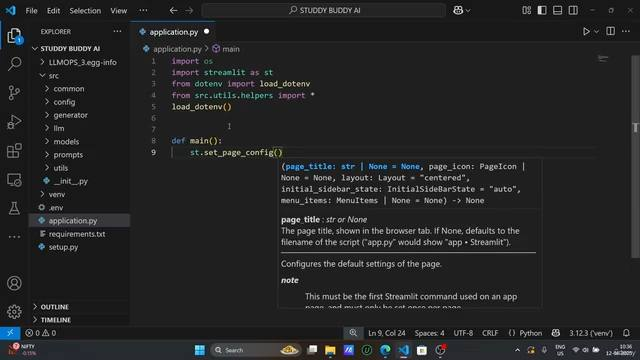
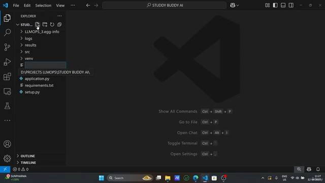
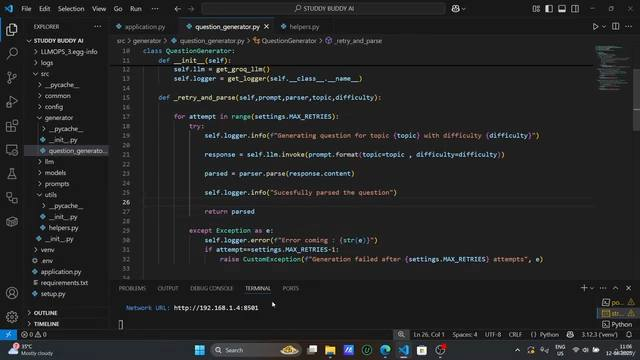
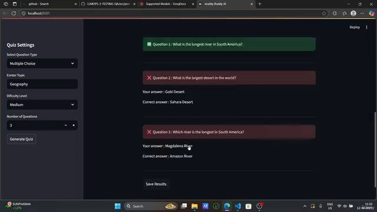
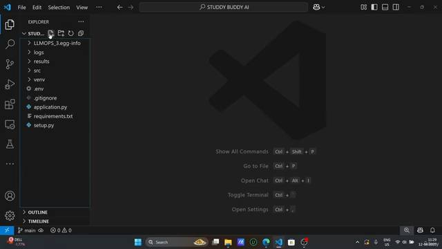
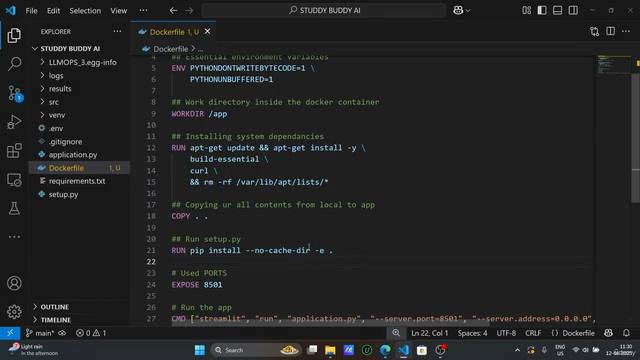
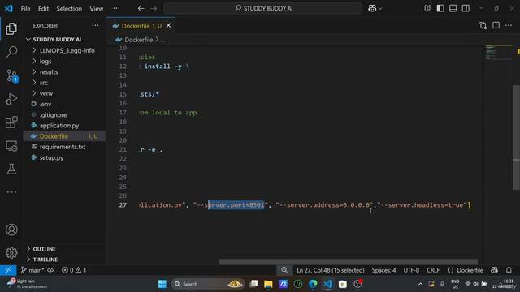

# Study Buddy AI：应用入口文件与容器化（P088–P089）

> 课程：LLMOps & AIOps Bootcamp（BV1gXR4BPERd）
> 覆盖：P088（编写 `application.py` 并跑通 Streamlit 应用）、P089（Git 版本管理 + Dockerfile）
> 前置：你已经完成了 `src/utils/helpers.py`（含 `QuizManager`、`attempt_quiz`、`evaluate_quiz`、`generate_result_dataframe`、`save_to_csv`、`rerun`）与 `src/generator/question_generator.py`（含 `QuestionGenerator`）。这两个文件是上一节视频的产物，本节直接调用它们。

---

## 1. 这一节做什么

这一节把前面几节零散写好的模块（题目生成器、Quiz 管理器、工具函数）拼成一个**能真正跑起来的 Streamlit 应用**，然后把它**版本化并打成 Docker 镜像**，为下一节的 CI/CD 部署做准备。具体产出三样东西：

1. 根目录下的 `application.py` —— 整个应用的唯一入口，包含页面配置、四个 session state、侧边栏表单、生成/答题/提交/评分/导出五段逻辑。
2. 根目录下的 `.gitignore` —— 把 `logs/`、`.env`、`results/` 等不该进仓库的东西挡在外面。
3. 根目录下的 `Dockerfile` —— 基于 `python:3.10-slim`，暴露 8501 端口，用 `--server.headless=true` 启动 Streamlit。

讲师在这一节里**现场踩了三个坑并当场修掉**，这三个坑是本节最有价值的部分，我在第 7 节单独列出来：`parse` 没 return、`iterrows` 少了括号、`save_results` 缩进错位导致 "没有可用结果。"。



---

## 2. 讲师原话（带时间戳）

> "所以在根目录下我们会创建 application.py……首先导入 os，导入 streamlit……再导入 load_dotenv……这样每次运行 application.py 时都会加载所有环境变量。"
> —— p088 [00:00]

> "首先我们要设置页面配置，所以我会写 st.set_page_config……页面标题随便给一个就行，就叫 study buddy AI……再给一个页面图标……用两个耳机。"
> —— p088 [01:28]

> "我们基本上有三到四个会话状态……第一个是 quiz manager，然后是 quiz generated……quiz submitted……然后是 rerun trigger……因为在 Streamlit 应用里，提交按钮有多种类型……一般点击提交时，所有输出都会被清空。为了避免这种清空，就得靠会话状态。"
> —— p088 [02:26]–[04:19]

> "确保这个 multiple choice 的名称和你……在 generate question 里要和这个匹配……你这里写的是什么，直接复制，到 application.py 里粘贴过来，这样就不会有拼写错误。在 fill in the blanks 里你可以随便写……因为它走的是 else 分支。"
> —— p088 [06:42]–[07:12]

> "题目数量等于 st.sidebar.number_input……最小值从 1 开始……最大值设为 10……默认选中 5。"
> —— p088 [09:32]–[10:30]

> "我们会写 generator 等于 QuizQuestionGenerator……然后给一个 message success 等于 st.session_state.quiz_manager.generate_questions……注意参数顺序要一致：先是 generator，然后是 topic、question type、difficulty、number of questions。"
> —— p088 [12:26]–[13:54]

> "为什么要重新运行？这样那些改动才能反映到界面上，这就是 rerun 的主要用途。"
> —— p088 [15:15]

> "如果用户已经成功答完所有题目……我们再创建一个按钮 st.button，这是 Submit Quiz 按钮……你会评估测验，调用 evaluate_quiz……然后把 st.session_state.quiz_submitted 改为 true。"
> —— p088 [17:10]–[17:39]

> "correct count 等于 results_df.is_correct.sum……总题数是 results_df 的长度……得分百分比就是正确数除以总题数再乘 100。"
> —— p088 [19:07]–[20:03]

> "生成测验出错，mcq generation failed，has no attribute options……你可以看到 retry 和 parse 函数……我们拿到了响应也做了解析，但没有把解析结果返回。所以到这里加上 return parsed 就行。"
> —— p088 [28:14]–[28:44]

> "这个错误基本上是因为 iterrows……iterrows 是个方法，所以括号也要加上。"
> —— p088 [29:11]–[29:41]

> "为什么显示 no results available……我觉得是对齐的问题……如果它在这个块里，我就按一下 tab 让它和这个 if saved_file 对齐。"
> —— p088 [30:38]–[31:07]

> "我们这里没有用会话状态……我点击下载结果，可以看到有些部分被自动清空了。这就是不用会话状态的缺点。"
> —— p088 [44:02]–[44:29]

> "首先创建一个 .gitignore 文件。这个文件里放的是我们不想推送到 GitHub 的东西。首先是 logs 目录，然后是 .env 目录……我们也不想推送 results。"
> —— p089 [00:00]–[00:28]

> "我们会用 Python 3.10 Slim 镜像……有一个工作目录，我们设置工作目录名为 app……运行 pip install -r requirements.txt……不用缓存目录……暴露端口……Streamlit 应用只跑在 8501 端口。"
> —— p089 [02:55]–[03:54]

> "服务器地址设为 0.0.0.0，这样应用就能被任意 IP 访问……server headless 等于 true……否则打开 Streamlit 应用时可能会出问题。"
> —— p089 [04:24]–[05:23]



---

## 3. 从零复现

### 3.1 目录结构（复现前先对齐）

```
study-buddy-ai/
├── application.py              # 本节新建
├── .gitignore                  # 本节新建
├── Dockerfile                  # 本节新建
├── requirements.txt            # 上一节已有
├── .env                        # 本地有，不进仓库
├── src/
│   ├── __init__.py
│   ├── utils/
│   │   ├── __init__.py
│   │   └── helpers.py          # 上一节已有：QuizManager / attempt_quiz / evaluate_quiz / generate_result_dataframe / save_to_csv / rerun
│   └── generator/
│       ├── __init__.py
│       └── question_generator.py  # 上一节已有：QuestionGenerator
├── logs/                       # 运行时生成，不进仓库
└── results/                    # 运行时生成，不进仓库
```

### 3.2 步骤一：写 `application.py`

按讲师顺序，从 import 开始，一段一段往下写。**不要跳着写**，因为后面的代码依赖前面的 session state 名字。完整文件见第 4 节，这里只讲顺序：

1. import `os`、`streamlit as st`、`load_dotenv`，并立刻 `load_dotenv()`。
2. 从 `src.utils.helpers` 里 `import *`（讲师原话是 "我们把所有内容都导入进来。"），从 `src.generator.question_generator` 里 import `QuestionGenerator`。
3. 定义 `main()` 函数，把所有逻辑包进去。
4. 在 `main()` 里先 `st.set_page_config(...)`。
5. 初始化四个 session state（`quiz_manager`、`quiz_generated`、`quiz_submitted`、`rerun_trigger`）。
6. 写标题 `st.title("Study Buddy AI")`。
7. 写侧边栏：`st.sidebar.header("Quiz Settings")`，然后四个控件（question type / topic / difficulty / number of questions）。
8. 写 `Generate Quiz` 按钮及其回调逻辑。
9. 写答题区（`if quiz_generated and quiz_manager.questions`）。
10. 写 `Submit Quiz` 按钮及其回调（evaluate + 置 `quiz_submitted=True` + rerun）。
11. 写结果区（`if quiz_submitted`）：算分、逐题渲染、`Save Results` 按钮 + `Download Results` 按钮。
12. 文件末尾 `if __name__ == "__main__": main()`。

### 3.3 步骤二：跑起来

```bash
# 在项目根目录
streamlit run application.py
```

浏览器打开 `http://localhost:8501`。讲师在 [27:15] 就是这么跑的，第一次跑就报了 `mcq generation failed has no attribute options`，修完 `parse` 的 return 后第二次跑通。

### 3.4 步骤三：写 `.gitignore`

```gitignore
logs/
.env
results/
__pycache__/
*.pyc
```

讲师原话只点了 `logs/`、`.env`、`results/` 三项（[00:00]–[00:28]），`__pycache__` 和 `*.pyc` 是我按 Python 项目惯例补的，课里没讲，但不加会让仓库变脏。

### 3.5 步骤四：Git 版本化

讲师在 [01:27]–[02:25] 给的命令序列（GitHub 新建 repo 后页面上会显示同样的命令）：

```bash
git init
git branch -M main
git remote add origin https://github.com/<你的用户名>/study-buddy-ai.git
git add .
git commit -m "initial commit"
git push origin main
```

注意讲师说 "确保不要用这个 README 文件来创建仓库。"（[01:27]），意思是新建 repo 时**不要勾选** "添加一个 README 文件"，否则远端会有一个本地没有的 commit，第一次 push 会冲突。

### 3.6 步骤五：写 `Dockerfile`

讲师在 [02:55] 说 "我已经把代码放在资源部分的 GitHub 目录里了。只要复制那个 Dockerfile 并粘贴到这里即可。"，然后逐行解释。完整文件见第 4 节。关键点：

- 基础镜像 `python:3.10-slim`
- `WORKDIR /app`
- 装系统依赖（讲师说 "这对所有生产级项目都是必需的。"，但**具体包名逐字稿没念出来**，见第 7 节）
- `COPY . .`
- `RUN pip install -r requirements.txt --no-cache-dir`
- `EXPOSE 8501`
- `CMD` 里带 `--server.address=0.0.0.0 --server.headless=true`

### 3.7 步骤六：构建并运行镜像

```bash
docker build -t study-buddy-ai .
docker run -p 8501:8501 --env-file .env study-buddy-ai
```

`--env-file .env` 是我补的：`.env` 被 gitignore 了，不会进镜像，所以运行时必须把环境变量注入进去，否则 `load_dotenv()` 找不到文件，LLM API key 会缺失。课里没讲这一步，但不做的话容器里应用会起不来。

### 3.8 步骤七：把 Dockerfile 也推上去

讲师在 [05:49] 说 "我们对代码做了修改。所以现在来执行 git add、git commit、git push。"，然后确认 GitHub 上能看到 Dockerfile。

```bash
git add .
git commit -m "add Dockerfile"
git push origin main
```

---

## 4. 完整代码

### 4.1 `application.py`（完整文件，可直接保存运行）

```python
import os
import streamlit as st
from dotenv import load_dotenv

load_dotenv()

from src.utils.helpers import *          # noqa: F401,F403
from src.generator.question_generator import QuestionGenerator


def main():
    # ---------- 1. 页面配置 ----------
    st.set_page_config(
        page_title="Study Buddy AI",
        page_icon="🎧",
    )

    # ---------- 2. session state 初始化 ----------
    if "quiz_manager" not in st.session_state:
        st.session_state.quiz_manager = QuizManager()

    if "quiz_generated" not in st.session_state:
        st.session_state.quiz_generated = False

    if "quiz_submitted" not in st.session_state:
        st.session_state.quiz_submitted = False

    if "rerun_trigger" not in st.session_state:
        st.session_state.rerun_trigger = False

    # ---------- 3. 标题 ----------
    st.title("Study Buddy AI")

    # ---------- 4. 侧边栏：Quiz Settings ----------
    st.sidebar.header("Quiz Settings")

    question_type = st.sidebar.selectbox(
        "Select Question Type",
        ["multiple choice", "fill in the blank"],
        index=0,
    )

    topic = st.sidebar.text_input(
        "Enter Topic",
        placeholder="Indian history",
    )

    difficulty = st.sidebar.selectbox(
        "Difficulty Level",
        ["easy", "medium", "hard"],
        index=1,
    )

    num_questions = st.sidebar.number_input(
        "Number of Questions",
        min_value=1,
        max_value=10,
        value=5,
    )

    # ---------- 5. Generate Quiz ----------
    if st.sidebar.button("Generate Quiz"):
        st.session_state.quiz_submitted = False

        generator = QuestionGenerator()

        success = st.session_state.quiz_manager.generate_questions(
            generator,
            topic,
            question_type,
            difficulty,
            num_questions,
        )

        st.session_state.quiz_generated = success
        rerun()

    # ---------- 6. 答题区 ----------
    if st.session_state.quiz_generated and st.session_state.quiz_manager.questions:
        st.header("Quiz")
        attempt_quiz(st.session_state.quiz_manager)

        if st.button("Submit Quiz"):
            evaluate_quiz(st.session_state.quiz_manager)
            st.session_state.quiz_submitted = True
            rerun()

    # ---------- 7. 结果区 ----------
    if st.session_state.quiz_submitted:
        st.header("Quiz Results")

        results_df = st.session_state.quiz_manager.generate_result_dataframe()

        if not results_df.empty:
            correct_count = results_df["is_correct"].sum()
            total_questions = len(results_df)
            score_percentage = (correct_count / total_questions) * 100

            st.write(f"Score: {score_percentage}%")

            for _, result in results_df.iterrows():
                question_num = result["number"]

                if result["is_correct"]:
                    st.success(f"✅ Question {question_num}: {result['question']}")
                else:
                    st.error(f"❌ Question {question_num}: {result['question']}")
                    st.write(f"Your answer: {result['user_answer']}")
                    st.write(f"Correct answer: {result['correct_answer']}")

            st.markdown("---")

            if st.button("Save Results"):
                saved_file = st.session_state.quiz_manager.save_to_csv()

                if saved_file:
                    with open(saved_file, "rb") as f:
                        st.download_button(
                            label="Download Results",
                            data=f.read(),
                            file_name=os.path.basename(saved_file),
                            mime="text/csv",
                        )
                else:
                    st.warning("No results available")


if __name__ == "__main__":
    main()
```

> **关于 `results_df` 的列名**：`number`、`question`、`is_correct`、`user_answer`、`correct_answer` 这五个字段名，逐字稿里讲师念到的是 `is_correct`（[19:07]）、`number`（[21:32]）、`question`、`user_answer`、`correct_answer`（[22:57]–[23:53]）。它们必须与你在 `helpers.py` 里 `generate_result_dataframe()` 实际产出的列名一致。**如果你上一节写的列名不同，请以你 `helpers.py` 里的实际输出为准**，改 `application.py` 里对应的 key，不要照抄这里的名字。

### 4.2 `.gitignore`

```gitignore
logs/
.env
results/
__pycache__/
*.pyc
```

### 4.3 `Dockerfile`

```dockerfile
FROM python:3.10-slim

ENV PYTHONDONTWRITEBYTECODE=1 \
    PYTHONUNBUFFERED=1

WORKDIR /app

RUN apt-get update && apt-get install -y --no-install-recommends \
    build-essential \
    curl \
    && rm -rf /var/lib/apt/lists/*

COPY . .

RUN pip install --no-cache-dir -r requirements.txt

EXPOSE 8501

CMD ["streamlit", "run", "application.py", \
     "--server.port=8501", \
     "--server.address=0.0.0.0", \
     "--server.headless=true"]
```

> **关于 `ENV` 与 `apt-get` 的具体包名**：讲师在 [02:55]–[03:24] 说 "这些是我们在这里定义的一些必需环境变量。" 和 "这些是我们必须安装的一些重要系统依赖……对所有生产级项目来说都是必需的"，但**逐字稿没有念出具体变量名和包名**。上面 `PYTHONDONTWRITEBYTECODE` / `PYTHONUNBUFFERED` 和 `build-essential` / `curl` 是按 Python 镜像的通用惯例补的，**不是讲师原话**。如果你只想要讲师明确讲过的部分，可以删掉 `ENV` 和 `RUN apt-get` 两段，只保留 `FROM` / `WORKDIR` / `COPY` / `RUN pip install` / `EXPOSE` / `CMD`，应用同样能跑（除非你的 `requirements.txt` 里有需要编译的包）。

### 4.4 `requirements.txt`（参考，按你上一节实际装的写）

```text
streamlit
python-dotenv
pandas
openai
```

> 版本号课里没讲，请以你上一节实际 `pip install` 的版本为准。锁版本是生产部署的常规做法，但**不是讲师在本节讲的内容**。

---

## 5. 逐行解释

### 5.1 `application.py` 顶部

```python
import os
import streamlit as st
from dotenv import load_dotenv

load_dotenv()
```

`load_dotenv()` 必须在 import 业务模块**之前**调用。因为 `src/utils/helpers.py` 里如果也读 `os.getenv("OPENAI_API_KEY")`，那行代码在 import 时就会执行，此时 `.env` 还没加载，key 就是 `None`。讲师在 [00:29] 说 "每次运行 application.py 时，它都会加载你所有的环境变量。"，强调的就是这个顺序。

```python
from src.utils.helpers import *          # noqa: F401,F403
from src.generator.question_generator import QuestionGenerator
```

讲师在 [00:59] 说 "我们想导入所有内容，基本上就是既要导入 rerun，也要导入 quiz_manager，还要导入 quiz_manager 里面的方法。"。`import *` 会把 `QuizManager`、`attempt_quiz`、`evaluate_quiz`、`rerun` 全部拉进来。`# noqa` 是给 linter 看的，不影响运行。

### 5.2 四个 session state

```python
if "quiz_manager" not in st.session_state:
    st.session_state.quiz_manager = QuizManager()
```

Streamlit 的机制是：**每次交互（点按钮、改下拉框）都会重跑整个脚本**。讲师在 [34:28] 演示了这一点——"每当我选中某项时……这里原本有个运行按钮，所以这意味着每当我们在屏幕上选择某些选项时，页面就会自动刷新。"。如果不把 `QuizManager` 实例存进 `st.session_state`，每次重跑都会 new 一个新的，之前生成的题目、用户填的答案全丢。

`quiz_generated` / `quiz_submitted` 是两个布尔开关，控制"答题区"和"结果区"是否渲染。讲师在 [04:46] 解释得很清楚："当这个 quiz_manager 会话状态存在时，我们的测验就会打开……一旦用户点击提交按钮，quiz_submitted 会话状态就会被激活。"。

`rerun_trigger` 讲师在 [03:49] 说 "我们在 helpers.py 中定义了这个，也就是 rerun_trigger。"，但**在 `application.py` 里它从头到尾没被读写过**——实际触发重跑用的是 `rerun()` 函数调用，不是这个 state。这是一个遗留变量，留着不影响运行，你也可以删掉。

> **给前端同学的类比**：`st.session_state` 相当于一个挂在组件树根上的 `useRef` + `useState` 混合体——它跨渲染周期存活，但不会自动触发重渲染，需要你手动调 `rerun()` 才刷新 UI。

### 5.3 侧边栏四个控件

```python
question_type = st.sidebar.selectbox(
    "Select Question Type",
    ["multiple choice", "fill in the blank"],
    index=0,
)
```

讲师在 [06:42]–[07:12] 特别强调："确保这个多选题名称与你……在生成问题时应该和这个保持一致……把它复制并粘贴到这里，这样就不会有拼写错误。"。原因是 `helpers.py` 的 `generate_questions` 里大概率是 `if question_type == "multiple choice": ... else: ...` 这种分支，字符串对不上就走进 else 分支，生成出错误类型的题。`"填写空白处"` 可以随便写，因为它走 else。

```python
difficulty = st.sidebar.selectbox(
    "Difficulty Level",
    ["easy", "medium", "hard"],
    index=1,
)
```

`index=1` 让 "medium" 成为默认选中项。讲师在 [09:06] 说 "容易的索引是 0，中等是 1，困难是 2，所以默认情况下我们选择了索引 1。"。

```python
num_questions = st.sidebar.number_input(
    "Number of Questions",
    min_value=1,
    max_value=10,
    value=5,
)
```

`value=5` 是默认值，讲师在 [10:30] 说 "即使用户什么都不选，也会自动生成 5 道题。"。

### 5.4 Generate Quiz 按钮

```python
if st.sidebar.button("Generate Quiz"):
    st.session_state.quiz_submitted = False
    generator = QuestionGenerator()
    success = st.session_state.quiz_manager.generate_questions(
        generator, topic, question_type, difficulty, num_questions,
    )
    st.session_state.quiz_generated = success
    rerun()
```

讲师在 [13:24] 强调参数顺序："首先定义你的生成器，然后传入生成器……在主题之后……题型、难度、题目数量。"。这个顺序必须和 `helpers.py` 里 `generate_questions` 的签名完全一致，否则会 TypeError。

`st.session_state.quiz_submitted = False` 这一行是**重置开关**：用户点"Generate Quiz"说明要重新开始一轮，之前提交过的状态要清掉，否则结果区会一直显示上一轮的分数。讲师在 [11:30] 说 "这个 submitted 仍然是 false。"，就是这个意思。

`rerun()` 是必须的。讲师在 [15:15] 说 "为什么要重新运行？这样那些更改就会反映到 UI 上。"。因为 `quiz_generated` 刚被改成 `True`，但当前这次脚本执行已经走到按钮分支了，下面的 `if st.session_state.quiz_generated:` 判断用的是**旧值**（`False`），不 rerun 的话答题区不会出现。

### 5.5 答题区

```python
if st.session_state.quiz_generated and st.session_state.quiz_manager.questions:
    st.header("Quiz")
    attempt_quiz(st.session_state.quiz_manager)
```

`attempt_quiz` 是 `helpers.py` 里的函数，负责把每道题渲染成 radio/input 并把用户答案写回 `quiz_manager.user_answers`。讲师在 [38:14] 说 "它会记录你在这个测验中给出的所有输入……并把它们存到 user_answers 里。"。

```python
    if st.button("Submit Quiz"):
        evaluate_quiz(st.session_state.quiz_manager)
        st.session_state.quiz_submitted = True
        rerun()
```

`evaluate_quiz` 把 `user_answers` 和正确答案比对，写回 `quiz_manager` 内部状态。然后置 `quiz_submitted=True` 并 rerun，让结果区出现。讲师在 [39:10] 说 "一旦提交测验，UI 就会发生变化……这就是我们需要 rerun 方法的原因。"。

### 5.6 结果区算分

```python
results_df = st.session_state.quiz_manager.generate_result_dataframe()

if not results_df.empty:
    correct_count = results_df["is_correct"].sum()
    total_questions = len(results_df)
    score_percentage = (correct_count / total_questions) * 100
```

`is_correct` 是一列布尔值，`.sum()` 把 `True` 当 1 加起来，得到答对题数。讲师在 [19:07] 说 "正确数等于 results_df.is_correct.sum……总题数是 results_df 的长度……得分百分比基本上就是正确数除以总题数再乘以 100。"。

> **注意**：讲师口述时写的是 `results_df.is_correct.sum`（属性访问），但 pandas 里列名如果和 DataFrame 方法名冲突（比如列名叫 `count`），属性访问会拿到方法而不是列。用 `results_df["is_correct"]` 更稳。这是我在复现时做的防御性改动，**不是讲师原话**。

### 5.7 逐题渲染

```python
for _, result in results_df.iterrows():
    question_num = result["number"]

    if result["is_correct"]:
        st.success(f"✅ Question {question_num}: {result['question']}")
    else:
        st.error(f"❌ Question {question_num}: {result['question']}")
        st.write(f"Your answer: {result['user_answer']}")
        st.write(f"Correct answer: {result['correct_answer']}")
```

`iterrows()` **必须带括号**。讲师在 [29:41] 现场踩了这个坑："iterrows 是一个方法。因此，你也必须加上这些括号，圆括号也要加。"。写成 `results_df.iterrows` 不加括号，拿到的是方法对象，`for ... in` 会报 `TypeError: 'method' object is not iterable`。

`st.success` 渲染绿色框，`st.error` 渲染红色框，`st.warning` 渲染黄色框——讲师在 [41:36] 说 "st.success 消息是绿色的，st.error 消息是红色的，st.warning 消息是黄色的。"。

答错时额外多显示两行 `Your answer` 和 `Correct answer`，讲师在 [42:35] 举例："用户选了戈壁沙漠，但正确答案是撒哈拉沙漠。"。

### 5.8 Save Results 与 Download Results

```python
    st.markdown("---")

    if st.button("Save Results"):
        saved_file = st.session_state.quiz_manager.save_to_csv()

        if saved_file:
            with open(saved_file, "rb") as f:
                st.download_button(
                    label="Download Results",
                    data=f.read(),
                    file_name=os.path.basename(saved_file),
                    mime="text/csv",
                )
        else:
            st.warning("No results available")
```

**缩进是这里最容易错的地方**。讲师在 [30:38]–[31:07] 踩的坑就是 `if saved_file:` 和 `if st.button("Save Results"):` 没对齐——`if saved_file` 被缩进到了 `if st.button` 的**外面**，导致按钮没点的时候 `saved_file` 未定义或为 None，直接走 else 分支显示 "没有可用结果。"。修法就是"按下 Tab 键，让它与这里的 if saved_file 对齐。"（[31:07]）。

`st.download_button` 的 `data` 参数要的是**字节内容**，不是文件路径，所以要先 `open(saved_file, "rb")` 再 `f.read()`。`file_name` 用 `os.path.basename(saved_file)` 从完整路径里剥出文件名。

### 5.9 为什么最后一段没 rerun

讲师在 [43:33] 说 "因为这是最后一个方法，所以我们不需要再次使用 rerun 方法。"。因为 `save_to_csv` 和 `download_button` 不改变任何 session state，UI 不需要刷新。

但讲师紧接着在 [44:02] 演示了一个副作用："我点击下载结果时，你可以看到有些部分会自动被清空……这就是不使用会话状态的缺点。"。原因是 `st.download_button` 本身也是一次交互，会触发脚本重跑，而 `saved_file` 是局部变量，重跑后就没了，`if saved_file:` 变成 False，下载按钮消失。讲师给的修法是"你也可以直接为这个保存结果创建一个会话状态。"——把 `saved_file` 存进 `st.session_state`。**这个修法讲师只是口头提了，没在视频里实际改代码**，所以第 4 节的完整文件里我保留了原样（局部变量），你在复现时会看到同样的"下载一次后按钮消失"现象，这是预期行为，不是你的 bug。

### 5.10 Dockerfile 逐行

```dockerfile
FROM python:3.10-slim
```

讲师在 [02:55] 说 "我们将使用 Python 3.10 Slim 镜像。"。slim 版不带编译工具链，镜像小，但如果 `requirements.txt` 里有需要编译的包（比如某些版本的 `psycopg2`），`pip install` 会失败，需要补 `apt-get install build-essential`。

```dockerfile
WORKDIR /app
```

讲师在 [03:24] 说 "我们正在设置一个名为 app 的工作目录。"。后续所有 `COPY`、`RUN`、`CMD` 的相对路径都以 `/app` 为基准。

```dockerfile
COPY . .
RUN pip install --no-cache-dir -r requirements.txt
```

讲师在 [03:24]–[03:54] 说 "你要把所有内容都复制进去……所有应用内容、所有 src、所有 requirements.txt 文件，全部复制到我们的 Docker 镜像里……运行 pip install -r requirements.txt……不使用缓存目录，这样之前的所有缓存都会被清除，我们就能重新开始。"。

`--no-cache-dir` 让 pip 不把下载的 wheel 缓存在镜像层里，镜像能小几百 MB。

```dockerfile
EXPOSE 8501
```

讲师在 [03:54] 说 "Streamlit 应用只在 8501 端口上运行。因此，我们暴露了 8501 端口。"。`EXPOSE` 只是文档性声明，真正把端口映射到宿主机的是 `docker run -p 8501:8501`。

```dockerfile
CMD ["streamlit", "run", "application.py", \
     "--server.port=8501", \
     "--server.address=0.0.0.0", \
     "--server.headless=true"]
```

讲师在 [04:24]–[05:23] 逐条解释：
- `--server.port=8501`：和 `EXPOSE` 一致。
- `--server.address=0.0.0.0`："so that our application can be accessed by any IP address"。默认 Streamlit 只监听 `localhost`，容器外访问不到。
- `--server.headless=true`："otherwise there can be issues while opening up a Streamlit app ... when you write it those dependencies are partially ignored"。headless 模式跳过"自动打开浏览器"的逻辑，容器里没有浏览器，不设这个会卡住或报错。

---

## 6. 复现检查清单

按顺序打勾，任何一项不过就别往下走：

- [ ] `application.py` 在项目根目录，`streamlit run application.py` 能启动，浏览器 `localhost:8501` 能看到 "Study Buddy AI" 标题和左侧 "Quiz Settings" 侧边栏。
- [ ] 侧边栏四个控件都在：Question Type（默认 multiple choice）、Enter Topic（placeholder 是 Indian history）、Difficulty Level（默认 medium）、Number of Questions（默认 5，范围 1–10）。
- [ ] 填 topic 点 "Generate Quiz"，答题区出现，题目数量等于你选的 number。
- [ ] 答完点 "Submit Quiz"，结果区出现，显示 `Score: xx%`，每题有绿勾或红叉，答错的题额外显示 Your answer / Correct answer。
- [ ] 点 "Save Results"，`results/` 目录下出现一个 `.csv` 文件，点 "下载结果" 能下载到本地，用 Excel 打开列完整。
- [ ] **已知现象**：下载一次后 "下载结果" 按钮消失（讲师 [44:02] 演示过），这是没给 `saved_file` 加 session state 导致的，不是 bug。
- [ ] `.gitignore` 里 `logs/`、`.env`、`results/` 三项都在，`git status` 看不到 `.env` 和 `results/`。
- [ ] GitHub 上能看到 `application.py`、`Dockerfile`、`src/`、`requirements.txt`，看不到 `.env`。
- [ ] `docker build -t study-buddy-ai .` 成功。
- [ ] `docker run -p 8501:8501 --env-file .env study-buddy-ai` 后，`localhost:8501` 能打开，且能成功生成题目（说明 API key 注入成功）。

**三个必踩的坑，复现时对照检查**：

| 现象 | 原因 | 修法 |
|---|---|---|
| 点 Generate Quiz 报 `mcq generation failed has no attribute options` | `question_generator.py` 里 `parse` 函数解析完没 `return parsed` | 在 `parse` 末尾加 `return parsed`（讲师 [28:44]） |
| 点 Submit Quiz 报 `'method' object is not iterable` | `results_df.iterrows` 少了括号 | 改成 `results_df.iterrows()`（讲师 [29:41]） |
| 点 Save Results 显示 "没有可用结果。" | `if saved_file:` 缩进没和 `if st.button("Save Results"):` 对齐 | 把 `if saved_file:` 及其内部整体缩进到 `if st.button` 块内（讲师 [31:07]） |





---

## 7. 课里没讲但你会撞上的

这一节列的是**逐字稿里没有、但你照着上面复现一定会遇到**的问题。每一条都标了"课里没讲"，不是讲师的锅，是环境差异。

**1. `requirements.txt` 的版本锁定（课里没讲）**
讲师全程没提版本号。生产部署时 `streamlit`、`pandas`、`openai` 任意一个升级都可能改 API（比如 `st.download_button` 的参数名、pandas 的 `iterrows` 行为），建议 `pip freeze > requirements.txt` 锁死。

**2. `.env` 不进镜像，运行时必须注入（课里没讲）**
`.gitignore` 把 `.env` 挡在仓库外，`COPY . .` 也就不会把它带进镜像。容器里 `load_dotenv()` 找不到文件，所有 `os.getenv` 返回 `None`。必须 `docker run --env-file .env` 或 `-e OPENAI_API_KEY=xxx`。讲师在 [04:24] 只讲了端口和 headless，没讲环境变量注入。

**3. `python:3.10-slim` 缺编译工具链（课里没讲）**
讲师说 "这些是我们必须安装的一些重要系统依赖……这对所有生产级项目都是必需的。"，但**没念出包名**。如果你的 `requirements.txt` 里有需要 C 编译的包（`psycopg2`、`numpy` 某些版本、`tokenizers` 等），slim 镜像里 `pip install` 会报 `gcc: command not found`。第 4.3 节的 Dockerfile 里我补了 `build-essential` 和 `curl`，这是通用惯例，不是讲师原话。

**4. `st.download_button` 触发重跑导致按钮消失（讲师提了但没改）**
讲师在 [44:02] 演示了这个现象并口头说 "你也可以为这个保存结果也创建一个会话状态。"，但**视频里没实际改代码**。要彻底修，把 `saved_file` 存进 session state：

```python
if st.button("Save Results"):
    st.session_state.saved_file = st.session_state.quiz_manager.save_to_csv()

if st.session_state.get("saved_file"):
    with open(st.session_state.saved_file, "rb") as f:
        st.download_button(...)
```

这段是**我按讲师口述思路补的示意代码，课里没有这段代码**。

**5. `results_df` 列名必须和 `helpers.py` 对齐（课里没讲）**
第 4.1 节用的 `number` / `question` / `is_correct` / `user_answer` / `correct_answer` 是从讲师口述里抠出来的，但**你上一节 `helpers.py` 里 `generate_result_dataframe()` 实际产出的列名可能不同**（比如叫 `q_num` 而不是 `number`）。跑之前先 `print(results_df.columns)` 看一眼，对不上就改 `application.py` 里的 key，否则会 `KeyError`。

**6. `st.session_state.rerun_trigger` 是死变量（课里没讲）**
讲师在 [03:49] 定义了这个 state，但整个 `application.py` 里**没有任何地方读写它**。实际触发重跑的是 `rerun()` 函数。留着无害，但别以为它在起作用。

**7. `--server.headless=true` 不加会怎样（课里没讲细节）**
讲师只说 "否则可能会出现问题。"。具体表现是：Streamlit 启动时会尝试 `webbrowser.open()` 打开浏览器，容器里没有 `$DISPLAY`，会抛异常或卡住。headless 模式跳过这一步。

**8. Git 新建 repo 时勾了 README 会 push 失败（课里提了一句）**
讲师在 [01:27] 说 "确保不要拿这个 README 文件。"，但没解释原因。原因是远端多了一个本地没有的 commit，`git push origin main` 会报 `rejected (fetch first)`。修法：`git pull --rebase origin main` 再 push，或者干脆重建 repo 不勾 README。

**9. `attempt_quiz` 的具体实现课里没讲（课里没讲）**
`attempt_quiz` 是 `helpers.py` 里的函数，本节只调用不实现。它内部怎么渲染 radio、怎么把答案写回 `quiz_manager.user_answers`，是上一节视频的内容。如果你上一节没写完整，本节会卡在答题区不显示题目。

**10. 前端类比：session state ≈ useRef + 手动 forceUpdate（课里没讲）**
给前端转 AI 的同学：`st.session_state` 跨渲染周期存活，但改它**不会**自动触发重渲染，必须手动 `rerun()`。这和后端 Java 的 `HttpSession` 有点像（跨请求存活），但 Streamlit 的"请求"是每次 UI 交互，粒度细得多。Java 里 `synchronized` / 数据库事务那套在这里用不上——Streamlit 是单进程单线程跑脚本，没有并发写 session state 的问题，但**多用户**会各自有独立的 session state，互不干扰。







---

**下一节预告**（讲师 [05:49] 原话）："从下一个视频开始，我们将进行 CICD 部署。" 本节产出的 `Dockerfile` 和 GitHub repo 就是下一节 CI/CD 的输入。