# LLMOps & AIOps Bootcamp：从 Manifest 到 Jenkins 接入 GitHub（P90–P93）

> 读者定位：前端转 AI 应用工程师。本文档覆盖 P90–P93 四节课的完整落地路径：写 Kubernetes manifest → 开 GCP VM 并装 Docker/minikube/kubectl → 装 Jenkins → Jenkins 接 GitHub 跑通第一次 checkout。
> 说明：课程原项目叫 StudyBuddy AI（讲师 GitHub 用户名 `data guru 0`），下文统一用 `studybuddy-ai` 作为示例仓库名，你替换成自己的即可。**课里没讲**的部分会明确标注。

---

## 1. 这一节做什么

这四节课是一条完整的「把本地 Streamlit 应用送上 Kubernetes」的前半段流水线，拆成四步：

1. **P90**：在项目根目录写两个 Kubernetes manifest —— `deployment.yml` 和 `service.yml`。前者描述「跑几个副本、用哪个镜像、容器端口多少、环境变量从哪来」，后者描述「怎么把这个 app 暴露出去」。
2. **P91**：在 GCP 上开一台 Ubuntu 24.04 的 VM（e2 / standard / 16GB 内存 / 150GB 磁盘），SSH 进去，克隆 GitHub 仓库，然后依次安装 **Docker → minikube → kubectl** 三件套，并 `minikube start` 起一个单机 Kubernetes 集群。
3. **P92**：用 Docker 跑一个 Jenkins LTS 容器，**必须让它和 minikube 在同一个 Docker network 上**（这是本节最容易翻车的点），配好 GCP 防火墙规则让 8080 端口能从外网访问，解锁 Jenkins、建管理员、装 Docker / Docker Pipeline / Kubernetes 三个插件，再进容器装 python/pip/venv。
4. **P93**：在 GitHub 生成 classic PAT，存进 Jenkins 凭据，新建 Pipeline 任务指向 GitHub 仓库，写一个只含 `github checkout` 一个 stage 的 `Jenkinsfile`，推上去，跑通第一次 Build，并在 Jenkins workspace 里看到代码被拉下来了。

四节连起来的效果：**代码在 GitHub，Jenkins 能拉代码，集群已经就绪**——为后面「Jenkins 构建镜像 → 推 Docker Hub → ArgoCD 部署」铺好路（ArgoCD 部分不在 P90–P93 内，课里只提到「CD 用 ArgoCD」）。

---

## 2. 讲师原话（带出处）

关于 manifest 的作用：

> "manifest 文件基本上就是 Kubernetes 部署文件，这些文件定义了你的应用将以什么方式部署在 Kubernetes 集群里。"
> —— p090 [00:13]

> "manifest 文件由两部分组成。第一部分是 deployment.yml，第二部分是 service.yml。有些人喜欢把它们合并到一个文件里。"
> —— p090 [00:29]

关于副本数与 VM 资源的关系：

> "你想为应用创建多少个副本？就保持 2 个吧……如果你的虚拟机配置足够好，比如有大约 32 GB 内存，那也可以创建 5 到 6 个副本。但如果虚拟机资源有限，比如只有 8 GB 内存……那就确保保持在 2 到 3 个。"
> —— p090 [01:51]

关于环境变量为什么不走 `.env`：

> "我们不能把这个 env 文件推送到开发环境……Kubernetes 不知道这个 env 文件是什么……我们会把 GROC API 密钥注入到 Kubernetes 集群中……现在这一行做的事情，就是获取我们强制注入到 Kubernetes 集群里的那个 GROC API 密钥。"
> —— p090 [03:47]–[04:45]

关于 service 的 type：

> "这里有三类。一个是 cluster IP，一个是 node port，一个是 node balancer。cluster IP 意味着你只能在内部访问……当它是 node port 或 node balancer 时，你也可以让它从外部访问……你不能把它设置为 cluster IP。"
> —— p090 [05:41]

关于 VM 规格：

> "这里选择 e2……因为它成本效益高……在机器类型里选择 standard 和 16 GB 内存，因为 16 GB 已经足够了……直接搜索 Ubuntu，你会用 Ubuntu，而且在 Ubuntu 里我也更倾向 24.04 版本，因为它更稳定。"
> —— p091 [01:14]–[01:30]

> "你需要多少 GB 的硬盘？就保持 150 GB 吧。"
> —— p091 [01:55]

关于安装顺序（Docker 必须先于 minikube）：

> "minikube start 使用 Docker。所以这就是为什么最好先安装 Docker。然后 minikube 才能正常工作。因为 minikube 依赖 Docker。"
> —— p091 [11:35]

> "假设你先安装了 minikube，那你就无法安装……总之，先安装 Docker Engine，然后安装 minikube，接着我们会安装 kubectl。"
> —— p091 [12:04]

关于 Jenkins 必须和 minikube 同网络：

> "你基本上有四个网络：bridge、host、minikube、none。所以你必须确保 Jenkins 运行在和 minikube 相同的网络上。"
> —— p092 [00:29]

关于 GCP 防火墙：

> "如果你是第一次使用 GCP，你会遇到这个错误，Jenkins 页面不会出现……你必须设置一条防火墙规则。"
> —— p092 [02:26]

> "源 IPv4 范围，你需要写 0.0.0.0/0。并且你必须允许所有端口。"
> —— p092 [04:19]

关于 python 与 python3 的别名：

> "如果我写 python --version，它会显示找不到 python 命令，但通常如果你想运行一个应用……你一般会写 python application.py……为了让 python3 充当 python，我们必须运行这个命令。"
> —— p092 [08:25]

关于 Jenkinsfile 只留一个 stage：

> "首先把这段注释掉，我们现在不需要它，然后我们现在也不需要这些 stage，保留两个括号，最后两个括号，其他的都注释掉。"
> —— p093 [04:47]

关于 git push 的密码：

> "然后它会要求输入密码，不要给默认密码，否则它会显示错误。你必须去你的访问令牌。"
> —— p093 [08:37]

---

## 3. 从零复现

### 3.0 前置条件

- 一个 GitHub 仓库，根目录已有：`application.py`（Streamlit 应用，监听 **8501**）、`Dockerfile`、`requirements.txt`、`src/` 目录。这些是 P90 之前就做好的，**课里没讲**它们的内容。
- 一个 GCP 账号（讲师说新账号有约 300 美元赠金）。
- 一个 Docker Hub 账号（P90 里 image 字段要填它，但真正 push 镜像在后续课程，**课里没讲**）。

### 3.1 第一步：写 manifest（对应 P90）

在项目根目录建 `manifest/` 目录，里面放两个文件：`deployment.yml`、`service.yml`。

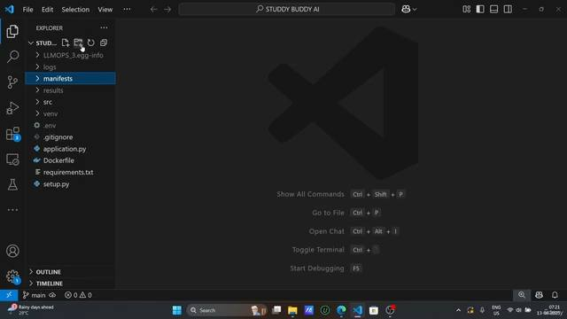

关键约束（讲师反复强调的一致性）：

| 字段 | deployment.yml | service.yml | 必须一致？ |
|---|---|---|---|
| app 名称 | `llmops`（metadata.name 与 selector/labels） | `selector.app` | ✅ 必须一致 |
| 容器端口 | `containerPort: 8501` | `targetPort: 8501` | ✅ 必须一致 |
| service 端口 | — | `port: 80` | 内部端口，固定 80 |
| service 类型 | — | `type: NodePort`（或 LoadBalancer） | ❌ 不能是 ClusterIP |

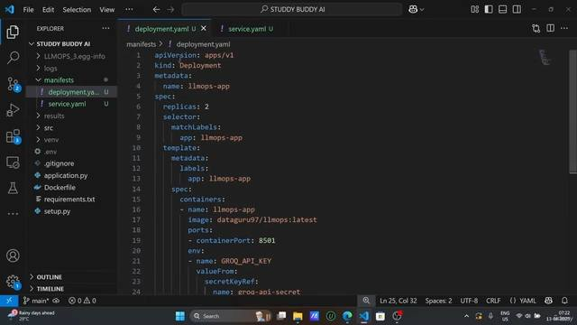

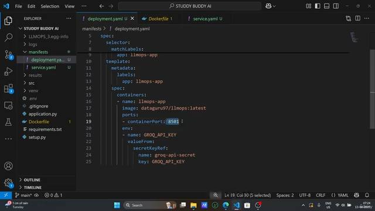

### 3.2 第二步：开 GCP VM（对应 P91）

1. GCP 控制台搜索 `VM instances` → Create instance。
2. 名称随意，region/zone 保持默认。
3. **Series 选 E2**（讲师原话：cost efficient）。
4. **Machine type 选 standard，16 GB 内存**（对应 4 vCPU）。
5. Boot disk → Change → 操作系统选 **Ubuntu**，版本 **24.04 LTS**，架构 x86_64。
6. 磁盘大小改成 **150 GB**。
7. Networking 里勾上 **Allow HTTP / Allow HTTPS / Allow load balancer**，并启用 **IP forwarding**。
8. Create。等 1–2 分钟，出现绿色对勾即运行中。
9. 点 **SSH** 打开浏览器终端（第一次会让你 Authorize）。

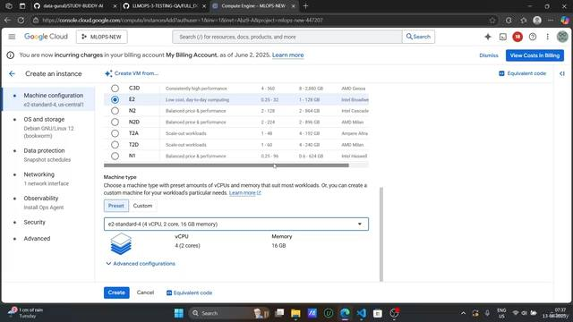

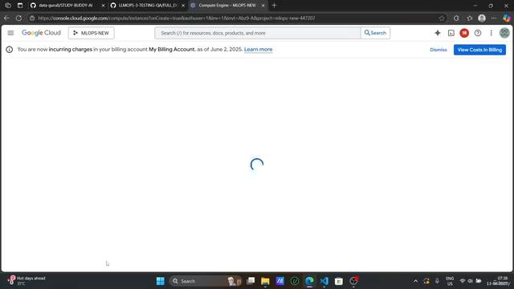

### 3.3 第三步：克隆仓库（对应 P91）

在 SSH 终端里：

```bash
git clone https://github.com/<你的用户名>/studybuddy-ai.git
ls
cd studybuddy-ai
clear
```

注意讲师的提醒：**浏览器 SSH 终端里 Ctrl+V 无效，要右键 → Paste**。

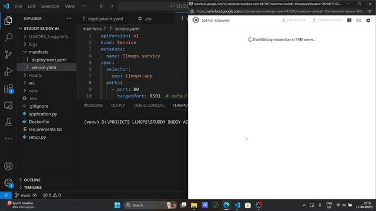

### 3.4 第四步：装 Docker（对应 P91）

按讲师做法：浏览器搜 "在 Ubuntu 上安装 Docker Engine"，进 Docker 官方文档，用 **apt repository** 方式安装：

```bash
# 1) 设置 Docker 的 apt 仓库（官方文档第一条命令，整段复制）
# 2) 安装 Docker 引擎（官方文档第二条命令，提示时按 Y）
# 3) 验证（可选）
```

然后滚到页面底部 **"继续执行 Linux 的安装后步骤"**，跑四条命令（讲师原话：创建 docker 组、把用户加进去）：

```bash
sudo groupadd docker
sudo usermod -aG docker $USER
newgrp docker
# 第四条为验证命令
```

讲师解释这四条的意义：**不加这些，你每条 docker 命令都得写 `sudo`**；加完之后可以直接 `docker run hello world`。

```bash
docker run hello-world
```

再往下还有两条 **"配置 Docker 通过 systemd 开机自启动"** 的命令，也照抄执行——作用是 VM 一开机 Docker 自动起。

最后验证：

```bash
sudo systemctl status docker     # 看到 active (running)
docker ps -a                     # 能看到刚才 hello-world 容器（已 Exited）
```

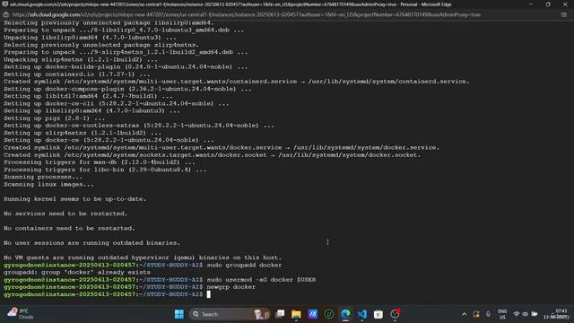

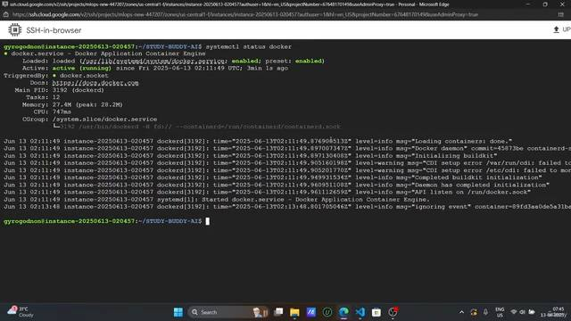

### 3.5 第五步：装 minikube（对应 P91）

浏览器搜 "安装 minikube"，进 `minikube start` 官网。讲师先念了它的要求：**≥2 CPU、≥2GB 空闲内存、≥20GB 磁盘**——这正是他选 4 vCPU / 16GB / 150GB 的原因。

在 Linux x86-64 的 stable binary 下载区，有两条命令：

```bash
# 第一条：下载 minikube 二进制
curl -LO https://storage.googleapis.com/minikube/releases/latest/minikube-linux-amd64
# 第二条：安装到 /usr/local/bin
sudo install minikube-linux-amd64 /usr/local/bin/minikube
```

然后启动集群（讲师说大约 3–4 分钟）：

```bash
minikube start
```

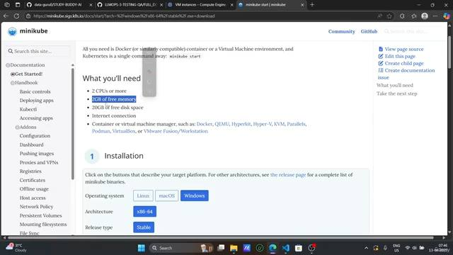

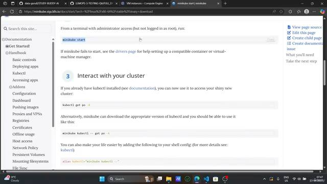

### 3.6 第六步：装 kubectl（对应 P91）

浏览器搜 "install kubectl"，进 Kubernetes 官方文档。讲师的做法：

```bash
# 第一条：下载 kubectl 二进制（官方文档给的 curl 命令）
# 第二条：验证（讲师说 optional）
```

因为用的是 Ubuntu，讲师改走 **snap** 路线（原话：Ubuntu 默认带 snap，snap 更可靠）：

```bash
sudo snap install kubectl --classic
kubectl version --client
```

验证 minikube 状态：

```bash
minikube status
```

讲师看到的输出包含 `type: Control Plane`、`host: Running`、`kubelet: Running`、`apiserver: Running`、`kubeconfig: Configured` 这几行（**字段名以你实际输出为准**）。

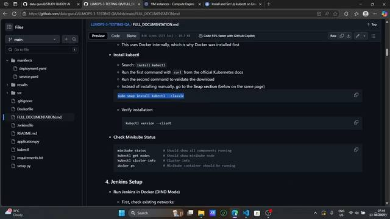

> 注：清单里 p091 最后一帧是 `p091_0688s.jpg`（11:28），13:30 之后没有对应截图，上面这张图请以清单实际存在的帧为准；若清单无此帧，请改用 `p091_0688s.jpg`。

### 3.7 第七步：跑 Jenkins 容器（对应 P92）

先看现有 Docker 网络：

```bash
docker network ls
```

讲师看到的网络有：`bridge`、`host`、`minikube`、`none`（**以你实际输出为准**）。**关键：Jenkins 必须加入 `minikube` 这个网络**，否则后面 Jenkins 里的 kubectl 找不到集群。

启动 Jenkins（讲师给的是 LTS 镜像，映射 8080 与 50000，挂 docker socket，指定 network）：

```bash
docker run -d \
  --name jenkins \
  -p 8080:8080 \
  -p 50000:50000 \
  -v /var/run/docker.sock:/var/run/docker.sock \
  --network minikube \
  jenkins/jenkins:lts
```

验证：

```bash
docker ps
docker network ls
```

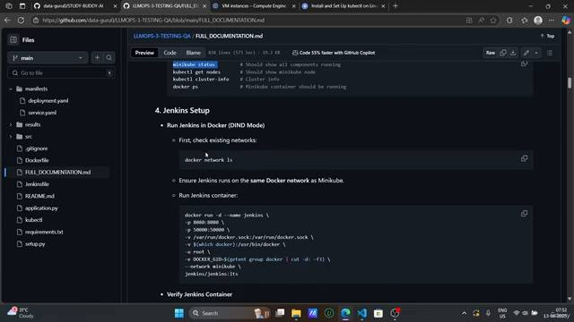

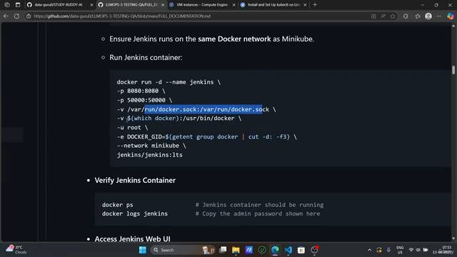

### 3.8 第八步：GCP 防火墙放行 8080（对应 P92）

在 GCP 控制台搜 `firewall` → Create firewall rule：

- Name：随意
- Network：default
- Direction：Ingress
- Action on match：Allow
- Targets：All instances in the network
- Source filter：IPv4 ranges
- Source IPv4 ranges：`0.0.0.0/0`
- Protocols and ports：Allow all

创建后，浏览器访问 `http://<VM 外部IP>:8080`。

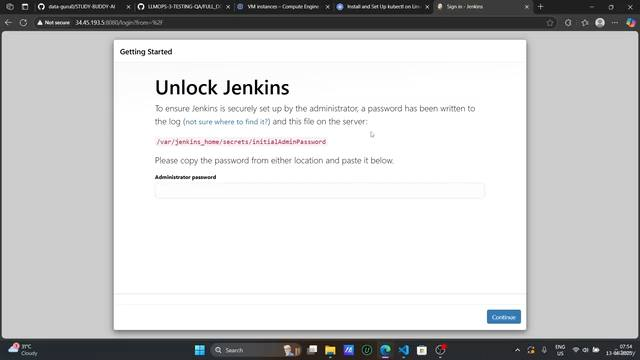

### 3.9 第九步：解锁 Jenkins + 建管理员 + 装插件（对应 P92）

取初始密码：

```bash
docker logs jenkins
```

在日志里找解锁密码（讲师原话：日志里能看到 password），粘贴到页面 → Continue → **Install suggested plugins** → 建管理员用户（用户名/密码/全名/邮箱随意）→ Save and Finish → Start using Jenkins。

装三个插件：Manage Jenkins → Plugins → Available plugins，分别搜并安装：

- **Docker**
- **Docker Pipeline**
- **Kubernetes**

（讲师说勾上后会把依赖树一起装，等它跑完。）

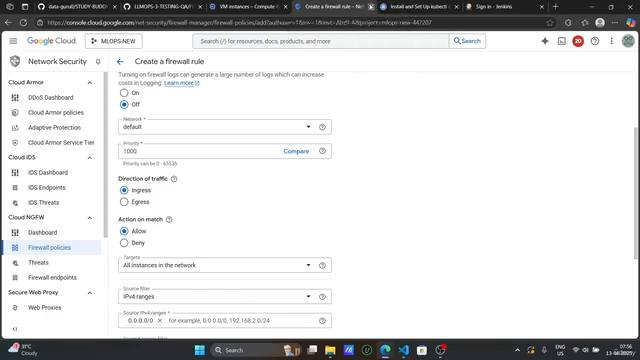

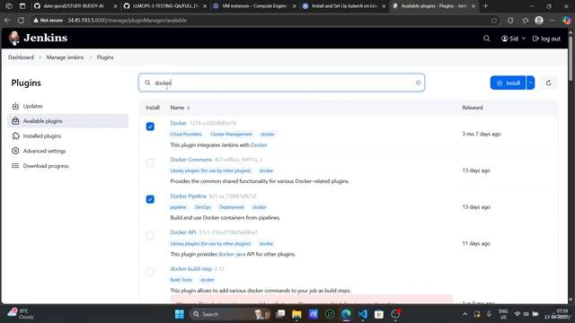

### 3.10 第十步：进 Jenkins 容器装 python/pip/venv（对应 P92）

```bash
docker exec -it jenkins bash
apt update -y
apt install -y python3
python3 --version          # 讲师环境是 3.9.2，你的可能不同
```

讲师演示的「twist」：容器里 `python --version` 报 command not found，但项目里习惯写 `python application.py`。解决：

```bash
ln -s /usr/bin/python3 /usr/bin/python
python --version           # 现在和 python3 一致
```

再装 pip 和 venv：

```bash
apt install -y python3-pip
apt install -y python3-venv
exit
```

**改了容器内容必须重启容器**：

```bash
docker restart jenkins
```

重启后 Jenkins 会要求重新登录（讲师提醒：登录时勾 **Keep me signed in**）。

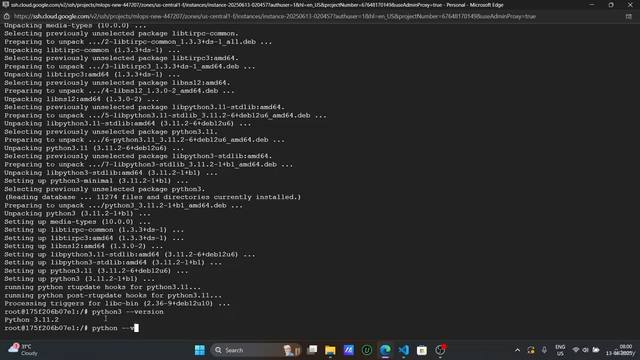

### 3.11 第十一步：GitHub 生成 classic PAT（对应 P93）

GitHub → 头像 → Settings → Developer settings → **Personal access tokens → Tokens (classic)** → Generate new token (classic)。

讲师列的权限（六个）：

- `repo`
- `workflow`
- `admin:org`
- `admin:public_key`
- `admin:repo_hook`
- `admin:org_hook`

生成后**把 token 页面留着别关**（讲师原话：you require this access token again and again）。

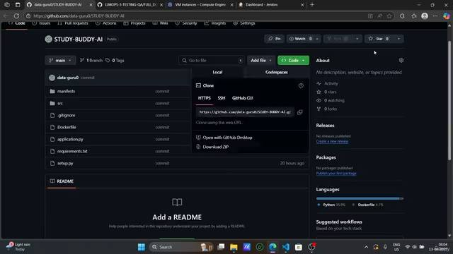

### 3.12 第十二步：把 token 存进 Jenkins 凭据（对应 P93）

Jenkins → Manage Jenkins → Credentials → System → Global credentials → Add Credentials：

- Kind：Username with password
- Username：你的 GitHub 用户名
- Password：刚才的 PAT
- ID：`github-token`
- Description：`github-token`

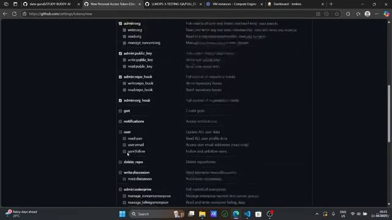

### 3.13 第十三步：新建 Pipeline 任务（对应 P93）

Dashboard → New Item → 名字 `study-buddy-ai` → 选 **Pipeline** → OK。

往下滚到 Pipeline 段：

- Definition：**Pipeline script from SCM**
- SCM：**Git**
- Repository URL：你的仓库 HTTPS 地址
- Credentials：选 `github-token`
- Branch：`main`（你的可能是 `master`）
- Script Path：`Jenkinsfile`（保持默认）

Apply → Save。

然后点 **Pipeline Syntax** → 选 `checkout` → 填同样的 URL / 凭据 / 分支 → **Generate Pipeline Script**，把生成的片段留着（下一步用）。

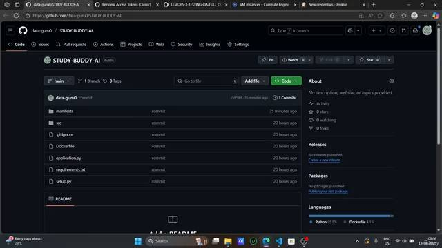

### 3.14 第十四步：写 Jenkinsfile 并推送（对应 P93）

在 VS Code 项目根目录新建 `Jenkinsfile`，粘贴讲师给的模板，然后**把除第一个 stage 之外的所有内容注释掉**（讲师原话：keep the two brackets last two brackets and otherwise comment out everything），再把上一步生成的 checkout 片段替换进去。

保存后：

```bash
git add .
git commit -m "add Jenkinsfile"
git push
```

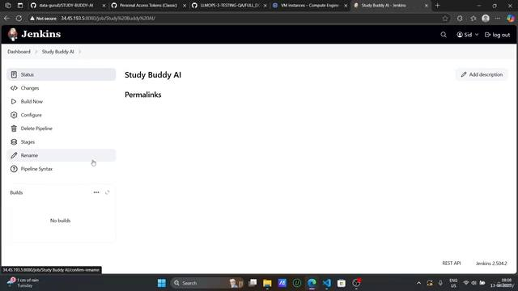

### 3.15 第十五步：VM 上配置 git 并拉取（对应 P93）

讲师发现：VM 上 `ls` 看不到 Jenkinsfile——因为 VM 只是 clone 过，没和远端连上。于是：

```bash
git config --global user.email "you@example.com"
git config --global user.name "your-github-username"
git add .
git commit -m "sync"
git pull --no-rebase
git push
```

`git push` 时会问用户名和密码：**用户名填 GitHub 用户名，密码填 PAT，不是账号密码**（讲师原话：don't use your default password）。粘贴 PAT 时终端不显示字符，直接回车。

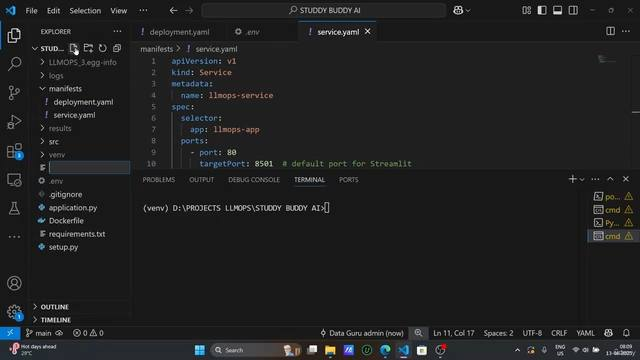

### 3.16 第十六步：跑第一次 Build（对应 P93）

Jenkins → 打开 `study-buddy-ai` → **Build Now** → 点 Build 号 → **Console Output**。看到 `Finished: SUCCESS` 即成功。

再点左侧 **Workspace**，能看到 `application.py`、`Dockerfile`、`Jenkinsfile`、`manifest/`、`requirements.txt`、`src/`、`setup.py` 等文件——说明代码已从 GitHub 拉进 Jenkins 工作区。

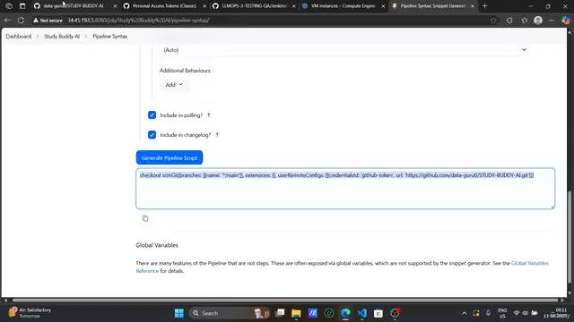

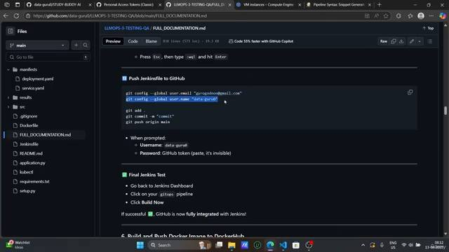

---

## 4. 完整代码

### 4.1 `manifest/deployment.yml`

> 说明：讲师在 P90 说「代码在 resource section 的 manifest 目录，直接复制」，逐字稿没有逐行念出完整 YAML。下面这份是按讲师口述的字段（kind、name、replicas、image、containerPort 8501、env 从集群 secret 取 GROC API key）还原的**可直接使用的等价版本**；`secretKeyRef` 的具体 secret 名讲师未在逐字稿中念出，用 `groc-api-secret` 占位，**请以你实际注入集群的 secret 名为准**。

```yaml
apiVersion: apps/v1
kind: Deployment
metadata:
  name: llmops
  labels:
    app: llmops
spec:
  replicas: 2
  selector:
    matchLabels:
      app: llmops
  template:
    metadata:
      labels:
        app: llmops
    spec:
      containers:
        - name: llmops
          image: <你的DockerHub用户名>/<你的镜像名>:latest
          ports:
            - containerPort: 8501
          env:
            - name: GROC_API_KEY
              valueFrom:
                secretKeyRef:
                  name: groc-api-secret
                  key: GROC_API_KEY
```

### 4.2 `manifest/service.yml`

```yaml
apiVersion: v1
kind: Service
metadata:
  name: llmops-service
spec:
  selector:
    app: llmops
  ports:
    - port: 80
      targetPort: 8501
  type: NodePort
```

### 4.3 `Jenkinsfile`（P93 阶段，只保留 checkout）

```groovy
pipeline {
    agent any

    stages {
        stage('github checkout') {
            steps {
                // 下面这段来自 Jenkins → Pipeline Syntax → checkout 生成的脚本
                checkout([$class: 'GitSCM',
                    branches: [[name: '*/main']],
                    userRemoteConfigs: [[
                        credentialsId: 'github-token',
                        url: 'https://github.com/<你的用户名>/studybuddy-ai.git'
                    ]]
                ])
            }
        }

        // 以下 stage 在 P93 阶段全部注释掉，后续课程再打开
        // stage('build image') { steps { /* ... */ } }
        // stage('push image')  { steps { /* ... */ } }
        // stage('deploy')      { steps { /* ... */ } }
    }
}
```

### 4.4 一键复现脚本（把 P91 的安装步骤串起来）

> 课里没有这个脚本，以下为把讲师逐条敲的命令整理成的可执行版本，方便你重装 VM 时省事。**执行前请确认你在 Ubuntu 24.04 上**。

```bash
#!/usr/bin/env bash
set -euo pipefail

# 1) Docker（apt repository 方式，命令取自 Docker 官方文档）
sudo apt-get update
sudo apt-get install -y ca-certificates curl gnupg
sudo install -m 0755 -d /etc/apt/keyrings
curl -fsSL https://download.docker.com/linux/ubuntu/gpg | \
  sudo gpg --dearmor -o /etc/apt/keyrings/docker.gpg
sudo chmod a+r /etc/apt/keyrings/docker.gpg
echo "deb [arch=$(dpkg --print-architecture) signed-by=/etc/apt/keyrings/docker.gpg] \
https://download.docker.com/linux/ubuntu $(. /etc/os-release && echo $VERSION_CODENAME) stable" | \
  sudo tee /etc/apt/sources.list.d/docker.list > /dev/null
sudo apt-get update
sudo apt-get install -y docker-ce docker-ce-cli containerd.io docker-buildx-plugin docker-compose-plugin

# 2) 免 sudo
sudo groupadd docker || true
sudo usermod -aG docker "$USER"
newgrp docker <<'EOF'
docker run hello-world
EOF

# 3) 开机自启
sudo systemctl enable docker.service
sudo systemctl enable containerd.service

# 4) minikube
curl -LO https://storage.googleapis.com/minikube/releases/latest/minikube-linux-amd64
sudo install minikube-linux-amd64 /usr/local/bin/minikube
minikube start

# 5) kubectl（snap 路线）
sudo snap install kubectl --classic
kubectl version --client
minikube status
```

---

## 5. 逐行解释

**`replicas: 2`** —— 讲师说这是「跑几个 pod」。为什么不是 5？他给了资源换算：32GB RAM 的机器可以 5–6 个，8GB 只能 2–3 个。他选的 16GB VM 落在中间，取 2 是保守值。**在 Node 里对应什么**：类似 PM2 的 `instances: 2` 或 Node cluster 起两个 worker，但 K8s 的副本是跨容器隔离的，不是同进程 fork。

**`containerPort: 8501` 与 `targetPort: 8501` 必须相等** —— 讲师原话「whatever port you will give in the container port make sure you give in the target port also」。因为 8501 是 Streamlit 在容器内实际监听的端口（对应 Dockerfile 里的 `EXPOSE 8501` / `streamlit run --server.port 8501`），Service 只是把外部 80 转发到容器 8501。写错这个数字，Service 会转发到没人监听的端口，表现为 502/连接拒绝。

**`port: 80`** —— 讲师说「port 80 will be same only because it is an internal port」，指 Service 自身在集群内的虚拟端口，不是宿主机端口。**前端类比**：相当于 nginx 的 `listen 80` 反代到 upstream 8501。

**`type: NodePort`** —— 讲师明确说不能是 ClusterIP，因为 ClusterIP 只能集群内访问。NodePort 会在每个节点上开一个高端口对外暴露；LoadBalancer 也行（云厂商会分配 LB）。**课里没讲** NodePort 默认端口范围（30000–32767），也没讲怎么查实际分配的端口——你需要 `kubectl get svc` 看 `PORT(S)` 列。

**`env.valueFrom.secretKeyRef`** —— 讲师解释得很直白：`.env` 不能进 Git，K8s 不认识 `.env` 文件，所以先把 GROC API key「强行注入」集群（用 `kubectl create secret`，**具体命令课里没讲**），再由这一行从集群里取出来喂给容器。**在 Node 里对应什么**：就是 `process.env.GROC_API_KEY`，只不过值不是从 `.env` 读，而是从 K8s Secret 挂进来。

**`--network minikube`** —— P92 最关键的一行。Docker 默认网络是 `bridge`，minikube 自己建了一个叫 `minikube` 的网络。Jenkins 如果跑在 `bridge` 上，它容器里的 kubectl 根本解析不到 minikube 的 API server，后续 deploy 阶段会直接失败。讲师先 `docker network ls` 确认网络名，再在 `docker run` 里指定，这个顺序不能反。

**`-v /var/run/docker.sock:/var/run/docker.sock`** —— 把宿主机 Docker 守护进程的 socket 挂进 Jenkins 容器，这样 Jenkins 里执行 `docker build` 实际用的是宿主机的 Docker。**课里没讲**这带来的安全风险（等于给容器 root 级宿主控制权），生产环境一般用 Kaniko 或独立 build agent。

**`ln -s /usr/bin/python3 /usr/bin/python`** —— 讲师演示的「twist」。Ubuntu 24.04 默认只有 `python3`，但项目文档/习惯都写 `python application.py`。建软链让 `python` 指向 `python3`。**注意**：这是容器内的临时修改，`docker restart` 后仍在（因为改的是容器可写层），但**容器被删就没了**——正确做法是写进自定义 Dockerfile，课里没讲。

**`git pull --no-rebase`** —— 讲师在 VM 上 push 失败后改用这个。默认 `git pull` 在配置了 `pull.rebase` 时会 rebase，可能产生冲突提示；`--no-rebase` 强制 merge。**前端类比**：就是 VS Code 里那个「Pull (Merge)」而不是「Pull (Rebase)」。

**`checkout([$class: 'GitSCM', ...])`** —— Jenkins Pipeline 的 SCM 插件调用，由 Pipeline Syntax 页面生成，不要手写。`credentialsId: 'github-token'` 必须和你在凭据里填的 ID 完全一致，大小写敏感。

**为什么 P93 要把其他 stage 注释掉** —— 讲师原话「otherwise it will cause error」。因为 build/push/deploy 阶段依赖 Docker Hub 凭据、镜像名、kubectl 上下文，这些在 P93 还没配好。先让 checkout 单独跑通，是标准的增量调试策略。

---

## 6. 复现检查清单

按顺序打勾，任何一项不过不要往下走：

**Manifest（P90）**
- [ ] `manifest/deployment.yml` 和 `manifest/service.yml` 都在仓库根目录的 `manifest/` 下
- [ ] deployment 的 `metadata.name`、`spec.selector.matchLabels.app`、`template.metadata.labels.app` 三处字符串完全一致
- [ ] service 的 `spec.selector.app` 与上面一致
- [ ] `containerPort` 与 `targetPort` 都是 8501
- [ ] service `type` 不是 `ClusterIP`
- [ ] `image` 字段已替换成你自己的 Docker Hub 用户名/镜像名

**VM 与工具链（P91）**
- [ ] GCP VM 是 E2 / standard / 16GB / Ubuntu 24.04 / 150GB
- [ ] HTTP、HTTPS、load balancer、IP forwarding 四项都勾了
- [ ] SSH 能进，`git clone` 成功，`ls` 能看到项目文件
- [ ] `docker run hello-world` 不需要 sudo 就能跑
- [ ] `sudo systemctl status docker` 显示 active (running)
- [ ] `minikube start` 成功（不是先装 minikube 后装 Docker）
- [ ] `kubectl version --client` 有输出
- [ ] `minikube status` 里 host/kubelet/apiserver 都是 Running

**Jenkins（P92）**
- [ ] `docker network ls` 里能看到 `minikube`
- [ ] Jenkins 容器是用 `--network minikube` 起的
- [ ] `docker ps` 里 jenkins 和 minikube 容器同时在跑
- [ ] GCP 防火墙规则已建：Ingress / Allow / All instances / `0.0.0.0/0` / all ports
- [ ] 浏览器能打开 `http://<外部IP>:8080` 并看到解锁页
- [ ] `docker logs jenkins` 能拿到初始密码
- [ ] 管理员账号已建，能登录 dashboard
- [ ] Docker、Docker Pipeline、Kubernetes 三个插件状态是 success
- [ ] 容器内 `python --version` 和 `python3 --version` 输出一致
- [ ] `docker restart jenkins` 后能重新登录

**GitHub 集成（P93）**
- [ ] classic PAT 已生成，六个权限都勾了，token 还留着
- [ ] Jenkins 凭据 ID 是 `github-token`，用户名是 GitHub 用户名，密码是 PAT
- [ ] Pipeline 任务的 SCM 指向正确仓库、正确分支、凭据选对
- [ ] `Jenkinsfile` 已推到 GitHub，且只保留 `github checkout` 一个 stage
- [ ] VM 上 `git config --global user.email/user.name` 已设
- [ ] VM 上 `git pull --no-rebase` 后 `ls` 能看到 `Jenkinsfile`
- [ ] Jenkins Build Now 后 Console Output 是 `Finished: SUCCESS`
- [ ] Workspace 页面能看到 `application.py`、`Dockerfile`、`manifest/`、`src/`

---

## 7. 课里没讲但你会撞上的

1. **`kubectl create secret` 的具体命令**。P90 只说「把 GROC API key 强行注入集群」，没给命令。你需要自己跑类似 `kubectl create secret generic groc-api-secret --from-literal=GROC_API_KEY=xxx`，且 secret 名要和 deployment.yml 里 `secretKeyRef.name` 对上。**secret 名课里没念，以你实际创建的为准。**

2. **`kubectl apply -f manifest/` 什么时候跑**。P90–P93 全程没有真正 apply 过 manifest，只是写好放着。真正部署在后续课程（涉及 ArgoCD）。你现在 `kubectl get pods` 是空的，这是正常的。

3. **Docker Hub 登录与 push**。P90 的 image 字段填了 Docker Hub 用户名，但 P90–P93 没有 `docker login` / `docker push` 的步骤。讲师说「later we will be deploying our image to Docker Hub」，属于后续内容。

4. **minikube 的 driver**。讲师环境里 minikube 默认用 docker driver（因为他说「minikube start uses Docker」）。如果你在别的环境跑，minikube 可能提示选 driver，需要显式 `minikube start --driver=docker`。

5. **NodePort 实际端口怎么查**。`kubectl get svc llmops-service` 的 `PORT(S)` 列会显示类似 `80:3xxxx/TCP`，冒号后面才是宿主机端口。课里没讲这一步，但你想从浏览器访问 app 时必须知道。

6. **Jenkins 容器重启后插件/工具是否还在**。`docker restart` 保留可写层，所以 apt 装的 python 还在；但如果你 `docker rm` 重建容器，全部丢失。生产做法是写自定义 Jenkins 镜像，课里没讲。

7. **`git push` 到 GitHub 时用 PAT 而非密码**。讲师强调了，但没说 GitHub 从 2021 年起已经彻底禁用密码推送——如果你照旧输密码，会直接 403，不是「error field due to」那种模糊报错。

8. **GCP 防火墙 `0.0.0.0/0` 的安全含义**。讲师为了省事全开，等于 Jenkins 8080 对全网暴露。真实项目应限制 source IP 或用 IAP，课里没讲。

9. **`Jenkinsfile` 里 `agent any` 的含义**。课里没解释，它表示「任意可用 agent」，单机 Jenkins 就是 master 自己。后续加 build agent 时才需要改。

10. **`minikube status` 输出字段名**。讲师念了 `type: Control Plane`、`host`、`kubelet`、`apiserver`、`kubeconfig`，但不同 minikube 版本字段可能不同，**以你实际输出为准**，不要照抄判断。

---

**下一步预告（不在本文档范围）**：P94 起会把 Jenkinsfile 里注释掉的 build/push stage 打开，接 Docker Hub；再接 ArgoCD 做 CD。本文档到「Jenkins 能拉代码」为止，这是一个可独立验证的里程碑。