# LLMOps & AIOps Bootcamp P94–P99：用 Jenkins + Argo CD 把 Study Buddy AI 部署进 Kubernetes

> 覆盖范围：P094–P098 是一条完整的 CI/CD 落地主线（Jenkins 构建镜像 → 推 Docker Hub → Argo CD 拉 manifest → 部署到 Minikube → Webhook 自动触发 → 动态镜像 tag）。
> P099 是**下一个项目**（AI Celebrity Detector + QA 系统）的纯讲解视频，全程没有代码，本文在第三、四节末尾单独整理它的设计决策，并明确标注「课里没有代码」。
>
> 读者背景按「前端转 AI 应用工程师」处理：涉及 Jenkins/K8s 的地方我会补一句它在 Node 世界里对应什么。

---

## 一、这一节做什么

前面几节你已经有了这些东西：一个能跑的 Python/Streamlit 应用、一个 Dockerfile、一个 GitHub 仓库、一台装了 Minikube 的云 VM、一套已经能跑通 `git pull` 的 Jenkins Pipeline。**但那时候流水线只到「拉代码」为止，镜像还是你手工 `docker build` 的。**

P094–P098 这五集要补完的，就是「**从 git push 到线上 Pod 换新**」这一整条链路：

1. **P094**：让 Jenkins 有能力构建镜像，并把镜像推到 Docker Hub。核心是「Jenkins 里配 Docker 工具 + 配 Docker Hub 凭据 + 打开 Jenkinsfile 里被注释掉的 build/push stage」。
2. **P095**：在 Minikube 里装 Argo CD，并把它从 `ClusterIP` 改成 `NodePort`，让浏览器能访问 UI。
3. **P096**：处理最难啃的一块——把 `~/.kube/config` 里「指向证书文件路径」的字段，全部换成「证书内容的 base64」，做成一个**无扩展名的系统文件**，作为 Jenkins 的 Secret file 凭据上传。
4. **P097**：把 Argo CD 接上 GitHub 仓库、把 Groq API Key 注入集群、创建 Argo CD Application、让 Jenkins 调 `argocd app sync`，最后现场踩了两个「双引号」的坑并修掉。
5. **P098**：配 GitHub Webhook 让 push 自动触发构建；再用 `v${BUILD_NUMBER}` + `sed` 回填 manifest 解决「Argo CD 一直用旧缓存镜像」的问题。

**做完之后的验收标准**（P098 结尾讲师实际演示到的状态）：

- 你改一行前端代码 → `git push` → Jenkins 自动开始构建（不用手点 Build Now）。
- Jenkins 构建出 `你的仓库:v<构建号>` 并推到 Docker Hub。
- Jenkins 自动把 `manifests/deployment.yml` 里的镜像 tag 改成新 tag，并 commit/push 回 GitHub。
- Argo CD 检测到 manifest 变化，滚动更新 Pod（旧的两个 Terminating，新的两个 Running）。
- 浏览器刷新 Streamlit 页面，看到的是新代码的效果。

> **前端对照**：如果你用过 Vercel / Netlify，这套东西等价于「GitHub push → 自动 build → 自动 deploy」。区别是 Vercel 把 build 和 deploy 打包成一个黑盒，而这里 Jenkins 负责 build（CI），Argo CD 负责 deploy（CD），两者通过「Git 仓库里的 manifest」这个中间产物解耦。理解这个解耦，是理解整条链路的关键。

---

## 二、讲师原话（带出处）

> "我们将构建 Docker 镜像，并把该 Docker 镜像推送到 Docker Hub。为此，首先要在 Jenkins 中配置 Docker 工具。"
> —— p094 [00:00]

> "只需点击“自动安装”，然后点击“添加安装程序”，并从 docker.com 下载；Docker 版本应为最新版。"
> —— p094 [00:29]

> "确保它仅设为公开，然后我们来创建仓库。"
> —— p094 [01:52]

> "访问权限应为读、写和删除。"
> —— p094 [02:22]（讲 Docker Hub Personal Access Token 的权限范围）

> "从这期视频开始，我们的持续集成部分就完成了，接下来进入持续交付部分。持续交付需要 Argo CD。"
> —— p095 [00:00]

> "集群 IP 只能在内部访问，但我们希望应用也能从外部访问，对吧？因此，我们要把这个 Argo CD 服务器的集群 IP 改为节点端口。"
> —— p095 [02:25]

> "我们直接把数据粘贴到那个文件里……实际上我们必须把这个配置文件上传到 Jenkins 中，所以才需要只把数据放在这个文件里。我们不想指定路径。"
> —— p096 [03:46]

> "它是一个文件类型……这里的文件基本上指的是系统文件。如果我用记事本保存，它就会变成 txt 文件……所以那是不一样的，不要混淆。"
> —— p096 [10:51]（讲 kubeconfig 必须是无扩展名系统文件，不能是 .txt）

> "这个阶段……每次都会在 Jenkins 容器内安装 kubectl 和 argocd cli。"
> —— p097 [00:53]（讲师自己说这是「temporary fix 临时方案」）

> "由于不建议把 .env 文件推送到 GitHub……我们必须采用另一种方式来使用 API 密钥。"
> —— p097 [06:10]

> "只要我们本地电脑向 GitHub 推送内容，那个构建流水线就会自动触发。"
> —— p098 [00:00]

> "它正在获取我的占位符，并用……镜像标签替换我的占位符。"
> —— p098 [08:01]（讲 `sed` 回填 manifest 那一行，他说这一行「copied it from Stack Overflow」）

> "Argo CD 倾向于使用之前缓存的镜像……所以如果你将其设为 v1，它就会使用之前的 v1。"
> —— p098 [05:13]

> "假设你的流水线因某些原因崩溃了，Argo CD 会自动回滚到之前健康的状态……这样你的应用就不会停止。"
> —— p098 [12:49]（解释 Argo CD 为什么保守）

> "基本上，我们正在做一个人工智能名人识别器和问答系统。"
> —— p099 [00:19]

> "GAR，你可以把 Google Artifact Registry 理解为 Google Cloud 中的一种 Docker Hub。"
> —— p099 [06:32]

---

## 三、从零复现

### 3.0 先对齐前置条件

| 项 | 要求 | 说明 |
|---|---|---|
| Jenkins | 已装好、能访问 GitHub、已有一个跑通的 Pipeline job | 这是 P094 之前的状态 |
| Jenkins 插件 | Docker Pipeline、Git、Credentials Binding | `docker.build()` / `docker.withRegistry()` 来自 Docker Pipeline；`withCredentials([file(...)])` 来自 Credentials Binding |
| 云 VM | 已装 Minikube + kubectl，且 `minikube start` 成功 | P095 里 `kubectl get ns` 能看到 `default / kube-node-lease / kube-public / kube-system` |
| Docker Hub | 一个账号 | 用来放镜像 |
| GitHub | 一个仓库，里面有 Dockerfile / `manifests/` / `Jenkinsfile` | 讲师仓库叫 `study-buddy-ai` 一类 |
| Groq | 一个 API Key，存在你本地 `.env` 里 | P097 会把它注入 K8s |

下面所有占位符统一约定，**复现时全局替换**：

| 占位符 | 换成 |
|---|---|
| `<DOCKERHUB_USER>` | 你的 Docker Hub 用户名（讲师的是他截图里那个） |
| `<GITHUB_OWNER>/<GITHUB_REPO>` | 你的 GitHub 仓库路径 |
| `<JENKINS_URL>` | 你 Jenkins 的访问地址 |
| `<ARGOCD_NODEPORT>` | P095 里 `kubectl get svc -n argocd` 看到的 NodePort（讲师环境是 31704） |
| `<K8S_SERVER>` | `kubectl cluster-info` 输出的 control plane 地址（讲师环境是 `https://...:8443`） |

---

### 3.1 步骤一：在 Jenkins 里配置 Docker（P094）

进入 Jenkins → **Manage Jenkins → Tools** → 一直往下滚到 **Docker installations** → **Add Docker**：

- Name 填 `docker`（讲师说「name could be anything，just give the name docker only」）；
- 勾选 **Install automatically**；
- **Add installer** → **Download from docker.com**；
- Docker version 选 latest；
- Apply → Save。

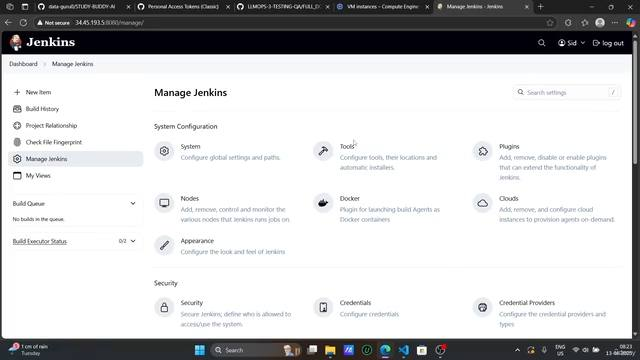

> 这一步解决的是「Jenkins 容器里有 `docker` 命令可执行」的问题。不做这步，后面 `docker.build()` 会直接报 command not found。
>
> **常见错误**：如果 Save 之后 Build 仍然报 `docker: not found`，先确认 Jenkins 是否重启过（Tools 的自动安装需要重启才生效），再确认 Jenkins 用户是否在 `docker` 组里（`sudo usermod -aG docker jenkins` 后重启 Jenkins）。这两条是 Jenkins 官方文档里就写着的，不是玄学。

---

### 3.2 步骤二：建 Docker Hub 仓库 + 生成 Token（P094）

1. 打开 https://hub.docker.com ，登录（讲师演示时第一次密码错了，改用 Google 登录）。
2. **Create repository**，名字随意（讲师用的是 `study` 这类短名），**Visibility 必须是 Public**。
3. 右上角头像 → **Account settings** → **Personal access tokens** → **Generate new token**：
   - Description 随便填；
   - **Permissions 选 Read, Write, Delete**；
   - 生成后**不要关页面**，token 只显示一次。

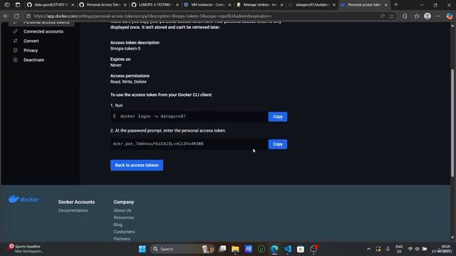

> **为什么是 Token 不是密码**：Docker Hub 从 2021 年起就禁止用账号密码做 CI 推送，必须用 PAT（Personal Access Token）。这跟前端用 GitHub PAT 代替密码是同一个道理——密码可以改、可以开 2FA，Token 可以单独吊销，权限还能收窄。

---

### 3.3 步骤三：把 Token 存进 Jenkins 凭据（P094）

Manage Jenkins → **Credentials** → **System**（旧版本叫 Global credentials）→ **Add Credentials**：

| 字段 | 值 |
|---|---|
| Kind | Username with password |
| Username | 你的 Docker Hub 用户名 |
| Password | 上一步生成的 access token |
| ID | `dockerhub-token` |
| Description | `dockerhub-token` |

> ⚠️ **ID 里不要带空格**。讲师口述是「docker hub token」，但 Jenkins 的 ID 一旦带空格，后面 `withRegistry()` 引用会很痛苦，直接用 `dockerhub-token`。这个 ID 必须和 Jenkinsfile 里的 `DOCKER_CRED_ID` 一字不差。
>
> **排查技巧**：如果 Build 报 `unauthorized: incorrect username or password`，先回 Credentials 页面确认 ID 拼写，再确认 Token 的权限勾了 Write——只勾 Read 是推不上去的。

---

### 3.4 步骤四：打开 Jenkinsfile 里被注释的 stage（P094）

在 VS Code 里打开 `Jenkinsfile`：

1. 取消注释环境变量块（`DOCKERHUB_REPO` / 凭据 ID 等）；
2. 把 `DOCKERHUB_REPO` 改成 `你的用户名/你的仓库名`；
3. 把凭据 ID 改成上一步的 `dockerhub-token`；
4. 取消注释 **Build** 和 **Push** 两个 stage。

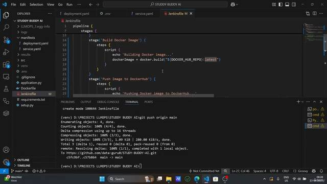

5. 再把 `manifests/deployment.yml` 里的 `image:` 也换成同一个仓库名（讲师原话：「keep the latest part, just replace it with this」）。
6. 本地 `git add / git commit / git push`，然后**回到 VM 上 `git pull origin main`**（因为 Jenkins 是在那台 VM 上跑的）。

> 这里讲师踩了个小坑：他先在 VS Code 内置终端里 `git pull` 报错，于是 `Ctrl+X` 关掉重开终端才成功。你如果遇到「终端卡在某个进程」，同样是重开一个就行。

7. 回 Jenkins 点 **Build Now**，看 Console Output：先拉代码 → `docker build` → `docker push` → 绿勾。
8. 回 Docker Hub 刷新，能看到刚推上去的镜像（讲师那条显示 318 MB 左右，他说 Docker Hub 会压缩，所以看着不大）。

> **前端对照**：这一步等价于你在 `package.json` 里配好 `build` 脚本、在 CI 里跑 `npm run build && docker push`。区别是 Jenkins 的 stage 是显式写出来的，而 npm scripts 是隐式的——显式的好处是 Console Output 里每一步都能单独看耗时和日志。

---

### 3.5 步骤五：装 Argo CD（P095）

在 VM 上（`minikube` 已启动）：

```bash
# 1. 看现有 namespace
kubectl get ns

# 2. 给 Argo CD 建 namespace
kubectl create namespace argocd

# 3. 用官方 install.yaml 安装（讲师说的「that even GitHub link」就是这条）
kubectl apply -n argocd -f https://raw.githubusercontent.com/argoproj/argo-cd/stable/manifests/install.yaml

# 4. 看资源状态，必须全部 Running
kubectl get all -n argocd
```

讲师对 `kubectl get all -n argocd` 输出的判读方式（原文）：每一行如果显示 `1/1` 就是「running running running」，正常；如果是 `0/1` 就是有错，**不能往下走**。

> **命令解释**：`kubectl apply -f <URL>` 是「声明式应用」——它会把 URL 里的 YAML 解析成 K8s 对象，已存在就 patch、不存在就 create。这跟前端 `npm install` 读 `package.json` 是同一个思路：你描述「要什么」，工具负责「怎么达到」。`-n argocd` 是把所有资源都放进 `argocd` 这个命名空间，等价于 npm 的 `--prefix`。
>
> **常见错误**：如果 `kubectl get all -n argocd` 里 `argocd-server` 一直 `0/1`，先 `kubectl describe pod -n argocd -l app.kubernetes.io/name=argocd-server` 看 Events，最常见的是镜像拉取超时（国内网络）——需要给 Minikube 配代理，或者换用国内镜像源。

---

### 3.6 步骤六：把 argocd-server 改成 NodePort（P095）

```bash
kubectl get svc -n argocd
```

你会看到全部是 `ClusterIP`。讲师的原话是「ClusterIP 只能在内部访问，但我们要从外部访问，所以要改成 NodePort」。

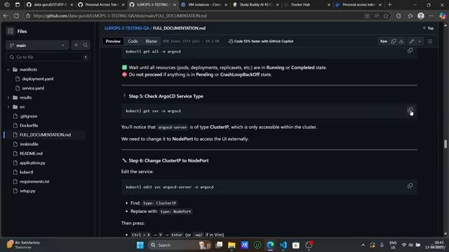

```bash
kubectl edit svc argocd-server -n argocd
```

在 vi 里：
1. 往下翻找 `type: ClusterIP`；
2. 用 `dd` 之类的删掉整行（讲师演示时删多了，后来又手动补写）；
3. 写 `type: NodePort`；
4. `Esc` → `:wq!` → 回车保存。

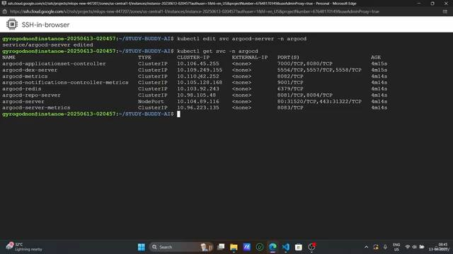

```bash
kubectl get svc -n argocd
# NAME            TYPE       CLUSTER-IP    EXTERNAL-IP   PORT(S)        AGE
# argocd-server   NodePort   10.x.x.x      <none>        80:31704/TCP   6m
```

> 上面是**示例输出**，`PORT(S)` 里的 NodePort 号（讲师环境是 31704）你那边大概率不一样，**以你实际看到为准**。这个号后面要填进 `ARGOCD_SERVER`。

讲师在 P095 还演示了 `kubectl port-forward` 这条路（他说「it is forwarding… on 704」），并且发现：**这个终端被 port-forward 占住后，就没法在里面跑取密码的命令了**，所以他另开了一个终端。这一点在第 3.7 步会用到。

> **前端对照**：`ClusterIP` 相当于「只有内网能访问的 localhost」，`NodePort` 相当于「把服务暴露到公网 IP 的某个端口」。Vercel 默认给你一个 `*.vercel.app` 域名，那是它帮你做了 NodePort + Ingress 的事；在 Minikube 里你得手动做。

---

### 3.7 步骤七：拿到 admin 密码并登录（P095）

讲师说「for getting the password you have to run this command」，但没把命令完整念出来。下面是 Argo CD 官方的初始密码读取方式，功能等价：

```bash
kubectl -n argocd get secret argocd-initial-admin-secret \
  -o jsonpath="{.data.password}" | base64 -d
```

> 若你的 Argo CD 版本里没有这个 Secret，请以 `kubectl -n argocd get secret` 的实际输出为准，命令以官方文档为准。

拿到一串字符后：

- 浏览器打开 `http://<VM 外网 IP>:<ARGOCD_NODEPORT>`
- 会有「连接不是私密连接」的告警 → 高级 → 继续（讲师原话：「we are daring persons」）
- Username：`admin`
- Password：上面那串

登录成功即进入 Argo CD Dashboard。讲师提醒：**如果你已经在云厂商那边开过防火墙规则，就不用每次都重开**。

> **命令解释**：`-o jsonpath="{.data.password}"` 是从 Secret 的 JSON 里只取 `.data.password` 这一个字段；`| base64 -d` 是因为 K8s Secret 里的值默认是 base64 编码的。这跟前端从 JWT 里 `atob(payload)` 解出用户信息是同一个操作。

---

### 3.8 步骤八：把 kubeconfig 做成「内嵌数据」的 Secret file（P096，最费劲的一步）

#### 为什么必须改

`~/.kube/config` 默认长这样（字段是**文件路径**）：

```yaml
users:
- name: minikube
  user:
    client-certificate: /home/you/.minikube/profiles/minikube/client.crt
    client-key: /home/you/.minikube/profiles/minikube/client.key
```

你把这个文件传到 Jenkins，Jenkins 容器里**根本没有** `/home/you/.minikube/...` 这些路径。所以要把三个字段从「路径」换成「文件内容的 base64」，字段名同时改成带 `-data` 后缀的版本（讲师原话：「just change this name to certificate authority data」）。

#### 操作

```bash
# 1. 进入项目根目录（讲师用 cd 加 Tab 补全）
cd ~/study-buddy-ai

# 2. 看隐藏文件
ls -la
# 你会看到 .kube 目录

cd ~/.kube
ls
# config 是你的目标文件

# 3. 把 config 内容打印出来
cat ~/.kube/config
```

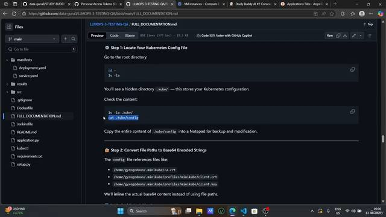

把 `cat` 出来的**全部内容**复制到一个文本编辑器（讲师用的是 notepad），然后逐个字段替换。三个 base64 用这三条命令拿：

```bash
cat ~/.minikube/ca.crt | base64 -w 0
cat ~/.minikube/profiles/minikube/client.crt | base64 -w 0
cat ~/.minikube/profiles/minikube/client.key | base64 -w 0
```

> 讲师念的命令是「cat + 路径 + `base64 -w 0`」。`-w 0` 的意思是**不换行**，输出必须是一整行；如果不加，base64 会每 76 字符折一行，粘进 YAML 就废了。

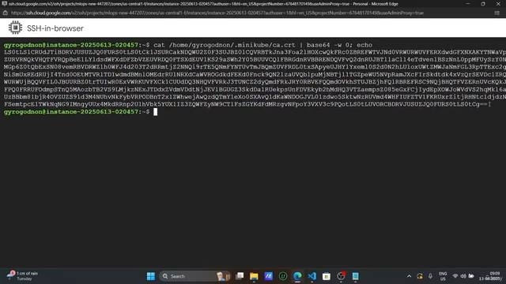

替换规则：

| 原字段 | 改成 |
|---|---|
| `certificate-authority: <路径>` | `certificate-authority-data: <base64>` |
| `client-certificate: <路径>` | `client-certificate-data: <base64>` |
| `client-key: <路径>` | `client-key-data: <base64>` |

> 复制 base64 时讲师特意强调：「make sure you don't add extra spaces, just copy from that particular equal to that last equal」。多一个空格，集群就连不上。

#### 存成「系统文件」而不是 .txt

讲师在 Windows 上用 **Git Bash**（装了 Git CLI 就自带）在 Downloads 目录里：

```bash
cd ~/Downloads
vi kubeconfig
```

粘贴全部内容 → `Esc` → `:wq!` → 回车。

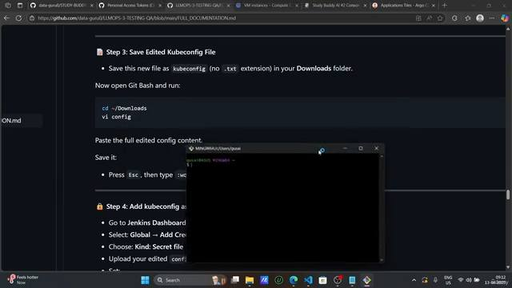

讲师专门解释过为什么：**用记事本保存会变成 `.txt` 文本文件，而我们需要的是无扩展名的「文件（file）」类型**。你在 Windows 文件属性里能看到「类型：文件」而不是「文本文档」。

#### 上传到 Jenkins

Manage Jenkins → Credentials → System → Add Credentials：

| 字段 | 值 |
|---|---|
| Kind | **Secret file** |
| File | 选刚才那个 `kubeconfig` |
| ID | `kube-config` |
| Description | `kube-config` |

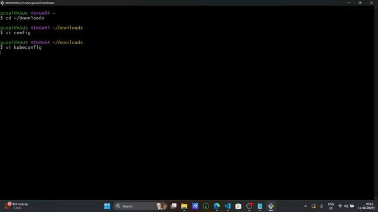

#### 拿集群 Server URL

```bash
kubectl cluster-info
# Kubernetes control plane is running on:
# https://192.168.49.2:8443
```

把这个 URL 复制走，**替换 Jenkinsfile 里的 `K8S_SERVER`**（讲师说：「Although it's previously also was same only, so no problem」——他那个环境前后一致）。

> **常见错误**：如果 Jenkins 里 `kubectl` 报 `Unable to connect to the server: x509: certificate signed by unknown authority`，说明 `certificate-authority-data` 没替换干净，或者 base64 里混进了换行/空格。用 `base64 -d` 反解一下，看能不能还原出合法的 PEM（`-----BEGIN CERTIFICATE-----` 开头）。

---

### 3.9 步骤九：Argo CD 接 GitHub + 注入 Groq Key（P097）

#### 1）Jenkinsfile 全量取消注释

讲师：「just uncomment everything now because you need everything」。包括：
- 安装 kubectl / argocd CLI 的 stage（临时方案）；
- `Apply Kubernetes & Sync App with Argo CD` 这个 stage。

> 关于那个「每次安装 CLI」的 stage，讲师自己说了：**这是 temporary fix**。正规做法是进 Jenkins 容器里装一次（他前面演示过用 pip/venv 装东西的路径），然后把这个 stage 永久删掉，不用每次构建都重装。

#### 2）替换 Jenkinsfile 里的三处

| 位置 | 换成 |
|---|---|
| kubeconfig 凭据 ID | `kube-config`（必须和你上传时填的一致） |
| `K8S_SERVER` | `kubectl cluster-info` 的 control plane URL |
| `ARGOCD_SERVER` | Argo CD 页面地址栏那串 `<IP>:<NodePort>`，`argocd login --insecure` 用它 |

#### 3）Argo CD 里连 GitHub 仓库

Argo CD UI → **Settings** → **Repositories** → **Connect Repo**：

| 字段 | 值 |
|---|---|
| Connection method | **VIA HTTP/HTTPS** |
| Name | 随便（可选） |
| Project | `default` |
| Repository URL | 你的 GitHub 仓库 HTTPS 地址 |
| Username | 你的 GitHub 用户名 |
| Password | 你的 GitHub Personal Access Token |

点 Connect，状态显示 **Successful** 就通了。

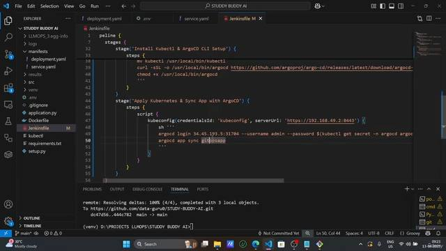

#### 4）把 Groq API Key 注入集群

```bash
kubectl create secret generic groq-api-secret \
  --from-literal=GROQ_API_KEY="<你的 Groq API Key>" \
  -n argocd
```

> 讲师没念出 Secret 的名字和 key 名，只说「paste that groq api inside these two quotes」。上面用的是占位名，**必须和 deployment.yml 里 `secretKeyRef` 的 `name`/`key` 对上**。另外讲师没提到 `-n` 参数；如果你把应用部署在 `argocd` 命名空间，Secret 也必须在同一个命名空间，否则 Pod 起不来（详见第七节）。

#### 5）创建 Argo CD Application

Argo CD UI → **Applications** → **New App**：

| 字段 | 值 |
|---|---|
| Application Name | `study` |
| Project Name | `default` |
| Sync Policy | **Automatic**，并勾上 **PRUNE RESOURCES** 和 **SELF HEAL** |
| Repository URL | 上一步连接成功的仓库 |
| Revision | `main`（讲师特意把默认的 `HEAD` 清掉换成 `main`） |
| Path | `manifests`（你的 deployment/service yml 所在目录） |
| Cluster URL | 默认那个 |
| Namespace | `argocd` |

Create 之后，讲师第一步就是**把 App 名字回填到 Jenkinsfile**：

```groovy
argocd app sync study
```

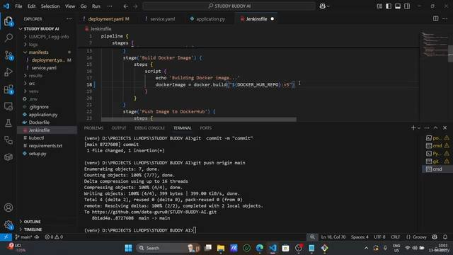

#### 6）第一次同步

```bash
git add . && git commit -m "add argocd sync stage" && git push origin main
# 在 VM 上
git pull origin main
```

然后 Jenkins 点 Build，同步成功后 App 会显示 **Healthy + Synced**，里面能看到 1 个 Deployment + 1 个 Service + **2 个 Pod**（因为 replicas: 2）。

#### 7）第一次访问应用

```bash
# 终端 A（会被占住）
minikube tunnel

# 终端 B
kubectl port-forward svc/<你的 service 名> 1994:<容器端口> -n argocd
```

浏览器访问 `http://<VM 外网 IP>:1994`。

> 讲师这里本地端口是随手写的（先 1994，后来说 9090），**本地端口随你写，只要不冲突**；关键是 service 名要和 `manifests/service.yml` 一致，讲师原话：「make sure you copy this name and replace it with your name」。

#### 8）讲师现场踩的两个坑（你几乎一定会撞上）

**坑 A：双引号套双引号。**

页面报错后，讲师定位到 `src/utils/helpers.py` 里拼接字符串的地方：外层已经是 `"`，内层又是 `"`，导致语法/输出错乱。

他的修法：**把内层换成单引号**。原话：「inside quotes are also double quotes, outside quotes are also double quotes. So we have to convert one of them as single quotes.」

**坑 B：Argo CD 用旧镜像。**

改完代码重新构建，页面还是旧的。讲师解释：「Argo CD has a tendency to use previous cached images… if you have set it to v1 it will use previous v1」。他临时把 `deployment.yml` 里的 `image` 改成 `latest` 试了一下，发现还是不行——因为 `latest` 本身也会被 Argo CD 缓存。真正的解法在 P098：用 `v${BUILD_NUMBER}` 作为 tag，每次构建都是新 tag，Argo CD 就不得不拉新镜像。

---

### 3.10 步骤十：Webhook + 动态 tag（P098）

#### 1）配 GitHub Webhook

GitHub 仓库 → **Settings** → **Webhooks** → **Add webhook**：

| 字段 | 值 |
|---|---|
| Payload URL | `http://<JENKINS_URL>/github-webhook/` |
| Content type | `application/json` |
| Secret | 留空（讲师没设） |
| Which events | **Just the push event** |
| Active | 勾上 |

点 Add webhook，GitHub 会立刻发一个 ping，Jenkins 那边如果配对了会显示 200。

> **命令解释**：`/github-webhook/` 是 GitHub 插件注册的固定路径，**末尾的斜杠不能少**。少了会 404。这跟前端配 Stripe webhook 时 `/api/webhook` 路径必须一字不差是同一个道理。

#### 2）Jenkinsfile 里加「回填 manifest」stage

讲师在 `Apply Kubernetes & Sync App with Argo CD` 之前加了一个 stage，核心就一行 `sed`（他说「copied it from Stack Overflow」）：

```groovy
stage('Update Manifest Image Tag') {
    steps {
        sh '''
            sed -i "s|image: .*|image: ${DOCKERHUB_REPO}:v${BUILD_NUMBER}|" manifests/deployment.yml
            git config user.email "jenkins@example.com"
            git config user.name "Jenkins"
            git add manifests/deployment.yml
            git commit -m "Update image tag to v${BUILD_NUMBER}" || echo "no changes"
            git push origin main
        '''
    }
}
```

> **命令解释**：`sed -i "s|A|B|" file` 是「把文件里的 A 替换成 B，原地写回」。这里用 `|` 而不是 `/` 当分隔符，是因为替换内容里有 `https://` 这种带 `/` 的字符串，用 `/` 会冲突。`|| echo "no changes"` 是兜底：如果这次 commit 没有 diff（比如重复构建），`git commit` 会返回非 0，加个 `||` 让 stage 不红。

#### 3）验证整条链路

1. 本地改一行 Streamlit 的文案；
2. `git add . && git commit -m "test webhook" && git push origin main`；
3. 回 Jenkins，**不要点 Build Now**，等几秒应该自动出现一个 `#<新构建号>` 的构建；
4. 构建过程中去 Docker Hub 看，应该多了一个 `v<新构建号>` 的 tag；
5. 构建完去 GitHub 看 `manifests/deployment.yml`，`image:` 那行应该变成 `...:v<新构建号>`；
6. Argo CD UI 里 App 会短暂 `OutOfSync`，然后自动 `Synced`，Pod 滚动更新；
7. 浏览器刷新，看到新文案。

> **前端对照**：这一步等价于 Vercel 的「Git Integration」——push 即部署。区别是 Vercel 的构建产物是静态文件，直接推到 CDN；这里的构建产物是 Docker 镜像，推到 Registry，再由 Argo CD 从 Registry 拉。多了一层「manifest 变更」作为触发信号，好处是可审计、可回滚（`git revert` 那个 commit 就回滚了）。

---

### 3.11 P099 的设计决策（课里没有代码）

P099 是下一个项目 **AI Celebrity Detector + QA 系统** 的纯讲解，全程没有代码。讲师在这一集里讲的设计决策，对理解本节的 CI/CD 链路有补充作用，整理如下：

- **架构**：前端（Streamlit / React）→ 后端（FastAPI）→ 模型（人脸识别 + QA）→ 存储（向量库）。
- **镜像仓库**：用 **GAR（Google Artifact Registry）** 代替 Docker Hub。讲师原话：「GAR, you can say your Google Artifact Registry is a type of Docker hub for your Google Cloud.」——也就是说，本节学的 `docker.build` / `docker.push` / `image:` 这套东西，换成 GAR 之后只是 URL 前缀变了，流程完全一样。
- **部署目标**：从 Minikube 换成 GKE。`kubectl` 命令不变，变的是 `kubeconfig` 的 context。
- **CI/CD**：仍然是 Jenkins + Argo CD，只是 Jenkins 的 agent 从「VM 上的容器」换成「GKE 里的 Pod」。

> 这一节**没有代码**，所以本文不展开。你只要记住：**本节学的所有东西都是可迁移的**，换云厂商、换 Registry、换 K8s 发行版，变的只是配置，不变的是「build → push → 改 manifest → sync」这条主线。

---

## 四、完整代码

> 本节把 P094–P098 涉及的所有文件汇总，方便你对照复制。所有 `<...>` 占位符按第 3.0 节的约定替换。

### 4.1 `Jenkinsfile`

```groovy
pipeline {
    agent any

    environment {
        DOCKERHUB_REPO = '<DOCKERHUB_USER>/study-buddy-ai'
        DOCKER_CRED_ID = 'dockerhub-token'
        K8S_SERVER     = 'https://192.168.49.2:8443'
        ARGOCD_SERVER  = '<VM_IP>:31704'
    }

    stages {
        stage('Checkout') {
            steps {
                git branch: 'main',
                    url: 'https://github.com/<GITHUB_OWNER>/<GITHUB_REPO>.git'
            }
        }

        stage('Build Docker Image') {
            steps {
                script {
                    docker.build("${DOCKERHUB_REPO}:v${BUILD_NUMBER}")
                }
            }
        }

        stage('Push Docker Image') {
            steps {
                script {
                    docker.withRegistry('', DOCKER_CRED_ID) {
                        docker.image("${DOCKERHUB_REPO}:v${BUILD_NUMBER}").push()
                    }
                }
            }
        }

        stage('Install kubectl & argocd CLI') {
            // 讲师原话：temporary fix，正规做法是进容器装一次
            steps {
                sh '''
                    curl -LO "https://dl.k8s.io/release/$(curl -L -s https://dl.k8s.io/release/stable.txt)/bin/linux/amd64/kubectl"
                    chmod +x kubectl
                    sudo mv kubectl /usr/local/bin/
                    curl -sSL -o argocd https://github.com/argoproj/argo-cd/releases/latest/download/argocd-linux-amd64
                    chmod +x argocd
                    sudo mv argocd /usr/local/bin/
                '''
            }
        }

        stage('Update Manifest Image Tag') {
            steps {
                sh '''
                    sed -i "s|image: .*|image: ${DOCKERHUB_REPO}:v${BUILD_NUMBER}|" manifests/deployment.yml
                    git config user.email "jenkins@example.com"
                    git config user.name  "Jenkins"
                    git add manifests/deployment.yml
                    git commit -m "Update image tag to v${BUILD_NUMBER}" || echo "no changes"
                    git push origin main
                '''
            }
        }

        stage('Apply Kubernetes & Sync App with Argo CD') {
            steps {
                withCredentials([file(credentialsId: 'kube-config', variable: 'KUBECONFIG')]) {
                    sh '''
                        argocd login ${ARGOCD_SERVER} --insecure \
                            --username admin \
                            --password "$(kubectl -n argocd get secret argocd-initial-admin-secret -o jsonpath='{.data.password}' | base64 -d)"
                        argocd app sync study
                    '''
                }
            }
        }
    }
}
```

### 4.2 `manifests/deployment.yml`

```yaml
apiVersion: apps/v1
kind: Deployment
metadata:
  name: study-buddy-ai
  namespace: argocd
spec:
  replicas: 2
  selector:
    matchLabels:
      app: study-buddy-ai
  template:
    metadata:
      labels:
        app: study-buddy-ai
    spec:
      containers:
        - name: study-buddy-ai
          image: <DOCKERHUB_USER>/study-buddy-ai:v1
          ports:
            - containerPort: 8501
          env:
            - name: GROQ_API_KEY
              valueFrom:
                secretKeyRef:
                  name: groq-api-secret
                  key: GROQ_API_KEY
```

### 4.3 `manifests/service.yml`

```yaml
apiVersion: v1
kind: Service
metadata:
  name: study-buddy-ai
  namespace: argocd
spec:
  selector:
    app: study-buddy-ai
  ports:
    - port: 80
      targetPort: 8501
  type: ClusterIP
```

### 4.4 `kubeconfig`（替换后的样子，节选）

```yaml
apiVersion: v1
kind: Config
clusters:
- name: minikube
  cluster:
    server: https://192.168.49.2:8443
    certificate-authority-data: <base64 of ca.crt>
users:
- name: minikube
  user:
    client-certificate-data: <base64 of client.crt>
    client-key-data: <base64 of client.key>
contexts:
- name: minikube
  context:
    cluster: minikube
    user: minikube
current-context: minikube
```

---

## 五、逐行解释

> 只挑最容易出错的几行，逐行拆开讲。前端同学可以把「Groovy 字符串」理解成「模板字符串」，把「sh 块」理解成「在子 shell 里跑的一段 bash」。

**`docker.build("${DOCKERHUB_REPO}:v${BUILD_NUMBER}")`**
- `docker.build` 是 Docker Pipeline 插件提供的方法，等价于 `docker build -t <tag> .`。
- `${DOCKERHUB_REPO}` 是 Groovy 的字符串插值，等价于 JS 的 `${DOCKERHUB_REPO}`。
- `v${BUILD_NUMBER}` 里的 `BUILD_NUMBER` 是 Jenkins 内置环境变量，每次构建自增。**这一行是整个 P098 的核心**——它保证了每次构建的 tag 都不同，从而绕过 Argo CD 的镜像缓存。

**`docker.withRegistry('', DOCKER_CRED_ID) { ... }`**
- 第一个参数是 Registry 地址，空字符串表示 Docker Hub 默认地址 `registry-1.docker.io`。
- 第二个参数是凭据 ID，对应第 3.3 节你填的 `dockerhub-token`。
- 花括号里的代码块执行时，Jenkins 会自动 `docker login`，执行完自动 `docker logout`。**不要手动写 `docker login`**，那样密码会进日志。

**`sed -i "s|image: .*|image: ${DOCKERHUB_REPO}:v${BUILD_NUMBER}|" manifests/deployment.yml`**
- `-i` 是 in-place，直接改文件。
- `s|A|B|` 是替换，`|` 是分隔符（因为 A/B 里都有 `/`，用 `/` 会冲突）。
- `image: .*` 匹配「`image: ` 开头到行尾」的整段，替换成新的 `image: <repo>:v<num>`。
- **注意**：这行会匹配文件里**所有** `image:` 开头的行。如果你的 deployment.yml 里有多个 container，需要把正则收窄成 `image: .*study-buddy-ai.*` 之类。

**`git commit -m "..." || echo "no changes"`**
- `||` 是「前面失败才执行后面」。`git commit` 在没有 diff 时返回非 0，加个 `||` 让 stage 不红。
- 这跟前端 `npm test || true` 是同一个套路。

**`withCredentials([file(credentialsId: 'kube-config', variable: 'KUBECONFIG')])`**
- 把 Jenkins 里的 Secret file 凭据挂载成一个临时文件，路径赋给 `KUBECONFIG` 环境变量。
- `kubectl` 和 `argocd` 都会自动读 `KUBECONFIG` 环境变量，所以不需要显式 `--kubeconfig`。
- **注意**：`variable` 名必须是 `KUBECONFIG`（全大写），不能写成 `kubeconfig`，否则工具不认。

**`argocd login ${ARGOCD_SERVER} --insecure --username admin --password "..."`**
- `--insecure` 表示跳过 TLS 证书校验（因为 NodePort 是 http）。
- `--password` 后面用 `$(...)` 动态取密码，避免把密码写死在 Jenkinsfile 里。
- **注意**：`$(...)` 在 Groovy 的 `sh '''...'''` 里是 bash 语法，不是 Groovy 插值。如果你用 `"""..."""` 三引号双引号，`$` 会被 Groovy 先解析，导致命令错乱。**这是新手最容易踩的坑**。

---

## 六、复现检查清单

> 每条都给出「怎么验证」，不要凭感觉勾。

| # | 检查项 | 怎么验证 |
|---|---|---|
| 1 | Jenkins 里有 `docker` 命令 | Jenkins → Manage Jenkins → Tools → Docker installations 里有 `docker`；或进 Jenkins 容器 `docker --version` 有输出 |
| 2 | Docker Hub 仓库是 Public | 浏览器无痕模式打开 `https://hub.docker.com/r/<user>/<repo>`，不登录也能看 |
| 3 | Jenkins 凭据 ID 是 `dockerhub-token` | Credentials 页面能看到该 ID；Jenkinsfile 里 `DOCKER_CRED_ID` 一字不差 |
| 4 | Build + Push stage 绿勾 | Jenkins Console Output 里能看到 `Successfully built` 和 `Pushed` |
| 5 | Docker Hub 上有镜像 | 刷新 Docker Hub 仓库页面，Tags 里能看到 `v<num>` |
| 6 | Argo CD 全部 Pod Running | `kubectl get all -n argocd` 每行都是 `1/1` 或 `2/2` |
| 7 | argocd-server 是 NodePort | `kubectl get svc -n argocd` 的 TYPE 列是 `NodePort` |
| 8 | 能登录 Argo CD UI | 浏览器打开 `http://<IP>:<NodePort>`，`admin` + 初始密码能进 |
| 9 | kubeconfig 是 Secret file 类型 | Jenkins Credentials 页面 Kind 列显示 `Secret file`，不是 `Secret text` |
| 10 | kubeconfig 无扩展名 | Windows 文件属性里「类型」是「文件」，不是「文本文档」 |
| 11 | Argo CD 连上 GitHub | Settings → Repositories 里状态是 `Successful` |
| 12 | Groq Secret 存在 | `kubectl get secret groq-api-secret -n argocd` 有输出 |
| 13 | Argo CD App 是 Healthy + Synced | UI 里 App 卡片左上角两个绿勾 |
| 14 | Webhook 生效 | GitHub → Settings → Webhooks → 最近一次 delivery 是 200 |
| 15 | push 自动触发构建 | 改一行代码 push，Jenkins 不点按钮也出现新构建 |
| 16 | manifest 被回填 | GitHub 上 `manifests/deployment.yml` 的 `image:` 是 `v<新构建号>` |
| 17 | Pod 滚动更新 | `kubectl get pods -n argocd -w` 能看到旧 Pod Terminating、新 Pod Running |
| 18 | 页面是新代码 | 浏览器强刷（Ctrl+Shift+R）后看到新文案 |

---

## 七、课里没讲但你会撞上的

| 现象 | 原因 | 怎么办 |
|---|---|---|
| `docker: command not found` | Jenkins 没配 Docker 工具，或配了没重启 | 回 3.1 节重配，重启 Jenkins |
| `unauthorized: incorrect username or password` | Token 权限只勾了 Read，或 ID 拼错 | 回 3.2 节重新生成 Token，勾 Read+Write+Delete |
| `x509: certificate signed by unknown authority` | kubeconfig 里 `certificate-authority-data` 没替换干净 | 用 `base64 -d` 反解，确认是合法 PEM |
| `Unable to connect to the server: EOF` | `K8S_SERVER` 写错，或 Minikube 没启动 | `minikube status` 确认 Running，`kubectl cluster-info` 对 URL |
| Argo CD 一直用旧镜像 | 镜像 tag 没变，Argo CD 缓存命中 | 用 `v${BUILD_NUMBER}` 动态 tag（3.10 节） |
| 页面报 `SyntaxError: unexpected EOF` | Python 里双引号套双引号 | 内层换单引号（3.9 节坑 A） |
| Pod 起不来，`CreateContainerConfigError` | Secret 名字/命名空间对不上 | `kubectl describe pod` 看 Events，确认 `secretKeyRef` 的 name/namespace |
| Webhook 显示 404 | Payload URL 少了末尾 `/` | 改成 `http://<JENKINS_URL>/github-webhook/` |
| Webhook 显示 403 | Jenkins 开了 CSRF，或 GitHub IP 没白名单 | Jenkins → Configure Global Security → 勾「GitHub → 允许」 |
| `argocd login` 报 `permission denied` | `KUBECONFIG` 变量名写错 | 必须是全大写 `KUBECONFIG` |
| `sed` 替换后 manifest 没变 | 正则没匹配上，或文件路径错 | 先 `grep image manifests/deployment.yml` 确认当前内容 |
| `git push` 报 `rejected` | Jenkins 容器里的 git 没配 user.email | 加 `git config user.email/user.name`（4.1 节已加） |
| `minikube tunnel` 占住终端 | 它是前台进程 | 另开终端跑其他命令（3.6 节已提） |
| NodePort 访问超时 | 云厂商安全组没放行 | 去云控制台加一条入站规则，放行该端口 |
| Argo CD UI 打不开，但 `kubectl get svc` 正常 | 浏览器用了 https，但 NodePort 是 http | 手动把地址栏 `https://` 改成 `http://` |
| Jenkins 构建卡在 `Install kubectl` | 网络拉 GitHub Release 超时 | 换国内镜像源，或把这个 stage 删掉改成预装（3.9 节已提） |
| `argocd app sync` 报 `app not found` | App 名字和 Jenkinsfile 里不一致 | 回 Argo CD UI 复制 App 名，回填 Jenkinsfile |
| 滚动更新时 502 | replicas 只有 1，且没配 readinessProbe | 把 replicas 调到 2，加 `readinessProbe`（课里没讲，但生产必须） |
| `git commit` 报 `nothing to commit` | 重复构建，manifest 没 diff | 加 `|| echo "no changes"` 兜底（4.1 节已加） |

> **最后一句**：这张表里的每一条，都是「课里没讲但真实会撞上」的。撞上不可怕，按「现象 → 原因 → 怎么办」三列定位，比盲目 Google 快得多。