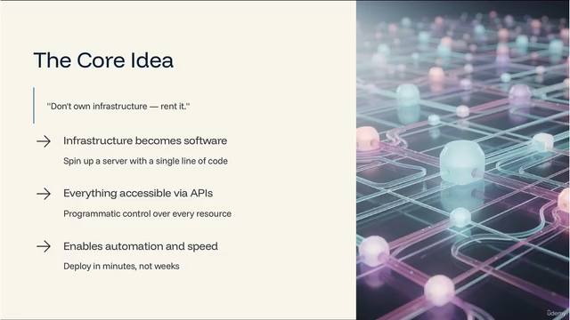
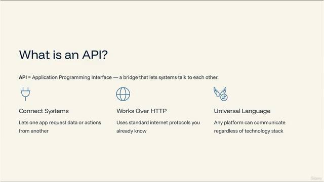
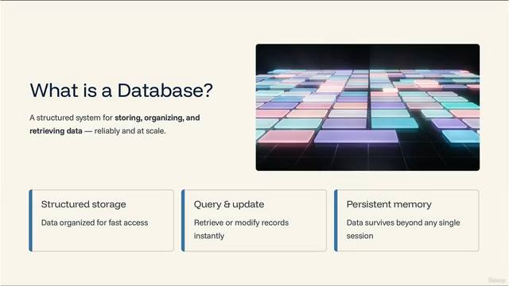
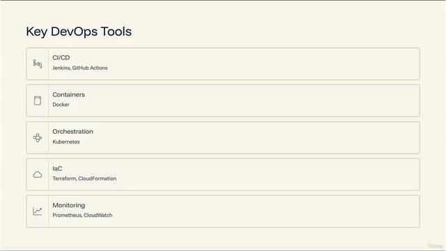
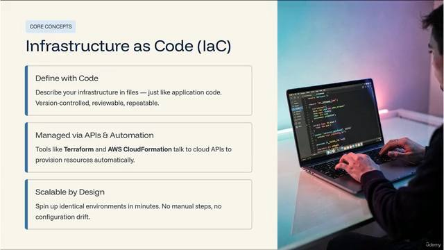
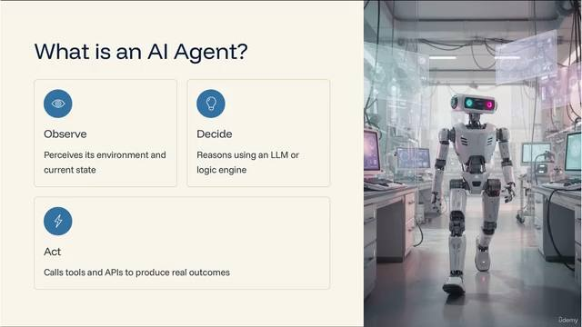
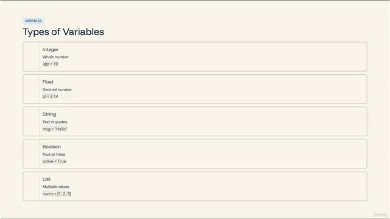
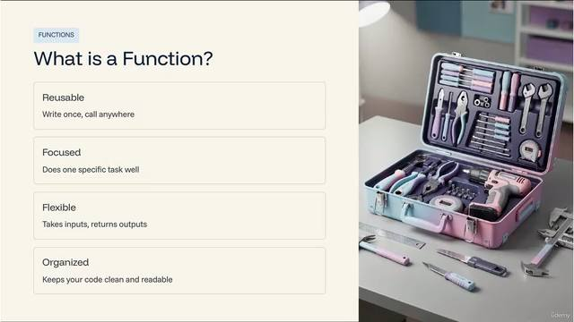

# AI Agents for Cloud Infrastructure（P1–P6）复现文档

## 1. 这一节做什么

这 6 集不是上来就写 Agent 代码，而是先把「云基础设施为什么能被 AI 控制」这件事讲透。讲师给出的主线是：**云资源被抽象成 API → API 让基础设施变成可编程的软件 → 可编程的东西才能被 Agent 观察、决策、调用**。所以这一节的可复现产物不是一上来就部署一个云服务，而是先做出一套能指导后续编码的「设计底稿」，再用一个本地 Python 示意程序把「观察—分析—决策—执行—验证」跑通。

读者照着本文，最终会得到：

1. 一个项目目录 `cloud-agent-foundation/`；
2. 四张表：资源—API 映射表、组件职责表、Agent 决策循环表、容量估算表；
3. 一个可直接运行的 `cloud_agent_demo.py`，用标准库模拟「Agent 调云 API」的最小闭环；
4. 一份复现检查清单，以及一份「课里没讲但你会撞上」的避坑清单。

需要先说明：**这 6 集逐字稿里没有真实云账号操作，也没有给出完整工程代码**。所以本文第 4 节的代码是「示意代码」，用于把讲师讲的变量、循环、函数、API 请求/响应、Agent 决策循环落成可运行的东西；它不是课程原样代码，也不能直接拿去操作真实 AWS/Azure/GCP。真实云调用需要认证、权限、SDK、计费和错误处理，这些课里没讲，我会在第 7 节单独列出来。


这一节适合前端转 AI 应用工程师这样理解：你平时写 `fetch('/api/user')`，请求打到后端，后端查数据库再返回 JSON；现在把「后端」换成云厂商，把「数据库」换成云上的存储和数据库，把「按钮点击」换成 Agent 的决策，整条链路没有变，变的是调用者从人变成了程序。

---

## 2. 讲师原话（带「—— pNNN [MM:SS]」）

下面按主题归并讲师原话，不按集数流水账排列。英文原句保留，后面用中文说明它对应本文哪个设计动作。

**关于云的本质：资源通过互联网按需交付。**

> "Cloud computing is simply the delivery of computing resources over the internet." —— p001 [00:00]

这句话决定了后面所有设计都围绕「资源」和「API」展开，而不是围绕某台具体机器。你不需要先买服务器，你需要的是「申请服务器的能力」。

**关于基础设施变成可编程软件。**

> "Infrastructure is no longer something you physically manage, it becomes programmable." —— p001 [02:21]

这是整门课的地基。因为基础设施可编程，Agent 才能通过调用 API 去「动手」。如果基础设施只能人工点控制台，Agent 再聪明也没有执行通道。

**关于 IaaS、PaaS、SaaS 的控制权取舍。**

> "As you move from IaaS to SaaS, you give up control but gain simplicity." —— p001 [03:17]

这句话对应本文第 3 节的方案取舍：课程主要靠近 IaaS 和 PaaS，因为要保留足够的控制权给 Agent。



**关于 API 的请求—响应模型。**

> "A client ... sends a request. ... the server receives that request and processes it. ... Then the server sends back a response." —— p002 [02:55]

Agent 不是点按钮，而是发请求、收响应。本文第 4 节的接口草案和示意代码都按这个模型写。

**关于 DevOps 的持续循环。**

> "This loop is continuous, not one time. That's the key difference." —— p003 [03:22]

Agent 不是跑一次脚本就结束，它要嵌进计划、构建、测试、发布、部署、运行、监控的循环里。本文的 Agent 决策循环表因此加了「验证」和「记录」两个动作。

**关于基础设施即代码。**

> "With tools like CloudFormation or Terraform, you can describe your entire system ... in a template. Then with a single command, that infrastructure is created automatically." —— p004 [03:19]

这句话说明 Agent 的「意图」最好落成可版本化的模板，而不是一段无法审计的临时命令。本文把 IaC 放在「治理层」。

**关于脚本、API、Agent 的分层。**

> "Scripts automate tasks. APIs expose capabilities. Agents orchestrate everything." —— p005 [05:42]

这是全课最值得背下来的一句。本文第 3 节的分层方案就是按这三层拆的。

**关于 Agent 做备份的例子。**

> "It could monitor system activity, detect anomalies or risks, decide that a backup is needed, and then call the API to execute it." —— p005 [06:39]

本文第 4 节的示意代码就照这个例子写：观察服务器状态、判断是否该备份、调用备份 API、验证结果。

**关于 Python 三件套。**

> "Variables store data. Loops allow you to process that data repeatedly. And functions help you organize your logic into reusable blocks." —— p006 [05:47]

这对应本文示意代码里的 `SERVERS` 变量、`for` 循环和 `observe/analyze/decide/act` 函数。

---

## 3. 从零复现

这一节按纯讲解课的复现方式写：**需求 → 约束 → 估算 → 方案 → 取舍**。每一步都给出可产出的文件和表格，照着做就能得到第 4 节的设计产物。

### 3.1 需求：我们要做一个什么样的系统

需求不是「写一个脚本定时备份」，而是：**一个能观察云资源状态、根据状态做决策、调用 API 执行动作、并验证动作结果的 Agent**。讲师在 p005 用备份举例：Agent 不是到点就备份，而是先监控系统活动，发现异常或风险，再决定要不要备份，最后调 API 执行。

把它拆成最小可运行需求：

1. 能列出当前资源状态（compute、storage、database、networking 四类资源中，本示例只做 compute 和 backup）；
2. 能根据状态发现两类问题：服务不健康、备份过期；
3. 能决定动作：重启服务、执行备份；
4. 能调用 API 执行；
5. 能验证 API 返回是否成功；
6. 能把观察、决策、执行结果打印出来，方便人审查。

这 6 条就是第 4 节代码的骨架。

### 3.2 约束：讲师给出的边界条件

把这些约束写进设计文档，避免后面把 Agent 写成「万能脚本」：

| 约束 | 讲师依据 | 对设计的影响 |
|---|---|---|
| API 是被动的，不会自己发起动作 | p005 [03:19] 左右 | Agent 必须有明确的调用方和触发条件 |
| 脚本是固定顺序，不会理解上下文 | p005 [01:27] | 不要把「判断该不该备份」写死在脚本条件里，要留出决策层 |
| Agent 需要推理，通常由大语言模型驱动 | p005 [04:16] 左右 | 决策层与执行层要分开，便于替换模型 |
| DevOps 是持续循环，不是一次性 | p003 [03:22] | Agent 要能重复运行，且每次运行要记录结果 |
| 基础设施用代码定义 | p004 [03:19] | 资源模板要版本化，Agent 的动作要可审计 |
| 课程主要靠近 IaaS/PaaS | p001 [03:17] | 不依赖 SaaS 的封闭按钮，保留 API 控制权 |

另外有一条隐含约束：**这 6 集没有讲真实云厂商的认证方式、SDK 和计费**。所以本文的复现只做到「本地模拟 API」，真实云调用放到第 7 节作为扩展项，不假装课程教过。

### 3.3 估算：先算清楚量级，再决定架构

讲师在 p004 提到系统要能处理 10 个用户、1000 个用户、一百万个用户，但**课里没有给具体数字**。下面是一张示意估算表，数字仅用于练习「用算式推容量」，不是课程给出的结论。

先设一个练习场景：100 台服务器，每台每分钟接收 120 次请求，Agent 每 5 分钟观察一次。

| 估算项 | 算式 | 示意结果 | 用途 |
|---|---|---|---|
| 用户请求 QPS | 100 台 × 120 次/分钟 ÷ 60 秒 | 200 请求/秒 | 决定 API 网关和数据库读压力 |
| 数据库读 QPS | 200 请求/秒 × 10% 需要查库 | 20 查询/秒 | 决定数据库连接数下限 |
| Agent 观察频率 | 100 台 ÷ 5 分钟 | 20 台/分钟 | 决定 Agent 一轮要拉多少资源 |
| Agent 每轮 API 调用 | 20 台 × 每台 1 次列表 + 平均 0.5 次动作 | 30 次/轮 | 决定是否需要分批和限流 |
| 备份存储量 | 100 台 × 20 GB × 保留 7 份 | 14,000 GB | 决定对象存储容量和成本告警 |
| Agent 每日循环次数 | 24 小时 × 60 分钟 ÷ 5 分钟 | 288 轮/天 | 决定日志量和幂等要求 |

这些算式的作用不是让你背数字，而是让你在设计 Agent 时先问：它一轮要调多少次 API？失败重试会不会把量放大？日志保留多久？这些问题课里没展开，但你在真实项目里一定会遇到。

### 3.4 方案：分六层落地

按讲师「脚本—API—Agent」的分层，再加 DevOps 和 IaC，得到六层方案：

1. **资源层**：compute（EC2/虚拟机）、storage（S3 这类对象存储）、database（SQL/NoSQL/Redis）、networking（连接、访问控制）。讲师在 p001 和 p004 都强调这四类组件。
2. **API 层**：每个资源操作暴露成请求—响应接口，返回 JSON。讲师在 p002 明确说大多数 API 走 HTTP、返回 JSON。
3. **工具层**：把 API 包装成 Agent 可调用的函数，例如 `list_servers()`、`backup_server(name)`、`restart_server(name)`。
4. **决策层**：Agent 的 observe → analyze → decide → act → verify 循环。讲师在 p005 讲的是 observe、decide、act；verify 来自 p003 的「validate the fix」；record 课里没讲，但建议加。
5. **流程层**：把 Agent 嵌进 DevOps 生命周期：计划、构建、测试、发布、部署、运行、监控。对应 p003 的持续循环。
6. **治理层**：IaC 模板、权限、审计、成本。对应 p004 的 infrastructure as code 和 p004 的 security（permissions、firewalls、identity management）。

目录结构建议如下，直接照着建：

```text
cloud-agent-foundation/
├── README.md
├── design/
│   ├── resource-api-map.md
│   ├── component-responsibility.md
│   ├── agent-loop.md
│   └── capacity-estimate.md
├── cloud_agent_demo.py
└── run.sh
```

`run.sh` 内容只有一行：

```bash
python3 cloud_agent_demo.py
```

课里没讲 Python 版本，本文按 Python 3.10+ 写；如果你的环境是 3.8，代码也能跑，因为只用了标准库。

### 3.5 取舍：为什么这样选，不那样选

| 取舍点 | 选择 | 理由 | 不这样会怎样 |
|---|---|---|---|
| IaaS / PaaS / SaaS | 靠近 IaaS 和 PaaS | 保留 API 控制权，Agent 才能动手 | 全用 SaaS，Agent 只能点别人开放好的按钮，控制力弱 |
| 脚本还是 Agent | 决策层用 Agent，执行层保留脚本式函数 | 脚本适合固定动作，Agent 适合判断「该不该做」 | 全用脚本，条件一变就失效；全用 Agent，简单动作也被过度复杂化 |
| SQL / NoSQL / Redis | 按数据关系选，不盲目追新 | 讲师 p002 说关系型适合关系强的数据，NoSQL 适合灵活扩展，Redis 适合缓存和实时 | 用错类型会导致查询困难或成本上升 |
| 单云 / 多云 / 混合 | 课程示例先用单云心智模型 | 讲师 p004 说多云用于灵活性和风险管理，但初学先把一条链路走通 | 一上来多云，认证、网络、计费复杂度会压垮学习进度 |
| IaC 模板 / 控制台手点 | 用模板 | 可重复、可版本控制、可被 Agent 读取 | 手点无法审计，环境无法一模一样重建 |
| Agent 直接执行 / 先验证再执行 | 先 observe 再 decide，执行后 verify | 讲师 p005 的例子就是先监控再决定；p003 也提到验证修复 | 直接执行容易在状态不明时误操作 |

给前端同学补一句：这里的「分层」很像前端的 `UI 层 → API 请求层 → 状态管理层`。Agent 的 `decide()` 相当于状态管理里的 reducer，`act()` 相当于发请求的 service，`observe()` 相当于拉数据。这样类比不需要理解后端也能上手。

---

## 4. 完整代码

这一节先给四张设计表，再给一个完整可运行的示意代码文件。再次强调：**课里没有代码，以下 Python 为示意**，用于把讲师讲的概念跑通，不是课程原样代码，也不是生产级云客户端。

### 4.1 资源—API 映射表

| 资源类别 | 课程提到的例子 | Agent 可调用的动作（示意） | 对应 API 形状 |
|---|---|---|---|
| Compute | EC2、虚拟机 | 列出服务器、重启服务器、扩容 | 请求里带资源名，响应返回 JSON |
| Storage | S3 | 备份、列出备份、删除过期备份 | 请求里带对象路径，响应返回确认 |
| Database | SQL、NoSQL、Redis | 查询状态、读写数据 | 请求里带查询条件，响应返回数据 |
| Networking | 网络、访问控制 | 查询连通性、调整访问规则 | 请求里带规则，响应返回结果 |
| 监控 | Prometheus、CloudWatch | 拉指标、查告警 | 请求里带时间范围，响应返回指标 |
| CI/CD | Jenkins、GitHub Actions | 触发流水线、查构建结果 | 请求里带流水线名，响应返回状态 |
| 容器/编排 | Docker、Kubernetes | 构建镜像、扩缩容 | 请求里带镜像或副本数，响应返回状态 |
| IaC | Terraform、CloudFormation | 预览、应用模板 | 请求里带模板，响应返回变更结果 |

这张表的作用是：以后每加一个 Agent 能力，先问它落在哪一行、调哪个 API、返回什么 JSON。不要一上来写「万能 Agent」。

### 4.2 组件职责表

| 组件 | 职责 | 输入 | 输出 | 不该做什么 |
|---|---|---|---|---|
| `observe()` | 拉取资源状态 | 无或资源范围 | 资源列表 | 不做判断、不改状态 |
| `analyze()` | 找异常和风险 | 资源列表 | findings 列表 | 不直接调执行 API |
| `decide()` | 把 findings 转成动作 | findings | actions 列表 | 不执行动作 |
| `act()` | 调 API 执行 | actions | 执行结果 | 不做复杂推理 |
| `verify()` | 检查结果是否成功 | 执行结果 | 布尔值或报告 | 不静默吞错 |
| `api_*()` | 暴露能力 | 请求参数 | JSON 响应 | 不主动发起动作 |

### 4.3 Agent 决策循环表

| 阶段 | 做什么 | 失败时怎么办 | 课里依据 |
|---|---|---|---|
| Observe | 拉资源状态 | 记录错误，下一轮重试 | p005 讲 Agent 会观察 |
| Analyze | 找异常、找风险 | 标记「无法判断」，不猜 | p005 讲分析日志、发现异常 |
| Decide | 选动作 | 动作不明确时交给人确认 | p005 讲决定修复 |
| Act | 调 API | 失败重试要有上限 | p005 讲执行修复 |
| Verify | 检查返回 | 失败则回滚或告警 | p003 讲验证修复 |
| Record | 写日志和审计 | 日志失败不能阻塞主流程 | 课里没讲，建议加 |

### 4.4 接口/数据模型草案

下面是最小请求—响应模型，字段名是本文示意，不是课程给出的云厂商字段：

```json
// 请求：备份某台服务器
{
  "action": "backup",
  "server": "web-1"
}

// 成功响应
{
  "ok": true,
  "message": "backup finished for web-1"
}

// 失败响应
{
  "ok": false,
  "error": "web-1 is not healthy, backup skipped"
}
```

讲师在 p002 说 API 通常返回 JSON，p005 说 Agent 调 API 执行动作。这个草案就是按这两句话写的。

### 4.5 完整示意代码：`cloud_agent_demo.py`

保存到 `cloud-agent-foundation/cloud_agent_demo.py`，直接运行 `python3 cloud_agent_demo.py`。代码只用标准库，不依赖第三方包。

```python
#!/usr/bin/env python3
"""
cloud_agent_demo.py

课里没有代码，以下为示意：
用 Python 标准库模拟一个“观察 - 分析 - 决策 - 执行 - 验证”的云基础设施 Agent。
它不连接真实云厂商，只模拟 API 的请求 / 响应形状。

运行：
    python3 cloud_agent_demo.py
"""

import json
from datetime import datetime, timezone


# ---------------------------------------------------------------------------
# 资源层：模拟当前云资源状态
# 说明：这些字段是本文示意，不是真实云厂商字段。
# ---------------------------------------------------------------------------
SERVERS = [
    {
        "name": "web-1",
        "status": "healthy",
        "last_backup_hours": 1,
        "requests_per_min": 120,
    },
    {
        "name": "web-2",
        "status": "unhealthy",
        "last_backup_hours": 30,
        "requests_per_min": 0,
    },
    {
        "name": "worker-1",
        "status": "healthy",
        "last_backup_hours": 26,
        "requests_per_min": 45,
    },
]

BACKUPS = []


# ---------------------------------------------------------------------------
# API 层：每个函数模拟一个被动等待调用的 API 端点。
# 对应讲师 p002 讲的 request / response，以及 p005 讲的 API 只暴露能力。
# ---------------------------------------------------------------------------
def api_list_servers():
    """GET /servers：返回 JSON 字符串，模拟 HTTP response body。"""
    return json.dumps({"ok": True, "data": SERVERS})


def api_backup_server(name):
    """POST /servers/{name}/backup：执行备份并返回结果。"""
    for server in SERVERS:
        if server["name"] == name:
            if server["status"] != "healthy":
                return {
                    "ok": False,
                    "error": f"{name} is not healthy, backup skipped",
                }

            server["last_backup_hours"] = 0
            BACKUPS.append(
                {
                    "server": name,
                    "at": datetime.now(timezone.utc).isoformat(),
                }
            )
            return {"ok": True, "message": f"backup finished for {name}"}

    return {"ok": False, "error": f"server {name} not found"}


def api_restart_server(name):
    """POST /servers/{name}/restart：把 unhealthy 服务重启为 healthy（示意）。"""
    for server in SERVERS:
        if server["name"] == name:
            server["status"] = "healthy"
            server["requests_per_min"] = 10
            return {"ok": True, "message": f"{name} restarted"}

    return {"ok": False, "error": f"server {name} not found"}


# ---------------------------------------------------------------------------
# 工具层 + 决策层：Agent 可调用的函数。
# 对应讲师 p006 讲的变量、循环、函数，以及 p005 讲的 Agent 编排。
# ---------------------------------------------------------------------------
def observe():
    """观察：调用列表 API，把 JSON 字符串解析成 Python 列表。"""
    raw = api_list_servers()
    payload = json.loads(raw)
    return payload["data"]


def analyze(servers):
    """分析：找出不健康的服务和备份过期的服务。"""
    findings = []

    for server in servers:
        if server["status"] != "healthy":
            findings.append(
                {
                    "type": "unhealthy",
                    "server": server["name"],
                }
            )

        if server["last_backup_hours"] >= 24:
            findings.append(
                {
                    "type": "backup_due",
                    "server": server["name"],
                }
            )

    return findings


def decide(findings):
    """决策：把发现的问题转成具体动作。"""
    actions = []

    for finding in findings:
        if finding["type"] == "unhealthy":
            actions.append(
                {
                    "action": "restart",
                    "server": finding["server"],
                }
            )

        elif finding["type"] == "backup_due":
            actions.append(
                {
                    "action": "backup",
                    "server": finding["server"],
                }
            )

    return actions


def act(actions):
    """执行：按动作调用对应 API。"""
    results = []

    for item in actions:
        if item["action"] == "restart":
            results.append(api_restart_server(item["server"]))

        elif item["action"] == "backup":
            results.append(api_backup_server(item["server"]))

    return results


def verify(results):
    """验证：所有结果都 ok 才算成功；没有动作时视为成功。"""
    if not results:
        return True

    return all(result.get("ok") is True for result in results)


def run_agent_once():
    """跑一轮完整的 Agent 循环。"""
    print("== observe ==")
    servers = observe()
    print(json.dumps(servers, indent=2, ensure_ascii=False))

    print("== analyze ==")
    findings = analyze(servers)
    print(json.dumps(findings, indent=2, ensure_ascii=False))

    print("== decide ==")
    actions = decide(findings)
    print(json.dumps(actions, indent=2, ensure_ascii=False))

    print("== act ==")
    results = act(actions)
    print(json.dumps(results, indent=2, ensure_ascii=False))

    print("== verify ==")
    print(verify(results))


if __name__ == "__main__":
    run_agent_once()
```

运行后你会看到类似输出（字段名来自上面代码块，不是云厂商真实返回）：

```text
== observe ==
[
  {
    "name": "web-1",
    "status": "healthy",
    "last_backup_hours": 1,
    "requests_per_min": 120
  },
  ...
]

== analyze ==
[
  {
    "type": "unhealthy",
    "server": "web-2"
  },
  {
    "type": "backup_due",
    "server": "web-2"
  },
  {
    "type": "backup_due",
    "server": "worker-1"
  }
]

== decide ==
[
  {
    "action": "restart",
    "server": "web-2"
  },
  {
    "action": "backup",
    "server": "web-2"
  },
  {
    "action": "backup",
    "server": "worker-1"
  }
]

== act ==
[
  {
    "ok": true,
    "message": "web-2 restarted"
  },
  {
    "ok": true,
    "message": "backup finished for web-2"
  },
  {
    "ok": true,
    "message": "backup finished for worker-1"
  }
]

== verify ==
true
```

注意：`web-2` 先被重启成 healthy，所以后面的备份能成功。这个顺序依赖是示意代码故意做出来的，真实系统里要明确「先重启还是先备份」的编排规则。

---

## 5. 逐行解释

这一节解释第 4 节的设计表和代码为什么这样定，不这样会怎样。按「决策点」讲，不逐字翻译代码。

**为什么先定义 `SERVERS` 变量？** 对应讲师 p006 说的「变量是带标签的容器」。Agent 的第一件事不是动作，而是知道「现在有什么资源」。如果资源状态散落在多个脚本里，Agent 每轮观察都要拼数据，容易漏。把资源状态集中成一个列表，相当于给 Agent 一个统一视图。

**为什么 `api_list_servers()` 返回 JSON 字符串，而不是直接返回列表？** 因为要模拟真实 API。讲师 p002 说大多数 API 走 HTTP、返回 JSON；如果这里直接返回 Python 列表，就跳过了「序列化/反序列化」这一层，后面接真实 API 时会发现 `json.loads` 没地方放。返回字符串再解析，能让你提前遇到 JSON 解析错误。

**为什么 API 函数里要检查 `status != "healthy"` 就拒绝备份？** 这是「API 只暴露能力，不替你做决策」的体现。讲师 p005 说 API 不会自己发起动作，也不会判断该不该做。这里把「不健康不能备份」放在 API 内部，是一种防御性约束；更严格的做法是放在 `decide()` 里，API 只做最终校验。两种都可以，但你要知道边界在哪。

**为什么 `observe()`、`analyze()`、`decide()`、`act()` 要拆成四个函数？** 因为讲师 p005 把 Agent 描述成「观察、决定、行动」的编排者。拆开以后，你可以单独测试 `analyze()` 的规则，也可以把 `decide()` 从规则版替换成 LLM 版，而不用改 `act()`。如果全写在一个 `main()` 里，后面接大模型时会很难改。

**为什么 `analyze()` 用 `for` 循环？** 对应 p006 讲的循环：对集合里的每个元素重复做同一件事。这里遍历服务器列表，检查两个条件。真实系统里可能是遍历 100 台、1000 台服务器，循环是基础。前端同学可以把它理解成 `servers.forEach(server => ...)`，只是 Python 的写法更简洁。

**为什么 `decide()` 也用一个循环？** 因为 findings 和 actions 不是一一对应：一个不健康的服务可能同时触发「重启」和「备份」两个动作。用循环把「发现」映射成「动作」，比写一堆 `if` 更清楚。这里没有用 LLM，是规则版；讲师 p005 说 Agent 的推理「often powered by large language models」，真实接入时把 `decide()` 内部换成模型调用即可，输入输出形状不变。

**为什么 `verify()` 要单独存在？** 讲师 p003 在 DevOps 例子里提到「validate the fix」，p005 的备份例子也隐含「执行完要知道成没成」。如果 `act()` 调完 API 就结束，失败会被静默吞掉。`verify()` 把所有 `ok` 检查一遍，失败就返回 false，后面可以接告警或重试。

**为什么容量估算表要写算式，而不是直接写结论？** 因为讲师 p004 只给了「10 个用户、1000 个用户、一百万个用户」这种量级追问，没有给具体数字。写算式是为了让你在真实项目里替换参数：把 100 台换成 1000 台，把 5 分钟换成 1 分钟，结果自己会说话。直接背数字没有意义。

**为什么资源—API 映射表要列「不该做什么」？** 这是从讲师 p005 的「API 不决策、脚本不灵活、Agent 才编排」推出来的。每个组件只做一件事，Agent 的决策才不会和 API 的校验混在一起。前端同学可以类比：不要把业务判断写进 `fetch` 封装里，`fetch` 只负责请求，判断放在上层。

**为什么接口草案用 `action`、`server`、`ok`、`message`、`error` 这些字段？** 因为它们直接对应代码块里的请求和响应，能跑通。真实云厂商的字段名不同，课里也没讲，所以本文不假装知道。你在接真实 API 时，以厂商文档为准，不要照搬这里的字段名。





---

## 6. 复现检查清单

照着勾，全部勾完说明你已经把这一节的设计底稿和示意程序跑通了。

- [ ] 已创建目录 `cloud-agent-foundation/`，并建好 `design/` 子目录。
- [ ] 已写出 `design/resource-api-map.md`，至少覆盖 compute、storage、database、networking 四类资源。
- [ ] 已写出 `design/component-responsibility.md`，明确 `observe/analyze/decide/act/verify` 各自不做什么。
- [ ] 已写出 `design/agent-loop.md`，包含 observe、analyze、decide、act、verify、record 六个阶段。
- [ ] 已写出 `design/capacity-estimate.md`，至少有一个 QPS 算式和一个存储算式。
- [ ] 已把 `cloud_agent_demo.py` 保存到项目根目录，文件没有省略号。
- [ ] 已运行 `python3 cloud_agent_demo.py`，能看到 `observe/analyze/decide/act/verify` 五段输出。
- [ ] 已确认输出里 `web-2` 先被重启、后被备份，顺序符合代码逻辑。
- [ ] 已尝试修改 `SERVERS` 里某台服务器的 `last_backup_hours`，观察 `analyze()` 结果变化。
- [ ] 已尝试把 `decide()` 里的一个条件改掉，确认 `act()` 结果跟着变。
- [ ] 已能用自己的话解释：为什么 API 不主动发起动作。
- [ ] 已能用自己的话解释：脚本、API、Agent 三者的区别。
- [ ] 已能用自己的话解释：IaaS、PaaS、SaaS 的控制权取舍。
- [ ] 已能用自己的话解释：为什么基础设施即代码能让 Agent 更安全地工作。
- [ ] 已把本文第 7 节的坑至少读一遍，知道真实云调用还缺什么。











---

## 7. 课里没讲但你会撞上的

这一节列的是课程没有展开、但你真去接云 API 或接大模型时一定会遇到的问题。它们不是讲师说过的内容，我明确标注「课里没讲」，你可以当作扩展 checklist。

1. **Python 环境和依赖管理**：课里没讲 Python 版本、虚拟环境、`requirements.txt`。本文代码只用标准库，所以不需要 `pip install`；一旦你接云 SDK，就需要建虚拟环境并锁版本。
2. **API 认证**：讲师提到 permissions、firewalls、identity management，但课里没讲 API key、token、IAM 角色怎么配。真实调用不要把密钥写进代码，放环境变量或密钥管理服务。
3. **限流和重试**：课里没讲 429、超时、指数退避。Agent 一轮调几十次 API 时，限流一定会遇到。重试要有上限，否则失败会放大成雪崩。
4. **幂等**：课里没讲「同一个动作重复执行会怎样」。备份、重启这类动作要想清楚幂等键，否则 Agent 重试可能重复备份或重复重启。
5. **JSON 解析失败**：课里讲了 JSON，但没讲字段缺失、类型不对、响应不是 JSON 时怎么办。示意代码里 `json.loads` 失败会直接抛异常，生产代码要捕获并记录。
6. **云厂商 SDK 和区域**：课里没讲具体 SDK 名字、区域选择、网络出口。你接真实云时会发现同一个资源在不同区域有不同 endpoint，这些都要查文档。
7. **成本控制**：讲师说云是「按使用付费」，但课里没讲预算告警、资源回收、闲置检测。Agent 自动扩容时尤其要加成本上限，不然它可能很勤奋地帮你花钱。
8. **日志和审计**：课里没讲日志格式、保留周期、审计追踪。Agent 的每个决策都应该能回溯：看到了什么、为什么这么决定、执行结果如何。
9. **LLM 输出解析**：讲师说 Agent 的推理常由大语言模型驱动，但课里没讲怎么让模型输出稳定 JSON、怎么校验、怎么防止模型幻觉调用不存在的 API。真实接入时要在 `decide()` 外面加 schema 校验和人工确认开关。
10. **并发和锁**：课里没讲并发。多个 Agent 同时观察同一批资源时，可能一个在重启、一个在备份。前端同学可以类比 Node 里的异步并发：多个 `Promise` 同时改同一份状态会出问题，需要队列或锁。本文示意代码是单线程顺序执行，所以没这个问题，但真实系统要处理。
11. **容器和本地运行**：讲师提到 Docker 和 Kubernetes，但课里没讲 Dockerfile 怎么写、本地怎么跑容器。你如果要把示意程序容器化，需要自己补 Docker 基础。
12. **安全边界**：讲师提到 security 是基础设施组件之一，但课里没讲最小权限、网络隔离、密钥轮换。Agent 能调 API 就意味着它能改生产环境，权限必须比人类操作更收紧，而不是更宽松。

最后提醒一句：本文的代码是「把概念跑通」的示意，不是生产模板。你真正接云时，先把 `api_*()` 函数替换成厂商 SDK 调用，保留 `observe/analyze/decide/act/verify` 的骨架，再逐层加认证、限流、日志、幂等和成本保护。这样你既没有偏离讲师的主线，也不会把示意代码直接扔进生产。