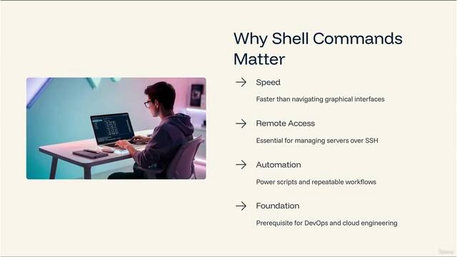
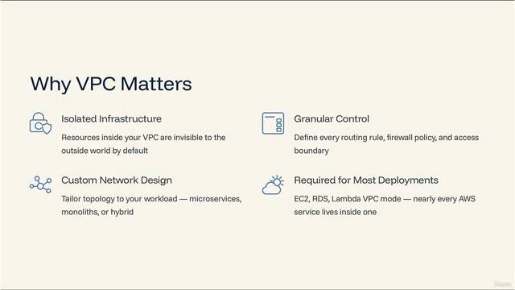
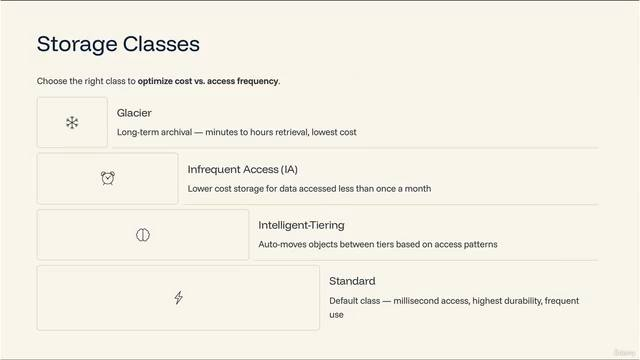
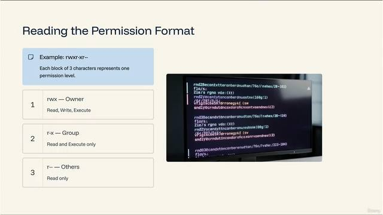
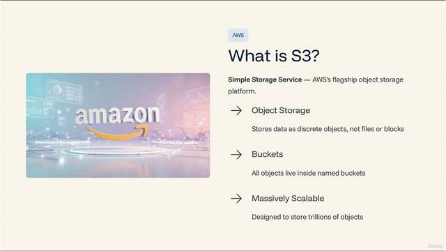
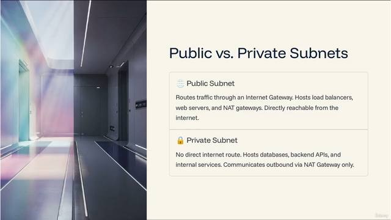

# AI Agents for Cloud Infrastructure（P12–P17）复现文档

> 覆盖课程片段：P012 权限 → P013 Shell 命令 → P014 EC2 计算 → P015 S3 存储 → P016 RDS 数据库 → P017 VPC 网络
> 说明：这六集的逐字稿里**几乎没有真实终端输出，也没有一个完整的代码仓库**。讲师给的是「概念 + 命令名 + 云服务组件」。所以本文档的复现方式是：**本地能跑的部分写成可直接执行的 shell 脚本（第 4 节），云上只能人工点的部分写成决策表与配置清单**。凡是逐字稿没讲的，文中会明确写「课里没讲」。

## 1. 这一节做什么

这六集想解决一个问题：**一个 AI Agent 要真的去操作基础设施，它需要碰到哪些层，每一层的最小权限边界在哪里。**

讲师的推进顺序是从「最近的一层」往「最远的一层」走：

| 片段 | 层次 | 落地产物 |
|---|---|---|
| P012 | 文件权限（owner / group / others + rwx） | 一套 `chmod` / `chown` 演练脚本 |
| P013 | Shell 命令（导航 / 文件 / 查看 / 搜索 / 系统信息 / 链式） | 一个 agent 只读日志的沙箱脚本 |
| P014 | Compute（EC2 实例、AMI、key pair、security group） | EC2 启动决策表 |
| P015 | Storage（S3 bucket / object / key / storage class） | 桶命名与访问控制表 |
| P016 | 结构化数据（RDS、表 / 行 / 列 / 查询、endpoint） | 数据模型草案 |
| P017 | 网络（VPC / subnet / IGW / route table / security group / NACL） | 拓扑职责表 + 地址规划表 |

读完之后你应该能做到两件事：一是能在自己的机器上把 P012、P013 的命令**真跑一遍并看到权限位变化**；二是能拿着 P014–P017 的四张表，在 AWS 控制台上把一套「公网只暴露 web 层、数据库与 Agent 内网隔离」的最小架构搭出来。

## 2. 讲师原话

下面每条都摘自逐字稿，英文是原文，方括号里是页码与时间戳。

> "Permissions are rules that control who can access a file or resource and what actions they can perform." —— p012 [00:00]
> （权限是控制「谁能访问哪个文件或资源、能做什么动作」的规则。）

> "The owner is the user who created the file. They typically have the highest level of control. The group consists of multiple users who share access to certain resources. Others refers to all remaining users on the system." —— p012 [02:19]
> （权限分三层：owner 是创建者、通常权限最高；group 是共享资源的多个用户；others 是剩下所有人。）

> "To view permissions, you use the ls-l command. This command displays detailed information about files, including their permissions, owner, and group." —— p012 [03:45]
> （用 `ls -l` 查看权限，它会把权限、owner、group 一起打出来。）

> "To change permissions, you use the Chomad command." —— p012 [04:13]
> （逐字稿把命令转写成 "Chomad"，按上下文就是 `chmod`；下一句明确说可以用符号写法，也可以用 `755` 这样的数字写法。）

> "To change ownership, you use the Chown command." —— p012 [05:10]
> （改归属用 `chown`，可以换用户也可以换组。）

> "By restricting permissions, you create guardrails that limit what the agent can do. This is a core principle in secure system design. Least privilege. You give systems only the access they need and nothing more." —— p012 [06:09]
> （最小权限：只给它需要的访问权，多一点都不给。）

> "using and and lets you run one command only if the previous one succeeds." —— p013 [05:16]
> （用 `&&` 把命令串起来，前一条成功才跑下一条。这是自动化的起点。）

> "If an agent has unrestricted access to the shell, it could perform harmful actions. That's why it's important to combine shell access with proper permissions and guardrails." —— p013 [06:16]
> （Agent 如果能不受限地开 shell，就能干坏事；所以 shell 能力必须配权限和护栏。）



> "Security groups act as virtual firewalls, controlling what traffic is allowed in and out of your instance." —— p014 [03:19]
> （security group 是实例级虚拟防火墙，管进出流量。）

> "Vertical scaling means increasing the size of a single instance, adding more CPU or memory. Horizontal scaling means adding more instances to handle increased load." —— p014 [04:47]
> （纵向扩容 = 加大单机；横向扩容 = 加机器。）

> "Each bucket has a globally unique name, meaning no two buckets can have the same name across AWS." —— p015 [01:55]
> （桶名在 AWS 全局唯一，这是 S3 最容易踩的坑之一。）

> "You can define who can read, write, or manage objects using IM policies and bucket policies." —— p015 [04:42]
> （逐字稿把 IAM 转写成 "IM policies"；访问控制靠 IAM 策略 + 桶策略两道。）

> "High availability is achieved through multi-AZ deployments, where your database is replicated across multiple zones." —— p016 [02:20]
> （高可用靠 multi-AZ，把库复制到多个可用区。）

> "To use an RDS database, you need to connect to it. This is typically done using an endpoint, which is like a URL for your database. You also need credentials, such as a username and password." —— p016 [03:45]
> （连库靠 endpoint（相当于数据库的 URL）+ 用户名密码。）

> "A public subnet is connected to the internet, allowing resources within it to be accessed externally. A private subnet, on the other hand, is not directly accessible from the internet." —— p017 [03:20]
> （公有子网通公网，私有子网不通；这是安全分层的核心。）



> "Network ACLs operate at the subnet level, providing an additional layer of control." —— p017 [04:46]
> （NACL 在子网级再加一层控制，和实例级的 security group 形成两层。）

## 3. 从零复现

这一节按「需求 → 约束 → 估算 → 方案 → 取舍」把讲师的推导走一遍，最后给出两条可以立刻执行的命令。

### Stage 0：需求

我们要做的系统是：**一个 AI Agent 能读取运行日志、能把结果写回存储、能查结构化数据，但绝对不能删库、不能改系统文件、不能被公网直接访问。**

### Stage 1：约束（来自逐字稿）

1. 权限有三个层级、三种类型，缺一不可：`owner/group/others` × `read/write/execute`（p012 [02:19]）。
2. 改权限有符号与数字两种写法，数字写法里 `7` 是满权、`5` 是读+执行（p012 [04:13]）。
3. Shell 是最强也最危险的一层：Agent 有了不受限 shell 就能干坏事（p013 [06:16]）。
4. 云上四件套各自有边界：security group 管实例进出（p014 [03:19]）、桶默认私有（p015 [04:42]）、库靠 endpoint + 凭据（p016 [03:45]）、私有子网不通公网（p017 [03:20]）。

### Stage 2：估算（**以下数字全部是本文档自设的示例假设，逐字稿没有给任何具体数值**）

| 估算项 | 假设 | 算式 | 结论 |
|---|---|---|---|
| Agent 日志量 | 每天 200 次会话，每次日志 50 KB | 200 × 50 KB = 10 MB/天；10 MB × 365 ≈ 3.65 GB/年 | 一年不到 4 GB，S3 Standard 完全够用 |
| 日志访问热度 | 前 30 天要频繁 grep，之后基本不看 | 30 天 × 10 MB = 300 MB 热数据 | 热区放 Standard，冷区转 Infrequent access（讲师 p015 [04:03] 讲的类别切换思路） |
| 结构化数据 | 1 万用户 × 每人 2 KB 记录 | 10 000 × 2 KB = 20 MB | 存储不是瓶颈，**瓶颈是并发连接数与读请求**，所以要 read replica（p016 [02:20]） |
| 计算 | 1 个 API 服务 | 1 台实例即可起步 | 先用 1 台 general purpose，后续 horizontal scaling（p014 [04:47]） |
| 网络 | 2 个子网：public 放 web，private 放库与 Agent | 2 段地址 | 公网入口只有 1 个，暴露面最小 |

### Stage 3：方案（分层落地）

```
[公网用户]
    │  (只允许 80/443，课里没讲具体端口号，以你实际服务为准)
    ▼
[Internet Gateway]  ←── 讲师 p017 [03:49] 的「桥」
    │
    ▼
[Public Subnet]  ──  Web/API 实例（EC2，security group 只放行 web 端口）
    │  内网调用
    ▼
[Private Subnet] ──  RDS 数据库（只有 web 层的 security group 能连）
                 └─  Agent 执行器（只读日志、只写指定桶前缀）
    │
    ▼
[S3 Bucket]  日志 / 数据集 / 模型输出（默认私有，仅授权角色可读写）
```

### Stage 4：取舍

| 取舍点 | 讲师给的判断 | 我们选什么 / 为什么 |
|---|---|---|
| 纵向 vs 横向扩容 | p014 [04:47] 两种都讲了 | 先横向（多加一台最便宜），单机撑不住再纵向 |
| Standard vs Glacier | p015 [04:03] 按访问频率选 | 30 天内 Standard，之后 Infrequent access；Glacier 只给合规归档 |
| 自建库 vs RDS | p016 [02:20] 托管省掉备份/补丁/高可用 | 选 RDS，前端背景的团队没有人愿意半夜打补丁 |
| 一个子网 vs 公私分离 | p017 [03:49] 公私分离是 best practice | 一定分离，否则数据库直接暴露 |

### Stage 5：动手（两条命令，先在本地跑通）

课里没给仓库，所以下面命令你只要有一个 bash 就能跑（macOS 自带 bash 3.2 也能跑本文脚本，Linux 更没问题）：

```bash
mkdir -p ~/agents-cloud-lab && cd ~/agents-cloud-lab
# 把第 4 节的两个脚本分别存成 p12-permissions/demo-perms.sh 和 p13-shell/collect-logs.sh
bash p12-permissions/demo-perms.sh
bash p13-shell/collect-logs.sh
```

## 4. 完整代码

> 再次强调：**讲师的这六集没有给出任何可运行代码**。下面 4.3 / 4.4 的脚本是本文档按照 p012、p013 讲到的命令（`ls -l`、`chmod`、`chown`、`pwd`、`ls`、`cd`、`touch`、`mkdir`、`cp`、`mv`、`rm`、`cat`、`head`、`tail`、`find`、`grep`、`whoami`、`top`、`df`、`&&`）拼出来的复现脚本，**不是讲师写的**；4.5–4.9 是决策表与草案，同样不是逐字稿原文。

### 4.1 目录结构

```
agents-cloud-lab/
├── p12-permissions/
│   └── demo-perms.sh          # 权限三层 + rwx + chmod + chown 演练
├── p13-shell/
│   └── collect-logs.sh        # agent 只读日志的沙箱脚本（含 && 链式）
├── p14-ec2/
│   └── launch-decisions.md    # 启动决策表（见 4.5）
├── p15-s3/
│   └── bucket-plan.md         # 桶命名与访问控制（见 4.6）
├── p16-rds/
│   └── data-model.md          # 表 / 行 / 列 草案（见 4.7）
└── p17-vpc/
    └── network-plan.md        # 拓扑职责表 + 地址规划（见 4.8）
```

### 4.2 环境与依赖

| 依赖 | 版本 | 备注 |
|---|---|---|
| bash | 3.2 及以上 | macOS 自带 3.2；Linux 一般 4.x/5.x。脚本没用 bash 4 专属语法 |
| coreutils（`ls`/`chmod`/`chown`/`find`/`grep`/`df`/`top`） | 系统自带即可 | macOS 是 BSD 版，`ls -l` 的字段顺序与 Linux 略有差异 |
| `sudo` | 有则更好 | 只有 `chown` 演示需要 root |
| AWS 账号 | 免费层可选 | 课里没讲计费；**建任何资源前先看清是否收费** |

脚本用到的环境变量（都有默认值，不设也能跑）：

| 变量名 | 默认值 | 作用 |
|---|---|---|
| `LAB_DIR` | `./lab-p12` | p12 演练目录 |
| `LOG_DIR` | `./lab-p13/logs` | p13 演练日志目录 |

### 4.3 `p12-permissions/demo-perms.sh`（完整文件）

```bash
#!/usr/bin/env bash
# p12 权限演练：owner / group / others 三层 + r/w/x 三型 + chmod + chown
# 依据：p012 [00:00]-[06:49] 讲到的 ls -l / chmod / chown
set -euo pipefail

LAB_DIR="${LAB_DIR:-./lab-p12}"

mkdir -p "$LAB_DIR"
cd "$LAB_DIR"

echo "== 我是谁（对应 p013 [04:18] 的 whoami）=="
whoami
echo

echo "== 我在哪（对应 p013 [01:26] 的 pwd）=="
pwd
echo

# 1) 造两个文件：一个当数据文件，一个当 agent 要执行的脚本
touch report.log agent-task.sh

# 2) 用数字写法设权限（p012 [04:13]：7 满权、5 读+执行）
chmod 644 report.log      # owner: rw-  group: r--  others: r--
chmod 755 agent-task.sh   # owner: rwx  group: r-x  others: r-x

echo "== ls -l 输出（字段名与顺序以你的系统实际输出为准）=="
ls -l
echo

# 3) 收紧到最小权限：数据文件只给自己读写
chmod 600 report.log
echo "== 收紧后 report.log =="
ls -l report.log
echo

# 4) 给 group 放开读（符号写法）
chmod g+r report.log
echo "== chmod g+r 之后 =="
ls -l report.log
echo

# 5) 去掉 others 的全部权限
chmod o-rwx report.log
echo "== chmod o-rwx 之后 =="
ls -l report.log
echo

# 6) chown：改归属需要 root，非 root 只打印跳过
if [ "$(id -u)" -eq 0 ]; then
  chown root:root report.log
  echo "== chown root:root 之后 =="
  ls -l report.log
else
  echo "[跳过 chown] 当前不是 root。p012 [05:10] 讲的 chown 需要 sudo，例如："
  echo "  sudo chown root:root report.log"
fi

echo
echo "== 自检：agent-task.sh 必须可执行 =="
if [ -x agent-task.sh ]; then
  echo "OK: agent-task.sh 具备 execute 权限（p012 [01:50] 讲的 execute）"
else
  echo "FAIL: 缺少 execute 权限，agent 无法把文件当程序运行"
  exit 1
fi
```

### 4.4 `p13-shell/collect-logs.sh`（完整文件）

```bash
#!/usr/bin/env bash
# p13 Shell 演练：一个「只读日志、只写归档目录」的 agent 沙箱
# 依据：p013 [01:26]-[05:46] 讲到的导航 / 文件管理 / 查看 / 搜索 / 系统信息 / && 链式
set -euo pipefail

LOG_DIR="${LOG_DIR:-./lab-p13/logs}"

mkdir -p "$LOG_DIR/archive"

# 生成测试数据（printf 不是讲师讲的命令，仅用于造样本）
printf '%s\n' "INFO boot ok" "INFO job-1 done" "ERROR timeout" "INFO job-2 done" > "$LOG_DIR/app.log"
printf '%s\n' "ERROR db timeout" "WARN retry" > "$LOG_DIR/error.log"

echo "== pwd：当前目录（p013 [01:26]）=="
pwd
echo

echo "== ls：列出目录内容（p013 [01:26]）=="
ls -l "$LOG_DIR"
echo

echo "== cat：整文件（p013 [02:53]）=="
cat "$LOG_DIR/error.log"
echo

echo "== head：前 2 行 =="
head -n 2 "$LOG_DIR/app.log"
echo

echo "== tail：后 2 行 =="
tail -n 2 "$LOG_DIR/app.log"
echo

echo "== grep：在所有日志里找 ERROR（p013 [03:49]）=="
grep -n "ERROR" "$LOG_DIR"/*.log || echo "(没有匹配)"
echo

echo "== find：按名字找 .log 文件 =="
find "$LOG_DIR" -name "*.log" -type f
echo

echo "== && 链式：前一步成功才走下一步（p013 [05:16]）=="
mkdir -p "$LOG_DIR/archive" \
  && cp "$LOG_DIR/app.log" "$LOG_DIR/archive/" \
  && echo "归档完成"
echo

echo "== df：磁盘占用（p013 [04:47]）=="
df -h
echo

echo "== top：进程与资源（只取一次快照，失败则提示）=="
top -b -n 1 2>/dev/null | head -n 5 || echo "你的平台不支持 top -b，直接运行 top 交互查看"
```

### 4.5 EC2 启动决策表（`p14-ec2/launch-decisions.md`）

讲师在 p014 [03:48] 把启动流程拆成六步，这里把每一步落成「你要填什么」：

| # | 步骤（p014 [03:48]） | 讲师原话要点 | 你的填入值（示例，课里没给具体数值） |
|---|---|---|---|
| 1 | 选 AMI | "这是一个用于定义操作系统和预装软件的模板" | 一个 Ubuntu LTS 镜像（课里没讲具体发行版） |
| 2 | 选实例类型 | general / compute / memory / GPU 四类（p014 [02:21]） | general purpose 起步；跑 AI 推理才换 GPU 类 |
| 3 | 配网络 | "指明实例将属于哪个网络和子网" | `public-subnet`（web 层）；Agent 执行器放 `private-subnet` |
| 4 | 加存储 | "具体取决于你需要存储多少数据" | 随实例的默认卷；日志不放本地，放 S3 |
| 5 | 配安全组 | "安全组充当虚拟防火墙"（p014 [03:19]） | 只放 web 端口；SSH 来源限定为自己的出口 IP（课里没讲端口号，按实际填） |
| 6 | 启动并 SSH 连接 | "使用 SSH 连接到它" | key pair 私钥权限设成 `600`（对应 p012 的最小权限） |

### 4.6 S3 桶命名与访问控制表（`p15-s3/bucket-plan.md`）

| 项目 | 规则来源 | 你的方案 |
|---|---|---|
| 桶名 | "全局唯一的名称"（p015 [01:55]） | `<公司前缀>-agent-logs-<年月>`，全小写、全局唯一 |
| 对象键 | "一个唯一的键，作用类似于路径或文件名"（p015 [02:52]） | `logs/YYYY/MM/DD/<run-id>.log`，用 key 前缀模拟目录 |
| 默认可见性 | "默认情况下，S3 存储桶是私有的"（p015 [04:42]） | 保持私有，不自作主张开公开 |
| 谁能读 | "IAM 策略和存储桶策略"（p015 [04:42]） | 只给 Agent 运行角色的读权限，写权限限定到 `logs/` 前缀 |
| 存储类别 | standard / intelligent tiering / infrequent access / glacier（p015 [04:03]） | 30 天内 Standard，之后转 Infrequent access |
| 加密 | "无论是静态存储还是传输过程中"（p015 [05:12]） | 开服务端加密 + 只用 HTTPS 访问 |

> 课里**只说了策略存在，没有给出任何策略 JSON 的具体字段**（讲师没写 Principal / Resource / Action 这些键）。你实际配置时以 AWS 控制台生成的模板为准，不要照抄网上来的策略。



### 4.7 RDS 数据模型草案（`p16-rds/data-model.md`）

讲师讲了 tables / rows / columns / queries / endpoint / credentials（p016 [03:18]-[04:14]），但**没给任何表结构**。下面是按这些概念画的草案，字段是本文档自拟，不是逐字稿内容。

**表 `agent_runs`**

| 列 | 类型（示意） | 说明 |
|---|---|---|
| `id` | 整数，主键 | 一次 agent 运行 |
| `user_id` | 整数 | 关联的用户 |
| `started_at` | 时间 | 开始时间（用于"查询最近一周"这类 queries） |
| `status` | 短字符串 | 成功 / 失败 |
| `output_key` | 字符串 | 结果在 S3 里的对象 key |

**连接方式**：用 endpoint（"类似于数据库的 URL"）+ 用户名密码（p016 [03:45]）。**endpoint 的具体形态与端口，课里没讲**，以控制台显示为准。

**扩展路线**（对应 p016 [04:40]）：先用 1 个小实例；读请求多了加 read replica；要可靠性上 multi-AZ（p016 [02:20]）。

### 4.8 VPC 组件职责表 + 地址规划（`p17-vpc/network-plan.md`）

| 组件 | 职责（逐字稿依据） | 你填什么 |
|---|---|---|
| VPC | "your own isolated network within AWS"，定义 IP 段（p017 [00:55]） | `10.0.0.0/16`（**示例网段，课里没给具体值**） |
| Public subnet | "connected to the internet"（p017 [03:20]） | `10.0.1.0/24`，放 web / API |
| Private subnet | "not directly accessible from the internet"（p017 [03:20]） | `10.0.2.0/24`，放 RDS 与 Agent 执行器 |
| Internet Gateway | "a bridge between your private network and the public internet"（p017 [03:49]） | 挂在 VPC 上，只有 public 子网的路由表指向它 |
| Route table | "define how traffic flows within your VPC"（p017 [03:49]） | public 表：默认路由走 IGW；private 表：不配公网默认路由 |
| Security group | 实例级防火墙（p014 [03:19] / p017 [04:46]） | web 组放行 web 端口；db 组只允许来自 web 组的连接 |
| Network ACL | 子网级额外一层（p017 [04:46]） | 默认全放行，先别乱改；要收紧时在子网级加规则 |

### 4.9 Agent 最小权限矩阵（把 p012 [06:09] 的 least privilege 落地）

| 能力 | 允许 | 禁止 | 对应层 |
|---|---|---|---|
| 读日志 | ✅ 只读 `logs/` 前缀 + 只读 `*.log` | ❌ 改、删 | S3 策略 + 文件权限 `644/444` |
| 执行任务 | ✅ 只有 `755` 的脚本 | ❌ 改脚本本身（不给 write） | p012 [01:50] 的 execute |
| 查数据 | ✅ SELECT 类查询 | ❌ 删表 / 改结构 | RDS 账号权限 |
| 开 shell | ⚠️ 只允许白名单命令 | ❌ 任意命令 | p013 [06:16] 的护栏 |
| 被公网访问 | ❌ 一律不 | — | private subnet（p017 [03:20]） |

## 5. 逐行解释

### 5.1 为什么 `chmod 644` 和 `755` 是这两个数

p012 [04:13] 说数字写法里 `7` 是满权、`5` 是读+执行。三位数字分别对应 owner / group / others 三层（p012 [02:19]）。`644` = owner 读写（6 = 4 读 + 2 写）、group 只读、others 只读 —— 这是「数据文件」的常见姿态：自己能改，别人只能看。`755` = owner 满权，group 和 others 读+执行 —— 这是「脚本」的姿态：别人能跑，但不能改。**如果能改又能跑，等于给了别人往你机器上塞代码的权限，这就是安全漏洞。**

### 5.2 为什么脚本里先 `644` 再收紧到 `600`

`600` 只留 owner 读写，group 和 others 全无。演示顺序是「宽 → 窄」，因为最小权限原则（p012 [06:09]）的落地动作就是**不断往下收**，而不是一上来给满再想办法补。收窄不会破坏功能，放宽才会。

### 5.3 为什么 `chmod g+r` 和 `o-rwx` 用符号写法

数字写法一次把三层全重设，容易手滑把 owner 权限也改掉；符号写法只动指定那一层，风险小。**团队协作时优先用符号写法**，这是对 p012 [04:13] 「改权限要小心」的落实。

### 5.4 为什么 `chown` 要单独判断 root

`chown` 改的是归属，普通用户改不了别人的文件。脚本用 `id -u` 判断，非 root 就只打印提示，这样脚本在任何机器上都不会中途失败（`set -e` 下失败会直接退出）。这也是把「课里讲的命令」变成「可复现脚本」必须做的适配。

### 5.5 为什么 `ls -l` 的输出不能写死

逐字稿只说它会打出 permissions、owner、group（p012 [03:45]），**没有给出字段顺序，也没提链接数、大小、时间这些列**。macOS（BSD）和 Linux（GNU）的 `ls -l` 列顺序本来就不一样。所以脚本里直接调真实命令，让环境自己输出，文档里只描述「你会看到什么类型的信息」。



### 5.6 为什么 `collect-logs.sh` 里每一步都加 `echo "== ... =="`

为了让输出可对照。你跑完一眼就能看出哪一段对应 p013 的哪个知识点（导航、文件管理、查看、搜索、系统信息、链式）。

### 5.7 为什么 `grep` 后面要跟 `|| echo "(没有匹配)"`

`grep` 在没匹配时返回非零退出码，而脚本开了 `set -euo pipefail`，会直接终止。加 `||` 兜底，脚本才能继续演示后面的 `find` 和 `&&`。**这不是讲师讲的内容，是把它写成可运行脚本的必要处理。**

### 5.8 为什么用 `&&` 串 `mkdir → cp → echo`

p013 [05:16] 的原话是「前一条成功才跑下一条」。归档这种事，如果目录没建成就去复制，只会得到一个半成品。`&&` 保证三步要么全成、要么停在失败处 —— 这就是讲师说的「自动化的起点」。

### 5.9 为什么 EC2 决策表把「安全组」放在第 5 步而不是第 1 步

因为安全组的规则取决于你前面选的子网和端口。先定网络位置（public 还是 private），再定放行什么流量，逻辑才顺。讲师 p014 [03:48] 的六步顺序也是这个意思：网络在前、安全在后。

### 5.10 为什么 S3 桶名方案里带「年月」

桶名全局唯一（p015 [01:55]）。带上年月，方便按生命周期切桶，也降低撞名概率。键前缀用 `logs/YYYY/MM/DD/...` 是因为 S3 用 key 模拟目录（p015 [02:52]）—— 前端出身的读者可以理解成「key 就是完整路径字符串，没有真正的目录对象」。



### 5.11 为什么 RDS 草案里把 `output_key` 存在库里而不是把结果本身存库里

大对象放 S3，结构化字段放 RDS —— 这是 p015 [06:06] 与 p016 [06:06] 两段叠加出来的分工：S3 存数据集/输出，RDS 存「用户输入、系统输出、关于模型预测的元数据」。库里只存一个指针（key），查询快、库也不会被大字段撑爆。

### 5.12 为什么 private subnet 的路由表「不配公网默认路由」

p017 [03:49] 明确说私有子网「typically do not have direct internet access，而是内部通信或走受控入口」。不配默认路由，就是从网络层物理性地保证「就算库被攻破也连不出去」。



## 6. 复现检查清单

**本地部分**

- [ ] 目录建好了：`ls -d ~/agents-cloud-lab/p12-permissions ~/agents-cloud-lab/p13-shell`
- [ ] `demo-perms.sh` 有执行权限：`chmod 755 p12-permissions/demo-perms.sh`
- [ ] 跑通 p12：`bash p12-permissions/demo-perms.sh`，最后一行必须是 `OK: agent-task.sh 具备 execute 权限`
- [ ] 看到 `report.log` 从 `644 → 600 → g+r → o-rwx` 的权限串变化（对照 `ls -l report.log`）
- [ ] 输出里有 `whoami` 和 `pwd` 两段（对应 p013 [04:18] / [01:26]）
- [ ] 跑通 p13：`bash p13-shell/collect-logs.sh`，必须出现 `归档完成`
- [ ] `grep -n "ERROR"` 那段至少匹配到 `error.log` 里的 `ERROR db timeout`
- [ ] `find` 那段能列出 `app.log` 与 `error.log`
- [ ] 用 `ls -l` 观察自己机器上 `ls -l` 的列顺序（和 Linux 教程截图对比一下，确认你知道差异）

**云上部分（对照四张表逐项打勾）**

- [ ] EC2：AMI / 实例类型 / 子网 / 存储 / 安全组 / key pair 六项都填了（4.5 表）
- [ ] 私钥文件权限是 `600`（拿 p012 的知识自检一次）
- [ ] S3：桶名全局唯一；桶保持私有；只给 Agent 角色读 `logs/` 的权限
- [ ] S3：确认没有任何对象被设成 public（除非你明确在做静态站）
- [ ] RDS：能拿到 endpoint；凭据存在安全的地方；先用最小实例
- [ ] RDS：确认是否开了 multi-AZ（开了会贵，先想清楚）
- [ ] VPC：public / private 两个子网都在；private 子网没有公网默认路由
- [ ] VPC：db 的 security group 只允许来自 web 组的连接，不是 `0.0.0.0/0`

## 7. 课里没讲但你会撞上的

1. **权限数字的加法规则**。讲师只给了 `7` 和 `5` 两个点，没讲 `4=读、2=写、1=执行` 的位权。你实际配 `640`、`750` 时会需要它。（这是通用 Linux 知识，不是本课内容。）
2. **`chmod -R 777` 的诱惑**。「跑不起来就 777」是新手最常见的操作，它等于把 p012 讲的所有边界一次性拆掉。遇到权限报错，先 `ls -l` 看是谁的权限不对，再定向放开。
3. **递归改权限会连目录一起改**。目录的 `x` 位含义是「能不能进去」，不是「能不能执行」。给目录去掉 `x`，里面的文件你都进不去。
4. **前端背景最容易踩的坑：在 Node 里执行 shell**。`child_process.exec` 会把字符串交给 shell 解析，用户输入一旦拼进去就是命令注入；`execFile`/`spawn` 传参数数组可规避。这正是 p013 [06:16] 「Agent 有不受限 shell 就能干坏事」在代码层面的具体形态。**课里没有讲 Node，这段是给你的迁移提示。**
5. **SSH 的来源限制**。讲师说了 security group 管流量（p014 [03:19]），但没说 SSH 端口对 `0.0.0.0/0` 开放有多危险。实践上应限定到自己的出口 IP。**具体端口号课里没讲**。
6. **IAM 策略与桶策略的区别**。讲师只提了两个名字（p015 [04:42]），没说谁优先、怎么写。实际配置时以控制台模板为准。
7. **RDS 的并发与事务**。多 Agent 同时写同一行会互相覆盖。关系库靠事务隔离级别解决；在 Node 里对应的是「用连接池 + 显式事务包裹多语句写入」，而不是每条 SQL 单独发一次。**课里完全没讲事务和连接池**，但你的 Agent 一旦并发跑起来必然遇到。
8. **`top -b` 在 macOS 不存在**。脚本已做了 fallback；如果你在 Mac 上看到提示，直接用 `top` 交互查看即可。
9. **云资源的计费**。六集全程没提钱。EC2 停机不等于不计费（取决于计费方式）、NAT/数据传出、multi-AZ 的 RDS 都是常见账单惊吓项。建之前先确认。
10. **S3 的「文件夹」是假象**。控制台里看到的目录是 key 前缀渲染出来的，删「目录」就是批量删对象，删完不可撤销。**课里没讲版本控制**，建议先开版本控制再让 Agent 有写权限。