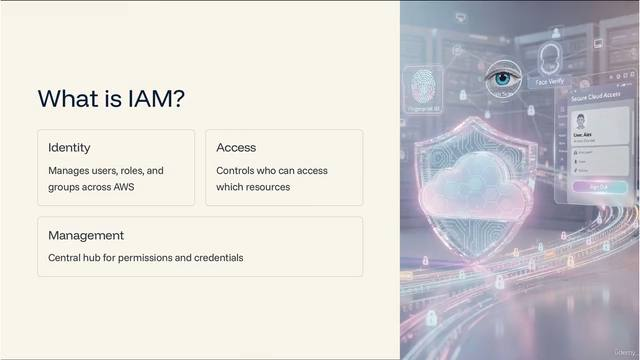
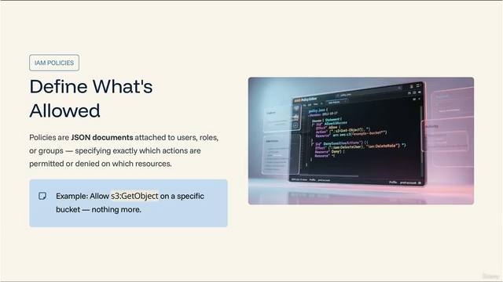
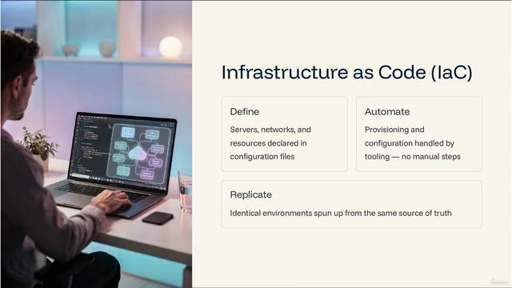
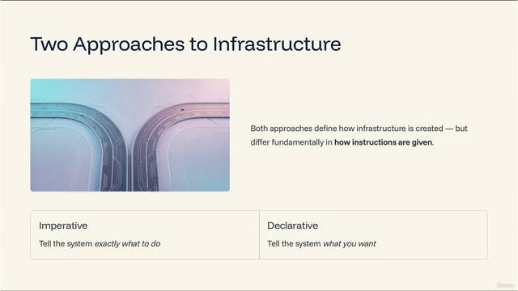
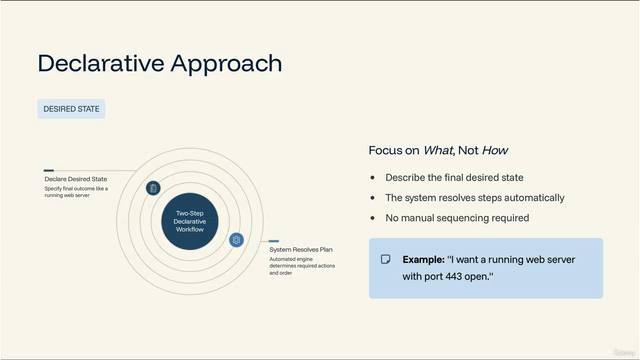
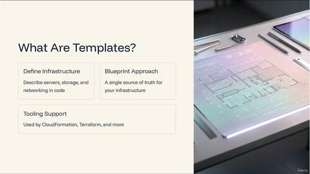
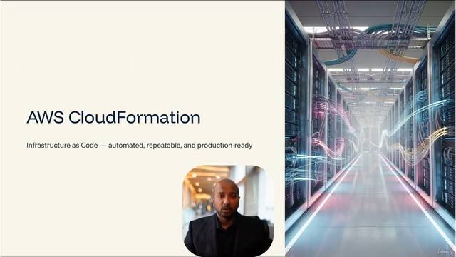
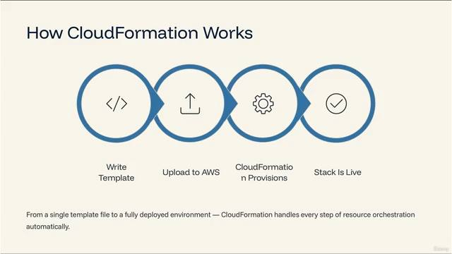

# AI Agents for Cloud Infrastructure：IAM、IaC、声明式模板与 CloudFormation 复现文档（P18–P22）

## 1. 这一节做什么

这一段课程的主线不是“某一个命令怎么敲”，而是：**当 AI Agent 要操作云基础设施时，如何用 IAM 限定它能做什么，再用 Infrastructure as Code、声明式模板、模板/模块和 CloudFormation，把“Agent 想改基础设施”变成可审查、可复现、可回滚的工程流程。**

逐字稿里，讲师先把 IAM 讲成云上的访问控制层：谁是你、你能做什么；然后讲 IaC 把基础设施变成代码；再讲声明式与命令式的区别；接着讲 template 与 module 如何复用；最后落到 AWS CloudFormation 的 template、stack、resources、parameters、outputs、rollback。课程没有演示完整代码，也没有给出可直接复制的 CloudFormation 模板。因此本文会严格按照逐字稿重组概念，并把缺失的落地部分明确标成“课里没有代码，以下为示意”，方便你照着复现一个最小闭环：**IAM 最小权限策略 + 一个 CloudFormation 模板 + 一个 stack 部署/验证/删除流程**。

读完你应该能交付：

- 一张 IAM 权限边界表：Agent 能读什么、不能删什么；
- 一个可保存的 CloudFormation 模板文件；
- 一组环境变量和部署命令；
- 一个复现检查清单；
- 一份“课里没讲但实际会踩”的排错清单。



---

## 2. 讲师原话（带「—— pNNN [MM:SS]」）

下面只摘关键原话，不逐段流水账。你可以把这些话当成这一节的设计依据。

> "IAM 代表身份与访问管理，它是 AWS 用来控制资源访问的系统。"
> —— p018 [00:00]

> "IAM 不会给所有人完全访问权限，而是让你精确控制允许执行哪些操作。"
> —— p018 [00:28]

> "这会形成护栏，阻止有害操作。"
> —— p018 [06:12]

这句话是 AI Agent 场景的核心：Agent 不是“有云账号就什么都能干”，而是被 IAM 关进护栏里。

> "基础设施即代码是一种用代码管理和配置基础设施、而不是依赖手动流程的实践。"
> —— p019 [00:00]

> "在命令式方法中，你给出一步步的指令；在声明式方法中，你描述期望的结果，系统会自行想办法实现它。"
> —— p020 [00:29]

> "模板是基础设施即代码的基础。它们用结构化文件定义你的基础设施，就像一份说明需要创建哪些内容的蓝图。"
> —— p021 [00:00]

> "堆栈是该模板的一次运行实例，代表你已部署的资源。"
> —— p022 [01:53]

> "如果部署过程中出现问题，CloudFormation 可以自动回滚变更。"
> —— p022 [05:12]



---

## 3. 从零复现

这一节是概念课，不是命令课。下面按“需求 → 约束 → 估算 → 方案 → 取舍”的顺序复现讲师的推导过程。最后再在“4. 完整代码”里给出一个可保存的示意模板和部署命令。注意：**课里没有给模板代码，也没有演示 AWS CLI；第 4 节的模板和命令是为了让你能落地复现而补的示意，不是讲师原稿。**

### 3.1 需求：让 Agent 能安全地操作云资源

根据 p018，IAM 要回答两个问题：

1. **Who are you?** 身份认证：用户、角色、凭证。
2. **What are you allowed to do?** 授权：policy 定义允许或拒绝的动作。

根据 p018 后段，AI Agent 应该有“护栏”：例如可以启动或停止实例，但不能删除关键资源。根据 p019、p021、p022，Agent 不应该直接生成一堆命令去执行，而应该生成 template 或配置，经过审查后再应用。这样做的原因是：

- IaC 让基础设施可版本化、可复用、可自动化；
- 声明式让 Agent 描述“最终要什么”，而不是“每一步怎么做”；
- template 是蓝图，module 是可复用组件；
- CloudFormation 的 stack 把一组资源作为一个整体管理，失败可回滚。

所以本次复现的目标不是“做一个万能 Agent”，而是做一个最小安全闭环：

> Agent 只能读 demo S3 bucket，不能删除；所有基础设施通过 CloudFormation template 声明；部署成一个 stack；验证输出；最后删除 stack。

### 3.2 约束：权限、可复现、可回滚

从逐字稿可以抽出这些约束：

| 约束 | 逐字稿依据 | 复现要求 |
|---|---|---|
| 最小权限 | p018 [03:50] 讲 least privilege | 只给读，不给删；删除动作显式拒绝 |
| 尽量用 role，不长期存凭证 | p018 [02:25] 讲 role 临时权限 | 不把 access key 写进模板或代码 |
| 基础设施用代码定义 | p019 | 用 template 文件，不用控制台点选 |
| 声明式优先 | p020 | 描述最终资源，不写“第一步第二步” |
| template 可复用 | p021 | 参数化 bucket 名称 |
| stack 作为整体管理 | p022 | 用 stack 部署、更新、删除 |
| 失败可回滚 | p022 [05:12] | 用 CloudFormation 的 rollback 能力，不手工擦屁股 |



### 3.3 估算：把“审查成本”算出来

课里没有给出具体容量数字。下面是为了复现练习而设的**示例参数**，不是讲师给出的结论。你可以替换成自己的数据。

| 变量 | 含义 | 示例值 | 算式 |
|---|---|---:|---|
| T | Agent 每天任务数 | 20 | 示例 |
| G | 每个任务生成模板数 | 1 | T × G |
| R | 每天需要审查的模板数 | 20 | R = T × G = 20 |
| P | 每次审查耗时（分钟） | 10 | 示例 |
| H | 每天审查工时 | 3.33 小时 | H = R × P / 60 = 20 × 10 / 60 |
| N | 每个模板涉及资源数 | 2 | bucket + IAM policy |
| E | 每天资源变更事件数 | 40 | E = R × N = 20 × 2 |
| M | 每月审查模板数 | 600 | M = R × 30 = 20 × 30 |

这个估算说明：**Agent 生成模板并不等于零成本**。真正要设计的是“生成 → 审查 → 应用 → 回滚”的流水线。逐字稿里讲的是概念，没有给审查系统和审批流；这里只是帮你把概念变成可估算的工程对象。

### 3.4 方案：四层结构

根据课程，复现方案可以拆成四层：

1. **身份层：IAM**
   - 用 role / policy 限定 Agent 的动作；
   - 允许读，拒绝删；
   - 不把长期 access key 写进代码。

2. **描述层：IaC template**
   - 用 YAML 或 JSON 描述资源；
   - p022 提到 CloudFormation 模板包含 Resources、Parameters、Outputs，以及可选的 Mappings、Conditions；
   - 本复现用 Parameters 传入 bucket 名称，用 Outputs 输出 bucket ARN 和 policy ARN。

3. **复用层：template 与 module**
   - template 是完整蓝图；
   - module 是可复用组件；
   - 课里讲了 module 概念，但没有给 CloudFormation Modules 的具体语法。因此本复现先做单模板，模块化只停留在职责划分，不编造 CloudFormation module 代码。

4. **执行层：CloudFormation stack**
   - template 上传后创建 stack；
   - stack 代表已部署资源；
   - 更新时 CloudFormation 对比新旧模板，只改必要部分；
   - 失败时自动回滚。

### 3.5 取舍：为什么选声明式而不是命令式

p020 明确对比了两种方式：

- 命令式：一步一步写“创建服务器、安装软件、配置、启动”。控制细，但步骤多、依赖多、环境容易不一致。
- 声明式：只描述最终状态，由工具计算怎么达到。可重复、可版本化，但调试时对工具依赖更强。

在本复现里，选声明式的理由很直接：**Agent 生成“最终资源描述”比生成“每一步命令”更容易审查**。如果 Agent 生成十步命令，你很难判断第三步会不会删库；如果 Agent 生成一个 template，你可以看 Resources 和 IAM policy，审查边界更清楚。代价是：你需要理解 template 语法，并且接受 CloudFormation 决定执行顺序。







---

## 4. 完整代码

> **重要标注：课里没有代码，以下为示意。**  
> 逐字稿只讲了 IAM、IaC、声明式、template/module、CloudFormation 的概念，没有给出完整模板，也没有演示命令。下面的 `template.yaml` 和命令是为了让你能复现一个最小闭环而补的工程示意，不是讲师原稿。模板中的具体资源类型 `AWS::S3::Bucket`、`AWS::IAM::ManagedPolicy` 也不是逐字稿逐字给出的，属于复现所需的最小示例；实际生产请按你的权限和合规要求调整。

### 4.1 目录结构

```text
ai-agent-cfn-demo/
├── template.yaml
└── README.md
```

本文只需要一个核心文件 `template.yaml`。`README.md` 可以放下面的环境变量和命令。

### 4.2 依赖与版本

| 依赖 | 说明 |
|---|---|
| AWS CLI v2 | 课里没讲版本号；用你机器上 `aws --version` 的实际输出为准 |
| AWS 账号 | 需要能创建 CloudFormation stack、S3 bucket、IAM managed policy 的权限 |
| CloudFormation | AWS 托管服务，无本地 npm 包版本；模板语言版本在下面代码块中写为 `2010-09-09` |
| Node/npm | 本复现不需要 |

### 4.3 环境变量

```bash
export AWS_REGION="us-east-1"
export AWS_PROFILE="default"          # 可选；如果你用默认 profile 可以不设
export STACK_NAME="ai-agent-cfn-demo"
export BUCKET_NAME="ai-agent-cfn-demo-$(date +%s)"
export TEMPLATE_FILE="template.yaml"
```

说明：

- `AWS_REGION`：部署区域；
- `AWS_PROFILE`：可选，本机多账号时使用；
- `STACK_NAME`：CloudFormation stack 名称；
- `BUCKET_NAME`：S3 bucket 名称，必须全局唯一；
- `TEMPLATE_FILE`：模板文件路径。

### 4.4 完整文件：`template.yaml`

```yaml
AWSTemplateFormatVersion: "2010-09-09"
Description: Illustrative CloudFormation template for the course notes. The course did not provide template code.

Parameters:
  BucketName:
    Type: String
    Description: Globally unique S3 bucket name for the demo.
    AllowedPattern: "^[a-z0-9][a-z0-9-]{1,61}[a-z0-9]$"
    ConstraintDescription: Must be 3-63 chars, lowercase letters, numbers, hyphens, and start/end with alphanumeric.

Resources:
  DemoBucket:
    Type: AWS::S3::Bucket
    Properties:
      BucketName: !Ref BucketName

  DemoAgentReadOnlyPolicy:
    Type: AWS::IAM::ManagedPolicy
    Properties:
      Description: Least-privilege read-only policy for the demo bucket.
      PolicyDocument:
        Version: "2012-10-17"
        Statement:
          - Sid: AllowListBucket
            Effect: Allow
            Action: s3:ListBucket
            Resource: !Sub "arn:aws:s3:::${BucketName}"
          - Sid: AllowGetObject
            Effect: Allow
            Action: s3:GetObject
            Resource: !Sub "arn:aws:s3:::${BucketName}/*"
          - Sid: DenyDeleteBucket
            Effect: Deny
            Action: s3:DeleteBucket
            Resource: !Sub "arn:aws:s3:::${BucketName}"
          - Sid: DenyDeleteObject
            Effect: Deny
            Action: s3:DeleteObject
            Resource: !Sub "arn:aws:s3:::${BucketName}/*"

Outputs:
  BucketName:
    Description: Name of the created bucket.
    Value: !Ref DemoBucket
  BucketArn:
    Description: ARN of the created bucket.
    Value: !GetAtt DemoBucket.Arn
  AgentPolicyArn:
    Description: ARN of the least-privilege managed policy.
    Value: !Ref DemoAgentReadOnlyPolicy
```

### 4.5 部署命令

```bash
aws cloudformation deploy \
  --region "$AWS_REGION" \
  --profile "$AWS_PROFILE" \
  --template-file "$TEMPLATE_FILE" \
  --stack-name "$STACK_NAME" \
  --parameter-overrides BucketName="$BUCKET_NAME" \
  --capabilities CAPABILITY_IAM
```

如果你没有设置 `AWS_PROFILE`，把 `--profile "$AWS_PROFILE"` 这一行删掉，或先执行 `unset AWS_PROFILE`。

### 4.6 验证命令

```bash
aws cloudformation describe-stacks \
  --region "$AWS_REGION" \
  --stack-name "$STACK_NAME" \
  --query "Stacks[0].StackStatus" \
  --output text
```

状态值以实际输出为准。课里没有讲 AWS CLI 的 `describe-stacks` 用法，这里只是为了让你确认 stack 是否创建完成。

查看 Outputs：

```bash
aws cloudformation describe-stacks \
  --region "$AWS_REGION" \
  --stack-name "$STACK_NAME" \
  --query "Stacks[0].Outputs" \
  --output table
```

### 4.7 清理命令

```bash
aws cloudformation delete-stack \
  --region "$AWS_REGION" \
  --stack-name "$STACK_NAME"
```

注意：如果 S3 bucket 里已经有对象，删除 stack 可能失败。课里没有讲这个坑，实际排错见第 7 节。





---

## 5. 逐行解释

### 5.1 `template.yaml` 逐行说明

**`AWSTemplateFormatVersion: "2010-09-09"`**  
这是 CloudFormation 模板版本声明。它出现在本文代码块里；逐字稿只提到模板用 YAML/JSON 编写，没有逐字讲这个字段。实际项目按 AWS 当前支持为准。

**`Description: ...`**  
模板描述。这里明确写了“课里没有提供模板代码”，避免把示意模板误认为讲师原稿。

**`Parameters:`**  
p022 提到 Parameters 允许向模板传入输入值，使模板灵活可复用。这里用 `BucketName` 作为参数，避免把 bucket 名硬编码。

**`BucketName:` / `Type: String`**  
参数名和类型。类型是字符串。

**`AllowedPattern` 和 `ConstraintDescription`**  
限制 bucket 名称格式。S3 bucket 名称有全局唯一和命名规则要求；逐字稿没有展开这些规则，这里是为了减少部署时低级错误。

**`Resources:`**  
p022 明确说 Resources 定义要创建什么，例如服务器或数据库。本模板里放两个资源：S3 bucket 和 IAM managed policy。

**`DemoBucket:` / `Type: AWS::S3::Bucket`**  
声明一个 S3 bucket。逐字稿提到 S3 bucket 作为资源例子，但没有给具体资源类型；`AWS::S3::Bucket` 是本文示意代码中的写法。

**`BucketName: !Ref BucketName`**  
把 Parameters 里的 `BucketName` 引用到资源属性里。`!Ref` 是 CloudFormation YAML 的引用标签，不是 JavaScript 语法。前端同学容易把它当成普通 YAML 字符串，实际上它会被 CloudFormation 解析。

**`DemoAgentReadOnlyPolicy:` / `Type: AWS::IAM::ManagedPolicy`**  
声明一个 IAM 托管策略。p018 讲 policy 可以用 JSON 描述允许或拒绝的动作；这里把 policy 直接写进 CloudFormation 模板，作为“Agent 护栏”的示意。

**`PolicyDocument:`**  
IAM policy 文档主体。p018 说 policy 用 JSON 格式、结构化地指定权限；在 YAML 模板里可以用 YAML 映射表达同样的结构。

**`Version: "2012-10-17"`**  
IAM policy 语言版本。这个值出现在本文代码块里；逐字稿没有展开版本号。

**`Statement:`**  
策略语句列表。p018 提到 policy 可以允许读 S3、拒绝删除对象；下面四条分别对应允许列桶、允许读对象、拒绝删桶、拒绝删对象。

**`Sid: AllowListBucket`**  
语句标识，便于阅读和排错。逐字稿没有提 `Sid`，这是示意模板里的可读性字段。

**`Effect: Allow` / `Effect: Deny`**  
p018 明确说 policy 定义允许或拒绝。这里用 Allow 给读权限，用 Deny 明确挡住删除动作。IAM 中显式 Deny 的优先级请以 AWS 实际语义为准；逐字稿没有展开优先级细节。

**`Action: s3:ListBucket` / `s3:GetObject` / `s3:DeleteBucket` / `s3:DeleteObject`**  
这些是具体动作名，出现在本文代码块里。它们对应“列桶、读对象、删桶、删对象”的示意权限。逐字稿只举例“允许读 S3、拒绝删除对象”，没有逐字给出这些 action 名称。

**`Resource: !Sub "arn:aws:s3:::${BucketName}"`**  
用 `!Sub` 把参数拼进 ARN。桶级动作和对象级动作的 Resource 形状不同：`ListBucket`、`DeleteBucket` 用桶 ARN；`GetObject`、`DeleteObject` 用对象 ARN。这是示意模板的写法，课里没有讲 ARN 语法。

**`Outputs:`**  
p022 提到 Outputs 返回部署后的有用信息，例如 URL 或资源 ID。这里输出 bucket 名称、bucket ARN 和 policy ARN，方便后续接 Agent 或审查系统。

**`Value: !Ref DemoBucket`**  
引用资源。对 S3 bucket 使用 `!Ref` 通常返回 bucket 名称；具体返回值以 CloudFormation 文档和实际输出为准。

**`Value: !GetAtt DemoBucket.Arn`**  
取资源属性。`!GetAtt` 是 CloudFormation YAML 标签，用来获取资源属性；这里取 bucket ARN。

### 5.2 部署命令逐行说明

**`aws cloudformation deploy`**  
这是 AWS CLI 的 CloudFormation 部署命令。逐字稿没有演示命令；这是为了复现而补的。

**`--region "$AWS_REGION"`**  
显式指定区域，避免默认区域和你创建资源的区域不一致。

**`--profile "$AWS_PROFILE"`**  
可选。多账号环境用 profile 隔离凭证。课里讲 role 和临时权限，但没有讲本地 CLI profile。

**`--template-file "$TEMPLATE_FILE"`**  
指定模板文件。对应 p022 的“编写 template 并上传/创建 stack”。

**`--stack-name "$STACK_NAME"`**  
指定 stack 名称。p022 说 stack 是 template 的运行实例，代表已部署资源；这里就是给这个运行实例起名。

**`--parameter-overrides BucketName="$BUCKET_NAME"`**  
传入模板参数。对应 p022 的 Parameters。

**`--capabilities CAPABILITY_IAM`**  
因为模板里创建 IAM managed policy，CloudFormation 需要你确认 IAM 能力。这个参数是 AWS CLI 的复现要求，逐字稿没有讲。

### 5.3 关于锁和并发

这一节没有锁或事务代码。p022 讲的是 stack 作为整体更新、失败回滚，不是数据库事务。实际工程里，如果你用 Node 服务触发 `aws cloudformation deploy` 或 `update-stack`，不要在一个请求处理器里并发发两次更新同一个 stack；更稳妥的是用队列串行化。Node 里可以用队列或 Redis 锁，但**课里没有讲这些工具**，这里只是提醒你会撞上的并发问题。

---

## 6. 复现检查清单

- [ ] 已创建目录 `ai-agent-cfn-demo/`。
- [ ] 已保存完整 `template.yaml`，缩进为两个空格，YAML 没有 Tab。
- [ ] 已确认本机安装 AWS CLI：`aws --version` 有输出。
- [ ] 已配置 AWS 凭证：`aws sts get-caller-identity` 能返回身份；该命令课里没讲，仅用于自检。
- [ ] 已设置 `AWS_REGION`、`STACK_NAME`、`BUCKET_NAME`、`TEMPLATE_FILE`。
- [ ] `BUCKET_NAME` 是全局唯一、全小写、符合 S3 命名规则的名称。
- [ ] 执行 `aws cloudformation deploy ...` 后没有报权限错误。
- [ ] 执行 `describe-stacks` 能看到 stack 状态；状态值以实际输出为准。
- [ ] Outputs 里能看到 `BucketName`、`BucketArn`、`AgentPolicyArn`。
- [ ] 确认 IAM policy 只允许读、明确拒绝删；如果不符合你的环境，先改模板再部署。
- [ ] 实验结束后执行 `delete-stack`；如果删不掉，检查 bucket 是否非空。
- [ ] 不要在生产账号直接跑示意模板；先用测试账号或测试区域。

---

## 7. 课里没讲但你会撞上的

1. **AWS CLI 没装或没配凭证**  
   逐字稿只讲概念，没有讲 CLI。实际复现时，`aws cloudformation deploy` 需要本机有 AWS CLI v2 和可用凭证。版本号课里没讲，以 `aws --version` 为准。

2. **S3 bucket 名称全局唯一**  
   bucket 名称不是“你账号内唯一”，而是全局唯一。本文用 `$(date +%s)` 降低冲突概率，但正式环境要有命名规范。

3. **IAM 策略创建了不等于已经挂到 Agent 上**  
   p018 说 policy 可以附加到 users、roles、groups。本文模板只创建了 managed policy，没有创建 role 并附加。课里没有讲具体附加步骤；实际落地时你还要把 `AgentPolicyArn` 关联到 Agent 使用的 role。

4. **CloudFormation 删 stack 可能被非空 S3 bucket 卡住**  
   p022 讲了 stack 和 rollback，但没有讲 S3 删除保护/非空桶问题。如果 bucket 里有对象，删除 stack 可能失败。你需要先清空 bucket，或使用更完整的生命周期/删除策略；具体策略课里没讲。

5. **YAML 的 `!Ref`、`!Sub`、`!GetAtt` 不是普通 YAML**  
   前端同学容易把它们当字符串。它们是 CloudFormation 的 YAML 短标签，必须由 CloudFormation 解析。用通用 YAML linter 时可能报“未知 tag”，这不一定是模板错。

6. **Region 不一致**  
   CLI 默认区域、控制台区域、stack 区域不一致时，你会“看不到刚创建的资源”。本文所有命令都显式带 `--region`。

7. **IAM 传播延迟**  
   创建 policy 或 role 后立即使用，可能短暂遇到权限未生效。p018 讲权限和角色，但没有讲传播延迟。遇到时重试并查看实际错误信息，不要凭印象猜字段。

8. **CloudFormation drift**  
   p019 讲 desired state 与 current state，p022 讲 stack 更新。如果有人又在控制台手改资源，就会出现“模板写的”和“实际存在的”不一致。课里没有展开 drift 检测命令；生产上要禁止手改或定期检查。

9. **Terraform module 与 CloudFormation module 不是同一个语法**  
   p020 提到 Terraform 和 CloudFormation，p021 讲 module 是可复用组件。但课里没有给 CloudFormation Modules 的具体写法。不要把 Terraform 的 module 语法直接套到 CloudFormation 上；本文也刻意没有编造 CloudFormation module 代码。

10. **Agent 生成模板后必须审查**  
    p021、p022 都强调 Agent 生成 template 后要 review、validate、apply。课里没有讲具体审查系统。最小实践是：模板进 Git、PR 审查、CI 做 lint/validate、部署前看 Resources 和 IAM policy 的 diff。

11. **成本**  
    S3 bucket 和 IAM policy 本身通常成本很低，但任何云资源都可能产生费用。课里没有讲计费；实验后执行 `delete-stack`，并确认资源真的删干净。

12. **不要给 Agent 长期 access key**  
    p018 明确说 role 提供临时权限，减少凭证暴露风险；还提到避免长期凭证、定期轮换。复现时不要把 access key 写进模板、环境变量或前端代码。课里没有给具体 role assumption 代码；需要时再按 AWS SDK 的凭证链实现。