# AI Agents for Cloud Infrastructure（P23–P28）复现文档

> 适用读者：前端转 AI 应用工程师。本段课程（P23–P28）是**概念讲解课**，逐字稿里没有可运行代码、没有终端命令、没有配置文件。因此本文档按「纯讲解课」规范撰写：第 3 节把讲师的推导过程按步骤复现，第 4 节把讲师给出的方案落成可用的产物（决策表、职责表、估算表、接口草案），第 5 节逐条解释每个决策为什么这样定。凡逐字稿没讲的内容，一律标注「课里没讲」。

---

## 1. 这一节做什么

P23–P28 这六集，讲的是「把一个 AI Agent 真正放到云上跑起来」所需要的**基础设施与运维知识底座**，可以拆成六块：

| 集数 | 主题 | 一句话定位 |
|---|---|---|
| P23 | Terraform（基础设施即代码） | 用代码描述「我要什么云资源」，可跨云、可复用、可版本控制 |
| P24 | Monitoring（监控） | 云上看不见服务器，监控是你的「眼睛」，看的是指标趋势 |
| P25 | Logging（日志） | 监控告诉你「发生了什么」，日志告诉你「为什么发生」 |
| P26 | Alerts（告警） | 把监控/日志变成实时响应，甚至触发自动修复 |
| P27 | Scaling（伸缩） | 系统如何应对流量增长与波动而不崩 |
| P28 | LLM（大语言模型） | Agent 的「大脑」，概率式、上下文相关、通用 |

这六块合起来是一条完整链路：**Terraform 把资源建出来 → 监控/日志把运行状态看清楚 → 告警把异常变成动作 → 伸缩让系统扛住增长 → LLM 作为决策核心驱动 Agent**。讲师在 P23 结尾明确把 Terraform 和 AI 系统连起来（「AI agents can generate Terraform configurations based on requirements」），在 P24–P27 反复强调「AI agent 自动执行，所以更需要可见性和控制」，最后 P28 收束到「LLM 是系统的 brain，但不单独工作，要和 tools、APIs、infrastructure 组合」。

对前端转 AI 应用工程师的你来说，这六集的价值不在于背概念，而在于：**当你要把一个 LLM 应用从本地 demo 推到线上，你会依次撞上这六个问题**——资源怎么建、出问题怎么看、为什么出错、怎么被通知、扛不住怎么办、模型本身怎么用。

---

## 2. 讲师原话（带出处）

下面按主题摘录关键原话，保留讲师措辞，标注集数与时间点。

**关于 Terraform 的定位与工作流：**

> "Terraform 是 HashiCorp 开发的基础设施即代码工具，允许你用代码来定义和管理基础设施。和 CloudFormation 一样，它采用声明式方法，也就是说你描述的是基础设施的目标状态。"
> —— p023 [00:00]

> "Terraform 是云平台无关的。这意味着你可以用它跨 AWS、Azure、Google Cloud 等平台管理基础设施。Terraform 使用自己的配置语言 HCL，这种语言的设计目标是简单易读。"
> —— p023 [00:29]

> "第一步是 Terraform Plan，它会展示将要做出哪些变更。这让你可以在实际应用之前审查和验证这些变更。接下来运行 Terraform Apply，它会创建或更新资源。"
> —— p023 [01:54]

> "首先，你在其中运行 Terraform 来初始化项目并下载所需的 provider。接着运行 Terraform Plan 预览变更……然后运行 Terraform Apply 执行变更并创建资源。最后，如果需要，可以运行 Terraform Destroy 来移除资源。"
> —— p023 [03:42]

> "Terraform 使用状态文件来跟踪你的基础设施。这个文件存储了已创建资源的相关信息……当你做出变更时，Terraform 会将目标状态与当前状态进行比较。"
> —— p023 [03:16]

> "模块是 Terraform 中一个强大的特性。它们允许你将相关资源组合成可复用的组件。例如，你可以为 Web 服务器创建一个模块，其中包含实例、安全组和配置。"
> —— p023 [04:38]

> "AI agent 可以根据需求生成 Terraform 配置。这些配置随后可以被审查和应用。由于 Terraform 支持多个云平台，它能够实现跨云自动化。"
> —— p023 [07:02]

**关于监控：**

> "监控是持续跟踪系统健康状况和性能的过程。在云环境中，你无法物理地看到服务器。因此监控就成了你的可见性层。"
> —— p024 [00:00]

> "在基础设施层面，你跟踪 CPU 使用率、内存、磁盘使用率和网络活动……在应用层面，你监控响应时间、错误率和请求量等性能指标。"
> —— p024 [01:26]

> "指标是监控的核心构建块。它们是随时间收集的数值数据点。例如 CPU 利用率、请求延迟和每秒请求数。"
> —— p024 [02:23]

> "AWS CloudWatch 在 AWS 环境中被广泛使用。Azure Monitor 和 Google Cloud Monitoring 在各自的平台上承担类似的作用。此外还有 Datadog 和 Prometheus 等第三方工具。"
> —— p024 [02:53]

> "阈值定义了系统可接受行为的界限。例如，你可以设置一个阈值，CPU 使用率超过 80% 即被视为过高。"
> —— p024 [04:18]

**关于日志：**

> "监控告诉你正在发生什么，而日志告诉你为什么会发生。"
> —— p025 [00:00]

> "日志通常遵循结构化格式。每条日志记录包含一个时间戳，告诉你事件发生的时间。它还包含日志级别，比如 info、warn 或 error。消息部分提供事件的详细信息。还可以包含额外的上下文，比如用户 ID 或请求 ID。"
> —— p025 [03:22]

> "云平台为此提供了 AWS CloudWatch Logs 等工具。此外还有 ELK stack 和 Datadog 等第三方方案。"
> —— p025 [04:18]

> "日志提供了 agent 行为的审计轨迹。它们让你能够追踪决策过程并定位问题。如果 agent 出现了意外行为，日志能帮你理解原因。"
> —— p025 [05:14]

**关于告警：**

> "告警是当系统中出现问题时通知你的机制。它们在预定义条件满足时触发，比如某个指标越过阈值或某个特定事件发生。"
> —— p026 [00:00]

> "基于阈值的告警在指标越过预定义值时触发，比如 CPU 使用率超过 80%。基于事件的告警由特定事件触发，比如系统故障或错误。基于异常的告警使用更先进的技术来检测异常行为。"
> —— p026 [02:21]

> "常见的渠道包括邮件、短信以及 Slack 或 Microsoft Teams 等消息平台。对于关键系统，通常会使用 PagerDuty 等专用工具。"
> —— p026 [02:49]

> "信息性告警提供一般性更新，不需要立即处理。警告性告警表示存在潜在问题，应当加以关注。严重告警表示需要立即处理的严重问题。"
> —— p026 [03:46]

> "告警的一个常见挑战是告警疲劳……如果每个小问题都触发告警，就很难区分重要信号和噪音。"
> —— p026 [04:14]

> "如果 CPU 使用率过高，告警可以触发自动伸缩来增加资源。如果服务失败，告警可以触发重启。这就形成了能够自动响应问题的自愈系统。"
> —— p026 [04:42]

**关于伸缩：**

> "伸缩主要有两种类型：垂直伸缩和水平伸缩。垂直伸缩是增加单台机器的容量。水平伸缩是增加更多机器来分散负载。"
> —— p027 [01:27]

> "垂直伸缩有局限性。任何一台机器都有最大容量。而且做出变更可能需要停机。"
> —— p027 [02:24]

> "水平伸缩在云环境中被广泛使用，因为它支持高可用性。它还降低了单点故障的风险。"
> —— p027 [02:53]

> "自动伸缩通过自动化将伸缩提升到了新的水平……如果 CPU 使用率超过某个阈值，就可以添加新实例。当需求下降时，可以移除实例。"
> —— p027 [03:20]

> "负载均衡器充当入口点，将请求分发到可用的实例……如果一台服务器故障，流量可以重定向到其他服务器。"
> —— p027 [04:16]

> "响应式伸缩根据当前状况做出反应，比如 CPU 使用率过高。预测式伸缩使用历史数据来预判需求。定时伸缩根据已知模式调整资源，比如业务高峰期。"
> —— p027 [04:45]

**关于 LLM：**

> "LLM（大语言模型）是在海量文本数据上训练出来的 AI 系统。它的主要目标是理解和生成类人的语言。"
> —— p028 [00:00]

> "当你提供输入时，模型会处理它并预测接下来应该是什么。这种预测基于概率。例如，给定一个句子，模型会判断最可能的下一个词是什么。"
> —— p028 [00:58]

> "首先，它们是概率性的，也就是说输出基于可能性而非确定性……其次，它们具备上下文感知能力……第三，它们是通用的……最后，它们可以根据你的提示方式进行调整。"
> —— p028 [02:23]

> "例子包括 GPT 系列模型、Claude、Llama 和 Mistral。这些模型各有自己的优势和能力。有些针对推理进行了优化，另一些则侧重于效率或开源可及性。"
> —— p028 [02:51]

> "传统软件是基于规则的。你定义精确的逻辑和预期结果。而 LLM 是基于模式的。它们根据学到的模式生成输出，而不是固定的规则。"
> —— p028 [04:46]

> "在基于 agent 的系统中，它们通常充当决策组件。它们可以决定采取什么行动以及如何响应。这使它们成为系统的大脑。然而，它们并非独自运作。它们会与工具、API 和基础设施相结合。"
> —— p028 [05:42]

---

## 3. 从零复现

> 说明：本段课程是纯讲解课，逐字稿里**没有可执行代码、没有终端命令、没有配置文件**。因此本节「从零复现」复现的是**讲师的推导过程**：需求 → 约束 → 估算 → 方案 → 取舍。每一步都标注讲师原话出处，凡讲师没讲的估算，明确标注「课里没讲，以下为按讲师口径的示意推算」。

### 3.1 需求：把「一个 LLM Agent 应用」推到云上，需要哪几层？

讲师在 P23 结尾把 Terraform 和 AI 系统连起来，在 P24–P27 反复强调「AI agent 自动执行，所以更需要可见性和控制」，在 P28 收束到「LLM 是 brain，但不单独工作」。把六集串起来，需求可以拆成五层：

1. **资源层**：把服务器、存储、网络建出来 → Terraform（P23）
2. **可见层**：知道系统在干什么 → Monitoring（P24）+ Logging（P25）
3. **响应层**：异常时被通知、甚至自动修复 → Alerts（P26）
4. **弹性层**：流量涨了扛得住、流量落了省成本 → Scaling（P27）
5. **智能层**：Agent 的决策核心 → LLM（P28）

讲师原话：「By using Terraform, you can build scalable and reliable AI powered infrastructure systems.」（p023 [07:31]）——这句话就是五层串起来的总结。

### 3.2 约束：讲师明确点出的边界

- **Terraform 是 cloud agnostic**（p023 [00:29]），但 CloudFormation 是 AWS specific（p023 [06:06]）。取舍：跨云选 Terraform，全押 AWS 可选 CloudFormation。
- **Vertical scaling 有上限、可能要停机**（p027 [02:24]）。取舍：大系统靠 horizontal scaling。
- **LLM 是 probabilistic，不是 deterministic**（p028 [02:23]）。取舍：系统设计必须容纳不确定性，不能像传统 rule-based 软件那样假设输出固定。
- **告警太多会导致 alert fatigue**（p026 [04:14]）。取舍：阈值要有意义，只对「需要动作」的事告警。

### 3.3 估算：讲师给的数字与示意推算

讲师在逐字稿里**只给了一个具体数字**：CPU 使用率超过 **80%** 视为高（p024 [04:18]、p026 [02:21]、p027 [03:20] 三处重复）。其余容量估算课里没讲。

下面这张表是**按讲师口径做的示意推算**，用于让你在设计时有量级感，**不是讲师原话**：

| 估算项 | 讲师是否讲过 | 示意算法（课里没讲，供参考） |
|---|---|---|
| 单实例 CPU 告警阈值 | 讲过：80% | 直接用 80% |
| 水平扩容触发点 | 讲过「CPU 超阈值就加实例」，未给具体值 | 沿用 80%，留 20% 缓冲 |
| 缩容触发点 | 课里没讲 | 常见做法是低于扩容阈值一档（如 50%），避免抖动 |
| 日志保留天数 | 课里没讲 | 按合规要求定，课里只提「audit trail」 |
| LLM 上下文窗口大小 | 课里没讲具体数字 | 课里只说「context-aware」，未给 token 数 |

> 注意：上表右列凡是标「课里没讲」的，都是行业常见做法，**不是讲师在本课里说的**。写方案时不要把右列当成课程结论引用。

### 3.4 方案：讲师给出的六块拼图

按讲师原话，方案是这样拼的：

1. **用 Terraform 定义资源**：`.tf` 文件描述 desired state，`terraform init` → `plan` → `apply` → `destroy` 四步工作流（p023 [03:42]）。
2. **用 state file 跟踪现状**：Terraform 对比 desired state 和 current state，决定要做什么（p023 [03:16]）。state 可本地存，也可放 remote backend 协作（p023 [03:42] 附近）。
3. **用 modules 复用**：把「实例 + 安全组 + 配置」打包成一个 module，跨环境复用（p023 [04:38]）。
4. **监控看指标**：基础设施层看 CPU/内存/磁盘/网络，应用层看响应时间/错误率/请求量（p024 [01:26]）。
5. **日志看事件**：结构化日志含 timestamp、log level、message、context（如 user ID / request ID）（p025 [03:22]）。
6. **告警分三级**：informational / warning / critical（p026 [03:46]），可触发 autoscaling 或 restart 实现 self-healing（p026 [04:42]）。
7. **伸缩分两轴**：vertical vs horizontal（p027 [01:27]），配 load balancer 分发流量（p027 [04:16]），策略分 reactive / predictive / scheduled（p027 [04:45]）。
8. **LLM 做决策核心**：probabilistic、context-aware、general purpose、prompt-adaptable（p028 [02:23]），和 tools/APIs/infrastructure 组合（p028 [05:42]）。

### 3.5 取舍：讲师明确做的对比

| 对比项 | 讲师结论 | 出处 |
|---|---|---|
| Terraform vs CloudFormation | 跨云选 Terraform，全押 AWS 可选 CloudFormation | p023 [06:06] |
| Vertical vs Horizontal scaling | 现代云系统更常用 horizontal | p027 [01:27] |
| Monitoring vs Logging | 监控答「what」，日志答「why」，两者互补 | p025 [00:00]、p025 [02:25] |
| 告警阈值松紧 | 太敏感→告警疲劳；太松→漏掉关键问题 | p024 [04:48] |
| LLM vs 传统软件 | 传统 rule-based 确定；LLM pattern-based 灵活但不可预测 | p028 [04:46] |

---

## 4. 完整代码

> 再次强调：**本段课程逐字稿里没有任何可运行代码**。讲师在 P23 提到 `.tf` 扩展名、HCL 语言、`terraform init/plan/apply/destroy` 命令名，但没有给出任何一行 HCL 配置、没有任何终端输出、没有任何日志样例。因此本节按「纯讲解课」规范，把讲师方案落成**可用的产物**：设计决策表、组件职责表、接口/数据模型草案、容量估算表。**以下所有代码块均为示意，课里没有代码。**

### 4.1 设计决策表（把讲师取舍落成可执行决策）

| 决策点 | 讲师倾向 | 落地选择 | 依据 |
|---|---|---|---|
| IaC 工具 | Terraform（跨云） | Terraform | p023 [00:29] |
| 状态管理 | state file，可本地或 remote backend | 团队协作放 remote backend | p023 [03:16] |
| 资源复用 | modules | 按「web server = instance + security group + config」建 module | p023 [04:38] |
| 监控工具 | CloudWatch / Azure Monitor / GCP Monitoring / Datadog / Prometheus | 按云厂商选原生，跨云选第三方 | p024 [02:53] |
| 日志工具 | CloudWatch Logs / ELK / Datadog | 集中式（centralized logging） | p025 [04:18] |
| 告警分级 | informational / warning / critical | 三级，critical 走 pager duty 类工具 | p026 [03:46]、p026 [02:49] |
| 伸缩方向 | horizontal 为主 | horizontal + load balancer | p027 [01:27]、p027 [04:16] |
| 伸缩策略 | reactive / predictive / scheduled 组合 | 先 reactive，再补 scheduled | p027 [04:45] |
| LLM 选型 | GPT / Claude / Llama / Mistral，按 reasoning vs efficiency vs open source 选 | 按任务定，课里没给具体 benchmark | p028 [02:51] |

### 4.2 组件职责表

| 组件 | 职责 | 输入 | 输出 | 讲师出处 |
|---|---|---|---|---|
| Terraform Provider | 插件，让 Terraform 对接云平台 | 云平台凭证 | 资源操作能力 | p023 [02:21] |
| Terraform Resource | 代表要创建的基础设施元素（服务器、存储） | HCL 声明 | 实际云资源 | p023 [02:48] |
| Terraform Variable | 传动态输入 | 外部值 | 配置参数 | p023 [02:48] |
| Terraform Output | 部署后返回有用信息（资源 ID、endpoint） | apply 结果 | 供其他系统消费 | p023 [02:48] |
| Terraform State | 跟踪已创建资源，对比 desired vs current | apply 历史 | 变更计划 | p023 [03:16] |
| Monitoring | 持续跟踪健康与性能 | metrics | 趋势、dashboard | p024 [00:00] |
| Logging | 记录事件 | 事件流 | 结构化日志 | p025 [00:00] |
| Alerting | 条件满足时通知 | 阈值/事件规则 | 通知、自动动作 | p026 [00:00] |
| Autoscaling | 按规则增减实例 | 指标 + 规则 | 实例数变化 | p027 [03:20] |
| Load Balancer | 分发流量 | 入站请求 | 转发到实例 | p027 [04:16] |
| LLM | 决策核心 | prompt | 输出/动作 | p028 [05:42] |

### 4.3 接口/数据模型草案（示意，课里没有代码）

**结构化日志条目**——按讲师 p025 [03:22] 描述的字段（timestamp、log level、message、context 如 user ID / request ID）落成 JSON 草案：

```json
{
  "timestamp": "2025-01-01T00:00:00Z",
  "level": "error",
  "message": "agent tool call failed",
  "context": {
    "userId": "u_123",
    "requestId": "req_abc",
    "agentId": "agent_001"
  }
}
```

> 字段名 `timestamp` / `level` / `message` / `context` 对应讲师原话「timestamp」「log level」「message」「user IDs or request IDs」（p025 [03:22]）。`agentId` 是本文档为 AI 场景补的，**课里没讲**。

**告警规则草案**——按讲师 p026 [02:21] 的三种类型（threshold / event / anomaly）落成结构：

```json
{
  "name": "high-cpu",
  "type": "threshold",
  "metric": "cpu_usage",
  "condition": "> 80",
  "severity": "warning",
  "channel": "slack"
}
```

> `type` 取值 `threshold` / `event` / `anomaly` 对应讲师原话（p026 [02:21]）；`severity` 取值 `informational` / `warning` / `critical` 对应讲师原话（p026 [03:46]）；`channel` 取值 email / SMS / Slack / Teams / pager duty 对应讲师原话（p026 [02:49]）。**具体字段名（如 `metric`、`condition`）课里没讲，以上为示意。**

**Terraform 模块结构草案**——按讲师 p023 [04:38] 的「web server = instance + security group + config」：

```
modules/
  web-server/
    main.tf        # instance + security group
    variables.tf   # 动态输入
    outputs.tf     # 返回 resource ID / endpoint
```

> 目录名 `modules/`、文件名 `main.tf` / `variables.tf` / `outputs.tf` 是 Terraform 社区惯例，**课里没讲具体文件名**，讲师只说了 `.tf` 扩展名（p023 [01:54]）和「instance, security group and configuration」三件套（p023 [04:38]）。

### 4.4 容量估算表（示意，课里没给数字）

| 维度 | 讲师口径 | 示意取值 | 备注 |
|---|---|---|---|
| CPU 告警阈值 | 80% | 80% | 讲师原话 |
| 扩容触发 | CPU 超阈值加实例 | 80% | 沿用讲师阈值 |
| 缩容触发 | 课里没讲 | 50%（示意） | 留滞回区间防抖动 |
| 告警分级 | 三级 | informational / warning / critical | 讲师原话 |
| 伸缩策略 | reactive / predictive / scheduled | 先 reactive | 讲师原话 |

---

## 5. 逐行解释

> 本节逐条解释第 4 节每个决策/每张表为什么这样定、不这样会怎样。因为本课无代码，解释对象是**决策与产物**，不是代码行。

**为什么 IaC 选 Terraform 而不是 CloudFormation？**
讲师原话：Terraform 是 cloud agnostic，CloudFormation 是 AWS specific（p023 [06:06]）。如果你的 Agent 应用未来可能跑在多云，选 Terraform 一次定义多处 apply；如果全押 AWS，CloudFormation 的 native 集成更深。不这样选的后果：多云场景下你要维护两套 IaC，复杂度翻倍——这正是讲师说的「reduces complexity and improves consistency」（p023 [00:56]）的反面。

**为什么 state file 要放 remote backend？**
讲师说 state 可本地存也可 remote backend 协作（p023 [03:42] 附近）。本地存的问题：多人协作时 state 冲突，Terraform 无法正确对比 desired vs current。放 remote backend 后，团队共享同一份「现状」，plan 才准。不这样做的后果：两个人同时 apply，资源被重复创建或互相覆盖。

**为什么 module 要按「instance + security group + config」打包？**
讲师原话举例就是这个三件套（p023 [04:38]）。打包的意义是「跨环境复用」——dev/staging/prod 用同一个 module，只换变量。不打包的后果：每个环境复制粘贴配置，改一处漏两处，讲师说的「reduce duplication and improve code organization」（p023 [05:08]）就落空。

**为什么监控要分基础设施层和应用层？**
讲师原话：基础设施层看 CPU/内存/磁盘/网络，应用层看响应时间/错误率/请求量（p024 [01:26]）。只监控一层会漏：只看 CPU 正常，但应用层错误率飙升，用户已经在报错；只看应用层，底层磁盘满了你不知道。两层都看才有「complete picture」（p024 [02:23]）。

**为什么日志要结构化而不是纯文本？**
讲师原话：结构化日志含 timestamp、log level、message、context（p025 [03:22]），「allows you to filter and search logs efficiently」（p025 [03:51]）。纯文本日志 grep 能凑合，但按 request ID 串联一次请求的全链路、按 level 过滤 error，结构化才做得到。不结构化的后果：出问题时你在几万行文本里肉眼找。

**为什么告警要分三级？**
讲师原话：informational 不需立即动作，warning 需关注，critical 需立即处理（p026 [03:46]）。不分级的后果：所有告警一个优先级，人会被淹没，就是讲师说的 alert fatigue（p026 [04:14]）。分级后 critical 走 pager duty 类工具（p026 [02:49]），informational 走邮件，注意力分配才对。

**为什么伸缩以 horizontal 为主？**
讲师原话：vertical 有单机上限、可能要停机（p027 [02:24]）；horizontal 支持高可用、降低单点故障风险（p027 [02:53]）。不这样选的后果：流量涨到单机上限就撞墙，且 vertical 扩容往往要重启，停机就是事故。

**为什么 load balancer 是 horizontal scaling 的必要搭档？**
讲师原话：load balancer 把流量分发到多实例，一台挂了流量转到其他（p027 [04:16]），「Without it, horizontal scaling would not be effective」（p027 [04:45]）。没有 LB，多实例就是一堆散沙，客户端不知道连谁，一台挂了客户端就报错。

**为什么 LLM 设计要容纳不确定性？**
讲师原话：LLM 是 probabilistic，输出基于 likelihood 不是 certainty（p028 [02:23]）；传统软件 rule-based 确定，LLM pattern-based 灵活但不可预测（p028 [04:46]）。不这样设计的后果：你按「输入 A 必得输出 B」写死逻辑，线上就会因为模型输出漂移而崩。正确做法是像讲师说的，把 LLM 当 brain，外面套 tools/APIs/infrastructure 做约束（p028 [05:42]）。

**为什么 Agent 系统比传统系统更需要监控/日志/告警？**
讲师在 P24–P26 反复讲：AI agent 自动执行，你需要 visibility 看它在干什么（p024 [05:43] 附近）、需要 audit trail 追它的决策（p025 [05:14]）、需要 alert 在它异常时介入甚至 pause（p026 [05:37] 附近）。传统系统人点一下才动，Agent 自己动，所以「看得见、追得到、拦得住」三件事缺一不可。

---

## 6. 复现检查清单

> 本课无代码，检查清单检查的是「你是否把六块拼图都理解了、能对应到自己的项目」。

- [ ] 能说出 Terraform 四步工作流：`init` → `plan` → `apply` → `destroy`（p023 [03:42]）
- [ ] 能解释 state file 的作用：对比 desired state 和 current state（p023 [03:16]）
- [ ] 能说出 Terraform 四大组件：Provider / Resource / Variable / Output（p023 [02:21]–[02:48]）
- [ ] 能说出 module 的典型打包：instance + security group + config（p023 [04:38]）
- [ ] 能区分监控和日志：what vs why（p025 [00:00]）
- [ ] 能列出监控的两层指标：基础设施层（CPU/内存/磁盘/网络）+ 应用层（响应时间/错误率/请求量）（p024 [01:26]）
- [ ] 能写出结构化日志的四个字段：timestamp / level / message / context（p025 [03:22]）
- [ ] 能说出告警三种类型：threshold / event / anomaly（p026 [02:21]）
- [ ] 能说出告警三个级别：informational / warning / critical（p026 [03:46]）
- [ ] 能说出告警渠道：email / SMS / Slack / Teams / pager duty（p026 [02:49]）
- [ ] 能解释 alert fatigue 及避免方法：设置有意义的阈值、只对需动作的事告警（p026 [04:14]）
- [ ] 能区分 vertical vs horizontal scaling 及各自局限（p027 [01:27]、[02:24]）
- [ ] 能说出三种伸缩策略：reactive / predictive / scheduled（p027 [04:45]）
- [ ] 能说出 LLM 四个特征：probabilistic / context-aware / general purpose / prompt-adaptable（p028 [02:23]）
- [ ] 能解释 LLM 和传统软件的区别：rule-based vs pattern-based（p028 [04:46]）
- [ ] 能说出 LLM 在 Agent 中的角色：brain，但不单独工作，要和 tools/APIs/infrastructure 组合（p028 [05:42]）

---

## 7. 课里没讲但你会撞上的

这一节专门列「讲师没讲、但你真动手会卡住」的点。每条都明确标注课里没讲。

**1. Terraform 的具体 HCL 语法。** 讲师只说了 `.tf` 扩展名、HCL 语言名、四步命令，**没给任何一行 HCL**。你实际写第一个 `main.tf` 时会撞上：provider 块怎么写、resource 块怎么写、变量怎么引用。这些需要查 Terraform 官方文档，课里没讲。

**2. Terraform state 的锁机制。** 讲师说 state 可放 remote backend 协作（p023 [03:42] 附近），但**没讲并发 apply 时 state 怎么加锁**。多人同时 apply 会撞上 state lock 问题。在 JS/Node 里类比：类似你用文件存共享状态但没加锁，两个进程同时写就乱——Terraform 的 remote backend 一般自带锁，但具体机制课里没讲。

**3. 监控工具的具体接入方式。** 讲师列了 CloudWatch / Azure Monitor / GCP Monitoring / Datadog / Prometheus（p024 [02:53]），但**没讲任何一个的 SDK 怎么装、指标怎么上报**。你实际接 Prometheus 时会撞上 exporter 配置、scrape 间隔等，课里没讲。

**4. 日志的采集管道。** 讲师说 centralized logging 重要（p025 [04:18]），列了 CloudWatch Logs / ELK / Datadog，但**没讲日志怎么从应用送到这些系统**（agent？sidecar？SDK？）。课里没讲。

**5. 告警的「自动动作」怎么接。** 讲师说告警可触发 autoscaling 或 restart 实现 self-healing（p026 [04:42]），但**没讲触发链路怎么搭**（webhook？事件总线？）。课里没讲。

**6. Autoscaling 的具体规则配置。** 讲师说「CPU 超阈值加实例」（p027 [03:20]），但**没讲冷却时间（cooldown）、最小/最大实例数怎么设**。不设冷却时间会撞上「扩容→缩容→再扩容」的抖动。课里没讲。

**7. LLM 的 API 调用与成本。** 讲师列了 GPT / Claude / Llama / Mistral（p028 [02:51]），但**没讲任何一家的 API 怎么调、token 怎么算钱、rate limit 怎么处理**。课里没讲。

**8. LLM 输出的结构化约束。** 讲师说 LLM 是 probabilistic（p028 [02:23]），但**没讲怎么让它的输出可靠地变成结构化数据**（JSON mode？function calling？）。这是 Agent 落地的核心难点，课里没讲。

**9. Prompt 设计的具体方法。** 讲师说「small changes in the input can lead to different outputs」（p028 [03:51]），「prompt design is so important」，但**没给任何 prompt 模板或技巧**。课里没讲。

**10. 六块拼图怎么在代码里串起来。** 讲师把六块分别讲了，但**没给一个端到端的示例项目**（Terraform 建资源 → 应用上报指标 → 日志进集中系统 → 告警触发 → 自动扩容 → LLM 做决策）。这是本段课程最大的空白，需要你自己按第 4 节的表拼。

**11. 前端视角的对应关系。** 讲师全程用云/运维视角，**没讲前端工程师熟悉的概念怎么映射**。补一句：Terraform 的 declarative 思路类似 React 的声明式渲染（描述 UI 应该长什么样，框架负责 diff 和更新）；Terraform 的 plan 类似 React 的 reconciliation 预览；state file 类似虚拟 DOM 的「上一帧」。这些类比课里没讲，是本文档为前端读者补的。

**12. 安全与权限。** 讲师提了 security group（p023 [04:38]）和 compliance（p025 [00:58]），但**没讲 IAM、密钥管理、网络隔离**。Agent 自动执行意味着它持有的凭证权限要最小化，课里没讲。

---

## 附：截图索引

本段课程为纯讲解课，截图以 PPT 关键页为主。以下为本文档引用的截图（均来自清单，帧号未改）：

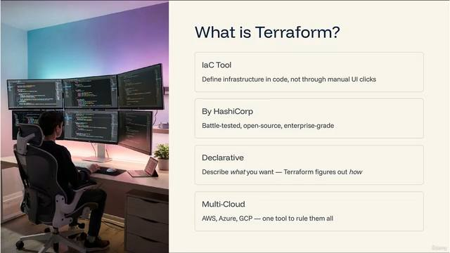

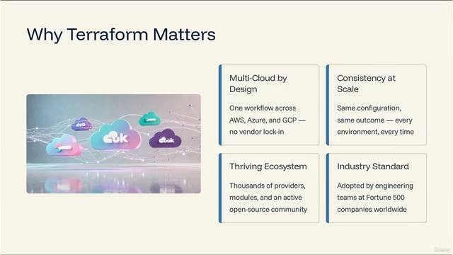

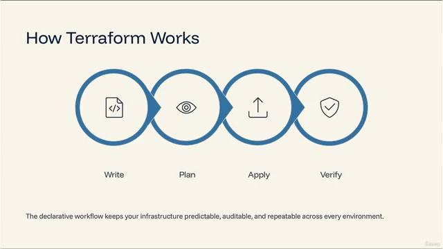

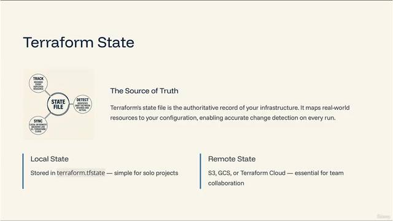

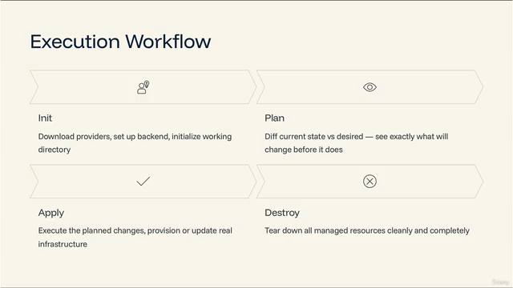

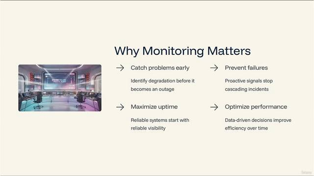

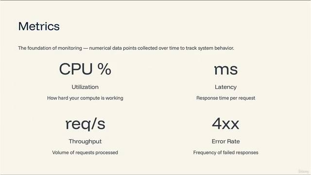

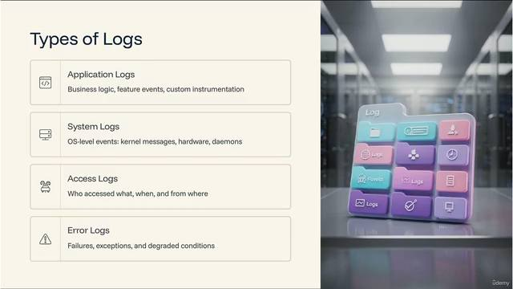

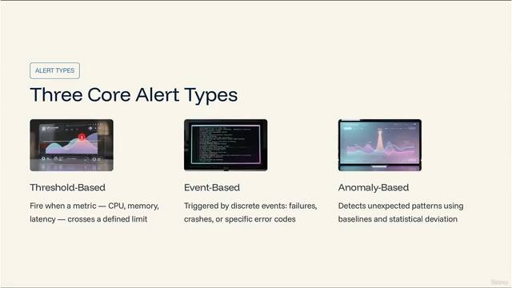

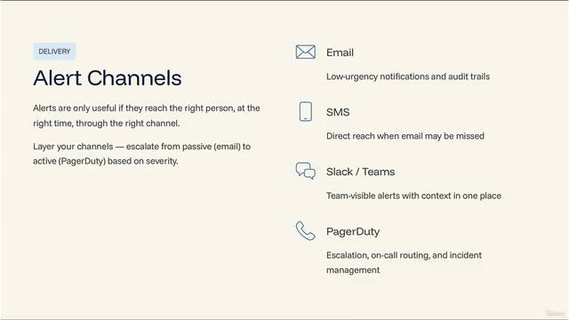

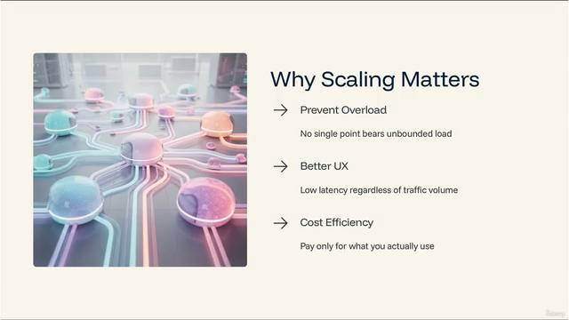

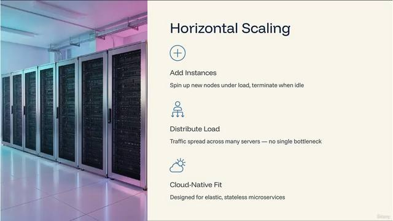

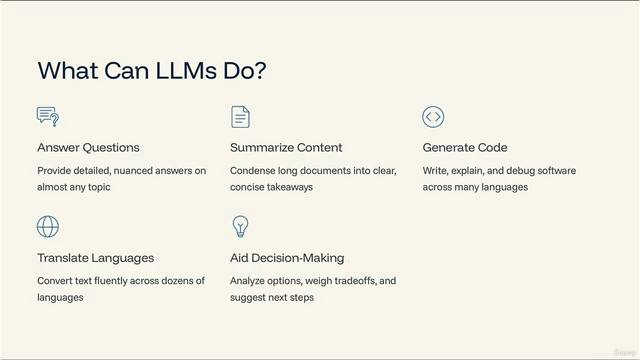

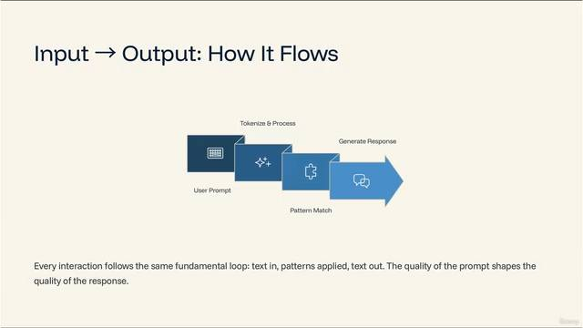

> 截图说明：以上 14 张均取自清单，路径与帧号原样复制。因本课为 PPT 讲解课，截图内容以讲师幻灯片为主，具体画面文字以实际图片为准；本文档对每张图的 alt 描述基于逐字稿对应时间点的讲述内容，若图片实际文字与 alt 有出入，以图片为准。