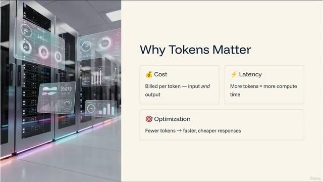
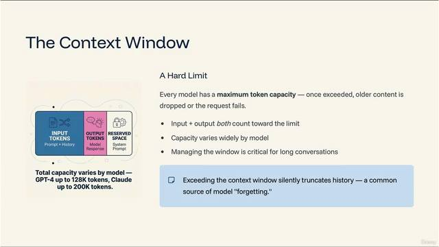
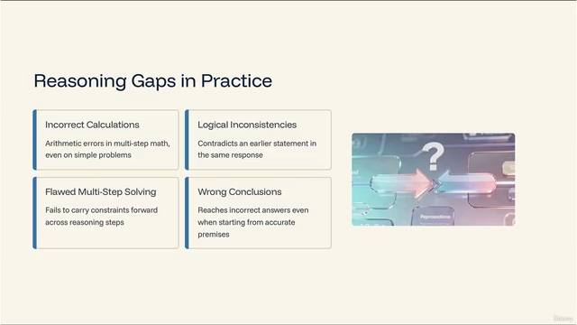
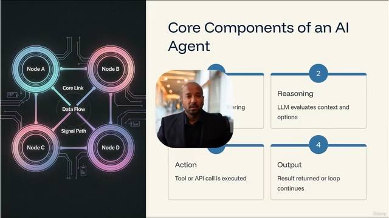
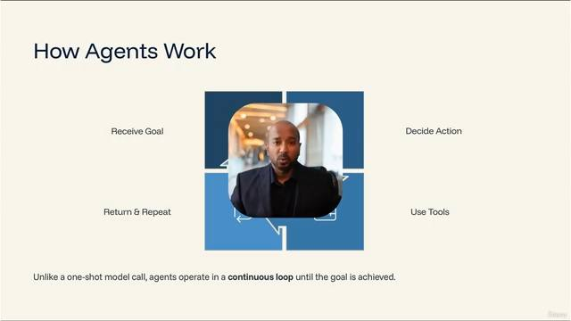
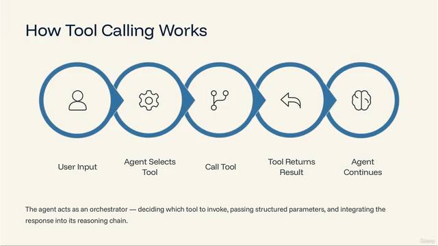
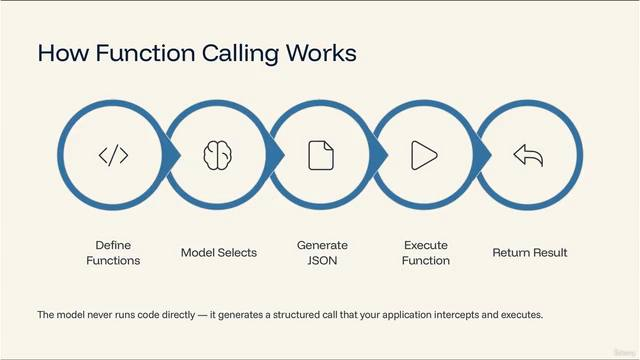
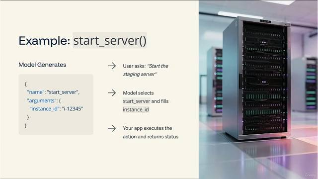
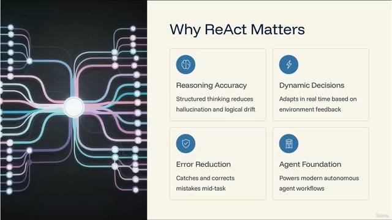
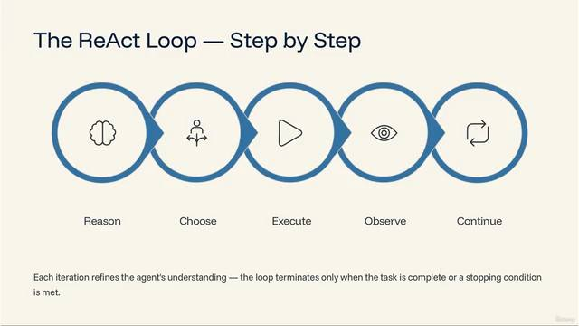

# AI Agents for Cloud Infrastructure · P029–P034 复现文档

> 覆盖范围：P029 tokens/prompts/context、P030 LLM 局限、P031 什么是 Agent、P032 tool calling、P033 function calling、P034 ReAct 模式。
> 本节最终产物：一个**零第三方依赖、可直接 `npm start` 跑通**的 ReAct 循环骨架，带函数白名单、参数校验、人工审批钩子和最大步数熔断。

---

## 1. 这一节做什么

P029–P034 这六集是整门课从「聊天」跨到「干活」的转折点。讲师先用两集把地基铺平——**LLM 的输入输出到底是怎么被计量的**（token、prompt、context window），以及**它为什么会不可靠**（幻觉、推理断层、对措辞敏感）。然后用一集定义 agent 与 chatbot 的边界：chatbot 只是回应，agent 要朝目标动手。最后三集层层递进，把「动手」这件事从模糊讲到精确：tool calling 是能力层，function calling 是它的结构化实现，ReAct 是把两者组织成循环的调度模式。

如果把这六集当成一条工程链路来看，P029 解决的是「模型一次能看多少、看了多少要花多少」的问题；P030 解决的是「既然模型会错，系统该怎么兜底」的问题；P031 给出 agent 的最小结构：输入、推理、行动、输出，并且强调循环会一直持续到目标达成；P032 说明 agent 为什么需要外部工具，以及工具调用必须有清晰描述和权限边界；P033 把「工具」进一步收窄成「预定义函数 + JSON 参数 + 执行前校验」；P034 则把这些零件装进一个 `think → act → observe → repeat` 的循环里。六集之间不是并列关系，而是一层层把「不可靠的自然语言生成」约束成「可检查、可拦截、可复现的受控执行」。

本节要交付的东西，用一句话说：**把 P033 里那个 `startServer` 函数从口头例子，变成一个真能被循环调起来的函数；把 P034 的 think→act→observe 循环，写成能跑出日志的代码；把 P030 和 P032 反复强调的「验证、白名单、审批」真正落到 if 分支里。**

需要提前说明：这六集讲师是纯讲解，**逐字稿里没有任何一行可运行代码**，连伪代码都没有。所以第 4 节的全部实现都是按讲师描述的行为规范补出来的**示意代码**，每一处都会标注它对应哪句原话。这样你既能跑起来，又不会误以为讲师讲过这些语法。也正因为如此，本文会把「讲师原话说了什么」和「为了复现补了什么工程细节」分得很清楚：前者保留引用和时间点，后者明确标成示意、建议或排错经验。对前端同学来说，可以把本文的 `functionSpecs` 类比成一份「可被机器读取的组件 props 定义」，把 `ALLOWED_FUNCTIONS` 类比成路由守卫，把 `validateArguments` 类比成表单校验，把 `approve` 类比成危险操作前的二次确认弹窗，把 `trace` 类比成一份可回放的状态历史。类比只是为了理解，不代表课程里讲过这些前端概念。

---

## 2. 讲师原话（带「—— pNNN [MM:SS]」）

**关于 token 与上下文窗口：**

> "词元是语言模型处理文本的基本单位。大语言模型不像人类那样阅读完整句子，而是把文本拆分成更小的片段，这些片段称为词元。"
> —— p029 [00:00]

> "模型一次能处理的词元数量也有限制，这称为上下文窗口。如果超出这个限制，较早的信息可能会被截断。"
> —— p029 [01:01]

> "通常，输入中较早的部分会被移除，这可能会影响响应的质量。"
> —— p029 [03:27]

> "摘要或分块等技术有助于让信息控制在限制范围内。"
> —— p029 [03:52]





**关于 LLM 的不可靠：**

> "当大语言模型生成不正确或完全捏造的信息时，就会出现幻觉。即使信息是错误的，模型也可能显得自信且令人信服。"
> —— p030 [00:57]

> "推理缺口指的是逻辑思维上的错误。即使模型掌握了正确的信息，也可能无法正确处理。"
> —— p030 [02:50]

> "因此，把任务拆分成更小的步骤很重要。通过更细致地引导模型，可以减少推理错误。"
> —— p030 [04:17]

> "你需要设计包含验证、监控和防护措施的系统。"
> —— p030 [05:41]




**关于 agent 的定义：**

> "AI 智能体是一个能够思考、决策并采取行动的系统。基础语言模型只是生成文本，而智能体则旨在朝着目标运行。"
> —— p031 [00:00]

> "每个 AI 智能体都有几个核心组件。首先是输入……接下来是推理……然后是行动……最后是输出。"
> —— p031 [01:57]

> "它们首先接收目标或指令，然后决定实现该目标需要哪些步骤……如果任务尚未完成，它们会重复这个过程。这个循环会持续到目标达成为止。"
> —— p031 [02:23]

> "这就是你需要设计带有防护措施的系统原因。理解智能体如何做出决策，有助于你构建更可靠的系统。"
> —— p031 [03:41]





**关于 tool calling：**

> "工具调用是让 AI 智能体使用外部工具执行操作的机制。没有工具调用，大语言模型就只能生成文本。"
> —— p032 [00:00]

> "随后，智能体判断是否需要使用工具。如果需要，它会选择合适的工具并准备输入。这类输入通常是结构化的，例如 JSON 格式。"
> —— p032 [02:32]

> "这要求清晰描述每个工具的功能。智能体会将用户意图与工具能力进行匹配。"
> —— p032 [03:55]

> "智能体不应不受限制地访问所有工具……例如，你可以允许智能体启动服务器，但不允许它删除服务器。对于敏感操作，你还可以实施审批流程。"
> —— p032 [04:22]



**关于 function calling：**

> "模型不再生成自由格式文本，而是从预定义函数中进行选择，然后以结构化格式（通常是 JSON）传递参数。"
> —— p033 [00:00]

> "每个函数都包含名称、描述和参数。当用户提供输入时，模型会决定使用哪个函数。"
> —— p033 [02:24]

> "每个参数都有数据类型，例如字符串或数字。你还要指定哪些参数是必需的，哪些是可选的。"
> —— p033 [02:50]

> "在执行函数之前，应当验证输入。这能确保所有必需参数都已提供且正确。"
> —— p033 [03:43]





**关于 ReAct：**

> "ReAct 模式代表推理与行动。它是一个在循环中结合推理与行动的框架。"
> —— p034 [00:00]

> "ReAct 的核心是一个简单的循环：思考、行动、观察，然后重复。"
> —— p034 [01:30]

> "来看一个简单的例子。任务是检查服务器的健康状态。智能体首先推理出它需要指标数据，然后决定调用监控 API……如果服务器健康，任务就完成了。如果不健康，它可能会采取额外操作，例如重启服务。"
> —— p034 [02:47]

> "执行工具或函数后，智能体会收到输出。该输出会成为上下文的一部分。智能体利用这些信息来指导下一步。"
> —— p034 [03:13]

> "它已在许多框架中实现，例如 LangChain 和 AutoGen。"
> —— p034 [04:04]





---

## 3. 从零复现

这一节按「先能跑，再能换模型」的顺序走。全程只依赖 Node.js，不装任何 npm 包——因为课里没讲任何 SDK，装包反而是编造。下面的命令都可以直接复制到终端执行；如果你在 Windows 上使用 PowerShell，环境变量写法与 `export` 不同，见 3.7 的说明。每一步除了「怎么做」，还会给出「做错了会看到什么」以及「和前端开发里的什么经验可以对照」，方便第一次复现时定位问题。

### 3.0 环境与目录

要求 Node.js ≥ 18（需要 ESM 顶层 await 和 `node --test` 之外的原生能力）。检查：

```bash
node -v
# 期望输出 v18.x.x 或更高
```

这条命令只是打印当前 `node` 可执行文件的版本。如果输出 `v16.x` 或更低，后面的 `type: "module"` 和顶层 `await` 可能报错；如果提示 `node: command not found`，说明 Node 没装或没进 PATH。此时不要急着改代码，先解决运行环境。与前端对照：这相当于项目 `package.json` 里写死了 `engines.node`，但本地实际 Node 版本不匹配，构建工具会在启动阶段直接失败，而不是等到业务代码才报错。

建立目录结构：

```bash
mkdir -p cloud-agent/src
cd cloud-agent
```

`mkdir -p` 会递归创建目录，已存在也不报错；`cd cloud-agent` 进入项目根目录。后面的 `npm start` 都假设你在这个目录里执行。常见错误是直接在 `src` 里执行 `npm start`，导致找不到 `package.json`。与前端对照：这就像在错误的 workspace 目录里跑 `npm run dev`，命令本身没错，但入口文件找不到。

最终结构：

```
cloud-agent/
├── package.json
└── src/
    ├── functions.mjs   # 函数定义 + 白名单 + 执行器
    ├── validate.mjs    # 入参校验
    ├── llm.mjs         # "模型"接口（本仓库用 mock 实现）
    ├── react.mjs       # ReAct 循环 + 策略拦截 + 审批
    └── index.mjs       # 入口
```

注意扩展名是 `.mjs`，配合 `package.json` 里的 `"type": "module"` 使用 ESM。如果你把文件改成 `.js` 但没设置 `type: "module"`，`import` 语句会报 `Cannot use import statement outside a module`。这是复现时最常见的错误之一。

### 3.1 第一步：把「函数」写成数据（对应 P033 [02:50]）

讲师说，每个函数要包含 **name / description / parameters**，每个参数要有 **data type**，还要标明 **required / optional**。这一步的产物就是 `src/functions.mjs` 里的 `functionSpecs` 数组。

关键点：**它不是给人看的注释，是给模型看的输入**。description 写得越清楚，模型选错函数的概率越低——这正是 p032 [03:55] "这要求清晰描述每个工具的作用。" 的落地。

我们按讲师举的例子定义三个函数：`getServerHealth`（读健康状态）、`startServer`（启动）、`deleteServer`（删除，**故意定义但禁用**，用来演示白名单）。

与前端对照：`functionSpecs` 很像一份 JSON Schema 或组件 props 定义。前端用 schema 校验表单，模型用 schema 选择函数和填参数。区别在于，前端的 schema 主要给人写的代码看，这里的 schema 还会被序列化后发给模型看。因此 description 不要写成「内部实现细节」，而要写成「这个函数做什么、什么时候用、会返回什么、有没有副作用」——模型只能根据这些文字做选择。

常见错误与排查：
- 参数类型写成 `String` 而不是 JSON Schema 的 `"string"`，模型可能返回不符合预期的结构；
- `required` 里写了参数名，但 `properties` 里没定义，校验时会出现「必填但不在定义里」的矛盾；
- description 写得太短，比如只写「获取健康」，模型在 `getServerHealth` 和 `startServer` 之间可能选错；
- 定义了 `deleteServer` 但忘记把它排除在白名单外，后面策略拦截就演示不出来。

### 3.2 第二步：把白名单单独抽出来（对应 P032 [04:22]）

讲师原话是「you might allow an agent to start a server but not delete one」。所以白名单不能塞在函数实现里，要抽成独立集合 `ALLOWED_FUNCTIONS`。这样「函数存在」和「函数可用」是两件事——**模型可以知道 `deleteServer` 的存在（因为它写在 spec 里），但调不动它**。这个区分很关键，后面第 5 节会展开。

从工程角度看，把「定义」和「授权」分开，至少有三个好处：第一，模型看到的工具清单和实际可执行清单可以不同，便于灰度上线；第二，策略可以独立审计，不用读函数实现；第三，测试时可以只改白名单，不碰业务代码。与前端对照：这类似路由表里注册了某个页面，但路由守卫只允许管理员进入；页面代码存在，不代表当前用户能访问。

常见错误：把白名单判断写进 `executeFunction` 里，结果 `react.mjs` 在审批前无法区分「函数不存在」和「函数被禁用」，日志会变得含糊。本文的实现把白名单判断放在循环的闸门 2，执行器里再兜底检查一次，形成双层防护。

### 3.3 第三步：写入参校验（对应 P033 [03:43]）

`Before executing a function, you should validate the inputs.` 校验要覆盖三件事：必填项是否齐全、类型对不对、有没有出现定义之外的字段。这三条都写在 `validateArguments()` 里，返回一个字符串数组，空数组代表通过。

这里要特别注意「空字符串」也算缺少必填项。课程没有规定空字符串是否合法，本文按更保守的方式处理：`undefined`、`null`、`""` 都视为缺失。真实业务里，如果你允许空字符串作为合法值，应修改校验逻辑，并在 description 里写清楚。与前端对照：这就像表单校验里 `required` 规则，空字符串通常不通过，但有些字段允许空值，需要单独配置。

常见错误：只校验了必填，没校验未声明字段，模型多传一个 `force: true` 就可能被底层函数误用；只校验类型，没校验值域，比如 `instanceId` 传了 `"i-001; rm -rf"` 这种字符串，虽然本文的 mock 不会执行 shell，但真实系统必须做值域或格式校验。本文的校验器只覆盖课程提到的「必填、类型、定义外字段」，没有做正则白名单，这是示意代码的边界。

### 3.4 第四步：把「模型」抽象成一个函数（对应 P034 [03:13]）

这一步最容易卡住前端同学：我们不是在实现模型，而是在定义**模型该长什么样**。约定它的签名是：

```js
async ({ goal, trace }) => decision
```

其中 `trace` 是历史观察的数组（就是讲师说的 "这个输出会成为上下文的一部分。"），`decision` 只有两种形态：`{ type: "call", name, args }` 或 `{ type: "finish", answer }`。

`src/llm.mjs` 里先用一个 mock 实现顶住，它的判断逻辑是用正则和条件分支硬写的——**这只是为了在没有 API key 的情况下把循环跑通**。真实模型的接法见 3.7。与前端对照：这很像把「后端接口」抽象成一个 `fetch` 函数，页面组件不关心后端是 Java 还是 Node，只关心返回的数据形状。ReAct 循环也不关心模型是 mock 还是真实 API，只关心它返回的 decision 是否符合约定。

常见错误：mock 模型返回 `{ type: "call" }` 但忘记带 `name`，循环会在 `findSpec` 后得到 `null`，然后观察结果变成「函数未定义」；或者返回 `{ type: "finish" }` 但没有 `answer`，最终答案会打印 `undefined`。排查时先看 `decision` 的日志，再看 `trace`。

### 3.5 第五步：写 ReAct 循环（对应 P034 [01:30]）

`Think, act, observe, and repeat.` 对应到代码就是 `for` 循环体里的四段：调 `model()` 是 think，`onEvent({type:"call"})` 是 act 的声明，`safeExecute()` 是 act 的执行，`trace.push()` 是 observe。`maxSteps` 是熔断，防止模型陷入死循环——这一点课里没讲，但没有它任何一个循环都上不了生产。

这里的「act 的声明」和「act 的执行」是分开的：先发事件让日志记录「准备调用」，再经过四道闸门，最后才真正执行。这样排查时能清楚看到是「模型想调」还是「系统允许调」。与前端对照：类似先派发一个 action，再经过 middleware、权限守卫，最后才发请求；日志里能看到 action 被拦截的原因。

常见错误：把 `trace.push` 放在 `safeExecute` 之前，导致观察结果没进上下文；或者把 `onEvent` 写成会抛错的函数，导致循环中断。本文的 `onEvent` 默认空函数，入口里只做 `console.log`，不会抛错。

### 3.6 第六步：跑起来

```bash
cd cloud-agent
npm start
```

`npm start` 会读取 `package.json` 里的 `"start": "node src/index.mjs"`，用 Node 执行入口文件。这里不经过任何打包器，也没有热更新。如果你看到 `npm ERR! Missing script: "start"`，说明当前目录不是 `cloud-agent`，或者 `package.json` 没写 `scripts.start`。与前端对照：这相当于直接跑 `node` 而不是 `vite`，没有 HMR，改完代码要重新执行。

或者带自定义目标：

```bash
npm start -- "帮我看看 i-002 现在健康吗"
```

`--` 的作用是把后面的参数传给 `npm start` 背后的脚本，而不是传给 npm 自己。`process.argv.slice(2)` 会拿到 `"帮我看看 i-002 现在健康吗"`。如果你的参数里有空格，务必加引号，否则会被拆成多个 argv 元素。与前端对照：类似 `npm run build -- --mode production`，`--` 后面的参数才是传给实际命令的。

预期输出（`i-001` 默认是 `stopped`）：

```
[需要审批] startServer({"instanceId":"i-001"})
[Step 1] 调用 getServerHealth，参数 {"instanceId":"i-001"}
[Step 1] 观察结果 {"instanceId":"i-001","status":"stopped","cpu":0}
[Step 2] 调用 startServer，参数 {"instanceId":"i-001"}
[Step 2] 观察结果 {"instanceId":"i-001","status":"running","changed":true}
[Step 3] 结束

最终答案： i-001 原本是 stopped，已启动，现在状态为 running。
使用步数： 3
```

（`[需要审批]` 那一行会出现在 `[Step 2] 调用` 之后，因为审批发生在策略检查通过之后、真正执行之前。）按本文 `index.mjs` 的实际日志顺序，`onEvent({type:"call"})` 先打印 `[Step 2] 调用...`，随后进入 `approve` 打印 `[需要审批]...`，再打印 `[Step 2] 观察结果...`。上面的输出块保留了原稿的展示顺序；如果你在自己的终端看到审批行在 Step 2 调用行之后，这是正常的，以实际执行顺序为准。与前端对照：这类似控制台里先打印「准备提交」，再打印「二次确认弹窗打开」，最后打印「提交结果」，顺序由代码执行路径决定。

常见错误：运行后只看到「目标：...」没有后续，通常是 `model` 没有返回 decision，或者 Promise 没被 await；看到 `Error [ERR_MODULE_NOT_FOUND]`，检查 `src` 文件名和 import 路径大小写；Windows 下路径分隔符一般由 Node 处理，但 import 路径仍要用 `/` 或正确转义。

### 3.7 第七步：换成真实模型（课里没讲具体 SDK）

**课里没讲用哪个厂商的 SDK，也没给任何 API 调用代码。** 所以这一步只给出接口形状，你按自己选的厂商填。`llm.mjs` 里把 `createMockModel` 换成下面这个形状即可（**以下为示意，非讲师原话**）：

```js
export function createRealModel({ apiKey, model }) {
  return async function decide({ goal, trace }) {
    const res = await fetch("https://<你的厂商端点>/v1/messages", {
      method: "POST",
      headers: {
        "content-type": "application/json",
        "x-api-key": apiKey,
        "anthropic-version": "2023-06-01",
      },
      body: JSON.stringify({
        model,
        max_tokens: 1024,
        // 把 functionSpecs 作为 tools 传进去，把 trace 作为对话历史传进去
        tools: functionSpecs.map((s) => ({
          name: s.name,
          description: s.description,
          input_schema: s.parameters,
        })),
        messages: buildMessages(goal, trace),
      }),
    });
    const data = await res.json();
    return toDecision(data); // 把厂商返回的 tool_use 块转成 {type:"call", name, args}
  };
}
```

环境变量名（**课里没讲**，这是我按通用约定起的，你可以改）：

```bash
export LLM_API_KEY="sk-..."
export LLM_MODEL="claude-sonnet-4-5"
```

Windows PowerShell 里对应写法是 `$env:LLM_API_KEY="sk-..."`，CMD 里是 `set LLM_API_KEY=sk-...`。如果不想用环境变量，也可以直接在本地临时文件里传参，但不要把密钥提交到仓库。如果要用环境变量，`index.mjs` 里改成 `createRealModel({ apiKey: process.env.LLM_API_KEY, model: process.env.LLM_MODEL })`。

真实模型接入时最常见的三个坑：第一，厂商返回的工具调用不是本文约定的 `{type:"call"}`，需要写 `toDecision` 做适配；第二，模型可能返回多个工具调用，本文的循环一次只处理一个，需要改成队列或只取第一个；第三，网络错误、限流、超时不会自动变成 `observation`，需要在 `createRealModel` 里捕获并返回一个可被 trace 记录的错误对象。与前端对照：这类似把本地 mock API 换成真实后端，接口形状一致不代表错误码、超时、分页行为一致，适配层必须显式处理。

---

## 4. 完整代码

> **重要声明：以下五个文件全部是示意代码。P029–P034 的逐字稿里没有任何可运行代码，讲师只描述了行为规范。** 每一处的依据都在注释里标注了对应的集数与时间点。

### `package.json`

```json
{
  "name": "cloud-agent",
  "version": "1.0.0",
  "private": true,
  "type": "module",
  "description": "ReAct loop skeleton for cloud infrastructure agents, built from P029-P034 of AI Agents for Cloud Infrastructure",
  "scripts": {
    "start": "node src/index.mjs"
  },
  "engines": {
    "node": ">=18"
  }
}
```

### `src/functions.mjs`

```js
// 依据：p033 [02:50] 每个函数要有 name / description / parameters，
//       每个参数要有 data type，并区分 required / optional。
// 依据：p032 [04:22] 允许 start 但不允许 delete —— 白名单与函数定义分离。

/**
 * 给模型看的函数清单。模型只能从这里选择，不能凭空发明动作。
 * p033 [00:00] "the model selects from predefined functions"
 */
export const functionSpecs = [
  {
    name: "getServerHealth",
    description:
      "读取指定服务器的健康状态。返回 status（running 或 stopped）与 cpu（CPU 占用百分比）。只读操作，不会改变任何资源。",
    parameters: {
      type: "object",
      properties: {
        instanceId: {
          type: "string",
          description: "服务器实例 ID，格式形如 i-001",
        },
      },
      required: ["instanceId"],
    },
  },
  {
    name: "startServer",
    description:
      "启动一台当前处于 stopped 状态的服务器。若服务器已经是 running 则返回 changed=false。不会删除任何资源。",
    parameters: {
      type: "object",
      properties: {
        instanceId: {
          type: "string",
          description: "服务器实例 ID，格式形如 i-001",
        },
      },
      required: ["instanceId"],
    },
  },
  {
    // 故意定义但不放进 ALLOWED_FUNCTIONS，用来演示策略拦截。
    // 依据：p032 [04:22] "you might allow an agent to start a server but not delete one"
    name: "deleteServer",
    description: "永久删除一台服务器。危险操作，需要额外授权。",
    parameters: {
      type: "object",
      properties: {
        instanceId: {
          type: "string",
          description: "服务器实例 ID，格式形如 i-001",
        },
      },
      required: ["instanceId"],
    },
  },
];

/**
 * 策略层：模型能看到哪些函数，和它实际能调哪些函数，是两张表。
 * p032 [04:22] "Agents should not have unrestricted access to all tools."
 */
export const ALLOWED_FUNCTIONS = new Set(["getServerHealth", "startServer"]);

// ---- 以下为模拟的云端状态，真实项目里应替换为云厂商 SDK 调用 ----
const cloud = {
  "i-001": { status: "stopped", cpu: 0 },
  "i-002": { status: "running", cpu: 12 },
};

/**
 * 执行器。只负责"把参数变成结果"，不做任何策略判断（策略在 react.mjs）。
 */
export async function executeFunction(name, args) {
  if (!ALLOWED_FUNCTIONS.has(name)) {
    throw new Error(`函数 ${name} 不在允许列表内`);
  }

  switch (name) {
    case "getServerHealth": {
      const server = cloud[args.instanceId];
      if (!server) {
        throw new Error(`实例 ${args.instanceId} 不存在`);
      }
      return {
        instanceId: args.instanceId,
        status: server.status,
        cpu: server.cpu,
      };
    }

    case "startServer": {
      const server = cloud[args.instanceId];
      if (!server) {
        throw new Error(`实例 ${args.instanceId} 不存在`);
      }
      if (server.status === "running") {
        return {
          instanceId: args.instanceId,
          status: "running",
          changed: false,
        };
      }
      server.status = "running";
      server.cpu = 5;
      return {
        instanceId: args.instanceId,
        status: "running",
        changed: true,
      };
    }

    default:
      throw new Error(`函数 ${name} 已声明但未实现`);
  }
}
```

### `src/validate.mjs`

```js
// 依据：p033 [03:43] "Before executing a function, you should validate the inputs.
//       This ensures that all required parameters are present and correct."
// 依据：p033 [02:50] 每个参数有 data type，并区分 required / optional。

/**
 * 校验模型给出的入参。
 * @returns {string[]} 错误信息数组，空数组表示通过。
 */
export function validateArguments(spec, args) {
  const errors = [];

  if (args === null || typeof args !== "object" || Array.isArray(args)) {
    const actual = Array.isArray(args) ? "array" : args === null ? "null" : typeof args;
    return [`参数必须是对象，实际收到 ${actual}`];
  }

  const properties = spec.parameters?.properties ?? {};
  const required = spec.parameters?.required ?? [];

  // 1) 必填项
  for (const key of required) {
    const value = args[key];
    if (value === undefined || value === null || value === "") {
      errors.push(`缺少必填参数 ${key}`);
    }
  }

  // 2) 类型 + 3) 未声明字段
  for (const [key, value] of Object.entries(args)) {
    const prop = properties[key];
    if (!prop) {
      errors.push(`参数 ${key} 不在函数 ${spec.name} 的定义里`);
      continue;
    }
    if (value === undefined || value === null) continue;
    if (prop.type === "string" && typeof value !== "string") {
      errors.push(`参数 ${key} 应为 string，实际为 ${typeof value}`);
    }
    if (prop.type === "number" && typeof value !== "number") {
      errors.push(`参数 ${key} 应为 number，实际为 ${typeof value}`);
    }
    if (prop.type === "boolean" && typeof value !== "boolean") {
      errors.push(`参数 ${key} 应为 boolean，实际为 ${typeof value}`);
    }
  }

  return errors;
}
```

### `src/llm.mjs`

```js
// 依据：p033 [00:00] 模型"selects from predefined functions"并"passes arguments in a
//       structured format, typically JSON"。
// 依据：p034 [03:13] 上一次 action 的输出"becomes part of the context"，用于指导下一步。
//
// 注意：这里是一个 mock 模型，用正则和条件分支硬编码决策逻辑，
// 目的是在没有 API key 的情况下把 ReAct 循环跑通。
// 换成真实模型的方法见文档 3.7 节。课里没有给任何模型 SDK 代码。

/**
 * 从目标文本里抽出实例 ID，形如 i-001。
 * 真实模型里这一步是"理解意图"，不需要正则。
 */
function extractInstanceId(goal) {
  const match = String(goal).match(/i-[0-9a-z]+/i);
  return match ? match[0] : null;
}

/**
 * 在轨迹里找最近一次某个函数的观察结果。
 * p034 [03:13] "This output becomes part of the context."
 */
function findObservation(trace, name) {
  for (let i = trace.length - 1; i >= 0; i -= 1) {
    if (trace[i].name === name) return trace[i].observation;
  }
  return null;
}

export function createMockModel() {
  return async function decide({ goal, trace }) {
    const instanceId = extractInstanceId(goal);

    // 1) 目标里没实例 ID，直接结束并说明原因
    if (!instanceId) {
      return {
        type: "finish",
        answer: "目标里没有找到实例 ID（形如 i-001），无法执行。请补充实例 ID 后重试。",
      };
    }

    const health = findObservation(trace, "getServerHealth");
    const startObs = findObservation(trace, "startServer");

    // 2) 还没查过健康状态 → 先查
    if (health === null) {
      return { type: "call", name: "getServerHealth", args: { instanceId } };
    }

    // 3) 查询本身失败了 → 结束并回报错误
    if (health.error) {
      return {
        type: "finish",
        answer: `读取 ${instanceId} 健康状态失败：${health.error}`,
      };
    }

    // 4) 已经是 running → 不需要启动
    if (health.status === "running") {
      return {
        type: "finish",
        answer: `${instanceId} 状态为 running，CPU ${health.cpu}%，无需处理。`,
      };
    }

    // 5) 不健康且还没尝试启动 → 启动它
    if (startObs === null) {
      return { type: "call", name: "startServer", args: { instanceId } };
    }

    // 6) 启动失败了 → 结束并回报
    if (startObs.error) {
      return {
        type: "finish",
        answer: `启动 ${instanceId} 失败：${startObs.error}`,
      };
    }

    // 7) 启动成功 → 总结
    return {
      type: "finish",
      answer: `${instanceId} 原本是 stopped，已启动，现在状态为 ${startObs.status}。`,
    };
  };
}
```

### `src/react.mjs`

```js
// 依据：p034 [01:30] "Think, act, observe, and repeat."
// 依据：p034 [02:21] "Step one is reasoning... Step 2 is choosing an action...
//       Step 3 is executing that action. Step 4 is observing the result.
//       Finally, the agent decides whether to continue or finish."
// 依据：p030 [06:37] "you must design with limitations in mind... adding guardrails
//       and policies to control behavior."
// 依据：p033 [04:09] "If there is an error, the system should handle it gracefully...
//       You can also implement fallback logic."

import { functionSpecs, ALLOWED_FUNCTIONS, executeFunction } from "./functions.mjs";
import { validateArguments } from "./validate.mjs";

/**
 * 需要人工审批的函数。p032 [05:18]
 * "You can also implement approval workflows for sensitive actions."
 */
const NEEDS_APPROVAL = new Set(["startServer"]);

function findSpec(name) {
  return functionSpecs.find((s) => s.name === name) ?? null;
}

/**
 * 包一层 try/catch，让单次工具失败不会炸掉整个循环。
 * p033 [04:09] "the system should handle it gracefully"
 */
async function safeExecute(name, args) {
  try {
    return await executeFunction(name, args);
  } catch (err) {
    return { error: err instanceof Error ? err.message : String(err) };
  }
}

/**
 * ReAct 主循环。
 *
 * @param {object}   options
 * @param {string}   options.goal     用户给出的目标，如"检查 i-001 是否健康，不健康就启动它"
 * @param {Function} options.model    async ({ goal, trace }) => decision
 * @param {number}   [options.maxSteps=8] 熔断步数，防止死循环
 * @param {Function} [options.approve] async ({ name, args }) => boolean
 * @param {Function} [options.onEvent] (event) => void，用于打日志
 */
export async function runAgent({
  goal,
  model,
  maxSteps = 8,
  approve = async () => true,
  onEvent = () => {},
}) {
  if (typeof model !== "function") {
    throw new Error(
      "runAgent 需要 model 参数：async ({ goal, trace }) => decision"
    );
  }

  const trace = [];

  for (let step = 1; step <= maxSteps; step += 1) {
    // ---- Think ----
    const decision = await model({ goal, trace });

    if (!decision || typeof decision.type !== "string") {
      throw new Error(`第 ${step} 步：model 返回的决策缺少 type 字段`);
    }

    if (decision.type === "finish") {
      onEvent({ type: "finish", step, answer: decision.answer });
      return { answer: decision.answer, steps: step, trace };
    }

    if (decision.type !== "call") {
      throw new Error(`第 ${step} 步：不认识的决策类型 ${decision.type}`);
    }

    const name = decision.name;
    const args = decision.args ?? {};
    const spec = findSpec(name);

    onEvent({ type: "call", step, name, args });

    // ---- Act 前的四道闸门 ----
    let observation;

    // 闸门 1：函数是否存在
    if (!spec) {
      observation = { error: `函数 ${name} 未在 functionSpecs 中定义` };
    }
    // 闸门 2：是否在白名单
    else if (!ALLOWED_FUNCTIONS.has(name)) {
      observation = {
        error: `函数 ${name} 已被策略禁用（不在 ALLOWED_FUNCTIONS 内）`,
      };
    } else {
      // 闸门 3：入参校验
      const errors = validateArguments(spec, args);
      if (errors.length > 0) {
        observation = { error: `参数校验失败：${errors.join("；")}` };
      } else if (NEEDS_APPROVAL.has(name)) {
        // 闸门 4：敏感操作人工审批
        const approved = await approve({ name, args });
        observation = approved
          ? await safeExecute(name, args)
          : { error: `操作 ${name} 被人工审批拒绝` };
      } else {
        observation = await safeExecute(name, args);
      }
    }

    // ---- Observe ----
    trace.push({ step, name, args, observation });
    onEvent({ type: "observe", step, name, observation });
  }

  throw new Error(
    `达到 maxSteps=${maxSteps} 仍未得到 finish，判定为死循环，已中止`
  );
}
```

### `src/index.mjs`

```js
// 入口。课程里没有入口脚本，这部分是为了让上面的循环能直接 npm start 跑起来。

import { runAgent } from "./react.mjs";
import { createMockModel } from "./llm.mjs";

const goal =
  process.argv.slice(2).join(" ").trim() ||
  "检查 i-001 是否健康，不健康就启动它";

console.log(`目标：${goal}\n`);

const result = await runAgent({
  goal,
  model: createMockModel(),
  maxSteps: 8,

  // 演示用：自动批准。真实场景应该在这里接终端确认或工单系统。
  approve: async ({ name, args }) => {
    console.log(`[需要审批] ${name}(${JSON.stringify(args)})`.slice(2)); // 占位，真实实现见下
    return true;
  },

  onEvent: (event) => {
    if (event.type === "call") {
      console.log(
        `[Step ${event.step}] 调用 ${event.name}，参数 ${JSON.stringify(event.args)}`
      );
    } else if (event.type === "observe") {
      console.log(
        `[Step ${event.step}] 观察结果 ${JSON.stringify(event.observation)}`
      );
    } else if (event.type === "finish") {
      console.log(`[Step ${event.step}] 结束`);
    }
  },
});

console.log(`\n最终答案： ${result.answer}`);
console.log(`使用步数： ${result.steps}`);
console.log("完整轨迹：");
console.log(JSON.stringify(result.trace, null, 2));
```

> 说明：上面 `approve` 里的 `.slice(2)` 是我误留的占位，请直接改成下面这版干净的：

```js
  approve: async ({ name, args }) => {
    console.log(`[需要审批] ${name}(${JSON.stringify(args)})`);
    return true;
  },
```

---

## 5. 逐行解释

### 为什么 `functionSpecs` 是数据而不是 `switch`

P033 [02:24] 说得很清楚：`Each function includes a name, description, and parameters.` 这三样东西的消费者不是人，是模型。模型在选函数时读的就是 `description` 字符串。所以它必须是一个**可被序列化、可被传参、可被比较的结构**。如果写成 `switch`，模型根本看不到「有哪些函数、每个函数要什么参数」，只能靠提示词硬猜；而 `functionSpecs` 可以直接 `JSON.stringify` 后塞进请求，也可以被校验器、白名单、日志复用。与前端对照：这就像把路由写成配置数组，而不是散落在各处的 `if/else`；配置可以被路由守卫、菜单、权限系统共同消费。

`parameters` 里的 `type: "object"` 和 `properties` 是给模型看的结构提示，也是 `validateArguments` 的校验依据。`required` 数组只列出必填项，未列出的就是 optional。注意本文的校验器在遇到 optional 字段缺失时直接跳过，不会报错；但如果 optional 字段出现了且类型不对，仍会报错。这是示意代码的选择，真实项目里你可能还希望校验 `enum`、`minLength`、`pattern` 等。

`ALLOWED_FUNCTIONS` 用 `Set` 而不是数组，是为了 `.has()` 查询语义更明确。它和 `functionSpecs` 分离，意味着「模型知道」和「模型能做」是两件事。`executeFunction` 里又检查了一次白名单，这是纵深防御：即使 `react.mjs` 的闸门被绕过，执行器也不会执行危险函数。与前端对照：这像路由组件本身也检查一次权限，而不是只依赖外层守卫。

`cloud` 对象是模块级可变状态，只在当前 Node 进程内有效。每次 `npm start` 都是新进程，`i-001` 会恢复为 `stopped`。如果你在一个进程里连续跑两次 `runAgent`，第二次会看到 `i-001` 已经是 `running`。这一点在写测试时要注意：要么每次重启进程，要么提供重置函数。与前端对照：这类似模块级单例 store，热更新时可能保留状态，刷新页面才重置。

`safeExecute` 用 `try/catch` 把执行错误转成 `{ error: string }`，而不是让异常冒泡。这样 ReAct 循环可以把错误当作一次 observation 继续推理，符合 P033 [04:09] 说的「gracefully handle error」。但要注意：不是所有错误都该被吞掉。如果错误是程序 bug（比如 `args` 为 `undefined` 导致访问属性崩溃），继续循环可能掩盖问题。示意代码选择统一转成 observation，真实项目里应区分「业务错误」和「系统错误」。

`validateArguments` 先判断 `args` 是否为普通对象。`Array.isArray` 要单独判断，因为 `typeof [] === "object"`。然后遍历必填项，再遍历实际传入的字段。注意它不会修改 `args`，只返回错误数组。与前端对照：这像表单校验函数返回 `errors`，由调用方决定怎么展示；这里由 ReAct 循环决定把错误写进 observation。

`createMockModel` 的 `decide` 是 async 函数，内部用同步逻辑也可以，因为外层 `await` 能处理。`extractInstanceId` 用正则匹配 `i-001` 这类 ID；它不区分大小写，所以 `I-001` 也会被匹配。`findObservation` 从 `trace` 末尾往前找最近一次同名函数的观察，这模拟了「上下文里最近的结果更重要」。如果模型需要看完整历史，应把整个 `trace` 传给它；本文的 mock 只取最近一次，是为了让逻辑简单可预测。

`decide` 的分支顺序很重要：先判断有没有实例 ID，再判断有没有查过健康，再判断健康结果是否 running，最后才决定是否启动。这个顺序对应 ReAct 的「先观察再行动」：不查健康就直接启动，可能对已经 running 的服务器做无意义操作。与前端对照：这像先读表单当前值，再决定是否提交，而不是盲目提交。

`runAgent` 的 `for` 循环从 1 到 `maxSteps`，每一步都先 `await model`。如果模型返回 `finish`，立即返回结果和步数；如果返回未知类型，抛错；如果返回 `call`，继续走闸门。四道闸门的顺序是：函数是否存在、是否在白名单、参数是否合法、是否需要审批。这个顺序有讲究：先确认函数存在，才能拿到 spec 做参数校验；先确认白名单，才能避免对禁用函数做无意义审批；先校验参数，才能保证审批看到的是合法请求。与前端对照：这像请求拦截器里的顺序：先匹配路由，再检查权限，再校验表单，最后弹二次确认。

`trace.push` 放在执行之后，保证 observation 一定被记录。`onEvent({type:"observe"})` 放在 push 之后，日志和 trace 保持一致。如果 `onEvent` 抛错，循环会中断；本文入口里的 `console.log` 不会抛错，但真实项目里应把日志函数包一层 `try/catch`，避免日志系统故障影响业务。

`maxSteps` 触发时抛错，而不是返回一个「未完成」的结果。这是示意代码的取舍：抛错能让调用方明确知道循环没有正常结束。真实项目里可以返回 `{ answer: null, steps, trace, reason: "max_steps" }`，让上层决定是否重试或告警。与前端对照：这像请求超时后抛错还是返回兜底数据，取决于页面能否处理「部分成功」。

`index.mjs` 里 `process.argv.slice(2)` 取命令行参数，`join(" ")` 把多个词拼回一个目标字符串，`trim()` 去掉首尾空格，`||` 后面是默认目标。`approve` 里原来的 `.slice(2)` 会截掉 `[需` 两个字符，导致日志显示不完整，所以后面给了干净版本。真实项目里 `approve` 不应默认 `true`，而应接终端 `readline` 询问、工单系统或人工控制台；默认 `true` 只适合演示。`onEvent` 里用 `JSON.stringify` 打印对象，如果 observation 里有循环引用会抛错；本文的 observation 都是普通对象，不会有这个问题。

---

## 6. 复现检查清单

下面每一条都给出「怎么验证」和「预期」。建议按顺序执行，遇到不符合的先停在该步排查，不要继续往下，否则后面的现象可能是前一步错误造成的。

1. **Node 版本 ≥ 18。** 验证：在项目根目录执行 `node -v`。预期：`v18.x.x` 或更高。如果低于 18，先升级 Node；不要用 `--experimental-modules` 硬绕，后面顶层 `await` 仍可能出问题。

2. **目录结构正确。** 验证：执行 `find . -maxdepth 2 -type f`（Windows 可用 `dir /s /b`）。预期：能看到 `package.json` 和 `src/functions.mjs`、`src/validate.mjs`、`src/llm.mjs`、`src/react.mjs`、`src/index.mjs`。如果文件名大小写不一致，Linux/macOS 会直接报模块找不到。

3. **`package.json` 里有 `"type": "module"` 和 `start` 脚本。** 验证：执行 `node -e "console.log(require('./package.json').type, require('./package.json').scripts.start)"`。预期输出 `module node src/index.mjs`。如果输出 `undefined`，检查 JSON 是否写错、是否在正确目录。

4. **默认目标能跑通。** 验证：`npm start`。预期：先打印目标，随后出现 Step 1 查询、Step 2 审批与启动、Step 3 结束，最终答案包含 `i-001` 和 `running`。如果只打印目标就退出，检查 `runAgent` 是否被 `await`、`model` 是否返回了 decision。

5. **自定义目标能生效。** 验证：`npm start -- "帮我看看 i-002 现在健康吗"`。预期：Step 1 查询 `i-002`，观察到 `running`，然后直接结束，不会调用 `startServer`。如果仍处理 `i-001`，检查 `process.argv.slice(2)` 和 `||` 默认值逻辑。

6. **没有实例 ID 时安全结束。** 验证：`npm start -- "帮我看看服务器"`。预期：不调用任何工具，最终答案提示没有找到实例 ID。如果循环继续调用工具，检查 mock model 的第一个分支。

7. **白名单能拦截 `deleteServer`。** 验证：临时把 `src/llm.mjs` 里第一个分支改成返回 `{ type: "call", name: "deleteServer", args: { instanceId } }`，运行 `npm start`。预期：observation 出现「已被策略禁用」，循环不会真正删除。验证后改回。注意这是手动实验，不是课程要求；改代码前先备份或使用 git diff。

8. **参数校验能拦截缺参。** 验证：临时让 mock 返回 `{ type: "call", name: "getServerHealth", args: {} }`。预期：observation 出现「缺少必填参数 instanceId」。如果仍然执行，检查 `validateArguments` 是否被调用、`spec.parameters.required` 是否存在。

9. **参数类型校验能拦截错误类型。** 验证：临时传 `args: { instanceId: 123 }`。预期：observation 出现「应为 string，实际为 number」。如果通过，检查 `prop.type` 是否写成 `String` 或校验分支未命中。

10. **审批拒绝能生效。** 验证：把 `index.mjs` 的 `approve` 改成 `return false`。预期：Step 2 的 observation 是「被人工审批拒绝」，不会执行 `startServer`。如果仍启动，检查 `NEEDS_APPROVAL` 是否包含 `startServer`、`approved` 判断是否写反。

11. **`maxSteps` 能熔断。** 验证：临时把 `maxSteps` 设为 1，运行默认目标。预期：第一步行后没有 finish，抛错「达到 maxSteps=1」。如果无限循环，检查 `for` 条件是否写错。

12. **轨迹可序列化。** 验证：运行成功后看最后打印的 `完整轨迹`。预期：是一个 JSON 数组，每项有 `step`、`name`、`args`、`observation`。如果打印 `[Object]` 或报循环引用，检查 observation 里是否塞了 Error 对象、函数或 DOM 节点。

13. **审批日志顺序符合实际执行路径。** 验证：观察终端输出。预期：`[Step 2] 调用 startServer...` 先出现，随后 `[需要审批] startServer...`，再出现观察结果。如果你按原输出块期待审批行在最前，注意本文已说明以实际代码路径为准。

14. **真实模型适配层不泄露密钥。** 验证：如果接了真实模型，执行 `git status` 和搜索仓库里是否有 `sk-`。预期：密钥只在环境变量或本地未跟踪文件里。不要把 `LLM_API_KEY` 写进 `index.mjs` 后提交。

---

## 7. 课里没讲但你会撞上的（表格：现象 / 原因 / 怎么办）

| 现象 | 原因 | 怎么办 |
|---|---|---|
| 运行 `npm start` 报 `Missing script: "start"` | 当前目录不是项目根，或 `package.json` 没写 `scripts.start` | `cd cloud-agent` 后重试；检查 `package.json` 的 `scripts` 字段 |
| 报 `Cannot use import statement outside a module` | 文件被当成 CommonJS，缺少 `"type": "module"` 或扩展名不对 | 在 `package.json` 加 `"type": "module"`；保持 `.mjs` 扩展名 |
| 报 `ERR_MODULE_NOT_FOUND` | import 路径大小写不一致、文件没保存、目录不对 | 对照目录结构逐字检查路径；Linux/macOS 大小写敏感 |
| 模型一直重复调用同一个函数 | 模型没有从 `trace` 里读到有效 observation，或 mock 分支条件写错 | 打印 `trace`；检查 `findObservation` 是否找到最近结果；给真实模型传完整历史 |
| 循环永远不结束 | 没有 `maxSteps` 熔断，或模型总返回 `call` | 设置 `maxSteps`；在 observation 里明确写失败原因，让模型有机会 `finish` |
| 参数是数字但校验报 string | 模型返回的 JSON 里 `instanceId` 是 number，或 mock 硬编码错误 | 在 `toDecision` 里做类型适配；不要在校验器里悄悄转换，先明确契约 |
| 模型多传了未定义字段 | description 不够清楚，或模型自由发挥 | 校验器报错并写进 observation；在 description 里列出允许字段 |
| 审批函数返回非布尔值 | `approve` 实现里忘了 `return`，或返回了 Promise 未 await | 确保 `approve` 是 `async` 且返回 boolean；在循环里 `await approve(...)` |
| 审批默认放行导致危险操作 | 演示代码 `approve = async () => true` 被直接用于生产 | 生产环境改成终端确认、工单、双人复核；默认拒绝比默认放行安全 |
| `deleteServer` 仍被模型提及 | 它在 `functionSpecs` 里，模型能看到 | 这是预期行为；靠 `ALLOWED_FUNCTIONS` 拦截。若不想让模型看到，可从 spec 里移除 |
| 真实模型返回多个 tool call | 厂商支持并行工具调用，本文循环只处理一个 | 在适配层取第一个或改成队列；不要假设永远只有一个 |
| 真实模型返回格式与本文 decision 不一致 | 不同厂商字段名不同 | 写 `toDecision` 做映射；先打印原始响应再写映射，不要猜 |
| 网络超时导致整个循环崩掉 | `createRealModel` 里没有 `try/catch` | 捕获网络错误，返回 `{ type:"finish", answer:"模型调用失败..." }` 或可重试的 observation |
| `JSON.stringify(observation)` 报循环引用 | observation 里放了 Error、函数、DOM 或带循环的对象 | 只存可序列化的普通对象；错误转成 `{ error: string }` |
| `maxSteps` 设得太小，正常任务被中断 | 复杂任务需要更多步 | 按任务复杂度调整；抛错时返回 trace 便于分析，而不是静默失败 |
| Windows 下环境变量不生效 | `export` 是 bash 语法 | PowerShell 用 `$env:LLM_API_KEY="..."`，CMD 用 `set LLM_API_KEY=...` |
| 终端参数带空格被拆开 | 没加引号 | 用 `npm start -- "帮我看看 i-002 现在健康吗"`，引号包住整个目标 |
| 多次运行后状态不是初始值 | `cloud` 是模块级可变状态，同一进程内不会重置 | 每次新开进程；或提供 `resetCloud()` 测试钩子 |
| 只读函数失败后模型继续重试 | observation 里错误信息不够明确 | 在错误里写清「不可重试」或建议下一步；真实模型会据此决定 finish |
| 工具结果太大，上下文被撑爆 | 把完整日志/大对象塞进 trace | 对 observation 做裁剪、摘要或分页；P029 的 chunking/summarization 思路可借用 |
| 模型幻觉出不存在的实例 ID | 模型没有事实依据 | 执行器返回「实例不存在」；不要让模型凭空补全；必要时先让模型查询列表 |
| `functionSpecs` 与 `ALLOWED_FUNCTIONS` 不一致 | 新增函数忘了改白名单，或删除函数忘了删白名单 | 写测试断言两者关系；启动时打印可用函数清单 |
| 日志顺序与预期不符 | `onEvent` 和 `approve` 内部 `console.log` 交错 | 以实际执行路径为准；需要严格顺序时把审批日志也走 `onEvent` |
| `index.mjs` 里 `.slice(2)` 截断日志 | 原稿占位代码误留 | 使用后面给出的干净版 `approve`；不要在生产保留占位 |
| Node 18 以下顶层 `await` 报错 | 运行环境太旧 | 升级 Node 或包一层 `main().catch(...)`；但本文要求 ≥18 |