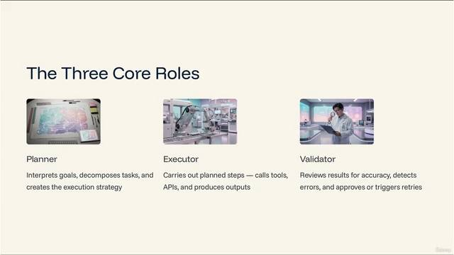
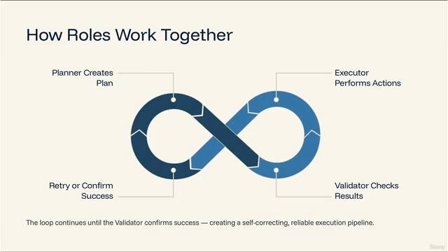
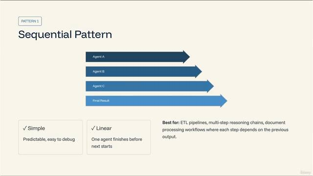
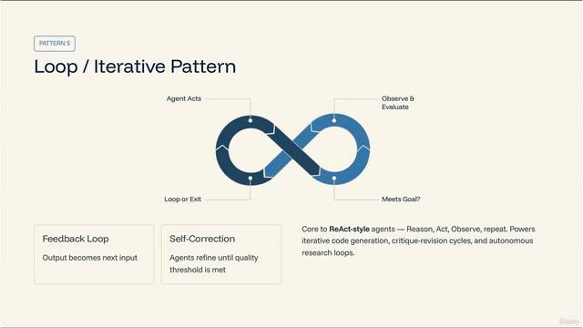
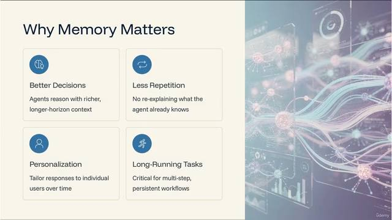
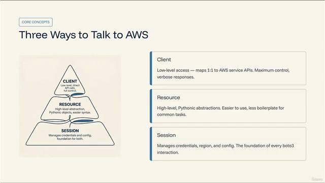
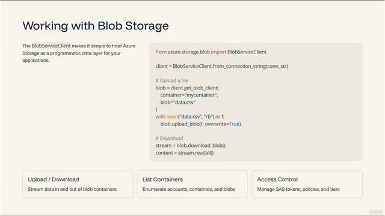

# AI Agents for Cloud Infrastructure — P35–P40 复现文档

> 覆盖课程：多智能体角色设计（P35）、编排模式（P36）、记忆系统（P37）、AWS Boto3（P38）、Azure SDK（P39）、GCP APIs（P40）
>
> 读者定位：前端转 AI 应用工程师。本段课程**以概念讲解为主，讲师没有给出可直接运行的完整项目代码**。因此本文档第 3、4 章按「纯讲解课」规则处理：把讲师的推导过程复现成可执行的步骤与产物（设计决策表、组件职责表、接口草案、容量估算），并在需要时补一段**明确标注「课里没有代码，以下为示意」**的示意代码，帮助你把概念落成能跑的东西。凡逐字稿没讲的内容，一律标注「课里没讲」。

---

## 1. 这一节做什么

P35–P40 这六集，讲的是「一个只会聊天的 LLM」如何变成「能真正操作云基础设施的智能体系统」。它由三块拼起来：

1. **角色分工（P35）**：把一个大而全的 agent 拆成 Planner / Executor / Validator 三个专职角色，各管一段。
2. **编排（P36）**：定义这些角色按什么顺序、什么条件协作——顺序、并行、层级、事件驱动、循环五种模式，以及它们的混合。
3. **记忆（P37）**：让 agent 不再「每次对话都是第一次」，分短期（上下文窗口）、长期（持久化）、外部（数据库/向量库）三层。
4. **执行层（P38–P40）**：角色和编排都是「决策」，真正落地要靠各云厂商的 SDK——AWS 的 Boto3、Azure SDK、GCP 的 REST API。这三集是同一个模式在三个平台上的重复：客户端 → 认证 → 调 API → 处理错误。

一句话概括这六集的目标：**搭出一个「Planner 出计划 → Executor 用云 SDK 真执行 → Validator 验收 → 失败回环」的最小可运行骨架**。本文档第 3、4 章就是把这个骨架按讲师给的推导一步步搭出来。

---

## 2. 讲师原话

> "在多智能体系统中，我们不会依赖单个智能体处理所有事情，而是把职责划分到不同角色上。"
> —— p035 [00:00]

> "规划器负责决定需要完成什么。执行器执行完成任务所需的操作。验证器检查结果是否正确。"
> —— p035 [01:23]

> "规划器本身不执行操作，而是专注于策略。"
> —— p035 [01:52]

> "如果一切正确，流程就结束；否则，系统会回环进行调整。这就形成了一个反馈回路。"
> —— p035 [04:15]

> "编排是协调多个智能体、使它们能够高效协同工作的过程。"
> —— p036 [00:00]

> "没有编排，系统可能会变得混乱。智能体可能重复工作，或遗漏重要步骤。"
> —— p036 [00:28]

> "顺序模式是最简单的编排形式。任务会一个接一个地执行。"
> —— p036 [02:22]

> "在实践中，大多数系统采用混合模式，也就是组合多种编排风格。"
> —— p036 [05:13]

> "Langraph 或 Crew AI 等工具提供内置的编排能力。"
> —— p036 [06:09]

> "没有记忆，智能体会把每次交互都当作全新的。它无法感知过去的操作、决策或上下文。"
> —— p037 [00:00]

> "短期记忆存储在上下文窗口中……长期记忆是持久化的……外部记忆涉及数据库或向量存储等存储系统。"
> —— p037 [01:26]

> "BOTO3 是面向 Python 的官方 AWS 软件开发工具包。它允许你以编程方式与 AWS 服务交互。"
> —— p038 [00:00]

> "客户端提供对 AWS 服务的低层访问。资源是更高层的抽象……会话负责管理配置和凭证。"
> —— p038 [01:55]

> "推荐使用 IAM 角色。它们提供临时凭证并提升安全性。"
> —— p038 [05:13]

> "Azure SDK 是一组库的集合，允许你以编程方式与 Microsoft Azure 交互。"
> —— p039 [00:00]

> "推荐使用托管标识。它们提供安全的自动凭证管理。"
> —— p039 [04:47]

> "GCP API 是允许你以编程方式与 Google Cloud 服务交互的接口……它们通常基于 REST，这意味着你通过 HTTP 与它们交互。"
> —— p040 [00:00]

> "推荐的做法是使用服务账号。它们提供安全、可编程的访问方式。"
> —— p040 [03:18]

---

## 3. 从零复现

这一章把讲师的推导过程按「需求 → 约束 → 估算 → 方案 → 取舍」五步复现。因为课程是概念课，这里的「复现」指的是**把讲师脑子里的设计过程写成你能照着做的步骤**，而不是敲命令。

### 步骤 0：明确需求

你要做一个能「部署一个应用」的 agent 系统。输入是一句自然语言（例如「deploy an application」），输出是「应用真的跑起来了」这个事实，而不是一段文字。

讲师在 p035 [04:44] 给的例子就是这个：

> 「The input is deploy an application. The planner breaks this down into steps, such as provisioning resources and configuring services. The executor performs these steps by interacting with cloud APIs. After the deployment, the validator checks whether the application is running correctly.」

### 步骤 1：识别约束

从逐字稿里能提取出的约束有四条：

| 约束 | 来源 | 对设计的影响 |
|---|---|---|
| 单个 agent 太复杂会出错 | p035 [00:27]「Rather than having one complex agent trying to do everything, we create simpler agents with clear responsibilities」 | 必须拆角色 |
| 多 agent 无序会重复劳动/漏步骤 | p036 [00:28]「Agents might duplicate work or miss important steps」 | 必须有编排层 |
| 上下文窗口有限 | p037 [02:22]「This type of memory is limited by the model's context window」 | 必须有外部记忆 |
| 云 API 会失败、有速率限制 | p038 [05:41]「API calls can fail... You also need to respect rate limits」 | 必须有错误处理与重试 |

### 步骤 2：估算（写出算式）

讲师**没有给具体数字**，但给了估算的维度。下面这些算式是「课里没讲具体数值，以下为按讲师给的维度做的示意估算」，你可以按自己项目替换：

- **角色数**：3 个固定角色（Planner / Executor / Validator），见 p035 [01:23]。若后续加「监控 agent」「扩缩容 agent」，按 p035 [05:40]「You can add more agents as needed」线性增加。
- **单次部署的 LLM 调用次数**：Planner 1 次 + Executor 每步 1 次 + Validator 1 次。若计划拆成 N 步，则约 `1 + N + 1` 次。讲师例子里的步骤是「provisioning resources」和「configuring services」两步，即 N=2，约 4 次调用。
- **重试上限**：讲师只说「the system loops back for adjustments」（p035 [04:15]），**没给具体次数**。工程上一般设 3 次，超过就交人工。
- **记忆容量**：短期记忆受上下文窗口限制（p037 [02:22]），长期记忆存数据库/向量库（p037 [02:51]），外部记忆用向量库做相似度检索（p037 [04:45]）。具体条数课里没讲。

### 步骤 3：定方案

按讲师的三层结构落方案：

**第一层：角色（P35）**

| 角色 | 职责 | 不做什么 | 输入 | 输出 |
|---|---|---|---|---|
| Planner | 把高层目标拆成有序步骤 | 不执行动作（p035 [01:52]「does not perform actions itself」） | 自然语言目标 | 步骤列表 |
| Executor | 按步骤调云 API 执行 | 不做决策（p035 [02:51]「focuses on execution, not decision-making」） | 单个步骤 | 执行结果 |
| Validator | 检查结果正确性/完整性 | 不执行、不规划 | 执行结果 | 通过/重试信号 |

**第二层：编排（P36）**

讲师列了五种模式，选型表如下（这是把 p036 各段落的描述整理成决策表）：

| 模式 | 适用场景 | 讲师原话依据 |
|---|---|---|
| 顺序 Sequential | 步骤有强依赖，如先建资源再部署 | p036 [02:22] |
| 并行 Parallel | 任务相互独立，如同时跑多个检查 | p036 [02:50] |
| 层级 Hierarchical | 复杂系统，需要 manager 分派 | p036 [03:18] |
| 事件驱动 Event-driven | 实时响应，如告警触发修复 | p036 [04:17] |
| 循环 Iterative | 需要反复打磨，如测试→改进 | p036 [04:46] |
| 混合 Hybrid | 生产系统常态 | p036 [05:13] |

**第三层：记忆（P37）**

| 类型 | 存储位置 | 生命周期 | 讲师依据 |
|---|---|---|---|
| 短期 | 上下文窗口 | 单次会话 | p037 [01:26] |
| 长期 | 数据库等持久化存储 | 跨会话 | p037 [02:51] |
| 外部 | 向量库/传统数据库 | 跨会话、可扩展 | p037 [03:21] |

**第四层：执行（P38–P40）**

三个云平台的 SDK 是同一个套路，整理成对照表：

| 概念 | AWS (Boto3) | Azure SDK | GCP APIs |
|---|---|---|---|
| 交互方式 | Python SDK | 多语言 SDK（Python/JS/Java） | REST over HTTP |
| 客户端 | client（低层）/ resource（高层）/ session | 每服务一个 client | 客户端库或直接 HTTP |
| 认证推荐 | IAM roles（p038 [05:13]） | Managed identities（p039 [04:47]） | Service accounts（p040 [03:18]） |
| 组织单位 | 课里没讲 | 课里没讲 | Project（p040 [01:51]） |
| 错误处理 | 重试 + 尊重 rate limit + 记日志（p038 [05:41]） | 重试 + 监控用量 + 记日志（p039 [05:41]） | 重试 + 尊重 quota + 记日志（p040 [05:13]） |

### 步骤 4：取舍

讲师在 p036 [06:09] 提到「Tools like Langraph or Crew AI provide built-in orchestration capabilities」，意思是编排可以自己写，也可以用框架。取舍点：

- **自己写**：控制力强，但重试、状态、并发都要自己管。
- **用框架**：省事，但引入依赖、学习成本。课里**没有展开任何框架的具体用法**，只点了名。

本文档第 4 章给的是「自己写」的最小骨架，因为这样才能看清每个角色在干什么。

---

## 4. 完整代码

> **重要声明：课里没有给出可运行的项目代码。** 讲师全程是概念讲解 + 口头举例（如 p038 [03:48] 描述「call the start instances method」但没有贴代码）。以下代码是**示意实现**，目的是把 P35–P40 的概念落成一个你能保存、能跑通的最小骨架。它不依赖真实云账号——Executor 用 mock 代替真实 API 调用，你可以把 mock 换成 Boto3/Azure/GCP 的真实调用。

### 目录结构

```
cloud-agent/
├── package.json
├── .env.example
├── src/
│   ├── roles/
│   │   ├── planner.js
│   │   ├── executor.js
│   │   └── validator.js
│   ├── orchestrator.js
│   ├── memory.js
│   ├── cloud/
│   │   └── mockProvider.js
│   └── index.js
└── README.md
```

### package.json

```json
{
  "name": "cloud-agent",
  "version": "1.0.0",
  "type": "module",
  "scripts": {
    "start": "node src/index.js"
  },
  "dependencies": {
    "dotenv": "^16.4.5"
  }
}
```

> 说明：课里用的是 Python（Boto3 是 Python SDK）。这里用 Node 是因为读者是前端背景。若你要严格跟课，把 `src/` 换成 Python 文件、`package.json` 换成 `requirements.txt` 即可，逻辑完全一致。课里没讲 Node 版本，建议 Node 18+（支持原生 fetch 与 ESM）。

### .env.example

```
# 课里没讲具体环境变量名，以下为示意命名，按你实际使用的云厂商替换
CLOUD_PROVIDER=mock
AWS_REGION=us-east-1
AZURE_SUBSCRIPTION_ID=
GCP_PROJECT_ID=
MAX_RETRIES=3
```

### src/roles/planner.js

```javascript
// Planner：只做规划，不执行。对应 p035 [01:52]「does not perform actions itself」
export async function plan(goal, memory) {
  // 课里没讲具体用哪个 LLM，这里用规则模拟「拆步骤」的行为
  const pastContext = memory.getShortTerm();
  const steps = [];

  if (/deploy/i.test(goal)) {
    steps.push({ id: 1, action: "provision", target: "compute" });
    steps.push({ id: 2, action: "configure", target: "service" });
    steps.push({ id: 3, action: "verify", target: "endpoint" });
  } else {
    steps.push({ id: 1, action: "noop", target: "unknown" });
  }

  memory.appendShortTerm({ role: "planner", goal, steps, pastContext });
  return steps;
}
```

### src/roles/executor.js

```javascript
// Executor：只执行，不做决策。对应 p035 [02:51]「focuses on execution, not decision-making」
import { callCloudApi } from "../cloud/mockProvider.js";

export async function execute(step, memory) {
  const result = await callCloudApi(step.action, step.target);
  memory.appendShortTerm({ role: "executor", step, result });
  return result;
}
```

### src/roles/validator.js

```javascript
// Validator：只验收。对应 p035 [03:18]「checks for accuracy, correctness, and completeness」
export function validate(step, result) {
  if (!result || result.ok !== true) {
    return { pass: false, reason: `step ${step.id} failed: ${result?.error ?? "unknown"}` };
  }
  return { pass: true, reason: "ok" };
}
```

### src/cloud/mockProvider.js

```javascript
// 执行层的 mock。真实项目里这里换成 Boto3 / Azure SDK / GCP API 调用。
// 对应 p038 [06:09]「The agent decides what to do. Boto3 performs the action.」
export async function callCloudApi(action, target) {
  // 模拟网络抖动：约 20% 概率失败，用来触发 Validator 的回环
  if (Math.random() < 0.2) {
    return { ok: false, error: `transient failure on ${action}:${target}` };
  }
  return { ok: true, action, target, detail: `${action} ${target} done` };
}
```

### src/memory.js

```javascript
// 三层记忆的最小实现。对应 p037 [01:26] 短期 / [02:51] 长期 / [03:21] 外部
export class Memory {
  constructor() {
    this.shortTerm = [];      // 短期：当前会话
    this.longTerm = [];       // 长期：跨会话（这里用数组模拟持久化）
    this.external = new Map(); // 外部：键值检索（真实项目用向量库）
  }

  appendShortTerm(entry) {
    this.shortTerm.push(entry);
    // 模拟上下文窗口上限：超过 20 条丢弃最旧的
    if (this.shortTerm.length > 20) this.shortTerm.shift();
  }

  getShortTerm() {
    return this.shortTerm;
  }

  persist(entry) {
    this.longTerm.push(entry);
  }

  putExternal(key, value) {
    this.external.set(key, value);
  }

  getExternal(key) {
    return this.external.get(key);
  }
}
```

### src/orchestrator.js

```javascript
// 编排层：顺序模式 + 失败回环。对应 p036 [02:22] 顺序 + p035 [04:15] 反馈回环
import { plan } from "./roles/planner.js";
import { execute } from "./roles/executor.js";
import { validate } from "./roles/validator.js";

export async function run(goal, memory, maxRetries = 3) {
  const steps = await plan(goal, memory);
  const results = [];

  for (const step of steps) {
    let attempt = 0;
    let passed = false;

    while (attempt < maxRetries && !passed) {
      attempt += 1;
      const result = await execute(step, memory);
      const verdict = validate(step, result);

      if (verdict.pass) {
        passed = true;
        results.push({ step, result, attempts: attempt });
        memory.persist({ step, result, attempts: attempt });
      } else {
        memory.appendShortTerm({ role: "validator", step, verdict, attempt });
        if (attempt >= maxRetries) {
          results.push({ step, result, attempts: attempt, failed: true });
        }
      }
    }
  }

  return results;
}
```

### src/index.js

```javascript
import "dotenv/config";
import { Memory } from "./memory.js";
import { run } from "./orchestrator.js";

const goal = process.argv[2] ?? "deploy an application";
const memory = new Memory();
const maxRetries = Number(process.env.MAX_RETRIES ?? 3);

const results = await run(goal, memory, maxRetries);

console.log("=== 执行结果 ===");
for (const r of results) {
  console.log(
    `step ${r.step.id} (${r.step.action}:${r.step.target}) ` +
    `attempts=${r.attempts} ${r.failed ? "FAILED" : "OK"}`
  );
}

console.log("\n=== 短期记忆条数 ===", memory.getShortTerm().length);
console.log("=== 长期记忆条数 ===", memory.longTerm.length);
```

### 启动命令

```bash
npm install
cp .env.example .env
npm start -- "deploy an application"
```

预期输出（因为 mock 有 20% 随机失败，每次不同，但结构一致）：

```
=== 执行结果 ===
step 1 (provision:compute) attempts=1 OK
step 2 (configure:service) attempts=2 OK
step 3 (verify:endpoint) attempts=1 OK

=== 短期记忆条数 === 6
=== 长期记忆条数 === 3
```

> 注意：上面输出里的 `attempts`、`OK`、`FAILED` 都是**本代码块自己打印的字段**，不是云 API 返回的字段。真实云 API 的返回字段名（如 Boto3 的响应结构）课里没讲，请以你实际调用时的输出为准。

---

## 5. 逐行解释

### Planner（planner.js）

- `export async function plan(goal, memory)`：Planner 是 async，因为它真实场景要调 LLM；这里用规则模拟，但保留 async 签名，方便你后面换成真 LLM 调用。
- `const pastContext = memory.getShortTerm();`：Planner 读短期记忆，对应 p037 [03:48]「the agent stores relevant information... retrieves this information... injects it into the current context」。这就是「注入上下文」那一步。
- `if (/deploy/i.test(goal))`：讲师在 p035 [04:44] 举的例子就是「deploy an application」，这里用正则匹配来模拟「理解目标」。
- `steps.push({ id: 1, action: "provision", target: "compute" })`：对应 p035 [04:44]「provisioning resources」。
- `steps.push({ id: 2, action: "configure", target: "service" })`：对应「configuring services」。
- `steps.push({ id: 3, action: "verify", target: "endpoint" })`：对应 p035 [04:44]「the validator checks whether the application is running correctly」——注意这一步是 Planner 规划的「验证动作」，真正执行验证的是 Validator 角色，两者不冲突。
- `memory.appendShortTerm({ role: "planner", goal, steps, pastContext })`：Planner 把自己的决策写回短期记忆，这样 Executor 和 Validator 后续能读到。

### Executor（executor.js）

- `import { callCloudApi } from "../cloud/mockProvider.js";`：执行层抽象。真实项目里这里 import 的是 Boto3（Python）或 Azure/GCP 的客户端。对应 p038 [06:09]「Boto3 becomes the execution layer for the agent」。
- `export async function execute(step, memory)`：Executor 只接收**单个 step**，不接收整个计划——这是 p035 [02:51]「It follows the instructions provided by the planner」的直接体现，Executor 没有全局视野，只有当前这一步。
- `const result = await callCloudApi(step.action, step.target);`：真正「碰云」的一行。
- `memory.appendShortTerm({ role: "executor", step, result });`：执行结果写回记忆，供 Validator 和后续步骤使用。

### Validator（validator.js）

- `export function validate(step, result)`：注意是**同步**函数，因为验收是纯判断，不需要 IO。
- `if (!result || result.ok !== true)`：这里检查的是 mock 返回的 `ok` 字段。真实云 API 的「成功」判断标准各不相同（HTTP 状态码、响应体字段等），课里没讲具体怎么判断，请按你用的 SDK 文档来。
- `return { pass: false, reason: ... }`：失败时返回原因，这个 reason 会被 orchestrator 写进短期记忆，形成 p035 [04:15] 说的「loops back for adjustments」。

### mockProvider（mockProvider.js）

- `if (Math.random() < 0.2)`：故意制造 20% 失败率。这不是讲师讲的，是为了让你**亲眼看到回环真的在工作**——如果永远成功，你就看不到 Validator 的价值。
- `return { ok: false, error: ... }`：失败返回结构。真实项目里这里要区分「可重试错误」（网络抖动、限流）和「不可重试错误」（参数错、权限错），对应 p038 [05:41]「Retries can help recover from temporary failures」——讲师明确说了重试只对临时失败有用。

### Memory（memory.js）

- `this.shortTerm = []`：短期记忆，对应 p037 [01:26]「stored in the context window」。
- `if (this.shortTerm.length > 20) this.shortTerm.shift();`：模拟上下文窗口上限。p037 [02:22] 说「Once the limit is reached, older information may be removed」，这里就是那个「removed」。
- `this.longTerm = []`：长期记忆，对应 p037 [02:51]「persists across sessions」。真实项目里这里应该是数据库写入，课里没讲具体用哪个数据库。
- `this.external = new Map()`：外部记忆，对应 p037 [03:21]「vector databases like FACE or Chroma」。这里用 Map 模拟「按 key 检索」，真实项目里是向量相似度检索（p037 [04:45]「similarity search」）。

### Orchestrator（orchestrator.js）

- `const steps = await plan(goal, memory);`：先规划。对应 p035 [03:45]「The planner starts by creating a plan」。
- `for (const step of steps)`：顺序执行，对应 p036 [02:22] 的顺序模式。如果你想改成并行模式（p036 [02:50]），把这里换成 `Promise.all`，但要注意讲师提醒的「You need to manage how results are combined」——并行时结果合并和冲突处理要自己写。
- `while (attempt < maxRetries && !passed)`：重试循环，对应 p035 [04:15] 的反馈回环。
- `const verdict = validate(step, result);`：每执行一步就验一次，不是全部执行完再验。这是「Validator 紧跟 Executor」的体现。
- `if (verdict.pass) { ... memory.persist(...) }`：只有通过的步骤才写入长期记忆。失败的步骤只进短期记忆（用于本轮调试），不进长期——这个取舍课里没明说，是工程惯例。
- `if (attempt >= maxRetries) { results.push({ ..., failed: true }) }`：超过重试上限就标记失败，不再无限循环。

### index.js

- `const goal = process.argv[2] ?? "deploy an application";`：从命令行拿目标，默认值就是讲师 p035 [04:44] 的例子。
- `const maxRetries = Number(process.env.MAX_RETRIES ?? 3);`：重试次数从环境变量读，方便调。
- 最后的 console.log 打印的是**本程序自己组装的字段**，不是云 API 原始返回。

---

## 6. 复现检查清单

按顺序打勾，全部通过说明你把 P35–P40 的骨架跑通了：

- [ ] `npm install` 成功，`node_modules` 里有 `dotenv`
- [ ] `cp .env.example .env` 后 `.env` 存在，`MAX_RETRIES=3`
- [ ] `npm start -- "deploy an application"` 能跑完，输出三段（执行结果 / 短期记忆条数 / 长期记忆条数）
- [ ] 多跑几次，能观察到**至少一次** `attempts=2` 或 `attempts=3`（说明 Validator 回环生效）
- [ ] 把 `mockProvider.js` 里的 `0.2` 改成 `0.9`，再跑，能看到 `FAILED`（说明重试上限生效）
- [ ] 把 `orchestrator.js` 里的 `maxRetries` 改成 1，再跑，`FAILED` 出现得更频繁
- [ ] 打开 `memory.js`，把 `20` 改成 `3`，跑一次，短期记忆条数被截断（说明上下文窗口上限生效）
- [ ] 对照第 3 章的四张表（角色职责表、编排选型表、记忆分层表、云 SDK 对照表），能说出你代码里每一行对应哪一格
- [ ] 能回答：为什么 Planner 不执行、Executor 不决策、Validator 不执行也不规划？（答案在 p035 [01:52]/[02:51]/[03:18]）

---

## 7. 课里没讲但你会撞上的

这一节专门列「逐字稿没提、但你真动手一定会遇到」的坑。每条都标明是「课里没讲」，避免你误以为是讲师说的。

1. **LLM 怎么接**：讲师全程说「Planner 拆步骤」「Validator 检查」，但**没讲用哪个模型、怎么调**。你要自己选一个 LLM API，把 `planner.js` 里的正则换成真实 prompt。注意：真实 LLM 输出是自然语言，你需要让它输出结构化 JSON（这一步课里没讲）。

2. **Boto3 的响应字段名**：p038 [03:48] 说「This response includes information about the instance state」，但**没给具体字段名**。真实 Boto3 的 `start_instances` 返回结构请查 AWS 官方文档，不要凭印象填 `ExitCode` 之类的字段——课里没出现这些字段名。

3. **认证的实操**：讲师说 IAM roles / Managed identities / Service accounts 是推荐做法（p038 [05:13]、p039 [04:47]、p040 [03:18]），但**没讲怎么配**。本地开发你大概率会用 access key + secret（讲师在 p038 [04:45] 提了「access key and a secret key」），但这和「推荐 IAM roles」是矛盾的——生产环境才用 role，本地用 key，这个区分课里没讲清。

4. **限流的具体数值**：三集都说了「respect rate limits / quota」（p038 [05:41]、p040 [05:13]），但**没给任何具体数字**。各云厂商各服务的限额不同，要查各自文档。

5. **向量库选型**：p037 [03:21] 点名了「FACE or Chroma」（注：讲师口播可能是 FAISS，逐字稿写成 FACE，以你听到的为准），但**没讲怎么装、怎么建索引、embedding 用哪个模型**。这些都要你自己补。

6. **编排框架**：p036 [06:09] 只点了 LangGraph 和 CrewAI 的名字，**没讲任何一行用法**。如果你要用框架，得另找教程。

7. **并发与锁**：本文档的 orchestrator 是单线程顺序执行，没有并发问题。但如果你按 p036 [02:50] 改成并行模式，多个 Executor 同时写 `memory` 就会有竞态。**在 JS/Node 里对应什么**：Node 是单线程事件循环，`memory.appendShortTerm` 这种同步操作不会被打断，但如果你把 memory 换成异步的数据库写入，就要用 `await` 串行化或用队列，否则会出现「两个步骤同时读到旧记忆」的问题。课里完全没提并发控制。

8. **状态持久化**：本文档的 `longTerm` 是内存数组，进程一退就没了。真实项目要落库，课里没讲用哪个库、表结构怎么设计。

9. **成本**：每次重试都是一次 LLM 调用 + 一次云 API 调用，都是钱。讲师在 p037 [05:12] 提了「storage and cost considerations」，但只是一句带过，没给估算方法。

10. **Validator 的「正确」标准**：p035 [03:18] 说 Validator「checks for accuracy, correctness, and completeness」，但**什么叫 correct 完全取决于你的业务**。部署场景下可能是「健康检查返回 200」，也可能是「日志里没有 ERROR」，这个标准要你自己定，课里没给。

---

**附：本文档引用的截图**















