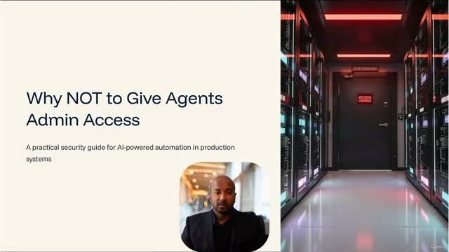
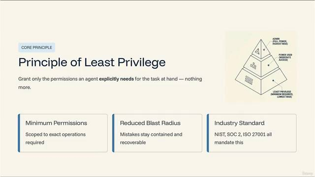
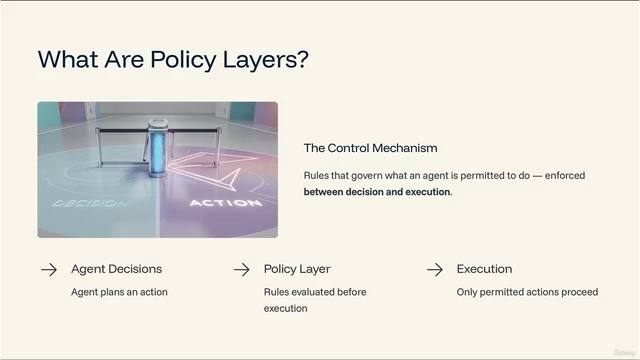
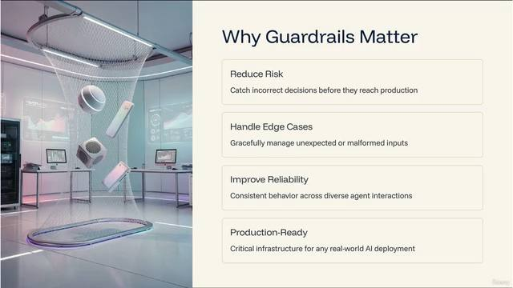
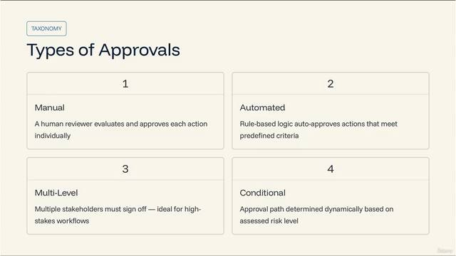
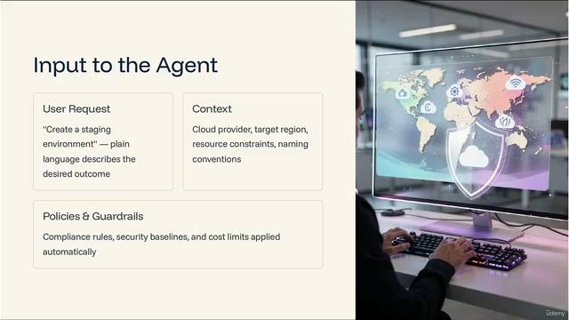
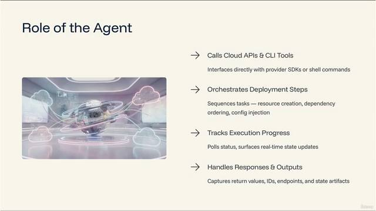

# AI Agents for Cloud Infrastructure · P41–P46 安全执行与部署全流程复现文档

> 覆盖课程 P41–P46：安全执行（Safe Execution）→ 策略层（Policy Layers）→ 护栏（Guardrails）→ 审批工作流（Approval Workflows）→ 基础设施计划生成（Infrastructure Planning）→ 部署执行（Deployment Execution）。
>
> 说明：这六节是**架构与设计讲解课**，逐字稿里**没有给出任何可运行代码、命令或配置文件**。因此本文档第 3、4 节按「纯讲解课」规则处理：把讲师的推导过程按步骤复现，并把讲师口头描述的安全栈落成**可用的设计产物**（决策表、职责表、数据模型草案、流程）。凡是我补的示意代码，都会明确标注「课里没有代码，以下为示意」，且不会把课里没提过的工具/字段安到讲师头上。

---

## 1. 这一节做什么

P41–P46 是一条完整的「让 AI Agent 安全地操作云基础设施」的流水线，从最危险的问题讲到最终落地：

1. **P41 安全执行**：为什么给 Agent 管理员权限是危险的（爆炸半径、概率性行为、真实后果），以及四条基本对策——最小权限、限定范围、职责分离、人在回路。
2. **P42 策略层**：在「Agent 做决策」和「真正执行」之间插一层规则闸门，决定 allow / deny / modify，并区分静态策略与动态策略。
3. **P43 护栏**：比策略层更细，贯穿每一步——输入护栏、输出护栏、动作护栏、上下文护栏。
4. **P44 审批工作流**：执行前的最后一道闸，人工或系统审批，按风险分级。
5. **P45 计划生成**：把自然语言需求转成结构化 IaC 模板（CloudFormation / Terraform / Bicep），并强调「规划与执行分离」。
6. **P46 部署执行**：Agent 作为编排者触发部署、监控、处理错误、部署后校验。

一句话：**P41–P44 建「安全栈」，P45–P46 建「从意图到现实」的执行链**。两者合起来才是生产级系统。

---

## 2. 讲师原话（带出处）

- 「Admin access gives full control over a system. It allows actions like creating, modifying, or deleting resources without restriction.」—— p041 [00:13]
- 「They are probabilistic, not deterministic. This means there is always some level of uncertainty.」—— p041 [00:58]
- 「The principle of least privilege … means giving only the permissions that are absolutely necessary. No more, no less.」—— p041 [02:51]
- 「For example, an agent might be allowed to start instances but not delete them.」—— p041 [03:20]
- 「Separation of duties … one agent might propose changes. Another might execute them.」—— p041 [04:17]
- 「Human in the loop … For sensitive actions, you require human approval.」—— p041 [04:47]
- 「Policy layers are essentially control systems that sit between your agent and execution.」—— p042 [00:00]
- 「These rules determine whether the action is allowed, denied, or needs modification.」—— p042 [00:29]
- 「Static policies are predefined rules … Dynamic policies … can adapt based on context, for example, time of day, user role, or system state.」—— p042 [04:21]
- 「Cloud providers offer built-in tools like IAM policies … Another option is Open Policy Agent.」—— p042 [04:48]
- 「Guardrails are constraints that guide how an AI agent behaves.」—— p043 [00:00]
- 「Input guardrails validate incoming data … Output guardrails validate what the agent produces … Action guardrails restrict what actions can be executed … Context guardrails control what information the agent can access.」—— p043 [01:25]
- 「You can enforce structured outputs such as JSON schemas.」—— p043 [02:51]
- 「You can use REGX filters to detect patterns. You can also use LLM-based validation for more complex checks.」—— p043 [04:46]
- 「Approval workflows are the final control layer before execution.」—— p044 [00:00]
- 「Manual approval … Automated approval … Multilevel approval … Conditional approval.」—— p044 [02:20]
- 「Low risk actions can be approved automatically. Medium risk actions may require conditional checks. High risk actions should require human approval.」—— p044 [04:15]
- 「The agent takes this input and converts it into a structured infrastructure plan. This plan is typically expressed as infrastructure as code.」—— p045 [00:29]
- 「It could be a cloud formation template, a Terraform configuration, or a bicep file.」—— p045 [01:51]
- 「It is important to separate planning from execution. The agent's role is to generate the plan. It does not directly execute it.」—— p045 [02:20]
- 「First, compute resources … Next, storage … a database … Networking … VPCs, subnets, and security groups.」—— p045 [02:48]
- 「The agent acts as an orchestrator. It doesn't manually create resources. Instead, it triggers the appropriate tools or APIs.」—— p046 [02:22]
- 「This includes retrying failed steps. It may also need to roll back changes.」—— p046 [04:15]

---

## 3. 从零复现（按讲师的推导过程走一遍）

这一节没有可敲的命令，但讲师给了一条清晰的**设计推导链**。照着下面 8 步，你就能在自己的项目里把「安全栈 + 计划生成 + 部署执行」搭出来。

### 步骤 1：先承认风险，再设计

讲师在 P41 开头就把前提钉死：Agent 是**概率性**的，会幻觉、会误读指令、会基于不完整上下文选错动作。所以设计目标不是「让 Agent 不出错」，而是「**出错时把影响压到最小**」。这是后面所有机制的出发点。



### 步骤 2：把「爆炸半径」量化成四类后果

讲师在 P41 [01:26]–[02:22] 列了四类真实风险，你在设计时要逐条对照自己的系统：

| 风险类别 | 讲师举的例子 | 对应到你的系统要问的问题 |
|---|---|---|
| 误删 | 意外删除关键基础设施 | 哪些资源是「删了就回不来」的？ |
| 数据泄露 | 错误配置权限暴露敏感数据 | 哪些权限配置一旦写错就泄露？ |
| 成本 | 触发昂贵操作导致意外账单 | 哪些操作会按量计费、可能失控？ |
| 宕机 | 错误配置导致服务中断 | 哪些改动会直接影响线上可用性？ |

### 步骤 3：用四条原则收窄权限（P41 的对策层）

1. **最小权限**：只给「绝对必要」的权限。讲师的原话是「No more, no less」。
2. **限定范围（scoped access）**：例如只允许 start/stop 实例，**禁止 delete**；或只允许在开发环境操作。
3. **职责分离**：一个 Agent 提议变更，另一个 Agent 执行变更，避免单点全权。
4. **人在回路**：敏感动作必须人工批准。



### 步骤 4：在 Agent 与执行之间插入策略层（P42）

讲师给的系统流是固定的：

```
用户输入 → Agent 推理生成动作计划 → 【策略层校验】 → 执行
```

策略层输出三种结果：**allowed / denied / modified**（讲师原话是 allowed、denied、needs modification）。关键点是「**没有任何东西能绕过策略层直接到达执行**」。



策略类型按讲师 [02:25] 的分类，可以组合使用：

| 策略类型 | 作用 | 讲师例子 |
|---|---|---|
| Allow / Deny | 最基础的允许与拒绝 | 允许 start/stop，拒绝删除生产资源 |
| Environment-based | 按环境区分 | 开发环境允许，生产环境不允许 |
| Action-based | 按操作类型区分 | 读操作允许，删除操作受限 |
| Resource-based | 限定到具体资源 | 只允许修改带 `DEV` 标签的资源 |

### 步骤 5：在每一步加护栏（P43）

策略层是「这道动作能不能过」，护栏是「**整个流程每一步的行为边界**」。讲师把它分成四层，并且强调它们是**贯穿工作流**的，不是单点：

```
输入护栏 → Agent 推理 → 输出护栏 → 动作护栏 → 执行
                ↑
          上下文护栏（限制 Agent 能访问的记忆/数据/系统上下文）
```



实现手段讲师点了四种：规则校验、schema 强制（如 JSON schema）、正则过滤、LLM 校验。他明确说「通常组合多种手段」。

### 步骤 6：加最后一道审批闸（P44）

审批是执行前的**最后检查点**，位置在策略层和护栏之后：

```
用户输入 → Agent 推理 → 策略层 → 护栏 → 【审批】 → 执行
```

审批分四类（讲师 [02:20]）：人工审批、自动审批、多级审批、条件审批。并按风险分级（[04:15]）：低风险自动批、中风险条件检查、高风险人工批。



### 步骤 7：让 Agent 生成 IaC 计划，但**不执行**（P45）

这是从「安全」转向「能力」的转折点。Agent 的输入是自然语言 + 上下文（云厂商、区域、约束）+ 策略与护栏；输出是**结构化 IaC 模板**（CloudFormation / Terraform / Bicep）。讲师反复强调「**规划与执行分离**」——Agent 只生成计划，不直接执行，计划要经过校验和审批才能进入下一步。



一个典型计划包含的组件（讲师 [02:48]）：计算（EC2/VM）、存储（S3/blob）、数据库（RDS/托管数据库）、网络（VPC、子网、安全组）。

### 步骤 8：Agent 作为编排者触发部署（P46）

最后一步，Agent 拿到**已校验、已审批**的模板，触发部署。讲师把 Agent 的角色定义为**编排者（orchestrator）**：它不手动创建资源，而是调用云 API 或 CLI 命令，然后监控、处理错误、部署后校验。

```
已审批的 IaC 模板 → Agent 触发部署（API/CLI）→ 云厂商创建资源
→ Agent 监控状态 → 处理错误（重试/回滚/通知）→ 部署后校验
```



---

## 4. 完整代码（设计产物）

> **课里没有代码。以下全部是把讲师口头描述落成的设计产物；其中标注「示意」的代码块是我为帮助理解补的，不是讲师给的。**

### 4.1 安全栈职责表（P41–P44 汇总）

| 层 | 职责 | 输入 | 输出 | 失败时 |
|---|---|---|---|---|
| 最小权限 / 范围 | 限定 Agent 能碰的资源与环境 | 权限配置 | 收窄后的权限集 | 动作被拒绝 |
| 策略层 | 判定动作 allow/deny/modify | 动作计划 | 判定结果 | 拒绝或改写 |
| 护栏 | 逐步约束行为 | 输入/输出/动作/上下文 | 校验通过或拦截 | 拦截并记录 |
| 审批 | 执行前最后检查点 | 已过策略与护栏的计划 | 批准/拒绝 | 停止执行 |

### 4.2 策略判定数据模型草案（示意）

> 课里没有代码，以下为示意。字段命名参照讲师提到的概念（action、environment、resource、allow/deny/modify），未引入课里没提过的字段。

```json
{
  "policy_id": "deny-delete-prod",
  "effect": "deny",
  "action": "delete",
  "environment": "production",
  "resource_tag": null,
  "note": "生产环境禁止删除动作"
}
```

```json
{
  "policy_id": "allow-dev-modify",
  "effect": "allow",
  "action": "modify",
  "environment": "development",
  "resource_tag": "DEV",
  "note": "仅允许修改带 DEV 标签的资源"
}
```

### 4.3 策略判定伪流程（示意）

> 课里没有代码，以下为示意，仅表达讲师描述的 allow/deny/modify 三态。

```text
function evaluate(plan):
    for rule in policies:
        if rule.matches(plan):
            if rule.effect == "deny":   return DENIED
            if rule.effect == "modify": return MODIFIED(plan)
    return ALLOWED
```

### 4.4 护栏四层检查表（P43）

| 护栏层 | 检查什么 | 讲师给的实现手段 |
|---|---|---|
| 输入护栏 | 输入是否安全、是否含恶意 prompt（如 prompt injection） | 规则校验、正则过滤 |
| 输出护栏 | 输出格式是否正确、是否幻觉/不安全 | JSON schema 强制、LLM 校验 |
| 动作护栏 | 动作频率、特定条件下是否允许 | 规则校验 |
| 上下文护栏 | Agent 能访问哪些记忆/数据/系统上下文 | 访问限制 |

### 4.5 审批风险分级表（P44）

| 风险级别 | 审批方式 | 讲师原话依据 |
|---|---|---|
| 低 | 自动审批 | 「Low risk actions can be approved automatically」 |
| 中 | 条件检查 | 「Medium risk actions may require conditional checks」 |
| 高 | 人工审批 | 「High risk actions should require human approval」 |

审批渠道（讲师 [03:46]）：CLI prompt、Web dashboard、Slack/Teams 等消息平台、Email。

### 4.6 基础设施计划组件表（P45）

| 组件 | 讲师举的例子 |
|---|---|
| 计算 | EC2 实例 / 虚拟机 |
| 存储 | S3 bucket / blob storage |
| 数据库 | RDS / 托管数据库服务 |
| 网络 | VPC、子网、安全组 |

### 4.7 部署执行流程表（P46）

| 阶段 | Agent 做什么 |
|---|---|
| 接收 | 拿到已审批的 IaC 模板 |
| 触发 | 调用云 API 或运行部署 CLI 命令 |
| 监控 | 跟踪每个资源创建状态、记录事件 |
| 错误处理 | 重试失败步骤、回滚、通知用户、记录详细错误 |
| 部署后校验 | 检查资源配置、测试连通性（如 Web 服务器可达） |

---

## 5. 逐行解释（每条设计为什么这样定）

**为什么先讲风险再讲机制（P41）**：讲师把「Agent 是概率性的」作为一切的前提。如果不先承认这一点，后面所有机制都会被当成「多余」。所以设计顺序必须是「先量化爆炸半径，再逐层收窄」——这也是为什么 P41 花了大半时间讲后果而不是讲方案。

**为什么最小权限要「No more, no less」**：给多了，爆炸半径大；给少了，Agent 干不了活。讲师用「允许 start/stop 但禁止 delete」这个具体例子，说明权限要**按动作粒度**切，而不是按「整个服务」切。在 JS/Node 里对应的是：不要给一个 service account 一把万能 key，而是按操作拆成不同的、最小化的凭据。

**为什么策略层要独立于 Agent**：讲师说「separate decision-making from execution」。如果判定逻辑写在 Agent 的 prompt 里，Agent 一旦被 prompt injection 影响，判定也跟着失效。把策略层做成 Agent 之外的独立组件，才能保证「即使 Agent 错了，策略层还能拦」。在 Node 里这对应「把校验逻辑放在 Agent 调用之外的一层中间件」，而不是塞进 prompt。

**为什么策略要分静态和动态**：静态策略简单、可预测，但不够灵活；动态策略能按时间、角色、系统状态自适应，但更复杂。讲师没有说哪个更好，只说「取决于需求」。取舍点：**规则稳定、审计要求高的场景用静态；需要按上下文自适应的场景用动态**。

**为什么护栏要分四层而不是一层**：讲师强调 Agent 是**多步**运行的，「small issues can compound into larger problems」。单层护栏只能拦一个点，四层护栏在输入、输出、动作、上下文各设一道，才能让问题在最早阶段被抓住。这对应到工程上就是「防御性编程 + 每步校验」，而不是「最后统一校验一次」。

**为什么输出护栏要用 schema**：讲师明确说「enforce structured outputs such as JSON schemas」。因为 Agent 的输出**直接驱动执行**，格式错了执行就错。用 schema 把「自由文本」变成「结构化契约」，是让概率性输出变得可校验的关键手段。在 Node 里对应 zod / JSON Schema 校验。

**为什么审批要按风险分级**：讲师的原话是低风险自动、中风险条件、高风险人工。如果不分级，要么全部人工（拖慢速度），要么全部自动（失去控制）。分级是「安全与效率」的平衡点，也是系统能规模化的前提。

**为什么规划与执行必须分离（P45）**：这是整个课程最核心的安全设计。讲师说「The agent's role is to generate the plan. It does not directly execute it」。分离之后，计划才能被**审查、校验、审批**——如果 Agent 边想边执行，就没有任何检查点。这也是为什么 P45 的输出是「可执行的 IaC 模板」而不是「直接部署」。

**为什么计划要迭代（P45 [05:14]）**：讲师说「We rarely get things perfect on the first try」。迭代让人类能在中间纠偏，把 Agent 从「一次性黑盒」变成「可引导的协作者」。

**为什么 Agent 在部署阶段只是编排者（P46）**：讲师说「It doesn't manually create resources. Instead, it triggers the appropriate tools or APIs」。让 Agent 直接操作资源等于绕过所有 IaC 工具的安全能力；让它只做编排，就能复用 CloudFormation/Terraform 本身的校验、状态管理和回滚能力。

**为什么部署后还要校验（P46 [05:11]）**：部署成功 ≠ 系统可用。讲师要求检查资源配置、测试连通性。这一步是「确认意图真的变成了现实」，也是发现隐藏问题的最后机会。

---

## 6. 复现检查清单

照着勾，确保你的系统把讲师讲的每一层都落地了：

- [ ] 我列出了自己系统里「删了就回不来」的资源清单（对应 P41 误删风险）
- [ ] 我给 Agent 的权限是按**动作粒度**切的，不是一把万能凭据（最小权限）
- [ ] 我明确禁止了至少一类高危动作（如生产环境 delete）
- [ ] 我把「提议变更」和「执行变更」拆给了不同角色/组件（职责分离）
- [ ] 敏感动作有人工审批环节（人在回路）
- [ ] Agent 与执行之间有一层**独立于 Agent** 的策略校验（P42）
- [ ] 我的策略覆盖了 allow / deny / modify 三态
- [ ] 我区分了静态策略与动态策略，并说明了各自用在哪
- [ ] 我在输入、输出、动作、上下文四个层面都设了护栏（P43）
- [ ] 我的 Agent 输出用 schema 做了结构化校验
- [ ] 执行前有审批闸，且按风险分级（低自动/中条件/高人工）（P44）
- [ ] 审批决策被记录（谁、何时、批了什么）
- [ ] Agent 只生成 IaC 计划，不直接执行（P45）
- [ ] 计划在进入部署前经过了语法校验、策略校验、必填字段检查
- [ ] 部署阶段 Agent 只做编排（调 API/CLI），不手动创建资源（P46）
- [ ] 部署过程有监控、错误处理（重试/回滚/通知）、部署后校验

---

## 7. 课里没讲但你会撞上的

1. **具体 IaC 模板长什么样**：讲师只说了 CloudFormation / Terraform / Bicep 三种格式的名字，**没有给任何模板示例**。你需要自己按所选工具的官方文档写。
2. **策略引擎的具体实现**：讲师提到 IAM policies、Open Policy Agent、自建策略引擎、middleware 四种方式，但**没有给任何一种的配置或代码**。选型要自己查文档。
3. **审批 UI 怎么做**：讲师列了 CLI、dashboard、Slack/Teams、Email 四种渠道，**没有讲任何一种的接入方式**。
4. **Agent 如何调用云 API**：讲师说「call APIs or run CLI commands」，但**没讲认证、凭据管理、SDK 选择**。这部分是安全栈之外的另一大块，课里没覆盖。
5. **回滚的具体机制**：讲师说「roll back changes」，但**没讲怎么回滚**（是依赖 Terraform 的 state 还是自己实现）。这块要结合你选的 IaC 工具来定。
6. **监控字段名**：讲师提到「status updates or error messages」，但**没有给任何具体字段名**。实际输出字段请以你所调用 API 的真实返回为准，不要凭印象填。
7. **成本控制的具体手段**：讲师把「触发昂贵操作」列为风险，但**没讲预算告警、配额限制怎么做**。
8. **多 Agent 职责分离的通信方式**：讲师说「one agent proposes, another executes」，但**没讲两个 Agent 之间怎么传递计划、怎么保证不被篡改**。

> 提醒：以上都是「课里没讲」的部分。写你自己的实现时，凡是涉及具体字段名、API 参数、配置项的地方，都以你实际使用的工具文档为准，不要照搬本文档里的示意命名。