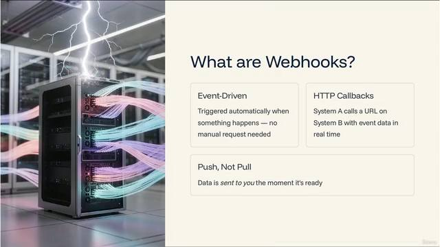
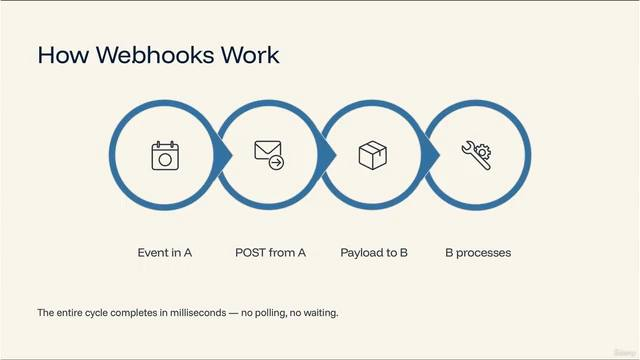
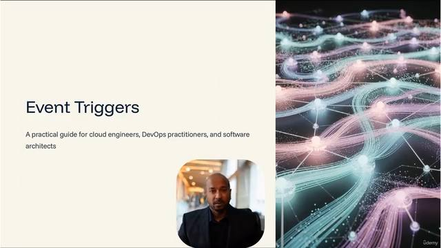
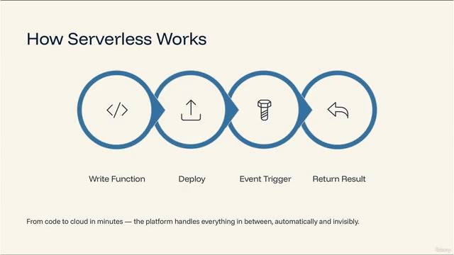
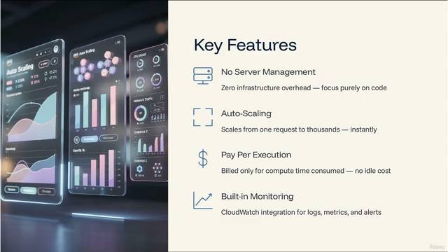
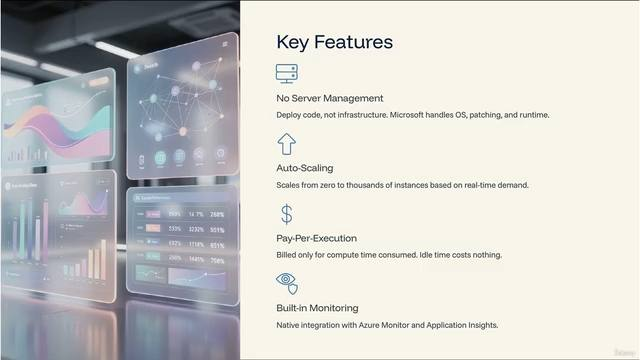
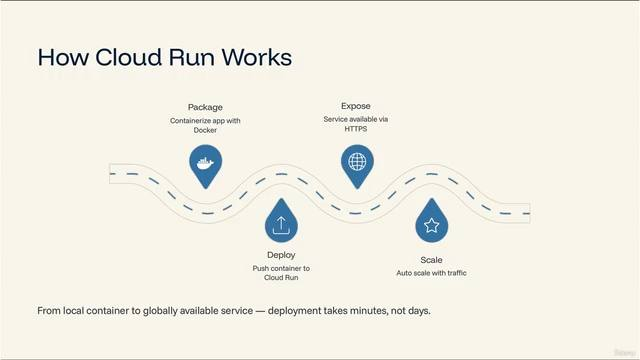
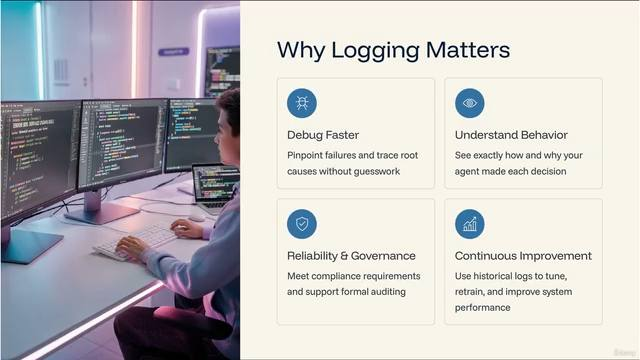

# AI Agents for Cloud Infrastructure（P47–P53）复现文档：事件驱动入口、触发器、Serverless 执行与 Agent 决策日志

> 说明：P47–P53 是**概念讲解课**，逐字稿没有给出项目仓库、云账号配置、IaC 文件、依赖版本、部署 CLI，也没有给出可直接运行的完整业务代码。因此本文按“纯讲解课”的复现方式写：把讲师的需求、约束、方案、取舍落成可执行的参考架构、接口草案、日志模型、容量估算表和本地示意 Demo。第 4 节代码是**我补的示意最小接收器**，会明确标注“课里没有代码，以下为示意”，不冒充讲师原话。

---

## 1. 这一节做什么

这一节覆盖 P47–P53，目标是把“事件驱动 AI Agent”从概念变成一条可以照着搭起来的最小链路：

1. 外部世界发生事件：支付完成、代码 push、监控告警、文件上传、用户请求等。
2. 事件通过 **Webhook** 或云平台事件源进入系统。
3. **Event Trigger** 根据事件类型、来源、过滤条件决定是否启动工作流。
4. **Serverless 执行层** 运行处理函数：AWS Lambda、Azure Functions，或用 Cloud Run 跑容器化服务。
5. 执行层调用 AI Agent 工作流，完成分析、决策、动作。
6. 全过程写入**结构化日志**：input、reasoning、actions、output 四类，进入集中日志系统，便于调试、审计、改进。

最终产物不是“背概念”，而是一套可落地的最小参考实现资产：

- 一个本地可跑的 Webhook 接收器示意 Demo；
- 一张“Webhook / API、函数 / 容器、实时 / 定时”的选型决策表；
- 一张组件职责表；
- 一份事件与日志的数据模型草案；
- 一份容量估算表；
- 一份复现检查清单；
- 一份“课里没讲但上线必撞”的风险清单。

课程本身没有给出真实云上部署命令，所以本文会明确区分：**哪些是讲师讲过的概念，哪些是我为了复现补的示意实现，哪些必须你按云厂商控制台/文档自行确认。**

---

## 2. 讲师原话（带「—— pNNN [MM:SS]」）

下面按“项目链路”重组引用，不按 P 号流水账。引号内为逐字稿原句节选，后面给中文解释。

Webhook 的本质是事件发生时由发送方主动推给接收方，而不是接收方反复查询。

> “With APIs, you request data. You make a call and get a response. This is a poll model. With webhooks, the system sends data to you. This is a push model.”
>
> —— p047 [01:26]





Webhook 接收端必须做安全校验，不能收到什么就执行什么。

> “You need to validate incoming requests. This ensures that they come from trusted sources. You can use secret tokens or signatures. These help verify authenticity. You should also protect against replay attacks.”
>
> —— p047 [03:48]

Webhook 交付不保证，失败要重试，重复请求要幂等，事件要记录。

> “Webhook delivery is not always guaranteed. You need to handle failures. This includes implementing retry mechanisms. If a request fails, it should be retried. You should also ensure idempotency. This means that repeated requests do not cause issues. Logging incoming events is important.”
>
> —— p047 [04:17]

事件触发器是把“发生了什么”转成“启动什么动作”的机制。

> “Event triggers are the mechanism that turns events into actions. Whenever something happens in a system, an event is generated. A trigger listens for that event. When it detects the event, it automatically starts a workflow or process.”
>
> —— p048 [00:00]



事件分类包括系统事件、用户事件、数据事件、定时事件。这个分类决定你后面怎么配过滤和触发方式。

> “System events include things like CPU spikes or failures. User events include actions like logins or requests. Data events involve changes in data such as file uploads or database updates. Scheduled events are time-based.”
>
> —— p048 [01:28]

云平台通常提供事件总线/发布订阅类服务，用来路由事件。

> “AWS has EventBridge. Azure uses EventGrid. GCP offers PubSub. These services allow you to route events.”
>
> —— p048 [03:51]

Serverless 的核心是：不预置机器，代码被事件触发才运行，平台负责伸缩，按执行付费。

> “Serverless is a way of running code without managing servers. You don't provision machines. You don't handle scaling. The cloud provider takes care of all of that.”
>
> —— p049 [00:00]

Serverless 的四个关键特征：无服务器管理、自动伸缩、按执行付费、事件驱动。

> “First, there is no server management. Second, they auto-scale. Third, you pay per execution. Finally, they are event-driven.”
>
> —— p049 [01:23]



Serverless 的代价：冷启动、执行时间上限、环境控制有限、调试更难。

> “Cold starts can introduce delays. This happens when a function is invoked after being idle. There are execution time limits. Functions cannot run indefinitely. You have limited control over the environment. Debugging can also be more challenging.”
>
> —— p049 [04:16]

AWS Lambda 的常见触发源包括 S3、API Gateway、EventBridge、DynamoDB Streams。

> “S3 can trigger Lambda when a file is uploaded. API Gateway can trigger it for HTTP requests. EventBridge can trigger it based on events. DynamoDB Streams can trigger it when data changes.”
>
> —— p050 [02:23]



Lambda 权限通过 IAM role 控制，原则是最小权限。

> “Each Lambda function has an associated role. This role defines what the function can do. You should follow the principle of least privilege. Only grant the permissions that are necessary.”
>
> —— p050 [04:18]

Azure Functions 的触发源包括 HTTP、Event Grid、Blob Storage、Timer。

> “HTTP triggers allow you to build APIs. Event Grid enables event-driven workflows. Blob storage triggers respond to file uploads. Timer triggers allow scheduled execution.”
>
> —— p051 [02:23]



Azure 侧安全通过 Azure Active Directory、RBAC、managed identities 管理。

> “Security in Azure Functions is managed through Azure Active Directory. You can use role-based access control. Managed identities are recommended.”
>
> —— p051 [04:13]

Cloud Run 不是单个函数，而是把完整应用打成容器后以 Serverless 方式运行。

> “It allows you to run containerized applications without managing servers. Instead of deploying individual functions, you deploy entire applications packaged as containers.”
>
> —— p052 [00:00]

Cloud Run 的部署流程：Docker 打包、部署容器、暴露 HTTP endpoint、有请求启动、无流量缩容。

> “First, you package your application into a container. This is usually done using Docker. The container includes your code and dependencies. You then deploy this container to Cloud Run. Once deployed, your service is exposed via an HTTP endpoint.”
>
> —— p052 [00:56]



Cloud Run 的取舍：支持更长进程、运行环境控制更强，但需要容器设置，也有冷启动和无状态约束。

> “It supports longer running processes. This makes it suitable for more complex workloads. You have greater control over the runtime environment. Because you use containers, you can customize everything.”
>
> —— p052 [04:42]

日志必须记录 Agent 的完整决策链，而不是只记最终输出。

> “You want to record the inputs the agent received, the reasoning or steps it took, and the final output it generated.”
>
> —— p053 [00:29]

四类日志组件：input、reasoning、actions、output。

> “First, the input. What triggered the agent? Second, the reasoning. What steps did the agent take? Third, the actions. What did the agent actually do? And fourth, the output. What was the final result?”
>
> —— p053 [01:28]



日志要用结构化 JSON，便于搜索、过滤、分析、做 dashboard。

> “You want structured logging. This means using formats like JSON instead of plain text. Why? because structured logs are machine-readable. You can search them, filter them, and analyze them easily.”
>
> —— p053 [05:17]

日志要集中化：CloudWatch、Azure Monitor、Google Cloud Logging。

> “You typically use centralized logging systems. For example, CloudWatch on AWS, Azure Monitor, or Google Cloud Logging. These tools aggregate logs from different services.”
>
> —— p053 [05:46]

---

## 3. 从零复现

这一章按“需求 → 约束 → 估算 → 方案 → 取舍”复现讲师的推导过程。课里没有给具体数值和云上命令，下面的数字是**容量估算模板假设**，不是课程数据；上线时要换成你的真实业务量。

### 3.1 需求：先定义要自动化什么

最小需求可以写成：

- 当外部事件发生时，系统自动启动一个 AI Agent 工作流；
- 不靠人工点击，不靠前端定时轮询；
- 事件可能来自 Webhook、文件上传、监控告警、定时任务；
- Agent 可能调用工具、查询云资源、生成结论、执行动作；
- 全链路可追溯：谁触发、输入是什么、Agent 怎么想、做了什么、结果如何；
- 重复事件不能重复执行危险动作；
- 失败要能重试，且日志能定位失败点；
- 执行层要能随流量伸缩，闲时不要常驻烧资源。

对应到课程：P47 解决“事件怎么进来”，P48 解决“事件怎么变成动作”，P49–P52 解决“动作在哪里跑”，P53 解决“怎么看见 Agent 做了什么”。

### 3.2 约束：哪些事情课程明确提醒了

- Webhook 是 push 模型，但“delivery is not always guaranteed”，所以要有重试与幂等（p047 [04:17]）。
- 接收端必须验证来源，可用 secret token 或 signature，并防 replay attack（p047 [03:48]）。
- Serverless 有冷启动、执行时间上限、环境控制有限、调试更难（p049 [04:16]）。
- Lambda 有 IAM role，按最小权限授权（p050 [04:18]）。
- Azure Functions 有 AAD、RBAC、managed identities（p051 [04:13]）。
- Cloud Run 需要容器化，默认无状态，持久化要外部存储（p052 [05:10]）。
- Agent 日志必须覆盖 input、reasoning、actions、output（p053 [01:28]）。
- 日志要结构化并集中化（p053 [05:17]、p053 [05:46]）。

课程没有给出的约束：具体云厂商运行时版本、内存上限数值、超时上限数值、价格、VPC 网络配置、密钥托管方式、重试退避算法、幂等存储选型。这些在第 7 节列。

### 3.3 估算：先用假设做容量表

假设（仅为模板，非课程数据）：

- 日均事件量：10,000 次；
- 峰值系数：5 倍日均 QPS；
- 平均每次 Agent 执行时长：2 秒；
- 每次事件写 4 条结构化日志；
- 单条日志平均 1 KB；
- 10% 请求遇冷启动，冷启动额外 1 秒。

算式：

- 日均 QPS = 10,000 / 86,400 ≈ 0.116 次/秒；
- 峰值 QPS = 0.116 × 5 ≈ 0.58 次/秒；
- 平均并发 ≈ 峰值 QPS × 执行时长 = 0.58 × 2 ≈ 1.16；
- 日执行时长 = 10,000 × 2 秒 = 20,000 秒 ≈ 5.56 小时；
- 冷启动额外时长 = 10,000 × 10% × 1 秒 = 1,000 秒 ≈ 16.7 分钟；
- 日日志量 = 10,000 × 4 × 1 KB = 40,000 KB ≈ 40 MB；
- 30 天日志量 ≈ 1.2 GB。

这张表用于选型：如果平均执行 2 秒、并发很低，函数型 Serverless 足够；如果单次任务可能跑几分钟、需要完整运行时和容器依赖，则 Cloud Run 更合适；如果企业身份体系已经在 Azure，Azure Functions 的 AAD/RBAC/managed identities 更顺。

### 3.4 方案：最小参考架构

```text
外部事件源
  ├─ 支付/代码托管/监控告警 → Webhook endpoint
  ├─ 文件上传 → S3 / Blob Storage / Cloud Storage 事件
  ├─ 定时任务 → Timer / Schedule
  └─ 云事件总线 → EventBridge / EventGrid / PubSub
                │
                ▼
        事件接收/触发器层
        - 验 token / signature
        - 防 replay
        - 幂等检查
        - 事件过滤
                │
                ▼
        Serverless 执行层
        - Lambda / Azure Functions：短任务、函数级
        - Cloud Run：容器化完整服务、较长任务
                │
                ▼
          AI Agent 工作流
        - input → reasoning → actions → output
                │
                ▼
        结构化日志 + 集中日志系统
        - CloudWatch / Azure Monitor / Google Cloud Logging
```

### 3.5 取舍：什么时候用哪个

| 取舍点 | 选 A | 选 B | 课程依据 | 本参考实现建议 |
|---|---|---|---|---|
| 事件进入方式 | API 轮询：你主动问 | Webhook 推送：事件方主动发 | p047 [01:26] | 实时场景优先 Webhook；没有推送能力的系统才轮询 |
| 执行形态 | 函数：Lambda / Azure Functions | 容器服务：Cloud Run | p049、p052 | 短小无状态任务用函数；完整应用/较长任务用 Cloud Run |
| 触发方式 | 实时触发 | 定时触发 | p048 [02:55] | 告警、支付、push 用实时；报表、巡检用定时 |
| 事件路由 | 直接绑定单源 | 事件总线统一路由 | p048 [03:51] | 多源、多消费者时上事件总线；单源简单链路可直连 |
| 安全 | secret token / signature | AAD/RBAC/managed identities / IAM role | p047、p050、p051 | 入口验证 + 执行角色最小权限，两层都要 |
| 状态 | 函数默认无状态 | 外部存储持久化 | p049、p052 | 幂等键、任务状态、审计日志放外部存储，不靠内存 |
| 可观测 | 纯文本日志 | 结构化 JSON + 集中日志 | p053 | 生产必须结构化并集中，否则排障会变成猜 |

取舍结论：**先把入口和日志做对，再选执行层。** 因为入口不安全、日志不完整，换什么 Serverless 都救不了；执行层反而可以根据任务时长和团队熟悉度替换。

---

## 4. 完整代码

> **课里没有代码，以下为示意。**  
> 课程只讲了 Webhook、Event Trigger、Serverless、Lambda/Azure Functions/Cloud Run、结构化日志的概念，没有给仓库、依赖版本或云部署脚本。下面给一个**本地可运行的单文件 Webhook 接收器**，把 P47 的“接收、验 token、幂等、记录事件”和 P53 的“input / reasoning / action / output 四类日志”落成可执行 Demo。它不是讲师代码，也不能直接替代云上 Lambda/Azure Functions/Cloud Run 部署。

### 4.1 目录结构

```text
event-driven-agent-demo/
├── app.py
├── requirements.txt
├── .env.example
└── logs/                  # 运行后自动生成
    └── agent-decisions.jsonl
```

### 4.2 `requirements.txt`

课程没有给出版本号；示意文件不锁版本。若要严格锁定，请在你自己的环境安装后执行 `pip freeze` 生成锁文件。

```text
fastapi
uvicorn[standard]
```

### 4.3 `.env.example`

```text
WEBHOOK_SECRET=change-me
LOG_PATH=logs/agent-decisions.jsonl
IDEMPOTENCY_TTL_SECONDS=86400
```

### 4.4 `app.py`（完整文件）

```python
import hashlib
import hmac
import json
import os
import time
import uuid
from pathlib import Path
from typing import Any, Dict, Optional

from fastapi import FastAPI, Header, HTTPException, Request
from fastapi.responses import JSONResponse
from pydantic import BaseModel, Field

APP_VERSION = "0.1.0-demo"
LOG_PATH = Path(os.getenv("LOG_PATH", "logs/agent-decisions.jsonl"))
WEBHOOK_SECRET = os.getenv("WEBHOOK_SECRET", "")
IDEMPOTENCY_TTL_SECONDS = int(os.getenv("IDEMPOTENCY_TTL_SECONDS", "86400"))


class EventEnvelope(BaseModel):
    event_id: str = Field(..., min_length=1)
    event_type: str = Field(..., min_length=1)
    payload: Dict[str, Any] = Field(default_factory=dict)
    occurred_at: Optional[str] = None


app = FastAPI(title="Event-driven AI agent demo", version=APP_VERSION)
_seen: Dict[str, float] = {}


def verify_token(token: Optional[str]) -> None:
    if not WEBHOOK_SECRET:
        return
    if not token:
        raise HTTPException(status_code=401, detail="missing token")
    if not hmac.compare_digest(token, WEBHOOK_SECRET):
        raise HTTPException(status_code=401, detail="invalid token")


def is_duplicate(event_id: str) -> bool:
    now = time.time()
    expired = [k for k, ts in _seen.items() if now - ts > IDEMPOTENCY_TTL_SECONDS]
    for k in expired:
        _seen.pop(k, None)

    if event_id in _seen:
        return True

    _seen[event_id] = now
    return False


def build_log_record(
    event: EventEnvelope,
    stage: str,
    content: Dict[str, Any],
) -> Dict[str, Any]:
    return {
        "log_id": str(uuid.uuid4()),
        "event_id": event.event_id,
        "event_type": event.event_type,
        "stage": stage,
        "content": content,
        "timestamp": time.strftime("%Y-%m-%dT%H:%M:%SZ", time.gmtime()),
    }


def append_log(record: Dict[str, Any]) -> None:
    LOG_PATH.parent.mkdir(parents=True, exist_ok=True)
    with LOG_PATH.open("a", encoding="utf-8") as f:
        f.write(json.dumps(record, ensure_ascii=False) + "\n")


def run_agent(event: EventEnvelope) -> Dict[str, Any]:
    decision = {
        "plan": "inspect_event",
        "event_type": event.event_type,
    }
    action = {
        "tool": "simulated_cloud_read",
        "status": "ok",
    }
    output = {
        "summary": f"processed {event.event_type}",
        "payload_keys": list(event.payload.keys()),
    }
    return {
        "decision": decision,
        "action": action,
        "output": output,
    }


@app.get("/health")
def health() -> Dict[str, str]:
    return {"status": "ok", "version": APP_VERSION}


@app.post("/webhooks/events")
async def receive_event(
    request: Request,
    x_webhook_token: Optional[str] = Header(default=None, alias="x-webhook-token"),
) -> JSONResponse:
    verify_token(x_webhook_token)

    raw = await request.body()
    try:
        body = json.loads(raw.decode("utf-8"))
    except json.JSONDecodeError as exc:
        raise HTTPException(status_code=400, detail="invalid json") from exc

    try:
        event = EventEnvelope(**body)
    except Exception as exc:
        raise HTTPException(status_code=422, detail=str(exc)) from exc

    append_log(
        build_log_record(
            event,
            "input",
            {
                "payload": event.payload,
                "occurred_at": event.occurred_at,
            },
        )
    )

    if is_duplicate(event.event_id):
        append_log(
            build_log_record(
                event,
                "output",
                {"status": "duplicate_ignored"},
            )
        )
        return JSONResponse(
            status_code=200,
            content={
                "status": "duplicate_ignored",
                "event_id": event.event_id,
            },
        )

    result = run_agent(event)

    append_log(build_log_record(event, "reasoning", result["decision"]))
    append_log(build_log_record(event, "action", result["action"]))
    append_log(build_log_record(event, "output", result["output"]))

    return JSONResponse(
        status_code=202,
        content={
            "status": "accepted",
            "event_id": event.event_id,
            "log_path": str(LOG_PATH),
        },
    )
```

> 说明：为了示意“签名/令牌验证”，代码用 `x-webhook-token` 请求头和 `hmac.compare_digest` 做常量时间比较。具体签名算法、header 名、重放窗口，课里没讲，不能当作生产标准。

### 4.5 启动与调用命令

macOS / Linux：

```bash
cd event-driven-agent-demo
python3 -m venv .venv
source .venv/bin/activate
pip install -r requirements.txt
export WEBHOOK_SECRET=change-me
export LOG_PATH=logs/agent-decisions.jsonl
uvicorn app:app --reload --port 8000
```

Windows PowerShell：

```powershell
cd event-driven-agent-demo
python -m venv .venv
.\.venv\Scripts\Activate.ps1
pip install -r requirements.txt
$env:WEBHOOK_SECRET="change-me"
$env:LOG_PATH="logs/agent-decisions.jsonl"
uvicorn app:app --reload --port 8000
```

健康检查：

```bash
curl http://127.0.0.1:8000/health
```

首次发送事件：

```bash
curl -X POST http://127.0.0.1:8000/webhooks/events \
  -H "Content-Type: application/json" \
  -H "x-webhook-token: change-me" \
  -d '{"event_id":"evt_001","event_type":"alert","payload":{"severity":"high","source":"monitoring"},"occurred_at":"2025-01-01T00:00:00Z"}'
```

响应字段来自上面代码块，预期形如：

```json
{"status":"accepted","event_id":"evt_001","log_path":"logs/agent-decisions.jsonl"}
```

再次发送同一 `event_id`：

```bash
curl -X POST http://127.0.0.1:8000/webhooks/events \
  -H "Content-Type: application/json" \
  -H "x-webhook-token: change-me" \
  -d '{"event_id":"evt_001","event_type":"alert","payload":{"severity":"high","source":"monitoring"},"occurred_at":"2025-01-01T00:00:00Z"}'
```

预期形如：

```json
{"status":"duplicate_ignored","event_id":"evt_001"}
```

查看日志：

```bash
cat logs/agent-decisions.jsonl
```

日志行由代码生成，字段包含 `log_id`、`event_id`、`event_type`、`stage`、`content`、`timestamp`。实际 UUID 和时间以你的运行输出为准。

### 4.6 设计决策表

| 决策 | 本参考实现 | 课程依据 | 不这样做会怎样 |
|---|---|---|---|
| 入口用 Webhook | `POST /webhooks/events` | p047 | 只能用轮询，实时性差、浪费请求 |
| 入口验 token | `x-webhook-token` + 常量时间比较 | p047 [03:48] | 任何人都能触发 Agent 执行危险动作 |
| 幂等 | `event_id` 去重 | p047 [04:17] | 重复投递导致重复执行、重复扣费、重复改资源 |
| 四类日志 | `input/reasoning/action/output` | p053 [01:28] | 只能看到最终结果，无法定位推理错在哪 |
| 结构化日志 | JSONL | p053 [05:17] | 日志是纯文本，难搜索、难过滤、难做 dashboard |
| 无状态执行 | 进程内存只作 Demo | p049、p052 | 多实例后幂等失效，重启丢状态 |
| 执行层可替换 | 本地 FastAPI 仅示意 | p049–p052 | 一上来绑死某云，迁移成本高 |

### 4.7 组件职责表

| 组件 | 职责 | 本地 Demo | 生产对应 |
|---|---|---|---|
| Webhook endpoint | 接收 HTTP 请求、验来源、解析 JSON | `app.py` 的 `/webhooks/events` | API Gateway / HTTP trigger / Cloud Run endpoint |
| Event trigger | 根据事件类型启动工作流 | `run_agent(event)` 直接调用 | EventBridge / EventGrid / PubSub / S3 / Blob / Timer |
| Serverless 执行层 | 运行处理逻辑、自动伸缩 | 本地 uvicorn 进程 | Lambda / Azure Functions / Cloud Run |
| Agent 工作流 | 生成 decision、调用 action、产出 output | `run_agent` 模拟 | 真实 Agent 编排逻辑 |
| 幂等存储 | 记录已处理 event_id | 进程内 `_seen` | 外部存储/唯一约束（具体选型课里没讲） |
| 日志 sink | 追加结构化日志 | `logs/agent-decisions.jsonl` | CloudWatch / Azure Monitor / Google Cloud Logging |
| 权限 | 控制入口与执行权限 | token 环境变量 | IAM role / AAD RBAC / managed identities |

### 4.8 接口与数据模型草案

事件信封 `EventEnvelope`：

| 字段 | 类型 | 必填 | 说明 |
|---|---|---|---|
| `event_id` | string | 是 | 幂等键，发送方应稳定生成 |
| `event_type` | string | 是 | 例如 `alert`、`payment_completed`、`code_push` |
| `payload` | object | 否 | 事件详情，JSON |
| `occurred_at` | string/null | 否 | 事件发生时间，格式由发送方定义 |

日志记录：

| 字段 | 类型 | 说明 |
|---|---|---|
| `log_id` | string | 单条日志 ID |
| `event_id` | string | 关联事件 |
| `event_type` | string | 事件类型 |
| `stage` | string | `input` / `reasoning` / `action` / `output` |
| `content` | object | 该阶段内容 |
| `timestamp` | string | 写入时间，UTC |

### 4.9 容量估算表（假设模板，非课程数据）

| 指标 | 假设/算式 | 结果 |
|---|---|---|
| 日均事件 | 10,000 | 10,000 次/日 |
| 日均 QPS | 10,000 / 86,400 | ≈ 0.116 次/秒 |
| 峰值 QPS | 0.116 × 5 | ≈ 0.58 次/秒 |
| 平均执行时长 | 2 秒 | — |
| 平均并发 | 0.58 × 2 | ≈ 1.16 |
| 日执行时长 | 10,000 × 2 秒 | 20,000 秒 ≈ 5.56 小时 |
| 冷启动额外时长 | 10,000 × 10% × 1 秒 | 1,000 秒 ≈ 16.7 分钟 |
| 日日志量 | 10,000 × 4 条 × 1 KB | ≈ 40 MB |
| 30 天日志量 | 40 MB × 30 | ≈ 1.2 GB |

---

## 5. 逐行解释

这一节逐条解释上一章的决策、代码和估算为什么这样定，不这样会怎样。

1. **为什么先做 Webhook 接收器，而不是先写 Agent 推理。**  
   课程 P47 把 Webhook 放在事件驱动入口，P53 又把 input 日志作为四类日志的第一类。入口不清晰，后面 Agent 再强也不知道“为什么被触发”。示意 Demo 先固定 `POST /webhooks/events`，让事件信封、验 token、幂等、input 日志先跑通。

2. **为什么用 `event_id` 做幂等键。**  
   p047 [04:17] 明确说 “Webhook delivery is not always guaranteed”，要 retry，要 idempotency。没有 `event_id`，同一支付完成事件被投递两次，Agent 可能重复执行两次动作。示意代码用 `_seen` 记录 `event_id`，重复时返回 `duplicate_ignored` 并写一条 output 日志。

3. **为什么 `_seen` 只能算 Demo。**  
   它是进程内 Python `dict`，没有锁、没有事务、没有跨实例共享。单进程本地跑没问题；多 worker 或多副本会各自维护一份，幂等失效。在 JS/Node 里类似模块级 `Map`，单进程内可用，但多实例同样有竞态。生产要放外部存储做原子检查或唯一约束；具体选型课里没讲。

4. **为什么验 token 用 `hmac.compare_digest`。**

## 6. 复现检查清单

- [ ] **环境与目录**：确认已进入 `event-driven-agent-demo`，激活虚拟环境并执行 `pip install -r requirements.txt`；验证 `python -c "导入 fastapi、uvicorn 和 pydantic"` 无报错；启动 `uvicorn app:app --reload --port 8000` 后，终端应显示服务监听在 `http://127.0.0.1:8000`。
- [ ] **启动前使用新的日志文件**：设置 `WEBHOOK_SECRET=change-me`、`LOG_PATH=logs/agent-decisions.jsonl`，删除旧日志或换一个新路径；验证时先执行 `pwd`，确认后续 `cat` 的路径与 `LOG_PATH` 相对位置一致。
- [ ] **健康检查**：执行 `curl http://127.0.0.1:8000/health`；应返回包含 `"status":"ok"` 和 `"version":"0.1.0-demo"` 的 JSON，字段顺序可不同。
- [ ] **缺失 token 被拒**：在 `WEBHOOK_SECRET` 非空时，不带 `x-webhook-token` 发 POST；应看到 HTTP 401，响应 `detail` 为 `missing token`。
- [ ] **错误 token 被拒**：带 `x-webhook-token: wrong` 发 POST；应看到 HTTP 401，响应 `detail` 为 `invalid token`。
- [ ] **确认 secret 不为空**：检查启动服务时环境变量里 `WEBHOOK_SECRET` 确实有值；若为空，`verify_token` 会直接放行，不带 token 也可能收到 202，这只是示意 Demo 的放行逻辑，不是生产安全状态。
- [ ] **首次合法事件被接收**：使用文档中的 `evt_001`、正确 `x-webhook-token` 和合法 JSON 调用 `/webhooks/events`；应返回 HTTP 202，响应含 `"status":"accepted"`、`"event_id":"evt_001"`，且 `log_path` 与设置的日志路径一致。
- [ ] **非法 JSON 被拒**：带正确 token，发送非 JSON 请求体；应返回 HTTP 400，响应 `detail` 为 `invalid json`。
- [ ] **缺字段或空字段被拒**：发送缺少 `event_id`、缺少 `event_type`，或二者为空字符串的 JSON；应返回 HTTP 422，不应返回 202。
- [ ] **日志文件生成且为 JSONL**：查看 `LOG_PATH` 文件；应存在该文件，每一行都是一条可被 `json.loads` 解析的 JSON，字段包含 `log_id`、`event_id`、`event_type`、`stage`、`content`、`timestamp`，不能出现半行或非 JSON 行。
- [ ] **首次事件包含四阶段日志**：对 `evt_001` 首次成功请求，日志中应有 `stage` 分别为 `input`、`reasoning`、`action`、`output` 的记录；`reasoning.content` 应含 `plan: inspect_event`，`action.content.tool` 应为 `simulated_cloud_read`，`output.content.summary` 应含 `processed alert`。
- [ ] **重复事件响应**：再次发送完全相同的 `evt_001`；应返回 HTTP 200，响应含 `"status":"duplicate_ignored"`，不再返回 202。
- [ ] **重复事件日志边界**：比较重复发送前后的日志；按当前示意代码，重复请求仍会先追加一条 `input`，随后追加一条 `output` 且内容为 `duplicate_ignored`，但不应新增 `reasoning`、`action`，也不应再次执行真实动作。若你期望重复请求完全不写 `input`，需要自行改代码，不能把当前行为当成课程规定。
- [ ] **新 event_id 可再次执行**：换一个 `event_id` 发送同样 `event_type`；应重新返回 202 `accepted`，并生成新的四阶段日志，说明当前幂等键是 `event_id` 而非事件业务内容。
- [ ] **日志只落本地文件**：确认日志只写在 `LOG_PATH` 指定的 JSONL 文件；本地运行不应自动写入 CloudWatch、Azure Monitor 或 Google Cloud Logging。
- [ ] **不要把本地 Demo 当云上部署验收**：本地返回 202 只代表示意接收器处理完成；当前文档没有给 Lambda、Azure Functions、Cloud Run 的部署命令、IAM/AAD 配置或云资源创建步骤，不能拿本地 202 作为云上部署成功证明。

## 7. 课里没讲但你会撞上的

| 现象 | 原因 | 怎么办 |
|---|---|---|
| `uvicorn app:app` 启动失败或报导入错误 | 没有在含 `app.py` 的目录启动、未激活虚拟环境或依赖未安装；课里没讲项目环境排错 | 补充：回到 `event-driven-agent-demo` 目录，激活 `.venv`，重新执行 `pip install -r requirements.txt`，先用 `python -c "import fastapi"` 验证。 |
| 安装依赖后出现 FastAPI/Pydantic 版本兼容问题 | `requirements.txt` 未锁版本；课里没给出版本号 | 补充：记录本机能跑通的 `pip freeze` 并锁定；不要假设任意最新版组合都兼容。 |
| 带 token 仍返回 401，合法事件被拒 | `x-webhook-token` 与 `WEBHOOK_SECRET` 不一致，或把 token 放进了 body/
