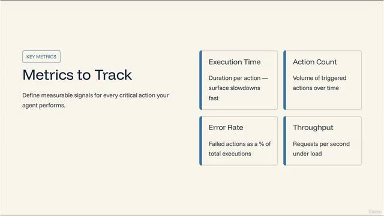
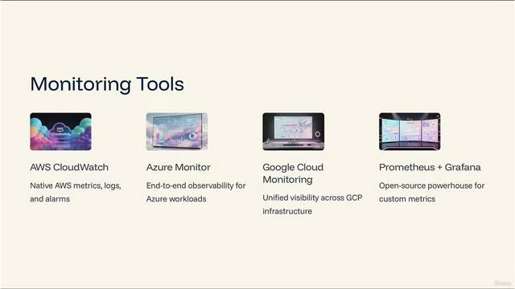
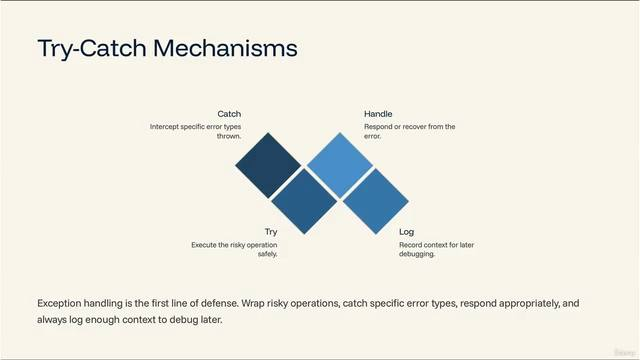
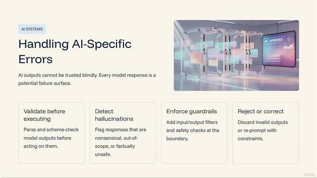
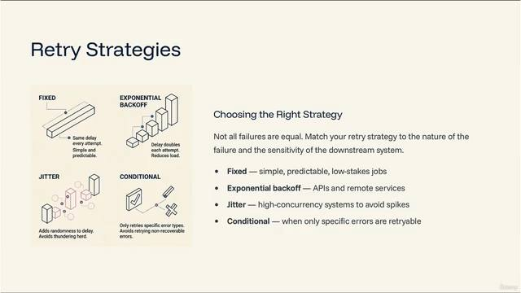

# AI Agents for Cloud Infrastructure（P54–P58）复现文档：给 Agent 加监控、错误处理、重试与 IAM 最小权限

> 说明：P54–P58 这五节是**纯概念讲解**，讲师从头到尾没有写一行代码、没有打开终端、没有给出任何配置文件。因此本文第 4 节的代码全部标注为「课里没有代码，以下为示意」——它按讲师讲到的原则逐条落地，可以真的跑起来，但它**不是讲师给的项目源码**。凡课里没讲的，我们在第 7 节单独列出，并明确写「课里没讲」。

---

## 1. 这一节做什么

P54–P58 这五节，合起来是一件事：**把「一个能自动调用云 API 的 AI Agent」从玩具变成可以上生产的东西**。讲师把它拆成四个互相咬合的部件：

| 节号 | 主题 | 在全链路里的位置 |
|---|---|---|
| P054 | Monitoring（监控） | 眼睛。实时看 Agent 在干什么 |
| P055 | Error Handling（错误处理） | 兜底。出错时系统不崩、不哑 |
| P056 | Retries（重试） | 自愈。临时性失败自动再来一次 |
| P057 | IAM Roles（角色与权限） | 边界。Agent 能碰什么、不能碰什么 |
| P058 | Least Privilege（最小权限） | 收窄。把 P057 的边界压到最紧 |

这五节不是并列知识点的罗列，而是一条**执行链路**：Agent 想执行一个动作 → 先过身份校验和权限判定（P057/P058）→ 再过输出校验（P055 的 validate/guardrails）→ 真正调用云 API → 调用失败就按错误类型决定是重试（P056）还是走回退（P055）→ 每一步都往监控里打点（P054）→ 越过阈值就告警。

我们这篇文档要「跑起来」的东西，就是这条链路本身：一个约 400 行的 Node.js 守护层 `AgentGuard`，加上一套可以照着复现的本地演示。跑完之后你能看到：

- 一个**越权动作**被 IAM 策略拦住（`storage:DeleteObject`）；
- 一个**模型幻觉动作**被输出校验拦住（路径穿越 `../etc/passwd`）；
- 一个**限流/超时**被指数退避 + 抖动重试掉；
- 一个**重试用尽**的动作走了回退，返回降级结果；
- 同一幂等键重复提交时**不会真的再调一次云 API**；
- 最后打印出错误率、p50/p95 延迟和告警条数。

> 读者背景提醒：你是前端转 AI 应用工程师。本文所有代码都是纯 ESM JavaScript，Node 20 起跑，零第三方依赖——你不需要装 TypeScript、不需要配构建、不需要懂后端框架。碰到「并发」「幂等」这类词，我会顺手给一句 JS/Node 里的对应说法。

---

## 2. 讲师原话

按四块整理，带时间戳。

**P054 监控**

> "日志告诉你已经发生了什么；监控告诉你此刻正在发生什么，并在出现问题时发出告警。"
> —— p054 [00:00]

> "先从智能体动作开始，跟踪接口调用、部署和已触发的工作流。接下来监控系统性能，包括延迟、响应时间和处理耗时。你还需要跟踪资源使用情况，处理器、内存和网络的使用情况都是重要信号。最后跟踪结果：有多少动作成功？有多少失败？"
> —— p054 [01:27]

> "你需要跟踪执行时间：每个动作要花多久？还要跟踪数量：有多少动作正在被触发？错误率至关重要：动作失败的比例是多少？吞吐量是另一个关键指标。"
> —— p054 [03:22]

> "选择正确的指标很重要。指标太少，你会漏掉问题；指标太多，又会制造噪声。目标是获得有意义的可见性。监控与告警结合后才会真正强大。你要为指标设定阈值，例如错误率超过 5%，或延迟超过某一水平。一旦越过这些阈值，就会触发告警。"
> —— p054 [03:51]

> "不过，告警必须经过仔细设计。告警太多会制造噪声，告警太少又会漏掉关键问题。目标是提供可据此采取行动的告警。"
> —— p054 [04:20]

> "云服务商提供内置方案。AWS CloudWatch、Azure Monitor 和 Google Cloud Monitoring 是常见例子。这些工具会收集指标、日志和事件，提供仪表盘和告警能力。你也可以使用开源工具，Prometheus 和 Grafana 被广泛使用。"
> —— p054 [04:47]

> 注：`Rafaana` 是逐字稿的音译，课上没有把关。本文不替你认定它是哪个产品，只按讲师原话保留。

> "监控聚焦于已知指标。你跟踪延迟和错误率这类预先定义的信号。可观测性则更深入，它让你能够理解未知问题。……监控告诉你哪里出了问题，可观测性帮助你理解为什么出问题。在复杂的人工智能系统中，两者都必不可少。你需要指标、日志和追踪数据。"
> —— p054 [05:16]

**P055 错误处理**

> "目标不是消除错误，而是以某种方式处理错误，使系统保持可靠、安全且有韧性。……接口会失败，网络会中断，输入可能不合法，人工智能模型也可能产生意料之外的输出。"
> —— p055 [00:00]

> "系统错误包括网络故障或基础设施中断这类情况。应用错误是代码中的缺陷或逻辑错误。外部错误来自第三方服务。……此外还有人工智能特有的错误，包括幻觉、无效输出或不安全的操作。每类错误都需要不同的处理策略。你不能用同一种方式对待所有失败。"
> —— p055 [01:55]

> "错误处理最基本的工具之一是 try catch。……然而，仅靠它并不够。你需要把它与日志记录、监控和回退策略结合起来。"
> —— p055 [03:12]

> "回退策略是系统在某个环节失败时所采取的做法。系统不会停下来，而是会作出调整。例如，如果主接口失败，你可以改用备用接口；如果人工智能模型产生无效输出，你可以返回默认响应。你也可以重试该操作。"
> —— p055 [03:41]

> "因此，校验至关重要。在执行任何动作之前，你应当校验输出：它符合预期格式吗？它安全吗？它遵循策略吗？如果不符合，就拒绝或修正它。你还可以加入护栏，对人工智能能做什么施加约束。"
> —— p055 [04:40]

> "出现问题时，用户不应看到原始错误信息，而应看到有意义且清晰的响应。……好的错误信息既能提供有效信息，又不会让人不堪重负。"
> —— p055 [05:16]

**P056 重试**

> "当某个操作失败时，系统不会立刻放弃，而是再次尝试。这很有用，因为许多失败都是暂时性的，例如网络抖动、短暂的接口中断或超时。"
> —— p056 [00:00]

> "重试对暂时性故障最有效，例如接口超时、服务临时中断、限流响应或网络中断。……不过，重试并不适合所有错误。如果代码中存在逻辑错误，重试并不能修复它；如果请求无效，重试只会再次失败。"
> —— p056 [01:27]

> "一种简单的方法是固定重试。……更好的方法是指数退避：每次重试后延长等待时间，从而减轻系统压力。另一种方法是加入随机性或抖动，防止多个系统同时重试。你还可以使用条件重试，只对某些类型的错误进行重试。"
> —— p056 [02:25]

> "例如，先等待一秒，再等待两秒，然后四秒，接着八秒。这样能给系统留出恢复的时间。"
> —— p056 [02:53]

> "重试绝不应无限进行。你需要设置限制，例如最大重试次数或最长总时间。"
> —— p056 [03:22]

> "幂等性是重试中的一个关键概念。它意味着重复执行同一操作会产生相同结果。……如果某个操作不具备幂等性，重试就可能引发问题。例如，创建重复资源或多次执行同一操作。"
> ——

## 5. 逐行解释

P54–P58 的逐字稿显示讲师全程为纯概念讲解，没有写代码、没有给文件、没有打开终端；本次提供的材料里也没有展开「4. 完整代码」的具体文件内容。因此不能对不存在的文件、行号编造逐行解释。下面按文档第 1 节列出的复现设计决策逐条解释：为什么这样设计，不这样写会怎样。凡文档声明为「课里没有代码，以下为示意」的部分，均按示意设计解释，不冒充讲师源码。

1. **把 Agent 的云操作收口到 `AgentGuard` 守护层，而不是让 Agent 直接调用云 API。**  
   课里反复强调 Agent 会自主行动，出错影响大：P057 说「agents can take actions automatically」，P058 说最小权限要让「even if something goes wrong, the damage is limited」。收口到守护层后，权限判断、输出校验、重试、回退、监控都在同一个入口完成。不这么做，校验和重试会散落在各个调用点，容易出现某个路径漏掉 IAM 判断或漏掉输出校验，越权动作和幻觉动作就可能直接打到云 API。

2. **执行链路按「身份/权限 → 输出校验 → 真正调用 → 错误分类重试/回退 → 监控打点 → 告警」排列。**  
   这是文档第 1 节对 P054–P058 的组合落地。P055 明确说「Before executing any action, you should validate the output」，P057/P058 强调先控制访问。把权限和校验放在真正调用之前，是为了避免副作用已经发生后再补救。反过来，如果先调用云 API 再校验，路径穿越或 `storage:DeleteObject` 这类动作可能已经执行，后面的拒绝没有意义。

3. **IAM 策略显式拦住 `storage:DeleteObject`。**  
   P057 说角色定义「what actions are allowed」，P058 举例：Agent 只需要读存储时，只给 read，不给 write/delete；如果给了 delete，一个 bug 就可能删数据。示意里用拒绝 `storage:DeleteObject` 来复现「越权动作被 IAM 策略拦住」。不这么写，演示会变成 Agent 拥有过大权限，无法验证最小权限边界；真实环境里则可能把删除能力暴露给不需要它的 Agent。

4. **输出校验拦住路径穿越 `../etc/passwd`。**  
   P055 说 AI 可能 hallucinate、产生 invalid outputs 或 unsafe actions，执行前要检查「Does it meet expected formats? Is it safe? Does it follow policies?」。路径穿越属于典型的 unsafe action，必须在调用前拒绝。不这么写，模型输出会被当成可信参数直接拼进文件或 API 请求，可能读到敏感文件或越过资源边界。

5. **把错误分成可重试与不可重试，而不是所有错误一律重试。**  
   P056 明确说重试适合 transient failures，例如 API timeout、临时服务不可用、rate limiting、网络中断；逻辑错误和无效请求重试只会重复失败。示意里让限流/超时走重试，让无效请求或逻辑错误不重试。不这么写，所有错误都重试会放大无效请求、增加云 API 压力，还会把真正的代码 bug 掩盖成「一直重试中」。

6. **重试采用指数退避 + 抖动，并设置最大次数或最大总时间。**  
   P056 给了 1s → 2s → 4s → 8s 的例子，并说 jitter 防止很多系统同时重试，还强调「Retries should never be infinite」。示意里用递增延迟和抖动重试限流/超时，同时设上限。不这么写：固定间隔重试容易在服务已经过载时继续打；无上限重试会让请求卡死、资源耗尽；没有抖动则多个客户端可能同一时刻再次冲击服务。

7. **同一幂等键重复提交时不真的再调一次云 API。**  
   P056 把 idempotency 定义为「repeating the same operation produces the same result」，并警告非幂等操作重试可能创建重复资源或重复执行动作。示意里用幂等键做去重，是为了让重试安全。不这么写，超时后重试可能重复创建资源，或者同一个业务动作被执行多次。注意：课里讲了幂等原则，但「用内存/缓存按幂等键去重」是文档第 1 节的示意实现选择，课里没有给具体实现。

8. **重试用尽后走回退，返回降级结果，而不是直接崩溃或抛 raw error。**  
   P055 说 fallback 是失败时系统如何 adapt，例如主 API 失败换备用 API、模型输出无效返回默认响应；P056 说重试失败后应进入 fallback。示意里让持续失败的动作走回退并返回降级结果。不这么写，重试耗尽后系统可能直接崩，或者把原始异常暴露给调用方，用户看到不可理解的错误，系统也没有可控的降级路径。

9. **监控同时记录动作、性能、结果三类信号，并输出错误率、延迟分位数和告警条数。**  
   P054 明确要监控 agent actions、system performance、resource usage、outcomes，并提到 latency、response times、error rates、throughput。示意里跑完打印错误率、p50/p95 延迟和告警条数，是为了让复现者能看到「结果」而不只是看日志。不这么写，只能看到单次成功/失败，无法判断整体错误率是否超过阈值，也无法判断延迟是否异常。需要标注：p50/p95 是文档第 1 节复现示意的输出指标；课里只泛讲 latency/response time，没有讲 p50/p95 的具体计算。

10. **告警阈值用错误率超过 5% 作为示例。**  
    P054 原话举例「error rate above 5% or latency above a certain level」，文档第 1 节把它落成告警条数。不设阈值，监控只是看板，不会主动提示；阈值太敏感会产生噪音，太松会漏掉问题。注意：课里只给了错误率 5% 这个例子，延迟的具体阈值课里没讲；示意实现若设置延迟阈值，属于复现补充，应在代码里显式写清楚。

11. **用户侧错误信息要友好，不直接暴露 raw error。**  
    P055 说「users should not see raw error messages」，要 explain what happened in simple terms，并 guide the user。示意里即使内部记录了详细错误，对外也返回可控消息。不这么写，用户会看到堆栈、内部服务名或敏感上下文，既难理解又可能泄露信息。

12. **错误要记录日志，并与监控关联。**  
    P055 说 every error should be logged，要记录 what happened、when、input、context；P054 说 logs 和 monitoring 结合才能定位模式。示意里每次动作记录 attempt、动作、结果、延迟等，是为了让重试和告警可追溯。不这么写，只能知道「错误率高了」，却不知道是哪个动作、第几次重试、什么错误类型导致，无法调试。

13. **IAM 使用最小权限、临时凭证、定期审查。**  
    P057 说不要 over-permissioning、不要 hard coding credentials、要 rotation、要 auditing；P058 说只给任务所需权限、避免 admin/full access、定期 review 防止 permission creep。示意里的 IAM 拒绝删除动作是这条原则的最小复现。不这么写，Agent 一旦行为错误或凭证泄露，影响范围会从「只能读一个资源」扩大到「可改可删整个账号」。需要标注：课里讲了原则，但临时凭证的具体实现、审查周期、策略文件格式课里没有给。

14. **复现采用 Node 20 起、纯 ESM、零第三方依赖的本地演示。**  
    这是文档第 1 节为前端转 AI 应用工程师设定的复现方式，不是讲师在 P54–P58 讲的内容。这样写是为了让你不用配 TypeScript、构建链或后端框架就能跑通守护层逻辑。不这么写，复现门槛会变高，容易把时间花在环境和依赖上。需要明确标注：课里没讲 Node 版本、ESM、零依赖这些工程选择，属于复现文档的补充设定。

## 6. 复现检查清单

以下检查项按文档第 1 节声明的预期行为整理。具体启动命令、入口文件名、日志字段名若第 4 节示意代码没有统一，按你实际代码命名验证；课里没给具体命令的地方已标注。

- [ ] **Node 环境可用。** 怎么验证：运行 `node --version`；应该看到 `v20` 或更高。课里没讲 Node 版本，这是复现文档的补充要求。
- [ ] **演示能启动且不依赖第三方包。** 怎么验证：按第 4 节实际入口启动，不执行额外 `npm install` 安装业务依赖；应该看到演示开始输出，不出现 `MODULE_NOT_FOUND`。课里没讲启动命令，按你第 4 节代码实际入口验证。
- [ ] **越权动作被 IAM 策略拦住。** 怎么验证：提交或触发 `storage:DeleteObject` 动作；应该看到权限拒绝/blocked/denied 类输出，并且没有该动作真正调用云 API 的成功记录。
- [ ] **模型幻觉动作被输出校验拦住。** 怎么验证：提交包含 `../etc/passwd` 的输出或参数；应该看到 validation/guardrail 拒绝，且不出现真实读取文件或真实云调用的成功记录。
- [ ] **限流/超时类错误会进入重试。** 怎么验证：制造一次可重试错误（文档声明的限流或超时）；应该看到 attempt 1、attempt 2 等重试日志，且两次尝试之间有等待。
- [ ] **重试使用递增延迟和抖动。** 怎么验证：观察重试日志中的延迟或时间戳；应该看到等待时间逐次增大，而不是固定间隔。抖动无法只靠肉眼完全确认时，至少确认延迟不是每次完全相同。课里没讲如何断言抖动，属补充检查。
- [ ] **重试有上限，不会无限重试。** 怎么验证：让可重试错误持续发生；应该看到达到最大次数或最大总时间后停止重试，并进入回退/失败处理，而不是一直打印重试。
- [ ] **不可重试错误不会被反复重试。** 怎么验证：提交无效请求或逻辑错误；应该只失败一次并进入拒绝/回退/错误处理，不出现多轮 attempt。
- [ ] **重试用尽后走回退并返回降级结果。** 怎么验证：让可重试错误持续超过上限；应该看到 fallback/degraded 类结果，进程不崩溃，并保留原始错误日志。
- [ ] **同一幂等键重复提交不会真的再调一次云 API。** 怎么验证：用同一个幂等键连续提交两次；应该看到第二次命中幂等去重/缓存，云 API 调用计数不增加。课里没讲幂等键存储方式，按第 4 节示意实现验证。
- [ ] **监控输出包含错误率、p50、p95 和告警条数。** 怎么验证：跑完演示后检查终端汇总；应该看到这些指标字段存在。p50/p95 是文档第 1 节的示意输出，课里没讲具体分位数计算。
- [ ] **错误率超过 5% 会触发告警。** 怎么验证：注入足够失败使错误率 > 5%；应该看到告警条数增加或出现告警日志。课里只给了 5% 示例，延迟阈值课里没讲，若代码有延迟告警需按代码配置验证。
- [ ] **低于阈值时不新增告警。** 怎么验证：在少量成功请求、错误率低于 5% 的窗口跑一次；应该看到告警条数不增加。课里没讲最小样本窗口，样本很少时可能误报，属补充注意项。
- [ ] **用户侧错误信息不暴露 raw error。** 怎么验证：触发一次失败；对外返回或打印给用户的消息应简洁可读，不包含堆栈、内部密钥、完整原始异常。详细错误应只出现在内部日志中。课里没讲具体消息格式，属补充检查。
- [ ] **日志能关联到具体动作和重试次数。** 怎么验证：检查一次失败动作的日志；应该能看到动作名、attempt、结果、延迟等上下文。课里没讲具体字段名，按第 4 节示意代码实际字段验证。
- [ ] **IAM 示意策略体现最小权限。** 怎么验证：检查示意策略或权限判断；应该只允许任务所需动作，显式拒绝不需要的 `storage:DeleteObject`，不出现 admin/full access 默认放行。课里没讲策略文件格式，属补充检查。
- [ ] **临时凭证/权限审查相关逻辑若实现了要能验证。** 怎么验证：若第 4 节示意包含临时凭证或审查逻辑，检查凭证有短期过期设置、权限有复核入口；若未实现，记录为「课里没讲具体实现，示意未覆盖」。课里讲了原则，但没给具体实现。

## 7. 课里没讲但你会撞上的

| 现象 | 原因 | 怎么办 |
|---|---|---|
| 补充：课里没讲——Node 20 下仍报 ESM/语法错误 | 项目没有声明 `"type": "module"`，或本机 Node 低于 20；课里没讲工程配置 | 在 `package.json` 加 `"type": "module"`，用 `node --version` 确认 Node 20+；按第 4 节实际入口重跑。 |
| 补充：课里没讲——本地跑不通真实云 API | 示意代码若接真实云 SDK，本地可能没有凭证、网络或权限；课里只讲 IAM 原则，没给本地凭证方案 | 用 mock/stub 复现守护层逻辑；真实云测试用最小权限测试账号和临时凭证，不要把长期密钥写进代码。 |
| 补充：课里没讲——`storage:DeleteObject` 没被拦住 | 只在应用层口头判断，没有显式 allow/deny 逻辑；或动作名与实际传入不一致 | 在守护层写显式权限判断或策略模拟，单测该动作必须 denied；真实环境用 IAM policy 再验一次。 |
| 补充：课里没讲——`../etc/passwd` 没被拦住 | 只用简单 `includes('../')` 判断，漏掉编码、变体或规范化后的路径穿越 | 先规范化路径再校验，测试 `../etc/passwd`、编码变体等；不要只靠一个字符串匹配。课里讲了要 validate，没讲具体校验实现。 |
| 补充：课里没讲——重试让演示等很久或测试不稳定 | 指数退避真实 sleep 1s→2s→4s→8s，且带抖动；课里给了退避例子，但没讲测试时如何缩短 | 生产保留真实退避；测试注入可配置的小延迟或假时钟，单独断言 attempt 次数和延迟递增。 |
| 补充：课里没讲——幂等去重失效 | 幂等键只存内存，进程重启或多实例就丢；或键由随机数生成，重复提交键不同 | 用持久化存储或分布式缓存保存幂等键；键由稳定业务参数生成；单测同键重复提交云调用计数不增加。课里讲了幂等概念，没讲存储实现。 |
| 补充：课里没讲——重试超过最大次数或最大时间后还在继续 | 只限制了 attempt 次数，没有限制总耗时；或异常路径漏判 | 同时设置 `maxAttempts` 和 `maxElapsedTime`，每次重试前检查；日志记录停止原因。 |
| 补充：课里没讲——不可重试错误也被重试 | 错误分类默认「全部可重试」，或只看错误消息不看类型 | 显式分类：rate limit、timeout、临时 5xx 可重试；invalid request、逻辑错误不重试；单测非重试错误只出现一次 attempt。 |
| 补充：课里没讲——错误率 5% 告警在小样本下误报 | 请求量很少时，一次失败就可能超过 5%；课里只讲阈值例子，没讲最小样本窗口 | 加最小样本数或持续时间窗口再触发告警；测试时明确样本量，避免用一两次请求判断。 |
| 补充：课里没讲——回退把失败掩盖成成功 | 回退返回默认成功结果，监控只看最终成功，不看 degraded 状态 | 回退结果显式标记 degraded，同时记录原始错误和告警；不要因为走了 fallback 就删除失败日志。 |
| 补充：课里没讲——日志里出现敏感信息 | 把完整请求体、模型输出、凭证或堆栈直接打进日志 | 脱敏日志，凭证绝不落盘；只记录动作、错误类型、幂等键、attempt 等必要上下文。课里讲了要 log error，没讲脱敏实现。 |
| 补充：课里没讲——本地监控指标和云上监控对不上 | 示意代码用内存聚合，CloudWatch/Azure Monitor/Google Cloud Monitoring 有采集延迟、维度和统计口径差异 | 明确本地演示只是示意；上云后用对应云监控工具按相同指标口径复测，不要直接拿本地 p95 和云看板数字对比。 |
| 补充：课里没讲——长任务中途临时凭证过期 | 课里讲了临时凭证会过期，但没讲复现代码里长任务跨过期时间怎么办 | 在每步调用前获取/刷新短期凭证；把凭证过期作为可重新认证或可重试场景单独处理，并记录日志。 |
