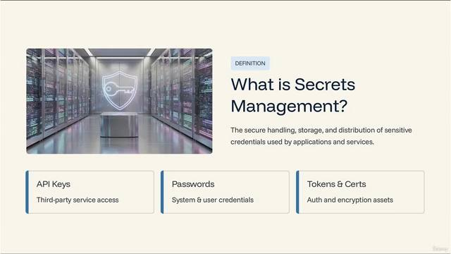
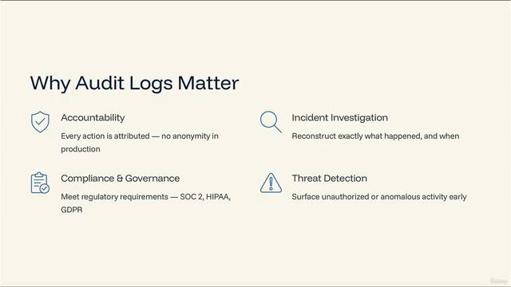
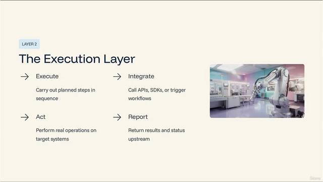
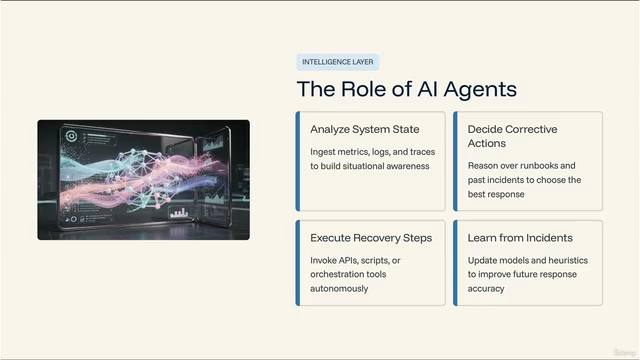
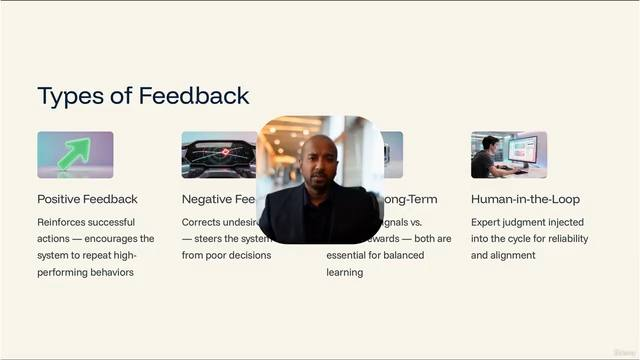
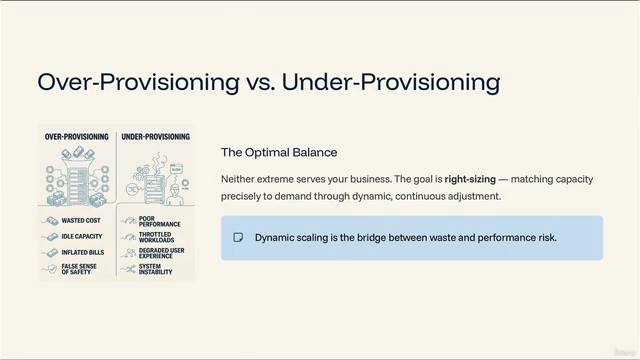
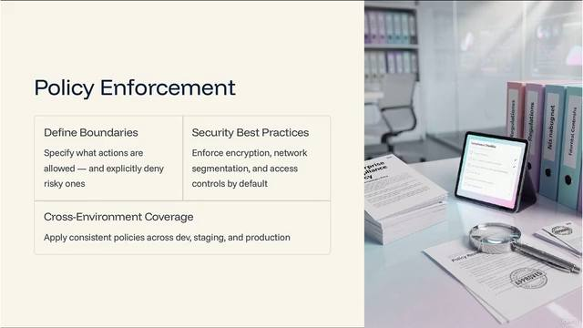
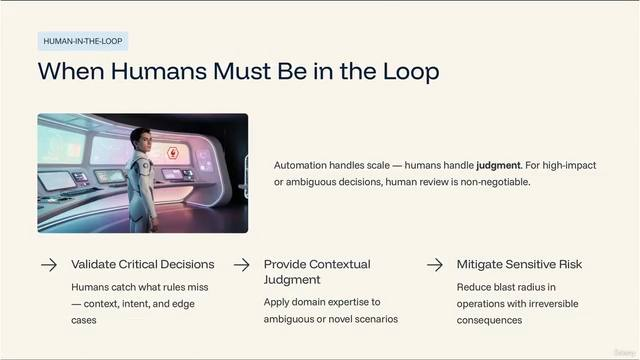
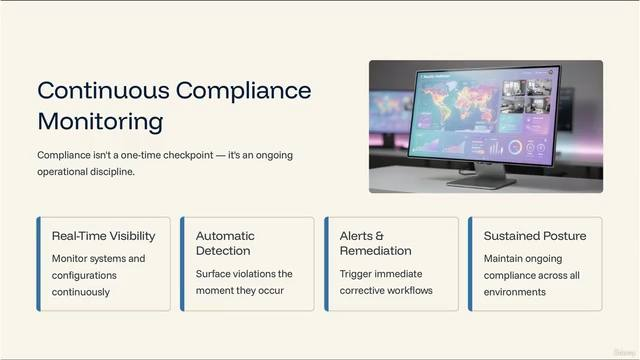

# AI Agents for Cloud Infrastructure（P59–P69）复现文档：从安全与审计到规划/执行、自愈、治理与合规

> 说明：P59–P69 是**纯设计讲解段**，逐字稿里没有讲师给出的可运行代码、依赖版本或启动命令。因此本文复现的不是一个现成仓库，而是一套**可评审、可落地为接口和状态机的设计包**。文中的 TypeScript 仅用于固定设计词汇，已明确标注「课里没有代码，以下为示意」。

## 1. 这一节做什么

这一节覆盖 P59–P69，主题不是某个框架的安装，而是生产级 AI 云基础设施的十个控制面：

1. Secrets Management：密钥、密码、Token、证书的安全存取与轮换。
2. Audit Logs：记录谁在什么时候对什么资源做了什么，强调可追责、不可篡改。
3. Planning vs Execution：把“决定做什么”和“实际去做”拆开，执行前可校验。
4. Self-healing：检测、诊断、动作、验证的自动修复闭环。
5. Feedback Loops：观察、分析、决策、行动的持续改进闭环。
6. Resource Utilization：计算、存储、网络、托管服务的利用率与成本平衡。
7. Optimization Strategies：Right-sizing、Auto-scaling、调度、存储/计算/网络优化。
8. Multi-account Strategy：生产、开发、测试、安全审计、共享服务、管理账号的隔离。
9. Governance Layers：组织、账号、资源、应用四层治理。
10. Approval Systems：人工、自动、多级、条件审批，作为决策与执行之间的闸门。
11. Compliance：SOC2、HIPAA、GDPR、PCI DSS、ISO 27001 等要求下的策略、监控、审计与自动化。

复现目标：在本地建立一个设计目录，产出决策表、组件职责表、接口草案、容量估算表和检查清单。读者照着本文，可以把这个设计包评审完，并把它作为后续写代码的需求基线。

复现工程目录建议如下，**这不是课里给出的仓库结构**，而是本文为了“可直接照着做”而整理的工作区：

```text
ai-cloud-control-plane-design/
├── README.md
├── decisions.md
├── responsibilities.md
├── interfaces.ts
├── capacity-estimate.md
└── checklists/
    ├── secrets.md
    ├── audit.md
    ├── self-healing.md
    ├── governance.md
    ├── approval.md
    └── compliance.md
```

依赖说明：本设计包没有运行时依赖；课里也没有给依赖版本。若用 TypeScript 检查接口草案，需要你本机自备 `tsc`，版本课里没讲。启动命令也不需要；可选检查命令是 `npx tsc --noEmit interfaces.ts`。



## 2. 讲师原话

下面引用逐字稿中的关键原话，并在旁边给出本文的复现理解。引用保留英文原句，时间戳来自逐字稿。

> "机密信息管理是指安全地处理系统中的敏感信息。这包括 API 密钥、密码、令牌和证书等。"
> —— p059 [00:15]

讲师把 Secret 的范围定得很宽：API Key、密码、Token、证书都算。复现时不要只把“数据库密码”当 Secret，任何授予访问权或控制权的东西都要纳入清单。

> "其中最常见的问题之一是在代码中硬编码机密信息。这会使其很容易暴露，尤其是在共享仓库中。"
> —— p059 [02:47]

这直接决定了设计约束：代码仓库、前端包、日志、Prompt 里都不能出现明文 Secret。Secret 应在运行时从专用系统取出。

> "它们会记录谁做了什么、何时发生以及影响了什么。"
> —— p060 [00:25]

审计日志的最小四要素是：身份、动作、时间戳、受影响资源。做数据模型时先把这四个字段固定下来，再讨论扩展字段。

> "审计日志侧重于安全与合规。它们结构更清晰，而且通常不可变。"
> —— p060 [02:23]

审计日志不是调试日志的复制品。它要结构化、集中化、访问受控，并且尽量不可篡改。普通日志可以采样，审计日志不能随便丢。

> "一部分决定要做什么，另一部分实际执行。"
> —— p061 [00:28]

规划层负责推理和产出计划；执行层负责调用 API、部署基础设施、触发工作流。执行层不应自己做决定，只按计划执行。

> "执行计划之前，你可以先检查它：是否符合策略？是否安全？是否满足约束条件？"
> —— p061 [03:44]

计划在执行前要经过校验。这是审批系统、治理策略和合规检查插入的位置。

> "自愈系统遵循一个简单的循环：首先检测，其次诊断，然后执行操作，最后验证。"
> —— p062 [01:24]

自愈不是“看到错误就重启”，而是检测、诊断、动作、验证四步闭环。验证失败要能升级或换动作。

> "反馈循环遵循一个简单的周期：首先观察，其次分析，然后决策，最后行动。"
> —— p063 [01:26]

反馈回路是 Observe → Analyze → Decide → Act。它和自愈相似，但反馈更强调从结果中改进策略，自愈更强调把故障恢复。

> "你会关注 CPU 使用率、内存使用率、磁盘使用率和 I/O，以及网络吞吐量等指标。"
> —— p064 [02:48]

资源利用率的观测指标至少包括 CPU、内存、磁盘使用与 IO、网络吞吐。没有度量就没有优化。

> "合理调整资源规格是最简单的优化策略之一。它意味着让资源规模与实际使用量相匹配。"
> —— p065 [01:28]

Right-sizing 是最直接的优化：实例太大就降配，太小就升配，依据是真实使用数据。

> "多账户策略很重要，原因有几个。首先，它们能限制风险。如果某个账户出了问题，不会影响其他账户。"
> —— p066 [00:56]

多账号的第一价值是缩小爆炸半径。生产、开发、测试、安全审计、共享服务应分账号。

> "治理在多个层级上运作。在组织层级，你定义全局策略……在账户层级……在资源层级……以及在应用层级……"
> —— p067 [01:23]

治理不是一张策略表，而是分层控制：组织级、账号级、资源级、应用级。

> "审批系统有不同类型。人工审批……自动审批……多级审批……条件审批……"
> —— p068 [02:24]

审批要分类型：人工审批、规则自动审批、多级审批、按条件审批。不是所有动作都值得停下来等人。

> "合规保护你的组织。它确保敏感数据得到妥善处理，从而降低泄露风险。它还有助于避免法律处罚。"
> —— p069 [00:59]

合规既是安全要求，也是法律和信任要求。它需要策略、监控、审计证据和自动化持续维护。



## 3. 从零复现

### 3.1 需求：先把十个能力写成“可验收卡片”

不要直接开始画架构。先为每个模块写一张卡片：它解决什么问题、输入输出是什么、失败时怎么办。建议在 `checklists/` 下每个模块一个 Markdown 文件，每张卡片至少包含：

| 模块 | 需求一句话 | 输入 | 输出 | 失败时 |
|---|---|---|---|---|
| Secrets | 运行时安全取 Secret，不落代码和 Prompt | Secret 名称、调用方身份 | 短期凭据或解密后的 Secret | 拒绝访问并记录审计 |
| Audit | 记录谁对什么做了什么 | 身份、动作、时间、资源 | 不可篡改审计事件 | 写失败要阻断高风险动作 |
| Planning | 把目标拆成结构化计划 | 用户请求、上下文 | Plan 步骤列表 | 计划不合法则拒绝 |
| Execution | 只执行已批准计划 | Plan、审批结果 | 执行日志、结果 | 失败可重试或升级 |
| Self-healing | 检测并修复常见故障 | 监控触发信号 | 修复动作、验证结果 | 验证失败换动作或告警 |
| Feedback | 根据结果改进策略 | 动作结果、指标 | 反馈记录、策略调整 | 指标缺失则降级为人工 |
| Resource | 平衡成本与性能 | 使用率指标 | 优化建议或动作 | 超阈值则限制动作 |
| Multi-account | 隔离环境与团队 | 账号映射、资源归属 | 账号级策略 | 越权访问拒绝 |
| Governance | 分层执行规则 | 策略、标签、命名规范 | 合规/不合规判定 | 不合规则阻断 |
| Approval | 高风险动作执行前审批 | 计划、风险等级、策略 | 批准/拒绝 | 拒绝则阻断 |
| Compliance | 持续满足监管要求 | 策略、日志、审计证据 | 合规报告、违规告警 | 违规自动告警或修复 |

这一步的产物是 `README.md` 里的范围说明。课里没有给具体模板，以上是本文为了可复现而整理的卡片格式。

### 3.2 约束：课程明确的不变量

从逐字稿中抽取硬约束，后续所有设计都不能违反：

1. Secret 不能硬编码，不能进共享仓库，不能暴露在 Prompt 或代码里。—— p059
2. 审计日志要结构化、集中、不可篡改、访问受控、定义保留期。—— p060
3. 规划和执行必须分离；执行前要能校验计划。—— p061
4. 自愈必须包含检测、诊断、动作、验证，并且有安全护栏。—— p062
5. 反馈回路必须能观察、分析、决策、行动，并区分正/负反馈、短期/长期、人工参与。—— p063
6. 资源优化要基于指标，不能靠猜；要处理过度配置和配置不足。—— p064、p065
7. 多账号要隔离环境、团队、成本和安全边界，并有管理账号做集中治理。—— p066
8. 治理要分组织、账号、资源、应用四层；策略、访问控制、资源治理、监控审计、自动化都要有。—— p067
9. 审批是决策与执行之间的检查点；AI Agent 可以提议动作，但不能直接绕过审批执行。—— p068
10. 合规要覆盖数据保护、访问控制、基础设施安全、日志审计，并持续监控。—— p069



### 3.3 估算：把容量问题写成算式

课里没有给具体数字，下面用变量和“示例假设”演示怎么估。所有示例数字都只是为了让你能复现计算过程，**不是讲师给出的数据**。

**Secret 读取峰值 QPS**：

```text
QPS_peak = (R_day / 86400) × BurstFactor
```

示例假设：每天 86,400 次读取，突发系数 5。  
计算：`(86400 / 86400) × 5 = 5 QPS`。  
含义：Secret Manager 的读取不是瓶颈，但缓存 TTL 和轮换失效要设计好。

**审计日志日增存储**：

```text
Storage_day = A_day × S_record
Storage_retention = Storage_day × RetentionDays
```

示例假设：每天 1,000,000 条审计事件，每条 1 KB。  
计算：`1,000,000 × 1 KB = 1 GB/day`；保留 90 天约 `90 GB`。  
含义：审计日志量级要先估，否则不可篡改存储的成本会失控。

**自愈动作次数**：

```text
Actions_day = Incidents_day × RetryFactor
```

示例假设：每天 20 个触发事件，平均重试系数 1.5。  
计算：`20 × 1.5 = 30 次/天`。  
含义：自愈动作要幂等，否则重试会重复重启或重复扩容。

**资源浪费月成本**：

```text
Waste_month = IdleInstances × Hours_month × HourlyRate
```

示例假设：10 个空闲实例，每月 730 小时，每小时 0.2 美元。  
计算：`10 × 730 × 0.2 = 1460 美元/月`。  
含义：Right-sizing 和清理空闲资源是直接省钱项。

**审批吞吐**：

```text
Approvals_day = CriticalActions_day × ApprovalRate
```

示例假设：每天 100 个关键动作，其中 20% 需要审批。  
计算：`100 × 0.2 = 20 次/天`。  
含义：审批系统要能处理批量、超时、升级和多级会签。



### 3.4 方案：串成端到端控制平面

把十个模块串成一条端到端流程：

1. 用户或 AI Agent 提出请求。
2. Planning 层把请求转成结构化 Plan，列出步骤、工具、参数、风险。
3. Governance 层按组织/账号/资源/应用策略校验 Plan。
4. Approval 层根据风险等级决定：自动批准、人工审批、多级审批或拒绝。
5. Execution 层只执行已批准的 Plan，并逐步记录审计事件。
6. 监控系统采集指标，触发 Self-healing 或 Feedback Loop。
7. Self-healing 执行修复动作，验证结果；失败则升级。
8. Feedback 把结果写回策略或提示后续优化。
9. Resource Optimization 根据指标做 Right-sizing、扩缩容、调度、存储清理。
10. Compliance 持续从审计日志和监控中生成证据，发现违规时告警或阻断。

这个流程的关键不是模块数量，而是**顺序不可乱**：计划先于执行，校验先于动作，审计贯穿始终。课里反复强调的“checkpoint”“gatekeeper”“validation”都在这个顺序里。

### 3.5 取舍：为什么这样定

- Secret 缓存 vs 轮换时效：缓存能降延迟，但轮换后旧缓存会短暂可用。取舍是缓存 TTL 要短于可接受的风险窗口。
- 审计不可篡改 vs 成本：不可篡改存储更贵，所以要先定保留期和分级保留。
- 人工审批 vs 速度：高风险动作人工审批更安全但更慢；低风险动作自动审批更快。课里明确说“不是每个动作都需要审批”。
- 多账号隔离 vs 集中治理：账号越多隔离越好，但管理成本越高；所以需要管理账号、策略集中下发和 IaC 自动化。
- 自愈自动化 vs 安全：自动化越快，误动作影响越大；所以要有阈值、审批、回滚和验证。



## 4. 完整代码

> 课里没有代码，以下为示意，不是讲师原始代码。它把课程中的设计词汇固定成可评审的接口草案。

### 4.1 设计决策表

| 决策 | 具体做法 | 理由 | 不这样会怎样 |
|---|---|---|---|
| Secret 不落代码 | 运行时从 Secret Manager 取 | 避免共享仓库泄露 | 仓库一旦泄露，全部凭据暴露 |
| 审计四要素 | identity、action、timestamp、resource | 可追责、可重建事件 | 出事无法定位谁做了什么 |
| 审计不可篡改 | 追加写、限制修改权限、集中存储 | 保证证据可信 | 日志可被篡改则失去审计价值 |
| 规划/执行分离 | Plan 是结构化产物，Execution 只执行 | 执行前可校验、可审批 | 坏决策直接变坏动作 |
| 执行层不做决策 | 只按 Plan 调 API/工作流 | 降低不可预测性 | 执行层自行判断会绕过治理 |
| 自愈四步 | 检测→诊断→动作→验证 | 防止盲目重启 | 动作无效或扩大故障 |
| 反馈四步 | 观察→分析→决策→行动 | 持续改进 | 系统静态重复错误 |
| 资源优化看指标 | CPU/内存/磁盘 IO/网络吞吐 | 数据驱动 | 靠猜会过度或不足配置 |
| 多账号隔离 | 生产/开发/测试/安全审计/共享服务/管理账号 | 缩小爆炸半径 | 一个账号故障影响全局 |
| 治理分层 | 组织/账号/资源/应用 | 控制粒度清晰 | 策略要么过粗要么过散 |
| 审批是闸门 | 请求→路由→审批→执行/阻断 | 高风险动作可控 | AI Agent 可直接执行危险动作 |
| 合规持续化 | 策略+监控+审计证据+自动化 | 合规不是一次性 | 静态检查会漏掉后续变更 |

### 4.2 组件职责表

| 组件 | 职责 | 不负责 |
|---|---|---|
| Secret Manager Adapter | 取 Secret、轮换、访问控制 | 不把 Secret 返回给前端或 Prompt |
| Audit Writer | 追加写审计事件 | 不改写历史事件 |
| Planner | 生成结构化 Plan | 不执行真实动作 |
| Plan Validator | 检查策略、约束、风险 | 不替代审批 |
| Approval Service | 管理审批状态与路由 | 不直接执行动作 |
| Executor | 执行已批准 Plan | 不自作主张改计划 |
| Monitoring | 采集指标与触发信号 | 不决定修复策略 |
| Self-healing Controller | 诊断、动作、验证 | 不无限重试 |
| Feedback Store | 保存结果与指标 | 不伪造成功 |
| Governance Engine | 分层策略判定 | 不绕过审批 |
| Compliance Reporter | 生成证据与报告 | 不修改原始审计日志 |

### 4.3 接口/数据模型草案（完整文件，示意）

保存为 `interfaces.ts`。这是完整文件，可直接用于类型检查；但再次强调：**课里没有代码，以下为示意**。

```ts
// 课里没有代码，以下为示意：用于复现课程中的设计词汇，不是讲师原始代码。

export type SecretRef = {
  name: string;
  audience: string; // 哪个服务或 AI Agent 使用
  rotationPolicy: string; // 课里只要求定期轮换，未给具体格式
};

export type AuditEvent = {
  identity: string;   // who：用户、服务或 AI Agent
  action: string;     // what
  timestamp: string;  // when，建议 ISO 8601
  resource: string;   // what was affected
  result?: "success" | "failure"; // 课里没讲，可选项
};

export type PlanStep = {
  id: string;
  tool: string;
  params: Record<string, unknown>;
  risk: "low" | "medium" | "high"; // 课里没给分级，本文示意
};

export type Plan = {
  goal: string;
  steps: PlanStep[];
  requiresApproval: boolean;
};

export type ApprovalStatus =
  | "pending"
  | "approved"
  | "rejected"
  | "executed"
  | "blocked";

export type ApprovalRequest = {
  id: string;
  planId: string;
  action: string;
  risk: "low" | "medium" | "high";
  status: ApprovalStatus;
  reviewer?: string;
  decidedAt?: string;
};

export type FeedbackRecord = {
  actionId: string;
  metricName: "accuracy" | "errorRate" | "latency" | "cost";
  before: number;
  after: number;
  verdict: "improved" | "worse" | "unchanged";
};

export type ResourceMetric = {
  resourceId: string;
  kind: "compute" | "storage" | "network" | "managedService";
  cpuUsage?: number;
  memoryUsage?: number;
  diskUsage?: number;
  diskIo?: number;
  networkThroughput?: number;
  timestamp: string;
};

export type HealingAction = {
  incidentId: string;
  action: "restart" | "scale" | "replace" | "rerun";
  target: string;
  guardrail: string;
};
```

### 4.4 容量估算表

| 项目 | 公式 | 示例假设 | 示例结果 | 用途 |
|---|---|---:|---:|---|
| Secret 读取峰值 | `(R_day/86400)×Burst` | 86400 次/天，Burst=5 | 5 QPS | 决定缓存和限流 |
| 审计日志日增 | `A_day×S_record` | 100 万条/天，1KB/条 | 1 GB/day | 决定存储与保留期 |
| 审计保留 90 天 | `Storage_day×90` | 1 GB/day | 90 GB | 估算不可篡改存储成本 |
| 自愈动作量 | `Incidents_day×Retry` | 20 次/天，1.5 | 30 次/天 | 决定幂等与限流 |
| 空闲资源浪费 | `Idle×Hours×Rate` | 10 台，730h，0.2/h | 1460/月 | Right-sizing 收益 |
| 审批吞吐 | `Critical×Rate` | 100 次/天，20% | 20 次/天 | 审批队列容量 |



### 4.5 审批与自愈状态机草案

审批状态：

```text
pending -> approved -> executed
pending -> rejected -> blocked
pending -> approved -> blocked（执行前校验失败）
```

自愈状态：

```text
detected -> diagnosed -> action_taken -> validated
validated -> resolved
validated -> escalate（验证失败）
```

课里讲了流程，但没有给状态机字段；以上是本文为了可复现而整理的草案。

## 5. 逐行解释

### 5.1 设计决策逐条解释

- **Secret 不落代码**：因为讲师明确说硬编码是最大错误之一。若不做，仓库、镜像、前端 bundle 都可能泄露凭据。
- **审计四要素**：讲师把审计定义为“who did what, when, and what was affected”。少一个字段，事件就无法重建。例如没有 identity，就无法追责；没有 timestamp，就无法排序。
- **审计不可篡改**：如果审计日志可改，攻击者可以删痕，合规审计也失去证据价值。
- **规划/执行分离**：讲师说一个部分决定做什么，另一个部分实际做。若合并，模型输出会直接变成真实动作，风险不可控。
- **执行层不做决策**：执行层只跟随计划，才能保证可预测性和权限边界。
- **自愈四步**：只做“检测→动作”会变成盲目重启；加诊断和验证才能形成闭环。
- **反馈四步**：只收集指标不行动，反馈没有价值；只行动不分析，系统会反复犯错。
- **资源优化看指标**：讲师列了 CPU、内存、磁盘 IO、网络吞吐。没有指标就无法区分过度配置和配置不足。
- **多账号隔离**：讲师说一个账号出问题不影响其他账号，这就是 blast radius 控制。
- **治理分层**：组织级策略管全局，账号级管边界，资源级管具体权限，应用级管行为规则。
- **审批是闸门**：讲师说 AI Agent 可以提议动作，但不应直接执行；审批是 decision 和 execution 之间的控制层。
- **合规持续化**：合规不是一次检查，系统变化后仍要持续监控和审计。

### 5.2 类型草案逐字段解释

- `SecretRef.name`：Secret 的逻辑名称，不是明文值。这样日志里可以安全打印名称而不泄露内容。
- `SecretRef.audience`：限定哪个服务或 Agent 使用，体现最小权限。没有 audience，所有调用方都能取同一个 Secret，风险扩大。
- `SecretRef.rotationPolicy`：课程要求定期轮换，但没给格式；这里用字符串保留扩展空间。
- `AuditEvent.identity`：可以是用户、服务或 AI Agent。课程明确说三类主体都要能记录。
- `AuditEvent.action`：发生了什么动作，例如读取、部署、删除、改权限。
- `AuditEvent.timestamp`：事件发生时间，必须能排序和追溯。
- `AuditEvent.resource`：受影响的资源，例如数据库、文件、基础设施组件。
- `AuditEvent.result`：课里没讲，作为可选项；如果业务需要区分成功失败可以加，但不要用它替代核心四要素。
- `PlanStep.tool`：计划要调用的工具或能力。课程说规划层决定用什么工具、按什么顺序。
- `PlanStep.params`：工具参数。执行层按参数执行，不在执行时重新推理。
- `PlanStep.risk`：课里没给具体分级，本文示意 low/medium/high；它用于决定是否需要审批。
- `Plan.requiresApproval`：计划级审批标记，方便在执行前拦截。
- `ApprovalStatus`：审批状态机。`blocked` 用于拒绝或执行前校验失败。
- `ApprovalRequest.reviewer`：记录谁批准，满足可追责。
- `FeedbackRecord.metricName`：课程列出的常见指标包括 accuracy、error rates、latency、cost。
- `ResourceMetric.kind`：课程把资源分为 compute、storage、network、managed services。
- `HealingAction.action`：课程列出的动作包括重启服务、扩缩容、替换不健康实例、重跑失败工作流。

### 5.3 估算逐行解释

- `QPS_peak`：先算平均，再乘突发系数。若不乘突发，Secret Manager 限流会在高峰误伤。
- `Storage_day`：审计事件数乘单条大小。若不估，保留期一长存储成本会失控。
- `Storage_retention`：日增乘保留天数。保留期要按合规要求定，不能无限保留。
- `Actions_day`：事件数乘重试系数。重试系数大于 1 意味着必须有幂等键，否则会重复动作。
- `Waste_month`：空闲实例数乘小时单价。这个公式直接对应 Right-sizing 和清理收益。
- `Approvals_day`：关键动作数乘审批比例。审批比例太高会拖慢交付，太低会放大风险。

### 5.4 状态机逐转移解释

- `pending -> approved`：审批人同意，动作可以进入执行。
- `pending -> rejected`：审批人拒绝，动作被阻断并记录原因。
- `approved -> executed`：执行层完成动作，写审计事件。
- `approved -> blocked`：执行前校验失败，例如策略变更或资源不满足条件。
- `detected -> diagnosed`：监控发现异常后先诊断，不直接重启。
- `diagnosed -> action_taken`：选择修复动作，并受 guardrail 限制。
- `action_taken -> validated`：动作后必须验证，不能假设成功。
- `validated -> resolved`：指标恢复，闭环结束。
- `validated -> escalate`：验证失败，升级人工或换动作。

在 JS/Node 里对应什么：审批状态转移不要只放在内存变量里。Node 单进程是单线程，但生产环境常有多副本；要用数据库条件更新或队列单消费者来保证同一审批只被处理一次。否则两个副本可能同时批准或同时执行。



## 6. 复现检查清单

把下面清单复制到 `checklists/`，逐项打勾。

### 6.1 Secrets

- [ ] 已列出所有 Secret 类型：API Key、密码、Token、证书。
- [ ] 代码仓库中搜索不到明文 Secret。
- [ ] 前端代码和 Prompt 中不包含 Secret。
- [ ] 设计中有 Secret Manager 适配层。
- [ ] 有最小权限的 audience/role 设计。
- [ ] 有轮换策略和缓存失效策略。
- [ ] 有 Secret 访问审计。

### 6.2 Audit

- [ ] 审计事件包含 identity、action、timestamp、resource。
- [ ] 审计日志集中存储。
- [ ] 审计日志追加写，普通角色不能修改。
- [ ] 定义了访问控制和保留期。
- [ ] 高风险动作写审计失败时能阻断。

### 6.3 Planning / Execution

- [ ] Plan 是结构化数据，不是一段自然语言。
- [ ] 执行前有 Plan Validator。
- [ ] 执行层不重新做决策。
- [ ] 执行结果写审计和反馈记录。

### 6.4 Self-healing / Feedback

- [ ] 自愈有检测、诊断、动作、验证四步。
- [ ] 触发信号覆盖服务失败、高延迟、错误率、资源耗尽、基础设施问题。
- [ ] 动作有 guardrail 和幂等键。
- [ ] 反馈记录包含 before/after 指标。
- [ ] 人工参与反馈有入口。

### 6.5 Resource / Optimization

- [ ] 采集 CPU、内存、磁盘使用与 IO、网络吞吐。
- [ ] 有 Right-sizing 流程。
- [ ] 有 Auto-scaling 或调度策略。
- [ ] 有存储清理/分层策略。
- [ ] 有网络跨区传输优化检查。

### 6.6 Multi-account / Governance / Approval / Compliance

- [ ] 账号至少分为生产、开发、测试、安全审计、共享服务、管理账号。
- [ ] 管理账号能集中下发策略。
- [ ] 治理覆盖组织、账号、资源、应用四层。
- [ ] 审批覆盖人工、自动、多级、条件四种类型。
- [ ] AI Agent 动作必须经过审批或策略校验。
- [ ] 合规覆盖数据保护、访问控制、基础设施安全、日志审计。
- [ ] 合规有持续监控和审计证据。

可选检查命令：

```bash
mkdir -p ai-cloud-control-plane-design/checklists
cd ai-cloud-control-plane-design
npx tsc --noEmit interfaces.ts   # 需要本机有 tsc，版本课里没讲
```



## 7. 课里没讲但你会撞上的

1. **Secret Manager 的具体 SDK 和 IAM 策略 JSON**：课里只提了 AWS Secrets Manager、Azure Key Vault、Google Secret Manager、HashiCorp Vault，没有给具体权限策略。落地时要查对应云文档。
2. **Secret 轮换的实现细节**：课里说“定期轮换”“自动化轮换”，但没讲轮换时如何双版本共存、如何回滚。你需要自己设计版本号和缓存失效。
3. **审计日志的不可篡改后端**：课里说 immutable、append-only、集中存储，但没指定数据库或对象存储。选型时要确认是否支持 WORM 或防删改策略。
4. **审计日志中的敏感数据脱敏**：课里没讲。审计记录参数时可能带入 Secret 或 PII，必须加脱敏规则。
5. **Plan Validator 的策略语言**：课里说执行前校验策略、约束、审批，但没给策略表达方式。你可以用规则表、策略引擎或代码校验，但要自己定。
6. **审批的并发竞争**：课里没讲。多副本审批服务下，两个请求可能同时批准同一动作。Node 里不要用内存标志位；用数据库条件更新或队列串行化。
7. **自愈动作的幂等**：课里没讲。重试可能重复重启、重复扩容。需要 idempotency key、租约或动作去重表。
8. **多账号的自动化创建**：课里提到预定义模板、IaC、自动化创建账号，但没有给具体目录结构或流水线。你需要自己补 Terraform/CDK/云厂商 API 的落地细节。
9. **合规控制项到证据的映射**：课里列了 SOC2、HIPAA、GDPR、PCI DSS、ISO 27001，但没有给控制矩阵。实际审计要逐条映射“策略—监控—日志—报告”。
10. **成本估算的精确公式**：课里讲资源类型和优化策略，但没有给计费公式。本文的容量估算是练习用示例，真实成本要以云账单为准。
11. **前端如何接审批**：课里没讲。前端不应持有 Secret；审批 UI 只展示动作、风险、审批状态，所有敏感操作走服务端。



以上设计包完成后，你就把 P59–P69 的讲解从“听过”变成了“可评审、可拆分开发任务、可验收”的工程基线。后续写代码时，优先实现 Secret 适配层、审计写入、Plan/Execution 分离和审批状态机，因为这四块是其他自动化能力的边界条件。