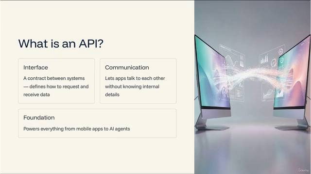
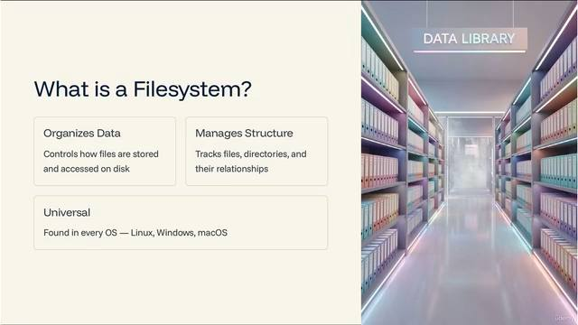
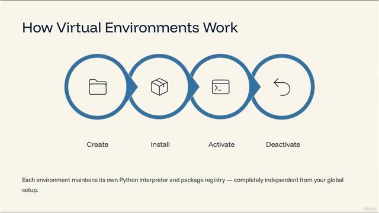
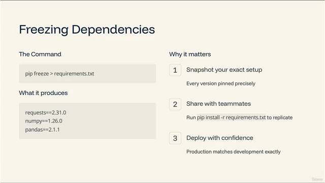
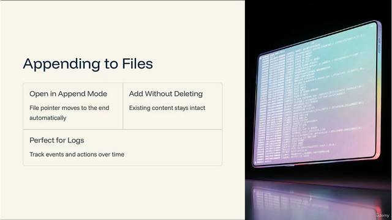
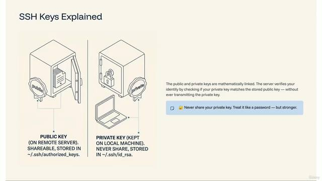
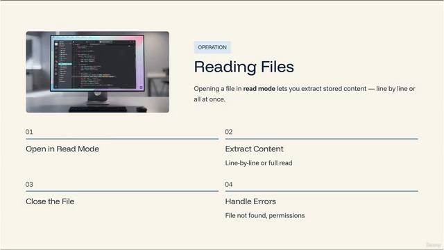

# AI Agents for Cloud Infrastructure（P7–P11）复现文档

> 课程：BV1xvosBREmD ｜ 覆盖 P007–P011
> 读者定位：前端转 AI 应用工程师。本文档按「先把地基打好，再让 Agent 跑起来」的顺序重组，而不是按视频顺序流水账。
> 说明：P7–P11 是概念 + 少量命令的基础课，讲师没有给出完整可运行的项目代码。因此第 4 节「完整代码」提供的是**可直接保存运行的最小可复现脚本**（标注了哪些是讲师原话、哪些是本文为复现补的脚手架），第 3 节「从零复现」按「环境 → 文件 → 网络 → 远程」四步走。

---

## 1. 这一节做什么

P7–P011 这五集，讲师在搭一个**「AI Agent 操作云基础设施」的地基**。它不教你写 Agent 框架，而是先把你必须会的四块底层能力补齐，因为后面所有 Agent 的动作，本质上都是这四块能力的组合：

| 集数 | 主题 | 在 Agent 项目里的角色 |
|---|---|---|
| P007 | API / REST / JSON | Agent 与外部世界通信的「语言」 |
| P008 | 文件处理（读/写/追加/删除） | Agent 的日志、中间结果、临时记忆 |
| P009 | Python 虚拟环境 + 依赖冻结 | 保证 Agent 在本地和生产行为一致 |
| P010 | Linux 文件系统与导航命令 | Agent 落地运行的「地面」 |
| P011 | SSH 远程连接 | Agent 直接控制远程机器的通道 |

一句话概括这五集的目标：**让一个 Python 程序能够安全地读写本地文件、通过 HTTP 调 API、在隔离环境里跑起来、并能 SSH 到远程服务器执行命令**——这四件事凑齐，你才有资格谈「让 Agent 去创建/更新/删除云资源」。

从学习顺序上看，这五集不是让你背命令，而是让你建立一条「程序如何与真实世界发生作用」的链路：P007 解决「怎么和外部服务说话」，P008 解决「说过的话怎么留下痕迹」，P009 解决「换一台机器还能不能复现」，P010 解决「程序到底站在哪个目录里干活」，P011 解决「怎么把动作发到远端机器」。前端开发者可以把这条链理解成：API 类似浏览器里的 `fetch`，文件处理类似 Node 里的 `fs`，虚拟环境类似每个项目自己的依赖目录，Linux 目录操作类似终端里的 `cd/ls/pwd`，SSH 则类似 CI 或部署脚本登录远端服务器。区别在于，Agent 会把这些能力自动化组合，因此每一步的边界和错误处理都更重要。



---

## 2. 讲师原话（带出处）

下面按主题摘录关键原话，保留讲师措辞，方便你对照视频。读这些原话时，建议配合第 3 节的命令一起看：原话负责说明「为什么」，命令负责说明「怎么做」，两者不要拆开记。

**关于 API 的定位**
> "API 是系统之间相互通信的一种方式。你不需要直接访问另一个系统的内部代码或数据库，而是发送请求并接收响应。"
> —— p007 [00:16]

> "在本课程中，API 至关重要，因为你的 Python 代码以及后续的 AI 智能体都要通过它与外部世界交互。"
> —— p007 [00:47]

**关于 REST 与四个方法**
> "REST API 使用 GET、POST、PUT 和 DELETE 等 HTTP 方法来定义你想执行的操作。"
> —— p007 [01:18]

> "REST 是无状态的。这意味着每个请求都是独立的，并且包含处理它所需的全部信息。系统不会记住之前的请求。"
> —— p007 [01:49]

> "GET 用于获取数据……POST 用于创建新数据……PUT 用于更新现有数据……DELETE 用于删除数据。"
> —— p007 [02:20]

**关于 JSON**
> "JSON 就是用键值对表示数据的一种结构化方式……键始终是字符串，而值可以是字符串、数字、布尔值、列表，甚至嵌套对象等不同类型。"
> —— p007 [02:51]

**关于文件处理的价值**
> "文件处理之所以重要，是因为它能让程序在单次运行结束后仍持久保存数据。没有它，每次程序停止时，程序生成的所有信息都会消失。"
> —— p008 [00:43]

> "你会用到四类主要的文件操作。第一类是读取……第二类是写入……第三类是追加……最后是删除。"
> —— p008 [01:41]

> "更好的做法是使用上下文管理器，它会自动处理关闭操作。"
> —— p008 [05:33]

**关于虚拟环境**
> "虚拟环境是一个隔离的空间，你的 Python 项目及其自身依赖都放在其中。可以把它想象成一个沙箱。"
> —— p009 [00:15]

> "你通常会运行 python -m venv env_name 这样的命令，它会创建一个包含所有必要文件的新目录。"
> —— p009 [03:12]

> "冻结依赖意味着记录项目中所用所有包的确切版本。你通常会用一个命令来完成这件事，并生成 requirements.txt 文件。"
> —— p009 [05:10]

**关于 Linux 文件系统**
> "在 Linux 中，文件系统尤为重要，因为一切都被当作文件来处理，包括系统组件。"
> —— p010 [00:44]

> "绝对路径从根目录开始，给出文件的完整位置……相对路径则基于你在文件系统中的当前位置。"
> —— p010 [02:13]

> "PWD 命令显示当前目录……LS 命令列出文件和目录……CD 命令允许你切换目录。"
> —— p010 [03:42]

**关于 SSH**
> "SSH 代表 Secure Shell，它是一种协议，允许你通过网络安全地连接到远程机器。"
> —— p011 [00:14]

> "第二种也是推荐的方法是密钥认证。它使用一对密钥：公钥和私钥。公钥存放在服务器上，私钥则保留在你的机器上。"
> —— p011 [02:09]

> "基本命令是 ssh username@host。其中 username 是你要登录的账户，host 是远程机器的地址。"
> —— p011 [03:35]

> "智能体可以使用 SSH 直接在远程机器上执行命令，特别是在 API 受限或不可用的环境中。"
> —— p011 [05:29]

---

## 3. 从零复现

这一节把五集内容串成一条**可执行的操作链**。你按顺序做完，就得到一个「能读写文件、能调 API、能 SSH 到远程」的最小 Python 工程。每一步都建议在同一个终端里完成，并且每做完一段就停下来看一眼输出，不要一口气把所有命令粘完；对前端开发者来说，这就像调试页面时先确认网络面板、再确认控制台，而不是一次性猜测问题在哪。

### 步骤 0：前置环境

- 一台本地机器（Mac / Linux / Windows 均可，命令有差异处会标注）
- Python 3.10+（`python3 --version` 确认）
- 一个可用的终端
- 可选：一台能 SSH 的远程机器（云服务器或本地虚拟机），没有也能完成前四步

`python3 --version` 的作用不是「安装 Python」，而是确认当前终端实际调用的解释器版本。前端开发者可以把它类比成 `node -v`：同一台机器上可能装了多个版本，真正决定项目行为的是你当前 `PATH` 里排在前面的那个。常见错误是终端里输入 `python` 得到旧版本或提示找不到命令，这时先用 `python3 --version` 确认，再根据系统调整命令。Windows 用户如果装的是 Python Launcher，也可能需要尝试 `py --version`，但本文后续统一以 `python3` 为主，遇到差异时按你的实际环境替换。

### 步骤 1：建项目目录并进入（对应 P010 文件系统）

```bash
mkdir -p ~/ai-agent-basics
cd ~/ai-agent-basics
pwd          # 确认当前绝对路径
ls -la       # 查看目录内容（含隐藏文件）
```

讲师在 P010 强调：`pwd` 告诉你「你在哪」，`ls` 告诉你「这里有什么」，`cd` 让你「换地方」。这三条是后面所有操作的地基。

命令完整解释：`mkdir -p ~/ai-agent-basics` 中的 `-p` 表示父目录不存在时一并创建，并且目录已存在时不报错；`~` 代表当前用户主目录。`cd ~/ai-agent-basics` 把当前工作目录切到项目目录。`pwd` 打印当前绝对路径，用来确认你没有在错误目录里操作。`ls -la` 中 `-l` 是长格式，`-a` 是包含以 `.` 开头的隐藏文件，后续 `.venv`、`.gitignore` 都会出现在这里。常见错误是路径拼错、权限不足、或在 Windows 终端里 `~` 展开行为不同；排查时先单独运行 `pwd`，再用 `ls -la` 看目标目录是否存在。前端对照：`pwd` 类似 Node 里的 `process.cwd()`，`cd` 类似终端里切换项目目录，`ls -la` 类似资源管理器里打开“显示隐藏文件”后再看目录内容。



### 步骤 2：创建并激活虚拟环境（对应 P009）

```bash
# 创建虚拟环境，目录名约定为 .venv
python3 -m venv .venv

# 激活（Mac / Linux）
source .venv/bin/activate

# 激活（Windows PowerShell）
# .venv\Scripts\Activate.ps1

# 激活后终端提示符前会出现 (.venv)
which python    # 应指向 ~/ai-agent-basics/.venv/bin/python
```

讲师原话是 `Python-m-venv-env name`（p009 [03:12]），即 `python -m venv <env_name>`。本文用 `.venv` 作为目录名，是社区惯例，不影响功能。

命令完整解释：`python3 -m venv .venv` 表示用当前 Python 解释器运行标准库里的 `venv` 模块，并在当前目录创建名为 `.venv` 的隔离环境目录。`source .venv/bin/activate` 是在当前 shell 里执行激活脚本，把 `.venv/bin` 放到 `PATH` 前面，于是后续 `python`、`pip` 都优先使用虚拟环境里的版本。`which python` 用来验证当前解析到的解释器路径。常见错误包括：忘记激活就直接安装依赖；在项目目录外执行激活脚本导致路径找不到；Windows 下 PowerShell 执行策略拦截脚本；激活后关闭终端又恢复系统环境。排查顺序是：先 `pwd` 确认在项目根目录，再 `ls .venv/bin` 或 `ls .venv\Scripts` 看激活脚本是否存在，最后 `which python` 或 Windows 下 `where python` 确认路径。前端对照：虚拟环境解决的是“这个项目的依赖只属于这个项目”，类似 Node 项目里的 `node_modules` 加锁文件，而不是把包全局装到系统里。



### 步骤 3：安装依赖并冻结（对应 P009）

```bash
# 安装本课需要的库：requests 用于调 API
pip install requests

# 冻结依赖，生成 requirements.txt
pip freeze > requirements.txt

# 查看生成内容
cat requirements.txt
```

`requirements.txt` 里会列出 `requests` 及其依赖的**精确版本号**。讲师在 p009 [05:40] 强调：没有这个文件的项目「被视为不完整」，因为别人无法复现你的环境。

命令完整解释：`pip install requests` 从包索引下载并安装 `requests` 以及它依赖的包。`pip freeze > requirements.txt` 把当前环境里已安装包的名称和精确版本写入文件，`>` 会覆盖原文件，所以每次冻结前要确认目标文件是不是你想更新的。`cat requirements.txt` 只是查看内容，便于检查是否包含 `requests==` 以及它的依赖项。常见错误：未激活虚拟环境就安装，导致冻结结果混入全局包；`pip` 命令指向系统 Python 而不是 `.venv`；网络代理或证书问题导致安装失败；手抄别人的版本号导致与本机不一致。排查时先 `which pip`、`which python`，再 `pip list` 看当前环境，最后重新执行 `pip freeze > requirements.txt`。前端对照：`requirements.txt` 类似 `package-lock.json` 或锁定的依赖清单，目的都是让另一台机器安装出尽可能一致的环境；区别是 Python 这里用 `==` 精确锁定版本。



### 步骤 4：写一个调 API 的脚本（对应 P007）

新建 `fetch_users.py`，用 `GET` 请求一个公开 API，把返回的 JSON 存到文件里。这一步同时练到 P007（API/REST/JSON）和 P008（文件写入）。

```bash
python fetch_users.py
cat users.json | head -20
```

运行前先确认虚拟环境已激活，并且当前目录是 `~/ai-agent-basics`。`python fetch_users.py` 会执行脚本；`cat users.json | head -20` 用于查看产物前 20 行，确认 JSON 已经写入。常见错误：`ModuleNotFoundError: No module named 'requests'` 说明依赖没装或没在虚拟环境里运行；网络超时说明目标 API 不可达或网络受限；`raise_for_status()` 抛错说明 HTTP 状态码不是 2xx；写文件失败可能是当前目录没有写权限。排查时先单独运行 `python -c "import requests，然后 print(requests.__version__)。"` 验证依赖，再用 `pwd` 和 `ls -la` 验证工作目录。前端对照：这一步类似在浏览器里用 `fetch` 请求接口，再把返回 JSON 保存成本地文件；区别是 Python 脚本运行在终端里，错误会直接打印到标准错误流。

### 步骤 5：写一个追加日志的脚本（对应 P008）

新建 `agent_log.py`，演示「追加模式」写日志——这是 Agent 记录自己每一步决策的标准做法。

```bash
python agent_log.py
cat agent.log
python agent_log.py   # 再跑一次，观察日志是追加而非覆盖
cat agent.log
```

第一次运行后 `agent.log` 应该出现一行 JSON；第二次运行后应该变成两行。如果你看到每次只有一行，说明文件被覆盖了，重点检查代码里打开文件的模式是不是 `"a"`。常见错误：在错误工作目录运行导致日志写到别处；文件权限不足；日志行不是合法 JSON，后续逐行解析失败。排查时用 `pwd` 确认目录，用 `ls -la agent.log` 看文件是否存在，用 `tail -n 5 agent.log` 看最后几行。前端对照：追加日志类似前端埋点或控制台日志，但 Agent 的日志通常会落盘，因为程序退出后内存里的内容会消失，只有文件能跨运行保留。



### 步骤 6：SSH 到远程机器（对应 P011，可选）

如果你有远程机器：

```bash
# 生成密钥对（如果还没有）
ssh-keygen -t ed25519 -C "ai-agent-basics"

# 把公钥拷到服务器
ssh-copy-id username@your-server-ip

# 连接
ssh username@your-server-ip
```

讲师在 p011 [03:35] 给出的基本命令是 `ssh username@host`。连接成功后你就在远程终端里，可以跑 `pwd`、`ls` 等 P010 的命令。

命令完整解释：`ssh-keygen -t ed25519 -C "ai-agent-basics"` 生成一对 Ed25519 密钥，`-t` 指定密钥类型，`-C` 是注释，方便你识别这把钥匙的用途。`ssh-copy-id username@your-server-ip` 把本地公钥追加到远程账号的授权列表里。`ssh username@your-server-ip` 使用指定账号登录远程主机。常见错误：私钥权限过宽导致 SSH 拒绝使用；远程主机端口不是 22 时需要 `-p`；用户名或 IP 写错；`ssh-copy-id` 在某些精简系统不存在；服务器未启动 SSH 服务或防火墙拦截。排查时先用 `ssh -v username@host` 看详细握手过程，再检查 `~/.ssh` 权限和远程 `authorized_keys`。前端对照：SSH 不是浏览器 API，它更像 CI/CD 或部署脚本登录服务器执行命令的通道；后续 Agent 若能使用 SSH，就相当于把“在远端终端里敲命令”这个动作自动化。



### 步骤 7：验证整条链

```bash
# 确认环境隔离生效
which python          # 指向 .venv
# 确认依赖可复现
cat requirements.txt
# 确认文件读写正常
ls -la *.json *.log
# 确认 API 调用成功
python -c "import json; print(len(json.load(open('users.json'))))"
```

这一步是把前面所有环节串起来做一次总检。`which python` 验证解释器来源，`cat requirements.txt` 验证依赖清单存在，`ls -la *.json *.log` 验证产物文件存在，最后一行用 Python 读取 `users.json` 并打印记录数量，验证 JSON 文件确实可被解析。常见错误：通配符没有匹配到文件时 shell 会报错或原样传参；`users.json` 不存在时最后一行会抛 `FileNotFoundError`；JSON 损坏时会抛 `JSONDecodeError`。排查时按“解释器 → 依赖 → 文件存在 → 文件内容”的顺序逐层确认，不要跳过前面的步骤直接怀疑 API。前端对照：这类似上线前检查 Node 版本、锁文件、构建产物和接口返回，只是这里把检查都放在终端里完成。

---

## 4. 完整代码

> 说明：P7–P11 讲师**没有给出完整可运行的项目代码**，只讲了概念和零散命令。以下三个文件是本文为「照着能跑」补的最小实现，每一处都对应讲师讲过的概念，并在注释里标注了出处。凡讲师没讲过的写法，注释里写「课里没讲，此处为复现补」。

保存文件时注意：三个文件都放在第 3 节创建的 `~/ai-agent-basics` 目录下；运行前先激活 `.venv`；如果使用编辑器保存，确认文件编码为 UTF-8，避免中文日志或中文注释在部分终端里乱码。前端开发者可以把这一节理解成把前面的概念落成三个可执行模块：一个负责网络请求和落盘，一个负责追加日志，一个负责锁定依赖。

### 4.1 `fetch_users.py` —— 调 API + 写 JSON 文件

```python
"""
演示 P007（API/REST/JSON）+ P008（文件写入）。
用 GET 请求公开 API，把返回 JSON 存到本地文件。
运行：python fetch_users.py
"""
import json
import requests

# 课里没讲具体用哪个 API，此处用 JSONPlaceholder 这个公开测试 API
API_URL = "https://jsonplaceholder.typicode.com/users"
OUTPUT_FILE = "users.json"


def fetch_users():
    # P007 [01:18]：GET 用于获取数据
    # 课里没讲 timeout 参数，此处为复现补：避免请求卡死
    response = requests.get(API_URL, timeout=10)

    # 课里没讲状态码检查，此处为复现补：非 2xx 直接抛错
    response.raise_for_status()

    # P007 [02:51]：API 返回的数据通常是 JSON
    return response.json()


def save_to_file(data, path):
    # P008 [03:49]：写文件用 write 模式，会创建或覆盖
    # P008 [05:33]：用 context manager（with）自动关闭文件
    with open(path, "w", encoding="utf-8") as f:
        # ensure_ascii=False 让中文不被转义；indent=2 便于人读
        # 课里没讲这两个参数，此处为复现补
        json.dump(data, f, ensure_ascii=False, indent=2)
    print(f"已写入 {len(data)} 条记录到 {path}")


if __name__ == "__main__":
    users = fetch_users()
    save_to_file(users, OUTPUT_FILE)
```

这个文件的关键点有三个：第一，网络请求必须设置超时，否则网络异常时程序可能长时间卡住；第二，拿到响应后要检查状态码，不能把 4xx/5xx 的响应体当成正常数据；第三，写文件使用 `with`，确保文件句柄自动关闭。常见错误是只写了 `requests.get` 没写 `raise_for_status()`，结果接口返回错误页时仍然被写进 `users.json`，后续解析才报错。前端对照：`raise_for_status()` 类似在 `fetch` 后手动检查 `response.ok`，不检查就会把错误响应当成成功数据继续处理。

### 4.2 `agent_log.py` —— 追加模式写日志

```python
"""
演示 P008（文件处理）中的「追加」操作。
每次运行都往 agent.log 末尾追加一行，不覆盖历史。
运行：python agent_log.py
"""
import json
from datetime import datetime

LOG_FILE = "agent.log"


def log_action(action, detail):
    # P008 [04:35]：追加模式 'a' 不覆盖已有内容，适合日志
    # P008 [05:33]：with 自动关闭文件
    entry = {
        "timestamp": datetime.now().isoformat(timespec="seconds"),
        "action": action,
        "detail": detail,
    }
    with open(LOG_FILE, "a", encoding="utf-8") as f:
        # 每行一个 JSON 对象，便于后续逐行解析
        f.write(json.dumps(entry, ensure_ascii=False) + "\n")
    print(f"logged: {action}")


if __name__ == "__main__":
    # 模拟 Agent 的两个动作
    log_action("fetch_users", "GET /users 成功")
    log_action("save_file", "写入 users.json")
```

这个文件的核心是 `"a"` 模式。`"a"` 表示追加，文件不存在时会创建，存在时从末尾继续写；如果误用 `"w"`，每次运行都会先清空再写，历史日志会丢失。另一个关键点是每行写一个 JSON 对象再加换行符，这样日志文件可以逐行解析。常见错误是日志写到别的目录，原因是相对路径依赖当前工作目录；排查时先 `pwd`，再看 `agent.log` 是否出现在预期位置。前端对照：这类似把前端事件逐条写入本地日志文件，但这里没有浏览器环境，必须自己处理文件打开模式和关闭时机。

### 4.3 `requirements.txt` —— 依赖冻结产物

```text
# 由 pip freeze 生成，版本号以你实际安装为准
certifi==2024.8.30
charset-normalizer==3.3.2
idna==3.10
requests==2.32.3
urllib3==2.2.3
```

> 注意：上面的版本号是示例。你执行 `pip freeze > requirements.txt` 后，文件里会是**你机器上实际的版本**。讲师在 p009 [05:40] 强调的正是「记录精确版本」，所以不要手抄别人的版本号。

这个文件不是手写业务代码，而是环境快照。`==` 表示精确版本，`pip freeze` 会把 `requests` 依赖的 `certifi`、`charset-normalizer`、`idna`、`urllib3` 等也列出来。常见错误是只写 `requests` 一行，导致别人安装时拿到不同的小版本；或者把全局环境冻结进来，文件里出现大量与本项目无关的包。排查时先确认虚拟环境已激活，再用 `pip list` 对照 `requirements.txt`。前端对照：它类似锁文件，目的不是“看起来完整”，而是让别人安装出接近一致的环境。

### 4.4 目录结构

```
ai-agent-basics/
├── .venv/              # 虚拟环境（P009），不要提交到 git
├── requirements.txt    # 依赖冻结（P009）
├── fetch_users.py      # API + 写文件（P007 + P008）
├── agent_log.py        # 追加日志（P008）
├── users.json          # fetch_users.py 的产物
└── agent.log           # agent_log.py 的产物
```

目录结构本身就是一种“可复现说明”。`.venv/` 是本地环境，通常不提交；`requirements.txt` 是可提交的依赖说明；两个 `.py` 文件是可执行代码；两个产物文件用于验证运行结果。常见错误是把 `.venv/` 提交到 Git，或者把 `users.json`、`agent.log` 误当成源码提交。前端对照：类似项目里的 `node_modules/` 不提交，但 `package.json` 和锁文件要提交；这里是 `.venv/` 不提交，`requirements.txt` 要提交。

---

## 5. 逐行解释

### `fetch_users.py`

- `import requests`：第三方 HTTP 库。课里没讲具体库名，但 P007 讲「Python 代码通过 API 与外部交互」，`requests` 是 Python 里最常用的实现方式。**在 JS/Node 里对应 `fetch` 或 `axios`**。常见错误是未安装就导入，表现为 `ModuleNotFoundError`；排查时先确认虚拟环境已激活，再执行 `pip install requests`。
- `API_URL = "https://jsonplaceholder.typicode.com/users"`：讲师在 p007 [05:14] 举例「GET 请求到 `/users` 端点」，这里用真实可访问的测试 API 落地这个例子。常见错误是 URL 拼写错误或网络不可达；排查时可以先在浏览器或 `curl` 里访问同一地址，确认网络层是否通。
- `requests.get(API_URL, timeout=10)`：对应 P007 [01:18] 的「GET 用于获取数据」。`timeout` 是课里没讲但生产必备的参数——没有它，网络卡住时程序会无限等待。常见错误是超时时间设得太短，在网络慢时误报失败；排查时先确认网络，再适度调整超时。
- `response.raise_for_status()`：课里没讲。作用是 HTTP 4xx/5xx 时抛异常，而不是默默返回错误页。**在 JS 里对应手动检查 `res.ok`**。如果不写这一行，接口返回 404 时你仍可能把错误 JSON 写进文件，直到后续读取才发现字段不对。
- `response.json()`：对应 P007 [02:51]「数据通常是 JSON 格式」，把响应体解析成 Python 字典/列表。常见错误是响应体不是合法 JSON，会抛 `JSONDecodeError`；排查时先打印响应文本或状态码，确认返回内容到底是什么。
- `with open(path, "w", ...) as f`：对应 P008 [03:49]「写模式会创建或覆盖」+ P008 [05:33]「用 context manager 自动关闭」。**在 JS 里对应 `fs.writeFileSync`，但 JS 没有 with 语法，需要 try/finally 或 await 保证关闭**。常见错误是路径所在目录不存在或没有写权限；排查时先用 `ls -la` 看目录，再用 `pwd` 确认工作目录。
- `json.dump(data, f, ensure_ascii=False, indent=2)`：把 Python 对象序列化成 JSON 写入文件。`ensure_ascii=False` 让中文原样输出，`indent=2` 让文件可读——这两个参数课里没讲，是复现时为了「人能看懂产物」补的。常见错误是数据结构不可序列化，例如包含 `datetime` 对象；排查时先把对象转成字符串或只保留 JSON 支持的类型。

### `agent_log.py`

- `open(LOG_FILE, "a", ...)`：**核心是 `"a"` 模式**。对应 P008 [04:35]「追加不覆盖已有内容，适合日志」。如果你误用 `"w"`，每次运行都会清空历史——这是新手最常踩的坑。验证方法是连续运行两次，然后 `wc -l agent.log` 看行数是否增加；如果始终只有一行，就检查模式。
- `datetime.now().isoformat(...)`：给每条日志打时间戳。课里没讲具体格式，但 P008 [02:52] 提到日志要记录「what happened, when it happened」，时间戳是必需品。常见错误是时区理解不一致；排查时先确认本机时间，再决定是否需要统一时区。
- `f.write(json.dumps(entry) + "\n")`：**每行一个 JSON**（JSONL 格式）。这样后续可以用 `for line in f: json.loads(line)` 逐行解析，不用一次性读整个文件。课里没讲 JSONL，但这是日志的标准做法。常见错误是忘记加 `\n`，导致多条日志粘成一行；排查时用 `tail -n 3 agent.log` 看换行是否正确。
- `if __name__ == "__main__":`：Python 惯用法，表示「直接运行本文件时才执行」。**在 JS 里对应 `if (require.main === module)`**。常见错误是把测试代码写在这个判断外面，导致被 import 时也执行；排查时看脚本是被直接运行还是被其他模块导入。

### `requirements.txt`

- 每一行 `包名==版本号`：对应 P009 [05:40]「capturing the exact versions」。`==` 是精确锁定，`>=` 是范围——讲师强调「exact」，所以用 `==`。常见错误是手动改成 `>=`，导致不同机器装出不同版本；排查时用 `pip freeze` 重新生成，不要手写猜测。
- 为什么连 `certifi`、`urllib3` 这些没直接装的包也列出来：因为它们是 `requests` 的依赖。`pip freeze` 会把整棵依赖树都冻结，这样别人 `pip install -r requirements.txt` 才能装出**完全一致**的环境。常见错误是只保留直接依赖，忽略间接依赖；排查时对比 `pip freeze` 的输出和文件内容。

### 关于 SSH（P011，无代码文件）

讲师在 p011 [03:35] 给的命令是 `ssh username@host`。拆开看：
- `ssh`：Secure Shell 客户端程序
- `username`：远程机器上的账号
- `host`：远程机器的地址（IP 或域名）
- 认证方式：p011 [02:09] 讲「key-based authentication 是推荐方式」，即公钥放服务器、私钥留本地。`ssh-keygen` 生成密钥对，`ssh-copy-id` 把公钥推上去——这两个命令课里没点名，但对应讲师讲的「public key stored on the server」这一步。

常见错误是私钥权限过宽，SSH 会拒绝使用并提示权限问题；排查时用 `ls -l ~/.ssh/id_ed25519` 看权限，必要时执行 `chmod 600 ~/.ssh/id_ed25519`。另一个常见错误是连接超时，可能是 IP、端口、防火墙或远程 SSH 服务未启动；排查时用 `ssh -v username@host` 看握手日志。前端对照：SSH 不是浏览器能直接发起的请求，它更像部署脚本或 CI 登录服务器的通道；理解它的认证和权限边界，后续让 Agent 远程执行命令时才不会把私钥暴露给不该暴露的进程。

---

## 6. 复现检查清单

按顺序打勾，全绿说明你复现成功。每条后面的「验证」是具体检查动作，不要只看结果文件“好像有”就跳过；前端调试也讲究逐层确认，这里同样按层排查。

- [ ] `python3 --version` 输出 3.10 或更高
  - 验证：在项目目录里执行一次，再在项目目录外执行一次，确认当前终端使用的是同一个解释器；如果版本不对，先检查 `PATH` 或使用 `python3.10` 这类明确命令。
- [ ] `~/ai-agent-basics/.venv/` 目录存在
  - 验证：执行 `ls -la ~/ai-agent-basics`，确认能看到 `.venv`；如果不存在，回到步骤 2 重新创建，并检查 `python3 -m venv .venv` 是否报错。
- [ ] 激活后 `which python` 指向 `.venv/bin/python`（不是系统 Python）
  - 验证：激活后执行 `which python`，路径中应包含 `ai-agent-basics/.venv`；Windows 下可用 `where python`。如果仍指向系统路径，说明激活脚本没有生效或终端没有重新加载。
- [ ] `pip freeze > requirements.txt` 后文件非空，且含 `requests==`
  - 验证：执行 `cat requirements.txt`，确认有 `requests==` 行；如果为空，检查是否在虚拟环境里执行，以及 `pip` 是否指向当前环境。
- [ ] `python fetch_users.py` 输出「已写入 10 条记录」（JSONPlaceholder 固定返回 10 个用户）
  - 验证：观察终端输出；如果没有输出，先看是否抛异常。常见异常包括依赖缺失、网络超时、HTTP 状态码错误。
- [ ] `users.json` 存在，`cat` 出来是格式化 JSON，含 `name`、`id` 等字段
  - 验证：执行 `ls -la users.json` 确认文件存在，再执行 `head -n 20 users.json` 看字段；如果文件为空，检查写入路径和权限。
- [ ] `python agent_log.py` 跑两次后，`agent.log` 有 **2 行**（证明是追加不是覆盖）
  - 验证：第一次运行后 `wc -l agent.log`，第二次运行后再执行一次；行数应增加。如果一直是 1 行，检查打开模式是否为 `"a"`。
- [ ] `agent.log` 每行是合法 JSON，含 `timestamp`、`action`、`detail`
  - 验证：执行 `python -c "import json，然后对 open('agent.log', encoding='utf-8') 中的每一行执行 json.loads(line)。"`，不报错说明每行可解析；再 `tail -n 1 agent.log` 看字段是否齐全。
- [ ] （可选）`ssh username@host` 能连上远程机器，连上后 `pwd` 正常输出
  - 验证：连接成功后执行 `pwd` 和 `ls -la`；如果连接失败，先用 `ssh -v username@host` 查看详细日志，再检查网络、端口、用户名和认证方式。
- [ ] （可选）`ssh-keygen` 生成的 `~/.ssh/id_ed25519` 权限是 `600`（讲师 p011 [05:16] 强调「set proper permissions on your key files」）
  - 验证：执行 `ls -l ~/.ssh/id_ed25519`，权限位应为 `-rw-------`；如果不是，执行 `chmod 600 ~/.ssh/id_ed25519` 后再试连接。



---

## 7. 课里没讲但你会撞上的

这一节专门列「讲师没提、但你照着做一定会遇到」的坑。下表按「现象 / 原因 / 怎么办」整理；每条都标注是「课里没讲」或「课里未展开」，避免误以为是讲师原意。

| 现象 | 原因 | 怎么办 |
|---|---|---|
| 运行脚本时报 `ModuleNotFoundError: No module named 'requests'` | 课里没讲依赖安装的失败路径；常见原因是没激活虚拟环境，或激活后没有执行 `pip install requests`。 | 先 `which python` / `which pip` 确认在 `.venv` 里，再执行 `pip install requests`；安装后用 `pip list` 确认 `requests` 存在。 |
| 请求长时间卡住，最后才报超时或一直不返回 | 课里没讲 `timeout`；网络异常时 `requests.get` 默认可能等待很久。 | 在请求里加 `timeout=10`，并用 `try/except` 捕获 `requests.exceptions.Timeout`；重试逻辑可后续用 `tenacity` 或 `urllib3.Retry` 补。 |
| 接口返回 404/500，但程序仍把错误内容写进文件 | 课里没讲状态码检查；只调用 `response.json()` 不会自动判断 HTTP 是否成功。 | 调用 `response.raise_for_status()`，或手动检查 `response.status_code`；非 2xx 时记录错误并停止写入。 |
| `pip freeze` 生成的 `requirements.txt` 又长又杂，包含大量无关包 | 课里没讲全局环境与虚拟环境的边界；忘记激活 `.venv` 就安装，冻结时会混入系统全局包。 | 先 `which python` 确认在虚拟环境，再重新 `pip freeze > requirements.txt`；必要时重建 `.venv` 并只安装项目依赖。 |
| `.venv/` 被提交到 Git，仓库体积异常变大 | 课里没讲 `.gitignore`；虚拟环境目录和本机路径、Python 版本绑定，不应提交。 | 在 `.gitignore` 加 `.venv/`，只提交 `requirements.txt` 和源码；已提交时用 `git rm -r --cached .venv` 从索引移除。 |
| Windows PowerShell 激活虚拟环境时报执行策略错误 | 讲师 p009 [04:11] 提到命令随操作系统略有差异，但课里没给 Windows 具体处理；PowerShell 默认可能禁止执行脚本。 | 用 `.venv\Scripts\Activate.ps1` 激活；若被策略拦截，按提示调整当前用户执行策略，或改用 cmd 的 `activate.bat`。 |
| JSON 里字段缺失，代码用 `data["field"]` 直接报 `KeyError` | 课里没讲 JSON `null` 与 Python `None`、字段缺失的区别；API 响应不一定每个字段都存在。 | 用 `data.get("field")` 取可选字段，并在写入前做基本校验；对 `None` 单独处理，避免把空值当正常值继续计算。 |
| SSH 连接被拒绝，提示私钥权限过宽 | 讲师 p011 [05:16] 说「set proper permissions」，但课里没展开具体值；私钥权限太宽时 SSH 会拒绝使用。 | 执行 `chmod 600 ~/.ssh/id_ed25519`，再确认 `~/.ssh` 目录权限不要过宽；用 `ssh -v username@host` 定位认证失败发生在哪一步。 |
| 执行 `ssh-copy-id` 提示命令不存在 | 课里没讲该命令的可用性差异；macOS 通常自带，部分精简 Linux 可能没有。 | 手动追加公钥：`cat ~/.ssh/id_ed25519.pub \| ssh user@host "mkdir -p ~/.ssh && cat >> ~/.ssh/authorized_keys"`，然后检查远程 `authorized_keys` 权限。 |
| Agent 能 SSH 后权限过大，存在误操作或安全风险 | 讲师 p011 [06:41] 明确说「using SSH with AI systems requires strong security controls」，但课里没展开落地方式。 | 给 Agent 使用受限账号，避免直接使用 root 私钥；通过远程 `authorized_keys` 的 `command=` 限制可执行命令，并保留审计日志。 |
| 云 API 偶发 5xx，Agent 一次失败就中断 | 课里没讲 `requests` 没有内置重试；网络抖动或服务端瞬时错误在云环境很常见。 | 对可重试错误做有限次指数退避，区分 4xx 与 5xx；记录每次重试日志，避免无限重试放大故障。 |
| 在 `~/` 下运行 `python ai-agent-basics/fetch_users.py`，产物却写到 `~/` | P010 [02:13] 讲了绝对/相对路径区别，但课里没讲「相对路径相对于运行时工作目录，不是脚本所在目录」。 | 运行前 `cd ~/ai-agent-basics`；或在代码里用 `pathlib.Path(__file__).parent / "users.json"` 锚定脚本目录。 |
| `agent.log` 每次运行都只剩一行 | 课里没讲写入模式差异；如果把 `"a"` 写成 `"w"`，每次都会清空重写。 | 检查 `open(LOG_FILE, "a", ...)`；连续运行两次后用 `wc -l agent.log` 验证行数是否增加。 |
| 读取 `users.json` 时报 `JSONDecodeError` | 课里没讲错误响应也可能被写入文件；或文件写入中断、编码不匹配。 | 先看文件开头和大小，确认不是错误页；请求端加 `raise_for_status()`，写入端确保 `json.dump` 成功后再认为产物有效。 |

---

**文档结束。** 按第 3 节走完、第 6 节全绿，你就具备了继续学后续 Agent 实操课的地基：能读写文件、能调 API、环境可复现、能 SSH 远程。这四件事正是讲师在 P7–P11 反复强调的「Agent 在真实世界运作的方式」。