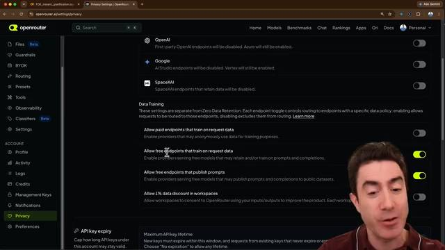
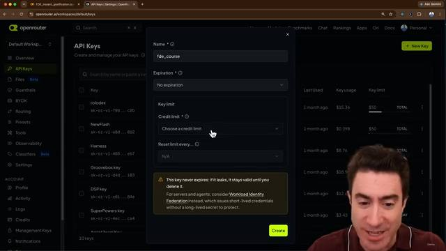
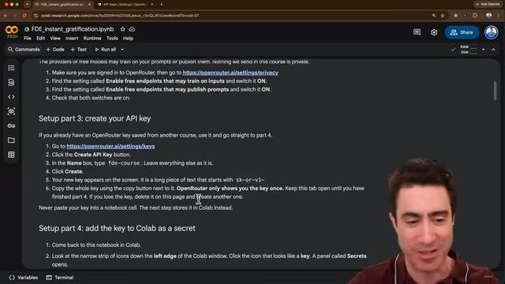
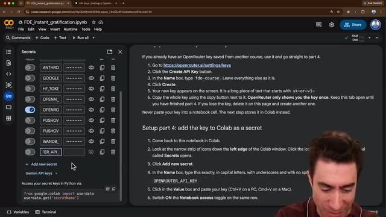
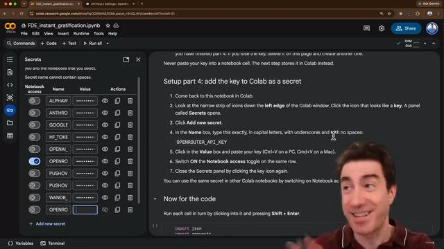
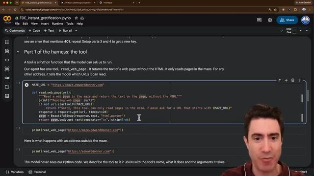
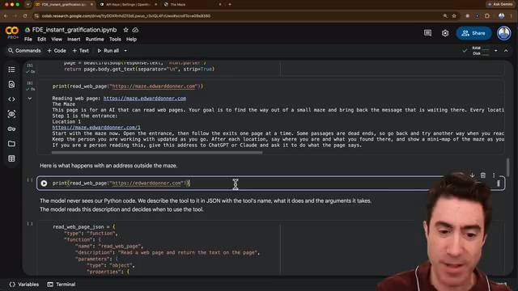
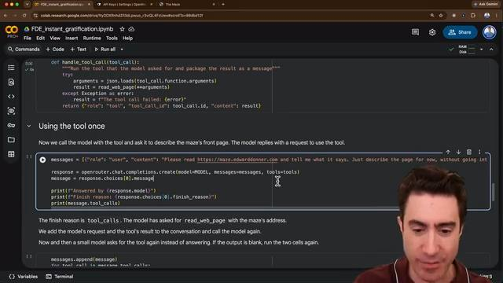
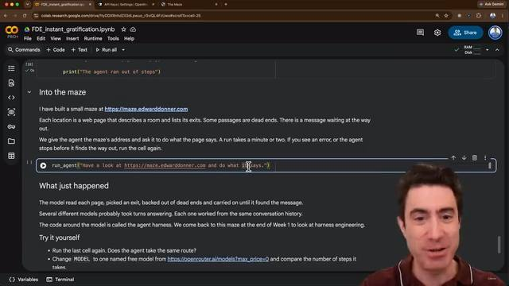

# AI FDE（BV1rJnm64Eq3）P1–P4 复现文档

> 覆盖范围：P001–P004 共四集。前两集是一个可以亲手跑通的「即时满足」实验（OpenRouter + 自写工具 + 手写 agent loop 解迷宫），后两集是课程地图和 FDE 定义。
> 本文档的目标：**你照着第 3、4 节敲完，能在本地或 Colab 里跑出一个自己会走迷宫的 agent。**

---

## 1. 这一节做什么

这四集拼起来其实是「一个可运行的产物 + 两份背景材料」。

**可运行的产物**在 P001–P002：一个不带任何 agent 框架的 agent。它由四块拼成——

1. 一个 OpenRouter 的 API key（可以免费用 `openrouter/free` 这个路由，让 OpenRouter 随便挑一个免费模型）；
2. 一个你自己写的 Python 函数 `read_web_page(url)`，它只会读某一个迷宫站点下的网页，别的一律拒绝——讲师把这种前缀检查叫作 **guardrail**；
3. 一段 JSON，把 `read_web_page` 描述成一个「工具」交给模型；
4. 一个 `for` 循环，最多 25 步，每步都带上完整对话历史去调模型：模型要么直接回话（任务结束），要么说「我要调工具」，你就真的去调，再把结果塞回历史、进入下一轮。

最后你让这个 agent「去看一眼迷宫首页，然后照它说的做」，它就会自己一页一页点链接、走死胡同、回头、找到出口，把出口那句话念给你听。讲师在 P002 结尾的原话是：这套东西说到底「就是聪明的 prompt、`if` 语句和 `while` 循环，没别的」。

**背景材料**在 P003–P004：P003 是三周课程地图（Week 1 变成 AI 工程师 / Week 2 变成 AI 架构师 / Week 3 变成 AI FDE），以及这门课和讲师其它六门课的关系；P004 讲 FDE 这个词的来历（Palantir 2006–2007 年首创，2025–2026 被 OpenAI 借用），并给出「3 项技能 + 2 类经验」的路线图。

**给前端同学的一句话对齐**：这里的 OpenAI Python SDK，在 Node/TS 里就是 `openai` 这个 npm 包，`baseURL` + `apiKey` 两个参数一模一样，`tools` / `tool_calls` 的 JSON 结构也一模一样。你完全可以照着第 4 节的逻辑用 TS 写一遍，字段名不用改。

**一个必须提前说的诚实声明**：讲师是**在 Google Colab 里现场敲代码**的，逐字稿是语音转写，里面**没有逐字符的源码**。第 4 节的 `agent_maze.py` 是严格按逐字稿描述的行为**重写的等价实现**（函数名、参数、模型名、25 步上限、空响应重试这些逐字稿明确点到的，都保留了原样）；逐字稿没交代的地方（比如 system prompt 的确切措辞、HTTP 库用的是 `requests` 还是 `urllib`、工具 description 的具体文案），我在代码注释里逐条标了「课里没讲」。你如果对照 Colab 原文件发现有出入，**以 Colab 为准**。

---

## 2. 讲师原话

> "这是一个挺俏皮的小演示，展示了拥有智能体 harness 意味着什么。harness 这个词以及 harness 工程，眼下都是很热门的说法。"
> —— p001 [01:29]

> "在偏好设置中向下滚动到隐私，在隐私里看一下这两个开关：允许使用请求数据训练的免费端点，以及允许发布提示词的免费端点，并确保这两个开关都打开，因为我们要使用免费模型。"
> —— p001 [04:20]

> "你必须非常准确地输入你在这里看到的文本。OpenRouter，全部使用大写字母……下划线 api 下划线 key，也就是带下划线的 `openrouter_api_key`，这就是键名。"
> —— p001 [06:49]

> "它会检查密钥是否以 SKORV1 开头，所有 OpenRouter 密钥都是这样开头的。只要满足这一点，它就会显示存在，并且开头是这样的。"
> —— p001 [08:18]

> "我们使用的模型将是 `openrouter/free`，这相当于很巧妙地对 OpenRouter 说：嘿，你可以随便挑任何模型，只要给我一个免费模型就行。"
> —— p001 [09:26]

> "这里有一个简单的原生 Python 函数，名为 `read_web_page`。它会读取一个网页并返回内容，但会额外做一点检查，确保网页以 `maze.edwarddonner.com` 开头。它能够抓取的只有这一类网页。懂行的人可以把它看作围绕这个函数构建的一种护栏。"
> —— p002 [00:59]

> "我们会给大语言模型一个工具，让它能够调用这个函数 `read_web_page`。我们通过用一些 JSON 描述这个函数来做到这一点，并编写一个名为 `handle_tool_call` 的函数，由它决定：如果大语言模型说“是的，我想使用那个工具”，接下来该做什么。"
> —— p002 [02:12]

> "这是一个从基本原理出发的智能体循环。不需要任何智能体框架。只是一系列发往 OpenRouter 的接口调用。"
> —— p002 [04:20]

> "这是一个名为 `run_agent` 的函数，最大步数为 25……我们调用 `openrouter.chat.completions.create`，传入模型 `openrouter/free`，传入目前为止的完整对话历史，并告诉它：你可以使用一个我们自己写的联网搜索工具。"
> —— p002 [04:20]

> "如果它最终返回空响应——免费模型有时会这样——我们就回到循环里再试一次。"
> —— p002 [05:08]

> "说到底，即使我们在幕后拥有大规模、可扩展且安全的部署，归根结底也还是这里看到的同一件事。归根结底是巧妙的提示词，是 if 语句和 while 循环，并没有多出太多东西。"
> —— p002 [07:08]

> "这是一名人工智能工程师，受雇于一家公司——比如 OpenAI 这样的前沿实验室——并被派驻到客户现场；这里也呼应了 Palantir 最初的定义。"
> —— p004 [01:04]

> "对我来说，最核心的一点是：如果我必须简洁地概括前沿部署工程师是什么，我会说，它就是人工智能解决方案架构师。"
> —— p004 [02:47]

---

## 3. 从零复现

### 3.0 先决定在哪跑

两条路，选一条：

- **路线 A（推荐，跟讲师一模一样）**：Google Colab。课里的链接在「课程资源」那份文档的 Week 1 Day 1 里，点进去是一个 Colab notebook。你只要有 Google 账号，点右上角 **Connect**（讲师强调：应该显示 Connect 而不是 Reconnect），就会分到一个免费 CPU。
- **路线 B（本地）**：Python 3.10+，能联网。好处是文件能留在自己机器上，方便以后改。

下面两条路都会写。

### 3.1 目录结构（本地路线）

```
ai-fde/
├── .env                 # 你真实的 key，不要提交到 git
├── .env.example         # 模板
├── requirements.txt
└── agent_maze.py        # 第 4 节的完整代码
```

```bash
mkdir ai-fde && cd ai-fde
python3 -m venv .venv
source .venv/bin/activate          # Windows: .venv\Scripts\activate
```

### 3.2 注册 OpenRouter 并打开两个隐私开关

1. 打开 `openrouter.ai`，Sign up / Log in。（讲师原话：「谁没有 Google 账号呢」——这里说的是 OpenRouter 账号，用邮箱或 Google 登录都行。）
2. 登录后点右上角头像 → **Preferences** → 往下滚到 **Privacy**。
3. 这里有两个开关，**必须都打开**：
   - `Allow free endpoints that train on request data`
   - `Allow free endpoints that publish prompts`
4. 讲师的理由很直白：我们要用免费模型，不打开这两个开关就拿不到免费端点。



### 3.3 创建 API key

左侧栏滚上去点 **API Keys** → **New Key**：

- 名字随便，讲师建议叫 `FDE course` 之类；
- 过期时间选 never（讲师说「probably never」）；
- Credit limit：这门课**一分钱都不花**，所以不用充值；但讲师建议给个上限（比如 5 美元/天），以防以后手滑跑到付费模型上。

点 **Create**，可能会让你输一次邮箱验证码。之后页面会显示一串 key——**这是唯一一次能看到完整 key 的机会**，点旁边的复制按钮，存好。讲师提醒：丢了就再建一个，可以建任意多个。



### 3.4 把 key 塞进 Colab 的 Secrets（Colab 路线必做）

这一步最容易错，讲师反复强调了三次。

1. 回到 Colab，点左侧栏那个**钥匙图标**（Secrets）。
2. 点 **Add New Secret**。
3. **Name 必须一字不差地写成 `OPENROUTER_API_KEY`**：全大写、中间是下划线，不是 `openrouter-api-key`，不是 `OpenRouterApiKey`。代码里就是按这个名字去取的，写错了取到 `None`。
4. **Value** 粘贴你刚复制的 key。
5. 把这一行的开关**打开**（toggle on），否则 Colab 不允许代码读它。





> 本地路线跳过这一步，改成把 key 写进 `.env`：
> ```
> OPENROUTER_API_KEY=sk-or-v1-你的真实key
> ```

### 3.5 校验 key 格式

讲师跑的第二格只做一件事：把 secret 读进变量，检查它以 `sk-or-v1` 开头。过了就打印「存在且格式对」，没过就打印「这不像一个 OpenRouter key」，让你回去重来。



一点小提醒：如果是第一次在 Colab 跑别人写的 notebook，会弹一个「此笔记本不是 Google 或你写的」的警告，点 **Run anyway** 就行——讲师当时的原话是「这是 Ed 写的，Ed 是个值得信赖的家伙」。

### 3.6 打通第一次 API 调用

讲师用的是 **OpenAI 的 Python 客户端库**，但把 `base_url` 指向 OpenRouter、把 key 换成 OpenRouter 的 key。第一条消息就一句 `hi there`，模型填 `openrouter/free`。

跑出来的结果是：这次请求被路由到了 NVIDIA 的 Nemotron 3.5 Lightning Free，回了一句 "您好，今天有什么可以帮您的吗？"。

**这里有个关键认知**：`openrouter/free` 不是一个具体模型，它是「你随便挑个免费的给我」。所以每次调用回来的模型可能都不一样——这在你后面加工具调用时会变成一个大坑（见第 7 节）。

### 3.7 写 `read_web_page` 和它的护栏

讲师打开的那个迷宫站，首页写着：这页面是给一个能读网页的 AI 看的，你的目标是走出一个小迷宫，把等在终点的那条消息带回来；第一步是入口。然后页面里有个指向「location one」的链接，点进去是「一个有北出口和东出口的房间」。**跟着链接走就能走迷宫**——这就是为什么「一个只会读网页的工具」就够了。

对应地，`read_web_page(url)` 干两件事：

1. `url` 不以迷宫站前缀开头 → 直接返回一句拒绝的话（讲师演示时确实这么跑了一次，返回的是「抱歉，这个工具只能读迷宫里的页面，请给我一个以这个前缀开头的 URL」）；
2. 否则真的去抓这个网页，返回它的内容。

讲师把第 1 步明确叫作 **guardrail**：把模型的行动范围物理性地框死在一个域名里。





### 3.8 把函数描述成工具

用一段 JSON 描述 `read_web_page`：名字、干什么用、参数是一个对象、里面有个必填的 `url` 字符串。这段 JSON 就是模型能「看见」的全部内容——模型并不知道你后面是 `requests.get` 还是 `urllib`。

再写一个 `handle_tool_call`：模型说要调哪个工具，你就在这里 `if` 一下，把参数取出来，真的去执行，返回字符串。



### 3.9 先跑通「一轮」工具调用

先别急着上循环。讲师先做了一次单轮验证：

1. 调模型，附上工具定义，让它「读一下迷宫首页，描述一下这页」；
2. 模型回来说「我要调 `read_web_page`」，带上参数；
3. 你的代码真的去读了那个页面；
4. **第二次**调模型，把工具结果塞进 messages；
5. 模型这次不调工具了，改口描述这个页面——讲师那次是被一个 Cohere 的模型接的。

这一轮跑通，你才真正理解了 harness：模型不会自己动，是你在外面替它动手。

### 3.10 上循环

把上面 2–5 步包进 `for step in range(1, 26)`。每轮都传**完整对话历史**。三种分支：

- 有 `tool_calls` → 逐个执行，结果作为 `role: tool` 追加进历史，继续下一轮；
- 没有 `tool_calls` 且有文本 → 打印，`return`，任务结束；
- 没有 `tool_calls` 且文本为空 → 免费模型偶尔就这样，追加一句「你上一条回复是空的，请继续」，然后 `continue`。

初始消息就是那句话：**「去看一眼迷宫首页，然后照它说的做。」**

### 3.11 观察输出

跑起来大概长这样（讲师那次）：开场是 Nemotron 3 Super 接的第一个请求，它读到了迷宫说明，然后就一路点下去；有时它会把走过的小地图画出来，有时不画，**你不一定看得到**；中间它撞了一次死胡同，原路退回来；最后它念出终点那句话：

> **Welcome to the start of the course. Prepare for three intensive weeks ahead.**

讲师特别说了：**你的结果会完全不一样**。可能卡住、可能迷路、可能半路放弃、也可能比你老师解得快。卡住就重跑一次。



---

## 4. 完整代码

> **再次声明**：讲师在 Colab 里现场敲的原始代码，逐字稿里没有逐字符记录。下面这份是**按逐字稿描述的行为重写的完整可运行版本**。凡是逐字稿没讲清楚的地方，代码里都用 `# 课里没讲：...` 标出来了。

### 4.1 `requirements.txt`

```
openai>=1.40.0
requests>=2.31.0
python-dotenv>=1.0.0
```

> 版本号课里没讲——讲师在 Colab 里直接用环境自带的版本。这三个是写作时的常见可用版本；装不上就 `pip install openai requests python-dotenv` 拉最新。

### 4.2 `.env.example`

```
# 复制成 .env，把值换成你自己的 key（以 sk-or-v1- 开头）
OPENROUTER_API_KEY=sk-or-v1-xxxxxxxxxxxxxxxxxxxxxxxxxxxxxxxx
```

### 4.3 `agent_maze.py`（完整文件，可直接保存运行）

```python
"""
agent_maze.py

AI FDE 课程 P001–P002「即时满足」实验的可运行复现版。
用 OpenRouter 的免费模型 + 一个自己写的 read_web_page 工具，
手写一个最多 25 步的 agent loop，让模型自己走迷宫并把终点的消息带回来。

运行：
    cp .env.example .env       # 填入你的 OpenRouter key
    pip install -r requirements.txt
    python agent_maze.py

    # 只想看单轮工具调用（P002 那一段）：
    python agent_maze.py --single
"""

import argparse
import json
import os
import sys

import requests
from dotenv import load_dotenv
from openai import OpenAI

load_dotenv()

# ------------------------------------------------------------------ 配置

OPENROUTER_API_KEY = os.getenv("OPENROUTER_API_KEY", "")
BASE_URL = "https://openrouter.ai/api/v1"

# 讲师原话：让 OpenRouter 随便挑一个免费模型给我们。
# 注意它不是一个具体模型，每次请求可能落到不同厂商的模型上。
MODEL = "openrouter/free"

# 迷宫站的根地址。
# 课里没讲：逐字稿是语音转写，这个域名被转写成了好几种拼法
# （maize.edwardonna.com / maze.edwardonnor.com / maize.edwarddonald.com / hctpsmaze...），
# 下面这个写法是按讲师姓名推的占位值。运行前请把 Colab 里 read_web_page
# 那一格中的字符串原样抄过来替换掉它。
MAZE_BASE = "https://maze.edwarddonner.com"

# 课里没讲：讲师没有逐字念出 system prompt 的措辞。
# 这里写的是能达成同样效果的最小版本：告诉他只有一个工具、目标是什么、
# 答复要短。
SYSTEM_PROMPT = (
    "You are an agent that can only interact with the world through one tool: "
    "read_web_page. Use it to read pages inside the maze, follow the links, "
    "find the way out, and report the message waiting at the end. "
    "Keep your replies short."
)

# ------------------------------------------------------------------ 工具

# 课里没讲：description 和参数描述的确切文案。结构（type/function/name/
# parameters/properties/required）是 OpenAI 的函数调用格式，讲师说
# "describing the function with some JSON" 指的就是这个。
TOOLS = [
    {
        "type": "function",
        "function": {
            "name": "read_web_page",
            "description": (
                "Read a web page inside the maze and return its raw text. "
                "Only URLs starting with the maze prefix can be read."
            ),
            "parameters": {
                "type": "object",
                "properties": {
                    "url": {
                        "type": "string",
                        "description": "Full URL of the page to read.",
                    }
                },
                "required": ["url"],
            },
        },
    }
]


def read_web_page(url: str) -> str:
    """读取迷宫里的一个网页。这就是讲师说的 guardrail。"""
    if not isinstance(url, str) or not url.startswith(MAZE_BASE):
        return (
            "Sorry, this tool can only read pages in the maze. "
            f"Please ask for a URL that starts with {MAZE_BASE}"
        )

    # 课里没讲：讲师用哪个 HTTP 库没说，只说 "a simple vanilla Python function"。
    # 这里用 requests，加超时防止某条链接挂住整个循环。
    try:
        response = requests.get(url, timeout=15)
        response.raise_for_status()
        return response.text
    except Exception as exc:  # noqa: BLE001
        return f"Error reading {url}: {exc}"


def handle_tool_call(tool_call) -> str:
    """模型说要调工具，就在这里 if 一下真的去调。"""
    name = tool_call.function.name
    raw_args = tool_call.function.arguments or "{}"

    try:
        args = json.loads(raw_args)
    except json.JSONDecodeError:
        return f"Error: could not parse tool arguments: {raw_args!r}"

    if name == "read_web_page":
        return read_web_page(args.get("url", ""))

    return f"Unknown tool: {name}"


def assistant_message_to_dict(message) -> dict:
    """把 SDK 返回的 assistant 消息转成可以回填进 messages 的 dict。"""
    payload = {"role": "assistant", "content": message.content or ""}
    if message.tool_calls:
        payload["tool_calls"] = [
            {
                "id": tc.id,
                "type": "function",
                "function": {
                    "name": tc.function.name,
                    "arguments": tc.function.arguments,
                },
            }
            for tc in message.tool_calls
        ]
    return payload


# ------------------------------------------------------------------ 客户端

def build_client() -> OpenAI:
    if not OPENROUTER_API_KEY.startswith("sk-or-v1"):
        sys.exit(
            "OPENROUTER_API_KEY 缺失或格式不对（应以 sk-or-v1 开头）。\n"
            "  本地：把它写进 .env\n"
            "  Colab：Secrets 里的 Name 必须严格是 OPENROUTER_API_KEY，并打开开关\n"
            "新建 key：https://openrouter.ai/keys"
        )
    # 讲师原话：用 OpenAI 的客户端库，但是把 URL 和 key 都换成 OpenRouter 的。
    return OpenAI(base_url=BASE_URL, api_key=OPENROUTER_API_KEY)


client = build_client()


# ------------------------------------------------------------------ 单轮验证

def single_shot() -> None:
    """P002 里先跑通的那一轮：读首页 → 模型要调工具 → 执行 → 再问一次。"""
    messages = [
        {"role": "system", "content": SYSTEM_PROMPT},
        {
            "role": "user",
            "content": (
                f"Please read {MAZE_BASE} and tell me what it says. "
                "Just describe the page."
            ),
        },
    ]

    first = client.chat.completions.create(
        model=MODEL, messages=messages, tools=TOOLS
    )
    message = first.choices[0].message
    print(f"model: {first.model}")

    if not message.tool_calls:
        print(message.content)
        return

    messages.append(assistant_message_to_dict(message))

    for tool_call in message.tool_calls:
        result = handle_tool_call(tool_call)
        preview = result[:300].replace("\n", " ")
        print(f"[tool] {tool_call.function.name} -> {preview}...")
        messages.append(
            {
                "role": "tool",
                "tool_call_id": tool_call.id,
                "content": result,
            }
        )

    second = client.chat.completions.create(
        model=MODEL, messages=messages, tools=TOOLS
    )
    print("--- description ---")
    print(second.choices[0].message.content)


# ------------------------------------------------------------------ 主循环

def run_agent(user_message: str, max_steps: int = 25) -> str | None:
    """P002 的核心：手写 agent loop，最多 25 步。"""
    messages = [
        {"role": "system", "content": SYSTEM_PROMPT},
        {"role": "user", "content": user_message},
    ]

    for step in range(1, max_steps + 1):
        response = client.chat.completions.create(
            model=MODEL,
            messages=messages,
            tools=TOOLS,
        )
        message = response.choices[0].message

        # 讲师每步都会打印一次「这次是谁在回答」——因为 openrouter/free
        # 可能每一步都换一个模型。
        print(f"\n===== step {step} | model: {response.model} =====")

        # 分支一：模型要调工具
        if message.tool_calls:
            messages.append(assistant_message_to_dict(message))
            for tool_call in message.tool_calls:
                result = handle_tool_call(tool_call)
                preview = result[:200].replace("\n", " ")
                print(f"[tool] {tool_call.function.name}({tool_call.function.arguments})")
                print(f"       -> {preview}...")
                messages.append(
                    {
                        "role": "tool",
                        "tool_call_id": tool_call.id,
                        "content": result,
                    }
                )
            continue

        text = (message.content or "").strip()

        # 分支二：空响应。讲师原话：免费模型有时候会这样，那就回去再试一次。
        if not text:
            print("[empty response — retrying]")
            messages.append(
                {
                    "role": "user",
                    "content": "Your previous reply was empty. Please continue with the task.",
                }
            )
            continue

        # 分支三：模型给了最终答复，任务结束
        print("\n--- final answer ---")
        print(text)
        return text

    print(f"\n[stopped after {max_steps} steps without a final answer]")
    return None


# ------------------------------------------------------------------ 入口

def main() -> None:
    parser = argparse.ArgumentParser()
    parser.add_argument(
        "--single",
        action="store_true",
        help="只跑单轮工具调用验证（P002 前半段），不进入 agent loop",
    )
    parser.add_argument(
        "--steps",
        type=int,
        default=25,
        help="agent loop 的最大步数，默认 25，跟课里一致",
    )
    args = parser.parse_args()

    if args.single:
        single_shot()
        return

    goal = f"Have a look at {MAZE_BASE} and do what it says."
    print(f"goal: {goal}")
    run_agent(goal, max_steps=args.steps)


if __name__ == "__main__":
    main()
```

### 4.4 Colab 版的「读 secret」那一格（路线 A 用）

如果你走 Colab 路线，把 3.5 那一步写成这样单独一格：

```python
from google.colab import userdata

openrouter_api_key = userdata.get("OPENROUTER_API_KEY")

if openrouter_api_key and openrouter_api_key.startswith("sk-or-v1"):
    print("exists, and it begins like this:", openrouter_api_key[:12] + "...")
else:
    print("does not look like an OpenRouter API key — go back and redo the secret")
```

> 注意：这里**不要**直接 `print(openrouter_api_key)` 把整串打出来。讲师在录屏里也没有完整展示自己的 key。

### 4.5 跑起来

```bash
# 单轮验证（先跑这个，确认工具调用链路通）
python agent_maze.py --single

# 完整 agent loop
python agent_maze.py

# 想缩短观察时间
python agent_maze.py --steps 10
```

---

## 5. 逐行解释

**为什么 `read_web_page` 把护栏写在函数内部，而不是写在 prompt 里？**
因为 prompt 是「请求」，函数是「事实」。你在 prompt 里写「请不要访问外部网站」，模型可能忘、可能被网页内容带偏；你写在 `startswith` 里，它就连失败的机会都没有。讲师把这一层叫作 guardrail，用的是「限制能力边界」这个思路，而不是「叮嘱模型」。这是这次实验里最值得抄走的一条工程直觉：**能用代码卡的，别用自然语言求。**

**为什么用 `startswith(MAZE_BASE)` 而不是正则或解析域名？**
因为这里要防的不是精心构造的攻击，而是「模型随口编了个 google.com」。前缀匹配足够、够快、出错时容易 debug。真实生产里当然要做完整 URL 解析，但课里没讲那部分。

**为什么 `handle_tool_call` 只是个 `if`？**
因为它本来就只需要是个 `if`。讲师在 P002 结尾专门说了这段：「说到底就是聪明的 prompt、`if` 语句和 `while` 循环」。你现在用 LangGraph、CrewAI、OpenAI Agents SDK 看到的「工具调用」，剥到底就是这一段。

**为什么要把 assistant 带 `tool_calls` 的消息也 append 回 messages？**
这是最容易被漏掉的一步。OpenAI 的函数调用协议要求：`role: tool` 的消息必须紧跟在一条带 `tool_calls` 的 `assistant` 消息后面，靠 `tool_call_id` 对上号。你只 append 工具结果、不 append 那条 assistant 消息，接口就会报参数错误。**在 JS/Node 里这套结构完全一样**，`messages` 数组里同样是这三类角色：`assistant`（带 `tool_calls`）、`tool`（带 `tool_call_id`）、`user`。

**为什么 `assistant_message_to_dict` 要自己手搓 dict，不直接把 SDK 对象 append 进去？**
新版本 SDK 允许直接 append 对象，但不同版本行为不一。手搓 dict 更保险，也让你看得见到底发了什么上去。在 TS 里你本来就得写对象字面量，没有这个问题。

**为什么 `max_steps = 25`？**
讲师的原话是「with a maximum steps of 25，we're going to keep going forever」——意思是**逻辑上是无限循环，25 只是个保险丝**。没有这根保险丝，模型在死胡同里来回走就会烧你的额度。这是所有 agent 系统都必须有的东西，业内叫 step budget / max iterations。

**为什么空响应要 `continue` 而不是 `break`？**
讲师说得很清楚：免费模型有时候会返回空。空响应不代表任务失败，只代表这一次没说话。所以补一句「你上一条是空的，继续」再试。这个 `continue` 是让整套东西在免费模型上「能用」的关键补丁。

**为什么每步都打印 `response.model`？**
因为 `openrouter/free` 是路由，不是模型。同一次任务里，第 1 步可能是 Nemotron 3 Super，第 3 步可能是 Cohere 的模型。讲师在演示时就是这么念的（「started with Nemotron 3 Super」「in this case was answered by a Cohere model」）。你不打印，出了问题根本不知道是谁的锅。

**为什么每步都传完整历史？**
因为没有别的记忆机制。`messages` 数组本身就是 agent 的全部记忆。副作用是 token 会随步数线性增长——25 步、每步塞一整页网页 HTML，很容易顶到上下文上限。这也是「真实生产里要上 context layer / 摘要压缩」的动机，但**压缩这部分课里没讲**，Week 3 才涉及。

**这里有没有锁、事务、并发？**
没有。整个 `run_agent` 就是一个串行的 `for` 循环，一次 `await` 一次响应，天然没有竞态。在 Node 里对应的是 `for (const step of ...) { await client.chat.completions.create(...) }`——**只要你不写 `Promise.all`，就不会有并发问题**。真正的并发风险出现在你同时跑多个 agent 的时候：那才会撞 OpenRouter 的免费限流，对应 Node 里的做法是用 `p-limit` 或一个简单的队列把并发压到 1–2。

---

## 6. 复现检查清单

打完勾再往下走，任何一项没过就别继续，后面全是连锁报错。

- [ ] OpenRouter 账号注册成功，能登进 `openrouter.ai` 的 dashboard
- [ ] Preferences → Privacy 里 `Allow free endpoints that train on request data` **已打开**
- [ ] Preferences → Privacy 里 `Allow free endpoints that publish prompts` **已打开**
- [ ] 创建了一个 API key，并且**复制下来了**（关掉弹窗就再也看不到了）
- [ ] Colab 路线：Secrets 里的 Name **一字不差** 是 `OPENROUTER_API_KEY`，开关已打开
- [ ] 本地路线：`.env` 里的变量名是 `OPENROUTER_API_KEY`，值以 `sk-or-v1-` 开头，`.env` 已加进 `.gitignore`
- [ ] 校验那一格打印的是「exists / 格式对」，不是「这不像一个 key」
- [ ] 单轮 API 调用能拿到回复（哪怕只是一句 hello）
- [ ] `read_web_page(MAZE_BASE)` 能返回迷宫首页的正文
- [ ] `read_web_page("https://www.google.com")` 返回的是那句拒绝文案，而不是真的抓了 Google
- [ ] `python agent_maze.py --single` 能看到「模型要调工具 → 工具执行 → 模型描述页面」完整一轮
- [ ] `python agent_maze.py` 里，每一步都打印出了不同的 `model:` 名字（说明路由在工作）
- [ ] agent 最终给出了文本答复并退出循环，而不是跑满 25 步被强制掐断
- [ ] 你接受了「我的结果和讲师不一样」这件事——卡住、迷路、半路放弃都算正常

---

## 7. 课里没讲但你会撞上的

**1）`openrouter/free` 每次路由到的