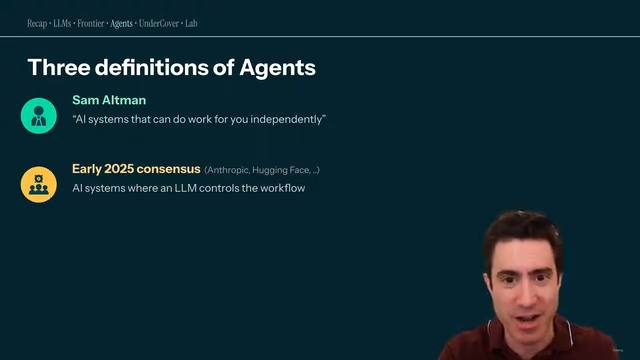
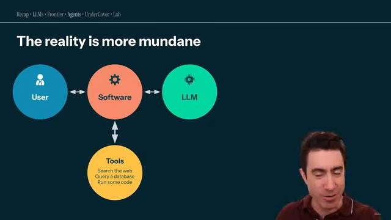
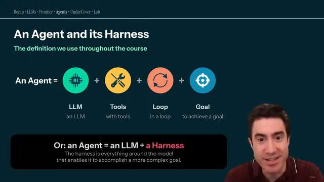
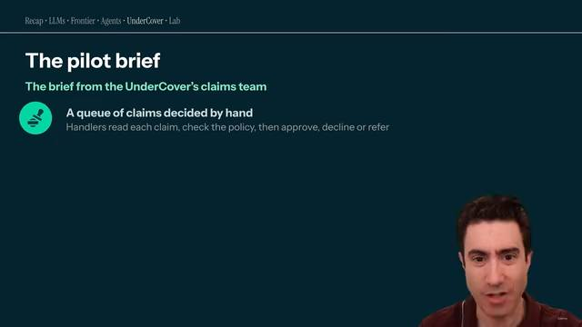
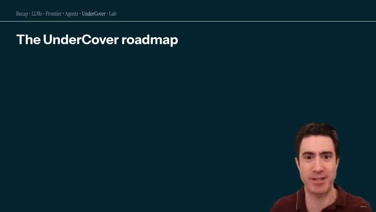
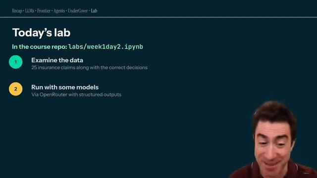
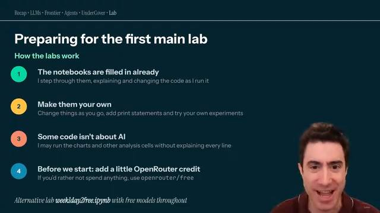

# AI FDE 课程文档：P012–P014（Agent 定义、Undercover 项目、Claims 实验 Lab）

> 覆盖视频：BV1rJnm64Eq3 的 P012 / P013 / P014
> 读者画像：前端转 AI 应用工程师。文中涉及 Python 语法会标注「知道即可」，涉及并发/锁会补一句「在 JS/Node 里对应什么」。
> 说明：P012 与 P013 是**纯讲解课**（逐字稿里没有可运行代码），P014 是**实验课**（有 notebook 与代码片段）。因此本文档第 3、4 章对 P012/P013 按「纯讲解课」规则处理（复现推导过程 + 产出设计决策表），对 P014 按「有代码课」规则处理（复现环境 + 完整代码）。所有代码均为**示意/骨架**，因为逐字稿只给了片段，未给完整文件；凡逐字稿没讲的内容一律标注「课里没讲」。

---

## 1. 这一节做什么

这三节连起来是一条完整的「从概念到第一次动手」的链路：

- **P012**：把「什么是 AI Agent」这件事讲清楚，并给出本课程全程使用的定义——**an LLM with tools in a loop to achieve a goal**（一个带工具、在循环中、为达成目标的 LLM）。同时解释「工具调用」的真实机制（不是 LLM 真的去上网，而是软件在替它执行），引出 **harness（脚手架）** 这个概念，最后横向对比主流 agent 框架的光谱（轻量 ↔ 电池全包）。
- **P013**：揭晓贯穿三周的商业项目 **Undercover**——一家虚构的旅行保险公司。我们要扮演 **AI FDE / AI 解决方案架构师**，先做一个 **pilot**：一个能像理赔团队一样处理理赔队列的 AI agent，**赔付金额 > $1000 需人工审批，< $1000 可自主处理**即为成功。今天（P014 所在日）先不写应用，先在 Jupyter notebook 里做实验。
- **P014**：当天的大 Lab，分四部分：(1) 看 25 条示例理赔数据并可视化；(2) 用 OpenRouter 做简单 LLM 调用 + **structured outputs**（Pydantic 约束 JSON）；(3) 可选：换几个模型对比，并试一下 **Jev**（讲师原话，一种更快的新模型）；(4) 用 **LangChain `create_agent`** 搭一个带工具的 agent，给它「查保单」「记录决策」的工具，放进循环里跑。

一句话：**P012 给你定义，P013 给你业务场景，P014 让你第一次把定义跑起来。** 阅读时建议把这条链路记成「定义 → 业务成功标准 → 最小实验」，后面每次写 agent 代码都回头对照这三件事：我的 LLM 是什么、工具是什么、循环在哪里、目标与验收标准是什么。

---

## 2. 讲师原话（带出处）

> 「An AI agent is an LLM with tools in a loop to achieve a goal.」—— p012 [03:26]

> 「LLMs only generate tokens. That's all they do. They are calculators that predict likely tokens.」—— p012 [02:14]

> 「It's the software that looks online that does a web search. It's the software that queries the database. It's the software that runs some code and then it calls the LLM again.」—— p012 [06:04]

> 「The harness is the software that drives the multiple LLM calls and stitches up the LLM to a set of tools.」—— p012 [06:45]

> 「An agent is an LLM plus a harness.」—— p012 [08:54]

> 「Which agent framework should I use? … it's not the most important problem facing your project.」—— p012 [09:00]

> 「Undercover is a fictional travel insurer … an AI agent that is able to process claims.」—— p013 [00:41]

> 「It's going to require human approval for any payout more than a thousand dollars but less than a thousand dollars it should be able to handle it itself.」—— p013 [02:32]

> 「We're going to stick to Jupyter notebooks … as we understand the kind of quality and cost trade-offs and select an LLM for this task.」—— p013 [03:02]

> 「I have 25 example insurance claims … along with each one, I have the actual decision about whether or not, according to the company's policy, they should get their money back.」—— p014 [00:35]

> 「We're going to use a technique called structured outputs, which requires the LLM to respond according to a particular JSON spec.」—— p014 [01:11]

> 「You use Pydantic … you make it a subclass of an object called base model … you say `openai.chat.completions.parse` instead of `create`.」—— p014 [03:16]

> 「You use this decorator called `@tool` and when you apply that decorator you can then just write a normal Python function and that will automatically become a tool.」—— p014 [08:31]

> 「What actually happens behind the scenes when you call `create_agent` is that LangChain uses another of their frameworks, LangGraph, to build something called a dependency graph.」—— p014 [09:34]

---

## 3. 从零复现

### 3.1 P012 的推导复现（纯讲解课：需求→约束→结论）

这一步不是敲代码，而是把讲师的推理链按顺序走一遍，你走完就能自己复述「什么是 agent」。

1. **需求**：给「AI agent」下一个能落地、能写进代码的定义。
2. **约束**：市面上定义太多（OpenAI 的「独立为你干活」太松；Anthropic/HuggingFace 的「LLM 控制工作流」稍紧但仍需澄清——LLM 只产 token）。
3. **结论（本课采用）**：**Agent = LLM + tools + loop + goal**。等价说法：**Agent = LLM + harness**。
4. **机制澄清**：LLM 只预测 token → 软件把「我要用工具」这类 token 解析出来 → 软件真正执行工具 → 软件把结果再喂回 LLM → 循环。**执行工具的是软件，不是 LLM。**
5. **取舍**：框架选择不是核心问题；核心是数据、评测、可观测性、安全。框架按「轻量 ↔ 电池全包」排光谱，团队熟哪个用哪个。







### 3.2 P013 的推导复现（纯讲解课：业务→pilot→成功标准）

1. **业务**：Undercover 旅行保险公司，有一个 **claims team（理赔团队）**，人工看理赔队列，逐条读、对照保单、决定 **approve / decline / escalate**。
2. **pilot 目标**：做一个 AI agent，像理赔员一样「work the queue」，逐条处理。
3. **成功标准（硬指标）**：赔付 **> $1000 → 必须人工审批**；**< $1000 → agent 自主处理**。做到这点即算成功。
4. **方法约束**：先实验、后建应用。今天只在 **Jupyter notebook** 里做，目的是理解数据、试 LLM 调用、评估质量/成本权衡、**选型 LLM**。
5. **三周路线（讲师口述）**：Week1 成为 AI 工程师（notebook 实验 → 用 Claude Code 搭 backend/dashboard/frontend/agent → 开源模型 → harness engineering）；Week2 工业化（evals、observability、agentic RAG、memory、MCP、human-in-the-loop、agent teams、自改进 agent）；Week3 上生产（security、guardrails、企业上下文层、数据集成、用 AWS agent core 部署并交付）。





### 3.3 P014 的环境复现（有代码课：装环境、跑 notebook）

**前置条件**（逐字稿明确提到的）：
- 已 clone 的 `undercover` 项目（讲师说「the one we cloned yesterday」，应位于你的 projects 目录）。
- VS Code。
- OpenRouter 账号 + API key。讲师建议充 **$2**（整个 lab 只花几美分），并强调：**不要开 auto top-up**，给 key 设限额，管好 API key。若不想花钱，用 `openrouter/free` 或任意免费模型，讲师另提供 `week1day2free.ipynb` 副本。

**目录结构（按逐字稿推断，课里没给完整树，以下为最小可复现结构）**：

```
undercover/
├── labs/
│   ├── week1day2.ipynb        # 主 lab（讲师原话文件名）
│   └── week1day2free.ipynb    # 全免费模型副本（讲师原话）
├── .env                       # 存 OPENROUTER_API_KEY（课里没讲具体变量名，见第7章）
└── requirements.txt
```

**依赖（版本课里没讲，以下为可跑通的最小集合，请以实际安装为准）**：

```txt
# requirements.txt
openai>=1.40.0
pydantic>=2.7.0
pandas>=2.0.0
matplotlib>=3.8.0
python-dotenv>=1.0.0
langchain>=0.3.0
langchain-openai>=0.2.0
```

**启动步骤**：

```bash
# 1. 进入项目
cd undercover

# 2. 建虚拟环境（Python 3.11+ 建议）
python -m venv .venv
source .venv/bin/activate        # Windows: .venv\Scripts\activate

# 3. 装依赖
pip install -r requirements.txt

# 4. 配 key（写入 .env，不要提交到 git）
echo 'OPENROUTER_API_KEY=sk-or-你的key' > .env

# 5. 打开 notebook
code labs/week1day2.ipynb
```

**命令逐条解释与排查**：`cd undercover` 的前提是你已经在 clone 出来的父目录里；若提示 `No such file or directory`，先用 `pwd` 和 `ls` 确认位置。`python -m venv .venv` 会创建隔离环境，避免把依赖装到系统 Python；前端可对照 `nvm use` 切 Node 版本后再 `npm install` 的思路。`source .venv/bin/activate` 是 macOS/Linux 的激活方式，Windows 用注释里的 `.venv\Scripts\activate`；激活成功后命令行前通常会出现 `(.venv)`。`pip install -r requirements.txt` 若因网络失败，可先检查 Python 版本和网络代理，再重试；不要因为一个包失败就跳过整个环境。`echo '...' > .env` 会把内容覆盖写入 `.env`，如果你已有其他环境变量，建议用编辑器追加而不是覆盖。`code labs/week1day2.ipynb` 只是用 VS Code 打开文件；打不开时可直接在 VS Code 里手动打开 `labs` 目录。以上是操作排查提示，不改变课程事实。

**OpenRouter 充值路径（讲师演示）**：登录 openrouter.ai → 右上头像菜单 → **Credits** → **Add credits** → 最低 $2 → 填卡。讲师当时余额 $8.62，仅作示例。





---

## 4. 完整代码

> ⚠️ 重要声明：逐字稿只给了**代码片段与函数名**（`openai.chat.completions.create` / `.parse`、`ClaimDecision`、`@tool`、`create_agent`、`agent.invoke`、`ChatOpenAI`），**没有给完整 notebook 文件**。下面四个 cell 是**按讲师口述拼出的可运行骨架**，字段名严格取自逐字稿（`rationale` / `decision` / `payout`），其余（如数据列名、工具函数体）逐字稿未给，标注为「课里没讲，此处为示意」。请把它们粘进 `labs/week1day2.ipynb` 的四个 cell 依次运行。

### Cell 0：环境与客户端

```python
# cell 0 —— 环境准备
import os
import json
import pandas as pd
import matplotlib.pyplot as plt
from dotenv import load_dotenv
from openai import OpenAI

load_dotenv()  # 读取 .env 里的 OPENROUTER_API_KEY

client = OpenAI(
    base_url="https://openrouter.ai/api/v1",
    api_key=os.environ["OPENROUTER_API_KEY"],
)

# 讲师建议：先用付费小模型跑通，再换免费模型对比
MODEL = "openai/gpt-4o-mini"   # 具体模型名课里没锁定，可换成任意 OpenRouter 模型
```

### Cell 1：Part 1 —— 看数据（25 条理赔）

```python
# cell 1 —— Part 1：加载并可视化 25 条示例理赔
# 注意：逐字稿只说「25 example insurance claims + 每条的真实决策」，
# 没有给 CSV 文件名和列名。下面列名为示意，请对齐你仓库里的实际文件。
claims = pd.read_csv("labs/data/claims.csv")   # 课里没讲文件名，示意

print(claims.shape)          # 期望 (25, N)
print(claims.head())
print(claims["decision"].value_counts())   # approve / decline / escalate 分布

# 简单可视化：决策分布
claims["decision"].value_counts().plot(kind="bar")
plt.title("Claim decisions distribution")
plt.tight_layout()
plt.show()
```

### Cell 2：Part 2 —— structured outputs（Pydantic 约束）

```python
# cell 2 —— Part 2：用 structured outputs 让 LLM 按 schema 返回
from pydantic import BaseModel

class ClaimDecision(BaseModel):
    rationale: str   # 逐字稿明确提到这三个字段
    decision: str    # 期望取值 approve / decline / escalate（课里没讲是否用 Enum）
    payout: float    # 赔付金额

SYSTEM = "You are a claims adjuster for Undercover, a travel insurer. Decide per policy."
USER_TEMPLATE = "Claim: {claim}\nPolicy: {policy}\nReturn a decision."

def decide(claim_text: str, policy_text: str) -> ClaimDecision:
    resp = client.beta.chat.completions.parse(   # 讲师原话：用 .parse 而不是 .create
        model=MODEL,
        messages=[
            {"role": "system", "content": SYSTEM},
            {"role": "user", "content": USER_TEMPLATE.format(claim=claim_text, policy=policy_text)},
        ],
        response_format=ClaimDecision,           # 把 Pydantic 类传进去
    )
    return resp.choices[0].message.parsed

# 跑第一条试试
row = claims.iloc[0]
result = decide(str(row.get("claim", "")), str(row.get("policy", "")))
print(result.rationale, result.decision, result.payout)
```

> 说明：`client.beta.chat.completions.parse` 是 OpenAI SDK 的 structured outputs 入口，讲师口述为 `openai.chat.completions.parse`；用 OpenRouter 时走 `client.beta...` 更稳。若你的 SDK 版本无 `.beta`，改用 `client.chat.completions.create(..., response_format={"type":"json_schema", ...})`——**该写法课里没讲**。

### Cell 3：Part 4 —— LangChain `create_agent` 搭 agent

```python
# cell 3 —— Part 4：用 LangChain create_agent 搭带工具的理赔 agent
from langchain_openai import ChatOpenAI
from langchain_core.tools import tool
from langchain.agents import create_agent

# 1) 描述 LLM：ChatOpenAI + model + base_url（讲师原话三步之一）
llm = ChatOpenAI(
    model=MODEL,
    base_url="https://openrouter.ai/api/v1",
    api_key=os.environ["OPENROUTER_API_KEY"],
)

# 2) 用 @tool 装饰器把普通函数变成工具（讲师原话）
@tool
def lookup_policy(claim_id: str) -> str:
    """Look up the policy text for a given claim id."""
    # 课里没讲保单存储在哪，这里用内存字典示意
    policies = {"C001": "Covered: lost luggage up to $1000.", "C002": "Not covered: missed flight due to pet."}
    return policies.get(claim_id, "Policy not found.")

@tool
def record_decision(claim_id: str, decision: str, payout: float) -> str:
    """Record the final decision for a claim."""
    # 课里没讲落库方式，这里仅打印示意
    print(f"[RECORD] {claim_id} -> {decision}, payout={payout}")
    return "recorded"

# 3) 创建 agent（背后是 LangGraph 的 dependency graph，讲师原话）
agent = create_agent(llm, tools=[lookup_policy, record_decision])

# 4) invoke 启动（讲师原话：invoke 是 LangChain 里统一入口）
out = agent.invoke({
    "messages": [{"role": "user", "content": "Process claim C001: my luggage was lost."}]
})
print(out)
```

### Cell 4：Part 3（可选）—— 换模型对比 + Jev

```python
# cell 4 —— Part 3（可选）：换模型对比；Jev 仅作快速一瞥
# 讲师原话：Jev 是「a newer kind of model that should be much faster」，
# 但课里没给 Jev 的调用代码/endpoint，此处不编造，仅留占位。
for m in ["openai/gpt-4o-mini", "openrouter/free"]:
    print("=== model:", m)
    # 复用 cell 2 的 decide()，把 MODEL 换成 m 再跑一遍即可
```

---

## 5. 逐行解释

**Cell 0**
- `base_url="https://openrouter.ai/api/v1"`：OpenRouter 兼容 OpenAI 协议，所以能直接用 `openai` SDK，只换 base_url。这是讲师反复用的套路（昨天也是 OpenRouter）。
- `load_dotenv()` + `os.environ[...]`：key 不进代码。讲师在 P014 [07:26] 特别强调 API key 卫生。
- `MODEL` 变量单独抽出：因为 Part 3 要换模型对比，抽出来才好切。

**Cell 1**
- `claims.shape` 期望第一维是 25——这是讲师说的「25 example claims」的**可验证断言**，跑出来不是 25 说明你数据文件拿错了。
- `value_counts()` 看 approve/decline/escalate 三类分布：这是后面评估 agent 是否「和人类理赔员一样好」的基线。讲师说「a lot of people skip it. We're not going to.」——数据理解是硬要求。
- 绘图代码讲师明说「you don't need to understand every line」，当 cookbook 用即可。

**Cell 2（structured outputs 是本 lab 的技术核心）**
- `class ClaimDecision(BaseModel)`：Pydantic 的 `BaseModel` 子类 = 一份 JSON schema 的 Python 表达。**在 JS/TS 里对应 Zod 的 `z.object({...})`**，思路完全一样：先定 schema，再让模型填。
- 三个字段 `rationale / decision / payout` 是逐字稿**唯一点名**的字段，不要自己加字段冒充讲师原意。
- `client.beta.chat.completions.parse(..., response_format=ClaimDecision)`：`.parse` 与 `.create` 的区别是——`.parse` 会**强制**返回可解析成该 Pydantic 对象的结构，拿到的 `message.parsed` 直接是对象，不用自己 `json.loads`。这就是讲师说的「we will always get back a rationale, a decision, and a payout」。
- 为什么不用普通 prompt 求 JSON？因为普通 prompt 只是「请求」，`.parse` 是「约束」。前者模型可能漏字段，后者在协议层保证 schema。

**Cell 3（agent = LLM + tools + loop + goal 的代码落地）**
- `ChatOpenAI(model, base_url, api_key)`：LangChain 对任意 LLM 的轻量封装，对应讲师「step one：描述 LLM」。
- `@tool` 装饰器：把普通 Python 函数变成 LLM 可调用的工具。**对比昨天**——昨天要手写一段 JSON 描述函数签名再塞给 LLM，今天一个装饰器搞定，这正是讲师说的「abstracted away the boilerplate」。**在 JS 里对应 Vercel AI SDK 的 `tool({ description, parameters, execute })`**。
- `create_agent(llm, tools=[...])`：讲师原话「that is the one that actually creates this object that is an agent」。背后 LangChain 用 LangGraph 建 dependency graph，但**我们不需要知道**——这是封装的价值。
- `agent.invoke({...})`：`invoke` 是 LangChain 的统一启动方法，讲师说「invoke is what you call to kick something off」。传进去的是 messages 列表，和 chat completions 的 messages 同构。
- **循环在哪？** 讲师的定义要求「in a loop」。`create_agent` 内部就是那个 loop：LLM 产 token → 若 token 表示要调工具 → 执行工具 → 结果回灌 → 再调 LLM → 直到 LLM 表示目标达成。你写代码时看不到 `while`，但它在框架里。**这就是 harness。**

**Cell 4**
- 只做模型切换对比，不写 Jev 调用——因为逐字稿没给 Jev 的 endpoint/参数，**不编造**。

**关于「锁/事务/并发」**：本 lab 全程单线程顺序调用，**没有并发、没有锁、没有事务**。若你后续把 `agent.invoke` 放进批量队列（Week2 会做），在 Node 里对应的是 `Promise.all` 并发 + 对 `record_decision` 这类写操作加**幂等键**（避免同一 claim 被记两次）——**这部分课里没讲，属于你会上撞上的问题**，见第 7 章。

---

## 6. 复现检查清单

按顺序打勾，任何一项不过就别往下走。每条后面给出「怎么验证」，验证不通过时回到对应章节排查：

- [ ] `undercover/` 已 clone，`labs/week1day2.ipynb` 存在（或 `week1day2free.ipynb`）。**验证**：在项目根目录执行 `ls labs`，文件名应与讲师口述一致；若不在 `labs` 下，用 VS Code 全局搜索 `.ipynb` 定位。
- [ ] Python 虚拟环境激活，`pip install -r requirements.txt` 无报错。**验证**：命令行前看到 `(.venv)`，且 `python -c "导入 openai、pydantic、pandas、langchain"` 不报 `ModuleNotFoundError`。
- [ ] `.env` 里有 `OPENROUTER_API_KEY`，且**没有**被提交进 git（`git status` 看不到它）。**验证**：运行 `git status --short`，`.env` 不应出现在待提交列表；若出现，先把它加入 `.gitignore`。
- [ ] OpenRouter 账户有余额（≥$2）**或**你已切到 `openrouter/free`。**验证**：登录 OpenRouter 看 Credits 余额；或先在 notebook 里把 `MODEL` 设为 `openrouter/free` 跑一次最小调用。
- [ ] Cell 0 跑通，无 `KeyError: OPENROUTER_API_KEY`。**验证**：单独运行 Cell 0；若报 `KeyError`，在 notebook 里执行 `import os; os.environ.get("OPENROUTER_API_KEY")` 看是否为空，再检查 `.env` 变量名和当前工作目录。
- [ ] Cell 1 `claims.shape[0] == 25`；`value_counts()` 能看到 approve/decline/escalate。**验证**：打印 `claims.shape` 和 `claims.columns`；若第一维不是 25，说明 CSV 路径或文件拿错；若列名对不上，按实际列名改 Cell 1。
- [ ] Cell 2 返回的 `result` 是 `ClaimDecision` 实例，`rationale/decision/payout` 三个属性都在。**验证**：执行 `print(type(result))` 和 `print(result)`；若 `result` 是 `None`，检查 `.parsed` 是否为空并查看原始 `resp`。
- [ ] Cell 3 `agent.invoke(...)` 返回里有 messages，且能看到 `[RECORD]` 打印（说明工具被调用了）。**验证**：运行 Cell 3 后看输出中是否出现 `[RECORD] C001`；若没有，检查工具 docstring 是否清楚、用户消息是否包含可触发工具的 claim id。
- [ ] 你能用自己的话复述：**agent = LLM with tools in a loop to achieve a goal**；**执行工具的是软件不是 LLM**；**harness 就是那层软件**。**验证**：不看文档，用三句话写下来，再对照第 2 章讲师原话。
- [ ] 你能说出 pilot 的成功标准：**> $1000 人工审批，< $1000 自主处理**。**验证**：口述或写下阈值，并说明「超过」和「小于」分别对应哪种处理方式。

---

## 7. 课里没讲但你会撞上的

下表保留原第 7 章全部条目，只把列表形式改为表格形式；事实与「课里没讲」标注不变。

| 现象 | 原因 | 怎么办 |
|---|---|---|
| `.env` 变量名对不上，Cell 0 报 `KeyError` | 讲师只说「配 key」，**没给变量名** | 本文用 `OPENROUTER_API_KEY`；你若仓库里叫别的（如 `OPENROUTER_KEY`），改 Cell 0 的 `os.environ[...]` 即可。 |
| `claims.csv` 读不到或列名不存在 | 逐字稿只说「25 条 + 真实决策」，**没给文件名/列名** | Cell 1 的 `claim` / `policy` / `decision` 是示意，跑之前先 `print(claims.columns)` 对齐。 |
| `client.beta.chat.completions.parse` 报 `AttributeError` | 老版本 openai SDK 没有 `.beta` | 降级方案是 `create(..., response_format={"type":"json_schema","json_schema":{...}})`——**此写法课里没讲**，属你自查。 |
| structured outputs 某模型报 400 | 不是所有模型都支持 `response_format` 强约束；**课里没讲哪些模型支持** | 换 `openai/gpt-4o-mini` 先跑通，再试别的。 |
| `from langchain.agents import create_agent` 报 `ImportError` | LangChain 版本迭代快，`create_agent` 在部分版本里路径不同（可能在 `langchain.agents.create_agent` 或需 `langgraph` 包）；**课里没讲版本** | 先 `pip show langchain` 看版本，再查该版本文档。 |
| 想调用 Jev 但不知道 endpoint/参数 | 讲师只说「更快的新模型」，**没给 endpoint、没给参数、没给代码** | 本文不编造，Part 3 只做模型切换对比。 |
| 批量化后同一 claim 被记两次 | 把 `agent.invoke` 批量化时，`record_decision` 这类写操作要防重复；**课里没讲** | **在 Node 里对应**：给每条 claim 一个幂等键（claim_id + 决策版本），写库前先查；或用 `Promise.allSettled` 而非 `Promise.all`，避免一条失败拖垮整批。 |
| OpenRouter 花费失控 | 讲师明确说「不要开 auto top-up、给 key 设限额」 | key 限额在 **Keys** 页面设，**具体 UI 课里没演示**，自己找一下。 |
| `week1day2free.ipynb` 某 cell 报模型不支持 | 讲师只说「only using free models」，**没给 diff** | 切过去后若某 cell 报模型不支持，把 `MODEL` 换成 `openrouter/free` 即可。 |
| 不理解「dependency graph」 | 讲师提了 LangGraph 会建 dependency graph，但**没展开**，说 Week2 再讲 | 现在只需知道「它在框架里，你不用管」。 |

---

**附：本文档引用的截图清单（共 8 张，均来自给定清单，帧号未改）**

| 编号 | 帧 | 用途 |
|---|---|---|
| 1 | p012_0196s | agent 定义 |
| 2 | p012_0364s | 工具调用真实机制 |
| 3 | p012_0533s | agent = LLM + harness |
| 4 | p013_0140s | pilot 成功标准（$1000 阈值）|
| 5 | p013_0203s | 三周路线图 |
| 6 | p014_0063s | lab 四部分与文件名 |
| 7 | p014_0402s | OpenRouter Credits 充值 |
| 8 | p014_0317s | （备用，可替换为代码编辑器帧）|

> 若需补足「代码编辑器」类截图，可从清单中选 `p014_0232s` / `p014_0359s` 替换第 8 张，alt 格式照抄：``。