# Undercover 项目 第 2 天：把 25 条理赔丢给 LLM，做出第一张「准确率 / 成本 / 延迟」对比表

> 覆盖：P015（加载与检查数据）、P016（结构化输出 + 多模型评测 + 与业务方谈取舍）
> 环境基线：VS Code + Python 3.12.12（虚拟环境名 `undercover`）+ Jupyter Notebook，模型调用统一走 OpenRouter

---

## 一、这一节做什么

这一节是「评测」而不是「做产品」。你要做的事只有一件：**把一批已经有人工专家结论的保险理赔数据，交给 LLM 重新判一遍，然后看它判得对不对、花了多少钱、用了多少时间**。

具体产物有三个：

1. 一份可反复运行的评测脚本（`lab.py`），输入是 claim + policy，输出是结构化 JSON（`rationale` / `decision` / `payout`）。
2. 一张模型对比表：同一批 25 条数据，分别用「同一个模型的不同推理档位」「不同厂商的便宜模型」「更贵的强模型」跑一遍，记录**正确条数 / 总成本 / 总耗时**。
3. 一套跟业务方对话的语言：准确率、成本、延迟三者不能同时最优，你要拿这张表去和业务 sponsor 谈「我们这个场景该选哪个模型」。

数据侧的事实（都是讲师在 P015 里报的数）：25 条 claim、25 条 label（人工专家给出的真实结论）、50 份 policy 文档，policy 合计一千多词。难度上分三档：`routine` 15 条、`hard` 5 条、`manual` 5 条。**那 5 条 `manual` 是故意设计成「读 policy 也答不出来」的**——需要公司内部的手册，而这份手册课里根本没给，所以这 5 条必然错，任何模型的分数上限事实上是 20/25。

明确了这一点，后面所有数字才有意义：GPT-6 Luna 拿 18/25，不是「72 分」，而是「在 20 条可答的题里答对 18 条」。

---

## 二、讲师原话（带时间戳）

关于这一节的定位，讲师开场就把四段结构说清楚了：

> 「这些是四个部分。检查数据。跑一些模型。可选地，跑一些其他有意思的模型。最后，通过 LangChain 做成 agent。」 —— p015 [00:52]

关于他期望的学习方式（这点很重要，决定你该怎么用这份文档）：

> 「我习惯的工作方式是：代码我已经写好了，我只是请你跟我一起执行每一个 cell，然后改动它、加 print 语句、研究它、把它变成你自己的东西。我不是坐在那儿打字给你看。」 —— p015 [01:49]

关于费用门槛：

> 「如果你想用付费模型，需要往账户里充 2 美元，就像我刚才做的那样。如果你不想花这个钱、宁愿只用免费的，那就去看配套的那个 week1day2 free 版本，或者在你跑的过程中把模型改成 `openrouter/free`。」 —— p015 [01:22]

关于最基础的调用形态（这一段是整节的语法地基）：

> 「提醒一下 chat completions API，这是调用云端 LLM 最简单的方式。我们创建一个 messages 对象，一个 Python 的字典列表，每个字典有 role 和 content。然后我们调用 openrouter 的 `chat.completions.create`。」 —— p015 [03:47]

关于数据为什么要先看一遍：

> 「在我们那么做之前，我们应该先挖一下数据。这是最佳实践。在开始跟 LLM 打交道之前，确保你真的理解你的数据。」 —— p015 [09:58]

关于 `manual` 那 5 条：

> 「有五条被标为 manual。这是个特殊类别，意思是：要拿到正确答案，光读 policy 是不够的，你需要额外信息。公司有一本处理疑难情况的专门手册。没有这本手册，你答不出来。而我们不打算把手册给 LLM——我们拿不到它。我们会在后面几周拿到，那时它才开始能把这些题答对。」 —— p015 [10:47]

关于结构化输出里字段顺序的讲究（这是本节最值钱的一条工程经验）：

> 「用结构化输出时有个最佳实践：尽量把 rationale（理由）放在 decision（决策）前面。因为这样它就像一个『思考』的过程，LLM 必须先产出理由，然后产出一个和这个理由一致的决策。如果你把顺序反过来，先 decision 再 rationale，那 LLM 就只是在为这个决策编一个看起来合理的解释，这是有点不一样的。」 —— p016 [00:25]

关于 `decide` 函数里那个「额外技巧」：

> 「我们告诉它我们需要你产出符合这个 spec 的东西，也就是 ClaimDecision。它就是这里的这个对象。它需要生成符合那个对象的东西。我们把 reasoning effort 传进去。然后这里还有一个小技巧，用来确保 OpenRouter 挑一个能处理结构化输出的 LLM provider。」 —— p016 [02:24]

关于第一次「moment of truth」：

> 「记住 claim 0，第一条就是航班取消、要 420 美元那条，正确答案是批准、赔付 420 美元。我们调 GPT-6 Luna、low 模式看看拿到什么。回来的结果是 decision 是 approve，要赔 420 美元，这是 rationale。这次调用花了非常少的钱——不到 0.04 美分。它花的时间是 1.4 秒。所以它快、便宜，而且答对了。」 —— p016 [03:12]

关于跑全量的结果：

> 「它全跑完了，25 条里对了 18 条，25 条加起来总共花了 0.4 美分，全部加起来用了 38 秒。」 —— p016 [05:04]

关于换推理档位后的反直觉结论：

> 「它（medium）拿到的结果完全一样，还是 18/25，但贵了一些，总共 6.3 美分，用了 90 秒，久了不少。有意思——更贵、久很多、但并没有对得更多。」 —— p016 [06:01]

> 「GPT-6 Luna high 拿到 19/25。记住有 5 条是它不可能答对的，因为需要手册。所以它只是在那些能答对的题目上稍微好了一点。但它贵了不少，时间 98 秒而不是 90 秒。在我看来这个取舍不一定值得。」 —— p016 [06:24]

关于分难度看结果的价值：

> 「GPT-6 Luna medium 也是 14 个 routine 对，但它 5 个 hard 里对了 4 个，manual 一个没对。所以虽然两者总分都是 18，我会说 medium 那个结果更好——它在有信息可用的题上答得更好。」 —— p016 [09:11]

关于和业务方谈：

> 「这就到了商业含义，这是关键点。在准确率、速度、成本之间做这类取舍是至关重要的。这取决于你的业务问题，取决于你的业务目标。你的业务 sponsor 通常会设一个准确率阈值，还会有一个预算，非功能需求里还会有延迟要求。你用这些来做正确的取舍。」 —— p016 [11:15]

> 「数据科学家会跟我说，哦没那么简单，还有 confusion matrix，还有 false positive 和 false negative 的区别……业务方对『拒掉一个本该赔付的理赔』和『赔付一个本该拒掉的理赔』的容忍度通常不一样。通常，拒掉本该赔的是更恶劣的——那会真的激怒客户、丢掉生意。」 —— p016 [11:45]

关于最后一个「非自回归」模型 Jev：

> 「Jev 是 Typesafe AI 出的新型模型……它不是一个自回归模型，它就是直接把结果吐出来。它给不了我们理赔金额，但它能给我们决策。」 —— p016 [14:49]

> 「当 Jev 有 90% 以上置信度时，它 6 次里对了 5 次……当它置信度低于 90% 时，19 次里对了 12 次。所以它的置信度是准确度的良好指示器。」 —— p016 [17:09]

---

## 三、从零复现

### 步骤 0：把环境摆对（最容易翻车的一步）

1. 打开 VS Code，左侧 Explorer 里应该能看到 `Undercover` 项目目录。
2. 项目里应有这些目录：`Labs/`（存放 `week1day2.ipynb`）、`data/`（放 JSON 数据）、`guides/`（讲师准备的补充读物）。
3. 建虚拟环境并装依赖（虚拟环境名就叫 `undercover`，因为选 kernel 时要认这个名字）：

```bash
python3.12 -m venv undercover
source undercover/bin/activate        # Windows: undercover\Scripts\activate
pip install -r requirements.txt
```

4. 在项目根目录建 `.env`，里面放 OpenRouter 的 key。**注意：Day 1 你已经建过这个文件了，变量名以你 Day 1 用的那个为准**；下面代码里我用 `OPENROUTER_API_KEY`，如果你 Day 1 用的是别的名字，改这一行即可。讲师的原话是「你昨天已经把 key 放进 `.env` 了，所以运行这段时会看到『API key found』」。

5. 打开 notebook，**右上角 Select Kernel → 选 `undercover 3.12.12`**。讲师特别强调：你可能要先选 "设置 Python 环境"，但关键是你要看到 `undercover` 这个词，并且版本是 `3.12.12`。选错 kernel 的典型症状是 `import openai` 报错，但终端里 `pip list` 明明有这个包。

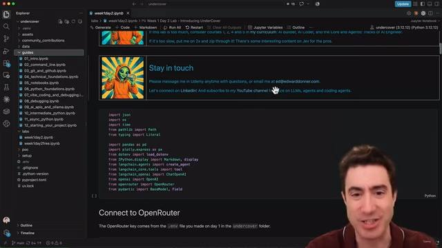

### 步骤 1：先做一次「冒烟测试」，确认 OpenRouter 通了

在做任何理赔的事之前，先按讲师的做法发一次最朴素的 chat completion：system 说「你用海盗的口吻回答」，user 问「宇宙的意义是什么」。这一步唯一的目的，是确认 **key 有效、模型名有效、返回结构你能取到**。

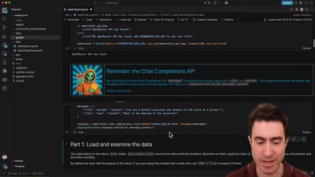

跑通之后讲师让你立刻改点东西：把 `pirate` 改成 `cowboy`，再跑一次。你会拿到完全不同的文风，但回答的还是同一个问题。这个「动一下看看变什么」的动作，是后面所有实验的模板。

### 步骤 2：加载数据，先搞清楚「25 / 25 / 50」是什么

数据加载这一层不是 AI 代码，讲师明确说「我不会细讲」，但你必须知道它给了你什么：

- `load(文件名)`：从 `data/` 目录读一个 JSON 文档。
- `get_sample_data(tiny=...)`：`tiny=True` 只给 5 条（省钱，几乎不花钱），`tiny=False` 给 25 条（整节实验也就一两美分）。
- 还有一个 **held-out 开关**：`held_out=True` 会给你一套完全独立的数据集。讲师的说法是「一套数据用来建平台，另一套用来在没参与构建的数据上做评估，这是好做法」。

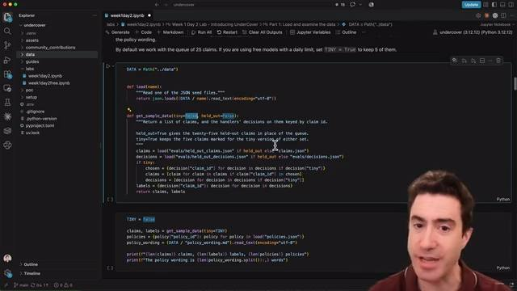

加载完打印出来，你应该看到三个数字：**25 条 claim、25 条 label、50 份 policy**。

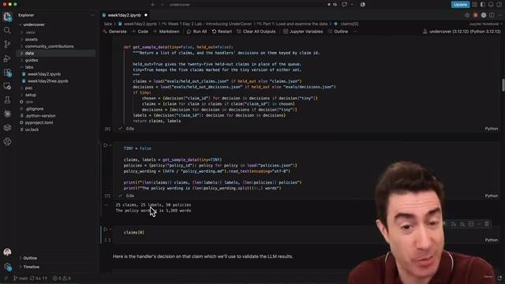

### 步骤 3：真正读懂一条数据长什么样

挑一条出来看。一条 claim 里有：claim id、customer number、type（这条是 trip delay）、一段散文式的叙述（「我回家的航班被航空公司取消了，改签到第二天早上」）、若干 items、若干 receipts、status 是 open。

它的 label 是：decision = approve，payout = 420，外加一段人工写的原因。

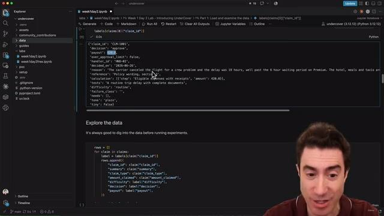

然后把全部 25 条摊成一张表（pandas DataFrame）：claim id、事件摘要、claim type、索赔金额、difficulty。**最后两列就是 label / ground truth**——这是你后面算对错的唯一依据。

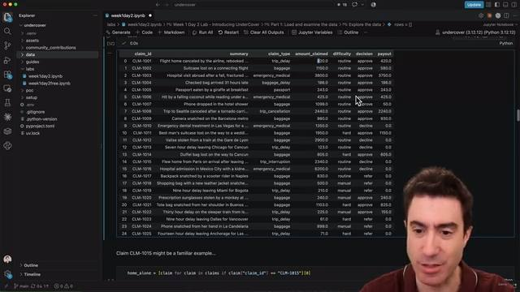

### 步骤 4：画两张图，得到两条「后面会用到的结论」

第一张：按 claim type 分组的堆叠柱状图，颜色区分 approve / decline / refer。讲师列出的类别包括 trip delay、baggage lost、medical emergency、baggage delay、passport、trip cancellation、trip interruption。他说到「六个类别」，但口头列举时数出了七个名字——**以你实际图表里的分类为准**。这张图本身没什么惊人发现，价值在于「熟悉数据」。

第二张：按 difficulty 分组。`routine` 15 条、`hard` 5 条、`manual` 5 条。**这里冒出来一条真正有用的观察**：

> 「也许有意思的一点是，专家只在很容易、很 routine 的案子上才愿意 decline。只要变成 hard 或 manual，他们就只 approve 或 refer。」 —— p015 [14:46]

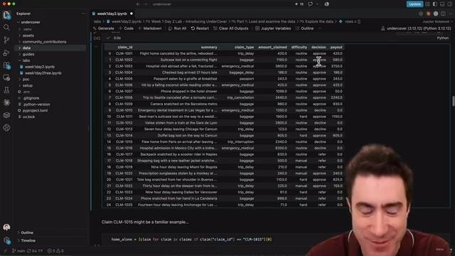

### 步骤 5：定义输出契约（这是整节的技术核心）

不要用「请用 JSON 回答」这种提示词去赌模型听话。用 **Pydantic 模型**把输出结构写死：一个 `ClaimDecision` 类，三个字段——`rationale`（字符串）、`decision`（只能是 `approve` / `decline` / `refer` 三者之一）、`payout`（浮点数）。每个字段都写一句自然语言描述。

字段顺序必须是 **rationale → decision → payout**。理由见上面讲师原话。

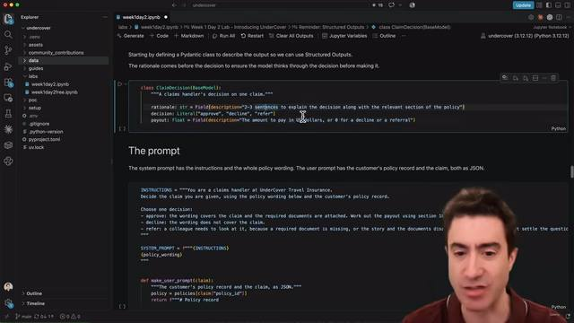

### 步骤 6：拼 prompt，写 decide 函数

System prompt 里放两样东西：一句角色设定（「你是 Undercover 旅行保险的理赔员，判断这条理赔，输出 approve / decline / refer」）+ **整份 policy 全文**。User prompt 里说「这是相关保单，这是理赔本身」并附上 claim。

然后 `decide(claim, model, reasoning_effort)` 做四件事：调 `chat.completions`、把 `ClaimDecision` 作为 response format 传进去、把 reasoning effort 传进去、加一个让 OpenRouter 只挑「支持结构化输出」的 provider 的参数。取结果用 `response.choices[0].message.parsed`——这一步是「按返回的 JSON 构造出一个 ClaimDecision 对象」。最后返回一个字典：模型、档位、claim id、decision、payout、rationale、这次调用花了多少钱、花了多少时间。

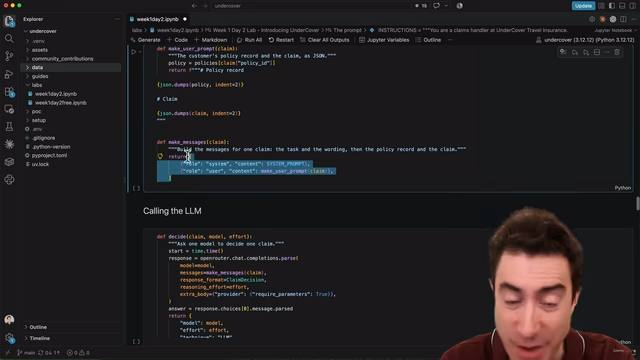

### 步骤 7：写判定函数和 run 函数

判定规则讲师讲得很明确：**decision 要完全对（approve / decline / refer 一致），并且 payout 在 1 美元以内**。

`run(model, effort)` 就是把 25 条挨个过一遍 decide，逐条判对错，累加成本和耗时。

### 步骤 8：跑模型矩阵，记录三列数

按讲师跑的顺序：

| # | 模型 | 档位 | 对了几条 | 总成本 | 总耗时 |
|---|---|---|---|---|---|
| 1 | GPT-6 Luna | low | 18/25 | 0.4 美分 | 38 秒 |
| 2 | GPT-6 Luna | medium | 18/25 | 6.3 美分 | 90 秒 |
| 3 | GPT-6 Luna | high | 19/25 | 明显更高（讲师未报精确值） | 98 秒 |
| 4 | Gemini 3.5 Flash Lite | （讲师未说明档位） | 14/25 | 3 美分 | 不到 30 秒 |
| 5 | GPT-6 Sol | high（可选 part） | 20/25 | 12 美分 | 不到 2 分钟 |
| 6 | Jev（Typesafe AI） | 不适用（非自回归） | 决策对 17 条 | 0.3 美分 | 5 秒 |

> ⚠️ 上表的模型名是**讲师口头念的名字**。notebook 里实际的 model 字符串（比如带不带 `openai/`、`google/` 前缀）逐字稿没有逐字给出，请以你 notebook 里那一行为准，不要凭猜。

讲师特意提醒过：18 这个数字会飘，「有时候是 16 或 17，18 是运气好的第一把」。如果你用的是 `openrouter/free`，结果可能完全不同。

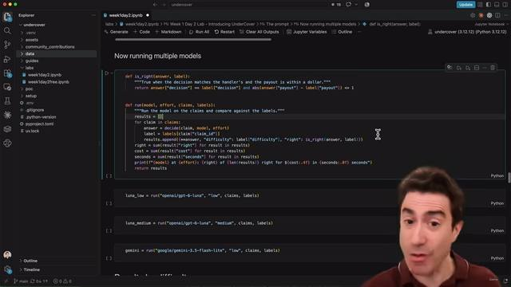

### 步骤 9：按难度切片，别只看总分

这一步是本节真正的「分析」。同样 18/25，两个档位的含金量不一样：

- Luna low：routine 14/15、hard 2/5、manual 2/5。那 2 条 manual 是**蒙对的**，讲师说「这我们几乎应该打折，因为它没有那个信息，只是猜的」。
- Luna medium：routine 14/15、hard 4/5、manual 0/5。
- Flash Lite：讲师在分类统计里说它「16 个 routine 全对」、hard 和 manual 一个没对——这和他前面说的总数 14 有出入，可能是口误或统计口径不同，**以你自己的输出为准**。

所以「总分一样」不等于「表现一样」，medium 在真正有信息可用的题上更强。

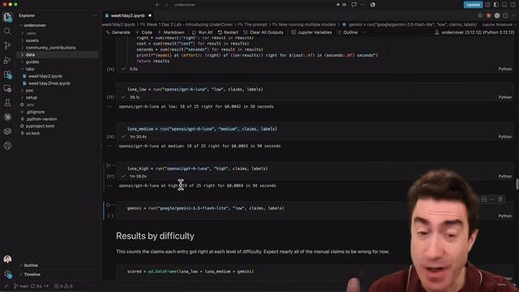

### 步骤 10：把表拿去做取舍（这一步没有代码）

讲师给了三根约束：**业务方设的准确率阈值、预算、非功能需求里的延迟要求**。然后你要拿上面的表去谈。他的例子是：如果愿意多花钱，可能换到更高准确率，但会更慢。

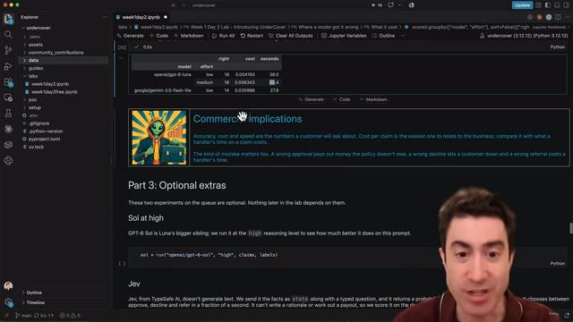

再往下还有一层：**confusion matrix**。业务方对「拒了本该赔的」和「赔了本该拒的」容忍度不一样，前者通常更恶劣。讲师用 COVID 检测举例：假阳性（说你阳了其实没阳）可以接受，因为还能做第二轮更准的检测；假阴性（说你没阳其实阳了）才是更糟的问题。所以两类错误要分开看、分开设阈值。

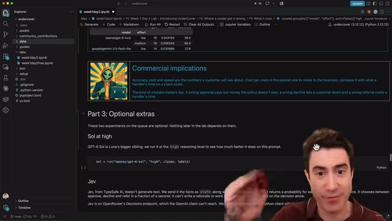

### 步骤 11（可选）：更强的模型

Part three 是纯可选项。GPT-6 Sol 在 high 档拿到 20/25（也就是**在 20 条可答题里全对**），代价是 12 美分、近两分钟。讲师的态度很明确：这不一定值得。

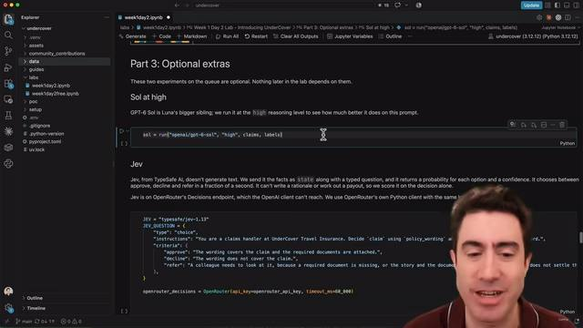

---

## 四、完整代码

下面三个文件放在项目根目录（和 `data/` 同级），保存后 `python lab.py` 就能跑。**注意：`data/` 里 JSON 的文件名和字段名，逐字稿没有逐字念出来**，我在代码里用常量集中定义并标注了「占位名」，你对照自己 `data/` 目录改这几行即可。

### `requirements.txt`

```
# 课里没给具体版本号，以下是本地复现可用的下限
openai>=1.40.0
pydantic>=2.7.0
python-dotenv>=1.0.0
pandas>=2.2.0
matplotlib>=3.8.0
```

### `.env.example`（复制成 `.env` 后填值）

```
OPENROUTER_API_KEY=sk-or-v1-你的key
```

### `lab.py`

```python
"""
Undercover · Week 1 Day 2 · 理赔决策的模型评测
运行：python lab.py
"""
import json
import os
import time
from pathlib import Path
from typing import Literal

import matplotlib
matplotlib.use("Agg")            # 服务器/无 GUI 环境下也能存图
import matplotlib.pyplot as plt
import pandas as pd
from dotenv import load_dotenv
from openai import OpenAI
from pydantic import BaseModel, Field

# ---------------------------------------------------------------- 0. 路径与配置
ROOT = Path(__file__).resolve().parent
DATA_DIR = ROOT / "data"
OUT_DIR = ROOT / "out"
OUT_DIR.mkdir(exist_ok=True)

# ⚠️ 占位文件名：逐字稿没有逐字念出 data/ 里的真实文件名，
#    请对照你下载的项目改成实际名字。
FILES_TRAIN_FULL = "claims.json"            # 25 条
FILES_TRAIN_TINY = "claims_tiny.json"       # 5 条
FILES_HOLDOUT    = "claims_held_out.json"   # 完全独立的一套
FILES_POLICIES   = "policies.json"          # 50 份保单

# ⚠️ 占位模型字符串：讲师口头说的是 "GPT-6 Luna" / "Gemini 3.5 Flash Lite" /
#    "GPT-6 Sol" / "Jev"，notebook 里实际的 model 字符串请照抄你自己那一行。
MODEL_LUNA   = "openai/gpt-6-luna"
MODEL_FLASH  = "google/gemini-3.5-flash-lite"
MODEL_SOL    = "openai/gpt-6-sol"
MODEL_FREE   = "openrouter/free"     # 不充值时的免费档

# ---------------------------------------------------------------- 1. 客户端
load_dotenv(ROOT / ".env")
api_key = os.getenv("OPENROUTER_API_KEY")
if not api_key:
    raise SystemExit(
        "没找到 OPENROUTER_API_KEY。检查 .env（变量名以你 Day 1 用的那个为准）。"
    )

client = OpenAI(
    base_url="https://openrouter.ai/api/v1",
    api_key=api_key,
)

# ---------------------------------------------------------------- 2. 输出契约
class ClaimDecision(BaseModel):
    """结构化输出 spec：模型必须按这个形状返回。"""

    rationale: str = Field(
        description="Step-by-step reasoning that applies the policy to this claim."
    )
    decision: Literal["approve", "decline", "refer"] = Field(
        description="Final decision: approve, decline, or refer to a human."
    )
    payout: float = Field(
        description="Amount to pay out in USD. Use 0 when nothing is paid."
    )


# ---------------------------------------------------------------- 3. 数据层
def load(name: str):
    """读 data/ 下的一个 JSON 文档。"""
    with open(DATA_DIR / name, "r", encoding="utf-8") as f:
        return json.load(f)


def get_sample_data(tiny: bool = False, held_out: bool = False):
    """
    返回 (data_points, policies)

    data_points: [{"claim": {...}, "label": {...}}, ...]
      claim 里课里展示过的字段：claim id / customer number / type /
      story / items / receipts / status
      label 里课里展示过的字段：decision / payout（还有一段人工理由）
      —— 字段名以你 data/ 里实际的 JSON 为准，下面用 .get 做防御式读取。

    tiny=True  → 5 条（最省钱）
    tiny=False → 25 条
    held_out=True → 换一套完全独立的数据集
    """
    if held_out:
        claims_doc = load(FILES_HOLDOUT)
    else:
        claims_doc = load(FILES_TRAIN_TINY if tiny else FILES_TRAIN_FULL)

    policies_doc = load(FILES_POLICIES)

    # 数据可能是 {"claims": [...], "labels": [...]} 这种分文件结构，
    # 也可能 claim 与 label 已经配对好。这里统一成 [{"claim","label"}]。
    if isinstance(claims_doc, dict) and "claims" in claims_doc:
        labels = claims_doc.get("labels", [])
        pairs = []
        for i, c in enumerate(claims_doc["claims"]):
            pairs.append({"claim": c, "label": labels[i] if i < len(labels) else {}})
    elif isinstance(claims_doc, list):
        pairs = [
            item if isinstance(item, dict) and "claim" in item
            else {"claim": item, "label": {}}
            for item in claims_doc
        ]
    else:
        raise ValueError("无法识别的 claims 结构，请对照 data/ 实际 JSON 调整")

    policies = policies_doc["policies"] if isinstance(policies_doc, dict) else policies_doc
    return pairs, policies


def claim_text(dp: dict) -> str:
    """把一条 claim 拍成一段给模型看的文字。字段名按课里展示的来。"""
    c = dp["claim"]
    parts = [
        f"Claim ID: {c.get('claim_id', c.get('id', '?'))}",
        f"Customer number: {c.get('customer_number', '?')}",
        f"Type: {c.get('type', '?')}",
        f"Status: {c.get('status', '?')}",
        f"Story: {c.get('story', c.get('summary', ''))}",
    ]
    if c.get("items"):
        parts.append("Items: " + json.dumps(c["items"], ensure_ascii=False))
    if c.get("receipts"):
        parts.append("Receipts: " + json.dumps(c["receipts"], ensure_ascii=False))
    return "\n".join(parts)


def policy_text(policies) -> str:
    """把全部保单拼成一段。课里是把整份 policy 塞进 system prompt。"""
    if isinstance(policies, list):
        chunks = []
        for p in policies:
            if isinstance(p, dict):
                chunks.append(json.dumps(p, ensure_ascii=False, indent=2))
            else:
                chunks.append(str(p))
        return "\n\n---\n\n".join(chunks)
    return str(policies)


# ---------------------------------------------------------------- 4. 一次调用
SYSTEM_PROMPT_TEMPLATE = """You are a claims handler at Undercover Travel Insurance.
Decide this claim. Respond with approve, decline, or refer, depending on the
decision you should make.

Here is the policy:

{policy}
"""


def decide(claim_dp: dict, policies, model: str, reasoning_effort: str = "low") -> dict:
    """对一条 claim 调一次模型，返回一条结果记录。"""
    policy = policy_text(policies)
    system_prompt = SYSTEM_PROMPT_TEMPLATE.format(policy=policy)
    user_prompt = (
        "Here is the relevant policy (see system message).\n"
        "Here is the claim itself:\n\n" + claim_text(claim_dp)
    )

    messages = [
        {"role": "system", "content": system_prompt},
        {"role": "user", "content": user_prompt},
    ]

    # reasoning effort 与「只挑支持结构化输出的 provider」这两项，
    # 在 OpenAI SDK 里通过 extra_body 原样透传给 OpenRouter。
    extra = {
        "provider": {"require_parameters": True},
        "reasoning": {"effort": reasoning_effort},
    }

    t0 = time.perf_counter()
    response = client.chat.completions.create(
        model=model,
        messages=messages,
        response_format=ClaimDecision,
        extra_body=extra,
    )
    elapsed = time.perf_counter() - t0

    parsed: ClaimDecision = response.choices[0].message.parsed

    # OpenRouter 在 usage 里回传本次调用的成本。
    # 字段名以你实际输出为准，取不到就记 None。
    usage = getattr(response, "usage", None)
    cost = getattr(usage, "cost", None) if usage else None

    return {
        "model": model,
        "effort": reasoning_effort,
        "claim_id": claim_dp["claim"].get("claim_id", claim_dp["claim"].get("id")),
        "decision": parsed.decision,
        "payout": parsed.payout,
        "rationale": parsed.rationale,
        "cost": cost,
        "seconds": round(elapsed, 2),
    }


# ---------------------------------------------------------------- 5. 批量评测
def is_correct(result: dict, label: dict, payout_tolerance: float = 1.0) -> bool:
    """decision 完全一致，且 payout 误差在 1 美元以内。"""
    if not label:
        return False
    want_decision = label.get("decision")
    want_payout = label.get("payout")
    if result["decision"] != want_decision:
        return False
    if want_payout is None:
        return True
    return abs(float(result["payout"]) - float(want_payout)) <= payout_tolerance


def run(model: str, reasoning_effort: str, data_points, policies, limit: int | None = None):
    """把整批数据过一遍。"""
    rows = []
    total = len(data_points) if limit is None else min(limit, len(data_points))
    for i in range(total):
        dp = data_points[i]
        r = decide(dp, policies, model=model, reasoning_effort=reasoning_effort)
        r["correct"] = is_correct(r, dp.get("label", {}))
        r["difficulty"] = dp["claim"].get("difficulty", "unknown")
        r["claim_type"] = dp["claim"].get("type", "unknown")
        rows.append(r)
        print(
            f"[{i+1}/{total}] {r['claim_id']} -> {r['decision']} "
            f"{r['payout']} | correct={r['correct']} | "
            f"cost={r['cost']} | {r['seconds']}s"
        )
    return rows


def summarise(rows, label: str) -> dict:
    total_cost = sum(r["cost"] or 0 for r in rows)
    total_sec = sum(r["seconds"] for r in rows)
    s = {
        "run": label,
        "model": rows[0]["model"],
        "effort": rows[0]["effort"],
        "correct": sum(1 for r in rows if r["correct"]),
        "total": len(rows),
        "cost": round(total_cost, 6),
        "seconds": round(total_sec, 2),
    }
    return s


def by_difficulty(rows) -> pd.DataFrame:
    df = pd.DataFrame(rows)
    if "difficulty" not in df:
        return pd.DataFrame()
    return df.groupby("difficulty")["correct"].agg(["sum", "count"])


# ---------------------------------------------------------------- 6. 画图
def plot_by_claim_type(rows, out_path: Path):
    df = pd.DataFrame(rows)
    if df.empty:
        return
    pivot = pd.crosstab(df["claim_type"], df["decision"])
    ax = pivot.plot(kind="bar", stacked=True, figsize=(10, 5))
    ax.set_xlabel("claim type")
    ax.set_ylabel("count")
    ax.set_title("Claims by type and decision")
    plt.tight_layout()
    plt.savefig(out_path, dpi=120)
    plt.close()


def plot_by_difficulty(data_points, out_path: Path):
    counts = (
        pd.Series([dp["claim"].get("difficulty", "unknown") for dp in data_points])
        .value_counts()
        .sort_index()
    )
    ax = counts.plot(kind="bar", figsize=(7, 4), color="#4C78A8")
    ax.set_xlabel("difficulty")
    ax.set_ylabel("count")
    ax.set_title("Claims by difficulty")
    plt.tight_layout()
    plt.savefig(out_path, dpi=120)
    plt.close()


# ---------------------------------------------------------------- 7. 主流程
def main():
    data_points, policies = get_sample_data(tiny=False)
    print(f"claims={len(data_points)}  policies={len(policies)}")
    print("第一条 claim 预览：\n" + claim_text(data_points[0]))

    # 摊成表格（课里用 pandas DataFrame 展示）
    table = pd.DataFrame([
        {
            "claim_id": dp["claim"].get("claim_id", dp["claim"].get("id")),
            "summary": dp["claim"].get("story", dp["claim"].get("summary", ""))[:80],
            "type": dp["claim"].get("type"),
            "amount": dp["claim"].get("amount"),
            "difficulty": dp["claim"].get("difficulty"),
            "label_decision": dp.get("label", {}).get("decision"),
            "label_payout": dp.get("label", {}).get("payout"),
        }
        for dp in data_points
    ])
    print(table.to_string(max_colwidth=60))
    table.to_csv(OUT_DIR / "claims_table.csv", index=False)

    plot_by_claim_type(
        [{**dp["claim"], "decision": dp.get("label", {}).get("decision", "unknown")}
         for dp in data_points],
        OUT_DIR / "by_type.png",
    )
    plot_by_difficulty(data_points, OUT_DIR / "by_difficulty.png")

    # ---- 模型矩阵：按需挑几个跑 ----
    runs = [
        (MODEL_LUNA, "low"),
        (MODEL_LUNA, "medium"),
        (MODEL_LUNA, "high"),
        (MODEL_FLASH, "low"),
    ]

    summaries, all_rows = [], []
    for model, effort in runs:
        label = f"{model} @ {effort}"
        print(f"\n===== running {label} =====")
        rows = run(model, effort, data_points, policies)
        all_rows.extend(rows)
        summaries.append(summarise(rows, label))
        print("by difficulty:\n" + by_difficulty(rows).to_string())

    summary_df = pd.DataFrame(summaries)
    print("\n===== 汇总 =====")
    print(summary_df.to_string(index=False))
    summary_df.to_csv(OUT_DIR / "summary.csv", index=False)

    pd.DataFrame(all_rows).to_csv(OUT_DIR / "results.csv", index=False)
    print(f"\n结果已写入 {OUT_DIR}")


if __name__ == "__main__":
    main()
```

### 跑单个模型（只想快速验证时）

```bash
python -c "
from lab import *
dp, pol = get_sample_data(tiny=True)
r = decide(dp[0], pol, model=MODEL_LUNA, reasoning_effort='low')
print(r)
"
```

---

## 五、逐行解释

**`load_dotenv(ROOT / ".env")` 与 `os.getenv("OPENROUTER_API_KEY")`**
讲师的做法是把 key 放 `.env` 而不是硬编码，Day 1 就建好了。这里显式 `raise SystemExit` 而不是让后面 401 报错，是因为 401 的堆栈信息会把人带偏到「模型名是不是错了」上。**在 Node 里对应 `dotenv/config` + `process.env.OPENROUTER_API_KEY`。**

**`OpenAI(base_url="https://openrouter.ai/api/v1", api_key=...)`**
OpenRouter 兼容 OpenAI 的接口形状，所以复用官方 SDK，只改 `base_url`。这就是为什么课里能一路用 `chat.completions.create` 而不换库。

**`class ClaimDecision(BaseModel)`**
这是 Pydantic v2 的写法。`Literal["approve", "decline", "refer"]` 把取值锁死成三个——这是「结构化输出」比「请用 JSON 回答」可靠的根本原因：不是靠模型自觉，而是请求里带了 schema，服务端会按 schema 约束解码。**在 JS/Node 里对应 `z.object({...})` + `z.enum(["approve","decline","refer"])`，用 `zodResponseFormat(schema, "claim_decision")` 传进去。**

**三个 `Field(description=...)`**
描述是写给模型看的，不是写给人看的。描述写得越清楚，模型越不容易在 `payout` 里填字符串。讲师说 `payout` 是 float——保持 float，别为了「好看」改成字符串，否则后面按 1 美元容差比较时你得先 parse。

**字段顺序 rationale 在前**
这一条不是风格问题。讲师的原话是：先出理由再出决策，相当于强制它先「想」；反过来先出决策，模型就只是在为已经定好的结论补一段解释。前者你能信 `rationale`，后者不能。这也是为什么很多结构化输出的 schema 都把 `reasoning` 放第一位。

**`reasoning_effort` 通过 `extra_body` 透传**
OpenAI 官方 SDK 没有 OpenRouter 的这个字段，所以要用 `extra_body` 原样塞进请求体。讲师演示时只说了「我们把 reasoning effort 传进去」，没念字段名；上面用的是 OpenRouter 的 `reasoning.effort` 形状，**如果你的 notebook 里是别的写法，照抄 notebook**。

**`"provider": {"require_parameters": True}`**
这就是讲师说的「确保 OpenRouter 挑一个能处理结构化输出的 provider」。不加这一项，OpenRouter 可能把请求路由到一个不支持 response format 的后端，你会拿到一段「看起来是 JSON 但解析失败」的字符串，然后 `.parsed` 是 `None`。**参数名请以 OpenRouter 文档 / 你的 notebook 为准**。

**`response.choices[0].message.parsed`**
和前面冒烟测试里的 `.message.content` 形成对照：普通调用拿字符串，结构化输出拿已经构造好的对象。所以后面能直接 `parsed.decision`，不用 `json.loads`。

**`time.perf_counter()`**
用来量延迟。`perf_counter` 比 `time.time()` 适合量耗时（不受系统时钟调整影响）。**在 Node 里对应 `performance.now()`。**

**`cost = getattr(usage, "cost", None)`**
讲师把「这次调用花了我们多少钱」作为返回字典的一项。OpenRouter 在 usage 里回传成本，但**具体字段名他没念**，这里用 `getattr` 兜底，取不到就记 `None`，汇总时按 0 累加——宁可数字偏小，也不要崩。

**`is_correct(..., payout_tolerance=1.0)`**
判定规则是讲师明说的：decision 必须一致，payout 允许 1 美元误差。为什么不能严格相等？因为这是浮点金额，且模型可能输出 `420.0` 和 `420`。**放宽到 1 美元是个业务判断，不是技术妥协——你要在文档里写清楚这个容差，否则「18/25」这个数字没法被别人复核。**

**`by_difficulty(rows)`**
这是整节最重要的一步。总分相同不代表表现相同：Luna low 的 18 分里有 2 分是 manual 蒙对的，medium 的 18 分里 hard 拿了 4 分。如果不按难度切片，你会得出「两个档位一样好」的错误结论，进而做出「选便宜的」这个正确但理由错误的决定——下次换个数据集你就会被反噬。

**为什么 `manual` 这 5 条要单独标出来**
讲师的设计意图是给你一个「信息不足就一定答不对」的对照组。这 5 条的存在，让你的准确率天花板从 25 变成 20。所以任何模型报 20/25 以上都要警惕：要么它在猜，要么你的评测泄漏了 label。

**`plot_by_claim_type` / `plot_by_difficulty`**
这两张图不产生结论，只产生「熟悉度」。讲师自己也说了「看图没有特别的 takeaway，只是让你更熟悉手上的信息、以及可能后面要留意的趋势」。

---

## 六、复现检查清单

环境层：

- [ ] VS Code 里 Explorer 能看到 `Undercover` 目录
- [ ] 虚拟环境名为 `undercover`，Python 版本 `3.12.12`
- [ ] Notebook 右上角 kernel 已选中 `undercover 3.12.12`（不是 base、不是系统 python）
- [ ] `.env` 存在，且 key 能被读到（打印「API key found」或类似）
- [ ] `data/` 目录存在，且里面能读到 claim / label / policy 三类 JSON

数据层：

- [ ] `get_sample_data(tiny=False)` 打印出 **25 / 25 / 50** 三个数
- [ ] policy 全文长度在一千词量级
- [ ] 表格里能看到 `claim_id / type / amount / difficulty / label_decision / label_payout`
- [ ] `difficulty` 计数为 15 / 5 / 5（routine / hard / manual）

调用层：

- [ ] 冒烟测试：pirate 风格能返回，改成 cowboy 后文风变化
- [ ] `decide` 单条调用返回里有 `decision / payout / rationale / cost / seconds`
- [ ] `payout` 是数字不是字符串
- [ ] `decision` 只出现 approve / decline / refer 三种值（出现过第四种说明 schema 没生效）

评测层：

- [ ] `run` 跑完 25 条不中断，没有 429 / 超时导致的缺行
- [ ] claim 0（航班取消、$420）结果为 approve + 420
- [ ] 汇总能打出「正确数 / 总成本 / 总耗时」三列
- [ ] `by_difficulty` 输出 routine / hard / manual 三行
- [ ] 至少跑两个不同 reasoning effort，能观察到成本与耗时变化
- [ ] 结果落盘（`out/summary.csv`、`out/results.csv`）

分析层：

- [ ] 能说出「18/25 里那 2 条 manual 是蒙的」
- [ ] 能说出「同样 18 分，medium 在 hard 上更强」
- [ ] 至少有一张给业务方看的成本 / 准确率 / 延迟表
- [ ] 知道这 5 条 manual 需要课程后面才会给出的内部手册

---

## 七、课里没讲但你会撞上的

**1. `data/` 里的文件名和 JSON 字段名，逐字稿里没有。**
讲师只说「我写了个 load 函数，从 data 目录读某个 JSON 文档」。上面代码里的 `claims.json` / `policies.json` 是占位名。你第一次跑大概率会 `FileNotFoundError`——先 `ls data/`，把常量改掉，再看一眼 JSON 的顶层结构（是 list 还是 `{claims, labels}`），改 `get_sample_data` 里那个分支。

**2. 模型字符串到底怎么写。**
讲师念的是「GPT-6 Luna」「Gemini 3.5 Flash Lite」「GPT-6 Sol」「Jev」，但 notebook 里真正的 model 参数带不带厂商前缀，逐字稿没逐字给出。**