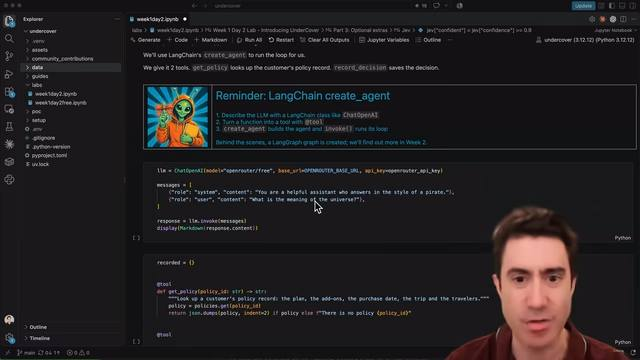
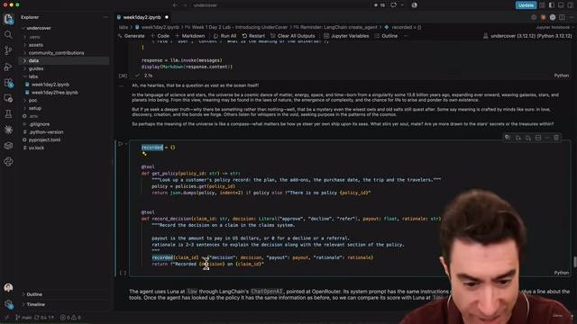
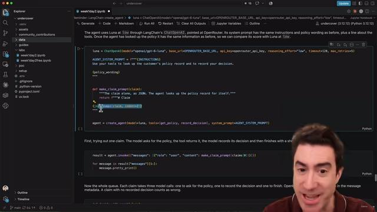
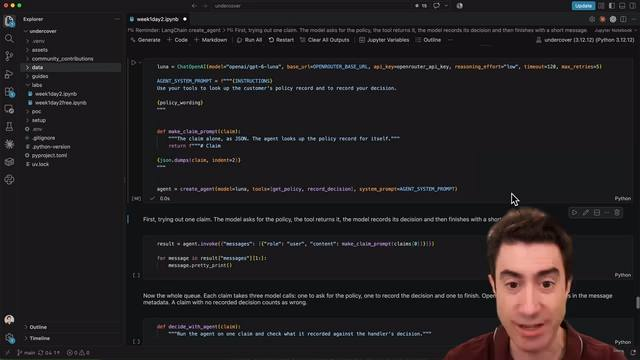
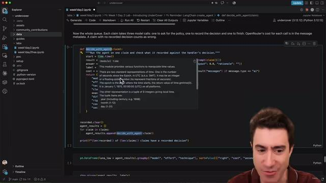
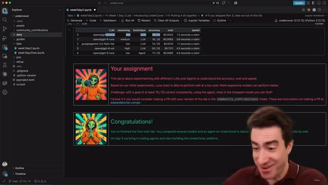
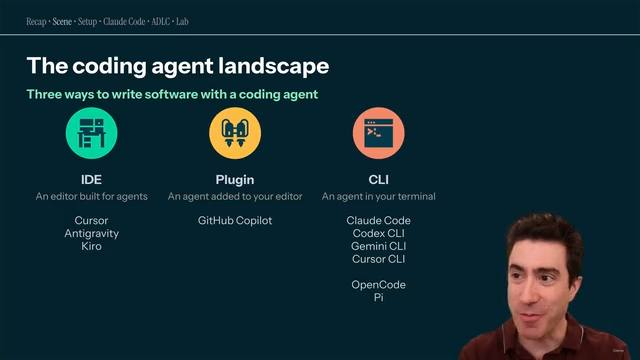
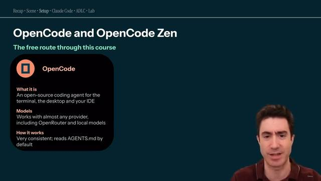
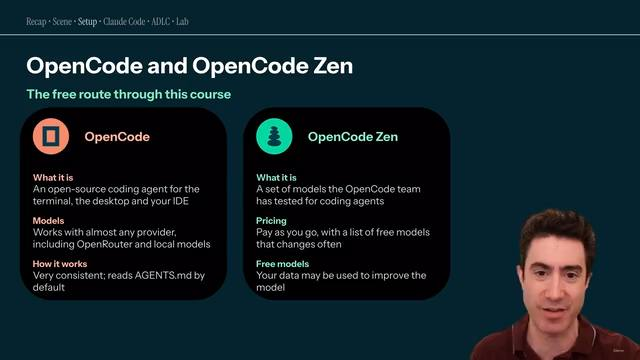

# AI FDE 课程文档：从 LangChain Agent 到 Coding Agent 实战（P17–P20）

> 覆盖 P17–P20。P17 是「用 LangChain 的 `create_agent` 亲手写一个带工具的 Agent，并和纯 LLM 调用做准确率/成本/耗时对比」；P18–P20 是「认识并使用别人写好的 Coding Agent（Claude Code / Codex / OpenCode）来写软件」。
>
> 说明：P18–P20 是概念讲解 + 安装演示，逐字稿里**没有给出可运行的完整代码**。因此第 3、4 章对 P17 给出可直接复现的完整代码；对 P18–P20 按「纯讲解课」处理，把讲师的推导与安装步骤落成可执行的清单和决策表，并明确标注哪些是「课里没有代码，以下为示意」。

---

## 1. 这一节做什么

这四集分成两个阶段，目标完全不同，别混在一起看：

**阶段一（P17）：亲手写 Agent。**
前面几集你一直在做「单次 LLM 调用 + 结构化输出」。P17 换一种做法：把普通 Python 函数用 `@tool` 装饰器变成工具，交给 LangChain 的 `create_agent` 组装成一个「LLM + 工具 + 循环」的 Agent，然后 `invoke` 它。场景还是那个旅行保险理赔：给 Agent 一份理赔申请，让它**自己去查**客户保单（`getPolicy`），**自己记录**理赔决定（`recordDecision`）。跑完 25 条数据后，和上一集的纯 LLM 方案对比准确率、成本、耗时。

**阶段二（P18–P20）：用别人写好的 Agent 写软件。**
这里出现一个容易绕晕的点：**我们用一个 Agent（Claude Code 这类 Coding Agent）去写软件，而这个软件本身又包含一个 Agent**——「用 Agent 造 Agent」。P19 讲 Coding Agent 的来龙去脉（Vibe Coding、CLI 为什么流行、Claude Code 的历史），P20 讲怎么在 Claude Code / Codex / OpenCode 三者中选一个并装好。

学完你应该能回答三个问题：
1. 一个 LangChain Agent 的最小可运行结构长什么样（模型 → 工具 → `create_agent` → `invoke`）。
2. 为什么「同样的模型，Agent 反而更慢更贵还可能更差」——以及什么场景才该上 Agent。
3. 怎么把 Coding Agent 装起来，并理解「harness（跑在你电脑上的软件）+ LLM（跑在云上的模型）= coding agent」这个拆法。

---

## 2. 讲师原话（带出处）

关于 Agent 的定义，讲师反复强调一句话：

> "An AI agent is an LLM with tools in a loop to achieve a goal." —— p018 [00:41]

关于 `create_agent` 的组装顺序：

> "We're going to first describe an LLM call using a class like chat open AI... We're then going to turn some functions into tools using the app tool decorator and then create agent and then invoke." —— p017 [00:31]

（注：逐字稿里 "app tool" 是语音转写，实际是 `@tool` 装饰器。）

关于 `@tool` 到底帮你做了什么：

> "just by decorating it with at tool, the LangChain framework will automatically turn these into things that could be called by an LLM. It will describe it with some JSON without us having to worry about the JSON." —— p017 [02:27]

关于这一集最关键的「反直觉结论」——Agent 不一定更好：

> "the agent solution when using the same model basically took longer was more expensive and in this case a little bit worse... what's the point in using an agent" —— p017 [07:51]

讲师自己给的答案：

> "in this specific situation, it makes no sense to use an agent because the benefit that you get with an AI agent is you're introducing the idea of autonomy... But in this case that was somewhat fake because we always wanted it to use the tool to get the customer's policy and then to use the tool to record its decision. We had a fixed workflow." —— p017 [08:17]–[08:53]

关于「用 Agent 造 Agent」：

> "We're using an agent like Claude code written by Anthropic, a packaged up agent, and we're using it is going to build some software. And one of the bits of software it's going to build is going to be an agent like the one that we coded yesterday." —— p018 [03:41]

关于 CLI 为什么流行（复古是故意的）：

> "It's actually a kind of intentional retro throwback... there's been this sense that we wish we could go back to the good old days when things were simpler." —— p019 [04:30]

关于 harness 与 LLM 的拆分：

> "the Claude Code harness which is the software that runs on your computer that controls the tools it has access to, the permissions, any sandbox... plus a choice of model... the two of those together, the software and the LLM, that forms the coding agent." —— p020 [00:56]–[01:17]

---

## 3. 从零复现

### 3.1 阶段一：跑通 LangChain Agent（P17）

**前置环境**（讲师用的是 Jupyter Notebook 逐 cell 执行，你也可以用 `.py` 脚本）：

```bash
# 建议 Python 3.11+
python -m venv .venv
source .venv/bin/activate        # Windows: .venv\Scripts\activate

pip install langchain langchain-openai python-dotenv
```

> 版本说明：逐字稿没有给出具体版本号。`create_agent` 属于较新的 LangChain 接口，安装时请以 `pip show langchain` 的实际版本为准；若你的版本里 `from langchain.agents import create_agent` 导入失败，请对照官方文档确认该函数在你版本中的导入路径（课里没讲版本兼容问题）。

**环境变量**：讲师用 OpenRouter 作为模型网关，key 从 `.env` 读取。在项目根目录建 `.env`：

```bash
OPENROUTER_API_KEY=sk-or-你的key
```

**复现步骤（按讲师的操作顺序）：**

1. **先做一次最朴素的 LLM 调用**，确认 LangChain + OpenRouter 通路是通的（对应 p017 [00:50] 的 "非常基础的 LangChain"）。跑通后再加工具。
2. **定义两个普通 Python 函数** `getPolicy` 和 `recordDecision`，外加一个全局字典 `recorded` 用来存结果。
3. **给这两个函数加 `@tool` 装饰器**，让 LangChain 自动生成给 LLM 看的 JSON 描述。
4. **写 system prompt 和 user prompt**。关键差异：user prompt 里**不再塞客户保单**，只放理赔申请；保单要靠 Agent 自己调 `getPolicy` 去取。
5. **`create_agent(model=..., tools=[getPolicy, recordDecision], system_prompt=...)`** 组装 Agent。
6. **`agent.invoke(...)`** 跑单条，观察它先调 `getPolicy`、再调 `recordDecision`，最后给出「批准 $420」。
7. **包一个 `decide_with_agent` 函数**，计时 + 记录，循环跑 25 条，统计准确率/成本/耗时，和上一集纯 LLM 结果对比。

### 3.2 阶段二：装好 Coding Agent（P18–P20）

这一步**课里没有代码**，是安装与选择流程。按讲师在 P20 的演示，复现路径如下（三选一）：

**选项 A：Claude Code（讲师本人使用）**
1. 在 claude.ai 注册并订阅付费计划（讲师提到入门约 $20/月）。
2. 打开 Claude Code 官方安装页，**点 "terminal" 那个入口**，不要点默认的桌面 App 按钮（p020 [06:07] 特别强调）。
3. 按你的系统选安装命令（macOS 可用 Homebrew，Windows 可用 winget，或直接用官方原生安装命令）。
4. 装完**退出 VS Code 再重开**，在终端里输入 `claude` 启动。
5. 首次启动会问「是否信任此文件夹」，选是；然后 `/login` 走浏览器登录 claude.ai 完成认证。

**选项 B：Codex（OpenAI）**
1. 在 chatgpt.com 注册。
2. 按官网一条命令安装。
3. `codex login` 登录，然后 `codex` 启动。

**选项 C：OpenCode（免费/低成本路线）**
1. 注册 OpenCode Zen 账号（免费模型 + 按量付费的便宜模型）。
2. 安装 OpenCode。
3. 启动后 `/connect` 连到 OpenCode Zen，`/models` 查看当前可用模型（含免费模型）。
4. 注意讲师的警告：免费模型**额度消耗快、质量参差**，需要耐心；且使用免费模型通常要同意「你的数据可用于训练」。

> 三个工具默认都会读取项目里的 `agents.md` 文件作为项目级指令（p020 [02:50] 提到 OpenCode 默认读 `agents.md`）。课里没讲这个文件的具体写法，此处不展开。

---

## 4. 完整代码

### 4.1 P17 完整可运行脚本（`agent_lab.py`）

> 说明：逐字稿是 Notebook 逐 cell 演示，下面把它整理成**单个可直接 `python agent_lab.py` 运行的完整文件**。函数体（保单数据、理赔数据）逐字稿没有逐字给出，这里用**最小可运行示例数据**填充，保证能跑通；真实数据请替换成课程 repo 里的 25 条理赔数据。模型名沿用讲师口述的 `openrouter/free` 与 `gpt-6-luna` 风格命名——**这些是讲师演示时用的名字，实际可用模型名请以你 OpenRouter 账户里 `/models` 列出的为准**。

```python
# agent_lab.py
import os
import time
from dotenv import load_dotenv

from langchain_openai import ChatOpenAI
from langchain.agents import create_agent
from langchain_core.tools import tool

load_dotenv()

OPENROUTER_BASE_URL = "https://openrouter.ai/api/v1"
OPENROUTER_API_KEY = os.getenv("OPENROUTER_API_KEY")

# ---------------------------------------------------------------
# 1. 最朴素的 LLM 调用（对应 p017 [00:50] 的 vanilla 示例）
# ---------------------------------------------------------------
def vanilla_demo():
    llm = ChatOpenAI(
        model="openrouter/free",
        base_url=OPENROUTER_BASE_URL,
        api_key=OPENROUTER_API_KEY,
    )
    messages = [
        {"role": "system", "content": "You are a helpful assistant who answers in the style of a pirate."},
        {"role": "user", "content": "What's the meaning of the universe?"},
    ]
    result = llm.invoke(messages)
    print("[vanilla]", result.content)


# ---------------------------------------------------------------
# 2. 全局记录字典 + 两个普通 Python 函数
# ---------------------------------------------------------------
recorded = {}

# 示例保单库：真实项目请替换为课程 repo 的数据
POLICY_DB = {
    "CUST-001": {
        "policy_id": "POL-7781",
        "coverage": "travel",
        "max_payout": 5000,
        "excess": 100,
        "notes": "Covers trip cancellation, medical, baggage.",
    },
    "CUST-002": {
        "policy_id": "POL-7782",
        "coverage": "travel",
        "max_payout": 2000,
        "excess": 250,
        "notes": "Basic plan, no adventure sports.",
    },
}


@tool
def getPolicy(customer_id: str) -> dict:
    """Look up a customer's insurance policy record by customer id."""
    return POLICY_DB.get(customer_id, {"error": "policy not found"})


@tool
def recordDecision(claim_id: str, decision: str, amount: float) -> str:
    """Record the final claim decision for a given claim id."""
    recorded[claim_id] = {"decision": decision, "amount": amount}
    return f"recorded {claim_id}"


# ---------------------------------------------------------------
# 3. 组装 Agent
# ---------------------------------------------------------------
def build_agent():
    model = ChatOpenAI(
        model="gpt-6-luna",              # 讲师演示用名，按你账户实际模型替换
        base_url=OPENROUTER_BASE_URL,
        api_key=OPENROUTER_API_KEY,
        reasoning_effort="low",          # 讲师说 "low reasoning effort"
    )
    system_prompt = (
        "Use your tools to look up the customer's policy record "
        "and record your decision. Full policy wording: "
        "Travel insurance covers cancellation, medical, baggage, "
        "subject to the excess and max payout in the policy record."
    )
    agent = create_agent(
        model=model,
        tools=[getPolicy, recordDecision],
        system_prompt=system_prompt,
    )
    return agent


# ---------------------------------------------------------------
# 4. 单条理赔：跑 Agent 并计时
# ---------------------------------------------------------------
def decide_with_agent(agent, claim: dict) -> dict:
    start = time.time()
    user_prompt = (
        f"Claim id: {claim['claim_id']}. Customer id: {claim['customer_id']}. "
        f"Incident: {claim['incident']}. Amount claimed: {claim['amount']}."
    )
    result = agent.invoke({"messages": [{"role": "user", "content": user_prompt}]})
    elapsed = time.time() - start
    return {
        "claim_id": claim["claim_id"],
        "elapsed": elapsed,
        "messages": result["messages"],
    }


# ---------------------------------------------------------------
# 5. 跑 25 条（这里用 2 条示例，替换成课程 repo 的 25 条）
# ---------------------------------------------------------------
SAMPLE_CLAIMS = [
    {"claim_id": "CLM-001", "customer_id": "CUST-001",
     "incident": "Flight cancelled due to storm, rebooked next day.",
     "amount": 420},
    {"claim_id": "CLM-002", "customer_id": "CUST-002",
     "incident": "Lost baggage on return leg.",
     "amount": 300},
]


def main():
    vanilla_demo()

    agent = build_agent()

    # 先跑单条，观察工具调用
    single = decide_with_agent(agent, SAMPLE_CLAIMS[0])
    print("[single] elapsed:", round(single["elapsed"], 2), "s")
    for m in single["messages"]:
        print("  -", type(m).__name__, getattr(m, "content", "")[:200])

    # 再循环
    for claim in SAMPLE_CLAIMS:
        r = decide_with_agent(agent, claim)
        print(f"[loop] {r['claim_id']} took {r['elapsed']:.2f}s")

    print("[recorded]", recorded)


if __name__ == "__main__":
    main()
```

### 4.2 P18–P20：Coding Agent 选型决策表（课里没有代码，以下为整理产物）

| 维度 | Claude Code | Codex | OpenCode |
|---|---|---|---|
| 厂商 | Anthropic | OpenAI | 开源社区 |
| 费用 | 付费订阅（讲师提到约 $20/月起） | 付费 | 免费；配 OpenCode Zen 可用免费/低价模型 |
| 安装入口 | 官网安装页，**选 terminal 入口** | 官网一条命令 | 官网安装 |
| 登录命令 | 首次启动自动登录，或 `/login` | `codex login` | `/connect` 连 OpenCode Zen |
| 启动命令 | `claude` | `codex` | `opencode`（以实际为准） |
| 项目指令文件 | 课里未明确 | 课里未明确 | 默认读 `agents.md` |
| 讲师评价 | 本人主力使用，最流行 | 模型强，很受欢迎 | 免费但额度紧、质量参差，需耐心 |

> 表中「启动命令」除讲师明确说过的 `claude`、`codex` 外，OpenCode 的启动命令课里没逐字念出，请以你安装后的实际命令为准。

---

## 5. 逐行解释

**`@tool` 装饰器（p017 [02:27]）**
这是整集最省事的一步。你写的是普通 Python 函数，加一个 `@tool`，LangChain 就把函数名、参数类型、docstring 自动转成给 LLM 看的 JSON schema。讲师原话是「without us having to worry about the JSON」。**注意 docstring 很重要**——它就是 LLM 判断「什么时候该调这个工具」的依据，所以 `getPolicy` 的 docstring 要写清「按 customer id 查保单」。

**`recorded` 为什么是全局字典**
讲师用一个模块级字典 `recorded` 存所有决定，`recordDecision` 往里写。这在教学里够用，但**在生产里是坑**：多进程/多请求会互相覆盖。在 Node 里对应的是模块级 `const recorded = {}`，同样有并发写问题；真实场景应换成数据库或至少带锁的存储。课里没讲并发，这里只提醒。

**system prompt vs user prompt 的分工（p017 [03:11]）**
关键设计：**保单不进 user prompt**。user prompt 只放理赔本身，保单让 Agent 通过 `getPolicy` 工具去取。这是「Agent 化」的核心动作——把「查数据」从「你替它查好塞进去」变成「它自己查」。对比上一集：上一集是把保单直接拼进 prompt 的固定工作流。

**`create_agent(model, tools, system_prompt)`（p017 [03:32]）**
三个参数对应三件事：用哪个模型、能用哪些工具、行为准则是什么。讲师强调这就是「general boilerplate」——循环、工具调用解析、消息拼接这些脏活框架替你做了。返回的 `agent` 对象，用 `invoke` 驱动。

**`agent.invoke(...)`（p017 [04:09]）**
讲师的原话是「we run the agent the way you run everything in Lang chain by calling invoke」。传进去的是消息列表。返回的 `result["messages"]` 里能看到完整轨迹：先出现工具调用（对应 `getPolicy`），再出现工具返回（保单内容），再出现 `recordDecision` 调用，最后是文本结论「批准 $420」。

**`decide_with_agent` 的计时（p017 [04:58]）**
用 `time.time()` 前后夹住 `invoke`，把耗时记下来。这个函数是后面「Agent vs 纯 LLM」对比的数据来源。讲师跑完 25 条用了「1 分 55 秒」。

**结果对比（p017 [05:37]）**
讲师实测：纯 LLM 对 18 条，Agent 对 17 条；Agent 更贵更慢。他明确说这可能是噪声（「I'm sure this is just noise」），历史上两者常常打平。**别把这个 18 vs 17 当成「Agent 更差」的铁证**，它说明的是「在这个固定工作流里，Agent 没带来额外价值」。

**为什么这个场景不该用 Agent（p017 [08:53]）**
讲师的核心论点：Agent 的价值是**自主性（autonomy）**——让 LLM 自己决定用哪个工具、走哪条路。但这个理赔场景是**固定工作流**：永远先查保单、再记录决定。把固定流程硬塞进 Agent（「crowbarring」），等于引入了不需要的自主性，代价是更慢更贵。**判断标准**：流程固定 → 用结构化输出的单次调用；流程需要 LLM 临场判断 → 才上 Agent。

**harness + LLM = coding agent（p020 [00:56]）**
讲师把 Claude Code 拆成两层：跑在你电脑上的 **harness**（管工具、权限、沙箱）+ 跑在云上的 **LLM**（Opus 5.5 之类）。两者合起来才叫 coding agent。这个拆法对前端很重要——它解释了为什么同一个 harness 能换不同模型，也解释了为什么「装 Claude Code」和「选哪个模型」是两件独立的事。

**为什么 CLI 是故意的复古（p019 [04:30]）**
讲师说这不是技术落后，是开发者文化里「想回到更简单的时代」的情怀，Claude Code 用 ASCII/块图形界面精准踩中了这个点，于是爆火，其他厂商跟进做各自的 CLI。

---

## 6. 复现检查清单

**阶段一（P17）**
- [ ] `pip install langchain langchain-openai python-dotenv` 成功，`python -c "导入 langchain"` 不报错。
- [ ] `.env` 里有 `OPENROUTER_API_KEY`，`vanilla_demo()` 能打印出一段海盗腔回答。
- [ ] `from langchain.agents import create_agent` 能导入（若失败，查你版本的导入路径）。
- [ ] 单条 `decide_with_agent` 跑通，`result["messages"]` 里能看到 `getPolicy` 和 `recordDecision` 的调用轨迹。
- [ ] `recorded` 字典里出现了该 claim 的决定和金额。
- [ ] 换成 25 条真实数据后，能统计出「对了几条 / 总耗时 / 大致成本」，并与纯 LLM 方案并列对比。
- [ ] 能用自己的话解释：为什么这个固定工作流场景下 Agent 更慢更贵。

**阶段二（P18–P20）**
- [ ] 选定一个 coding agent（Claude Code / Codex / OpenCode）。
- [ ] 完成安装，终端里能启动（`claude` / `codex` / 对应命令）。
- [ ] 完成登录认证（`/login` 或 `codex login` 或 `/connect`）。
- [ ] 首次进入时正确处理「是否信任此文件夹」。
- [ ] 能说清 harness 和 LLM 分别是什么、跑在哪。
- [ ] （若走免费路线）知道免费模型额度有限、质量参差，且需同意数据用于训练。

---

## 7. 课里没讲但你会撞上的

1. **`create_agent` 的导入路径随版本变。** 逐字稿只说「create agent framework in Lang chain」，没给 import 语句。不同 LangChain 版本里这个函数的位置可能不同，导入失败时别怀疑自己写错，先查版本。

2. **模型名是讲师演示用的，不是通用名。** `openrouter/free`、`gpt-6-luna` 这类名字是讲师当时账户里可用的模型。你直接抄会 404。正确做法：调 OpenRouter 的模型列表接口，换成你账户里真实存在的模型名。

3. **`reasoning_effort="low"` 不是所有模型都支持。** 讲师用了这个参数，但部分模型/网关会忽略或报错。报错就去掉它。

4. **全局字典 `recorded` 在并发下会串数据。** 教学脚本单线程跑没事，一旦你把它包成 Web 服务（比如 FastAPI/Express），多个请求同时写 `recorded` 会互相覆盖。在 Node 里对应 `const recorded = {}` 的同类问题。真实项目换数据库。

5. **Agent 的 `invoke` 返回结构和你想象的不一样。** 不是直接给你一段文本，而是 `{"messages": [...]}` 一整条轨迹。想拿最终结论，得取最后一条 message 的 content；想调试工具调用，得遍历中间的消息。课里演示时是直接打印，没细讲怎么解析。

6. **成本统计课里没给公式。** 讲师说「Agent 更贵」，但没展示怎么算钱。你需要从模型返回的 token 用量字段自己乘单价——**具体字段名请以你实际拿到的响应为准**，课里没念过字段名。

7. **免费模型（OpenCode Zen）的坑比讲师说的还多。** 除了额度紧、质量差，免费模型列表会**频繁变动**，今天能用的明天可能下架。写脚本时别把模型名写死。

8. **`agents.md` 的写法课里没讲。** P20 只提到 OpenCode 默认读 `agents.md`，但没给模板。你需要自己查对应工具的文档来写项目级指令。

9. **「用 Agent 造 Agent」别理解反了。** 是「Coding Agent（Claude Code）帮你写代码」，而「你写的代码里包含一个业务 Agent（P17 那种）」。不是让 Claude Code 去当你业务系统里的那个 Agent。

---

















