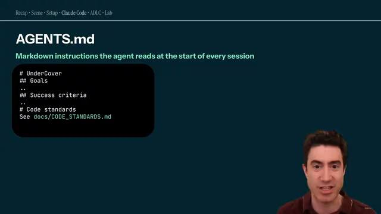
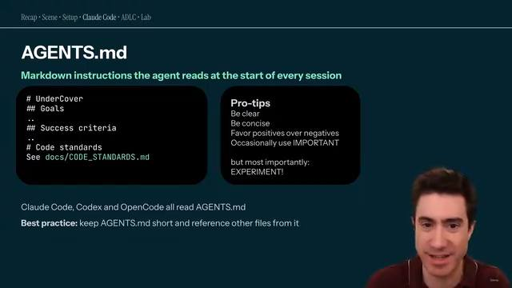
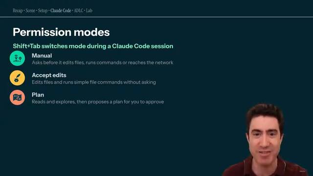
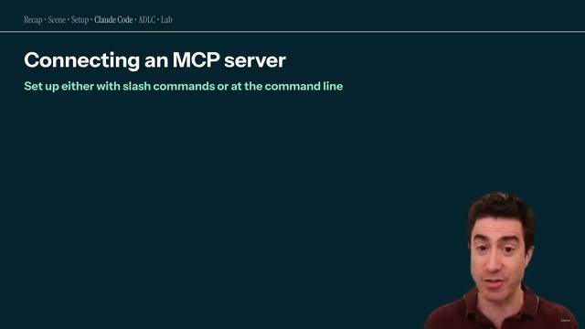
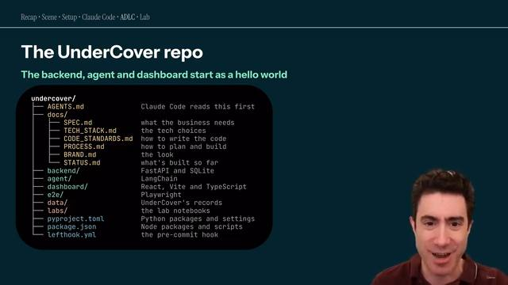
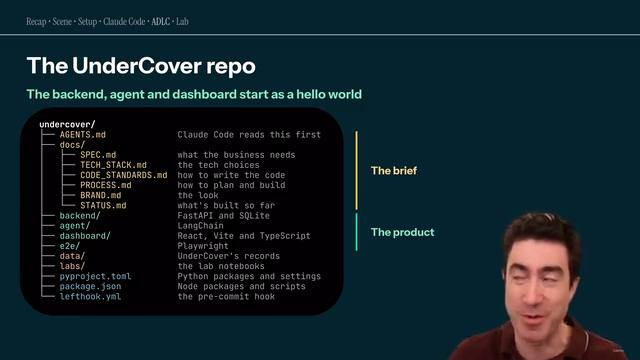
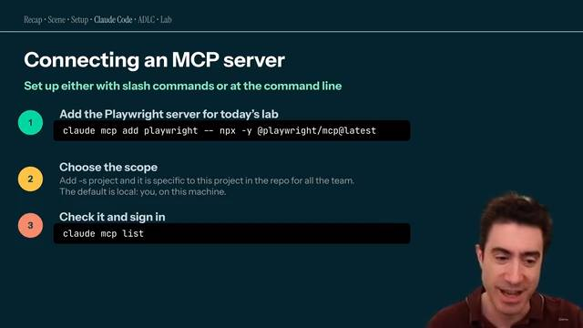

## 1. 这一节做什么

这一段（P21–P23）不是让你背某个 API，而是把「用 coding agent 做项目」的工作流搭起来：先建立你是负责人的使用原则，再准备一套让 agent 每次启动都能读到的 Markdown 项目上下文，然后配置 Claude Code 的权限模式、接入 Playwright MCP server，最后理解 ADLC 的两个含义，并把课程给的 repo skeleton 和七个关键文件落到自己的项目里。  
复现完成后的状态应该是：你有一个可被 Claude Code 打开的项目目录；根目录有 `AGENTS.md`；`docs/` 下有 spec、brand、tech stack、process、status、code standards 等文件；终端里 `claude mcp list` 能看到 `playwright` 已连接；你知道用 `shift+tab` 切换权限模式，知道用 `/compact`、`/clear`、`/rewind`，并且知道不要把所有规则塞进一个大文件，而是用 progressive disclosure 分层引用。



## 2. 讲师原话（带「—— pNNN [MM:SS]」）

> "你始终要掌握主导权。编码代理只是一个工具。"
> —— p021 [00:00]

讲师把 coding agent 定位成工具，不是责任人。最终交付质量由你负责，不能把问题推给 LLM。

> "第一步是任务简报，也就是由你写清规格、业务需求、需要遵循的风格和成功标准。"
> —— p021 [00:29]

项目开始时先写 brief：spec、业务需求、风格、成功标准。然后小步走、分阶段、每阶段有可衡量的成功标准。

> "默认情况下，所有编码代理都会查找名为 agents.md 的文件，并在启动时以及每次上下文被压缩后立即把它读入上下文。"
> —— p021 [04:35]

`agents.md` 是每次启动和上下文压缩后都会被读入的入口文件。Claude Code 以前主要找 `CLAUDE.md`，后来如果没有 `CLAUDE.md` 会回退找 `agents.md`；课程口述为 `agents.md`，实际大小写以你的工具和仓库为准。

> "这种策略有个名字，叫作渐进式披露。"
> —— p021 [07:52]

不要把所有标准塞进一个巨大文档。用一个入口指向下一层文档，让 agent 只加载当前任务需要的细节。



> "自动模式……现在它已是默认设置，也是大家普遍采用的方式。"
> —— p021 [10:10]

权限模式里，manual 会频繁问你，accept edits 只自动改文件，plan mode 现在很多人不再依赖，auto mode 是当前默认。auto mode 下 harness 会先判断命令是否安全，危险操作再升级给你确认。讲师还提到 `claude --dangerously-skip-permissions` 对应 YOLO mode，但只在沙箱等特定环境使用。



> "MCP……是一种将 AI 应用连接到外部系统的标准方式……Anthropic 将其描述为 AI 应用的 USB-C 接口。"
> —— p022 [02:46]

MCP 是接入别人工具的通用方式。你不需要把别人的工具代码搬进来再写英文描述，而是连接一个 MCP server。

> "Claude mcp add……如果在命令里加上 -s 参数，它就会只对当前项目生效……用 Claude MCP list 查看 MCP 服务器。"
> —— p022 [06:46]

课程演示用 `claude mcp add` 添加 MCP server；加 `-s` 可做成项目级共享配置；用 `claude mcp list` 查看已连接 server。视频中选择的是 Microsoft 的 Playwright MCP server，用来让 Claude Code 驱动浏览器测试自己做的产品。



> "当人们谈论 ADLC 这个新缩写时，他们可能指的是两种不同的东西。"
> —— p023 [00:00]

ADLC 有两个含义：一是 agentic development life cycle，即构建 AI agent 的生命周期；二是 AI-driven / agentic development life cycle，即用 coding agent 构建软件的生命周期。课程当天做的是第二种。

> "三个 P 变成了三个 H……框架、加固、人类。"
> —— p023 [03:29]

平台、流程、角色三个 P 对应 harness、hardening、humans 三个 H。Harness 是 agent 运行平台；hardening 是仓库里的控制措施；humans 是最终为 PR 和发布负责的人。

## 3. 从零复现

### 3.1 前置条件

这一段默认你已经能运行 Claude Code，并且能在 VS Code 的集成终端里打开它。P21–P23 没有重复讲 Claude Code 的安装、登录和账号配置，课里没讲的部分不要在这里臆造。你至少需要：

- VS Code。
- 一个可以打开的本地项目目录。
- 已按课程前面步骤安装并登录的 Claude Code。
- `git`，用于做 checkpoint 和回滚。
- 如果后续要跑 Python/Node 项目，按课程 `tech stack` 文件要求准备 Python 3.12 + UV、Node 26；安装细节本段没讲。

### 3.2 建立目录骨架

课程里 repo 有产品 skeleton、`data/`、`labs/`、`docs/`、`assets/`、`guides/` 等目录。下面按逐字稿能确认的结构建立最小目录。注意：这是按讲师口述还原的复现骨架，不是声称逐字复制课程仓库；真实 skeleton 以课程仓库为准。

```bash
mkdir -p undercover/back-end
mkdir -p undercover/agent
mkdir -p undercover/dashboard
mkdir -p undercover/end-to-end
mkdir -p undercover/data
mkdir -p undercover/labs
mkdir -p undercover/docs
mkdir -p undercover/guides
mkdir -p undercover/assets
cd undercover
git init
```

目录含义：

```text
undercover/
├── AGENTS.md
├── back-end/
├── agent/
├── dashboard/
├── end-to-end/
├── data/
├── labs/
├── docs/
├── guides/
└── assets/
```

逐字稿把 repo 文件分成几类：黄色是 project brief，也就是短 Markdown 文件；绿色是产品 skeleton，包括 back-end、agent、dashboard、end-to-end；橙色是 `data/` 和 `labs/`；蓝色是配置文件。课程还提到 `guides/` 里有 Guide 14，讲如何从零搭这种项目。产品 skeleton 里只有很基础的 hello world 级别代码，不是完整业务实现。



### 3.3 放入七个关键文件

课程让学员重点读七个文件：根目录的 `AGENTS.md`，以及 docs 下的六个文件。逐字稿明确提到 `spec.md`、`brand.md`、`tech stack`、`process.md`、`status.md`、`code standards`。其中 `tech stack` 和 `code standards` 的精确文件名课程口述没有逐字给出扩展名和连字符写法；下面用 `tech-stack.md` 和 `code-standards.md` 作为可复现命名，你如果沿用课程仓库文件名，只要同步改 `AGENTS.md` 里的指针即可。

把下面第 4 节的完整文件保存到对应路径：

```text
undercover/AGENTS.md
undercover/docs/spec.md
undercover/docs/brand.md
undercover/docs/tech-stack.md
undercover/docs/process.md
undercover/docs/status.md
undercover/docs/code-standards.md
```

保存后，在 VS Code 里打开 `AGENTS.md`，右键选择 Open Preview，确认 Markdown 能正常渲染。逐字稿里讲师就是用 Open Preview 查看 `spec.md` 和 `agents.md` 的。



### 3.4 启动 Claude Code 并检查权限模式

在项目根目录的 VS Code 集成终端运行：

```bash
claude
```

进入后按 `shift+tab` 切换权限模式。课程说 auto mode 是现在的默认，也是推荐使用的方式；manual 会频繁询问，容易造成 decision fatigue；YOLO mode 对应：

```bash
claude --dangerously-skip-permissions
```

讲师明确说 YOLO 现在几乎不用于普通项目，通常只在特定 sandbox 环境里使用。普通项目用 auto，遇到它认为危险的操作会升级给你确认。

如果你要设置更细的 allow / deny 规则，课程说可以在 `.claude/settings.json` 里配置，也可以直接让 Claude Code 帮你写，然后你进去检查。具体 JSON 字段课程没有给出模板，不要凭空抄一套字段名；让 agent 生成后逐项复核。

### 3.5 让 agent 先写 plan，再写代码

课程反复强调：不要一上来让它写代码。可以在 Claude Code 里直接说：

```text
Write me a plan first. Divide the plan into phases and give each phase success criteria. I want to check the plan before you write any code.
```

这比依赖旧的 plan mode 更直接。讲师说现在不需要专门切 plan mode，你只要明确要求“先写 plan、按阶段、给成功标准、我确认后再写代码”。每完成一个阶段就 `git commit` 做 checkpoint；需要回退时优先用 git，Claude Code 里也有 `/rewind`，但讲师更偏好 git。

### 3.6 接入 Playwright MCP server

课程演示在 VS Code 终端里执行 `claude mcp add playwright`，后面还跟了描述 Playwright MCP server 的参数。逐字稿只记录了命令骨架和“some parameters that describes playwright”，没有逐字给出完整参数全文，所以本文不能凭空补参数。复现时请暂停在 p022 06:49 的终端画面，按画面里的完整参数输入；不要直接复制一个缺参数的半截命令。



添加后检查：

```bash
claude mcp list
```

课程演示中列表里出现 `playwright`，并显示已连接的小勾。你也可以在 Claude Code 里输入 `/mcp`，通过菜单查看、添加、删除 MCP server。课程还提到，像 JIRA 这类 MCP server 添加后需要登录一次，最好用 `/mcp` 走登录流程。Codex 和 OpenCode 也有类似命令，但逐字稿没有给出具体命令全文，本文不编造。

### 3.7 用上下文命令控制成本和质量

Claude Code 里常用：

```text
/compact
/clear
/rewind
/mcp
```

- `/compact`：压缩上下文。
- `/clear`：清空重来。
- `/rewind`：回退到之前状态；讲师更推荐 git。
- `/mcp`：管理 MCP server。

课程说定期清理上下文既省 token 成本，也让 agent 表现更好。你可以把它理解成前端项目里清掉过期缓存和过期状态：上下文不是越大越好，留下当前任务需要的内容更重要。

## 4. 完整代码

说明：P21–P23 没有给出产品后端、前端、agent 的完整实现代码，只展示了 skeleton 和七个 Markdown 文件的作用。因此下面给出的是本段能直接保存的**七个完整 Markdown 文件**；它们不是课程仓库逐字复制，而是按讲师口述整理出的可运行模板。产品业务代码应由你后续让 Claude Code 按 plan 分阶段生成，不能在这段里编造。

### 4.1 `undercover/AGENTS.md`

```markdown
# Undercover

This repository is built as part of the AI FDE course. If you have questions about the course, use the course context first.

## Start Here

At the start of every session, read these files in full:

- docs/spec.md
- docs/brand.md
- docs/tech-stack.md
- docs/process.md
- docs/status.md
- docs/code-standards.md

Then follow the pointers below only when the current task needs more detail.

## Folder Structure

- `back-end/`: FastAPI and SQLite service
- `agent/`: LangChain agent
- `dashboard/`: React, Vite and TypeScript dashboard
- `end-to-end/`: end-to-end checks
- `data/`: business records from the claims team
- `labs/`: experiments
- `docs/`: project brief and process documents
- `guides/`: setup guides, including Guide 14
- `assets/`: images used by labs

## Progressive Disclosure

Read `docs/code-standards.md` for the essentials. For front-end-specific rules, read the front-end section referenced by that file. For back-end-specific rules, read the back-end section referenced by that file. Do not load every document unless the task requires it.
```

### 4.2 `undercover/docs/spec.md`

```markdown
# Undercover Travel Insurance Claims Pilot

From: Head of Claims Operations, Undercover Travel Insurance

## Current State

Claims handlers work a queue. For each claim they read it, approve it, decline it or refer it, work out the payout and explain the decision.

## Pilot Goal

Build a pilot with an AI agent, the Undercover Agent, that works the queue the way a claims handler does today.

## Required Behaviour

For each claim, the Undercover Agent must:

1. Read the claim.
2. Approve, decline or refer it.
3. Work out the payout.
4. Explain the decision.

## Rules and Records

The rules for the team are in this document. The records are in the `data/` directory.

## Out of Scope

- No payments manual.
- No sign-in.
- No real payments.
- No messages to customers.
```

### 4.3 `undercover/docs/brand.md`

```markdown
# Brand

Company: Undercover Travel Insurance

Tone: clear, calm, human and precise.

Primary colour: #0B5FFF
Secondary colour: #F4B400
Background: #FFFFFF
Text: #111827

Heading font: Inter
Body font: Inter

This file is a template. Replace the values with your own brand. The course does not give the exact brand values in this segment.
```

### 4.4 `undercover/docs/tech-stack.md`

```markdown
# Tech Stack

- Back end: FastAPI and SQLite.
- Agent: LangChain.
- Dashboard: React, Vite and TypeScript.
- Testing: Playwright.
- Data: use the files in `data/`.
- Python: 3.12, run with `uv`.
- Node: 26.
- OpenRouter key: supplied by the local environment. Do not commit it. The course does not name the environment variable in this segment.

Use idiomatic choices for this project. Do not introduce a different agent framework or a different front-end stack without asking.
```

### 4.5 `undercover/docs/process.md`

```markdown
# Process

## Checks

Run the project checks before every commit. The exact check commands are defined by the repository. The course only states the `uv run` prefix for Python and TypeScript strict mode for the dashboard.

A commit must not be created when checks fail.

## Steps

1. Write or update a plan before code. Divide the plan into phases and give each phase success criteria.
2. Work in small phases. Commit at checkpoints.
3. Use `git` to roll back. Prefer `git` over `/rewind` unless you specifically want Claude Code's rewind.
4. Keep `docs/status.md` up to date after each phase.
5. Ask for evidence from test output. When UI behaviour is involved, use the Playwright MCP browser automation as evidence.
6. Use the repo as the memory. Record decisions and next steps in Markdown.

## Rules

- Do not commit generated secrets, keys or local environment files.
- Keep `AGENTS.md` short and put detailed rules behind pointers.
- Use progressive disclosure. Load only the documents needed for the current task.
- If a check cannot run, stop and report the exact error.
- Do not claim a task is complete without evidence.
```

### 4.6 `undercover/docs/status.md`

```markdown
# Status

Current state: skeleton.

## Done

- One dashboard page exists.
- One way to test it exists.

## Next

- Build the back end.
- Build the LangChain agent.
- Connect the dashboard to the agent.
- Add end-to-end Playwright checks.

## Notes

Update this file after each phase. Keep it short. This is the running record of what has happened and what needs to happen next.
```

### 4.7 `undercover/docs/code-standards.md`

```markdown
# Code Standards

- Keep it simple.
- Add comments only where necessary.
- Be concise.
- No emojis.
- Avoid overly defensive code.
- Always use `uv run` for Python commands.
- Use TypeScript in strict mode.

For front-end-specific standards, add a separate section or a separate referenced document. For back-end-specific standards, do the same. Keep this file short and use progressive disclosure.
```

### 4.8 一次性创建命令

```bash
mkdir -p undercover/docs
cd undercover
```

然后把上面每个代码块分别保存到对应路径。保存后运行：

```bash
find . -maxdepth 2 -type f | sort
```

你至少应该看到：

```text
./AGENTS.md
./docs/brand.md
./docs/code-standards.md
./docs/process.md
./docs/spec.md
./docs/status.md
./docs/tech-stack.md
```

## 5. 逐行解释

`AGENTS.md` 的第一行 `# Undercover` 是给 agent 的全局上下文：这是 Undercover 项目，不是随便一个代码库。讲师在演示时也强调，`agents.md` 会告诉 Claude Code 这个 repo 是课程的一部分，方便它理解上下文。第二段的 `Start Here` 是入口，要求每次 session 开始先完整读六个 docs 文件。为什么不是把所有内容直接塞进 `AGENTS.md`？因为 `AGENTS.md` 每次启动都会被读入，太长会浪费上下文，也会把不相关信息污染进当前任务。讲师的 progressive disclosure 就是：入口文件只放指针，让 agent 需要时再往下读。

`Folder Structure` 这一段对应讲师展示的 repo 结构。它让 agent 知道 `back-end/`、`agent/`、`dashboard/`、`end-to-end/`、`data/`、`labs/`、`docs/`、`guides/`、`assets/` 各自是干什么的。对前端转 AI 应用工程师来说，这类似一个项目的 README + 目录约定；但 `AGENTS.md` 不只是给人看，它是 agent 每次启动的默认上下文。

`Progressive Disclosure` 这一段是整套文档策略的核心。它不要求 agent 一次读完所有标准，而是告诉它：先读 `docs/code-standards.md` 的 essentials，需要前端细则再读前端文档，需要后端细则再读后端文档。这样做的原因是上下文窗口有限，而且无关信息会干扰模型。你可以把它类比成前端里的按需加载：入口 chunk 只放路由和指针，具体页面代码在需要时再加载。

`docs/spec.md` 是业务 brief，必须用业务语言写。讲师明确说这个文件来自业务 sponsor，里面不应该有技术实现。它描述今天 claims 怎么工作、pilot 要做什么、每条 claim 要 read / approve / decline / refer、算 payout、解释 decision，还列出 `data/` 里的记录和 out of scope：不做 payments manual、不做 sign-in、不做 real payments、不给 customer 发消息。这个文件的作用是让 agent 知道“做什么”，而不是“用什么框架怎么做”。这也是 spec-driven development / spec-driven intent 的落点：用 spec 驱动 agent 行为，再用更多文档和迭代补充意图。

`docs/brand.md` 是品牌和风格文件。讲师说它可以放公司字体、颜色等，你也可以改成自己的品牌，甚至删掉让 Claude Code 自己决定。本文模板里的色值和字体是示意值，不是课程原值；课程没有在这一段给出 Undercover 的具体品牌参数。保留这个文件的意义是让最终产品不要和讲师做得一模一样，也让你练习用 brief 影响 agent 的输出。

`docs/tech-stack.md` 是高层技术方向。讲师说不想告诉 Claude Code 具体怎么实现，但至少要给高层方向，避免每个人用完全不同的框架导致混乱。课程明确提到 FastAPI 和 SQLite 做后端、LangChain 做 agent、React + Vite + TypeScript 做 dashboard、Playwright 做测试、数据在 `data/`、Python 3.12 + UV、Node 26、OpenRouter key 放在本地。逐字稿里 “react, beat and type script” 的 beat 按上下文应为 Vite，本文按 Vite 写；如果你介意，以视频画面为准。这里不要把 key 写进仓库，课程说 key is right there，但没有给出环境变量名，所以模板只写“由本地环境提供”。

`docs/process.md` 是 hardening 的落点。讲师说这个文件告诉 agent 交付流程，并且有一系列 checks 保证代码质量；更重要的是，不能只靠 agent 自觉，还要把控制内置到 commit 流程里，让它在提交前必须跑检查。本文模板写了“提交前必须跑项目检查，检查失败不得 commit”，但具体检查命令课程没有逐字给出，所以只保留 `uv run` 前缀和 TypeScript strict 这两个明确点。`Steps` 里的“先写 plan、分阶段、每阶段成功标准、git checkpoint、更新 status、用 Playwright 做 UI 证据”都来自讲师原话。`Rules` 里的“不要提交 secret”“repo 是 memory”“progressive disclosure”“检查跑不了就停下报错”也是按讲师强调的控制点整理。

`docs/status.md` 是 repo 的 running record。讲师展示的 skeleton 状态很简单：一个 dashboard 页面、一种测试方式，仅此而已。这个文件不是装饰，它让下一个 session 的 agent 知道当前做到哪里、下一步做什么。对团队协作尤其重要：repo 是 memory，队友拉下代码后看到的是同一套 Markdown 指令和同一份状态。

`docs/code-standards.md` 是精简的代码标准。讲师列的几条是：keep it simple、必要处加注释、简洁、不要 emoji、避免过度防御性代码、Python 命令总是 `uv run`、TypeScript 用 strict mode。这里不要写成长篇大论，因为 progressive disclosure 的精神是 essentials 放这里，细则放下一层。你如果有团队编码规范，可以替换成自己的；如果没有，就先用这几条让 agent 有边界。

## 6. 复现检查清单

- [ ] 已创建 `undercover/` 项目目录，并在其中执行 `git init`。
- [ ] 已创建 `back-end/`、`agent/`、`dashboard/`、`end-to-end/`、`data/`、`labs/`、`docs/`、`guides/`、`assets/`。
- [ ] `AGENTS.md` 位于项目根目录，且能在 VS Code 里 Open Preview 正常渲染。
- [ ] `docs/spec.md` 用业务语言描述 claims pilot，没有写成技术实现文档。
- [ ] `docs/brand.md` 已改成你自己的品牌或至少改过颜色/字体。
- [ ] `docs/tech-stack.md` 写明 FastAPI + SQLite、LangChain、React + Vite + TypeScript、Playwright、Python 3.12 + UV、Node 26。
- [ ] `docs/process.md` 写明提交前跑检查、检查失败不得 commit、每阶段更新 `status.md`。
- [ ] `docs/status.md` 写明当前是 skeleton，以及下一步要做什么。
- [ ] `docs/code-standards.md` 包含 no emojis、`uv run`、TypeScript strict 等课程明确提到的条目。
- [ ] 在项目根目录运行 `claude` 能进入 Claude Code。
- [ ] 按 `shift+tab` 能看到权限模式切换；普通项目使用 auto mode。
- [ ] 已按 p022 06:49 终端画面完整输入 `claude mcp add playwright` 及其参数，没有漏参数。
- [ ] 运行 `claude mcp list` 能看到 `playwright`，并显示已连接的小勾。
- [ ] 在 Claude Code 里输入 `/mcp` 能查看和管理 MCP server。
- [ ] 已让 Claude Code 先写 plan，plan 包含 phases 和 success criteria，确认后才写代码。
- [ ] 每个阶段结束用 `git commit` 做 checkpoint；需要回退时优先 git。
- [ ] 上下文变长时使用 `/compact`，需要重来时使用 `/clear`。
- [ ] `.claude/settings.json` 如果存在，里面的 allow / deny 规则是你或 Claude Code 生成后逐项检查过的，不是盲抄的。
- [ ] 没有把 OpenRouter key、环境变量文件或任何 secret 提交到 git。

## 7. 课里没讲但你会撞上

1. **Claude Code 的安装和登录没讲。** P21–P23 直接从“已经能运行 Claude Code”开始。你如果还没装好，需要回到课程前面的前置内容，别在本段里找安装命令。

2. **`claude mcp add playwright` 的完整参数没在逐字稿里。** 逐字稿只记录“playwright and then some parameters”。复现时必须看 p022 06:49 的终端画面，按画面补全；本文不编造参数。添加后一定用 `claude mcp list` 或 `/mcp` 验证。

3. **`agents.md` 和 `CLAUDE.md` 的优先级要按你的工具版本确认。** 讲师说 Claude Code 以前只找 `CLAUDE.md`，后来如果没有 `CLAUDE.md` 会回退找 `agents.md`。实际文件大小写、是否优先读 `AGENTS.md`，以你当前版本为准。课里还提到 Anti-Gravity 曾需要 `Gemini.md`，现在可能也转向 Agents.md；不确定就问你的 coding agent。

4. **`.claude/settings.json` 的 allow / deny 字段模板没讲。** 课程只说可以在 `.claude/settings.json` 里设置具体 allow / deny 规则，也可以让 Claude Code 帮你写。字段名和结构不要凭印象填；生成后逐项检查，尤其是涉及删除、网络、密钥的命令。

5. **auto mode 的“安全判断”不是绝对安全。** 讲师说 auto mode 由 classifier 判断命令是否危险，危险时升级给你；同时他也说这比 manual 的 decision fatigue 更实际。不要因为默认 auto 就无脑批准一切；看到不理解的命令仍然要停下来问。

6. **YOLO mode 只适合特定 sandbox。** `claude --dangerously-skip-permissions` 会跳过权限确认。课程说现在几乎不用于普通项目，常见于 agent 可以在沙箱里随便跑的场合。你的本机项目不要随便开。

7. **`tech stack` 和 `code standards` 的精确文件名课程口述不完整。** 本文用 `tech-stack.md` 和 `code-standards.md` 是为了可复现；如果你的仓库用别的命名，只要 `AGENTS.md` 指针同步改即可。不要出现“文件叫 A，入口指向 B”的情况。

8. **OpenRouter key 的环境变量名没讲。** 逐字稿只说 key is right there，没有说变量名。不要把 key 写进 Markdown 或提交到 git；用本地环境变量或课程现有配置，变量名以你的实际项目为准。

9. **产品代码不是这段给的。** 课程只给 skeleton 和七个 brief 文件，back-end、agent、dashboard、end-to-end 的具体实现要后面让 Claude Code 分阶段生成。本文没有编造 FastAPI 路由、LangChain chain 或 React 组件，因为逐字稿没有给这些实现。

10. **SQLite 的并发写和事务边界这段没讲。** 如果你后续让 agent 生成写库逻辑，SQLite 在多写入场景会遇到锁和事务边界问题。在 Node/JS 里你可以类比成“把写操作串行化、明确事务范围、避免长事务占锁”；这段课程没有展开，遇到时要把需求写进 plan 再让 agent 实现。

11. **Git commit hook 的具体实现没讲。** 讲师说要把检查内置到 commit，让 agent 不能绕过检查，但没给 hook 文件内容。你可以在后续 hardening 阶段让 Claude Code 生成，并要求它提供“检查失败时 commit 真的被阻止”的证据。

12. **Playwright MCP 的浏览器依赖没讲。** 课程只说它能驱动 Chrome、填字段、点击、截图，用来测试产品。你的机器是否需要额外安装浏览器或依赖，课里没讲；如果 `playwright` 连接成功但浏览器起不来，先查本地依赖，不要误判成 MCP 配置失败。