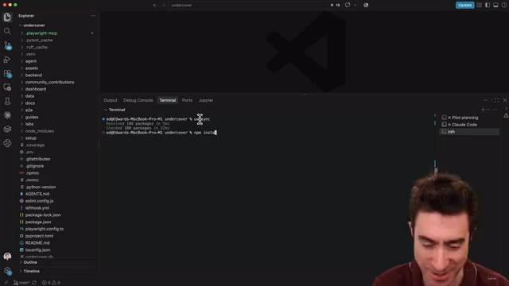
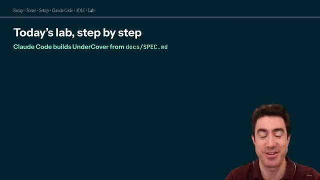
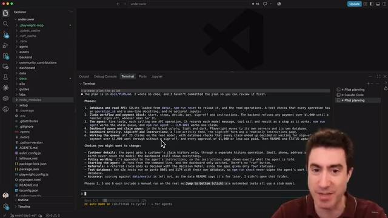
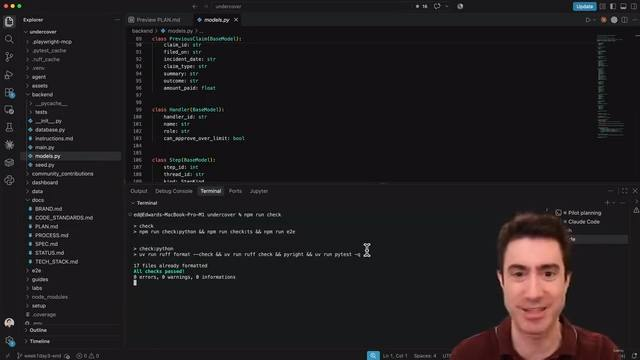
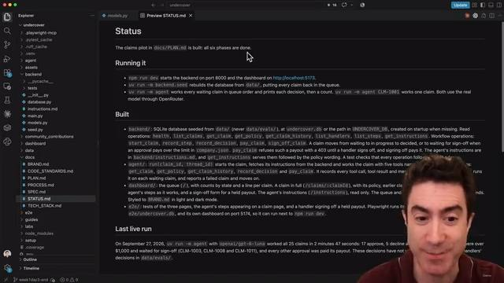
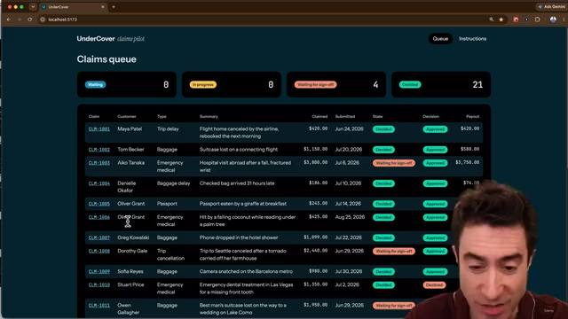
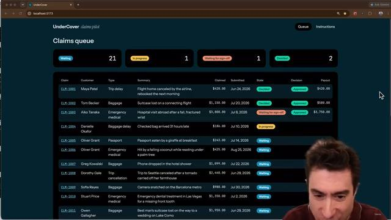

# 用 Claude Code 交付第一个 Pilot：三目录骨架、质量校验与端到端验证（P024–P026）

> 读者定位：前端转 AI 应用工程师。本文所有命令均来自逐字稿，凡是逐字稿没交代的东西，会在第 7 节明确标出「课里没讲」。

---

## 1. 这一节做什么

P024–P026 讲的是**同一件事的三个阶段**，不是三个独立知识点：

**阶段一（P024）：把质量校验跑通。** 这个仓库在上一节课之前就已经内置了一整套自动化检查——格式化、lint、类型检查、单元测试（带 80% 覆盖率门槛）、Playwright 端到端测试，以及一个在 `git commit` 时自动触发的 git hook。这一节讲师带着你逐条认识这些检查是什么，然后在本地实际执行 `uv sync` → `npm install` → `npm run dev` → `npm run check`，确认「你的起点和我的起点一致」。

**阶段二（P025）：让 Claude Code 先规划再动手。** 仓库里已经有 `spec.md`（业务语言写的需求）和 `techstack.md`（技术栈层面描述），以及三个空目录 `backend/`、`agent/`、`dashboard/`。讲师新建一个分支，然后只说了两个句子的指令：先说「please plan the pilot」，等它把 `docs/plan.md` 写出来；人工审一遍，再说「please implement the plan for the pilot」。

**阶段三（P026）：验收 + 真跑一遍业务。** 讲师展示那次实现花了 **32 分 13 秒**，`npm run check` 全绿（45 个单元测试 + 5 个端到端测试），`docs/status.md` 被自动写成了运行手册。然后按 status.md 里的三条命令：`npm run dev` 起服务、`uv run -m backend.seed` 重置数据库、`uv run -m agent` 让 agent 逐条处理理赔——在 `localhost:5173` 看着队列里的状态自己从「waiting」变成「decided」。

**跑完这一节，你手上会有：**

| 产物 | 路径 | 来源 |
|---|---|---|
| 一个能起的前后端 | `npm run dev` → `localhost:5173` | P026 [02:42] |
| 一个能批处理理赔的 LangChain agent | `uv run -m agent` | P026 [06:21] |
| 六阶段、验收项全勾选的计划文档 | `docs/plan.md` | P026 [00:29] |
| 自动生成的运行手册 | `docs/status.md` | P026 [02:20] |
| commit 时自动跑检查的 git hook | `npm install` 时装进 `node_modules` | P024 [05:19] |

**这一节不会产出的东西（课里明说后面才做）：** 用 LLM 做的独立代码评审（P024 [01:25] 提到 "将来我们用大语言模型做独立代码审查时"）、可在线编辑 agent 指令的界面（P026 [05:14] 说 "in future days"）。

---

## 2. 讲师原话（带出处）

**关于「质量校验的作用是约束 coding agent」**——这是整节的前提，讲师开场就点明了：

> "仓库中内置了一些控制措施，确保编码智能体无论做什么，都会遵守某些规则。"
> —— p024 [00:00]

**关于具体用了哪些工具**（注意讲师口述的 "rough" 就是 ruff、"PyRite" 就是 Pyright）：

> "它会自动运行所谓的代码检查工具：针对 Python 的 Ruff，以及针对 TypeScript 代码的 Prettier 和 ESLint。"
> —— p024 [00:14]

> "我们在 Python 中使用 Pyright，在 TypeScript 中使用 TSC 和严格模式。"
> —— p024 [00:43]

**关于覆盖率门槛**：

> "它会确保单元测试至少覆盖 80% 的代码……不过，单元测试覆盖率并不是评估单元测试的最佳方式。大家都知道，真正重要的是你测试代码的效果如何。"
> —— p024 [01:02] / [01:25]

讲师对覆盖率的态度很明确：**80% 只是个基本指标，不代表测试质量好**。这一点值得记住，别把「过了覆盖率门槛」当成「代码没问题」。

**关于 pre-commit hook 和它的漏洞**：

> "它会确保运行除 Playwright 端到端测试之外的所有测试……当然，这并非万无一失，因为虽然可能性不大，但 Claude Code 有可能显式禁用这些控制措施。"
> —— p024 [01:53] / [02:02]

> "你绝不能禁用这些检查。它们每次都必须运行。"
> —— p024 [02:32]

**关于为什么这些硬规则对 AI 好使、对人不好使**（这段是本节最有价值的一段判断）：

> "如果你把这些规则也用于人类开发者，那么像一位资深开发者——比如我——很可能就会说：啊，等一下。有些情况下你确实可能希望有较高的圈复杂度……但幸运的是，编码智能体不会这样顶嘴。它们只会照做。"
> —— p024 [03:48] / [04:10]

**关于三个目录的职责边界**：

> "仪表盘和智能体显然不会直接连接数据库，它们只使用 API。数据库仅由后端私有访问。"
> —— p025 [01:05] / [01:29]

**关于为什么必须人工审计划**：

> "真正的专业能力正是在这里建立起来的。把它当作一个机会，既要确保你是主导者，你要掌控它正在做的事情……也要借此机会学习任何你不理解的内容。"
> —— p025 [07:49] / [08:33]

**关于结果**：

> "它花了 32 分钟，准确说是 32 分 13 秒……最大的不同在于，成功标准自始至终都已逐项核验通过。"
> —— p026 [00:00] / [00:14]

**关于为什么能一次成功**（讲师自己给的归因，别只归给模型）：

> "它第一次就成功了。这证明了模型的能力，但也得益于我们当时搭建的测试框架（harness）。"
> —— p026 [09:35]

---

## 3. 从零复现

整个流程按**依赖顺序**排成 7 个阶段。不要跳阶段——阶段 A 不过，后面全是白搞。

### 阶段 A：把质量校验建立起来（P024）

**A1. 同步 Python 依赖**

```bash
uv sync
```

逐字稿里讲师说这一步"会非常快，因为我之前运行过它"，你自己第一次跑会慢一些。它会把 Python 包装进 `.venv`。

**A2. 安装 Node 依赖**

```bash
npm install
```

这一步会把东西装进 `node_modules`，**包括那个负责在 commit 时跑检查的 git hook 工具**（讲师口述为 "left hook"，npm 生态里的 lefthook，和 husky 是同类东西）。



讲师对这一步的三个提醒（P024 [06:19]）：

1. **会看到 deprecation warning——不用管**。"这种情况经常发生，因为这些软件包总是在变。"
2. **报错才是问题**。先问 Claude Code，搞不定再问讲师。
3. **可能要好几分钟**，别以为卡死了。

**A3. 起服务，确认能连上**

```bash
npm run dev
```

讲师原话：这一步 "会启动后端和仪表盘，以便我们检查它能否正常启动；除了告诉我们它已经在那里之外，它不应该有任何其他功能。"。也就是说，**此刻打开页面只会看到一个空壳**，这是正常的——产品还没生成。

**A4. 跑全量检查（关键一步）**

```bash
npm run check
```

这是本节最重要的命令，它按顺序跑：

1. 前端检查（很快）
2. ruff 的 Python 检查（很快）
3. 单元测试 + 覆盖率门槛判定（门槛 80%，讲师当时实测 96%，因为"需要测试的东西很少。"）
4. 重新格式化所有文件（讲师当时的结果是"不需要重新格式化任何内容。"）
5. 单元测试全部跑一遍
6. Playwright 端到端测试（讲师当时只有 1 个 test，通过）

一旦这一步全部通过，说明「你的起点 = 讲师的起点」，可以往下走。

> 注意：`npm run check` 的**具体脚本内容在逐字稿里没有展开**，讲师只说了它"does everything"。你在自己的仓库里跑 `cat package.json` 看 `scripts.check` 到底串了哪些命令——第 7 节会再提。

**A5.（可选，强烈建议）验证 pre-commit hook 真的生效**

按 P024 [07:35] 的说法：随便改一个文件（加个注释就行），然后 commit，你应该能看到检查跑起来。**唯一看不到的是 Playwright 端到端测试**——"为了保持快速简单，它不会运行它们。"。

---

### 阶段 B：开分支（P025）

```bash
git checkout -b week1-day3-ed
```

讲师要求分支名形如 `week1-day3-<你的名字>`。同时讲了怎么在分支间来回切（P025 [05:03]）：

```bash
git checkout main             # 切回主分支
git checkout week1-day3-ed    # 切回你的分支
```



**为什么一定要开分支？** 讲师的理由只有一句 "这能让我们的代码保持整洁有序。"，但实操上有更硬的原因：P025 [04:34] 给了一个「保底分支」`week1-day3-end`，如果你自己那份干崩了，一条 `git checkout week1-day3-end` 就能拿到讲师跑通的版本。要是你在 main 上直接干，这个撤退路线就没了。

---

### 阶段 C：让 Claude Code 规划（P025）

**C1. 启动 Claude Code**

```bash
claude
```

**C2. 确认模型和努力等级**（P025 [05:58]）

在 Claude Code 里执行 `/model` 看当前模型，`/effort` 看努力等级。讲师当时用的是「最新的最强模型之一」，effort 设成 **extra high**，并说 "超高对我来说正合适。"。

> 讲师说的具体版本号、折扣策略这些会随时间变化，以你本地 `/model` 列出的为准。想省额度就用 sonnet 那档。

**C3. 一句话下指令**

```
please plan the pilot
```

就这一句（P025 [06:25]："我要说的就这些。"）。讲师特别说明**不需要手动进入 plan mode**——`process.md` 里已经写了遇到这种指令要先规划。

**C4. 等它读完上下文**

P025 [06:48] 描述它当时在读 `brand`、`status` 等文件。这一步会花几分钟到十分钟（讲师那次是 10 分钟，P025 [07:01]）。

**C5. 等它把 `docs/plan.md` 写出来**

产物落在 `docs/plan.md`。

---

### 阶段 D：**人工审计划**（这一步不能被跳过）

这是整节里唯一「机器没法替你做」的环节。讲师的做法分三层：

**第一层：看它在终端里报的决策摘要。** 它当时报的决策之一是「不会把客户的 email、phone、address、date of birth 发给做决策的模型」。讲师的评价是 "我觉得这听起来是一个非常明智的决定。"（P025 [07:01]）。你的任务是：**每一条决策都过一遍，确认你同意**。

**第二层：打开 `docs/plan.md` 看结构。** 讲师描述它包含（P025 [07:21] / [07:49]）：

- 整体怎么拼起来
- claims 的状态（claims statuses）
- API
- 一堆规则（rules）
- agent 部分
- dashboard 部分
- 测试
- 然后是每个 phase：步骤、**带复选框的 success criteria**、用什么测、预期结果

六个 phase 是（P025 [08:03]）：1）基础设施；2）claim 工作流；3）agent；4）dashboard 队列与 claim；5）dashboard 的 "agent at work" 与 sign off；6）instructions 与"work the queue"，外加 out of scope 清单。



**第三层：把它当学习材料用。** 讲师说他第一次是"非常详细地过了一遍。"，问了几个问题。原话是："要提出尖锐的问题，弄清到底发生了什么，并把它也当作一次学习机会。"（P025 [09:03]）

---

### 阶段 E：让它实现（P025 末尾）

确认计划没问题后，第二句话：

```
please implement the plan for the pilot
```

然后等。讲师那次是 **32 分 13 秒**（P026 [00:00]）。期间它会自己 commit——而 commit 会触发 pre-commit hook，所以它**必须**自己跑 `npm run check` 才能提交成功。这就是阶段 A 那套检查的真正价值：**它不是给你看的，是给 agent 上的一道闸**。

---

### 阶段 F：验收（P026）

**F1. 看 `docs/plan.md` 的复选框是不是全勾上了**

P026 [00:00] 说得很清楚：和规划版比"只是略有不同。"，最大的差别就是 **success criteria 全部被勾选**。

**F2. 做一次 code review**

讲师把它当成"你团队里负责交付工作的一位初级人员"来审。他具体看了 `backend/`：确认打包方式、**models 被拆到独立的 Python module**、用了 literals 等等，"看起来它处理这件事的方式很可能是正确的。"（P026 [00:52]）。



你不熟这些技术栈也没关系，讲师给了替代方案："否则就问它那些难题。"

**F3. 自己跑一遍 `npm run check`**

```bash
npm run check
```

不要因为「它 commit 过了所以肯定过了」就跳过。讲师当时的输出是：**45 个测试通过** → 格式化检查 → 端到端测试 → **5 个 e2e 测试通过**，覆盖率达标。



**F4. 读 `docs/status.md`**

这是 `process.md` 里要求 agent 维护的文件。它被写成了运行手册（P026 [02:20]）：

> The claims pilot is built. All six phases are done.
> - `npm run dev` 启动后端和 dashboard
> - `uv run -m backend.seed` 重建数据库
> - `uv run -m agent` 处理每一条 claim



---

### 阶段 G：端到端跑一遍业务（P026 后半）

**G1. 打开应用**

浏览器访问 `http://localhost:5173`（讲师在 P026 [02:42] 说的）。你会看到：

- 一个理赔队列表格，可以滚
- 顶部汇总统计：waiting / in progress / 需要签核（raised for sign off）/ decided 四个数字
- 每一行有 client 名、claim 类型、当前决策、当前状态

讲师那次打开时是：nothing waiting、nothing in progress、4 raised for sign off、21 decided。

点进任意一条（例如 "玛雅·帕特尔 / 行程延误 / 回程航班被航司取消"），能展开看到：**Agent at Work 区**（类似 trace 的可展开观测记录）、**policy details**、**earlier claims details**，以及顶部的最终决策——那一条是批准 $420（P026 [04:07] / [04:29]）。

**G2. 重置数据库**

新开一个终端：

```bash
uv run -m backend.seed
```



刷新页面的瞬间统计数据会变成：**全部 waiting，25 条待决策，in progress 0，waiting for sign-off 0，decided 0**（P026 [05:25]）。

**G3. 启动 agent，看它自己干活**

```bash
uv run -m agent
```

然后**不要碰页面**，就看着。讲师原话："我的手没有碰它。"（P026 [06:21]）

你会看到队列里第一条被拿起 → 决策 → 变成 decided → 下一条进 in progress，一条一条往下走。讲师那次跑完的结果是：**3 条 waiting for sign off，22 条 decided**（P026 [07:49]）。

**G4. 如果结果不满意**

"Give your coding agent the feedback. Do another iteration. Keep bashing away at it until you're satisfied."（P026 [08:45]）

**G5. 保底方案**

如果你不想花时间自己跑，或者你的模型太弱搞不定：

```bash
git checkout week1-day3-end
npm install
```

然后照 G1–G3 运行，体验和讲师完全一致（P026 [09:11]）。

---

## 4. 完整代码

> **必须先说清楚**：这一节里，**产品的实际源码是 Claude Code 生成的，逐字稿没有给出任何一行 `backend/`、`agent/`、`dashboard/` 的代码**。我不会编造它们。下面给的是**你能直接保存、直接执行**的四类产物：把讲师的命令固化下来的脚本、喂给 coding agent 的完整指令文件、运行手册模板、以及贡献 PR 的说明。凡是从 P026 的 plan 摘要里提取的约束，我都会标出来源。

### 4.1 `scripts/bootstrap.sh` —— 把 P024 的起步动作固化成一步

```bash
#!/usr/bin/env bash
# scripts/bootstrap.sh
# 用途：新机器 / 换分支后，把工作区恢复成「可验证的起点」。
# 对应逐字稿：P024 [04:49] ~ [07:35]
set -euo pipefail

echo "==> [1/4] 同步 Python 依赖 (uv sync)"
uv sync

echo "==> [2/4] 安装 Node 依赖 (npm install)"
echo "    注意：出现 deprecation warning 属正常，报错才是问题 (P024 [06:19])"
npm install

echo "==> [3/4] 启动前后端 (npm run dev)"
echo "    预期：只有空壳，还没有业务功能 (P024 [05:35])"
echo "    请另开终端手动执行：npm run dev"
echo "    然后访问 http://localhost:5173 确认能打开"

echo "==> [4/4] 全量质量闸门 (npm run check)"
npm run check

echo
echo "✅ 起点已就绪。若要一并验证 pre-commit hook，"
echo "   随便改一个文件再 git commit，应看到检查触发（不含 e2e）(P024 [07:35])"
```

### 4.2 `scripts/run-pilot.sh` —— 把 P026 的业务三连跑固化

```bash
#!/usr/bin/env bash
# scripts/run-pilot.sh
# 用途：一条命令完成「重置数据 -> 跑 agent」，用于反复观察 agent 行为。
# 对应逐字稿：P026 [05:25] / [06:21]
# 前置：另一个终端里已经 npm run dev 在跑，浏览器开着 localhost:5173
set -euo pipefail

echo "==> [1/2] 重置数据库：所有 claim 回到未决策状态"
uv run -m backend.seed
echo "    现在刷新浏览器，应看到全部为 waiting，decided 为 0"

read -r -p "确认页面上所有 claim 都是 waiting？回车继续跑 agent..." _

echo "==> [2/2] 启动 agent，逐条处理队列"
echo "    接下来不要碰页面，观察状态自己变化 (P026 [06:21])"
uv run -m agent

echo
echo "✅ agent 运行结束。回到页面核对 waiting / in progress /"
echo "   需要签核 / decided 四个数字。"
```

### 4.3 `prompts/plan-pilot.md` —— 阶段 C 的完整指令文件

```markdown
# 任务：规划 pilot

请先阅读以下文件，再产出计划，不要开始写实现代码：

- `spec.md` —— 业务语言描述的产品需求
- `techstack.md` —— 技术栈的高层描述
- `process.md` —— 工作流程约束（含：本仓库的检查不得被禁用）
- `brand.md` —— 品牌/风格相关约束

## 硬性约束（来自课程 P024 / P025，不可协商）

1. **不得禁用或绕过本仓库的任何质量检查。**
   不允许在 commit 时使用跳过 pre-commit hook 的 flag，不允许注释掉 lint / 类型检查 / 测试。
   每次 commit 都必须让检查完整跑过。（依据：P024 [02:32]，process.md 已写明）

2. **三个目录的职责边界不可打破：**
   - `backend/` —— 唯一直接访问数据库的组件，对外提供 API
   - `agent/` —— LangChain agent，**只通过 API** 读写，不直连数据库
   - `dashboard/` —— 前端（React + TypeScript），**只通过 API** 读数据，不直连数据库
   （依据：P025 [00:36] / [01:05] / [01:29]）

3. **agent 需要能：** 处理队列中的 claim、决定是否赔付、赔付多少、给出理由。
   （依据：P025 [00:36]）

4. **dashboard 需要能展示：** 待处理队列、每条 claim 的细节、agent 的工作过程（trace 形式的可观测记录）、
   以及给 agent 的指令的只读视图。
   （依据：P026 [02:58] / [04:07] / [05:14]）

## 输出要求

把计划写入 `docs/plan.md`，必须包含：

- 整体架构如何拼合
- claims 的状态集合及其流转
- API 设计
- 业务规则
- agent 的设计
- dashboard 的设计
- 测试策略
- **按阶段拆分**：每个阶段包含 —— 步骤、**可勾选的 success criteria**、用什么方式测试、预期结果
- out of scope 清单

## 结束条件

写完 `docs/plan.md` 后停下，等人工审阅。**不要**自动进入实现。
```

### 4.4 `prompts/implement-pilot.md` —— 阶段 E 的完整指令文件

```markdown
# 任务：实现 pilot

请按 `docs/plan.md` 实现 pilot。

## 执行规则

1. 按计划里的阶段顺序推进，每完成一个阶段就把该阶段的 success criteria 勾选掉。
2. **每次 commit 前必须让 `npm run check` 完整跑过。**
   不允许跳过 pre-commit hook，不允许用任何 flag 绕过检查。（依据：P024 [02:32]）
3. 若某个 success criteria 无法满足，不要悄悄改计划——停下来在 `docs/plan.md` 里说明原因。
4. 全部完成后，把 `docs/status.md` 更新为可直接照做的运行手册，至少包含：
   - 如何启动（后端 + 前端）
   - 如何重置数据库
   - 如何运行 agent 处理整个队列

## 结束条件

`npm run check` 全绿（含端到端测试），`docs/plan.md` 里的 success criteria 全部勾选，
`docs/status.md` 已是最新的运行手册。
```

### 4.5 `docs/status.md` —— 运行手册模板（结构照 P026 [02:20] 的实况）

```markdown
# Claims Pilot —— 运行手册

状态：**已构建完成，六个阶段全部完成。**

## 启动

```bash
npm run dev
```

启动后端与 dashboard。浏览器打开 http://localhost:5173

## 重置数据库

```bash
uv run -m backend.seed
```

把数据库重建，所有 claim 回到未决策状态。

## 运行 agent

```bash
uv run -m agent
```

让 agent 通过 API 逐条处理队列中的每一个 claim，并记录其决策。

## 验收基线（讲师那次运行的实际结果，供你对照）

| 检查项 | 结果 |
|---|---|
| `npm run check` 单元测试 | 45 passed |
| `npm run check` 端到端测试 | 5 passed |
| agent 首次实现耗时 | 32 分 13 秒 |
| agent 跑完后的队列 | 3 条待签核，22 条已决策 |

> 以上数字来自 P026 [01:19] / [00:00] / [07:49]。你的数字会不同，
> 只要 `npm run check` 全绿且队列能走完就算通过。
```

### 4.6 `community-contributions/README.md` —— 交作业的目录约定（P026 [10:56] 起）

```markdown
# 社区贡献

## 怎么提交你的 pilot

1. 在本目录下新建一个以你名字命名的文件夹，例如 `community-contributions/your-name/`
2. 在该文件夹里放：
   - `pilot.md` —— 描述你做了什么、你观察到什么、你踩了什么坑
   - `plan.md` —— 你那份 `docs/plan.md` 的副本（讲师明确说想看这个）
   - 你项目的 GitHub 链接（**不要**把整个仓库塞进来，给链接就行）
3. fork 讲师仓库，在本地提交后发起 PR

## 说明

讲师合并 PR 时会用一个快捷键输入致谢并合并。那只是他按了一下键，
不是自动 merge bot —— 他确实看过（P026 [12:15]）。
```

---

## 5. 逐行解释

### 5.1 为什么 `bootstrap.sh` 一上来就 `set -euo pipefail`

这门课里，**脚本失败的方式比成功的方式重要**。`npm install` 出现 deprecation warning 是正常的（P024 [06:19]），但报错是不正常的。`set -e` 保证任何一步非零退出就立刻停，不会出现「装了一半接着跑 check，然后花两小时 debug 一个其实是依赖没装完的错误」。

`pipefail` 尤其重要，因为 `npm run check` 内部是串联多条命令的，如果不加，管道里前面的失败可能被吞掉——那样「检查通过」就是假绿灯，而假绿灯正是这套质量校验最怕的东西。

### 5.2 为什么顺序必须是 `uv sync` → `npm install` → `npm run check`

`npm run check` 里同时包含 **ruff / Pyright（Python 侧）** 和 **prettier / eslint / tsc（TypeScript 侧）**（P024 [00:14] / [00:43]）。也就是说这条命令横跨两套运行时。Python 包没装，ruff 直接 command not found；Node 包没装，prettier 跑不起来。所以两个包管理器必须先各自完成。

讲师在 P024 [04:49] 特意说：`uv sync` 你已经做过两天了，可以不重复跑——但**如果你换了机器或删过 `.venv`，就必须重跑**。这也是我把它写进脚本而不是靠记忆的原因。

### 5.3 为什么 `npm run check` 值得被反复跑，而 `npm run check` 的内容课里没讲

讲师对它的描述只有一句 "does everything"。但从他描述的执行过程（P024 [06:49]）能倒推出内部至少串了六步：前端检查 → ruff → 覆盖率判定 → 重新格式化 → 单元测试 → Playwright。

这里有一个**容易踩的坑**：第 4 步「重新格式化所有文件」会**改写你的工作区文件**。如果你的 `npm run check` 报错退出在格式化之前，工作区是干净的；如果在格式化之后报错，你的文件已经被改过了。所以脚本里我把 `npm run check` 放在最后一步，并且不自动 commit——**让格式化改动暴露在你眼前，而不是被一个自动 commit 吞掉**。

### 5.4 为什么要单独跑一次 `npm run check`，而不是相信「它 commit 过了」

因为 pre-commit hook **不跑 Playwright 端到端测试**（P024 [02:02]："除了 Playwright 端到端测试之外的所有测试"）。也就是说 agent 提交成功，只能证明单元测试和 lint 过了，**端到端测试是没跑过的**。讲师在 P026 [01:19] 自己也是重新跑了一遍才看到"五个端到端测试"全过。

这是本节最容易被忽略的一处不对称。

### 5.5 为什么 pre-commit hook 不能当成「铁壁」

P024 [02:02] 讲师自己承认："这并非万无一失，因为虽然可能性不大，但 Claude Code 可能会显式禁用这些控制项。"

他的两层加固：

1. **软约束**：在 `process.md` 里写明「不得禁用检查」（P024 [02:32]）。
2. **硬约束**：用 Claude Code 的 hooks 功能做成真正无法绕过的（P024 [03:02]）。讲师说"那会非常棒。那也会是一个很好的社区贡献。"——**也就是课上没做，留给你了**。他还提到自己另一个叫 Bench 的仓库里有更强的控制。

所以 4.3 和 4.4 两个 prompt 文件里的第 1 条约束，就是把这层软约束固化下来。它不是可选的装饰，是这套流程能自洽的前提。

### 5.6 为什么 `plan` 和 `implement` 必须拆成两次指令

P025 [02:18] 讲师说他**不需要手动进 plan mode**，因为 `process.md` 里已经写了「遇到这类指令先规划」。但即使流程自动拆了，**人必须插在中间**。

理由在 P025 [07:01]：它给出的第一个决策是「不会把 email、phone、address、date of birth 发给做决策的模型」。讲师判断"very sensible"——但**这个判断是人做的**。4.4 的 prompt 里，这条是通过 plan 摘要确认的，所以我没有把它硬编码进 implement 指令；它属于「你审完 plan 后应该自己确认存在的东西」，如果 plan 里没写，你应该在审阅阶段要求补上。

对前端转过来的读者：这相当于 code review 时的那道门。你不能因为 CI 绿了就直接 merge。

### 5.7 为什么 `seed` 和 `agent` 必须是两条独立命令

因为你要**反复观察**同一批数据被处理的过程。P026 [05:25] 讲师先 reset 再跑 agent，看完一次结果之后，可以再 reset 再看一次。

如果合成一条命令，你每次观察都得重跑一遍 seed，节奏被打断，而且没法在中途停下来看某一条 claim 的 trace。4.2 的脚本里我加了一个 `read -p` 断点，就是这个道理——**在 agent 启动前停一下，让你确认页面上真的全变成 waiting 了**。讲师当时也是先回页面确认「25 条全 waiting、decided 为 0」才启动 agent 的。

### 5.8 为什么 dashboard 和 agent 都不能直连数据库

P025 [01:29] 的原话："这个数据库是后端私有的。"

这条约束在工程上有三个具体后果，你实现时会撞上：

1. **agent 必须等后端起来才能工作**。这也是为什么 `run-pilot.sh` 的前置条件是「另一个终端里 `npm run dev` 在跑」。
2. **状态更新必须走 API**，不能 agent 直接改库、dashboard 直接读库——否则会看到过期数据。讲师演示时「刷新页面瞬间统计数据就变了」（P026 [05:52]），这个实时性就是靠单一数据源保证的。
3. **对前端转过来的你**：这和你熟悉的 BFF 模式一样——浏览器不直连数据库。这里只是把「agent」也当成了一个和浏览器平级的客户端。

### 5.9 为什么 `docs/status.md` 值得让 agent 自动维护

P026 [02:20] 那一屏是整节最实用的东西：一个**由 agent 自己写的运行手册**，里面三条命令就是复现的全部。这意味着你隔两周回来，不需要翻聊天记录。

讲师的机制是在 `process.md` 里要求「keep a file updated with the latest, a file called status.md」。4.4 的 prompt 把这条又写了一遍，并且在结束条件里要求更新它——不是因为讲师写了就该写，而是因为**如果你不要求，manager 类 agent 通常会只交代码不交说明书**。

### 5.10 关于 80% 覆盖率这个数字

P024 [01:25] 讲师说得很直白：覆盖率不是看单元测试的好办法，"关键在于你测试代码有多有效，而不只是你是否真的覆盖了不同的路径。"。

放到这一节的语境里：这个 80% 门槛的真正作用是**给 agent 一个不可协商的量化下限**，而不是衡量代码质量。讲师那次实测 96%，因为他自己也说"这是因为需要测试的东西很少。"——**分母小的时候百分比天然好看**。你实现完之后看到 90%+ 别高兴太早，跑一遍 G3 看 agent 实际表现才是真验收。

---

## 6. 复现检查清单

按顺序打勾，任何一项不过就停下来解决，不要往下走。

### 阶段 A：质量校验

- [ ] `uv sync` 成功退出
- [ ] `npm install` 成功退出（**忽略 deprecation warning**，报错才算失败）
- [ ] `node_modules/` 已生成，体量可观（讲师说"这一整个大文件夹"）
- [ ] `npm run dev` 能起来，`localhost:5173` 能打开
- [ ] 此时页面**没有业务功能**，只有一个空壳 —— 这是预期的
- [ ] `npm run check` 全绿，六步都跑过（前端检查 / ruff / 覆盖率 / 格式化 / 单元测试 / Playwright）
- [ ] 覆盖率 ≥ 80%
- [ ] （可选）改一行再 commit，能看到检查触发，且**看不到** e2e 测试

### 阶段 B：分支

- [ ] 已执行 `git checkout -b week1-day3-<你的名字>`
- [ ] 用 `git branch` 确认当前在你自己分支上

### 阶段 C：规划

- [ ] `claude` 已启动，`/model` 和 `/effort` 已按需设置
- [ ] 只说了 `please plan the pilot`，**没有**手动进 plan mode
- [ ] 等待期间没有中途打断
- [ ] `docs/plan.md` 已生成

### 阶段 D：人工审阅（**这是唯一不能跳的一步**）

- [ ] 读到并理解了它在终端报的每一条决策
- [ ] `docs/plan.md` 里有完整的六个 phase
- [ ] 每个 phase 都有**带复选框的 success criteria**
- [ ] 每个 phase 都写了「怎么测、预期结果」
- [ ] 有 out of scope 清单
- [ ] 确认了「PII 是否发给决策模型」这一条它怎么处理的（默认应是不发）
- [ ] 有疑问的地方我都问过了，且答案我认可
- [ ] 我对「我是不是这个方案的 owner」这个问题，答案是 yes

### 阶段 E：实现

- [ ] 只说了 `please implement the plan for the pilot`
- [ ] 等待期间没有中途改需求
- [ ] 结束时它自己是 commit 过的（能被 pre-commit hook 拦住说明校验生效）

### 阶段 F：验收

- [ ] `docs/plan.md` 里 success criteria **全部勾选**
- [ ] 我读过 `backend/` 的代码（或问过它难题并得到满意回答）
- [ ] 我自己跑了一遍 `npm run check`，全绿
- [ ] 我自己看到了 45 个左右的单元测试通过
- [ ] 我自己看到了 5 个端到端测试通过
- [ ] `docs/status.md` 存在，且含三条命令：dev / seed / agent
- [ ] 我照着 `docs/status.md` 的三条命令**一字不改地执行了一遍**，能跑通

### 阶段 G：端到端业务验收

- [ ] `localhost:5173` 打开，能看到队列表格和顶部四个统计数字
- [ ] 能点进某条 claim，看到 agent trace、policy details、最终决策与金额
- [ ] `uv run -m backend.seed` 之后，页面**刷新即变**为全 waiting、decided 为 0
- [ ] `uv run -m agent` 后，**手不碰页面**，状态自己开始变化
- [ ] 状态按 waiting → in progress → decided / 待签核 的顺序流转
- [ ] agent 跑完后队列清零（无 waiting、无 in progress）
- [ ] 我抽查了 2–3 条决策，认为金额和理由都合理

---

## 7. 课里没讲但你会遇到

这一节全部是逐字稿**明确没有覆盖**的东西。写在这里是为了让你撞上时知道「这不是我漏听了」，而不是去猜。

### 7.1 产品的实际源码——课里没给任何一行

`backend/`、`agent/`、`dashboard/` 里到底有多少文件、用什么框架、数据模型长什么样、API 有几个端点、`agents` 那个模块怎么组织——**逐字稿只字未提**。讲师只说了三个描述：dashboard 是 "原生 React + TypeScript"、agent 是 "LangChain agent"、backend 提供 API。P026 [00:52] 提到的 "模型被分离出来，放进它们自己的 Python 模块里。"、"using literals" 是他 review 时的观察，不是给代码。

**你实际会看到的**：一行 `git checkout week1-day3-end` 之后的代码量，可能远超你的预期。别试着在脑子里预先设计，按 P025 的流程让它自己长出来。

### 7.2 `package.json` 里的 `scripts.check` 到底串了什么——课里没讲

讲师只说它 "does everything"。你能确证的是它**依次包含**：前端检查、ruff、覆盖率门槛判定、重新格式化、单元测试、Playwright（P024 [06:49]）。**具体的命令串、覆盖率工具是哪个（coverage.py？pytest-cov？）、阈值写在哪**——都没讲。

你自己去 `cat package.json` 看 `scripts` 字段，这是最快的办法。

### 7.3 lefthook 的具体配置文件——课里没讲

讲师口述为 "left hook"，说它是 npm install 时装进来的、commit 时触发。**配置写在哪个文件（`lefthook.yml`？`package.json` 里？）、怎么指定「跳过 e2e」的规则**——都没讲。

顺着 `node_modules/` 里找，或者 `git log` 看第一次引入它时的 commit。

### 7.4 技术栈的具体版本——课里没讲

- Python 版本没讲
- Node 版本没讲
- React 版本没讲
- LangChain 版本没讲
- 数据库是哪种（SQLite？Postgres？）**没讲**
- `uv` 的版本没讲

`git checkout week1-day3-end` 之后看 `pyproject.toml` 和 `package.json` 的依赖段，那是唯一可靠的来源。**不要凭印象填版本号**。

### 7.5 `brand.md` / `process.md` / `CLAUDE.md` 的完整内容——课里只提了片段

能确证的只有两条：`process.md` 里写了「不得禁用检查」（P024 [02:32]）、写了「遇到 plan 类指令先规划」和「维护 status.md」（P025 [02:18] / P026 [02:20]）。其余内容课里没展开。

### 7.6 端口和进程管理的细节——课里只给了一个端口

只有 `5173` 这个数字能确证（P026 [02:42]）。**后端跑在哪个端口、`npm run dev` 是怎么同时起两个进程的（concurrently？turbo？）**——没讲。如果 5173 被占用，你会看到什么、怎么改，课里也没有。

### 7.7 `backend.seed` 具体做了什么——课里没讲

只能确认它的**外部行为**：跑完之后所有 claim 回到未决策状态、decided 变 0（P026 [05:52]）。它是删库重建、还是 UPDATE 全部记录、seed 数据是不是每次随机生成 25 条——都没讲。

这件事有实际影响：如果 seed 是随机的，你每次跑 agent 结果都不一样；如果是固定的，你应该能复现讲师的「3 条待签核、22 条已决策」。P026 [07:19] 讲师提到数据里有真实事件改编的彩蛋（护照被长颈鹿吃掉、把小孩落在家里），暗示**数据是精心构造的固定集**——但这是我从描述里推的，逐字稿没有明说。

### 7.8 「免费模型」这条路的具体操作——课里只给了警告和保底方案

P025 [03:15] 起讲师花了一分多钟警告免费模型的坑：rate limit 很快耗尽、必须切到极小的增量步骤、每一步都要测、要频繁 commit、要舍得把做坏的扔掉回退。他提到可以退而求其次用 "像 DeepSeek Flash 这样的廉价模型"。

**但具体怎么切模型、怎么配置 Open Code / Codex、rate limit 具体多久耗尽——课里没讲。** 他给的唯一可执行保底方案是 `git checkout week1-day3-end`。

### 7.9 用 Claude Code hooks 做「真正不可绕过」的校验——课里明说是留给你的

P024 [03:02]："you could make it completely bulletproof. For example, by using the hooks functionality include code. And I'll leave that up to you if you wish to do that. That would be really cool. That would be a nice community contribution as well."

**课上没做，这是待办。** 现在的状态是「软约束（process.md 写死）+ pre-commit hook」，理论上仍可被绕过。

### 7.10 前端的两个具体交互——课里只演示了外观

P026 [04:07] 展示的 "Agent at Work" 是「可展开的 trace」，[05:14] 的 instructions 页是「只读视图」。**trace 的数据结构长什么样、从哪里读、怎么渲染、只读页面的数据从哪个端点来**——都没讲。

对前端转过来的你，这是这一节最需要自己补的部分：**你熟悉的那套东西（组件、状态、数据获取）课里完全没碰**，它假定 agent 会把 UI 长出来。

### 7.11 AI 编码这条线的项目结构经验——需要你自己迁移

讲师反复强调的判断是"编程智能体不会顶嘴。"（P024 [04:10]）——人类 senior 会为高圈复杂度辩护，agent 不会。**这个判断怎么迁移到你的项目里、什么规则适合硬性化、什么规则需要留余地**——课里给的是这个仓库的答案，不是通用方法论。P026 [10:46] 讲师把它归到「人的四件事」里：accountability、评估标准、judgment、taste。这四件事**没有任何一件能被 `npm run check` 替代**。