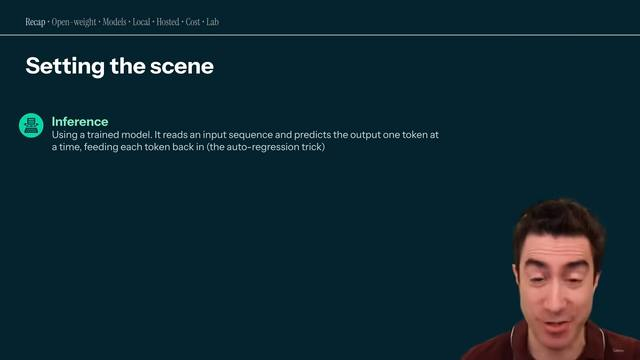
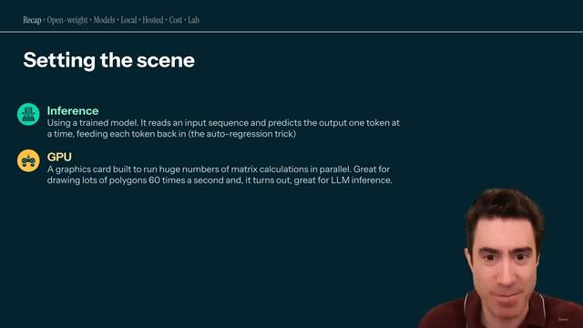
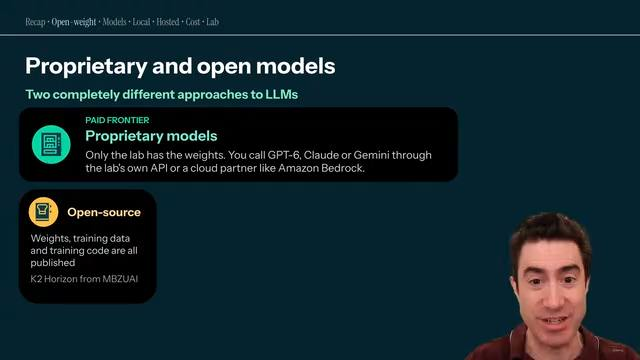
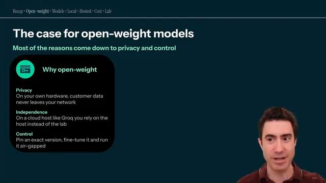
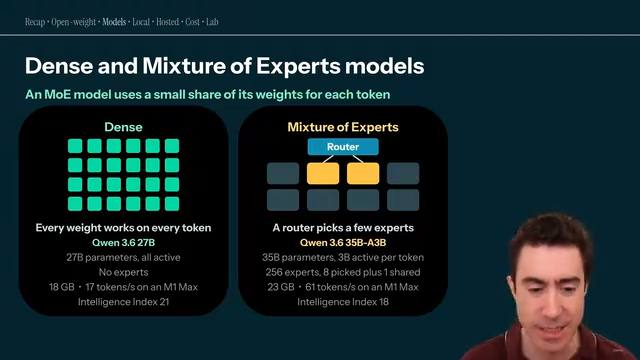
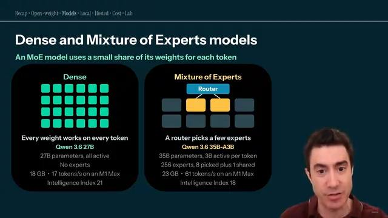
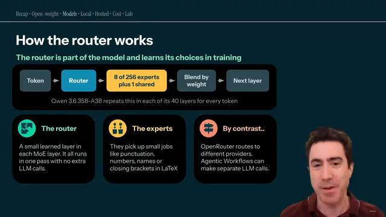

# AI FDE 第 1 周第 4 天：推理、开源/闭源模型与 MoE —— 从零复现文档

> 覆盖 P027–P029。这三节是「概念 + 演示」型课程：讲师先用大量幻灯片建立术语直觉（inference、GPU/VRAM/带宽、proprietary vs open weight、dense vs MoE），然后宣布要进实验室部署 Ollama、跑本地模型、走 OpenRouter 对比。**注意：逐字稿里讲师只「宣布」了这些实验，没有在 P027–P029 里逐条敲命令**。因此本文档第 3、4 节把「讲师宣布的实验」落成可执行步骤与完整文件，凡是逐字稿没给的内容一律标注「课里没讲」，并给出可验证的替代做法。阅读时请把「讲师原话」与「本文档补全的工程步骤」分开看：前者是课程事实，后者是为了让你能动手复现而补充的公开标准用法，不冒充讲师原话。

---

## 1. 这一节做什么

这三节要解决一个很具体的问题：**当你从「调 API 的前端」变成「要自己把模型跑起来的人」时，你需要先分清两件事——模型归谁（闭源/开源权重），以及模型内部怎么算（dense/MoE）——然后才动手部署。**

产出物有三样：

1. 一套能说清楚的术语表：inference、GPU、VRAM、unified memory、GPU bandwidth、proprietary model、open weight model、dense model、MoE、activated parameters（A3B 这种写法）。
2. 一个本地推理环境：装 Ollama、拉一个开源权重模型、用 HTTP 调它。
3. 一个对比实验：同一个 prompt，分别打本地 Ollama 和 OpenRouter，比较输出与成本/速度。

如果你熟悉前端，可以先把这件事类比成：以前你只写 `fetch('/api/chat')`，后端由别人维护；今天你要自己把「后端」跑起来，还要判断这个后端是装在自己机器上、还是走云上的转发网关。术语表解决「听懂别人在说什么」，本地 Ollama 解决「模型真的在你机器上跑」，OpenRouter 对比解决「同一请求换一条链路后，速度、成本、输出有什么差异」。这三件事合起来，才是从「调 API 的人」过渡到「能部署和评估推理链路的人」。

讲师在 P027 开头明确说了今天的安排：

> "我们会部署 Olama，运行一些本地模型，也会通过 OpenRooter 来跑，这样你就能对它们进行比较。"
> —— p027 [02:15]

以及可选的进阶练习：

> "如果你愿意，还有一些其他练习供你选择，比如在 RunPod 上部署你自己的服务器。"
> —— p027 [02:43]

所以本文档的主线就是：**术语 → 本地 Ollama → OpenRouter → 对比**，RunPod 作为可选延伸（课里没讲具体步骤，本文档只给方向，不编造命令）。每一节内部会补充命令解释、常见错误与排查、与前端的对照，以及检查清单的验证方法；但不会新增章节，也不会把「课里没讲」的内容写成讲师原话。

---

## 2. 讲师原话

按主题摘，不按页码流水账。以下引用保留逐字稿中的拼写与口语停顿，像 `Olama`、`OpenRooter` 这类写法是转写结果，阅读时对应到 Ollama、OpenRouter 即可；引用本身不改写。

**关于 inference 的定义**（这是全课的地基）：

> "这只是一个用来描述运行模型的花哨说法。使用模型实际上分为两个不同阶段：训练模型……训练完成后，实际运行它，给它一个新的提示词……让它生成输出，而你是通过这种自回归技巧来完成的……一次一个 token，它预测下一个 token，你把它反馈回去，得到下一个 token，这样做就被称为推理。"
> —— p027 [04:16]

**关于 GPU 与内存**（决定你能不能跑得动模型）：

> "在 GPU 上运行时，你真正关心的一件事是 GPU 有多少内存，因为模型需要装进这些内存里。"
> —— p027 [05:20]

> "在 Mac 上，现代 Mac 的 CPU 和 GPU 通常共享同一块内存，这被称为统一内存。"
> —— p027 [05:50]

> "GPU 还有一点也非常重要……那就是 GPU 带宽，也就是你能以多快的速度把数据传入 GPU，这对 GPU 运行模型的速度有很大影响。"
> —— p027 [06:20]

**关于 proprietary vs open**：

> "大语言模型的世界分为两派……一边是专有派，另一边是开放派。"
> —— p028 [00:00]

> "开源模型是指实验室已经发布了模型权重、所有参数……而且还发布了训练数据……以及方法论……也就是你从零开始重建这个模型所需要的一切。"
> —— p028 [01:52]

> "更常见的是，当我们宽泛地谈论开源模型时，其实更应该称它们为开放权重模型……开放权重模型是指权重已经公开……这样你就可以在自己的硬件上使用这个模型，但并不意味着他们发布了训练数据。"
> —— p028 [02:22]

**关于为什么选开源权重**：

> "业界选择开源模型的主要原因是数据隐私……你可以使用开源模型，把它安装在本地，然后知道自己与互联网是物理隔离的。"
> —— p028 [03:54]

**关于「开源一定便宜」的误解**：

> "有一种常见的误解，认为开源总是更便宜。它可能确实更便宜，但并不总是如此……总得有人来承担算力成本。"
> —— p028 [05:51]

**关于 Groq 与 OpenRouter 的区别**（很容易搞混，讲师专门澄清）：

> "带 Q 的 Groq 是一家推理服务提供商。他们很乐意代你运行开源模型。你可能会想，OpenRouter 也是这类服务的另一个例子。但这并不完全准确，因为虽然 OpenRouter 确实为你提供云 API，但 OpenRouter 本身并不运行推理。OpenRouter 只是把你的请求转发给众多提供商之一。"
> —— p028 [05:21]

**关于 dense vs MoE**：

> "混合专家模型……是指在运行时只计算模型的一部分。它由一组较小的模型组成……对于特定的输入，其中一些较小的模型会被激活。"
> —— p029 [00:00]

> "Qwen 3.6，27B。它有 270 亿参数，而且全部都会被使用。"
> —— p029 [00:59]

> "它的完整写法是 Qwen 3.6 35B-A3B……A 代表激活（activated）……它告诉你这是一个 350 亿参数的模型，但在任何一次推理任务中通常只用到其中 30 亿参数。"
> —— p029 [02:43]

> "比如那个 Qwen 模型有 256 个专家……任意时刻有 8 个处于激活状态，外加一个始终激活的专家，类似共享专家。"
> —— p029 [03:25]

**关于 router 不是 agent 的 router**（这是最容易被前端同学误解的点）：

> "路由这个概念描述的是大语言模型内部的一些结构安排……并不是整个大语言模型只有一个路由器……而是有很多个，每一层一个。"
> —— p029 [04:46]

> "重要的是不要把它和生成式 AI 混淆——后者你会进行多次大语言模型调用……那实际上是在多个大语言模型之间做路由。"
> —— p029 [06:15]

**关于 MoE 的取舍**：

> "如果内存是你的约束条件……那么你会发现稠密模型应该会稍微更聪明一些……而混合专家模型如果你的约束是速度，它会快得多。当然，最好的答案是针对你手头的任务实际试一试。"
> —— p029 [08:00]

---

## 3. 从零复现

> 说明：P027–P029 是概念课，讲师宣布了实验但没在逐字稿里给出完整命令。下面每一步都标注「课里讲了什么」与「课里没讲、本文档补什么」。补的部分都是 Ollama / OpenRouter 的公开标准用法，不是编造讲师原话。遇到命令报错时，先回到本节各小节的「常见错误与排查」，不要直接跳到第 4 节，否则你分不清是模型没拉下来、服务没起、还是 API Key 不对。

### 3.0 环境前提

- 一台能装 Ollama 的机器：macOS（Apple Silicon，unified memory，讲师本人就是 Mac）、Linux + NVIDIA GPU、或 Windows。
- 磁盘至少留 10–20 GB 给模型权重（具体取决于你拉哪个模型）。
- 一个 OpenRouter 账号和 API Key（用于第 3.3 步对比）。

**课里讲了什么**：讲师讲了 VRAM / unified memory / GPU bandwidth 是决定「能不能跑、跑多快」的关键（p027 [05:20]–[06:31]）。
**课里没讲**：具体要多少显存、要装什么版本。所以下面给的是「按模型大小反推」的方法，而不是一个拍脑袋的数字。

与前端对照：这一步像你本地起一个 Node 服务之前的「环境检查」——先确认 Node 版本、端口占用、依赖装没装，再谈业务代码。这里对应的是：确认 Ollama 能装、磁盘够大、OpenRouter Key 有额度。常见错误是磁盘空间不足导致 `ollama pull` 中途失败，表面看像网络问题；排查时先看 `df -h`（macOS/Linux）或磁盘剩余空间，再看模型大小。

### 3.1 先估算：你的机器能跑多大的模型

这是讲师在 P029 反复强调的思维：**参数越多，占内存越多；MoE 只激活一部分，但全部专家都得装进内存**。

> "混合专家模型需要把所有内存都准备好，以便全部加载，但它只运行其中一部分，所以运行得更快。"
> —— p029 [08:30]

一个可用的粗算（课里没给公式，这是工程常识，写出来是为了让你能动手）：

```
权重占用 ≈ 参数量 × 每参数字节数
  FP16  ≈ 2 字节/参数
  INT8  ≈ 1 字节/参数
  INT4  ≈ 0.5 字节/参数
```

举例（数字来自讲师原话的模型名，字节数是通用换算，课里没讲量化细节到公式级）：

| 模型 | 参数量（讲师原话） | 激活参数 | FP16 粗算 | INT4 粗算 |
|---|---|---|---|---|
| Qwen 3.6 27B（dense） | 27B，全部激活 | 27B | ~54 GB | ~13.5 GB |
| Qwen 3.6 35B-A3B（MoE） | 35B，激活 3B | 3B | ~70 GB | ~17.5 GB |
| Gemma 4 26B-A4B（MoE） | 26B，激活 4B | 4B | ~52 GB | ~13 GB |

> 注意：MoE 的「激活 3B」只影响**算得多快**，不影响**装多少**——35B 的专家全都得在内存里。这正是讲师说的「at the expense of needing to have a larger model, you need to have all of these experts around」（p029 [07:31]）。

**结论**：16 GB 统一内存的 Mac，INT4 下能舒服跑 27B dense 或 26B-A4B 这类；想跑 35B-A3B 建议 24 GB 以上。这只是起点，实际还要留 KV cache 和系统开销。

常见错误与排查：如果你只按「激活参数」估算 MoE，就会把 35B-A3B 误判成 3B 模型，结果下载后发现内存装不下。排查方法是看模型总参数（35B）而不是只看 A3B；用 `ollama list` 看实际模型大小，再对照系统剩余内存。与前端对照：这像你看 bundle size 时不能只看首屏用到的模块，MoE 的「未激活专家」仍要被打包进内存，只是运行时不一定全部计算。

### 3.2 安装 Ollama 并跑第一个本地模型

**课里讲了什么**：讲师说「We'll deploy Olama, we'll run some local models」（p027 [02:15]）。
**课里没讲**：安装命令、模型 tag。下面是 Ollama 官方标准流程。

macOS / Linux 一行安装：

```bash
curl -fsSL https://ollama.com/install.sh | sh
```

验证：

```bash
ollama --version
```

拉一个模型并交互式跑（先用小的验证链路通，再换大的）：

```bash
# 先拉一个小模型确认环境 OK（tag 以 ollama.com/library 实际为准）
ollama pull qwen2.5:7b

# 交互式对话
ollama run qwen2.5:7b
```

> 课里点名的是 Qwen 3.6 系列（p029 [00:59]、[02:43]），但**具体 tag 课里没给**，且 Ollama 库里的 tag 会变。请以 `https://ollama.com/library` 搜索 `qwen` 后看到的实际 tag 为准，不要照抄本文档的 `qwen2.5:7b` 当成讲师原话。

命令解释：`curl -fsSL` 中 `-f` 表示 HTTP 错误时失败，`-s` 静默进度，`-S` 出错仍显示错误，`-L` 跟随重定向；管道 `| sh` 把下载到的安装脚本交给 shell 执行。`ollama --version` 验证的是 CLI 是否在 `PATH` 里。`ollama pull` 只下载权重，不启动对话；`ollama run` 会启动本地服务并进入交互。常见错误：`command not found` 说明安装后当前 shell 没刷新 `PATH`，重开终端或检查安装输出；`ollama pull` 卡住先检查网络与代理；端口 `11434` 被占用会导致服务起不来，用 `lsof -i :11434` 或系统工具排查。与前端对照：`ollama pull` 像 `npm install` 拉依赖，`ollama run` 像本地启动 dev server 并打开一个 REPL。

### 3.3 用 HTTP 调本地 Ollama（这是「跑 inference」的可编程形态）

Ollama 默认在 `http://localhost:11434` 起服务。用 curl 打 `/api/generate`：

```bash
curl http://localhost:11434/api/generate -d '{
  "model": "qwen2.5:7b",
  "prompt": "用一句话解释什么是 inference",
  "stream": false
}'
```

返回体里会有 `response` 字段（字段名以你实际输出为准）。这一步的意义是：**你不再只是「打开一个聊天框」，而是像调 OpenAI API 一样调本地模型**——这正是从「前端调 API」过渡到「自己部署推理」的关键动作。

命令解释：`-d` 表示 POST 的 JSON body；`"model"` 必须与 `ollama list` 里的名字一致；`"stream": false` 让服务返回一个完整 JSON，方便脚本解析。常见错误：返回 `model not found` 说明 tag 不对或没 pull；连接拒绝说明 `ollama serve` 没起或端口不对；JSON 解析失败通常是 shell 引号把 body 拆坏了，建议把 body 放进文件再用 `--data @body.json`。与前端对照：这就像你在浏览器里用 `fetch` 打本地 API，区别是服务端不是 Express，而是 Ollama；你看到的 `response` 就是模型生成的文本字段。

### 3.4 走 OpenRouter 做对比

**课里讲了什么**：讲师说会「do them over OpenRooter as well ... compare them」（p027 [02:15]），并澄清 OpenRouter 只是转发、不自己跑推理（p028 [05:21]）。
**课里没讲**：具体 endpoint、header 名。下面是 OpenRouter 公开的标准用法。

OpenRouter 兼容 OpenAI 的 chat completions 格式：

```bash
curl https://openrouter.ai/api/v1/chat/completions \
  -H "Authorization: Bearer $OPENROUTER_API_KEY" \
  -H "Content-Type: application/json" \
  -d '{
    "model": "qwen/qwen-2.5-7b-instruct",
    "messages": [{"role": "user", "content": "用一句话解释什么是 inference"}]
  }'
```

> `model` 字段的取值必须去 `https://openrouter.ai/models` 查实际 slug，课里没给。`OPENROUTER_API_KEY` 是本文档约定的环境变量名，课里没讲变量名。

命令解释：`Authorization: Bearer` 是标准鉴权头；`Content-Type: application/json` 告诉服务端 body 是 JSON；`messages` 是 OpenAI 兼容的对话数组。常见错误：`401` 多半是 Key 没设或多了空格；`402` 可能是余额不足；`429` 是限流，先退避重试；`model not found` 是 slug 写错，去模型页复制实际值。与前端对照：这和你调任何 OpenAI 兼容接口一样，换 provider 时通常不用改请求形状；但 OpenRouter 会把请求转发给不同 provider，所以价格、限流、可用性可能随路由变化，排查时要看响应体和账单，不只看 HTTP 200。

### 3.5 可选延伸：RunPod 自建推理服务器

**课里讲了什么**：讲师说「there'll be some other exercises for you if you wish, like deploying your own server on RunPod」（p027 [02:43]）。
**课里没讲**：RunPod 的任何具体操作（选卡、镜像、端口、启动命令）。本文档**不编造**这些步骤。方向是：在 RunPod 租一张 GPU → 起一个带 Ollama 或 vLLM 的镜像 → 把 3.3 的 curl 指向那台机器的公网地址。具体以 RunPod 官方文档为准。

常见错误与排查只给原则：不要把本地 `localhost:11434` 直接当成远程地址；远程机器要确认服务监听 `0.0.0.0` 而不是仅 `127.0.0.1`；公网暴露必须做鉴权或至少限制来源，否则等于把推理接口开放给互联网。与前端对照：这像你把本地 dev server 部署到云主机，端口、防火墙、环境变量、鉴权都要重新检查，不能假设本地能跑云端就能跑。

---

## 4. 完整代码

下面是一个**可直接保存运行**的 Node 脚本，把 3.3 和 3.4 串起来：同一个 prompt，分别打本地 Ollama 和 OpenRouter，打印两边的输出和耗时。前端同学用 Node 最顺手。脚本的设计目标是「少依赖、能排错、结果可对比」：不引入 dotenv，手写最小 `.env` 解析；两个请求顺序执行，避免并发干扰耗时判断；每个请求都检查 `res.ok` 并打印失败原因。

目录结构：

```
ai-fde-day4/
├── package.json
├── .env
└── compare.mjs
```

`package.json`（Node 18+ 自带 fetch，无需额外依赖）：

```json
{
  "name": "ai-fde-day4",
  "version": "1.0.0",
  "type": "module",
  "scripts": {
    "compare": "node compare.mjs"
  }
}
```

`.env`（**不要提交到 git**）：

```
OPENROUTER_API_KEY=sk-or-你的key
OLLAMA_BASE_URL=http://localhost:11434
OLLAMA_MODEL=qwen2.5:7b
OPENROUTER_MODEL=qwen/qwen-2.5-7b-instruct
```

`compare.mjs`：

```javascript
// compare.mjs
// 同一 prompt 分别打本地 Ollama 与 OpenRouter，打印输出与耗时。
// 依赖：Node 18+（自带 fetch）。运行前先 `ollama serve` 并 `ollama pull` 好模型。

import { readFileSync } from "node:fs";

// --- 极简 .env 读取（避免引入 dotenv 依赖）---
function loadEnv(path = ".env") {
  const text = readFileSync(path, "utf8");
  for (const line of text.split("\n")) {
    const trimmed = line.trim();
    if (!trimmed || trimmed.startsWith("#")) continue;
    const eq = trimmed.indexOf("=");
    if (eq === -1) continue;
    const key = trimmed.slice(0, eq).trim();
    const val = trimmed.slice(eq + 1).trim();
    if (!(key in process.env)) process.env[key] = val;
  }
}
loadEnv();

const PROMPT = "用一句话解释什么是 inference，并说明它和 training 的区别。";

const OLLAMA_BASE_URL = process.env.OLLAMA_BASE_URL || "http://localhost:11434";
const OLLAMA_MODEL = process.env.OLLAMA_MODEL || "qwen2.5:7b";
const OPENROUTER_MODEL = process.env.OPENROUTER_MODEL || "qwen/qwen-2.5-7b-instruct";
const OPENROUTER_API_KEY = process.env.OPENROUTER_API_KEY;

// --- 本地 Ollama：/api/generate，非流式 ---
async function callOllama(prompt) {
  const started = Date.now();
  const res = await fetch(`${OLLAMA_BASE_URL}/api/generate`, {
    method: "POST",
    headers: { "Content-Type": "application/json" },
    body: JSON.stringify({
      model: OLLAMA_MODEL,
      prompt,
      stream: false,
    }),
  });
  if (!res.ok) {
    throw new Error(`Ollama HTTP ${res.status}: ${await res.text()}`);
  }
  const data = await res.json();
  // 字段名以实际返回为准；Ollama 的 /api/generate 通常返回 response 字段
  return { text: data.response ?? JSON.stringify(data), ms: Date.now() - started };
}

// --- OpenRouter：OpenAI 兼容的 chat completions ---
async function callOpenRouter(prompt) {
  if (!OPENROUTER_API_KEY) {
    throw new Error("缺少 OPENROUTER_API_KEY，请在 .env 中配置");
  }
  const started = Date.now();
  const res = await fetch("https://openrouter.ai/api/v1/chat/completions", {
    method: "POST",
    headers: {
      Authorization: `Bearer ${OPENROUTER_API_KEY}`,
      "Content-Type": "application/json",
    },
    body: JSON.stringify({
      model: OPENROUTER_MODEL,
      messages: [{ role: "user", content: prompt }],
    }),
  });
  if (!res.ok) {
    throw new Error(`OpenRouter HTTP ${res.status}: ${await res.text()}`);
  }
  const data = await res.json();
  // OpenAI 兼容格式：choices[0].message.content
  const text = data?.choices?.[0]?.message?.content ?? JSON.stringify(data);
  return { text, ms: Date.now() - started };
}

async function main() {
  console.log("Prompt:", PROMPT);
  console.log("=".repeat(60));

  const tasks = [
    ["本地 Ollama", () => callOllama(PROMPT)],
    ["OpenRouter", () => callOpenRouter(PROMPT)],
  ];

  for (const [label, fn] of tasks) {
    try {
      const { text, ms } = await fn();
      console.log(`\n[${label}] 耗时 ${ms} ms`);
      console.log(text);
    } catch (err) {
      console.error(`\n[${label}] 失败：${err.message}`);
    }
    console.log("-".repeat(60));
  }
}

main();
```

运行：

```bash
# 终端 A：确保 Ollama 服务在跑（macOS 装完通常自动起；否则手动）
ollama serve

# 终端 B：
npm run compare
```

运行前额外检查：`node -v` 应为 18 或更高，否则 `fetch` 不存在；`.env` 与 `compare.mjs` 在同一目录，否则 `loadEnv` 读不到；如果 `ollama serve` 报端口占用，先停掉已有实例。与前端对照：`compare.mjs` 很像你写两个 API adapter，一个指向 localhost，一个指向云端网关；输出耗时就是最朴素的 benchmark，先保证能跑，再谈更严谨的统计。

---

## 5. 逐行解释

**`loadEnv` 为什么手写而不装 dotenv**：这是演示脚本，少一个依赖少一个坑。它只处理 `KEY=VALUE` 和 `#` 注释，够用。生产环境请用成熟的 dotenv 或框架自带的 env 加载。与前端对照：类似 Vite 的 `.env`，但这里没有构建期注入，完全是运行时 `process.env`。

**为什么两个调用都记录 `Date.now()` 差值**：讲师在 P029 反复强调 MoE 的核心收益是**速度**（「something like three times faster」，p029 [04:02]），在 P028 强调成本要看 Pareto frontier（p028 [05:51]）。你要做取舍，就必须有「同一 prompt 下两边的耗时」这个数。这个脚本就是给你这个数的。注意这只是单次采样，网络抖动、模型冷启动都会影响；要更稳就多跑几次取中位数。

**`stream: false` 的含义**：Ollama 默认流式返回（一个个 token 吐），脚本里关掉是为了拿完整 JSON 好解析。如果你要做打字机效果（前端常见需求），把它改成 `true`，然后按行读 NDJSON——课里没讲流式细节，这里只点出开关在哪。常见错误：开了流式却仍用 `res.json()` 解析，会失败；流式要用 `ReadableStream` 逐行读。

**`data.response ?? JSON.stringify(data)` 的兜底**：Ollama 不同版本的返回字段可能不同，兜底是为了脚本不因字段改名而崩。**字段名请以你实际输出为准**，不要假设永远是 `response`。排查时先把原始 JSON `console.log` 出来，再决定取哪个字段。

**OpenRouter 的 `choices[0].message.content`**：这是 OpenAI 兼容格式，OpenRouter 沿用。这也是为什么讲师说 OpenRouter「just forwards on your request」（p028 [05:21]）——它对外暴露的就是这套标准形状，你换 provider 不用改代码。常见错误：有些 provider 返回 `content` 为数组或空值，脚本里用了可选链和兜底，仍失败就打原始 JSON。

**为什么把两个调用放在 `tasks` 数组里顺序跑而不是 `Promise.all`**：本地模型和远程 API 抢的是不同的资源，但顺序跑能让日志更可读、耗时对比更干净（并发时本地模型可能被远程请求的 CPU 调度干扰）。要并发把 `for` 换成 `Promise.all` 即可。与前端对照：顺序跑像串行 `await`，并发像 `Promise.allSettled`；对比实验先串行，别让并发污染数据。

**`if (!(key in process.env))` 而不是直接覆盖**：让真实环境变量优先于 `.env` 文件，这是 12-factor 的惯例，方便 CI 里注入。常见错误：shell 里已有空的 `OPENROUTER_API_KEY`，导致 `.env` 里的值不生效；排查时 `echo $OPENROUTER_API_KEY` 看是否为空。

**关于「锁/事务/并发」**：这个脚本没有共享可变状态，不涉及锁。如果你在 Node 里做「多个请求同时打同一个本地 Ollama」，注意 Ollama 默认会排队（并发数有限），在 JS 里对应的是「请求在服务端排队，你的 `await` 只是等」，不是 JS 事件循环的锅。与前端对照：类似浏览器并发请求被服务端限流，前端看到的只是 pending 变长，别误判成 JS 卡死。

---

## 6. 复现检查清单

按顺序打勾，任何一步不过就别往下走。每条都给出「怎么验证」，不要只看表面成功：

- [ ] `ollama --version` 有输出，说明装上了。**怎么验证**：把输出里的版本号记下来；若报 `command not found`，重开终端或检查安装路径是否进了 `PATH`。
- [ ] `ollama pull <你的模型tag>` 成功，`ollama list` 能看到它。**怎么验证**：`ollama list` 里名称与 tag 必须与后面请求里的 `model` 完全一致；如果列表为空，说明 pull 没成功或服务读的是另一个用户目录。
- [ ] `curl http://localhost:11434/api/generate -d '{"model":"<tag>","prompt":"hi","stream":false}'` 返回 JSON，里面有文本字段（字段名以实际为准）。**怎么验证**：先看 HTTP 状态是否 200，再看返回体里是否有非空文本；若连接拒绝，先 `ollama serve`。
- [ ] `.env` 里 `OPENROUTER_API_KEY` 已填，且**没有**提交到 git（`git status` 看不到它，或已在 `.gitignore`）。**怎么验证**：`git check-ignore .env` 有输出说明被忽略；`git status --short` 不应出现 `.env`。
- [ ] `npm run compare` 两边都打印出内容，没有 `失败：` 行。**怎么验证**：检查日志里两个 `[标签] 耗时 ... ms` 都存在；若一边失败，按错误里的 HTTP 状态和响应体排查，不要只看最后一行。
- [ ] 你记录下了两边的耗时数字——这是你做 dense/MoE、本地/远程取舍的第一手数据。**怎么验证**：把两次耗时写进笔记，最好多跑 3 次记下范围；单次数字只能当参考。
- [ ] 你能用自己的话复述：为什么 35B-A3B 比 27B dense「更大却可能更慢装、但更快跑」（对应 p029 [07:31]–[08:30]）。**怎么验证**：不看文档，用「总参数决定装多少、激活参数决定算多少」这句话解释一遍；解释不清就回到 3.1 的表格重算。

---

## 7. 课里没讲但你会撞上的

下表把课里没讲、但你实际会撞上的点逐条列出。每一行的「怎么办」都尽量给可执行的排查动作；没有讲师原话支持的具体命令仍标注为工程建议，不冒充课程内容。

| 现象 | 原因 | 怎么办 |
|---|---|---|
| 照抄文档或旧教程里的模型 tag，`ollama pull` 失败或拉到的不是想要版本。 | 模型 tag 会变。讲师点名的 Qwen 3.6、Gemma 4、DeepSeek V4.1 Flash、Kimi K3（p029 [07:14]–[07:31]）在 Ollama / OpenRouter 上的实际 slug 课里没给，且会随版本更新。 | 永远去官方库查当前 slug，别照抄任何文档（包括本文档）里的示例 tag；拉之前先 `ollama list` 看本地已有名字，再去 `https://ollama.com/library` 或 `https://openrouter.ai/models` 核对。 |
| 模型能下载，但一跑就 OOM，或速度远低于预期。 | 量化等级决定你能不能跑。讲师在 P027 提到「different types of quantization」（p027 [01:45]）但没展开公式；你实际拉模型时会看到 `q4_K_M` 这类后缀，这就是 4-bit 量化。同一模型不同量化，内存占用差一倍以上，输出质量也有差异。 | 先按第 3.1 节的粗算对一下你的内存；OOM 时先降量化等级或换小模型，再考虑加内存；不要只按「激活参数」估算 MoE。 |
| Mac 标称内存看起来够，但加载大模型仍然失败。 | Mac 的 unified memory 不是无限的。讲师说 Mac 是 CPU/GPU 共享内存（p027 [05:50]），但系统本身要占一部分，实际可用比标称少。16 GB 的 Mac 跑 13 GB 权重的模型会很紧张，KV cache 一长就 OOM。 | 留出系统余量，先跑小模型验证链路；OOM 时先降量化等级或换小模型，别硬扛；用活动监视器看内存压力，而不是只看「已用」。 |
| OpenRouter 账单或限流与预期不符。 | OpenRouter 的计费与限流：讲师说 OpenRouter 只是转发（p028 [05:21]），但转发是要加价的，且不同 provider 价格不同。你会在响应头或账单里看到实际扣费——具体字段名课里没讲，以 OpenRouter 实际返回为准。 | 做成本对比时别只看 token 数，要看账单；遇到 429 先退避重试；把模型 slug、provider、时间窗口记下来，方便对照账单排查。 |
| 本地跑小模型后，在 agentic 场景里出现未预期动作，误以为「本地一定更安全」。 | 「开源更安全」是个陷阱。讲师专门警告过（p028 [06:37]）：小模型能力弱，在 agentic 场景里更容易做出你没预期的动作。本地跑 ≠ 更安全，只是数据不出门。这两件事要分开想。 | 把「数据隐私」和「模型行为安全」分开评估；对工具调用加白名单、超时和人工确认；不要因为模型在本机就跳过权限与护栏。 |
| 想按讲师一句「if you wish」就上 RunPod，结果卡在选卡、镜像、端口。 | RunPod 自建是另一个量级的活。讲师只说了「if you wish」（p027 [02:43]），课里没给任何步骤。真要做，你要面对的是：选 GPU 型号、配镜像、开端口、做鉴权、管成本。 | 先按 RunPod 官方文档走一遍最小实例；确认服务监听 `0.0.0.0`、端口放行、加鉴权；本文档不编造命令，也不把 RunPod 当成 P027–P029 的必修范围。 |
| 调 prompt 想「控制 MoE 路由」，结果找错方向。 | MoE 的 router 和 agent 的 router 是两回事。这是讲师花最多口舌澄清的点（p029 [04:32]–[06:44]）。你在写 agent 时做的「根据意图选工具/选模型」是应用层路由；MoE 里的 router 是模型内部每一层都有的、训练学出来的参数。 | 调 prompt 时不要假设能直接控制 MoE 内部专家选择；应用层路由放在你的 agent 代码里做，模型内部路由交给模型；混为一谈会让你在错误层面调参。 |

---

### 附：本节关键截图













