# AI FDE（BV1rJnm64Eq3）P030–P032 复现文档：量化原理、模型文件格式与本地跑通 Ollama

> 读者画像：前端转 AI 应用工程师。本文所有命令都在 macOS / Linux / Windows(WSL 或 PowerShell) 通用，凡涉及语言语法的部分会额外标注对 JS/Node 的对应关系。
> 本节涉及的三个视频：P030（量化与模型命名）、P031（本地/生产推理方案与硬件）、P032（安装 Ollama 并真正跑起来）。

---

## 1. 这一节做什么

这一节的目标只有一个：**让你在自己这台电脑上，通过一个 HTTP 端口，跑起一个属于你自己的大模型，并且能读懂你下载的那个模型名字到底是什么意思。**

拆成四件事：

1. **搞懂「量化」这件事的账怎么算**。讲师给了一个可以直接套用的公式：显存/磁盘占用（GB）≈ 参数个数（十亿）× 每个权重占的位数 ÷ 8。1B 参数 × 16 bit ÷ 8 = 2 GB。这个公式后面会写成脚本，你可以拿它去估算任何一个模型。
2. **看懂模型文件的三种格式**：SafeTensors（Hugging Face 主发布格式）、GGUF（llama.cpp 团队设计，把参数 + 分词方式 + 聊天模板打包进一个文件，Ollama / LM Studio 用）、MLX（Apple Silicon 用）。
3. **看懂模型名字里的黑话**：`BF16`、`Q4_K_M`、`QAT`、`IT`、`A55B`、`E4B`，以及为什么这些名字「没有标准」。
4. **真正动手**：装 Ollama → `ollama pull` 拉模型 → `ollama run` 在终端里对话 → 浏览器打开 `localhost:11434` 确认 API 端口在监听。最后再用讲师提到的 `llmfit` 工具，测一下你这台机器能扛多大的模型。

**本节不产出前端页面，产出的是一条能跑通的本地推理链路 + 一套可复用的命令脚本。** 你照着第 3、4 节做，最后应该能得到一个终端里能聊天、`curl` 能打通、Node 脚本能调用的本地模型服务。

---

## 2. 讲师原话

先按主题把讲师的关键判断摘出来，后面所有实现都建立在这些判断上。

**关于量化的账怎么算**：

> "如果你算一下，一个十亿参数模型在磁盘上会占用 2 GB……十亿个参数每个 2 字节，也就是 20 亿字节，而 20 亿字节换个说法就是 2 GB。"
> —— p030 [00:54]

> "参数量（以十亿计）乘以每个权重的位数，再除以 8。16 位就是 2 字节，所以 10 亿参数等于 2 GB。"
> —— p030 [03:52]

**关于量化为什么值得做**（这是讲师要求你「记下来、面试会问」的那一句）：

> "官方给出的理由是……经验性的。也就是说，它大概就是这么运作的，我们并不完全清楚原因，但效果确实很好。"
> —— p030 [03:22]

讲师还特别强调量化**不等于**「砍掉一半参数」：把 16 bit 降到 8 bit，模型只掉一点点智能；但如果直接训练一个参数减半的小模型，「it's much less intelligent, there's no question」—— p030 [02:53]。

**关于模型名字里的那一串黑话**：

> "常见的一种是 Q4_K_M，它表示模型已被量化到 4 位，然后以某种特定方式打包，因此实际上每个参数最终大约占用 4.9 位。"
> —— p030 [08:23]

> "Q4_K_M……因为它是 Ollama 使用的默认格式，所以会在很多模型名称中看到它。"
> —— p030 [04:57]

> "量化感知训练……也就是说，它专门针对量化进行了设计。"
> —— p030 [10:32]

> "这些名称并没有统一标准，提供商可以随意编造自己喜欢的名称。"
> —— p030 [10:32]

**关于三种文件格式**：

> "Safetensors，这是 Hugging Face 存储模型的方式名称……这是发布模型参数最常见的方式。"
> —— p030 [06:38]

> "GGUF 文件是 Llama.CPP 背后的团队设计的一种文件格式……这种高效文件把参数、这些参数对应的分词方式以及聊天模板打包在一起……所有这些都被塞进一个文件里。"
> —— p030 [07:07]

> "MLX 文件格式面向 Apple Silicon。在 Mac 上运行模型时，LM Studio 和 Ollama 会使用它。"
> —— p030 [07:32]

**关于「蒸馏」和「量化」的区别**（这是最容易混的一对概念）：

> "用蒸馏，相当于拿大锤砸模型……结果会是一个很差的近似，智能水平会明显下降，而这完全是预期之中的。"
> —— p031 [04:02]

> "相比之下，量化当然是在保持参数数量不变的情况下降低精度。"
> —— p031 [04:32]

**关于跑模型的三种方案**：

> "从消费级这一端开始，有两个非常受欢迎的产品，Ollama 和 LM Studio，它们基本上做的是同一件事……它们提供的 API 与 OpenAI 的 API 完全相同。因此，你原本在调用 OpenAI，只需改成指向 localhost，就能用完全相同的代码。"
> —— p031 [00:26]

> "到了生产环境，首选是 vLLM。它运行在配备 Nvidia 和 AMD GPU 的机器上，所以无法在你的 Mac 上运行。"
> —— p031 [01:16]

**关于硬件选型与 llmfit**：

> "有一个很酷的工具叫 LLM fit，你可以通过 `uv tool install llm fit` 安装它，它会告诉你你的电脑能装下多大规模的模型。"
> —— p031 [07:00]

> "GPU 显存并不是唯一需要关注的重要因素。你还需要关注内存带宽。它能把数据多快地加载到 GPU 上？这会影响它输出词元的速度。"
> —— p031 [08:48]

**关于真正动手那一步**：

> "`ollama serve` 会启动 Ollama。`ollama pull` 后面接模型名称，会把模型下载到你的电脑上。`ollama list` 或 `ollama ls` 会显示当前有哪些模型。"
> —— p032 [00:22]

> "然后你可以访问 localhost 这个网址……它运行在你电脑的 11434 端口上，并会告诉你 Ollama 正在运行。"
> —— p032 [00:29]

> "如果你直接运行 `ollama` 命令，令人困惑的是，它会给你一大堆选项，用来在本地安装 Ollama，并把它接入 Open Claw 之类的东西。现在你只需忽略这些选项。"
> —— p032 [00:59]

---

## 3. 从零复现

下面每一步都是照着讲师在 P032 里的操作顺序来的，中间穿插 P030/P031 必要的背景解释。**整个过程预计 20–40 分钟，主要时间花在下模型上。**

### 3.1 先算一笔账：你要占多少磁盘

在下载任何东西之前，先想清楚你要花掉多少空间。讲师给的公式是：

```
占用 GB ≈ 参数（十亿） × 每个权重位数 ÷ 8
```

举几个他从课上举过的例子：

| 模型 | 参数 | 精度 | 估算占用 |
|---|---|---|---|
| 任意 1B 模型 | 1B | 16 bit | 1×16÷8 = **2 GB** |
| Qwen 3.8 27B（BF16 原版） | 27B | 16 bit | 27×16÷8 ≈ **54 GB**（讲师口述为 56 GB，因为实际参数量略多于 27B） |
| Qwen 3.8 27B（8 bit 量化版） | 27B | 8 bit | **约 30 GB**（讲师在 Ollama 模型页读到的数字） |
| Qwen 3.8 27B（默认量化版） | 27B | ≈4 bit | **18 GB**（讲师在模型页读到的数字） |

注意最后一行：模型页面上那个「18 GB」正是你一开始会疑惑的地方——27B 参数怎么可能只有 18 GB？答案是它已经被 `Q4_K_M` 之类的方案量化过了，只是这个标签藏在 **View All** 按钮后面。

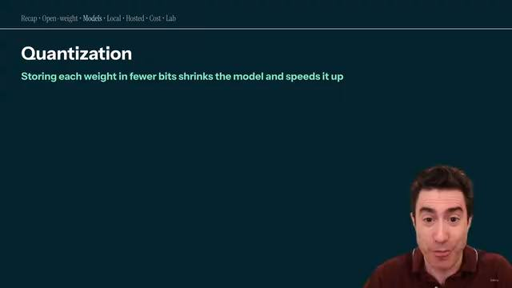

这张图里的类比值得记住：16 bit 就是有 65536 个档位的调光开关，8 bit 只剩 256 档，4 bit 只剩 16 档。开关还是同一个开关，只是档位变粗了。

### 3.2 认识量化方案的「菜名」

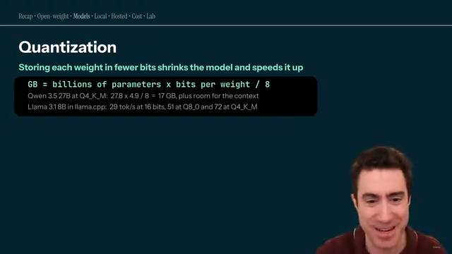

讲师明确说了他**不会深入讲每一种**，你只需要知道两件事：

- 这些名字是「把 16 bit 压到更低位数」的不同做法，做法之间有取舍（哪些权重多给一点精度、哪些少给一点）。
- `Q4_K_M` 是 Ollama 的默认方案，所以你在模型名里见得最多。它名义上是 4 bit，但因为打包方式，实际每个参数约用 **4.9 bit**。另外还有一个更早的方案叫 `Q4_0`。

课里还提到 `QAT`（Quantization Aware Training）：在训练阶段就为「将来要被量化」做准备。你会在 Gemma 的模型名里看到这个后缀。

### 3.3 认识三种文件格式

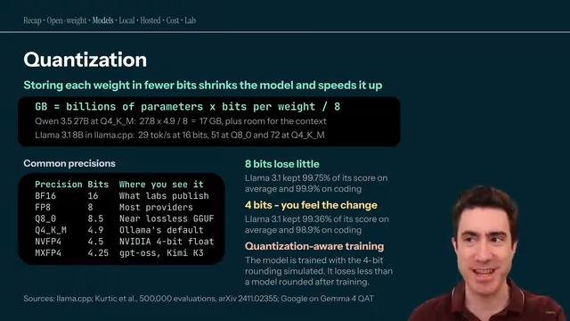

| 格式 | 谁做的 | 里面装了什么 | 谁在用 |
|---|---|---|---|
| SafeTensors | Hugging Face | 只有参数权重 | 实验室发权重时的默认格式 |
| GGUF | llama.cpp 团队 | 参数 + 分词方式 + 聊天模板，**全打包进一个文件** | Ollama、LM Studio |
| MLX | Apple | 针对 Apple Silicon 优化 | Mac 上的 LM Studio、Ollama |

对你的实际影响：**你在 Ollama 里下载的绝大多数是 GGUF 文件**；如果你在 Mac 上，模型页还会额外提供一个 `MLX` 后缀的版本，那是给 Apple 芯片优化过的。

### 3.4 会读模型名字

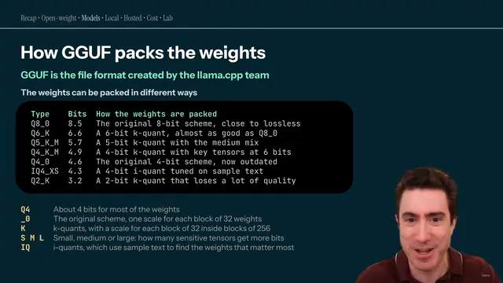

把讲师拆过的几个例子整理成一张表，以后看到陌生模型名就按这个顺序拆：

| 名字片段 | 含义 |
|---|---|
| `550B` / `27B` / `26B` | 总参数量 5500 亿 / 270 亿 / 260 亿 |
| `A55B` / `A4B` | 混合专家（MoE）模型，**任意时刻只有 55B / 4B 个参数在参与计算** |
| `E4B` | Gemma 特有的写法，effective 4B，用了一些额外技巧让实际参与计算的参数更少，跑得更快 |
| `IT` | Instruction Tuned，专门训练过对话，拿来就能聊 |
| `BF16` | 原始精度，16 bit，2 字节/参数 |
| `Q4_K_M` | 4 bit 量化，GGUF 打包方案，Ollama 默认 |
| `QAT` | 训练时就为量化做了准备 |
| `MLX` | Apple Silicon 专用格式 |
| 页面上的 `cloud` 标签 | **不是本地模型**，是跑在 Ollama 自己机器上的付费云推理 |

讲师的原话是「这些名字没有标准，厂商想怎么起就怎么起」，所以上面这张表不是规范，只是常见组合的翻译。

### 3.5 安装 Ollama

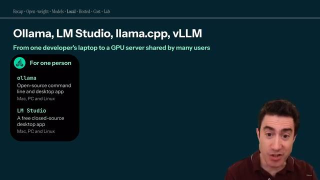

打开浏览器访问 `ollama.com`，点右上角 **Download**。**不要点 Sign in**——那是 Ollama Cloud 的付费业务，讲师专门提醒过这是「red herring」（干扰项），本地跑模型不需要账号、不需要登录。

装完之后**你会看到一个带界面的应用窗口，讲师让你直接关掉它**：

> "我希望你完全忽略这个，直接关掉它，因为接下来我们要在终端里使用 Ollama。"
> —— p032 [05:28]

### 3.6 终端里确认安装成功

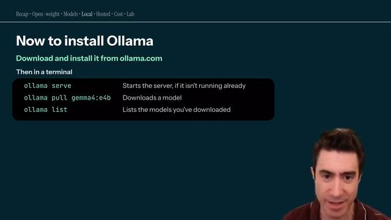

依次执行：

```bash
ollama --version
```

讲师自己跑出来的是 `0.34.2`，你装到更新的版本是正常的。

```bash
ollama
```

⚠️ **这一步会踩坑**：直接敲 `ollama` 不会给你帮助文档，而是弹出一个交互式的安装向导，问你「要不要把 Ollama 接到某个编辑器里」之类。讲师的处理方式是：

> "在那个界面按 `Ctrl+C` 退出。我们不想执行那个操作。"
> —— p032 [05:48]

所以敲完看到那个界面，直接 `Ctrl + C`。

```bash
ollama serve
```

如果服务已经在跑，这条命令会报错说端口已被占用。**这个报错是正常的**，意思就是「Ollama 已经在跑了，不用再起一个」。在 Node 里这相当于 `server.listen(3000)` 抛 `EADDRINUSE`——同一个端口只能被一个进程监听。

```bash
ollama list
# 或简写
ollama ls
```

这条命令列出你本地已有的模型。

### 3.7 下载模型

```bash
ollama pull qwen3.5:4b
```

讲师拉的是 Qwen 3.5 的 4B 版本，他说「大约 4 GB 左右」。第一次拉会花几分钟，取决于网速。

> ⚠️ 模型标签名以 `ollama.com` 模型页或 `ollama list` 实际显示为准。如果你执行 `pull` 报 `model not found`，回到模型页把那个完整的标签复制过来替换即可 —— 讲师在课上也是从模型页复制标签的。

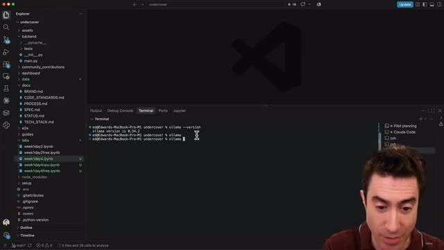

如果只是想先看看有哪些可选的 tag，可以在模型页点 **View All**：

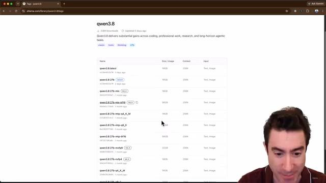

图里最底部那个 `BF16` 就是 16 bit 原版——27B 参数，按公式算 27×16÷8 ≈ 54 GB，讲师读到的页面显示是 56 GB。同页面里 8 bit 版本是 30 GB，默认量化版是 18 GB。**这三个数字放在一起，就是第 3.1 节那张表在真实页面上的样子。**

### 3.8 在终端里对话

```bash
ollama run qwen3.5:4b
```

进交互界面后，输入：

```
Hi there. I am Ed. Who are you?
```

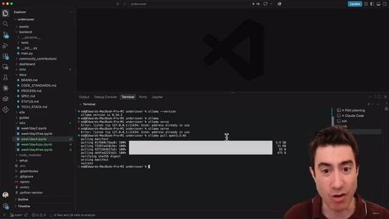

注意讲师指出的一个细节：Qwen 是一个**推理模型（reasoning model）**，它会先生成一段「思考过程」再给答案。你会在终端里看到它先自言自语几步，然后才输出正式回复。讲师的原话是「it's overthinking it, which is quite a common trait of these Qwen models」—— p032 [07:16]。

聊完按 `Ctrl + D` 退出交互界面。

再换一个模型试试：

```bash
ollama run gemma4:e2b-it-qat
```

标签拆开看就是：Gemma 4、effective 2B、instruction tuned（能聊天）、QAT（为量化训练过）。

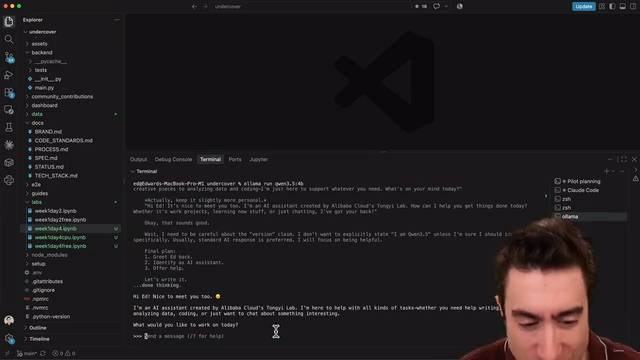

### 3.9 验证 API 端口

这是整节课最关键的一步——**从「终端里聊天」变成「别的程序能调用」**。

打开浏览器，访问：

```
http://localhost:11434
```

讲师看到的结果是页面返回一句 **"Ollama 正在运行"**。这句话的意思不是「装好了」，而是「11434 端口在监听，可以接请求了」。下一步你就把 OpenAI SDK 的 `baseURL` 指到这里。

> 课里讲师是用浏览器验证的，没有演示 `curl`。下面第 4 节的脚本里用 `curl` 做等价验证，只是自动化用的手段。

### 3.10 用 llmfit 看你的机器能扛多大

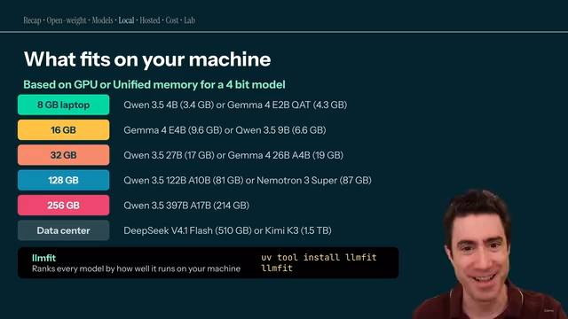

```bash
uv tool install llmfit
llmfit
```

`uv` 是 Python 的工具链管理器（课里没展开讲怎么装 uv）。装完之后直接敲 `llmfit`，它会扫你的硬件，然后列出一张表：

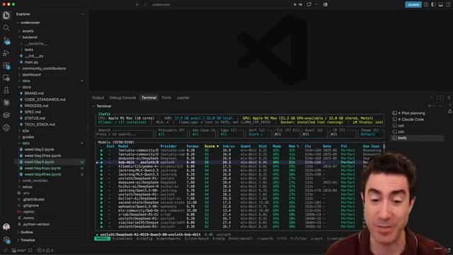

讲师解释这张表里的几列：

- 右上角是识别到的 GPU（讲师机器上是 Apple M1 Max）
- 蓝色部分是系统内存
- 每个模型的参数数量
- **score**：这个模型在你机器上的综合评分
- **tokens per second**：预估生成速度
- **fit**：`perfect` / `good` 之类的匹配度
- 默认按 score 从高到低排序，可以翻页往下看

讲师强调了两点：一是**显存/统一内存不是唯一指标，内存带宽同样重要**，它直接决定 token 生成速度；二是 **MoE 模型因为同时只有一部分参数在算，天然更快**。

### 3.11（可选）生产环境路线

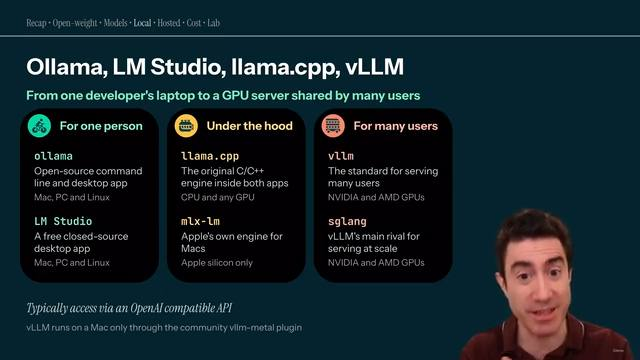

如果你以后要把这套东西部署给多人用，路线是 vLLM：

- 需要 NVIDIA 或 AMD 的 GPU 机器，**跑不了 Mac**
- 调用方式不变，还是 OpenAI 兼容 API
- 讲师提到社区有一些插件可以让 vLLM 在 Mac 上跑，但他本人没试过
- 预算有限的话，可以按小时租 RunPod 的 GPU（讲师说 RTX Pro 6000 大约 $2/小时），跑一小时实验完就关

**这一步是可选的，不影响前面 3.1–3.9 的复现。** 课里给的练习建议就是：租一台便宜的 RunPod 机器，自己在上面起一个 vLLM server 跑推理。

---

## 4. 完整代码

下面这套文件放在任意目录下（示例用 `~/ai-fde-local-llm`），可以直接保存并运行。**其中 `src/chat.mjs` 和 `scripts/04-size-math.mjs` 是按讲师讲过的公式和「OpenAI 兼容 API」这个说法补的示意代码，课里没有逐行演示过；所有 `ollama` 命令则完全来自 P032。**

### 4.1 目录结构

```
ai-fde-local-llm/
├── package.json
├── README.md
├── scripts/
│   ├── 01-check-ollama.sh
│   ├── 02-pull-models.sh
│   ├── 03-smoke-test.sh
│   └── 04-size-math.mjs
└── src/
    └── chat.mjs
```

### 4.2 `package.json`

```json
{
  "name": "ai-fde-local-llm",
  "version": "1.0.0",
  "private": true,
  "type": "module",
  "description": "复现 AI FDE P030-P032：本地跑通 Ollama 并通过 HTTP API 调用",
  "engines": {
    "node": ">=18"
  },
  "scripts": {
    "check": "bash scripts/01-check-ollama.sh",
    "pull": "bash scripts/02-pull-models.sh",
    "smoke": "bash scripts/03-smoke-test.sh",
    "math": "node scripts/04-size-math.mjs",
    "chat": "node src/chat.mjs"
  }
}
```

> `"type": "module"` 让你能用 `import` / 顶层 `await`。`engines.node >= 18` 是因为 `src/chat.mjs` 用了 Node 内置的 `fetch`，不需要装 `node-fetch`。

### 4.3 `scripts/01-check-ollama.sh`

```bash
#!/usr/bin/env bash
# 检查 Ollama 是否安装、是否在跑、已有哪些模型
set -uo pipefail

echo "===== 1. 版本 ====="
if ! command -v ollama >/dev/null 2>&1; then
  echo "❌ 没找到 ollama 命令。请先到 https://ollama.com 下载安装。"
  exit 1
fi
ollama --version

echo
echo "===== 2. 服务是否已在监听 11434 ====="
OLLAMA_HOST_URL="${OLLAMA_HOST_URL:-http://localhost:11434}"

if curl -sf "${OLLAMA_HOST_URL}" >/dev/null 2>&1; then
  echo "✅ 服务已在运行：${OLLAMA_HOST_URL}"
else
  echo "⏳ 服务未运行，尝试后台启动 ollama serve ..."
  nohup ollama serve > /tmp/ollama-serve.log 2>&1 &
  sleep 3
  if curl -sf "${OLLAMA_HOST_URL}" >/dev/null 2>&1; then
    echo "✅ 服务已启动：${OLLAMA_HOST_URL}"
  else
    echo "❌ 启动失败，日志见 /tmp/ollama-serve.log"
    echo "   常见原因：端口 11434 被别的进程占用。"
    exit 1
  fi
fi

echo
echo "===== 3. 端口响应内容（应包含 Ollama is running）====="
curl -s "${OLLAMA_HOST_URL}"
echo

echo
echo "===== 4. 本地已有模型 ====="
ollama list

echo
echo "✅ 检查完成。"
```

### 4.4 `scripts/02-pull-models.sh`

```bash
#!/usr/bin/env bash
# 拉取并试跑讲师演示的两个模型
set -euo pipefail

# 标签名以 ollama.com 模型页 / `ollama list` 实际显示为准；
# 若 pull 报 model not found，把这个变量换成页面上显示的完整标签。
QWEN_MODEL="${QWEN_MODEL:-qwen3.5:4b}"
GEMMA_MODEL="${GEMMA_MODEL:-gemma4:e2b-it-qat}"

echo "===== 拉取 Qwen（约 4 GB，首次较慢）====="
ollama pull "${QWEN_MODEL}"

echo
echo "===== 拉取 Gemma 4（effective 2B / IT / QAT）====="
ollama pull "${GEMMA_MODEL}"

echo
echo "===== 当前模型列表 ====="
ollama list

echo
echo "✅ 拉取完成。下一步可以执行："
echo "   ollama run ${QWEN_MODEL}"
echo "   ollama run ${GEMMA_MODEL}"
```

### 4.5 `scripts/03-smoke-test.sh`

```bash
#!/usr/bin/env bash
# 不发消息，只确认「端口通 + 模型在本地」
set -uo pipefail

OLLAMA_HOST_URL="${OLLAMA_HOST_URL:-http://localhost:11434}"
MODEL="${OLLAMA_MODEL:-qwen3.5:4b}"

echo "===== 1. 根路径探活 ====="
if curl -sf "${OLLAMA_HOST_URL}" >/dev/null 2>&1; then
  echo "✅ ${OLLAMA_HOST_URL} 可访问"
  curl -s "${OLLAMA_HOST_URL}"
  echo
else
  echo "❌ ${OLLAMA_HOST_URL} 不可访问。先跑 scripts/01-check-ollama.sh"
  exit 1
fi

echo
echo "===== 2. 模型是否在本地 ====="
if ollama list | grep -q "${MODEL%%:*}"; then
  echo "✅ 找到匹配 '${MODEL%%:*}' 的本地模型"
else
  echo "⚠️  没在本地模型列表里找到 '${MODEL%%:*}'，请先跑 scripts/02-pull-models.sh"
  echo "   当前本地模型："
  ollama list
fi
```

### 4.6 `scripts/04-size-math.mjs`

```javascript
#!/usr/bin/env node
// 把讲师 P030 [03:52] 的公式写成脚本：
//   GB ≈ 参数（十亿） × 每个权重位数 ÷ 8
// 用法：
//   node scripts/04-size-math.mjs            -> 默认 27B / 16bit
//   node scripts/04-size-math.mjs 27 8       -> 27B / 8bit
//   node scripts/04-size-math.mjs 7 4.9      -> 7B  / Q4_K_M（实际约 4.9bit/参数）

const paramBillions = Number(process.argv[2] ?? 27);
const bitsPerWeight = Number(process.argv[3] ?? 16);

if (!Number.isFinite(paramBillions) || !Number.isFinite(bitsPerWeight)) {
  console.error("用法: node scripts/04-size-math.mjs <参数量,单位十亿> <每权重位数>");
  process.exit(1);
}

const gigabytes = (paramBillions * bitsPerWeight) / 8;

console.log(`参数规模        : ${paramBillions}B`);
console.log(`每权重位数      : ${bitsPerWeight} bit`);
console.log(`估算磁盘/显存   : ${gigabytes.toFixed(1)} GB`);
console.log(
  `一句话          : ${paramBillions}B 参数按 ${bitsPerWeight}bit 存，约 ${gigabytes.toFixed(1)} GB`
);
```

### 4.7 `src/chat.mjs`

```javascript
#!/usr/bin/env node
// 课里没有给这段代码。这是按讲师 P031 [00:26] 的说法补的最小示例：
// "they've got APIs that are identical to OpenAI's API.
//  So you could be talking to OpenAI and then just change it to point to localhost"
//
// 字段名（choices / message / content）请以实际输出为准，课里未逐字段演示。

const BASE_URL = process.env.OLLAMA_BASE_URL ?? "http://localhost:11434/v1";
const MODEL = process.env.OLLAMA_MODEL ?? "qwen3.5:4b";
const USER_TEXT =
  process.env.USER_TEXT ?? "Hi there. I am Ed. Who are you?";

async function main() {
  console.log(`→ ${BASE_URL}  model=${MODEL}`);
  console.log(`→ user: ${USER_TEXT}\n`);

  let res;
  try {
    res = await fetch(`${BASE_URL}/chat/completions`, {
      method: "POST",
      headers: { "Content-Type": "application/json" },
      body: JSON.stringify({
        model: MODEL,
        messages: [{ role: "user", content: USER_TEXT }],
        stream: false
      })
    });
  } catch (err) {
    console.error("请求失败，先确认服务在跑（curl http://localhost:11434）");
    console.error(String(err));
    process.exit(1);
  }

  if (!res.ok) {
    console.error(`HTTP ${res.status}`);
    console.error(await res.text());
    process.exit(1);
  }

  const data = await res.json();
  const content = data?.choices?.[0]?.message?.content;

  if (typeof content === "string") {
    console.log("assistant:");
    console.log(content);
  } else {
    console.log("未拿到 choices[0].message.content，原始响应如下：");
    console.log(JSON.stringify(data, null, 2));
  }
}

await main();
```

### 4.8 `README.md`

```markdown
# ai-fde-local-llm

复现 AI FDE（BV1rJnm64Eq3）P030–P032：量化原理 + 本地跑通 Ollama + HTTP API 调用。

## 环境

- Node.js >= 18（用到内置 fetch）
- Ollama（从 https://ollama.com 下载，**不要**注册 Ollama Cloud）

## 步骤

```bash
npm run check    # 确认 ollama 已装、11434 在监听、列出本地模型
npm run pull     # 拉 qwen3.5:4b 与 gemma4:e2b-it-qat
npm run smoke    # 探活 + 确认模型在本地
npm run chat     # 用 Node 走 HTTP 调模型
npm run math     # 按讲师公式估算模型体积
```

## 环境变量

| 变量名 | 默认值 | 说明 |
|---|---|---|
| `OLLAMA_BASE_URL` | `http://localhost:11434/v1` | OpenAI 兼容接口的基础地址 |
| `OLLAMA_HOST_URL` | `http://localhost:11434` | shell 脚本探活用的根地址 |
| `OLLAMA_MODEL` | `qwen3.5:4b` | 要调用的模型标签 |
| `USER_TEXT` | `Hi there. I am Ed. Who are you?` | 发给模型的第一句话 |

模型标签请以 `ollama.com` 模型页或 `ollama list` 的实际显示为准。
```

---

## 5. 逐行解释

### 5.1 `scripts/01-check-ollama.sh`

- `set -uo pipefail`：`-u` 让未定义变量直接报错，`-o pipefail` 让管道里任一环失败都算失败。注意这里**故意没有加 `-e`**，因为「`ollama serve` 报端口已占用」我们希望在脚本里自己判断，而不是让脚本直接退出。
- `command -v ollama >/dev/null 2>&1`：判断命令是否在 PATH 里。这是 shell 里最稳的「有没有装」检查方式。**别用 `which`**，`which` 在某些系统上行为不一致。
- `OLLAMA_HOST_URL="${OLLAMA_HOST_URL:-http://localhost:11434}"`：`:-` 是「有值就用，没值用默认」。这样你可以在外部 `export OLLAMA_HOST_URL=...` 覆盖。
- `curl -sf ... >/dev/null 2>&1`：`-s` 静默，`-f` 遇到 HTTP 4xx/5xx 返回非零退出码。**这里用 `-f` 是关键**，否则哪怕服务返回 500，`curl` 也是退出码 0，你的探活就失效了。
- `nohup ollama serve > /tmp/ollama-serve.log 2>&1 &`：后台起服务并把输出重定向到日志。`nohup` 是让进程不受终端挂断影响。
- `sleep 3`：给进程一点启动时间。写死 3 秒有点粗暴，但在本地环境够用；生产脚本里应该改成轮询。
- `curl -s "${OLLAMA_HOST_URL}"`：直接打印响应体，正常情况下就是那句 **"Ollama 正在运行"**，和讲师在浏览器里看到的一致。
- `ollama list`：对应 P032 [00:22] 讲师讲的 `ollama list` / `ollama ls`。

### 5.2 `scripts/02-pull-models.sh`

- `QWEN_MODEL="${QWEN_MODEL:-qwen3.5:4b}"`：把模型标签抽成变量，是为了应对「标签名对不上」这个必然会发生的情况。你只要 `QWEN_MODEL=xxx npm run pull` 就能换，不用改脚本。
- `set -euo pipefail`：这里**加了 `-e`**，因为拉模型失败就该立刻停下，不要带着半个模型继续往下跑。
- `ollama pull "${QWEN_MODEL}"`：对应 P032 [06:30] 讲师拉 Qwen 3.5 4B 的操作，他提到大约 4 GB。
- `ollama list`：拉完再列一次，肉眼确认两个模型都在。

### 5.3 `scripts/04-size-math.mjs`

- `Number(process.argv[2] ?? 27)`：`process.argv[2]` 是第一个命令行参数，`??` 是空值合并（只在 `null`/`undefined` 时取默认），比 `||` 更准确——因为 `0` 是合法参数值。
- `(paramBillions * bitsPerWeight) / 8`：这就是讲师在 P030 [03:52] 说的公式。`÷8` 是因为 1 字节 = 8 位；参数单位是「十亿」，所以乘出来的结果单位直接就是 GB（十亿字节）。
- `gigabytes.toFixed(1)`：保留一位小数。**注意这一行和讲师口述的 56 GB 会有差异**：27×16÷8 = 54，讲师读页面是 56，原因是模型实际参数量略多于名义上的 27B。这个差异是正常的，不要以为是公式错了。
- 试跑结果：
  - `node scripts/04-size-math.mjs 27 16` → 54.0 GB（讲师页面读数 56 GB）
  - `node scripts/04-size-math.mjs 27 8` → 27.0 GB（讲师页面读数 30 GB，同样因为实际参数量偏大）
  - `node scripts/04-size-math.mjs 27 4.9` → 16.5 GB（讲师页面读数 18 GB）

  三个都对得上量级，说明公式是可用的估算工具，不是精确值。

### 5.4 `src/chat.mjs`

- `const BASE_URL = process.env.OLLAMA_BASE_URL ?? "http://localhost:11434/v1"`：端口 `11434` 来自 P032 [00:29]。`/v1` 这一层是为了对齐 OpenAI 的接口形状——讲师的原话是「API identical to OpenAI's API，把地址改指向 localhost 就行」，所以**同一份代码，只要把这个变量改成 `https://api.openai.com/v1` 并换成 OpenAI 的 key，逻辑不变**。这是本节最重要的可迁移点。
- `fetch(...)`：Node 18 起内置，不用装包。如果你在浏览器里写，这段逻辑几乎原样可搬。
- `headers: { "Content-Type": "application/json" }`：本地服务不需要 Authorization，这也是讲师说「直接指向 localhost 就行」的原因之一。
- `stream: false`：先拿完整响应，方便调试。改成 `true` 就要处理流式读取，课里没展开。
- `try/catch` 包住 `fetch`：这一步专门捕获「服务没起来」的情况。`fetch` 在连接被拒时会 reject，但**不会**在收到 500 时 reject——所以后面还要单独判断 `res.ok`。这个坑很多人会漏。
- `data?.choices?.[0]?.message?.content`：用可选链避免任何一层缺失时抛错。字段名**以实际输出为准**，课里没有逐字段演示过响应结构，所以下面还留了一条兜底分支把原始 JSON 打出来。
- `if (typeof content === 'string')`：类型守卫。有些情况下 `content` 可能是数组或者为空，直接 `console.log` 会打出 `undefined`，加了兜底更好排查。
- 脚本末尾的 `await main()`：因为 `package.json` 里设了 `"type": "module"`，`.mjs` 支持顶层 `await`。

### 5.5 关于「并发」这件事的 JS 对照

这一节没有锁、没有事务，但有两个**单实例**约束值得用 Node 的思维理解一下：

1. **`ollama serve` 只能有一个进程监听 11434**。再起一个就报端口占用——和 Node 里 `server.listen(11434)` 抛 `EADDRINUSE` 是同一回事。你不需要自己写锁，操作系统帮你做了。
2. **`ollama pull` 是一次阻塞式下载**。在脚本里它就是顺序执行的，等价于 Node 里的 `await` 一个下载任务。真正要并行拉多个模型时，别用 `&` 并发拉，容易把磁盘 IO 打满——顺序拉更稳。
3. **模型加载进内存后才开始推理**。讲师在 P032 里说换模型「takes just a second when it loads it in」，这个加载过程你没法从外部进度条看到，只能等。

---

## 6. 复现检查清单

按顺序打勾，任何一项不过就先解决它，不要往下走。

**环境层**

- [ ] `node -v` 输出 ≥ v18（`src/chat.mjs` 依赖内置 `fetch`）
- [ ] `ollama --version` 有输出，记下版本号（讲师是 `0.34.2`）
- [ ] 访问 `ollama.com` 时**没有**点 Sign in，也没装 Ollama Cloud 相关的东西
- [ ] 装完 Ollama 后那个 GUI 窗口已经关掉，后续全部在终端操作
- [ ] 裸敲 `ollama` 弹出的交互式安装向导已经用 `Ctrl + C` 退出

**服务层**

- [ ] `curl http://localhost:11434` 返回的正文里包含 `Ollama is running`
- [ ] `ollama list` 能正常输出（哪怕是空表格）
- [ ] 重复执行 `ollama serve` 会报端口占用——**这是预期行为**，不是错误
- [ ] `npm run check` 全绿

**模型层**

- [ ] `npm run pull` 完成，`ollama list` 里能看到你拉的两个模型
- [ ] `ollama run qwen3.5:4b` 能进交互界面，输入一句话能得到回复
- [ ] 回复前能看到「思考过程」（Qwen 是推理模型，这是正常现象）
- [ ] `Ctrl + D` 能正常退出交互界面
- [ ] `ollama run gemma4:e2b-it-qat` 能跑，且回复速度明显比 Qwen 快

**代码层**

- [ ] `npm run math` 三组参数结果与第 5.3 节对得上（54.0 / 27.0 / 16.5）
- [ ] `npm run smoke` 全绿
- [ ] `npm run chat` 能拿到一段中文或英文回复，不是 `undefined`
- [ ] 把 `OLLAMA_MODEL` 改成另一个模型标签后 `npm run chat` 还能跑通
- [ ] （可选）`USER_TEXT="用一句话解释什么是量化" npm run chat` 能返回合理答案

**认知层（对着讲义自查，不用动手）**

- [ ] 能不用查资料说清 `Q4_K_M` 的两个信息：4 bit 量化 + GGUF 的一种打包方式
- [ ] 能说清「量化」和「蒸馏」的区别：量化保参数量、降精度；蒸馏直接砍参数量
- [ ] 能说清 `BF16`、`IT`、`QAT`、`A##B` 分别是什么意思
- [ ] 知道 `localhost:11434` 这个端口存在，意味着「别的程序可以调它」

---

## 7. 课里没讲但你会撞上的

下面这些是照着做的时候大概率会遇到、但讲师在 P030–P032 里**没有展开**的情况。凡是标了「课里没讲」的，都是我的补充，不是讲师原话。

**1）`ollama pull` 卡住或中断**
课里没讲重试机制。实践中直接重跑同一条 `ollama pull <tag>` 即可，已下载的分片一般不会重头再来。如果反复失败，先确认磁盘剩余空间够——按第 3.1 节的公式，4 bit 的 4B 模型大约 2–3 GB，16 bit 的 27B 模型要 50 GB 以上。

**2）`ollama list` 里看不到刚拉的模型**
课里没讲。最可能的原因是标签打错了，`pull` 的时候其实拉的是另一个 tag。回到 `ollama.com` 模型页，点 **View All**，把完整标签连冒号后面那一段一起复制。

**3）Mac 上模型加载到一半卡死**
课里没讲具体表现和报错文本。只知道讲师反复强调 Mac 用的是**统一内存（unified RAM）**，不是独立显存；他在 llmfit 那一节还专门说「内存带宽也会影响出 token 的速度」。所以 Mac 上能跑多大的模型，取决于整机内存而不是「显存」。具体的内存不足报错长什么样，**以你机器上的实际输出为准**，课里没有演示。

**4）11434 端口被别的程序占了**
课里没讲怎么改端口。讲师只演示了「`ollama serve` 报错说明已经在跑」。如果确认是别的程序占用，改端口的方式课里没提，需要你自己查 Ollama 文档。

**5）下载速度很慢**
课里没讲。讲师拉 Qwen 时是「已经拉过了所以秒下」，他自己也说「It will take a few minutes for you」。国内网络环境下可能需要自备代理，这部分课里完全没涉及。

**6）关于「量化到 4 bit 之后效果变差」的体感**
讲师说得很明确：4 bit 在 benchmark 上看起来掉得不多，但**当你把它当 coding agent 用的时候，你会明显感觉「在跟另一个东西打交道」**（p030 [05:36]）。这是课里少有的、明确给出主观判断的地方，建议你自己拿同一个 prompt 在 Q4 和 Q8 上各跑一次对比。

**7）关于「模型名字没有标准」这件事的实际后果**
讲师说「a provider can make up whatever name they like」（p030 [10:32]）。这意味着**你不能靠正则去解析模型名来做自动化选型**。要做模型路由或自动挑选，只能维护一张显式的映射表，而不是解析字符串。

**8）llmfit 的 `uv` 从哪来**
课里只给了 `uv tool install llmfit`，没说 `uv` 本身怎么装。`uv` 是 Python 生态的工具链管理器，需要单独安装，这一步课里没有覆盖。

**9）vLLM 在 Mac 上跑不了**
课里讲得很清楚：vLLM 面向 NVIDIA / AMD GPU，Mac 上不行。讲师提了一句「社区有插件可以做到，但我没试过」。所以如果你只有 Mac，本节的 Ollama 路线就是你的主线，vLLM 那条路必须租 GPU 机器。

**10）关于「OpenAI 兼容 API」到底兼容到什么程度**
讲师说「identical to OpenAI's API，改一下 baseURL 就行」，但**课里没有逐字段验证过**。`src/chat.mjs` 里用的 `choices[0].message.content` 是 OpenAI 的形状，Ollama 返回的字段名请以你实际 `console.log` 出来的 JSON 为准——脚本里已经留了兜底分支把原始响应打出来，就是为这个准备的。