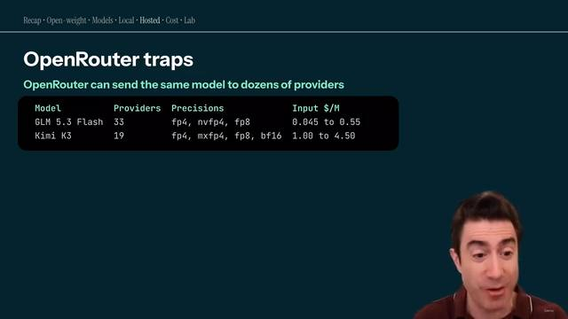
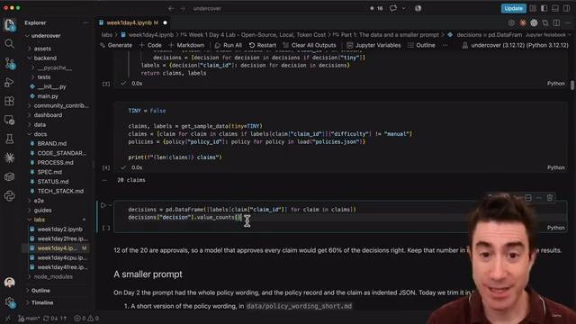
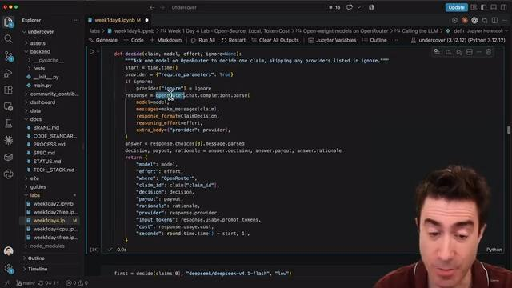
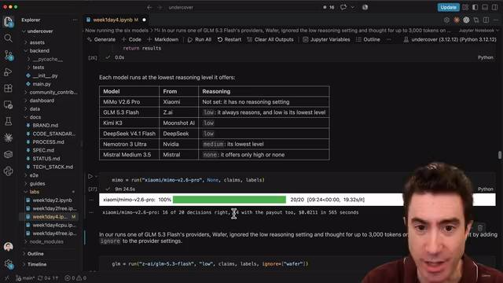
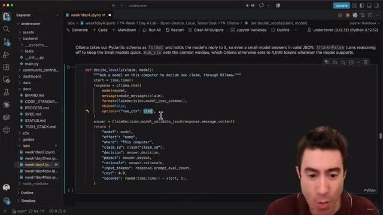
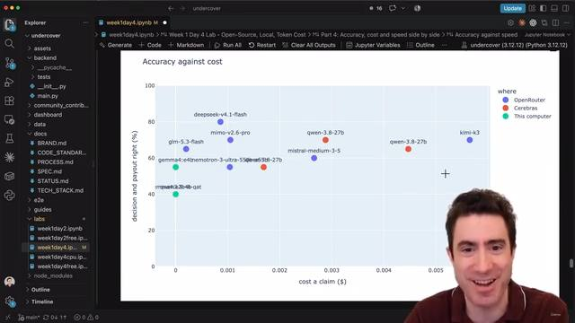
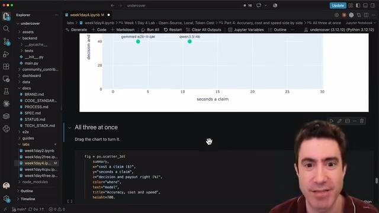

# AI FDE 课程文档：多模型评测实验（P033–P035）

> 覆盖 P033 / P034 / P035。本节是一个 Jupyter Notebook 实验：用同一套「精简版理赔提示词」跑 6 个 OpenRouter 上的开源权重模型 + 3 个本地 Ollama 模型 + 1 个直连 Cerebras 的模型，最后对比**准确率 / 成本 / 速度**，画出帕累托前沿图。

---

## 1. 这一节做什么

这一节不是讲概念，是**动手做一次模型选型实验**。做完之后你会得到一张表：每个模型在 20 条保险理赔样本上的「决策正确数 / 决策+赔付金额都正确数 / 总耗时 / 总花费」，以及两张散点图（准确率-成本、准确率-速度）。

具体分四步（讲师在 p034 [00:21] 明确列出）：

1. **数据**：加载 20 条理赔样本，**显式排除** difficulty 为 `manual` 的 5 条（那 5 条本来就需要人工补充信息，喂给模型是浪费时间）。
2. **OpenRouter 上的 6 个开源权重模型**：Mimo、GLM、Kimi、DeepSeek、Nemotron、Mistral。
3. **本地 Ollama 的 3 个模型**：Qwen 3.5 4B、Gemma 4 E2B IT QAT、Gemma 4 E4B。
4. **对比**：准确率、成本、速度三项并排，画图。

外加一个可选的「彩蛋」：不走 OpenRouter，**直连 Cerebras** 跑 Qwen 3 27B，验证「直连 provider」这条路。

> 讲师在 p033 [00:00] 开头就点明了这一节的核心动机：OpenRouter 本身不做推理，它背后是一堆 provider，**同一个模型可能被路由到不同 provider**，而不同 provider 的量化方式、支持的特性（比如 structured outputs）、价格、最大输出 token 都可能不一样。所以「固定 provider」是这一节反复出现的工程要点。

读这一节时，建议始终带着三个问题：第一，这次请求到底依赖 provider 的哪些能力，尤其是 structured outputs；第二，成本和速度的口径是什么，是单条、20 条还是一次批处理；第三，哪些结论是模型能力差异，哪些只是路由差异。把这三个问题问清楚，后面的表格和图才不会读成“谁分数高就选谁”这么简单。

---

## 2. 讲师原话

> "OpenRouter 本身并不运行推理。它背后使用了许多提供商。事实上，同一个模型可能会被分发到许多不同的提供商。GLM53 Flash 有 33 个不同的提供商。"
> —— p033 [00:00]

> "有些提供商可能不支持结构化输出，这意味着可能今天你运行的某段代码一切正常，明天同一段代码就不工作了，因为 OpenRouter 选择把你路由到另一个不支持结构化输出的提供商。"
> —— p033 [01:55]

> "你可以用 provider 字段指定尝试它们的顺序，并传入这个顺序。你可以指定要使用的量化方式。你可以把 allow fallbacks 设为 false……并把 require parameters 设为 true，这意味着它需要支持结构化输出。"
> —— p033 [02:55]

> "每次你为 OpenRouter 的接口密钥充值，他们都会收取 5.5% 的费用。"
> —— p033 [04:59]

> "不要过多考虑每个词元的成本，而要更多考虑在结果质量符合业务要求的前提下，完成一个真实业务任务所需的成本。"
> —— p033 [08:54]

> "原版策略有 1369 个词，缩短后的版本有 808 个词。"
> —— p034 [02:14]

> "20 个中有 12 个获得批准……如果一个模型对所有问题都回答“批准”，那么它的正确率就是 60%……任何低于 60% 的结果对我们来说都没用。"
> —— p034 [01:17]

> "如果你真的运行这个实验，它可能要花大约 25 美分，还可能占用 20 GB 内存……你可以把 tiny 设为 true，以获得更快、更便宜的运行。"
> —— p034 [00:21]

> "这实际上是在告诉 OpenRouter：嘿，确保只把我的请求路由到支持我这个请求里所有能力的提供商。"
> —— p034 [05:25]

> "我遇到一个问题：这个特定的提供商给我带来了麻烦。它没有遵循低推理设置。所以我可以传入 providers.ignore，把 Wafer 忽略掉。"
> —— p034 [10:05]

> "Mimo 在 20 个决策中做对了 16 个，其中 14 个还把应支付金额算对了……总共只花了 2 美分……565 秒，接近 10 分钟。"
> —— p034 [09:51]

> "DeepSeek V4 One Flash 表现很好。它做对了 17 个决策，其中 16 个的应支付金额也正确……全部 20 个只花了 0.7 美分。"
> —— p034 [12:26]

> "Cerebras……9 秒就把整件事做完了。"
> —— p035 [08:01]

> "获胜者当然是在本地运行的模型，成本正好是零。"
> —— p035 [10:53]

这些原话基本对应了本节的四个工程动作：固定 provider 能力、压缩 prompt、把准确率拆成决策和金额两个指标、把成本按真实业务任务而不是单 token 来算。后面复现时如果某一步跑不通，可以回到对应引用看讲师当时为什么这样设计。

---

## 3. 从零复现

### 3.1 前置条件

| 项 | 要求 | 说明 |
|---|---|---|
| Python | 3.11+ | 课里没指定版本，用你环境里能跑 pydantic v2 的版本即可 |
| 仓库 | 课程配套 repo 的 `labs/week1/day4/` 目录 | 讲师在 p034 [00:00] 说在 "第一周实验日要用的 labs 目录里的那个 undercover 仓库" |
| 变体 notebook | `week1_day4_lab.ipynb`（主）、`..._cpu.ipynb`（无 GPU）、`..._free.ipynb`（零花费） | p033 [11:36] 提到三个版本 |
| 磁盘 | 本地模型约 10 GB（Gemma 4 E4B 单独就接近 10 GB） | p035 [00:37] |
| 内存 | 最多约 20 GB；Gemma 4 E4B 建议 16 GB 以上 | p034 [00:21]、p035 [05:34] |
| 花费 | 全跑完约 25 美分（OpenRouter 部分） | p034 [00:21] |

前置条件这一张表建议在动手前逐项确认，尤其是磁盘和内存。原因是本地模型一旦开始拉取和加载，失败往往不是代码错误，而是环境资源不够；先确认 Python 版本、repo 路径和变体 notebook，再启动服务，可以少走很多弯路。

### 3.2 环境变量

在仓库根目录建 `.env`（讲师在 p035 [06:39] 明确说 "我的 .env 文件里有一个 API 密钥"）：

```bash
# .env
OPENROUTER_API_KEY=sk-or-v1-xxxxxxxxxxxxxxxxxxxxxxxx
CEREBRAS_API_KEY=csk-xxxxxxxxxxxxxxxxxxxxxxxx
```

> 注意：课里只提到这两个 key。Ollama 本地不需要 key。

完整解释：`.env` 要放在你执行 notebook 的工作目录或仓库根目录，`load_dotenv()` 默认会从当前工作目录向上查找；如果你在 `labs/week1/day4/` 里启动 Jupyter，但 `.env` 放在仓库根目录，通常也能被找到，但最稳妥的是确认 `os.environ["OPENROUTER_API_KEY"]` 能被读到。常见错误是 key 复制时带了引号或空格，或者变量名拼成 `OPENROUTER_KEY`。排查方法是在 notebook 里先跑 `print(os.environ.get("OPENROUTER_API_KEY", "MISSING")[:8])`，只打印前缀，不要打印完整 key。前端对照：Node 里对应 `process.env.OPENROUTER_API_KEY`，同样需要 `dotenv.config()` 或框架自带的环境变量加载；不要把 key 写进前端浏览器代码。

### 3.3 安装依赖

```bash
# 建议在虚拟环境里
python -m venv .venv
source .venv/bin/activate        # Windows: .venv\Scripts\activate

pip install openai python-dotenv pydantic tqdm pandas matplotlib ollama
```

> 说明：`openai` 包同时用于 OpenRouter 和 Cerebras，因为两者都提供 **OpenAI 兼容 API**（p033 [04:24] 讲师原话 "通过 OpenAI 兼容 API 使用它"）。`ollama` 是本地模型的客户端库（p035 [01:03] "我们使用的是 Ollama 客户端库。"）。

命令完整解释：`python -m venv .venv` 创建隔离环境，避免课程依赖污染系统 Python；`source .venv/bin/activate` 在 macOS/Linux 激活，Windows 用 `.venv\Scripts\activate`；`pip install` 一行安装本节需要的库。`openai` 负责 OpenRouter 和 Cerebras 的 OpenAI 兼容调用；`python-dotenv` 读取 `.env`；`pydantic` 定义结构化输出 schema；`tqdm` 显示进度条；`pandas` 处理样本和汇总；`matplotlib` 画图；`ollama` 调本地模型。常见错误与排查：如果 `pip install` 很慢，先确认是否在虚拟环境里；如果 `pydantic` 版本过旧，`model_json_schema()` 或 `model_validate_json()` 可能不可用，先升级到 v2；如果 `ollama` 报 `unexpected keyword argument 'think'`，说明库版本旧，先 `pip install -U ollama`。前端对照：Node 项目里对应 `npm install openai dotenv` 等，环境变量同样通过 `.env` 加载，但不要把服务端 key 暴露到浏览器。

### 3.4 拉取本地模型

```bash
ollama pull qwen3.5:4b
ollama pull gemma4:2b-it-qat
ollama pull gemma4:4b          # 可选，约 10 GB
```

> 课里 p035 [00:37] 说 "执行 pull 会确保这些模型已经在我们的电脑上"。**具体 tag 名课里没有逐字给出**，上面是根据讲师口述的模型名（"Quen 3.5 4B"、"Gemma 4 E2B IT QAT"、"Gemma 4 E4B"）推断的写法，请以 `ollama list` / Ollama 官方库里的实际 tag 为准。

常见错误与排查：如果 `ollama pull` 提示 `model not found`，先运行 `ollama list` 看本地已有哪些 tag，再去 Ollama 官方库确认准确名称；如果拉取中断，重新执行同一条 pull 命令通常会续传；如果磁盘不足，先删掉不用的旧模型。前端对照：前端不会直接拉模型，但如果你写的是本地工具或 Electron 应用，调用 Ollama 的 HTTP 接口时同样要确认模型 tag 存在，否则请求会直接返回模型不存在。

### 3.5 启动顺序

1. 确认 Ollama 服务在跑：`ollama serve`（多数安装包会自动作为后台服务启动）。
2. 打开 notebook：`jupyter lab labs/week1/day4/week1_day4_lab.ipynb`。
3. **从上往下依次执行 cell**，不要跳。第 1 个 cell 是 import + 连接 OpenRouter，第 2 个 cell 加载数据，后面依次是 prompt 构造、OpenRouter 批量跑、Ollama 批量跑、Cerebras、对比图表。
4. 想省钱/省时间：把 `tiny = True` 打开，只跑 5 条样本（p034 [00:21]）。

常见错误与排查：如果第 1 个 cell 就报 key 读不到，回到 3.2 检查 `.env`；如果第 2 个 cell 报文件不存在，确认 notebook 的当前工作目录是不是 `labs/week1/day4/`；如果 Ollama 请求连接失败，先在终端跑 `ollama list` 确认服务可用；如果跑到一半内存爆掉，先关掉 Gemma 4 E4B，只跑前两个本地模型。前端对照：这相当于 Node 服务启动顺序——先起本地依赖服务，再起应用；不要在前端请求里假设本地模型一定已经加载。

### 3.6 目录结构（按讲师描述还原）

```
undercover-repo/
├── .env
├── labs/
│   └── week1/
│       └── day4/
│           ├── week1_day4_lab.ipynb
│           ├── week1_day4_lab_cpu.ipynb
│           ├── week1_day4_lab_free.ipynb
│           └── data/
│               ├── claims.csv              # 理赔样本（含 difficulty 列）
│               └── policy_short.md         # 精简版保单条款（808 词）
└── ...
```

> 数据文件名课里没有逐字念出来，上面是按讲师描述（"data 目录中有我们所有策略的简化版本。"、"load in the 20 claims"）还原的合理命名。**实际文件名以你 clone 下来的 repo 为准**。

排查目录问题时，优先看 notebook 里 `Path("data/claims.csv")` 是相对哪个目录解析的；如果你从仓库根目录启动 Jupyter，路径可能和从 `day4/` 启动不一样。前端对照：这就像前端项目里的静态资源路径，开发服务器根目录不同，`/data/...` 的解析结果也不同。

---

## 4. 完整代码

下面把 notebook 里的关键 cell 按顺序整理成可直接保存运行的 `.py` 文件。**如果你用 notebook，把每个 `# ==== CELL N ====` 之间的内容粘进一个 cell 即可。**

```python
# ============================================================
# week1_day4_lab.py
# AI FDE Week1 Day4 多模型评测实验
# ============================================================

# ==== CELL 1: imports + 连接 OpenRouter ====
import os
import json
import time
from pathlib import Path

import pandas as pd
import matplotlib.pyplot as plt
from dotenv import load_dotenv
from pydantic import BaseModel
from tqdm import tqdm
from openai import OpenAI

load_dotenv()

# OpenRouter 走 OpenAI 兼容接口
openrouter = OpenAI(
    base_url="https://openrouter.ai/api/v1",
    api_key=os.environ["OPENROUTER_API_KEY"],
)

# 全局开关：True 只跑 5 条，省钱省时间
tiny = False


# ==== CELL 2: 加载数据 ====
def get_sample_data(tiny: bool = False):
    """读取理赔样本，排除 difficulty == 'manual' 的条目。"""
    df = pd.read_csv(Path("data/claims.csv"))
    # 讲师 p034 [01:17]：显式排除 manual 难度
    df = df[df["difficulty"] != "manual"].reset_index(drop=True)
    if tiny:
        df = df.head(5)
    return df


claims_df = get_sample_data(tiny=tiny)
print(f"样本数: {len(claims_df)}")
print(claims_df["label"].value_counts())   # 看 approve / decline / refer 分布


# ==== CELL 3: 构造精简 prompt ====
# 讲师 p034 [02:14]：原 policy 1369 词 -> 精简版 808 词
POLICY_PATH = Path("data/policy_short.md")

# 按 benefit 类型切分 policy，只把相关段落塞进 prompt
POLICY_SECTIONS = {
    "trip_delay": "## Trip Delay\n...",
    "trip_cancellation": "## Trip Cancellation\n...",
    "medical": "## Medical\n...",
    "baggage": "## Baggage\n...",
}

SYSTEM_PROMPT = (
    "You are a claims handler. "
    "Choose exactly one of: approve, decline, refer. "
    "Return a rationale, a decision, and a payout amount."
)


def make_messages(claim_row) -> list[dict]:
    """把一条 claim + 相关 policy 段落拼成 messages。"""
    benefit = claim_row["benefit"]
    policy_chunk = POLICY_SECTIONS.get(benefit, "")

    # 讲师 p034 [03:19]：把 documents 里的 id/text 去掉，只留必要信息
    docs = json.loads(claim_row["documents"]) if isinstance(claim_row["documents"], str) else claim_row["documents"]
    slim_docs = [{"type": d.get("type"), "text": d.get("text")} for d in docs]

    user_prompt = (
        f"POLICY:\n{policy_chunk}\n\n"
        f"CLAIM:\n{json.dumps(slim_docs, ensure_ascii=False)}\n\n"
        f"DETAILS:\n{claim_row['details']}"
    )
    return [
        {"role": "system", "content": SYSTEM_PROMPT},
        {"role": "user", "content": user_prompt},
    ]


# ==== CELL 4: 结构化输出 schema ====
class ClaimDecision(BaseModel):
    rationale: str
    decision: str        # approve / decline / refer
    payout: float


# ==== CELL 5: OpenRouter 单条决策 ====
def decide(claim_row, model: str, reasoning_effort: str = "low", ignore: list[str] | None = None):
    """调用 OpenRouter，返回 dict。"""
    provider_cfg = {
        "require_parameters": True,   # 只路由到支持 structured outputs 的 provider
    }
    if ignore:
        provider_cfg["ignore"] = ignore

    t0 = time.time()
    resp = openrouter.chat.completions.parse(
        model=model,
        messages=make_messages(claim_row),
        response_format=ClaimDecision,
        extra_body={
            "reasoning": {"effort": reasoning_effort},
            "provider": provider_cfg,
        },
    )
    elapsed = time.time() - t0

    parsed: ClaimDecision = resp.choices[0].message.parsed
    usage = resp.usage
    return {
        "decision": parsed.decision,
        "payout": parsed.payout,
        "rationale": parsed.rationale,
        "input_tokens": usage.prompt_tokens,
        "output_tokens": usage.completion_tokens,
        "elapsed_s": elapsed,
        "provider": getattr(resp, "provider", None),  # 该字段名请以实际输出为准
    }


# ==== CELL 6: 批量跑 + 打分 ====
def score_one(pred: dict, truth_row) -> tuple[bool, bool]:
    """返回 (决策是否正确, 决策+赔付是否都正确)。"""
    decision_ok = pred["decision"] == truth_row["label"]
    payout_ok = decision_ok and abs(pred["payout"] - truth_row["payout"]) < 0.01
    return decision_ok, payout_ok


def run(model: str, effort: str, df: pd.DataFrame, ignore: list[str] | None = None):
    rows = []
    for _, row in tqdm(df.iterrows(), total=len(df), desc=model):
        try:
            pred = decide(row, model=model, reasoning_effort=effort, ignore=ignore)
        except Exception as e:
            pred = {"decision": "error", "payout": 0.0, "rationale": str(e),
                    "input_tokens": 0, "output_tokens": 0, "elapsed_s": 0.0, "provider": None}
        d_ok, p_ok = score_one(pred, row)
        rows.append({**pred, "decision_ok": d_ok, "payout_ok": p_ok})
    return pd.DataFrame(rows)


# ==== CELL 7: 跑 6 个 OpenRouter 模型 ====
OPENROUTER_MODELS = [
    # (显示名, model id, reasoning effort, ignore 列表)
    ("Mimo",     "xiaomi/mimo-7b-rl",         None,   None),   # 不能设 effort，总是推理
    ("GLM53",    "z-ai/glm-5.3-flash",        "low",  ["wafer"]),
    ("KimiK3",   "moonshotai/kimi-k3",        "low",  None),
    ("DeepSeek", "deepseek/deepseek-v4.1-flash", "low", None),
    ("Nemotron", "nvidia/nemotron-4-340b",    "low",  None),
    ("Mistral",  "mistralai/mistral-large",   "low",  None),
]

results = {}
for name, model_id, effort, ignore in OPENROUTER_MODELS:
    print(f"\n=== {name} ===")
    results[name] = run(model_id, effort, claims_df, ignore=ignore)


# ==== CELL 8: 本地 Ollama ====
from ollama import Client
ollama_client = Client()


def decide_locally(claim_row, model: str):
    t0 = time.time()
    resp = ollama_client.chat(
        model=model,
        messages=make_messages(claim_row),
        format=ClaimDecision.model_json_schema(),   # 结构化输出
        think=False,                                 # 关掉 thinking
        options={"num_ctx": 8192},                   # 留出 reasoning 的余量
    )
    elapsed = time.time() - t0
    parsed = ClaimDecision.model_validate_json(resp.message.content)
    return {
        "decision": parsed.decision,
        "payout": parsed.payout,
        "rationale": parsed.rationale,
        "elapsed_s": elapsed,
        "input_tokens": 0, "output_tokens": 0, "provider": "local",
    }


def run_locally(model: str, df: pd.DataFrame):
    rows = []
    for _, row in tqdm(df.iterrows(), total=len(df), desc=model):
        try:
            pred = decide_locally(row, model)
        except Exception as e:
            pred = {"decision": "error", "payout": 0.0, "rationale": str(e),
                    "elapsed_s": 0.0, "input_tokens": 0, "output_tokens": 0, "provider": "local"}
        d_ok, p_ok = score_one(pred, row)
        rows.append({**pred, "decision_ok": d_ok, "payout_ok": p_ok})
    return pd.DataFrame(rows)


LOCAL_MODELS = [
    ("Qwen3.5-4B",   "qwen3.5:4b"),
    ("Gemma4-E2B",   "gemma4:2b-it-qat"),
    ("Gemma4-E4B",   "gemma4:4b"),
]
for name, tag in LOCAL_MODELS:
    print(f"\n=== {name} ===")
    results[name] = run_locally(tag, claims_df)


# ==== CELL 9: 直连 Cerebras（可选彩蛋）====
cerebras = OpenAI(
    base_url="https://api.cerebras.ai/v1",
    api_key=os.environ["CEREBRAS_API_KEY"],
)

# 课里没给出 Cerebras 的单价，这里留空，按你账户里的实际价格填
CEREBRAS_INPUT_PRICE_PER_M = 0.0
CEREBRAS_OUTPUT_PRICE_PER_M = 0.0


def decide_cerebras(claim_row, model: str, effort: str = "none"):
    t0 = time.time()
    resp = cerebras.chat.completions.parse(
        model=model,
        messages=make_messages(claim_row),
        response_format=ClaimDecision,
        extra_body={"reasoning": {"effort": effort}},
    )
    elapsed = time.time() - t0
    parsed = resp.choices[0].message.parsed
    usage = resp.usage
    cost = (
        usage.prompt_tokens / 1e6 * CEREBRAS_INPUT_PRICE_PER_M
        + usage.completion_tokens / 1e6 * CEREBRAS_OUTPUT_PRICE_PER_M
    )
    return {
        "decision": parsed.decision,
        "payout": parsed.payout,
        "rationale": parsed.rationale,
        "elapsed_s": elapsed,
        "input_tokens": usage.prompt_tokens,
        "output_tokens": usage.completion_tokens,
        "cost_usd": cost,
        "provider": "cerebras",
    }


def run_cerebras(model: str, effort: str, df: pd.DataFrame):
    rows = []
    for _, row in tqdm(df.iterrows(), total=len(df), desc=f"cerebras-{effort}"):
        try:
            pred = decide_cerebras(row, model, effort)
        except Exception as e:
            pred = {"decision": "error", "payout": 0.0, "rationale": str(e),
                    "elapsed_s": 0.0, "input_tokens": 0, "output_tokens": 0,
                    "cost_usd": 0.0, "provider": "cerebras"}
        d_ok, p_ok = score_one(pred, row)
        rows.append({**pred, "decision_ok": d_ok, "payout_ok": p_ok})
    return pd.DataFrame(rows)


for effort in ["none", "low", "high"]:
    results[f"Cerebras-Qwen3-27B-{effort}"] = run_cerebras("qwen-3-27b", effort, claims_df)


# ==== CELL 10: 汇总表 + 两张图 ====
summary = []
for name, df in results.items():
    n = len(df)
    summary.append({
        "model": name,
        "decision_acc": df["decision_ok"].sum() / n,
        "payout_acc": df["payout_ok"].sum() / n,
        "total_s": df["elapsed_s"].sum(),
        "s_per_claim": df["elapsed_s"].mean(),
        "total_cost_usd": df["cost_usd"].sum() if "cost_usd" in df else None,
    })
summary_df = pd.DataFrame(summary).sort_values("decision_acc", ascending=False)
print(summary_df.to_string(index=False))

# 准确率 vs 成本
fig, ax = plt.subplots(figsize=(8, 5))
for _, r in summary_df.iterrows():
    if r["total_cost_usd"] is None:
        continue
    ax.scatter(r["total_cost_usd"], r["decision_acc"], label=r["model"])
ax.set_xlabel("Total cost (USD)")
ax.set_ylabel("Decision accuracy")
ax.legend(fontsize=7)
plt.tight_layout()
plt.savefig("accuracy_vs_cost.png", dpi=150)

# 准确率 vs 速度
fig, ax = plt.subplots(figsize=(8, 5))
for _, r in summary_df.iterrows():
    ax.scatter(r["s_per_claim"], r["decision_acc"], label=r["model"])
ax.set_xlabel("Seconds per claim")
ax.set_ylabel("Decision accuracy")
ax.legend(fontsize=7)
plt.tight_layout()
plt.savefig("accuracy_vs_speed.png", dpi=150)
```

> **关于 `cost_usd`**：OpenRouter 的响应里是否直接带 cost 字段，课里没有逐字说明。上面的代码里 OpenRouter 分支**没有**计算 cost，只统计了 token 数；如果你要算钱，请按 OpenRouter 控制台里该模型的实际单价自己乘。Cerebras 分支里 `CEREBRAS_INPUT_PRICE_PER_M` / `CEREBRAS_OUTPUT_PRICE_PER_M` 两个常量课里也没给数值，需要你按账户里的价格填。

运行这份代码时，建议先确认 CELL 1 能成功建立客户端，再执行 CELL 2 看样本数是否为 20，随后再跑 CELL 7。常见错误与排查：如果 OpenRouter 报 401，检查 key；如果报 400 且提示 `response_format` 不支持，检查 `require_parameters` 是否生效；如果本地模型返回的不是合法 JSON，`model_validate_json` 会抛异常，这是预期之内，应该看 `error` 行而不是让整个 batch 崩掉。前端对照：这里相当于 Node 里先初始化 SDK，再逐条 `await`，最后把结果汇总成数组；不要在前端直接并发几十个本地模型请求，Ollama 会抢显存。

---

## 5. 逐行解释

### 5.1 为什么 `require_parameters: True` 是这一节最重要的一个参数

```python
provider_cfg = {"require_parameters": True}
```

讲师在 p034 [05:25] 解释得很清楚：这个字段**不是**「只支持 structured outputs 的 provider」，而是「**只路由到支持我这次请求里所有参数的 provider**」。因为这次请求里带了 `response_format=ClaimDecision`，所以效果上就等于「只路由到支持 structured outputs 的 provider」。

为什么必须加？p033 [01:55] 讲了后果：不加的话，今天代码跑得好好的，明天 OpenRouter 把你路由到一个不支持 structured outputs 的 provider，**同一份代码直接报错**。这是生产环境里最难查的一类 bug——不是你的代码变了，是路由变了。

常见错误与排查：如果加了 `require_parameters: True` 之后发现可用模型变少，或者某些请求直接没有 provider，这是预期行为，因为它在帮你排除不支持本次参数的 provider；如果仍然偶发 structured outputs 解析失败，要检查是不是模型本身返回了不合法 JSON，而不是路由问题。前端对照：Node 里就是 `body.provider = { require_parameters: true }`，没有额外 SDK 魔法，本质是请求体字段。

### 5.2 `ignore` 字段：为什么 GLM 要 `ignore=["wafer"]`

```python
("GLM53", "z-ai/glm-5.3-flash", "low", ["wafer"]),
```

p034 [10:05] 讲师原话：跑 GLM 时某个 provider（他点名 wafer）**不遵守 low reasoning 设置**，所以用 `providers.ignore` 把它排除掉。

在 JS/Node 里对应什么？就是你在 fetch 的 body 里多塞一个字段：

```js
body: {
  model: "...",
  messages: [...],
  response_format: {...},
  provider: { require_parameters: true, ignore: ["wafer"] }
}
```

没有锁、没有事务，就是一个普通的 JSON 字段。

常见错误与排查：`ignore` 里的 provider 名称要按 OpenRouter 实际返回/文档里的名字写，写错不会报“未知 provider”，而是等于没排除；如果排除后请求失败，先临时去掉 `ignore` 看是否恢复，确认是不是 provider 名称或可用性问题。前端对照：这类字段最适合放在服务端统一封装，不要让每个前端调用方自己拼 `provider` 配置。

### 5.3 `make_messages` 里为什么要「去掉 documents 的 id」

```python
slim_docs = [{"type": d.get("type"), "text": d.get("text")} for d in docs]
```

p034 [03:19] 讲师说 "把这些文档里的 ID 和文本提取出来"——注意他口述里说的是「把 ID 和 text 拿出来」，结合上下文（"我们会做类似提取 ID 和文本这样的操作。"）实际是**只保留 type 和 text，把 id 之类的冗余字段丢掉**。目的是让 prompt 更短、信号更密。

这就是 p033 [08:28] 讲的「unit economics」思路：不是抠一两个词，而是**整段重写**。讲师把 policy 从 1369 词压到 808 词（p034 [02:14]），prompt 从 2694 token 压到 1055 token（p034 [07:35]），**砍掉一半以上**。

常见错误与排查：如果 `documents` 字段有时是字符串、有时已经是对象，代码里要先判断再 `json.loads`；如果 `d.get("type")` 为 `None`，说明上游字段名可能不同，先打印一条原始 claim 看结构。前端对照：这相当于在 `fetch` 前先 `map` 一遍，把不需要的字段裁掉，避免把整页 DOM 或大对象直接 POST 给模型。

### 5.4 为什么本地模型要 `num_ctx: 8192` 和 `think=False`

```python
think=False,
options={"num_ctx": 8192},
```

p035 [01:30] 讲师解释：即使输入远小于上下文窗口，**有些本地模型你关不掉 thinking，它自己会推理**，所以要留出余量。`think=False` 是尽量关，`num_ctx` 是兜底。

在 Node 里对应什么？就是调 Ollama 的 HTTP 接口时 body 里多两个字段，没有并发/锁的问题。

常见错误与排查：老版本 `ollama` 库可能不认 `think`，先升级；如果设置 `num_ctx` 后反而变慢或内存爆掉，降到 4096 试试；如果模型仍然输出 reasoning 文本导致 JSON 解析失败，检查 `format` 是否传了 schema，以及在 prompt 里是否明确要求只返回 JSON。前端对照：前端调 Ollama 时同样要带 `format` 和 `options`，不要假设浏览器端能自动处理结构化输出。

### 5.5 `model_json_schema()` 和 `model_validate_json()`

```python
format=ClaimDecision.model_json_schema(),
...
parsed = ClaimDecision.model_validate_json(resp.message.content)
```

这是 pydantic v2 的两个标准方法（p035 [01:57] 讲师说 "那是 pydantic 的标准函数"）：

- `model_json_schema()` 把 `ClaimDecision` 类转成 JSON Schema，塞给 Ollama 当 `format` 参数，让模型按 schema 输出。
- `model_validate_json()` 把模型返回的 JSON 字符串**校验并转回** `ClaimDecision` 对象。如果模型输出不合 schema，这一步会抛异常——这就是为什么 `run_locally` 里要包 `try/except`。

常见错误与排查：如果 `model_json_schema()` 报错，通常是 pydantic 版本不对；如果 `model_validate_json()` 报错，先打印 `resp.message.content` 看模型到底返回了什么，不要直接猜。前端对照：Node 里常用 `zod` 做类似校验，思路一样：先拿 schema 约束输出，再解析校验，失败就记录为错误样本。

### 5.6 为什么 `score_one` 要返回两个布尔值

```python
decision_ok = pred["decision"] == truth_row["label"]
payout_ok = decision_ok and abs(pred["payout"] - truth_row["payout"]) < 0.01
```

p034 [09:51] 讲师报 Mimo 结果时说 "16 out of the 20 decisions right of which 14 it also got the amount to pay out correct"——**两个指标分开报**。因为「决策对但金额错」在业务上是半对：批了但赔错钱，比拒了更麻烦。所以 `payout_ok` 里先 `and decision_ok`，决策错了金额对也算。

常见错误与排查：如果 `payout` 字段缺失或为字符串，`abs()` 会报类型错误，先做 `float()` 转换；如果金额单位有元和分两种口径，先统一单位再比较。前端对照：前端展示时也应分两列显示“决策正确率”和“金额正确率”，不要合并成一个容易误导的分数。

### 5.7 60% 基线：为什么这个数字重要

p034 [01:17] 讲师算了一笔账：20 条里 12 条是 approve，**全答 approve 就有 60% 正确率**。所以：

- 任何模型决策准确率 < 60% → 无意义，不如写死 `return "approve"`。
- 60% 只是下限，真正的评估要看混淆矩阵（讲师说 "我们改天再讲"）。

这就是为什么最后汇总表里要同时看 `decision_acc` 和 `payout_acc`——单看决策准确率会被「全批」策略骗。

常见错误与排查：如果你开了 `tiny=True`，5 条样本里的 approve 数量不一定还是 12/20，60% 基线会漂移，所以严肃对比时不要用 `tiny=True` 下结论。前端对照：前端如果只显示一个“准确率”数字，也容易掩盖类别不平衡问题，最好同时显示样本分布。

### 5.8 帕累托前沿怎么读

p035 [11:16] 讲师画了两张图：

- **准确率 vs 成本**：x 轴是每条 claim 的花费，y 轴是准确率。**左上角最好**（便宜又准）。讲师结论：预算在 0.1 美分/条附近时，DeepSeek V4.1 Flash 在帕累托前沿上；预算更低才考虑 GLM53 Flash 或 Gemma 4 E4B。
- **准确率 vs 速度**：x 轴是每条 claim 的秒数，y 轴是准确率。**左上角最好**（快又准）。DeepSeek 5 秒/条，Mimo 近 30 秒/条，DeepSeek 直接支配 Mimo。要更快就进 Cerebras 领地（Qwen 3 27B low reasoning）。

「帕累托前沿」的意思：**没有任何一个模型在两项指标上都比它好**。图上的点如果被另一个点「左上方向」包住，就可以直接淘汰。

常见错误与排查：如果图上的点重叠严重，先把 `figsize` 调大或给不同模型加不同 marker；如果成本列全是 `None`，说明 OpenRouter 分支没有算 cost，检查你是否补了单价。前端对照：这就像前端性能图，不能只看一个指标，要同时看包大小和加载时间。

### 5.9 本地模型为什么成本是 0

p035 [10:53] 讲师原话 "当然，赢家是我们的本地模型，正好是漂亮的零"。注意他说的是 **API cost 为 0**，不是真免费——电费、GPU 折旧、时间都还在。所以汇总表里本地模型的 `total_cost_usd` 应该填 0，但 `s_per_claim` 要如实记录（Qwen 3.5 4B 约 3.5 分钟跑完 20 条）。

常见错误与排查：不要把本地模型成本列写成 `NaN` 后又在图上跳过，否则图里会少点；也不要因为 API cost 为 0 就忽略速度，实际业务里等待时间也是成本。前端对照：前端如果做“成本估算器”，也要区分 API 账单成本和本地资源成本。

### 5.10 Cerebras 直连：为什么值得单独跑一遍

p033 [03:55] 讲师说 Cerebras 用定制硅片（"定制芯片，这些巨大的硅晶圆"），推理极快但贵。p035 [08:01] 实测：Qwen 3 27B + reasoning=none，**9 秒跑完 20 条**，但只对 13 条。

这验证了 p033 [04:24] 的观点：**直连 provider 没有路由不确定性，但 provider 挂了/过载了要你自己处理 fallback**。OpenRouter 帮你兜底，代价是 5.5% 充值手续费（p033 [04:59]）。

常见错误与排查：Cerebras 的 model id 和 reasoning 档位要以控制台为准；如果 `reasoning.effort` 传了不支持的值，可能直接报错；直连时没有 OpenRouter 的 fallback，遇到 429/5xx 要自己加重试或降级。前端对照：这相当于前端直连第三方 API 还是走自己的 BFF，直连少一层但稳定性要自己兜。

---

## 6. 复现检查清单

跑完对照打勾：

- [ ] `.env` 里 `OPENROUTER_API_KEY` 已填，`load_dotenv()` 能读到  
  验证方法：在 notebook 里打印 `os.environ.get("OPENROUTER_API_KEY", "MISSING")[:8]`，能看到 `sk-or-v1` 前缀即通过；如果显示 `MISSING`，检查 `.env` 位置和变量名。
- [ ] `claims.csv` 加载后**恰好 20 条**（`tiny=False`），且 `label` 分布是 12 approve / 其余 decline+refer  
  验证方法：看 CELL 2 的 `print(f"样本数: {len(claims_df)}")` 和 `value_counts()` 输出；如果不是 20，检查是否误开了 `tiny=True`，或是否把 `manual` 排除逻辑写错。
- [ ] `claims_df["difficulty"]` 里**没有** `manual`  
  验证方法：加一行 `print(claims_df["difficulty"].unique())`，确认列表里不包含 `manual`；如果包含，检查过滤条件是不是 `!= "manual"`。
- [ ] 精简 prompt 的 token 数在 **1000–1100** 区间（讲师实测 1055，p034 [07:35]）  
  验证方法：用 tiktoken 或 provider 返回的 `usage.prompt_tokens` 看第一条请求；如果偏差很大，检查是否多塞了 policy 段落或 documents 字段。
- [ ] OpenRouter 6 个模型全部跑完，无 `error` 行  
  验证方法：对每个结果 DataFrame 执行 `(df["decision"] == "error").sum()`，应该为 0；如果有 error，看 `rationale` 里的异常信息定位是 key、provider 还是 schema 问题。
- [ ] GLM53 那轮传了 `ignore=["wafer"]`，且没有报「provider 不支持」的错  
  验证方法：在 `run()` 调用处确认 `ignore` 参数传入，并检查结果里没有大量 400/404；如果报错，先临时去掉 `ignore` 对比。
- [ ] `ollama list` 能看到 3 个本地模型 tag  
  验证方法：终端执行 `ollama list`，确认代码里用的 tag 与实际列表一致；不一致时改代码里的 `LOCAL_MODELS`。
- [ ] 本地 3 个模型跑完，`total_cost_usd` 记为 0  
  验证方法：汇总表里本地模型成本列应为 0 或显式空值；速度列要有真实 `s_per_claim`，不能因为成本为 0 就把整行丢掉。
- [ ] （可选）Cerebras 3 档 reasoning 都跑完，`none` 档总耗时在 10 秒量级  
  验证方法：看 `results["Cerebras-Qwen3-27B-none"]["elapsed_s"].sum()`；如果远大于 10 秒，检查是否网络慢或 effort 没生效。
- [ ] 汇总表里 DeepSeek 的 `decision_acc` 最高（讲师实测 17/20 = 85%）  
  验证方法：看 `summary_df` 第一行；如果你的模型 id 或版本不同，数值可能不同，但应能对照讲师结果解释差异。
- [ ] 两张 PNG 已生成：`accuracy_vs_cost.png`、`accuracy_vs_speed.png`  
  验证方法：在 notebook 当前目录执行 `ls` 或 `Path("accuracy_vs_cost.png").exists()`；如果没生成，检查 `plt.savefig` 是否被执行。
- [ ] 图上能看出 DeepSeek 在两张图里都靠近左上角  
  验证方法：打开 PNG 目测，或打印 `summary_df` 里 DeepSeek 的 `decision_acc`、`total_cost_usd`、`s_per_claim` 三项与其它模型比较。

---

## 7. 课里没讲但你会撞上的

下表把这一节最容易踩的坑按「现象 / 原因 / 怎么办」整理。原条目里的事实和排查代码都保留在表格中，方便跑实验时直接对照。

| 现象 | 原因 | 怎么办 |
|---|---|---|
| 想打印 OpenRouter 实际用了哪个 provider，但不知道字段在哪 | 讲师在 p034 [07:16] 说 "你会注意到，那是 Atlas cloud 用过的"，说明响应里能看出 provider，但**具体字段路径课里没念**；代码里写的 `getattr(resp, "provider", None)` 不一定对 | **该字段名请以实际输出为准**，先 `print(resp.model_dump())` 看一眼；实际可能是 `resp.model` 后缀、或 `resp.choices[0].provider`、或根本不在响应里 |
| 汇总表里 OpenRouter 的成本列算不出来 | 课里报了「2 美分」「0.4 美分」这些数，但没说这些数是从响应里读的还是自己按 token 数乘的；OpenRouter 响应是否直接带 cost 字段课里没逐字说明 | 稳妥做法：自己按 OpenRouter 控制台的单价乘 token 数；不要假设响应里一定有 `cost_usd` |
| 调 Ollama 时直接报 `unexpected keyword argument 'think'` | `think` 是较新版本 `ollama` Python 库才有的参数，老版本不认 | 先 `pip install -U ollama`；还不行就删掉 `think=False`，靠 prompt 里写 "不要逐步思考" 兜底 |
| 本地模型跑起来特别慢，机器疯狂 swap | `num_ctx: 8192` 是讲师经验值，但内存小的时候 Ollama 会频繁换页；p035 [05:34] 讲师说 Gemma 4 E4B "可能需要 16 GB 内存"，他 32 GB 都 "looks very full" | 内存不够就把 `num_ctx` 降到 4096；或者先只跑 Qwen3.5-4B / Gemma4-E2B，跳过约 10 GB 的 Gemma4-E4B |
| 开了 `tiny=True` 后准确率对比失真 | 5 条样本里 approve 的条数不一定是 3 条，60% 基线会漂 | 做严肃对比时**必须 `tiny=False`**；`tiny=True` 只用于验证流程能不能跑通 |
| Cerebras 请求报模型不存在 | 课里说 "Quinn 27B" / "Quinn 3827B"（口音导致 Qwen 听成 Quinn），实际 model id 大概率是 `qwen-3-27b` 之类，但课里没有逐字给出 | **以 Cerebras 控制台为准**；代码里的 `"qwen-3-27b"` 只是猜的，先查账户可用 model id |
| Mimo 传了 `reasoning.effort` 后行为不对 | OpenRouter 接受 `none` / `low` / `medium` / `high`，但**不是每个模型都支持每一档**；Mimo 讲师明确说 "你不能给它设置推理强度；它总会进行推理"（p034 [08:53]） | 代码里 Mimo 那行 effort 传 `None`，实际请求里要**整个省掉 `reasoning` 字段**，不能传 `null`；稳妥做法是加 `if effort is not None` 判断，再决定是否塞 `extra_body` |
| 本地小模型返回内容不是合法 JSON，`model_validate_json` 抛异常 | `format=model_json_schema()` 只是「建议」，小模型（2B/4B）经常输出多余文字或字段缺失 | `run_locally` 里必须包 `try/except`，把失败样本记为 `error` 而不是让整个 batch 崩掉；同时打印原始 `resp.message.content` 方便定位 |
| 想加速改成并发后，本地模型反而更慢 | 课里全程串行跑（`for` 循环 + tqdm），20 条样本串行没问题；本地 Ollama 并发会抢 GPU | OpenRouter 那边可以 `asyncio.gather` 并发；本地 Ollama 保持串行，或限制并发数；Node 里对应 `Promise.all` vs 串行 `for await`，同样的坑 |
| 模型返回 `420.0000001`，金额判断被判错 | 代码里用了 `< 0.01` 容差，课里没讲容差取多少；严格 `==` 会受浮点误差影响 | 业务上金额一般保留两位小数，容差 0.01 合理；如果单位是分，容差要相应换算 |

---

**参考截图**














