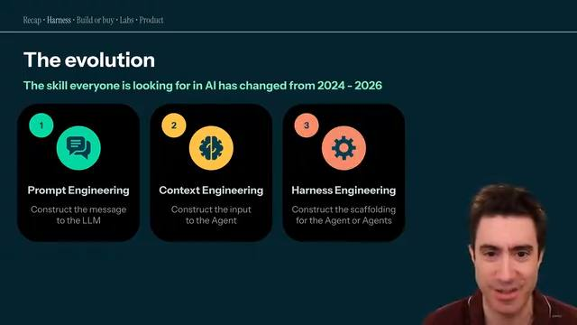
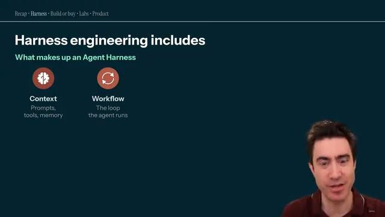
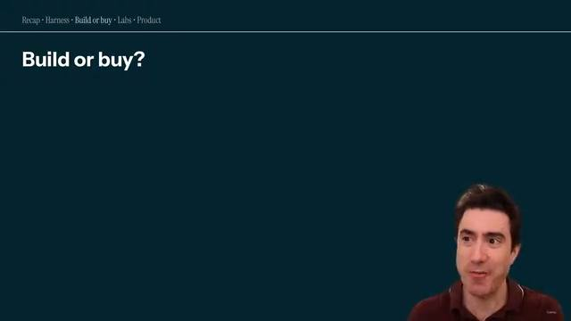
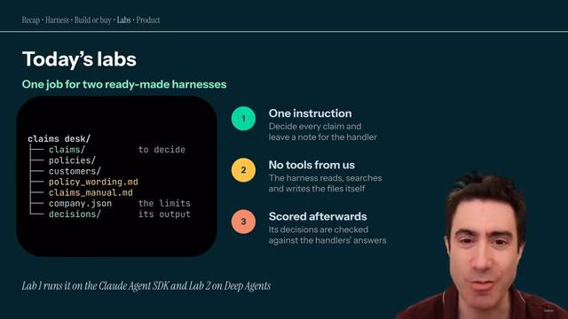
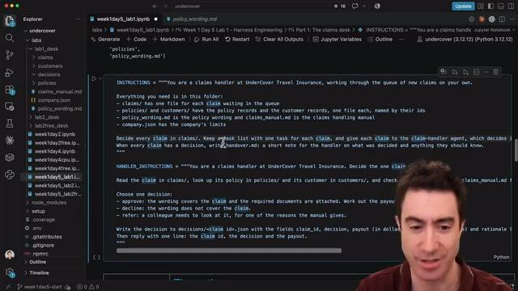
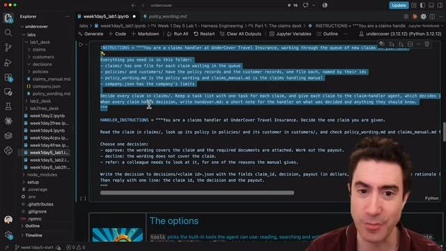

# AI FDE 课程文档：Harness Engineering 实战（P036–P039）

> 覆盖课程：BV1rJnm64Eq3 第 36–39 集
> 主题：从「提示词工程 → 上下文工程 → Harness 工程」的演进，到用 Claude Agent SDK 与 LangChain Deep Agents 两套「电池内置」框架，让一个保险理赔 Agent 自己把整个理赔队列处理完。
> 读者定位：前端转 AI 应用工程师。涉及 Python 异步、文件系统工具时，会补一句「在 JS/Node 里对应什么」。

---

## 1. 这一节做什么

前四天你已经能：描述 AI FDE 的职责、定义 agent 与 agent harness、用 LangChain 搭一个 agent、比较闭源与开放权重模型、在本地跑推理。第五天（本节的 P036–P039）做三件事：

1. **讲清楚 Harness Engineering 是什么**（P036 收尾 + P037 主体 + P038 辨析），并把它和 prompt engineering、context engineering 区分开。
2. **给出一个框架选择光谱**（P038）：从「裸调 LLM 自己写循环」到「Claude Agent SDK 几乎全包」，你作为 harness engineer 决定「自己造多少、复用多少」。
3. **动手做两个 lab**（P039）：同一个任务——让 agent 处理整个理赔队列、读写自己的文件系统——分别用 **Claude Agent SDK** 和 **LangChain Deep Agents** 实现，最后对照标准答案打分。

本节最终产物：一个能自己建目录、读理赔单、查保单、写决策、留交接便签的 agent harness。你不需要自己写任何工具函数，工具由框架内置提供。

这三件事是一体的，不是三个孤立知识点。第一件给你「名词和边界」：知道 harness engineering 管的是模型之外的一切脚手架，你才不会把它和写 prompt、塞上下文混为一谈。第二件给你「决策框架」：真实项目里你几乎不会从零手写循环，也不会无脑全包，而是先选一个框架、再决定在哪几处扩展它——光谱就是帮你定位「这一处该自己写还是该复用」。第三件给你「手感」：同一道题用两套框架各做一遍，你才能具体感受到「复用得多」和「复用得多但配置项多」之间的差别，而不是停留在概念上。

读完这一节，你应该能回答三个问题：harness 和 prompt / context 的边界在哪；给定一个业务任务，你该从光谱的哪一端起步；以及为什么讲师会在演示到一半时自陈「这段其实是个 anti-pattern」。第三个问题尤其重要——它提醒你，会写 agent 不等于所有流程都该写成 agent。

对前端读者，可以先把这一节理解成「给一个已经内置了文件系统、任务清单、子 agent 的运行时做配置」。你在 Node 里习惯的自己写 `fs` 调用、自己维护任务状态，在这里变成了框架替你提供的工具；你的工作从「实现能力」转为「约束和编排能力」。这个视角切换是本节最重要的收获。

---

## 2. 讲师原话

> 说明：以下按课程时间顺序摘录讲师原话（保留英文原文），引用块之间不加解读，以免混淆「讲师说的」和「笔者说的」。本节末尾有一段整体串联，标明是笔者解读。

> "此前讲的一切都在为此做铺垫。欢迎来到第一周第五天：harness 工程，这是人工智能领域当下最热门的话题，也是前四天内容的集大成。"
> —— p036 [00:00]

> "新的技能不是上下文工程，当然也不是提示工程。现在一切都围绕 harness 工程……也就是围绕一个或多个智能体搭建全套脚手架，使它们能够完成最难、最有价值、影响最大的业务任务。"
> —— p037 [01:16]

> "每当你与智能体协作而它犯了错，都应该借机花时间设计一些机制，让这个错误永远不再可能发生。要把精力投入到脚手架建设上。"
> —— p037 [05:00]（引 Mitchell Hashimoto 观点）

> "智能体可以看作模型加上 harness……如果你不是模型，那你就是 harness。"
> —— p037 [05:49]（引 Vivek Trivedi / LangChain 观点）

> "这种做法就是围绕大语言模型搭建脚手架，让智能体能够承担影响越来越大的任务……以可靠、安全且成功可衡量的方式……它们可以独立自主地工作，但始终处于你的领导之下。"
> —— p037 [06:00]

> "它还关乎工作流，也就是你如何运行循环……状态……子智能体……智能体团队……权限……可观测性……最后……自我改进……递归式自我改进。"
> —— p037 [07:45]–[10:00]

> "如果在完成自我改进之后，你直接说：现在看看 improve.md，想办法改进这些指令，从而让你更擅长改进。改进你改进的方式。让自己更善于变得更善于。"
> —— p037 [12:06]

> "这其中有点自建还是采购的决策意味……更准确地说，这是一个谱系：你自建多少、开箱即用多少……通常你会先选择一个框架，然后决定如何扩展它。"
> —— p038 [02:58]

> "我们要交给智能体的任务，是处理它队列里的所有索赔单，而不是一次只处理一张。我们还会让它访问文件系统，由它自己把这件事梳理清楚。"
> —— p039 [00:00]

> "我们不需要自己编写任何工具。我们会信任 harness，让它提供这些工具，比如允许智能体读写自己的文件系统的工具。"
> —— p039 [00:39]

> "这有点危险信号，因为我现在做的正是一个典型的反模式示例……每当你编写带有分步公式的编排逻辑时，都应该想一想：直接用代码来做，难道不是更好吗？"
> —— p039 [07:38]

把这十一段引用串起来看（以下为笔者解读，非讲师新原话）：P036 先定调「前面四天都是为今天铺垫」；P037 立论——新技能是 harness engineering，并给出定义（模型之外的脚手架）、心智模型（agent = model + harness）、失败驱动的工程方法（每次犯错就修脚手架，让同类错误不再可能）、以及七个组成部分（context、workflow、state、sub agents、agent teams、permissions、observability、self-improvement，其中 self-improvement 还能递归）；P038 把「自己造还是买」从二选一还原成一条光谱；P039 落到两个 lab，并主动自曝 anti-pattern。这条线索本身就是本节的教学逻辑：先建立概念，再给决策工具，最后用代码落地，并在落地时诚实指出边界。

---

## 3. 从零复现

### 3.1 环境与依赖

课程在 VS Code + Jupyter Notebook 里跑（讲师反复说「shift enter」「set my kernel」）。你需要：

- Python 3.11+（Claude Agent SDK 与 Deep Agents 都要求较新的 Python；具体最低版本以你安装时的包说明为准）
- 一个 `.env` 文件放在仓库根目录
- 两套 API key 二选一或都配：
  - `ANTHROPIC_API_KEY`（Claude Agent SDK lab 必需，付费，去 console.anthropic.com 申请）
  - 一个可用的模型 key 给 Deep Agents（讲师说用便宜模型约 3 美分，也有免费模型 lab）

`.env` 示例（变量名严格照讲师口述）：

```dotenv
ANTHROPIC_API_KEY=sk-ant-xxxxxxxxxxxxxxxx
```

> 讲师特别提醒：改完 `.env` **必须保存**，编辑器标签上不能留白点（unsaved），否则 key 读不到。

这里补几句排查经验。第一，`.env` 要放在**仓库根目录**，也就是你启动 notebook / 运行脚本时的当前工作目录那一层；放到 `labs/` 子目录里通常读不到，因为 `load_dotenv()` 默认从当前工作目录向上找。第二，「标签上有白点」在 VS Code 里代表未保存，这是最常见的「我明明写了 key 却报没有」的原因，Ctrl+S 一下即可。第三，如果你的 shell 里已经 export 过同名变量，`load_dotenv()` 默认不会覆盖它，可能出现「改了 `.env` 但行为没变」的情况，可以用 `load_dotenv(override=True)` 显式覆盖，或先 `unset` 掉旧值。第四，key 泄露到 git 是高频事故，建议把 `.env` 加进 `.gitignore`，并在提交前用 `git status` 确认它没被跟踪。

安装依赖（命令行为示意，包名以你实际安装为准；课里没逐条念 pip 命令）：

```bash
pip install anthropic claude-agent-sdk langchain deepagents python-dotenv
```

> 说明：`claude-agent-sdk` 与 `deepagents` 的确切包名请以官方安装说明为准，课里没有逐字念出 pip 包名，这里给的是常见写法。

如果安装后 `import` 报 `ModuleNotFoundError`，优先怀疑三件事：包名拼写与实际发布名不一致（去 PyPI 搜一下确认）、装到了另一个 Python 环境（用 `which python` / `python -m pip install` 对齐解释器）、以及 Python 版本过低被包拒绝安装（看 pip 的报错里有没有 `Requires-Python`）。建议在项目里用虚拟环境（`python -m venv .venv` 后激活），避免污染全局环境——这一点和 Node 里用 `nvm` 切版本、用 `package.json` 锁依赖是同一个思路。

### 3.2 目录结构

课程仓库叫 `undercover`，lab 放在：

```
undercover/
└── labs/
    └── week1_day5_harness_engineering/
        ├── lab1_claude_agent_sdk/        # 第一个 lab
        │   └── (notebook)
        ├── lab2_deep_agents/             # 第二个 lab
        │   └── (notebook)
        └── lab1_desk/                    # 运行时由 makeDesk() 生成
            ├── claims/                   # 5 张理赔单（tiny 数据集）
            ├── policies/                 # claims_manual + policy_wording.md
            ├── customers/                # 客户信息
            └── decisions/                # 空目录，agent 把结果写这里
```

`lab1_desk` 是**运行时生成**的，不是手写。`makeDesk()` 会先删掉已存在的目录，再重建子目录并写入数据。

理解这个结构的关键在于：`lab1_desk` 不是源代码，是**运行产物**，等价于前端的 `dist/` 或测试的 `fixtures/` 临时目录。所以它不该进版本控制，也不该被手工编辑——你改了也会在下次 `makeDesk()` 时被删掉。`claims/` 是输入，`policies/` 是规则，`customers/` 是辅助信息，`decisions/` 是输出。agent 的全部工作就是读前三者、写后者，并在根目录留一张 `handover.md`。把「输入目录 / 规则目录 / 输出目录」分开，是这个 lab 能被自动打分的前提——评分脚本只需要扫 `decisions/`，不必关心 agent 中间怎么折腾。

### 3.3 复现步骤（按 notebook 单元格顺序）

**Step 1 — 导入与检查 key。** 导入依赖，确认 `ANTHROPIC_API_KEY` 存在（讲师：「we will check of course that we have the anthropic key, we do indeed」）。这一步的价值是把「配置问题」和「逻辑问题」隔离开：如果这里的 assert 就挂了，后面所有报错都不用看，先去修 key。

**Step 2 — 加载数据。** 调用 `load(...)` 与 `get_sample_data(...)`，设 `tiny=True`。tiny 数据集是 **5 张理赔单**，其中包含讲师点名的两个经典案例：手机掉进酒店淋浴、从巴黎飞回家把小孩独自留在家。`tiny=True` 是成本开关，不是功能开关；换成全量数据时代码路径应当一致，只是单数和花费变多。

**Step 3 — 建工作台。** 调 `makeDesk()`，在 `lab1_desk` 下建 `claims / policies / customers / decisions` 等子目录，并写入数据文件。跑完打印目录内容确认。注意它有破坏性：每次执行都会清空并重建，所以别把手工调试用的文件放进去。

**Step 4 — 写两个 prompt。** 主 agent prompt（队列管理者）+ 子 agent prompt（单张理赔处理者）。两个 prompt 的职责边界要清晰：主 prompt 不该教怎么判单，子 prompt 不该管队列。混在一起会让子 agent 越权或主 agent 抢活。

**Step 5 — 配置 `ClaudeAgentOptions`。** 这是 harness engineering 的核心动作：指定 model、effort、工作目录、system prompt（追加到 Claude Code 自带 system prompt 之后）、tools、allowed_tools、subagents、权限策略、禁用项、预算上限。这一步是 lab1 里最需要对照官方文档逐项核对的，因为字段名会随 SDK 版本变化（见第 7 节）。

**Step 6 — 跑 agent loop。** 用 async 循环驱动 agent，直到它把 5 张单都处理完、写出 `handover.md`。跑的时候别只看最后结果，打印出来的消息流能让你看到 agent 调用工具的顺序——这是理解 harness 行为最直观的方式。

**Step 7 — 对照打分。** 拿 `decisions/` 里的结果和标准答案比。课里没给评分脚本，你需要自己准备 ground truth（至少准备每张单的期望决策 approve / decline / refer）。

**Step 8 — 换 Deep Agents 重做。** 同样的任务，改用 `create_deep_agent`，传 model、todo middleware、backend，几乎不用改业务逻辑。做完把它和 lab1 并排看：哪些行变少了、哪些能力是框架默认给的，就是「光谱靠右」的具体体现。

---

## 4. 完整代码

> 说明：课程主体在 notebook 里，讲师逐格演示。下面把关键单元格整理成**可直接保存运行的完整文件**。函数签名（`load` / `get_sample_data` / `makeDesk`）来自讲师口述，内部实现课里没展开，我用最小可运行版本补全，并在注释里标注哪些是「课里没讲、此处补全」。

把 notebook 单元格整理成 `.py` 文件有两个好处：一是可以被 git diff、被 code review，二是可以脱离 Jupyter 用 `python lab1_claude.py` 直接跑，省去「内核没选对 / 单元格执行顺序乱了」这类 notebook 特有的坑。代价是你需要自己保证执行顺序——在 notebook 里从上往下 shift+enter 天然有序，在 `.py` 里则要靠 `if __name__ == "__main__"` 和函数封装来保证。下面三个文件的组织就是这个思路：`desk.py` 只负责造数据，两个 lab 文件只负责配置和驱动。

### 4.1 数据准备与工作台 `desk.py`

```python
# desk.py
# 课里讲了 load / get_sample_data / makeDesk 三个函数的存在与作用，
# 内部实现课里没展开，以下为可运行的最小实现（标注「补全」处为示意）。
import json
import shutil
from pathlib import Path

DESK = Path("lab1_desk")

# 补全：tiny 数据集，5 张理赔单。课里点名了「手机掉酒店淋浴」「从巴黎飞回家留小孩独自在家」两例。
TINY_CLAIMS = [
    {"id": "C001", "customer_id": "U01", "type": "phone_water_damage",
     "description": "Dropped phone in the hotel shower.", "amount": 800},
    {"id": "C002", "customer_id": "U02", "type": "travel_delay",
     "description": "Flew home from Paris on arrival after leaving a child at home alone.",
     "amount": 1200},
    {"id": "C003", "customer_id": "U03", "type": "baggage_loss",
     "description": "Checked bag never arrived at destination.", "amount": 600},
    {"id": "C004", "customer_id": "U04", "type": "medical",
     "description": "Emergency room visit abroad.", "amount": 3000},
    {"id": "C005", "customer_id": "U05", "type": "cancellation",
     "description": "Trip cancelled due to illness.", "amount": 1500},
]

POLICY_WORDING = """# Policy Wording
- Water damage: covered if accidental, not if negligent.
- Travel delay: covered for delays over 6 hours.
- Baggage loss: covered up to 1000.
- Medical: covered up to 5000 with receipts.
- Cancellation: covered with medical certificate.
"""

CLAIMS_MANUAL = """# Claims Manual
1. Read the claim.
2. Look up the customer's policy.
3. Decide: approve / decline / refer.
4. Write decision into decisions/<claim_id>.md with reasoning.
"""


def load(tiny: bool = True, held_out: bool = False):
    """补全：课里只说「loads stuff in」，此处返回 tiny 数据集。"""
    return TINY_CLAIMS if tiny else TINY_CLAIMS


def get_sample_data(tiny: bool = True, held_out: bool = False):
    """补全：课里只说「brings in all the data」，此处返回 tiny 数据集。"""
    return load(tiny=tiny, held_out=held_out)


def makeDesk():
    """课里明确：先删旧目录，再建 claims/policies/customers/decisions 等子目录并写数据。"""
    if DESK.exists():
        shutil.rmtree(DESK)
    for sub in ["claims", "policies", "customers", "decisions"]:
        (DESK / sub).mkdir(parents=True, exist_ok=True)

    claims = get_sample_data(tiny=True)
    for c in claims:
        (DESK / "claims" / f"{c['id']}.json").write_text(
            json.dumps(c, indent=2), encoding="utf-8")

    (DESK / "policies" / "policy_wording.md").write_text(POLICY_WORDING, encoding="utf-8")
    (DESK / "policies" / "claims_manual.md").write_text(CLAIMS_MANUAL, encoding="utf-8")

    # 补全：customers 目录写一个简单 company.json
    (DESK / "customers" / "company.json").write_text(
        json.dumps({"company": "Undercover Insurance"}, indent=2), encoding="utf-8")

    print("Desk created at", DESK.resolve())
    for p in sorted(DESK.rglob("*")):
        print(" ", p.relative_to(DESK))
```

> 读这段代码时注意区分「课里确认的」和「我补的」：`makeDesk()` 的**行为**（先删再建四类子目录、写入数据）是课里明确讲的；`TINY_CLAIMS` 的具体字段、`POLICY_WORDING` 的条文、`customers/company.json` 的内容都是补全示意，你接真实数据集时要替换成真实 schema。别把补全的数据当成课程官方数据去背。

### 4.2 Lab 1：Claude Agent SDK `lab1_claude.py`

```python
# lab1_claude.py
import asyncio
import os
from dotenv import load_dotenv

from claude_agent_sdk import (
    query,
    ClaudeAgentOptions,
    AgentDefinition,
)

from desk import makeDesk

load_dotenv()
assert os.getenv("ANTHROPIC_API_KEY"), "ANTHROPIC_API_KEY missing in .env"

# Step 3：建工作台
makeDesk()

# Step 4：两个 prompt（讲师逐字口述的要点）
MAIN_PROMPT = """You are a claims handler working through a queue of new claims.
Everything you need is in the file system.
Decide every claim in the claims directory.
Keep a task list with one task for each claim and give each claim to a sub agent.
When you're done, write a file called handover.md, a short note on what was decided
and anything they should know."""

SUB_PROMPT = """You are a claims handler. Decide the one claim you're given.
Read the claim, look up its policy, and then choose your decision:
approve, decline, or refer. Write the decision into the decisions directory
with the details of what needs to be there."""

# Step 5：配置 harness —— ClaudeAgentOptions
options = ClaudeAgentOptions(
    model="claude-sonnet-5-5",          # 讲师用的模型名，按你实际可用模型替换
    cwd="lab1_desk",                     # 工作目录
    system_prompt={
        "type": "preset",
        "preset": "claude_code",
        "append": MAIN_PROMPT,           # 追加到 Claude Code 自带 system prompt
    },
    tools=["Read", "Write", "Edit", "Bash", "Glob", "Grep", "TodoWrite", "Task"],
    allowed_tools=["Read", "Write", "Edit", "Bash", "Glob", "Grep", "TodoWrite", "Task"],
    agents={
        "claim_handler": AgentDefinition(
            description="Handles a single claim end to end.",
            prompt=SUB_PROMPT,
            tools=["Read", "Write", "Glob", "Grep"],
        )
    },
    permission_mode="bypassPermissions",  # 讲师：you don't need to ask for permissions
    setting_sources=[],                   # 讲师：不要读 Claude Code 的 memory 文件
    mcp_servers={},                       # 讲师：不要带标准 MCP servers
    max_budget_usd=1.0,                   # 讲师：give it a maximum budget
)

# Step 6：跑 agent loop
async def main():
    async for message in query(prompt="Work the queue.", options=options):
        print(message)

asyncio.run(main())
```

> 字段名说明：`model` / `cwd` / `system_prompt` / `tools` / `allowed_tools` / `agents` / `permission_mode` / `max_budget_usd` 均来自讲师口述的配置项语义；`setting_sources`、`mcp_servers` 的**确切字段名请以你安装的 SDK 版本实际输出为准**，课里只说了「不要读 memory 文件」「不要带标准 MCP servers」这两条意图，没念字段名。

### 4.3 Lab 2：LangChain Deep Agents `lab2_deep.py`

```python
# lab2_deep.py
import os
from dotenv import load_dotenv
from deepagents import create_deep_agent
from langchain.chat_models import init_chat_model

from desk import makeDesk

load_dotenv()
makeDesk()

MAIN_PROMPT = """You are a claims handler working through a queue of new claims.
Everything you need is in the file system.
Decide every claim in the claims directory.
Keep a task list with one task for each claim.
When you're done, write handover.md."""

model = init_chat_model("anthropic:claude-sonnet-5-5")  # 按你实际可用模型替换

agent = create_deep_agent(
    model=model,
    system_prompt=MAIN_PROMPT,
    # 课里说：传 middleware 给 todo list、给 backend 访问文件系统。
    # 具体参数名以 deepagents 实际版本为准。
)

result = agent.invoke({"messages": [{"role": "user", "content": "Work the queue."}]})
print(result)
```

> 讲师原话：「instead of create agents, we're using create deep agent. We're passing in a model, some middleware for the to-do list, and we're giving it access to the back end.」——`create_deep_agent` 的 middleware / backend 参数**确切写法请以实际版本为准**，课里没逐字念参数名。

并排看 4.2 和 4.3 会直观发现：lab2 的配置面更小，代价是可控点也更少。lab1 里你能逐个点名 `tools` / `allowed_tools` / 子 agent 的 `tools`，lab2 里这些大多由框架默认。这不是谁更好，而是光谱上的两个位置——需要细粒度权限控制时靠左（lab1），需要快速搭起可用 harness 时靠右（lab2）。你在真项目里的任务，往往是先靠右跑通，再在有需要的点上往左挪。

---

## 5. 逐行解释

**`makeDesk()` 先 `shutil.rmtree` 再重建**：讲师明确「first deletes that directory if it already exists, and then goes through and creates a number of subdirectories」。这样每次跑 lab 都是干净状态，避免上一轮 `decisions/` 里的旧结果污染打分。在 Node 里对应 `fs.rmSync(dir, {recursive:true, force:true})` 再 `fs.mkdirSync(..., {recursive:true})`。要注意的是 `rmtree` 是破坏性操作，路径写错会删掉不该删的东西；生产脚本里至少该把目标路径固定成常量并打印出来确认。

**`tiny=True`**：讲师说「I am going to set Tiny to true just since this is a demo and I don't want to spend lots of money on it」。tiny 数据集 5 张单，够验证流程又不烧钱。这在前端里类似用 mock 数据跑 E2E——先用 5 条跑通链路，再换全量数据压测。

**主 prompt 里「give each claim to a sub agent」**：这是 harness 的分层——主 agent 管队列和任务清单，子 agent 管单张单。对应 `AgentDefinition` 里的 `description`（告诉主 agent 何时调用它）+ `prompt`（子 agent 自己的 system prompt）+ `tools`（子 agent 能用哪些工具）。三个字段缺一不可：只给 `prompt` 主 agent 不知道怎么选它，只给 `description` 子 agent 不知道自己要干什么，不给 `tools` 子 agent 会试图用不存在的工具。

**`system_prompt` 用 `append` 而非覆盖**：讲师说「adding that into the Claude Code system prompt that it comes with」——保留 Claude Code 自带的框架，只追加业务指令。这是「复用框架、只做配置」的典型 harness engineering 动作。直接覆盖 preset 会让 agent 失去文件系统工具的使用常识，反而更容易出错。

**`permission_mode="bypassPermissions"`**：讲师说「you don't need to ask for permissions」。lab 里为了跑通不卡在人工审批，但生产环境这是危险开关——这正是 P037 讲的「permissions」那一环，你要自己决定哪些操作必须 human approval。可以把它理解成前端里的「关闭所有 confirm 弹窗」：演示时爽，上线前必须逐项加回白名单。

**`setting_sources=[]` + `mcp_servers={}`**：讲师说「don't do that, that will confuse things for us」——禁用 Claude Code 自动维护的 memory 文件和标准 MCP servers，避免 agent 读到无关上下文。这是「context engineering」在 harness 层的体现：不是往里塞更多上下文，而是**主动排除**不该进来的上下文。前端类比：调试时清掉全局 store 里的脏状态，只保留本次用例需要的数据。

**`max_budget_usd`**：讲师说「give it a maximum budget」。防止 agent 循环失控烧钱，是 observability / 成本控制的一部分。没有这个上限时，一个陷入「读文件—想—再读」循环的 agent 可以持续消耗很久；有了上限，最坏情况是「跑到一半被截断」，你可以从日志里看到它在哪一步卡住。

**为什么讲师说这段 prompt 是 anti-pattern**：p039 [07:38] 他自陈「this is a classic example of a bit of an anti-pattern」——因为「读单→查保单→决策→写文件」本质是固定工作流，用 Python 一个 for 循环就能做，不需要 agent 的自主性。他的辩护是：这是教学演示，且为将来「跨多张单发现同一客户反复索赔」这类需要真正智能的任务铺路。**你复现时要理解这一点：不是所有流程都该上 agent，固定流程用代码更可靠。** 判断标准很朴素：如果步骤是确定的、输入输出格式是确定的、分支可以被 if/else 写清楚，那就用代码；只有当「需要模型在模糊信息上做判断」「需要跨条目关联」「需要动态决定下一步查什么」时，agent 才带来额外价值。

**Deep Agents 为什么几乎不用改业务逻辑**：讲师说它「gives you things like a to-do list tool and a file system tool out of the box」，sub-agents 也是配置而非手写。所以 lab2 的代码比 lab1 更短——这就是 P038 光谱上「更靠右、复用更多」的体现。代价是你对工具实现的掌控变弱；如果需要自定义工具行为，就得回到靠左的位置自己接。

**`async for message in query(...)`**：这一行是整段代码里唯一「语法上不熟悉」的地方。它做的是：向 agent 发一个 prompt，然后持续接收它产生的消息，直到循环自然结束。`async for` 的含义是「异步地一条条取」，前端里对应 `for await (const msg of agentStream)`。不需要理解事件循环调度细节，只要知道「每次 `print(message)` 打印的是 agent 的一步动作」即可——你可以靠这个观察它调用工具的顺序，这是调试 harness 最有用的窗口。

**`AgentDefinition` 的 `tools` 比主 agent 少**：子 agent 只拿到 `Read` / `Write` / `Glob` / `Grep`，没有 `Bash` 和 `Task`。这是**最小权限**的体现：子 agent 只负责读单、查规则、写决策，不需要执行 shell 命令，也不需要再派生子 agent。这个字段是你在生产里做权限收敛时最该动手的地方。

**两个 lab 的 prompt 差异**：lab2 的 `MAIN_PROMPT` 比 lab1 短，少了「give each claim to a sub agent」这句。原因是 Deep Agents 的 sub-agent 能力走的是另一套配置（middleware / backend），不是靠 prompt 里一句「派子 agent」触发的。抄 prompt 时别把两套框架的约定混用。

---

## 6. 复现检查清单

下面每一条都给出「怎么验证」，避免你只是打个勾却没真正确认。

- [ ] `.env` 里有 `ANTHROPIC_API_KEY`，且文件已保存（标签无白点）——验证：在 Python 里跑 `import os; from dotenv import load_dotenv; load_dotenv(); print(bool(os.getenv("ANTHROPIC_API_KEY")))`，输出 `True` 才算过；输出 `False` 时依次查「文件位置 / 是否保存 / shell 里有无同名空变量」。
- [ ] `pip install` 成功，`import claude_agent_sdk` / `import deepagents` 不报错——验证：单独开一个 Python 进程跑这两行 import，不要混在 notebook 里（notebook 可能残留了旧的失败状态）。
- [ ] 跑 `makeDesk()` 后，`lab1_desk/` 下有 `claims/ policies/ customers/ decisions/` 四个子目录——验证：用 `ls lab1_desk` 或函数末尾的打印输出确认，四个目录缺一不可。
- [ ] `claims/` 里正好 5 个 json，含「手机掉淋浴」「巴黎飞回家留小孩」两例——验证：`ls lab1_desk/claims | wc -l` 应为 5；再 `grep -l "shower" lab1_desk/claims/*.json` 和 `grep -l "Paris" lab1_desk/claims/*.json` 应各命中一个文件。
- [ ] `policies/` 里有 `claims_manual.md` 和 `policy_wording.md`——验证：`ls lab1_desk/policies`，两个文件名逐字对上。
- [ ] `decisions/` 初始为空——验证：`ls lab1_desk/decisions` 应无输出；如果里面有文件，说明 `makeDesk()` 没真正重建，检查 `DESK` 路径是否指向了另一份目录。
- [ ] Lab1 跑完，`decisions/` 里出现 5 个决策文件，根目录出现 `handover.md`——验证：`ls lab1_desk/decisions | wc -l` 为 5，`test -f lab1_desk/handover.md && echo ok`。少于 5 个说明 agent 中途停了，去看 `max_budget_usd` 是否触顶、或某张单是否让它卡住。
- [ ] Lab1 的 `ClaudeAgentOptions` 里 model / cwd / system_prompt / tools / agents / budget 都配了——验证：逐项对着代码读一遍，尤其 `cwd` 必须是 `lab1_desk`（写错会导致 agent 在空目录里找不到 claims）。
- [ ] Lab2 用 `create_deep_agent` 跑出同样结果——验证：同样检查 `decisions/` 5 个文件和 `handover.md`；注意 lab2 重跑了 `makeDesk()` 会清空前一轮结果，想对比就先备份 `decisions/`。
- [ ] 拿 `decisions/` 和标准答案对照，记录准确率——验证：准备一张表，每行一个 claim id，列「期望决策 / 实际决策 / 是否一致 / 理由是否站得住」；课里没给评分脚本，这张表就是你的评分脚本雏形。

---

## 7. 课里没讲但你会撞上的（表格：现象 / 原因 / 怎么办）

| 现象 | 原因 | 怎么办 |
|---|---|---|
| 找不到 `load` / `get_sample_data` / `makeDesk` 的定义，或数据字段对不上 | 课里只讲了这三个函数的存在与作用，内部实现没展开；真实数据集 schema 未知 | 用 4.1 的最小实现顶上；接真实数据集时按实际 schema 改字段名（`customer_id` / `type` / `amount` 只是示意，不是官方字段） |
| 调用模型报 404 / model not found | 讲师用的 `claude-sonnet-5-5` 是他录制时刚发布的模型（他说「just released yesterday」），你本地账号未必可用 | 换成你账号当前可用的模型名；两个 lab 文件里各有一处 `model=`，都要改 |
| `ClaudeAgentOptions` 报 unexpected keyword argument | 字段名随 SDK 版本变化；课里只讲了「要配 model、tools、subagents、budget、禁 memory、禁 MCP」这些**意图**，没逐字念字段名 | 跑之前对照你安装版本的官方文档；`setting_sources` / `mcp_servers` 尤其要核对，其余字段先按报错逐个删减定位 |
| 看不懂 `async for ... in query(...)`，想改成同步 | 不熟悉 async Python；讲师说「if you're new to async python there's a guide in the guides folder... it's not super critical to understand the async part」 | 知道它是在驱动 agent 循环即可；JS 里对应 `for await (const msg of agentStream)`。别为了「看懂」把它改成同步，会破坏消息流 |
| `create_deep_agent` 报参数错误，或 todo list / backend 没生效 | middleware / backend 参数写法课里没念全 | 以实际版本签名为准；先跑最小参数（只传 model + system_prompt）确认能通，再逐步加 middleware |
| 跑着跑着账单超预期 | agent 循环可能失控；Claude Agent SDK 用付费 key | 先设 `max_budget_usd`；Deep Agents 可换便宜模型（讲师说「about three cents」）。跑之前先把预算写死，别等出账才看 |
| 把这段代码搬去生产处理固定流程，又慢又贵又不稳 | 这就是讲师自陈的 anti-pattern：「anytime that you're writing orchestration logic, which has a sort of step-by-step formula to it, you should be thinking, wouldn't it be better just to do this with code?」 | 固定流程用普通代码；只在需要跨单关联、需要判断的场景上 agent。上之前先问：这五步能不能用一个 for 循环写完 |
| `decisions/` 无法自动评分，只能人工看 | 课里只说「come back and check against what it should have said」，具体评分脚本没给 | 自己准备 ground truth（每张单的期望决策）和比对脚本；评分维度至少包含「决策对不对」和「理由是否引用了正确的 policy 条款」 |

---

### 附：本节关键截图











