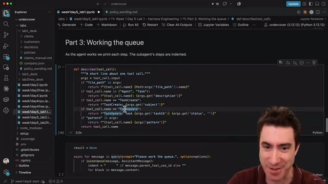
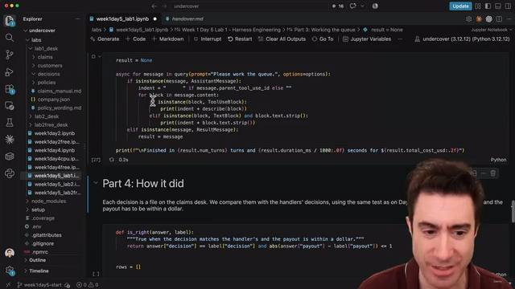
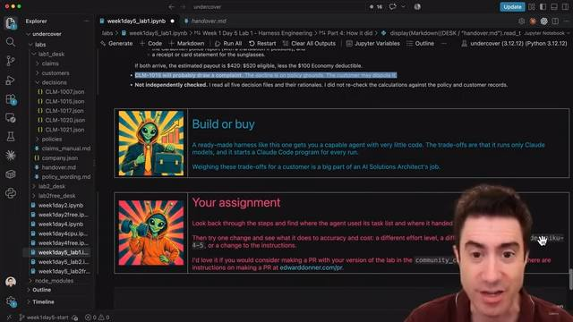
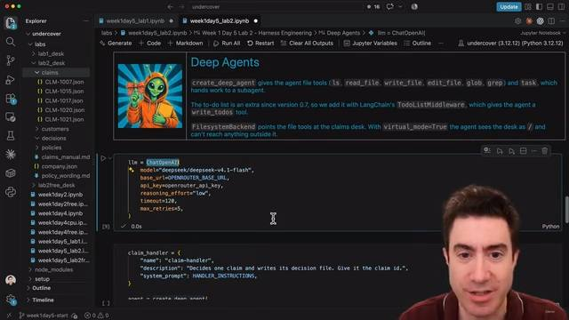
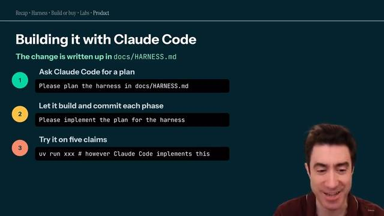
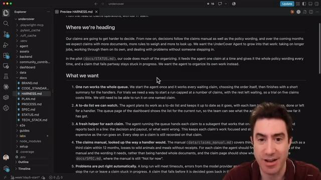
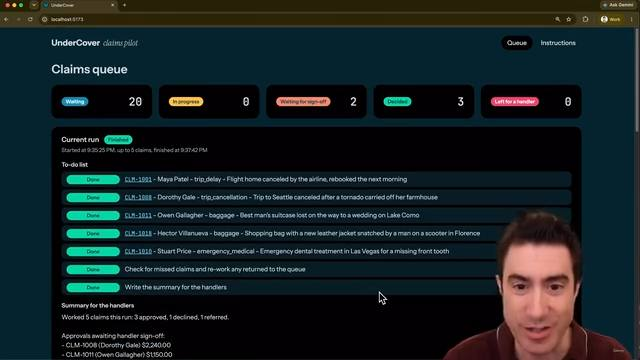
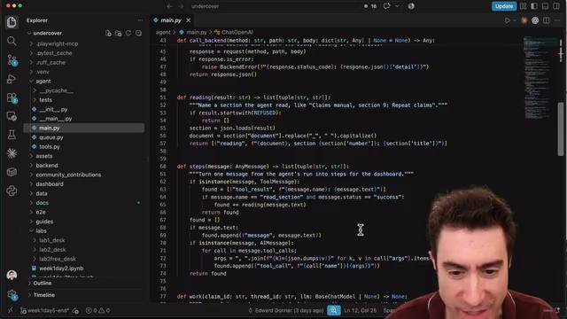
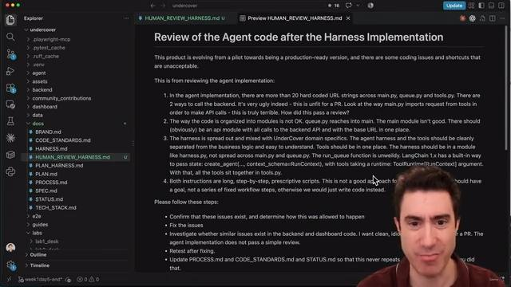
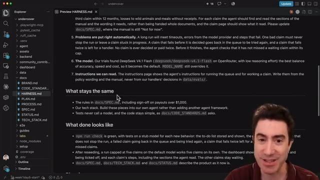

# AI FDE 实战文档：用 Agent Harness 把理赔队列跑通（P40–P42）

> 覆盖课程：BV1rJnm64Eq3，第 40、41、42 集
> 读者定位：前端转 AI 应用工程师。文中出现的 Python `async for` 一律会对照 JS 的 `for await...of`；`class` / 装饰器只要“知道即可”，不影响你复现。
> 阅读方式：第 3、4 章可以照着敲；第 5 章解释为什么这么写；第 6 章是验收清单；第 7 章是踩坑预警。

---

## 1. 这一节做什么

这三节课是**同一条主线上的三个台阶**，不是三个孤立知识点：

**台阶一（P40）——先用现成 harness 跑一遍，建立“它能跑通”的体感。**
同一个“理赔队列处理”任务，用两套现成的 agent harness 各实现一遍：第一套是 Claude Agent SDK（`query` + options），第二套是 LangChain 的 deep agents（`create_deep_agent`）。两套都读同一份 5 条理赔测试数据，都在 `decisions/` 目录里写决策文件，最后都写一份 handover 文档给人类看。两套都跑出 5 条全对。

**台阶二（P41）——拆掉现成 harness，回到自己 day3 做的产品，自己造 harness。**
产品仓库叫 undercover。讲师不满足于“调 SDK”，而是要用 `create_agent`（注意不是 `create_deep_agent`）把 harness 的每一块自己搭出来：可见的 to-do list、每个 claim 一个独立 sub agent、能查理赔手册的 tools、失败自动纠正。做法上是**intent driven development**：先写一份需求文档 `docs/harness.md`（只讲要什么，不讲怎么做），再让 Claude Code 出计划 `docs/plan_harness.md`，人审计划，最后实现。

**台阶三（P42）——实现出来、跑起来、然后人审，发现问题逼它自我改进。**
Claude Code 花了 44 分 21 秒实现完毕，产品看起来“一键生成、UI 漂亮、测试通过”。但讲师坚持“人类要负责”，于是逐行看代码，发现一堆问题：`main.py` 臃肿、硬编码后端 URL、`main.py` 从 `agent.tools` 里导入 `request` 造成模块间来回依赖、`run_queue` 近 50 行、提示词被写成“逐步骤的脚本”。他写了 `human_review_harness.md`，让 Claude Code 自己读、自己修、并把教训写回 `process.md` 和代码标准，防止再犯。

**产物清单（跑完之后你应该手里有的东西）**

| 产物 | 位置 | 来源 |
|---|---|---|
| 5 份决策文件 + handover 文档 | `lab1_desk/decisions/`、`lab2_desk/decisions/` | P40 |
| 需求文档 | `docs/harness.md` | P41 |
| 实现计划 | `docs/plan_harness.md` | P41 |
| agent harness 代码 | `agent/`（`main.py`、`q.py`、`tools.py` 等） | P42 |
| 人审意见书 | `docs/human_review_harness.md` | P42 |
| 流程标准 | `docs/process.md` | P42 修复后回写 |



---

## 2. 讲师原话（带出处）

> "这里就是 agent 循环 `async for message in query`……query 像一个生成器，你迭代它返回的内容，并传入两样东西：prompt……然后你再把 options 传给它。"
> —— p040 [00:28]

> "拿到最终结果后，我们就把它存到这个 `results` 对象里。"
> —— p040 [01:12]

> "留意这个 decisions 文件夹，现在还是空的……它刚写了一个决策文件，又写了两个决策文件。这些来自主 agent 创建的子 agent。"
> —— p040 [01:41]–[02:11]

> "很高兴地说，它五道题全对了。"
> —— p040 [02:41]

> "除了有一次之外，它每次都是五题全对。有一次它只对了四题……它并不完美。"
> —— p040 [03:50]

> "有一个非常细微的差别：我们把它称为 to-do list 而不是 task list，因为这是 deep agents 里使用的术语。"
> —— p040 [06:08]

> "我们不调用 `create_agent`，而是调用 `create_deep_agent`。这就是我们使用更大一层 harness 的方式——开箱即用的 agent harness。"
> —— p040 [07:27]

> "我们想要什么？我们想要一次运行就能处理整个队列。我们想要一个能在用户界面里看到的 to-do list。我们想要一个全新的助手、一个子 agent，依次处理每一条 claim。"
> —— p041 [06:50]

> "它不会给出解决方案，而是说明我们想要达成什么，也就是我们的意图。这就是意图驱动的开发。"
> —— p041 [01:04]

> "我说，请实现 harness 的方案。……44 分 21 秒后，Claude Code 完成了。"
> —— p042 [00:15]–[00:45]

> "最上面是队列，20 条在等待决策，5 条已处理，2 条已提交待签核，3 条已决策。"
> —— p042 [01:15]

> "在 `main.py` 里，它从 `agent.tools` 导入，导入了 `request`……就是这种来回折腾的写法。这是意大利面条式代码，真的不行。"
> —— p042 [06:15]

> "这不是 agentic AI 的意义所在。我们应该给 agent 一个目标，为它配备工具，让它自己想办法达成这个目标。"
> —— p042 [07:42]

---

## 3. 从零复现

### 阶段 0：环境准备

需要装好四样东西：

```bash
# 1) Python + uv（P42 的启动命令是 uv run -m agent，所以必须有 uv）
curl -LsSf https://astral.sh/uv/install.sh | sh
uv --version

# 2) Node（产品仓是 TS/Node 后端 + Python agent 模块，P41 里要跑 npm install）
node -v
npm -v

# 3) Git
git --version

# 4) Claude Code CLI（P41 起要用它做 intent driven development）
claude --version
```

两个 API Key，放进环境变量或 `.env`：

```bash
export ANTHROPIC_API_KEY="..."      # P40 lab1 / P41-P42 的 Claude Code 都要用
export OPENROUTER_API_KEY="..."     # P40 lab2 走 OpenRouter 调 DeepSeek
```

> 课里没讲这两个变量名是怎么配到项目里的（是 shell export 还是 `.env` 文件）。上面是通行做法，实际以你所用 SDK 文档为准。

依赖安装（在对应项目目录里执行）：

```bash
# lab1：Claude Agent SDK
uv add claude-agent-sdk

# lab2：deep agents + OpenRouter 兼容层
uv add deepagents langchain-openai
```

> **课里没给版本号。** 讲师全程没念任何 `x.y.z`。所以这里不写死版本，装最新版，然后按第 7 章的方法核对 API。

---

### 阶段 1：跑 lab1（Claude Agent SDK）

**目录结构**（讲师说“not in lab one desk but in lab two desk”，所以两个 lab 各有一个 desk 目录）：

```
lab1_desk/
├── claims/          # 放 5 条理赔测试数据
└── decisions/       # 空的！agent 会在运行过程中往里写
```

**准备要点：**
- `claims/` 里放 5 条理赔数据文件（讲师称之为 tiny dataset，共 5 个 data point）。
- `decisions/` **必须是空目录**，讲师在开跑前特意强调“keep an eye on this decisions folder that's empty right now”。
- 运行前先确认目录是空的，跑起来之后才能看到文件“一个一个冒出来”。

**运行：**

```bash
uv run python lab1_harness.py
```

跑起来你会看到三件事同时发生：
1. 终端里逐条打印 agent 正在调用哪个工具（讲师说那个 `describe` 函数**纯粹是为了打印好看，不是必需的**）；
2. `decisions/` 目录从空变成 1 个、2 个……最后 5 个决策文件——**其中一部分是主 agent 派生的 sub agent 写的**；
3. 全部决策写完后，再写一份 handover 文档。



**验收：** 用一份“标准答案”（讲师说这套标准答案**没有告诉 agent**）去比对 `decisions/`，看是否 5/5。



> 讲师原话：他跑了 6、7 次，除了有一次 4/5，其余都是 5/5。**所以你自己跑出 4/5 是正常的，不是你的环境坏了。**

---

### 阶段 2：跑 lab2（deep agents + DeepSeek）

**第二个目录：**

```
lab2_desk/
├── claims/
└── decisions/       # 同样保持空
```

**关键差异只有三个：**

1. **术语**：提示词里把 “task list” 改成 **“to-do list”**。讲师说：“如果你词用错了，DeepSeek 大概率也能猜出来，但我们既然知道工具叫什么，那就精确一点。”
2. **LLM**：不走 Anthropic，走 OpenRouter 调 `deepseek v4.1 flash`。构造方式是一个 `ChatOpenAI` 对象（这是 OpenAI 兼容层的简单包装），传 base URL + 模型名。
3. **入口函数**：`create_deep_agent`，而不是 `create_agent`。这是“电池全包”的那一层。

**运行：**

```bash
uv run python lab2_harness.py
```

同样盯住 `decisions/`：会看到 agent 先看目录 → 读文件 → **写 to-do** → 然后才出现 decision 文件。讲师特别提示“deep seek v4.1 flash 非常快”。



**验收：** 同样是 5/5。另外讲师在输出里打印了成本——**不到 4 美分**，明显比 Sonnet 便宜。

---

### 阶段 3：切到产品仓（P41）

先把仓库搞定。进 undercover 仓库，`Ctrl + \`` 开终端：

```bash
git status
```

**两条路线，选一条：**

**路线 A：继续用自己的分支（讲师推荐）**

```bash
# 把讲师准备好的需求文档拷进 docs/
cp labs/week1_day5_product_harness.md docs/harness.md
```

讲师说这份文件在 `labs/` 目录下，名字大致是 `week 1 day 5_product_harness.md`（逐字稿是口语念的，实际文件名以仓库里为准，`ls labs/` 看一眼即可）。在 IDE 里也可以直接拖进 `docs/` 再改名。

**路线 B：直接对齐讲师进度**

```bash
git checkout week-1-day-5-start    # 讲师念作 "week one day five dash start"
# 如果报本地有改动：
git stash
git checkout week-1-day-5-start
npm install
```

> 分支名逐字稿是口语念的，执行前用 `git branch -a` 核对一次真实名字。

切完确认：

```bash
ls docs/harness.md
```



---

### 阶段 4：让 Claude Code 出计划（P41）

```bash
claude
```

然后输入：

```
please plan the harness in docs/harness.md
```

讲师用的是 Opus，你也可以用别的模型。**这次计划生成花了 12 分半钟**——别以为卡住了。

产出：`docs/plan_harness.md`，分**六个阶段**，里面应该能看到这些内容（讲师逐条点评过）：

- 一个能在最后跑整个队列的命令；
- claims manual 的搭法；
- 一堆 API 改动；
- agent 用 `deepseek v4.1 flash`；
- `claim_agent.work_claim`，挂了**七个 tools**；
- 失败捕获的方式；
- 报告的构建；
- 启动方式 `uv run -m agent`，并且**可以 cap**（限制一次跑多少条）。



**这一步你必须真的读一遍计划再放行。** 讲师原话：“你可以让另一个 LLM 帮你审这个计划，但一定要确保你自己认可它。”

---

### 阶段 5：实现（P42）

```
please implement the plan for the harness.
```

**这次花了 44 分 21 秒。** 期间它会：
- 新建 agent harness 模块；
- 把主 agent / sub agent / tools 串起来；
- 改 API；
- 改后端对接。

跑完它会给你一份“发现报告”。讲师这里被问到的是一个**真业务问题**：*如果一条 claim 被批准了，但金额是 0 美元，后端会拒绝（“你怎么能批准一个 0 元的理赔？”），这种情况该怎么办？* 讲师认为这是个好问题，说明 agent 真的在思考业务边界，而不是埋头写代码。

---

### 阶段 6：跑起来 + 人审 + 自我修复

**6.1 启动产品看 dashboard**

```bash
uv run -m agent --cap 5
```

浏览器里看 dashboard，顶部是队列状态条：

> “20 are waiting for a decision, 5 have been acted on, 2 now raised for sign off, 3 decided.” —— p042 [01:15]



注意讲师说的“现在这个状态是它自己测试自己造成的：它重置了数据库，然后跑了 5 条”。

**你要观察的是 to-do list 实时变化**：waiting 数字往下掉、每条 to-do 从 pending 变 in-progress 再变 done，最后有一条“写人类可读的总结”。

**6.2 人审（这一步不能跳）**

讲师原话大意：测试过了、UI 好看，很容易让人直接放过，但**人类必须对 PR 负责**。他翻代码翻出这些问题：

| 问题 | 说明 |
|---|---|
| `main.py` 太臃肿 | 大量功能堆在一个模块里 |
| 硬编码后端 URL | 多处 URL 字符串写死 |
| 字符串拼接 | 到处都是手工拼 URL / 拼请求 |
| 模块间奇怪依赖 | `main.py` 从 `agent.tools` 导入 `request`，而 `request` 内部又依赖已经设好的后端 URL，形成来回依赖 |
| `q.py` 结构差 | `run_queue` 近 50 行，agent 直接塞在函数里 |
| harness 关注点和业务关注点混在一起 | 职责没分清 |
| 提示词是“逐步骤脚本” | 违反了 agentic 的初衷 |



**6.3 写 review 文档，逼它自我修复**

把上面这些写进 `docs/human_review_harness.md`，行动项固定为五步：

1. 先确认这些问题**确实存在**；
2. 修复；
3. 排查仓库里**其他地方有没有同类问题**；
4. 重新测试；
5. **更新 `process.md`、代码标准、状态**，让它不再犯。最后汇报怎么改的。

然后回 Claude Code：

```
/context
```

讲师这时看到**上下文已经用了 37%**，于是：

```
/compact
```

压实完再输入：

```
please read human_review_harness.md and carry out the actions
```



---

## 4. 完整代码

> **重要声明**：P40 的两段 harness 代码，讲师在镜头前展示过调用骨架，但**没有逐行念完整个文件**；P41–P42 的产品代码是他让 Claude Code 生成、然后在这一集里逐段点评，**逐字稿里没有源码全文**。下面的文件是在讲师口述的调用结构上补齐成可运行骨架的，凡是**讲师没念到的参数名 / 字段名**，我都在注释里标了 `# 课里没讲，以实际 SDK 为准`。请把它当“可运行的起点 + 待核对清单”，不要当“原样复制即成功”。

### 目录结构

```
undercover/
├── docs/
│   ├── harness.md                 # P41 需求文档（只讲要什么）
│   ├── plan_harness.md            # P41 计划（Claude Code 生成）
│   ├── human_review_harness.md    # P42 人审意见
│   └── process.md                 # 修复后回写的流程标准
├── labs/
│   └── week1_day5_product_harness.md
├── agent/
│   ├── __init__.py
│   ├── main.py                    # 入口：uv run -m agent
│   ├── q.py                       # 队列
│   └── tools.py                   # 工具（查手册、写决策等）
├── lab1_desk/{claims,decisions}/
├── lab2_desk/{claims,decisions}/
├── lab1_harness.py
└── lab2_harness.py
```

---

### 文件 1：`lab1_harness.py`

```python
# lab1_harness.py
# 用 Claude Agent SDK 驱动 agent 处理理赔队列。
# 结构依据 p040 [00:28]–[01:41] 的讲师口述。

import anyio
from claude_agent_sdk import query, ClaudeAgentOptions

# 课里没讲 options 是怎么构造的，讲师说"the options object that you created before"，
# 也就是在更早的课里已经建好。这里给出一个最小可用形态，字段名以你安装的 SDK 为准。
OPTIONS = ClaudeAgentOptions(
    # 课里没讲具体字段，只提到 harness 会用到 sub agent + 写文件。
    # 下面这行请按实际 SDK 文档核对后填写。
    # allowed_tools=[...],
    # cwd="lab1_desk",
    # system_prompt=...,
)

PROMPT = "please work the queue"


def describe(message) -> None:
    """讲师原话：这个函数纯粹是为了把工具调用打印得好看，不是必需逻辑。
    他在 [00:00] 明说 'this is not essential'。"""
    name = getattr(message, "name", None) or type(message).__name__
    print(f":: {name}")


async def main() -> dict:
    results = {}

    # 核心：query 是个异步生成器，你在它上面迭代。
    # JS 对照：for await (const message of query(...))
    async for message in query(prompt=PROMPT, options=OPTIONS):
        describe(message)

        # 讲师说"when we get the final result we will just store that in results"。
        # 具体是 message 的哪个字段，课里没念；按实际输出取。
        if getattr(message, "type", "") == "result":
            results["final"] = message

    print("finished")
    return results


if __name__ == "__main__":
    anyio.run(main)
```

---

### 文件 2：`lab2_harness.py`

```python
# lab2_harness.py
# 用 LangChain deep agents + OpenRouter/DeepSeek 处理同一批理赔。
# 结构依据 p040 [06:33]–[09:26] 的讲师口述。

import os
from langchain_openai import ChatOpenAI
from deepagents import create_deep_agent

BASE_URL = "https://openrouter.ai/api/v1"
MODEL = "deepseek/deepseek-v4.1-flash"   # 讲师念作 "deep-seek v4.1 flash"
DESK = "lab2_desk"

# 课里没讲这个类的完整参数；讲师只说了"传 base URL，说我们要用 DeepSeek v4.1 Flash"。
model = ChatOpenAI(
    model=MODEL,
    base_url=BASE_URL,
    api_key=os.environ["OPENROUTER_API_KEY"],
)

MAIN_PROMPT = """You are the claims operations agent.
Work the queue. For each claim, delegate to the claim handler sub agent.
Track your work with the to-do list. Write every decision file into the file system.
When everything is done, write a handover document for humans."""   # 讲师说两份 prompt 内容"基本一模一样"，只是术语改成 to-do list

SUB_AGENT_PROMPT = """You are a claim handler. You handle exactly one claim.
Read the claim, look things up as needed, then write one decision file."""

subagents = [
    {
        "name": "claim_handler",
        "description": "Handles one claim and writes a decision file.",
        "prompt": SUB_AGENT_PROMPT,
    }
]

agent = create_deep_agent(
    model=model,
    system_prompt=MAIN_PROMPT,
    subagents=subagents,
    # 讲师说"equips it with the to-do list middleware"，
    # 但没念这个参数的名字，按你装的版本填。
    # todo_list=True,          # ← 课里没讲，以实际 SDK 为准
    # 讲师说 backend 用文件系统，指向 lab2_desk，同样没念参数名。
    # backend=...,             # ← 课里没讲，以实际 SDK 为准
)

USER_PROMPT = "please work the queue"


def describe(tool_name: str) -> None:
    """同 lab1：janky 的打印函数，纯为好看。"""
    print(f":: {tool_name}")


def main() -> None:
    # 讲师说：迭代 agent.stream 的返回值，解出来 namespace 和 update。
    # 并给了"不多于 200 条 agent message"的限制。
    for namespace, update in agent.stream(
        {"messages": [{"role": "user", "content": USER_PROMPT}]},
        # recursion_limit / max_messages 之类，课里没念出确切参数名；
        # 讲师只说"telling it not more than 200 different agent messages"。
        # 以实际 SDK 为准。
    ):
        describe(namespace)


if __name__ == "__main__":
    main()
```

---

### 文件 3：`docs/harness.md`（需求文档，转述 P41 讲师逐条念过的内容）

```markdown
# Harness — Requirements

## Why
我们要能处理**更难的理赔**。当前系统只能应付简单案子。

## What we want
1. **一次运行跑完整个队列**，不需要人工一条条点。
2. **用户界面里能看到 to-do list**，让操作员知道 agent 正在做什么。
3. **每条 claim 交给一个全新的 helper（sub agent）处理**，避免上下文互相污染。
4. **agent 能查理赔手册**，像人类理算员一样找依据。
5. **出问题自动纠正**，不要卡住等人。
6. 模型选 **DeepSeek v4.1 Flash**——测试里它在“智力 / 价格”上综合最优。
7. **system prompt 必须可读**（人能读到 agent 收到的指令）。

## How it should feel
（此处放 UI 草图 / 交互示意）

## Process
请先通读本文档，理解意图，再产出实现计划。
不要直接开写。
```

---

### 文件 4：`docs/human_review_harness.md`（人审意见，转述 P42 讲师逐条列的问题）

```markdown
# Human Review — Harness

## 背景
这个产品正在从 **pilot** 走向 **production ready**。
pilot 阶段可以容忍的捷径，现在不可接受了。

## 必须修复的问题

1. **硬编码的 URL 字符串** —— unfit，非常丑。
2. **奇怪的反向依赖** —— `main.py` 从 `agent.tools` 导入 `request`，
   而 `request` 内部又依赖别人预先设好的 backend URL。来回依赖，spaghetti。
3. **模块划分不合理** —— harness 关注点和 domain 关注点混在一起。
4. **`run_queue` 函数过于庞大**（近 50 行），agent 直接被塞进了函数体。
5. **提示词写成了逐步骤的长脚本** —— 这违背 agentic AI 的初衷。
   我们应该给目标和工具，让 agent 自己想办法；否则不如直接写 Python。
6. `tools` 模块里又是另一套 API 调用方式，风格不统一。

## 你要做的
1. 先**确认**上述问题确实存在（逐条指出文件与行）。
2. 修复。
3. **排查仓库其他地方**是否有同类问题。
4. 重新测试。
5. **更新 `process.md`、代码标准与状态**，确保不再犯。
6. 汇报你具体怎么改的。
```

---

## 5. 逐行解释

**`async for message in query(prompt=..., options=...)`（lab1）**
`query` 返回的是**异步生成器**——不是一次性返回数组，而是“边跑边吐”。所以这里必须 `async for`，不能用普通 `for`。前端对照：`for await (const message of query(...))`。讲师在 [00:28] 特意说“如果你不懂异步，就当它是 `for message in query`”，意思是你先理解语义，语法只是形式。

**为什么传 `prompt` 和 `options` 两个东西**
`prompt` 是“这一轮要它干什么”（这里是 `please work the queue`）；`options` 是“整个 harness 的配置”——工具、目录、system prompt 那一套。这正是本课的核心命题：**agent 的能力上限，取决于你怎样配置 options**。讲师在 [03:11] 说“我们只配置了那个 options 对象、跑了 harness，这就是最小化的 harness engineering”。

**`describe(message)` 为什么“不必要”**
它只负责把工具调用打印成人能读的样子。删掉它，功能一模一样，只是终端里看不见 agent 在调什么工具。讲师在 [00:00] 说得非常明确。**但它在调试时极其有用**——你会靠它确认 `decisions/` 里的文件到底是谁写的（主 agent 还是 sub agent）。

**`results` 变量**
讲师说“把最终结果存进 results”。它的用途是**跑完之后比对**：拿 `results` / `decisions/` 里的内容，和一份你没告诉 agent 的标准答案逐条比。这就是 5/5 的检验方式。

**`create_deep_agent` vs `create_agent`（lab2 vs P42）**
这是本课最重要的一组取舍：
- `create_deep_agent` = **电池全包**。to-do list、sub agent、文件系统后端，框架都给你，你只填参数。
- `create_agent` = **裸的**。这些你得自己搭。P41 讲师列的四件事——to-do list、helper sub agent、查手册的 tools、自动纠错——就是他要在 `create_agent` 之上自己补的。

**为什么叫 to-do list 而不是 task list**
讲师 [06:08] 说这是 deep agents 的术语。他补了一句：“词错了 DeepSeek 大概也能猜出来，但既然知道工具叫什么，就精确点。” 这条经验对做 prompt 的人很有价值：**工具名和框架术语对齐，能降低模型调用错工具的概率。**

**`agent.stream(...)` 里的 `namespace, update`**
`stream` 是**流式返回增量**的接口。每次迭代给你一小块：`namespace` 告诉你这块来自哪个 agent（主 agent 还是哪个 sub agent），`update` 是这块的内容。你用这两个东西拼出实时的进度展示。

**`--cap 5` 为什么存在**
计划文档里就写明了“启动 `uv run -m agent`，并且可以 cap”。cap 的作用是**限制这次跑多少条 claim**。因为默认一次跑整个队列（20 条）既慢又花钱，调试阶段必须能限流。这是 harness 工程里很容易被忽略、但极其实用的一条设计。

**`/context` 看到 37% 就 `/compact`**
这不是随便的操作。P42 里 Claude Code 已经跑了一轮 44 分钟的实现、读了一堆文件，上下文吃掉三分之一以上。此时再让它读 `human_review_harness.md` 并动手改，很容易把关键信息挤出窗口。**先压实再下指令**，是长任务里的保命操作。

**`human_review_harness.md` 的第 5 条行动项才是重点**
前四条（确认问题、修复、排查别处、重测）都是“修这一次”。**第 5 条“更新 `process.md` 和代码标准”是“修以后每一次”**。讲师在 [08:26] 说得很克制：“这不是递归自我改进，但这是自我改进。” 这条思路对前端团队同样适用：把 code review 里的共性意见沉淀成 lint 规则 / 文档，而不是每次口头重复。



---

## 6. 复现检查清单

**环境**
- [ ] `uv --version` 正常
- [ ] `node -v` / `npm -v` 正常
- [ ] `claude --version` 正常
- [ ] `echo $ANTHROPIC_API_KEY` 非空
- [ ] `echo $OPENROUTER_API_KEY` 非空

**lab1**
- [ ] `lab1_desk/claims/` 里有 5 条数据
- [ ] `lab1_desk/decisions/` **运行前是空的**
- [ ] 跑起来后终端能看到工具调用逐条打印
- [ ] `decisions/` 里陆续出现 5 个文件（中途会有 sub agent 写的先落地）
- [ ] 最后生成 handover 文档
- [ ] 与标准答案比对：**5/5**（4/5 属正常波动）

**lab2**
- [ ] `lab2_desk/` 结构与 lab1 平行
- [ ] 提示词里用的是 **to-do list**，不是 task list
- [ ] 运行中能看到 `write todos` 类工具调用
- [ ] `decisions/` 5 个文件齐
- [ ] 比对 5/5
- [ ] 成本打印出来 ≈ 4 美分以内

**产品仓（P41）**
- [ ] `docs/harness.md` 存在且能 preview
- [ ] `claude` 里输入 `please plan the harness in docs/harness.md` 后**耐心等 12 分钟以上**
- [ ] `docs/plan_harness.md` 生成，且能看到：6 个阶段、队列命令、7 个 tools、失败捕获、报告构建、`uv run -m agent` + cap
- [ ] 你真的读完了计划才放行

**产品仓（P42）**
- [ ] `please implement the plan for the harness` 跑完（可能 40 分钟以上）
- [ ] `uv run -m agent --cap 5` 能启动
- [ ] dashboard 顶部出现 waiting / acted on / raised for sign off / decided 四项计数
- [ ] to-do list 在 UI 里实时推进
- [ ] 跑完有给人类的 summary
- [ ] 翻代码确认：`main.py` 是否臃肿、是否有硬编码 URL、`main.py` 是否从 `agent.tools` 导入了 `request`
- [ ] 写好 `docs/human_review_harness.md`（含“更新 process.md”那条）
- [ ] `/context` 看占比，必要时 `/compact`
- [ ] `please read human_review_harness.md and carry out the actions` 执行完毕
- [ ] `docs/process.md` 被更新

---

## 7. 课里没讲但你会撞上的

**7.1 options / 参数名对不上，代码直接报错**
讲师在整个 P40 里说的是“我们之前创建的那个 options 对象”——**那个对象是在更早的课里建的，这一集没重建**。同样，`create_deep_agent` 的 to-do list 中间件参数名、文件系统后端参数名、`agent.stream` 的 200 条上限参数名，**讲师一个都没念**。你必须自己查当前版本的 SDK 签名。**不要照抄本文档里的注释掉的参数名当真理**，那些是我按语义填的占位符。

**7.2 结果不是稳定 5/5**
讲师原话：跑了六七次，**只有一次是 4/5**。所以如果你第一次就没全对，先去查是不是随机的模型波动，别急着改代码。想提高稳定性，讲师给的作业是：换模型（Haiku / Opus / Fable）、调 reasoning effort、把 5 条扩到 20 条。

**7.3 `git checkout` 分支名对不上**
逐字稿里的 `week one day five dash start` 是**口语念的**，实际分支名里到底有没有连字符、是 `week-1` 还是 `week1`，必须 `git branch -a` 确认。带本地改动直接 checkout 会报错，按讲师的做法先 `git stash`。

**7.4 `npm install` 之后 Python 侧还得装依赖**
产品仓是 TS/Node 后端 + Python agent 模块的混合体。`npm install` 只解决 Node 侧；`uv run -m agent` 能不能跑起来，还取决于 Python 依赖有没有装全。课里没讲 `pyproject.toml` 长什么样，第一次 `uv run` 报缺包是常态，按提示 `uv add` 补。

**7.5 无 sub agent 的对照组**
讲师留的作业之一是“试试不用 sub agent，让它自己全干，看可靠性怎么变”。这个对照很有价值——**它直接告诉你 sub agent 到底在解决什么问题**：不是“多一层更高级”，而是隔离上下文、避免一条烂 claim 污染后面所有 claim。

**7.6 0 美元批准的坑**
P42 里 Claude Code 主动提出的那个问题——**批准了但金额为 0，后端会拒绝**——课里没给答案，讲师说这是“真正的业务问题”。你复现时如果卡在这儿，说明你撞上了同一个边界，去业务侧要规则，别自己拍脑袋。

**7.7 44 分钟不是卡死**
`please implement the plan for the harness` 在讲师机器上跑了 **44 分 21 秒**，计划阶段 **12 分半**。中途没有任何心跳输出是正常的。别 Ctrl+C，否则你会得到一个半成品仓库，而且很难判断哪些文件是完整的。

**7.8 为什么非要人审**
这是 P42 的核心结论，也是最容易被忽略的一条：**测试全绿、UI 漂亮，都不等于代码可交付**。讲师明确说，这一轮 Opus 生成的代码“a bit janky”，而且理由很坦诚——“我们在 pilot 阶段没把标准提上去，所以它延续了 pilot 的写法”。这是给所有用 AI 写代码的人的提醒：**标准是你给的，不是模型自带的。**