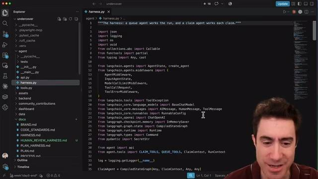
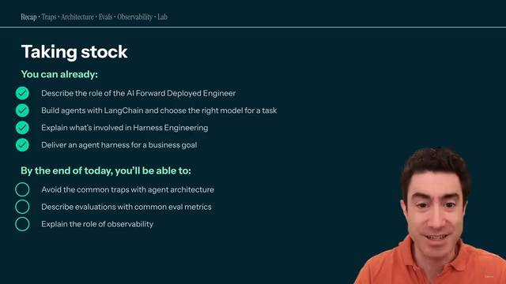
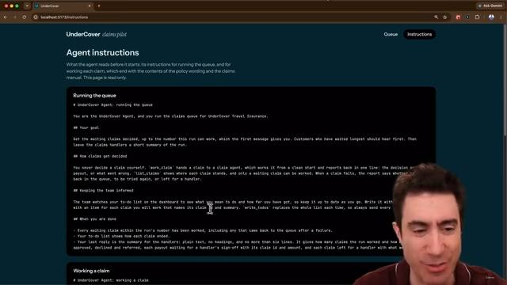
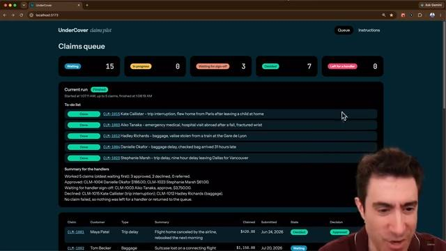
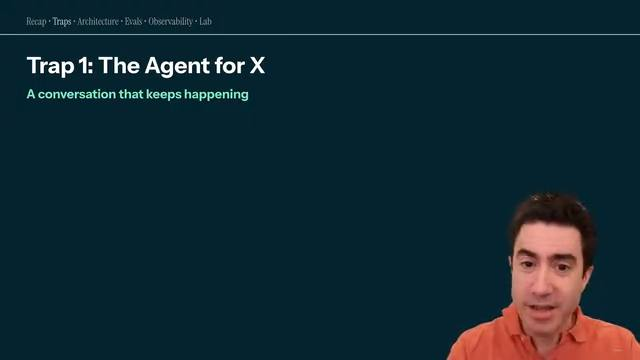
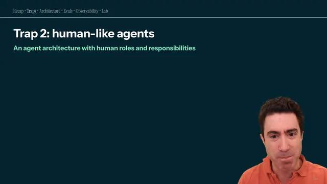
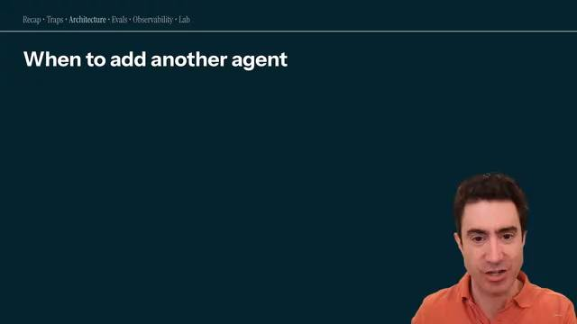
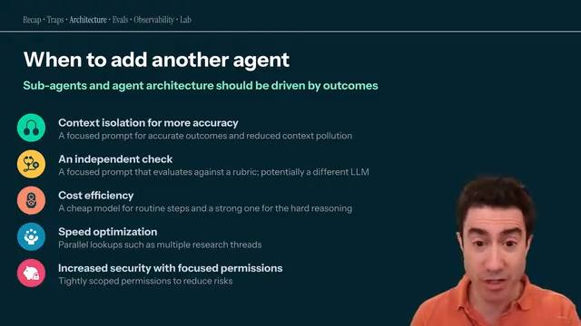

# AI FDE（BV1rJnm64Eq3）P43–P46 复现文档：Agent Harness 验收、三陷阱与子代理架构

> 复现边界先说明：P43 是对一个已经存在的 Agent Harness 项目做代码审查、运行验收和 UI 检查；P44–P46 是 Week 2 Day 1 的架构理论课。逐字稿里**没有给出完整仓库地址、依赖版本、环境变量名、启动命令、API schema 或完整源码**。因此本文不会编造这些内容：能照着做的部分是「验收已有项目」和「按讲师原则做架构实验」；不能从这段材料从零重建完整工程的地方，会明确写“课里没讲”。下面第 4 节给出的可运行文件是**示意代码/验收产物**，不是讲师原项目源码。

---

## 1. 这一节做什么

这一节的目标不是再讲一遍“什么是 Agent”，而是把 P43–P46 串成一条可执行的工作流：

1. **验收一个已经修过的 Agent Harness**：看代码模块是否清晰，看 `code standards` 是否补上了“每件事只有一种做法”，看 `process.md` 是否加入独立 reviewer，看 `status` 是否记录了 harness review。
2. **重新跑一轮业务任务**：启动应用，观察 to-dos 数量、claim 处理进度、五个 claim 是否跑完，打开 claim 详情，检查 light mode 和 mobile view。
3. **用架构原则约束下一步开发**：不要先画“agent 组织架构图”，而是先找业务问题、定义指标、做 baseline、跑实验；只有当子代理能带来可测量的更好结果时才拆。
4. **把固定业务逻辑从 prompt 拿回代码**：例如理赔扣减、赔付上限这类数学逻辑，应该放在代码或工具里，而不是让 LLM 在 prompt 里算。
5. **建立 evals / observability 意识**：讲师明确把 evaluations 和 observability 作为 agent architecture 的核心部分，并提到用 Langfuse 做开源 agent observability。

P43 的产物是“可提交 PR 的代码质量与运行验收”；P44–P46 的产物是“架构决策表 + 实验记录 + 子代理拆分条件 + 业务逻辑代码化示例”。

---

## 2. 讲师原话（带「—— pNNN [MM:SS]」）

P43 里讲师先检查 agent 代码结构：

> "有一个接口模块、一个 harness 模块和一个工具模块。"
> —— p043 [01:06]

这说明项目至少按 **API / harness / tools** 三层组织。逐字稿还提到 `claim tools` 和 `queue tools`，以及 `code standards markdown`、`process.md`、`status`。这些名字可以直接作为验收时的搜索关键词。

> "其中有一整节专门讲结构，而且一开头就给出每件事的一种做法。"
> —— p043 [01:54]

讲师认可的点不是“代码看起来多”，而是**结构章节明确写出“每件事只有一种做法”**。这对前端转 AI 应用工程师尤其重要：不要让同一个服务调用在三个地方有三种写法。

> "让一个没有写过这段代码的全新子代理来做审查，找出与编码标准的差异，并检查每个服务是否只有一种调用方式。"
> —— p043 [02:46]

这是 P43 最关键的流程改进：`process.md` 里加入一个**没有写这份代码的 fresh reviewer sub agent**，让它拿 coding standards 做 diff 审查，并检查每个服务是否只有一种调用方式。

> "我们可以发起一个拉取请求，并且可以放心地为这段代码的质量负责。"
> —— p043 [07:11]

验收的终点不是“能跑”，而是“敢为代码质量负责，可以提 PR”。

P44 回顾 harness engineering 七个方面：

> "harness 工程的七个方面中，第一个就是上下文工程所包含的一切。"
> —— p044 [02:07]

七个方面包括 context engineering、workflow、state、sub-agents、permission/sandbox、observability/evals、self-improvement。P44 还明确说今天会使用 Langfuse：

> "我们将使用 Langfuse，这是一个出色的开源智能体可观测性平台。"
> —— p044 [01:49]

P45 讲三个陷阱。第一个是“agent for X”：

> "我需要一个服务于我业务的智能体……然后我会说，好，那它到底在解决什么业务问题？"
> —— p045 [00:29]

讲师反复强调：不要从“我要一个 X agent”开始，要从**可测量的业务问题**开始；先尝试不用 agent、甚至不用 LLM 的 baseline。

> "搭建人工智能架构的最佳方式不是画方框和连线，而是做实验。"
> —— p045 [06:41]

> "从简单开始……加入智能体……因为这样能提升性能。"
> —— p045 [05:43]

P46 讲子代理拆分。最重要的原因是上下文隔离：

> "上下文隔离。这确实是你构建单独子代理的主要原因。"
> —— p046 [01:39]

还有一条是“固定业务逻辑不要写成 prompt”：

> "如果你有直截了当的业务逻辑，先做 A，再做 B，再做 C……那就应该放在 Python 代码里，而不是放在提示词里。"
> —— p046 [04:41]

最后讲师给优先级：

> "你首先应该优先考虑数据科学方面的问题。"
> —— p046 [06:32]





---

## 3. 从零复现

### 3.1 先明确：这一段能复现什么，不能复现什么

**能复现：**

- 对已有 Agent Harness 做一次结构化验收；
- 按 P43 的观察点检查 `code standards`、`process.md`、`status`；
- 启动已有应用后跑 5 个 claim，观察进度和最终状态；
- 检查 claim 详情页、light mode、mobile view；
- 按 P45/P46 做架构决策：业务问题 → 指标 → baseline → 单 agent → 是否拆子代理；
- 用代码实现固定业务逻辑，并把它作为工具暴露给 agent。

**不能从这段材料复现：**

- 完整仓库的目录树和文件内容；
- 依赖版本、包管理器、启动命令；
- 环境变量名和 `.env` 示例；
- API 路由、数据库 schema、队列实现；
- Langfuse 接入的具体 SDK 配置；
- 原项目的 claim 状态字段名。

这些必须从前序 P 的仓库/README 获取。逐字稿里没有的内容，本文不补假命令。

---

### 3.2 验收已有 Agent Harness 的步骤

#### Step 0：拿到前序项目

课里没讲仓库 URL、依赖版本、启动命令。你需要使用前序课程已经搭好的项目。打开项目后，先确认逐字稿里出现的这些对象存在：

- `API module`
- `harness module`
- `tools module`
- `claim tools`
- `queue tools`
- `code standards markdown`
- `process.md`
- `status`

如果这些文件/模块不存在，说明你拿到的不是 P43 对应的版本，先不要继续。

#### Step 1：检查 `code standards markdown`

在编辑器里打开 `code standards markdown` 的 preview。逐项检查：

1. 是否有 `structure` 章节；
2. 是否明确写出 `one way to do each thing`；
3. 是否给出例子；
4. 是否专门讲到 agents design；
5. 是否把“调用某个服务只有一种方式”写清楚。

讲师在 P43 里认可的就是这一点：不是“代码风格好看”，而是**约束明确、可被 reviewer 执行**。

#### Step 2：检查 `process.md`

打开 `process.md`，找到 reviewing 部分。重点看：

- 是否有独立 reviewer；
- reviewer 是否是“没有写这份代码的 fresh sub agent”；
- 是否要求 reviewer 获取 code standards 的差异；
- 是否检查“每个服务只有一种调用方式”；
- 是否不仅检查“代码能跑”，还检查“是否适合 merge”。

这一步对应讲师原话：`the reviewer of fresh sub agent that didn't write the code`。

#### Step 3：检查 `status`

打开 `status`，确认里面有一次 harness review 的记录：发生了什么、为什么发生、后续如何避免。P43 里讲师说“it did a review of the harness and it talks about what happened”。

#### Step 4：启动应用

启动命令课里没讲，环境变量名课里没讲。按前序仓库 README 执行。启动后应看到：

- 页面显示 `Running`；
- to-dos 出现；
- 逐字稿中提到数量从 `19` 开始下降；
- 有一个任务处于 in progress，逐字稿点名 `Kate Callister`；
- 列表里能看到已经跑过的任务。



#### Step 5：跑 5 个 claim

触发一轮 run，让 5 个 claim 跑完。逐字稿里观察到的最终状态是：

- 5 个都完成；
- 数字降到 `15`；
- `3` 个 waiting sign off；
- `7` 个 decided；
- 功能正常。

注意：这些数字是讲师那次运行的观察值，不是固定断言。你复现时以实际 UI 为准。



#### Step 6：打开 claim 详情并检查 UI

打开一个 claim，例如逐字稿里的 `Maya`，检查详情页各 section 是否完整。然后：

- 切到 light mode，确认不是只在 dark mode 下能看；
- 切到 mobile view，确认表格可以横向滚动，其他布局正常；
- 确认页面是 mobile friendly。

P43 里讲师明确说：light mode 看起来不错，mobile view 也“perfectly decent”，表格可以 sideways scroll。

#### Step 7：代码审查

快速检查三个模块：

- `API module`：是否像正常 API 模块；是否只有一个 hard-coded backend；讲师说也可以写在 `.EMV file`（逐字稿转写，可能是 `.env`，但环境变量名课里没讲，不要猜）；
- `harness module`：是否有合适的 middleware 和 setup；
- `tools module`：是否有 claim tools 和 queue tools；
- queue agent：是否不再是一个难维护的 50 行函数。

#### Step 8：提交 PR

具体 Git 命令课里没讲。按仓库规范提交。P43 的验收标准是：你愿意为这次代码质量负责。

---

### 3.3 按 P45/P46 做架构实验的步骤

不要先画 agent 组织图。按下面顺序做：

1. **写业务问题**：不是“我要一个 culture agent”，而是“离职率上升，需要降低离职率”或“理赔处理需要减少人工复核时间”。
2. **定义可测量指标**：例如离职率、理赔处理时长、人工改判率、appeal 后推翻率、每次处理成本。P45 的文化 agent 例子最终落到 attrition，因为 attrition 可测量；会议太多、会议迟到不是直接指标。
3. **做非 agent baseline**：先看传统代码、规则、报表、简单 LLM 调用能做到什么。P45 明确说“first, try solving it without agents and maybe even without LLMs at all”。
4. **单 agent 实验**：只做一个 agent，测量指标。
5. **判断是否拆子代理**：只有满足 P46 的条件才拆：任务聚焦、上下文隔离、独立 evaluator、成本/推理努力分层、并行 fan-out、权限隔离。
6. **接 observability / evals**：用 Langfuse 观察调用链和实验结果；用 rubric 做 LLM-as-a-judge。
7. **固定逻辑代码化**：扣减、上限、状态流转、重试、顺序流程不要塞 prompt。

---

### 3.4 子代理拆分决策表

| 拆分理由 | 判断问题 | 不满足时 |
|---|---|---|
| 聚焦任务 | 这个任务能否用专门 prompt、专门工具、专门上下文独立完成？ | 留在主 agent |
| 上下文隔离 | 子任务是否会产生大量文档/工具调用，污染主 agent 上下文？ | 不拆，或只返回摘要 |
| 独立评估 | 是否需要 evaluator 只看结果、不看推理过程？ | 用同一 agent 自评或人工抽检 |
| 成本分层 | 是否有些步骤需要强模型，有些只需弱模型/低推理？ | 统一模型 |
| 并行 fan-out | 是否能拆成多个互不依赖的搜索/分析任务并行跑？ | 串行 |
| 权限隔离 | 是否不同任务需要不同权限/沙箱边界？ | 不拆 |

所有理由最终都要回到一个标准：**是否带来可测量的更好结果**——更快、更便宜、更安全或更准确。





---

## 4. 完整代码

> 说明：P43–P46 的逐字稿没有给出讲师项目的完整源码，也没有给出可复制的启动命令。因此下面不是“讲师原项目代码”，而是两个**可直接保存使用的产物**：一个可运行的 Node 示意文件，把理赔扣减/赔付上限这类固定业务逻辑放到代码里；一个验收清单 Markdown。示意代码中的字段名是本文为了演示而设，不是课程里的真实 schema。

### 4.1 `claim-payout.mjs`（课里没有代码，以下为示意）

保存为 `claim-payout.mjs`，直接运行：

```bash
node claim-payout.mjs
```

完整文件：

```js
// 课里没有代码，以下为示意。
// 目的：演示 P46 的观点——deductible / coverage limit 这类固定数学逻辑
// 应放在代码或工具里，而不是让 LLM 在 prompt 里计算。

export function calculatePayout({ claimedAmount, deductible, coverageLimit }) {
  const values = [claimedAmount, deductible, coverageLimit];

  for (const value of values) {
    if (typeof value !== "number" || !Number.isFinite(value)) {
      throw new TypeError("claimedAmount, deductible, coverageLimit must be finite numbers");
    }
  }

  if (claimedAmount < 0 || deductible < 0 || coverageLimit < 0) {
    throw new RangeError("amounts must be non-negative");
  }

  const afterDeductible = Math.max(0, claimedAmount - deductible);
  const payout = Math.min(afterDeductible, coverageLimit);

  return {
    claimedAmount,
    deductible,
    coverageLimit,
    afterDeductible,
    payout
  };
}

const sample = calculatePayout({
  claimedAmount: 1200,
  deductible: 200,
  coverageLimit: 1000
});

console.log(sample);
```

预期输出：

```text
{
  claimedAmount: 1200,
  deductible: 200,
  coverageLimit: 1000,
  afterDeductible: 1000,
  payout: 1000
}
```

### 4.2 `docs/agent-acceptance-checklist.md`（完整验收文件）

保存为 `docs/agent-acceptance-checklist.md`：

```markdown
# Agent Harness 验收清单

## 1. 代码结构
- [ ] 存在 API module
- [ ] 存在 harness module
- [ ] 存在 tools module
- [ ] 存在 claim tools
- [ ] 存在 queue tools
- [ ] API 只有一个 hard-coded backend，或 backend 通过环境变量配置
- [ ] queue agent 不再包含难维护的超长函数

## 2. Code Standards
- [ ] code standards markdown 有 structure 章节
- [ ] 明确写出 one way to do each thing
- [ ] 给出至少一个正确示例
- [ ] 专门说明 agents design
- [ ] 明确每个服务只有一种调用方式

## 3. Process
- [ ] process.md 有 reviewing 部分
- [ ] reviewer 是 fresh sub agent
- [ ] reviewer 没有写被审代码
- [ ] reviewer 获取 code standards 差异
- [ ] reviewer 检查每个服务是否只有一种调用方式
- [ ] reviewer 检查代码是否适合 merge，而不仅是能运行

## 4. Status
- [ ] status 中有 harness review 记录
- [ ] 记录说明发生了什么
- [ ] 记录说明后续如何避免重复发生

## 5. 运行验收
- [ ] 应用可以启动（启动命令以项目 README 为准）
- [ ] 页面显示 Running
- [ ] to-dos 出现
- [ ] 能观察到任务进度
- [ ] 5 个 claim 全部完成
- [ ] 能看到 waiting sign off / decided 等状态
- [ ] 能打开 claim 详情页
- [ ] 详情页 section 完整

## 6. UI
- [ ] dark mode 正常
- [ ] light mode 正常
- [ ] mobile view 正常
- [ ] 表格在窄屏可以横向滚动

## 7. 提交
- [ ] 代码审查通过
- [ ] 愿意为代码质量负责
- [ ] 按仓库规范提交 PR
```

### 4.3 `docs/agent-architecture-decisions.md`（完整决策表）

```markdown
# Agent Architecture Decisions

## 业务问题
- 问题描述：
- 当前 baseline：
- 不用 agent / 不用 LLM 的方案：
- 可测量指标：
- 数据来源与质量：
- 成功阈值：

## 是否使用 Agent
- [ ] 存在需要自然语言理解的细微判断
- [ ] 固定流程已用代码/workflow 实现
- [ ] 已定义 evals
- [ ] 已定义 observability
- [ ] 已记录失败案例

## 子代理拆分理由
| 子代理 | 拆分理由 | 预期可测量收益 | 不拆的替代方案 |
|---|---|---|---|
|  | 聚焦任务 |  |  |
|  | 上下文隔离 |  |  |
|  | 独立评估 |  |  |
|  | 成本分层 |  |  |
|  | 并行 fan-out |  |  |
|  | 权限隔离 |  |  |

## 固定逻辑代码化
- 扣减/上限/税费/状态流转：
- 重试与幂等：
- 顺序 workflow：
- 工具输入输出 schema：

## 评估与观测
- 评估集：
- Rubric：
- LLM-as-a-judge 是否使用不同模型：
- Langfuse 观测点：
- 人工复核比例：
```





---

## 5. 逐行解释

### 5.1 `claim-payout.mjs` 逐行解释

- `export function calculatePayout(...)`：把赔付计算封装成纯函数。P46 说理赔里“根据 deductible 算应赔多少”是数学，不是 prompt。纯函数的好处是可直接单测，也可被 agent 作为 tool 调用。
- `const values = [claimedAmount, deductible, coverageLimit];`：把三个输入聚合成数组，便于统一校验。
- `typeof value !== "number" || !Number.isFinite(value)`：拒绝 `NaN`、`Infinity` 和非数字。LLM 生成工具参数时可能传字符串，这一层必须挡住。
- `claimedAmount < 0 || deductible < 0 || coverageLimit < 0`：金额不能为负，防止异常输入进入业务。
- `Math.max(0, claimedAmount - deductible)`：先扣免赔额，最低为 0。这个顺序是业务规则，应该由代码保证，而不是让模型“理解”。
- `Math.min(afterDeductible, coverageLimit)`：再受赔付上限约束。两个规则组合起来就是固定业务逻辑。
- `return { ... }`：返回结构化结果，方便 agent 读取，也方便日志和测试。
- 底部 `sample` 与 `console.log`：让文件可直接 `node claim-payout.mjs` 运行，验证输出。真实项目中应改成测试用例或工具 handler。

**在 JS/Node 里对应什么：** 这类纯函数不需要锁或事务；如果后续要写数据库，才需要事务/幂等。P46 没讲数据库实现，这里不展开。

### 5.2 验收清单逐项解释

- **API / harness / tools 三层**：对应 P43 讲师看到的模块划分。分层的目的不是好看，而是让 reviewer 能按边界检查。
- **一个 hard-coded backend**：P43 说“one hard-coded backend, which is nice”。少一个配置分支，就少一类运行差异。
- **queue agent 不再 50 行函数**：P43 明确说之前“unwieldy 50 line functions”很糟，现在 run queue 变得“perfectly decent”。验收时要看这个函数是否被拆小。
- **`one way to do each thing`**：P43 讲师认可 code standards 的核心。对前端团队也一样：同一个 API 调用不要同时存在 `fetch`、axios 封装、hooks 三种入口。
- **fresh reviewer sub agent**：P43 的流程改进。reviewer 不写代码，才不会被自己的实现思路带偏。
- **检查“适合 merge”而不只是“能运行”**：P43 说 reviewing section 不只看 checks work，还看 fit to merge。
- **status 记录 harness review**：P43 说 status 里能看到 review 和发生了什么，目的是避免重复犯错。
- **运行数字**：`19`、`15`、`3`、`7` 是讲师那次运行的观察值，不是接口契约。复现时以实际 UI 为准。
- **light mode / mobile view**：P43 明确检查了 light mode 和 mobile friendly，表格可横向滚动。
- **PR 责任**：P43 的终点是“可以提 PR，并对代码质量负责”，不是“本地能跑”。

### 5.3 架构决策表逐项解释

- **业务问题**：P45 的第一个陷阱就是“agent for X”。必须先写业务问题，不能写“我要一个 strategy agent”。
- **baseline**：P45 说先尝试不用 agent、甚至不用 LLM。没有 baseline，就无法证明 agent 带来改进。
- **可测量指标**：P45 的文化 agent 故事最终落到 attrition。会议太多、会议迟到是常见抱怨，但不一定和 attrition 对齐。
- **数据来源与质量**：P46 说优先 data science concerns，包括数据和质量。没有好数据，agent 只会生成“可信但没用”的内容。
- **是否使用 Agent**：P46 说固定顺序 A→B→C 应该用代码/workflow，不应为了自主性而自主性。
- **子代理拆分理由**：P46 给了六类理由：聚焦任务、上下文隔离、独立评估、成本分层、并行 fan-out、权限隔离。每一类都要写“预期可测量收益”和“不拆的替代方案”，否则就是为拆而拆。
- **固定逻辑代码化**：扣减、上限、税费、状态流转、重试、幂等、顺序 workflow 都应该在代码里；agent 只做需要自然语言判断的部分。
- **LLM-as-a-judge**：P46 说 evaluator 只看结果，不看第一个 agent 的推理，避免被过程带偏；还可以用不同模型增加独立性。
- **Langfuse 观测点**：P44 明确把 evals 和 observability 作为 architecture 的核心，并提到 Langfuse。具体接入代码课里没讲，不能编造环境变量名。

**在 JS/Node 里对应什么：**

- 并行 fan-out：Node 里通常用 `Promise.all` 并发跑多个独立子任务；但课里没讲具体实现。
- 权限隔离：Node 里至少是不同进程/容器/凭据边界；P44 提到 sandbox、container。
- 状态持久化：P44 说 Claude Code 里常见是 repo 里的 markdown；其他项目可能是文件或数据库，课里没展开。
- 锁/事务：P43–P46 没有讲并发写冲突和事务。若你后续把 claim 状态写数据库，需要自己补事务/幂等，不能从本段推导字段名。

---

## 6. 复现检查清单

- [ ] 我确认自己拿到的是 P43 对应的前序项目，而不是从零新建的空项目。
- [ ] 项目里存在 API module、harness module、tools module。
- [ ] 项目里存在 claim tools、queue tools。
- [ ] 我打开了 code standards markdown，并确认有 structure 章节。
- [ ] code standards 明确写出 `one way to do each thing`。
- [ ] code standards 专门讲到 agents design。
- [ ] process.md 有 reviewing 部分。
- [ ] reviewer 是 fresh sub agent，且没有写被审代码。
- [ ] reviewer 会拿 code standards 做差异检查。
- [ ] reviewer 检查每个服务是否只有一种调用方式。
- [ ] status 里有 harness review 记录。
- [ ] 应用能启动；启动命令以项目 README 为准，本文没有编造。
- [ ] 页面出现 Running。
- [ ] to-dos 出现并开始推进。
- [ ] 5 个 claim 全部跑完。
- [ ] 能看到 waiting sign off / decided 等状态。
- [ ] 能打开 claim 详情页，例如 Maya。
- [ ] dark mode 正常。
- [ ] light mode 正常。
- [ ] mobile view 正常，表格可横向滚动。
- [ ] 我运行了 `node claim-payout.mjs`，输出符合预期。
- [ ] 我把固定赔付逻辑放进代码/工具，而不是让 LLM 在 prompt 里算。
- [ ] 我为架构实验写了业务问题、指标、baseline、数据质量。
- [ ] 我没有在未定义 evals/observability 的情况下直接拆多个子代理。
- [ ] 我知道本段没有给出 Langfuse 的具体接入配置；需要另查课程后续或官方文档。

---

## 7. 课里没讲但你会撞上的

1. **仓库地址和目录树**：P43 只说了模块名，没有给完整路径。你需要在上一节课程材料里找仓库。
2. **依赖版本和包管理器**：逐字稿没有 `package.json`、锁文件、Node 版本。不要照抄本文示意代码的依赖，它只用 Node 内置能力。
3. **启动命令**：课里没讲 `npm run dev`、`docker compose up` 或任何具体命令。以项目 README 为准。
4. **环境变量名**：P43 提到 backend 可写在 `.EMV file`（逐字稿转写），但具体变量名课里没讲。不要猜 `OPENAI_API_KEY`、`ANTHROPIC_API_KEY` 等字段名并写进复现文档。
5. **claim 状态字段名**：逐字稿只说 waiting sign off、decided 等 UI 状态，没有给 API 字段名。实际输出字段以项目为准。
6. **队列实现**：P43 提到 queue agent，但没有讲队列技术、重试、死信、幂等。若你要上生产，需要自己补。
7. **并发与锁**：P43–P46 没有讲多 worker 同时处理同一 claim 的锁/事务。JS/Node 里如果你用数据库，需要自己设计条件更新或事务；课里没讲。
8. **Langfuse 接入**：P44 说会用 Langfuse 做 observability，但没有给 SDK 安装、环境变量、trace 结构。需要看后续实践或官方文档。
9. **评估集和 rubric**：P46 说 evaluator 可以有 rubric，检查 tone、accuracy、annotations 等，但课程没有给具体数据集和评分阈值。
10. **子代理通信**：P46 说 agents 可以用 tools、MCP servers、互相写 markdown，不需要 fancy 的 A2A。但具体协议实现课里没展开。
11. **Week 3 的 context layer / gateway / governance**：P46 明确说这些是 Week 3 的内容，本段只给方向，没有给设计细节。
12. **命令输出字段**：本段没有出现 `ExitCode`、`OOMKilled`、`HostConfig` 这类容器字段；如果你的运行环境输出这些字段，请以实际输出为准，不要从本文反推。

**最终验收口径：** 如果你能按第 6 节完成已有项目的验收，能运行 `claim-payout.mjs`，能写出一页架构决策表，并且能说清楚“为什么现在不拆子代理/为什么这个逻辑必须放代码”，就已经把 P43–P46 的可复现部分跑通了。完整工程源码和启动命令，需要回到前序课程仓库补齐。