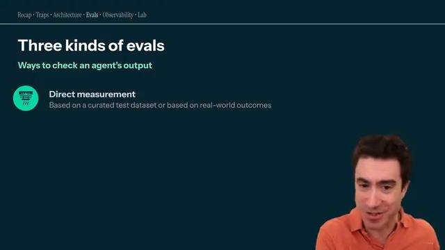
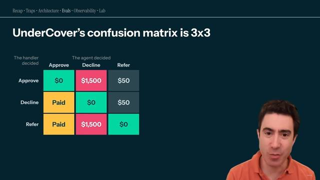
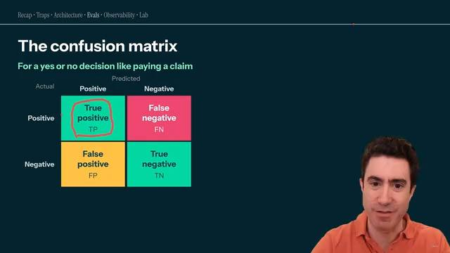
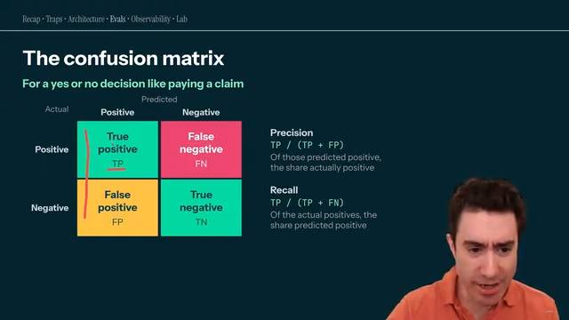
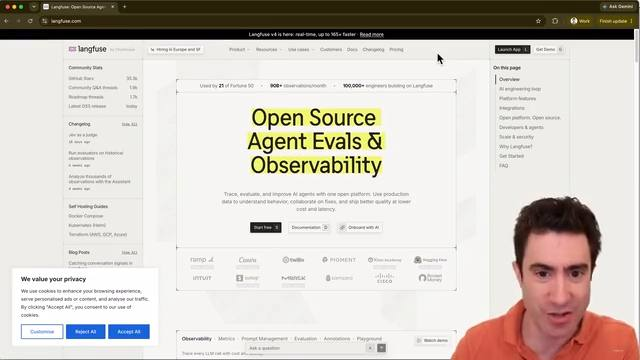
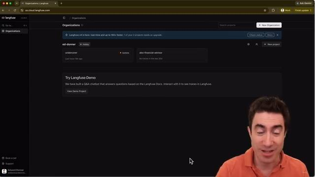
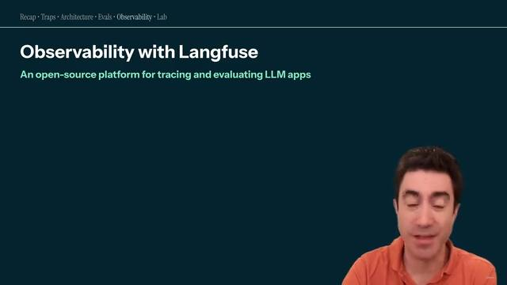
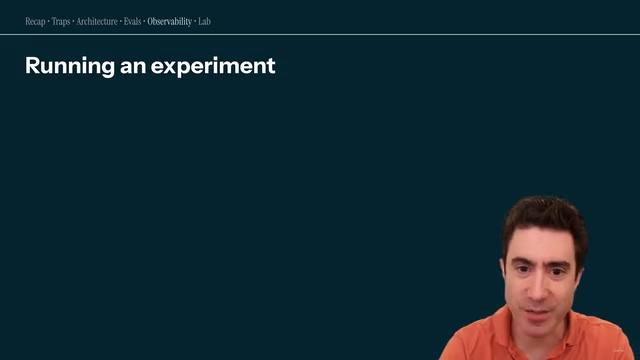
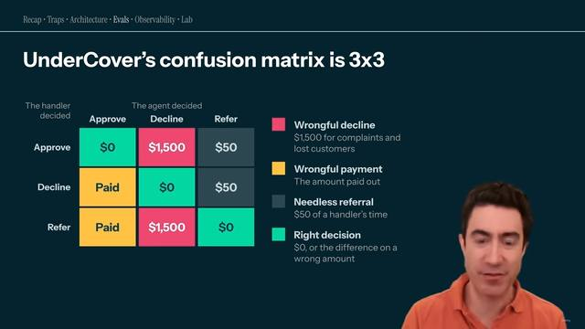
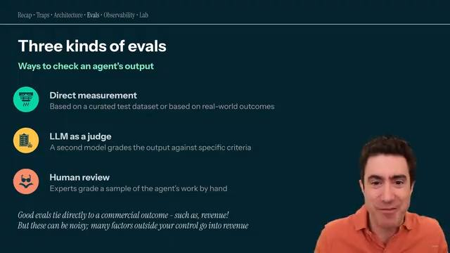

# AI FDE P47–P49 复现文档：给 Undercover 索赔 Agent 搭一套评估与可观测性回路

## 1. 这一节做什么

P47–P49 是整门课里"从做功能转向做判断"的三讲。前面几十讲你都在让 agent 能处理索赔；这三讲回答的是：它处理得对不对、错在哪、错一次值多少钱、怎么把过程录下来供人回看。

三讲各自的重心：

- **P47** 讲评估的三条路径：代码直接验证、LLM as a judge、人类评分；然后落到混淆矩阵和 precision/recall，并解释为什么业务对不同类型错误的容忍度不一样。
- **P48** 把二分类混淆矩阵扩成 undercover 专用的 approve/decline/refer 3×3 惩罚矩阵，并列出应该一起看的指标组合：accuracy、decision accuracy、Cohen's Kappa、错误成本、straight-through rate、precision/recall。
- **P49** 引入 Langfuse，讲 traces / datasets / experiments / scores 四个能力，以及 `run_experiment` 的四个参数：data、task、evaluators、run_evaluators。

最终要交付的不是新功能，而是一条能重复跑的回路：**业务容忍度 → 3×3 惩罚数字 → 一组指标 → Langfuse 项目 → `run_experiment` 跑批 → UI 里对比实验**。读者按本文做完，应该能在一个 harder 数据集上跑出至少一个 cost 分数和一个 accuracy 分数，并在 Langfuse 里看到 traces 和 experiment 记录。

需要先说明边界：这三讲的逐字稿以概念讲解和 Langfuse 控制台操作为主，**课里没有给出完整的评估脚本代码**。所以本文第 4 节的脚本是"示意代码"，用来把讲师口述的四个参数落成可读结构，具体 SDK 签名请以 Langfuse 官方文档和你安装的版本为准。

---

## 2. 讲师原话（带「—— pNNN [MM:SS]」）

关于评估的三条路径：

> "There are three different ways that you could check an agent's output. And the first one is the really obvious one, which is if you can directly measure and use code to validate a result." —— p047 [00:00]

> "The second type is LLM as a judge... giving it criteria giving it a rubric telling it exactly what dimensions it should score against and for each one giving it specific examples." —— p047 [00:38]

> "And then the third way is to have a human grader that comes in and evaluates the results from an agent." —— p047 [02:50]

关于指标组合：

> "The right answer is usually to have a set of metrics, a portfolio of metrics. Some of them are closer to your model... And then some of them are closer to the business." —— p047 [03:52]

关于混淆矩阵与 precision/recall：

> "Precision is the number of true positives divided by the total number of positives. It's the true positives divided by the true positives plus the false positives." —— p047 [09:27]

> "Recall is the number of true positives divided by... the true positives plus the false negatives." —— p047 [11:10]

关于 undercover 的业务容忍度：

> "The undercover business tolerates false positives, agreeing to someone's claim wrongly, more than false negatives, rejecting a claim that you should have agreed to." —— p047 [14:43]

关于 3×3 矩阵：

> "In the case of undercover, we don't have the normal confusion matrix because there are in fact three different possibilities... Approve, decline, or the other one, refer, raise, escalate." —— p048 [00:00]

关于惩罚数字：

> "Because of the hassle this causes us... this impacts the company by $1,500. That is the cost of a wrongful decline." —— p048 [00:55]

> "The two yellow squares represent situations where the agent decided to pay something out and it should either have declined it or referred it... we should just take however much it paid and make that be the amount." —— p048 [01:22]

> "The two gray boxes represent a needless referral... it should get a $50 penalty." —— p048 [01:56]

关于指标：

> "There is accuracy... There's a slight variation of this that we'll look at in the lab called Cohen's Kappa, which is when you organize it so that you take into account that if it just said yes everything it would already score a certain amount." —— p048 [03:43]

> "You'd also want to look at perhaps the straight through rate, or how often was it able to answer it itself without referring to a handler." —— p048 [04:42]

> "If the model just approves everything, it gets an accuracy. In our case of our test data, I think of 56%, just by saying yes to everything." —— p048 [07:04]

关于 Langfuse 与可观测性：

> "Observability is a very close second... We're going to be using a product called Langfuse." —— p049 [00:00]

> "There are four essential features of Langfuse... traces... data sets... experiments... scores." —— p049 [01:11]

> "Surfacing observability in the actual platform for the right kinds of users." —— p049 [02:46]

关于 `run_experiment` 四个参数：

> "We're going to call langfuse.run experiment and then we'll pass in a bunch of things and you'll see most importantly there is data, task, evaluators and run evaluators." —— p049 [05:31]

> "Data is simply a list of objects, it'll be using your data set, each object is a different data point. The task is a function that you pass in, and that function will be called repeatedly for each of the elements in items." —— p049 [06:15]

> "Evaluators is a list of different functions that will score one individual result... And Run Evaluators is a list very similar, but this time it's something that will score an entire experiment." —— p049 [06:48]

关于环境变量：

> "Secret key... And a public key... It's the three things that need to go in the dot EMV of the undercover project." —— p049 [08:50]

> "Remember to save. If you don't save Command S or Control S on a PC, then it won't be on disk and the environment variables won't work." —— p049 [09:38]

---

## 3. 从零复现

这一节按"业务规则 → 指标 → Langfuse 配置 → 跑实验"的顺序走。课里没有给出完整工程目录和依赖版本，下面凡涉及目录、文件名、安装命令的地方，都是为了让读者能落地而补的**工程约定**，不是讲师逐字稿里念过的内容；我会在每一步标注。

### 步骤 0：前置条件与环境约定

你需要：

1. 已经跟完前面课程、本地有一个能调用 undercover agent 的项目（P47 里讲师多次说 "正如我们此前为 undercover 所做的那样"）。
2. 一个浏览器，能访问 langfuse.com。
3. 一个能跑脚本的运行时。**课里没有明确说 Langfuse SDK 用哪种语言**；Langfuse 官方提供 Python 和 JS/TS SDK，本文以 Python 为例做示意，前端读者可以把同样的结构平移到 JS SDK。

示意目录结构（课里没讲，按最小可运行工程补）：

```
undercover/
├── .env
├── requirements.txt
├── data/
│   └── harder.jsonl
└── evals/
    └── run_experiment.py
```

`requirements.txt` 先写一行：

```
langfuse
```

课里没有指定版本号，装当前稳定版即可；具体版本以 `pip show langfuse` 的实际输出为准。



### 步骤 1：把业务容忍度写成 3×3 惩罚矩阵

这是整节最核心的产物。P48 明确说 undercover 不是二分类，而是 approve / decline / refer 三类，所以矩阵是 3×3：**行是人类 handler 的真实决定，列是 agent 的决定**。

把讲师口述的数字填进去：

| 真实 \ agent | approve | decline | refer |
|---|---|---|---|
| **approve** | 0 | $1,500 | $50 |
| **decline** | 实际赔付金额 | 0 | $50 |
| **refer** | 实际赔付金额 | $1,500 | 0 |

三条规则来自讲师原话：

- 错误 decline（真实 approve 或 refer，agent 却 decline）→ $1,500。理由是会上诉、最终往往还是赔付、且伤客户关系。
- 错误 approve（真实 decline 或 refer，agent 却 approve）→ 按实际赔付金额计。讲师特别提醒：如果这笔金额超过 $1,500，惩罚就比错误 decline 更重。
- 不必要 refer（真实 approve 或 decline，agent 却 refer）→ $50。理由是只增加人工处理成本，不直接伤客户也不直接赔钱。



### 步骤 2：把指标写成可计算的定义

P48 给出的指标不是让你全用，而是让你**组合**看。逐个写成可执行定义：

1. **accuracy**：绿色对角线（agent 与 handler 一致）的样本数 ÷ 总样本数。3×3 情况下就是三个对角格之和 ÷ 全部九格之和。
2. **decision accuracy**：把三类压成"批准/不批准"两类后，再算准确率。讲师原话是 "我们只是在说，先把它视为“批准”或“不批准”。而“不批准”就是“拒绝”或“转交”。"。
3. **Cohen's Kappa**：讲师只讲了性质——"全部说 yes 的 kappa 是 0，完美是 1"，**没有给公式**。实现时请用你选用的统计库，并在文档里注明公式来源；不要凭记忆手写。
4. **错误成本（cost of mistake）**：对每个样本，按真实类别和 agent 类别去 3×3 矩阵取对应格子的美元数，再求和或求平均。这是最贴近业务的指标。
5. **straight-through rate**：agent 没有 refer、自己给出最终决定的比例。讲师专门提醒：如果不看这个，agent 可以靠"全部 refer"把平均惩罚压到 $50，但业务上等于没用。
6. **precision / recall（针对 approval）**：precision = agent 批准中真正该批准的比例；recall = 所有该批准的索赔中被 agent 批准的比例。





### 步骤 3：创建 Langfuse 账号与项目

按 P49 的实际操作顺序：

1. 打开 langfuse.com，点右上角入口（讲师说你可能看到 "launch app" 或 "get started"）。
2. 用 Google 账号或邮箱注册。
3. 选择 region（讲师解释这是用来分配硬件的）。
4. 创建 organization，点进去。
5. 点 **New Project**，项目名建议就叫 `Undercover`（讲师自己演示时叫 `Undercover 2`，是因为他已经有一个 `Undercover`）。



### 步骤 4：创建 API key 并写入 `.env`

在项目里点 **Create new API key**。讲师说控制台会给你三个东西：

- secret key（不能泄露）
- public key
- 第三个值（host / base URL，讲师口述为 "这三件事"）

课里**没有念出这三个环境变量的具体变量名**，只说了"三个东西要放进 undercover 项目的 .env"。落地时请以你创建 key 时控制台显示的变量名为准。常见的对应关系是 `LANGFUSE_SECRET_KEY`、`LANGFUSE_PUBLIC_KEY`、`LANGFUSE_HOST`，但这不是讲师原话，写进 `.env` 前请核对控制台。

示意 `.env`（变量名以控制台为准）：

```dotenv
LANGFUSE_SECRET_KEY=sk-lf-...
LANGFUSE_PUBLIC_KEY=pk-lf-...
LANGFUSE_HOST=https://cloud.langfuse.com
```

讲师反复强调：**记得保存文件**（Mac 是 Command+S，Windows 是 Control+S），不保存环境变量不会生效。



### 步骤 5：准备 harder 数据集

P49 里讲师说得很具体：原来的数据集模型已经做得很好（"你本来能拿到 25 分（满分 25 分）"），所以要新建一个叫 **harder** 的数据集，让模型先做差，再逐步追上来。

数据集里每条至少要有：

- 一个唯一 id
- 输入（索赔内容）
- 期望输出 / golden 结果（handler 的真实决定，approve / decline / refer）
- 可选 metadata（比如索赔金额，用来算错误成本）

课里没有给 harder 数据集的字段 schema，上面的字段是按 P48 的 3×3 矩阵反推出来的最小集合。



### 步骤 6：写 `run_experiment` 脚本

按 P49 口述，`run_experiment` 接收四个关键参数：

- `data`：数据点列表，每个元素是一条数据集记录。
- `task`：一个函数，对 `data` 里每条记录调用一次，返回 agent 的输出。
- `evaluators`：函数列表，每个函数给**单条结果**打分（比如按 3×3 矩阵算 penalty）。
- `run_evaluators`：函数列表，每个函数给**整个实验**打分（比如整批的平均 cost、accuracy）。

示意脚本见第 4 节。再次强调：**课里没有给出这段代码的完整实现**，下面只是把四个参数的结构写出来。

### 步骤 7：运行并在 Langfuse UI 查看

运行脚本后，回到 Langfuse：

- 左侧 **Tracing**：看每一次模型调用和工具调用的输入输出、token、耗时。
- **Datasets**：确认 `harder` 已上传。
- **Experiments**：看这次 run 的记录和分数。
- **Scores**：看具体评估数值。



---

## 4. 完整代码

> **重要说明：课里没有代码，以下为示意。** 本节的目的不是提供一个能直接 `pip install` 后跑通的成品，而是把 P48 的 3×3 矩阵和 P49 的 `run_experiment` 四参数落成可读结构。真实 SDK 签名、参数名、返回类型请以 Langfuse 官方文档和你安装的版本为准。

### 4.1 设计决策表（P48 的 3×3 惩罚矩阵）

| 真实决定 | agent 决定 | 惩罚 | 讲师给的理由 |
|---|---|---|---|
| approve | approve | 0 | 正确，不罚 |
| approve | decline | $1,500 | 错误拒绝，会上诉、最终赔付、伤客户 |
| approve | refer | $50 | 不必要转人工，只增加人工成本 |
| decline | approve | 实际赔付金额 | 错误赔付，按赔出去的钱罚 |
| decline | decline | 0 | 正确，不罚 |
| decline | refer | $50 | 不必要转人工 |
| refer | approve | 实际赔付金额 | 错误赔付，按赔出去的钱罚 |
| refer | decline | $1,500 | 错误拒绝 |
| refer | refer | 0 | 正确，不罚 |

讲师额外提醒的例外：错误 approve 的金额如果超过 $1,500，惩罚会超过错误 decline。所以 `实际赔付金额` 这一格不能简单封顶在 $1,500。

### 4.2 组件职责表（P49 的 `run_experiment` 四参数）

| 参数 | 职责 | 调用次数 | 输入 | 输出 |
|---|---|---|---|---|
| `data` | 数据集条目列表 | 不调用，只被遍历 | — | 每条一个对象 |
| `task` | 调 agent 产出结果 | 每条 data 调用一次 | 单条 data | agent 输出 |
| `evaluators` | 给单条结果打分 | 每条结果调用一次（可多个 evaluator） | 单条 data + 单条输出 | 一个 score |
| `run_evaluators` | 给整批实验打分 | 每次实验调用一次（可多个） | 整批结果 | 一个 score |

### 4.3 数据模型草案（课里没给 schema，按 3×3 矩阵反推）

```text
DatasetItem
  id: string
  input: string            # 索赔文本
  expectedOutput: string   # handler 真实决定：approve / decline / refer
  metadata.claimAmount: number   # 用于计算错误 approve 的赔付金额

TaskOutput
  itemId: string
  decision: string         # agent 决定：approve / decline / refer
  paidAmount: number       # agent 批准时实际赔付金额；未批准为 0

Score
  name: string             # 如 "cost_of_mistake" / "accuracy"
  value: number
  comment?: string

Experiment
  name: string
  datasetName: string      # "harder"
  scores: Score[]
```

### 4.4 容量估算表（课里没给数字，以下为假设示例）

| 项 | 公式 | 示例（假设 100 条 harder 数据） |
|---|---|---|
| task 调用次数 | N | 100 |
| evaluator 调用次数 | N × E（E 为 evaluator 个数） | 100 × 2 = 200 |
| run_evaluator 调用次数 | R（R 为 run evaluator 个数） | 2 |
| LLM as judge 调用次数 | 若用 judge 则再加 N × J | 课里没给 J，按实际 judge 数算 |
| token 成本 | 以 Langfuse trace 里记录的实际 token 为准 | 课里没给单价 |

这张表的作用是让你在跑之前知道调用量级；具体 token 和费用以 Langfuse Tracing 页面显示的实际值为准。

### 4.5 示意脚本 `evals/run_experiment.py`

```python
# 课里没有代码，以下为示意，仅用于说明 run_experiment 四个参数如何组织。
# 真实 SDK 签名请以 Langfuse 官方文档为准。

import os
from langfuse import Langfuse

# 三个环境变量名以 Langfuse 控制台显示为准
langfuse = Langfuse(
    public_key=os.environ["LANGFUSE_PUBLIC_KEY"],
    secret_key=os.environ["LANGFUSE_SECRET_KEY"],
    host=os.environ["LANGFUSE_HOST"],
)

DATASET_NAME = "harder"

# P48 的 3×3 惩罚矩阵：行=真实决定，列=agent 决定
PENALTY = {
    ("approve", "approve"): 0,
    ("approve", "decline"): 1500,
    ("approve", "refer"): 50,
    ("decline", "approve"): "paid_amount",
    ("decline", "decline"): 0,
    ("decline", "refer"): 50,
    ("refer", "approve"): "paid_amount",
    ("refer", "decline"): 1500,
    ("refer", "refer"): 0,
}


def penalty_for(expected, actual, paid_amount):
    value = PENALTY[(expected, actual)]
    if value == "paid_amount":
        return paid_amount
    return value


def task(item):
    """对单条数据调用 undercover agent。调用逻辑沿用你前几周的实现。"""
    # 示意：真实实现里这里应该调用你的 agent
    raise NotImplementedError("请替换为你的 undercover agent 调用")


def cost_evaluator(item, output):
    """单条 evaluator：按 3×3 矩阵算这一条的 penalty。"""
    expected = item["expectedOutput"]
    actual = output["decision"]
    paid = output.get("paidAmount", 0)
    return {
        "name": "cost_of_mistake",
        "value": penalty_for(expected, actual, paid),
    }


def accuracy_run_evaluator(results):
    """整批 run evaluator：对角线命中率。"""
    if not results:
        return {"name": "accuracy", "value": 0}
    correct = sum(
        1 for r in results
        if r["item"]["expectedOutput"] == r["output"]["decision"]
    )
    return {"name": "accuracy", "value": correct / len(results)}


def main():
    # data 的来源：从 Langfuse 的 harder 数据集取，或本地 jsonl 读入
    data = langfuse.get_dataset(DATASET_NAME).items

    langfuse.run_experiment(
        name="undercover-harder-baseline",
        data=data,
        task=task,
        evaluators=[cost_evaluator],
        run_evaluators=[accuracy_run_evaluator],
    )


if __name__ == "__main__":
    main()
```

前端读者如果要把这段平移到 JS/TS，结构完全一样：`data` 是数组，`task` 是 async 函数，`evaluators` 是函数数组。下面这段是**课里没有的示意**，仅帮你理解 precision/recall 怎么算：

```js
// 课里没有代码，以下为示意
function precision(tp, fp) {
  return tp + fp === 0 ? 0 : tp / (tp + fp);
}
function recall(tp, fn) {
  return tp + fn === 0 ? 0 : tp / (tp + fn);
}
```

---

## 5. 逐行解释

**为什么错误 decline 是 $1,500，而不是"赔出去的钱"？**
P47 讲师已经把逻辑说透：undercover 业务更怕 false negative（该批没批），因为会上诉、最终往往还是赔付、还伤客户关系。$1,500 是讲师从业务方拿到的"一次错误拒绝的综合影响"估值，不是单笔赔款。所以它和"错误 approve 按实际赔付金额"是两种不同性质的惩罚。

**为什么错误 approve 按 `paid_amount` 而不是固定值？**
P48 原话："我们应该直接按它实际支付的金额来定这个数额。" 错误批准的直接损失就是赔出去的钱，金额越大罚越重。讲师还提醒：超过 $1,500 时，这个惩罚会超过错误 decline，这是有意设计的。

**为什么"不必要 refer"只罚 $50？**
因为它不直接赔钱、不直接伤客户，只是多走一道人工。$50 是人工处理成本。但注意：如果没有 straight-through rate 这个指标，agent 可以靠"全部 refer"把平均惩罚压到 $50，看起来分数不错，业务上却等于没干活。所以 P48 把 straight-through rate 和 cost 并列，就是为了堵这个漏洞。

**accuracy 和 precision/recall 到底差在哪？**
accuracy 是"对角线 ÷ 全部"，一个数；precision 和 recall 是两个数，分别看"批准里有多少是真的"和"该批的里有多少被批了"。P48 还专门问了一句：decision accuracy 怎么用混淆矩阵解释？答案是把三类压成 approve / not approve 两类，再看对角线比例。讲师给的实测数字是：如果模型全部说 approve，测试数据上 accuracy 能到 56%，所以单看 accuracy 会被"全批"策略骗到，才需要 Cohen's Kappa 把随机基线拉回 0。

**Cohen's Kappa 为什么能解决 56% 的问题？**
讲师只讲了性质：全部说 yes 的 kappa 记为 0，完美记为 1。它把"靠猜也能拿到的分"扣掉，只奖励比随机更好的部分。**课里没有给公式**，实现时请用统计库，不要手写。

**`task` 为什么是"对每个 item 调用一次"？**
P49 原话："这个函数会针对 items 中的每个元素反复调用。因此，它会遍历 items，并对每个元素调用 task，同时把该元素传入。" 这意味着你不需要自己写 for 循环，把 agent 调用封装成一个接收单条 item 的函数即可。

**`evaluators` 和 `run_evaluators` 为什么要分开？**
`evaluators` 看单条：这一条错在哪、罚多少。`run_evaluators` 看整批：这一轮实验整体 accuracy 多少、平均 cost 多少。前者用于定位，后者用于对比实验。P49 原话："Evaluators 是一组不同的函数，用于给单个结果打分……Run Evaluators 也是一个非常相似的列表，但这一次，它是用来给整个实验打分的。"

**`.env` 里为什么要三个值而不是一个？**
Langfuse 需要 public key 标识项目、secret key 做鉴权、host 指向你所在的 region。讲师说 "需要放进 .env 的三样东西"，但**没有念变量名**，所以写入前请对照控制台。

**为什么一定要新建 harder 数据集？**
P49 原话：原数据集模型已经能拿 25/25，继续用它会得到"什么都很好"的假象。harder 数据集是为了让模型先掉分，再观察你的改动有没有把它拉回来。这是实验设计的基线，不是可选项。



---

## 6. 复现检查清单

做完下面每一条再往下走：

- [ ] 3×3 矩阵九格全部填了业务数字，且"错误 approve"格用的是实际赔付金额、没有封顶在 $1,500。
- [ ] 能对一批数据算出：accuracy、decision accuracy、cost of mistake、straight-through rate、approval 的 precision/recall。
- [ ] 知道 Cohen's Kappa 的性质（全 yes 为 0、完美为 1），公式来源已记录；**没有**凭记忆手写。
- [ ] Langfuse 账号已注册，organization 和 project（建议名 `Undercover`）已创建。
- [ ] API key 已创建，三个值已写入 `undercover/.env` 并**保存**。
- [ ] 已能读到 `LANGFUSE_PUBLIC_KEY` / `LANGFUSE_SECRET_KEY` / `LANGFUSE_HOST`（变量名以控制台为准）。
- [ ] `harder` 数据集已准备，每条至少含 id、input、expectedOutput、claimAmount。
- [ ] `run_experiment` 脚本里 `data`、`task`、`evaluators`、`run_evaluators` 四个参数都已接上。
- [ ] 脚本能跑完一轮，Langfuse 的 Tracing / Datasets / Experiments / Scores 四个页面都能看到对应记录。
- [ ] 至少跑出两个实验（比如 baseline 和一次改动），能在 Experiments 页对比。

---

## 7. 课里没讲但你会撞上的

1. **Langfuse SDK 的语言和版本**：课里只演示控制台，没有说 SDK 用 Python 还是 JS，也没给版本号。本文用 Python 示意，前端读者可换 JS SDK；版本以 `pip show langfuse` 或 `npm ls langfuse` 的实际输出为准。
2. **`.env` 三个变量的具体名字**：讲师只说"三个东西"，没念变量名。写之前对照控制台，别照抄本文。
3. **Cohen's Kappa 的公式**：课里只讲性质，没给公式。用统计库，别手写。
4. **`paid_amount` 从哪来**：3×3 矩阵里"错误 approve 按实际赔付金额"要求 agent 输出里带赔付金额。P48 没讲这个字段在 agent 输出里叫什么、怎么取。实现前先和你前面的 agent 输出对齐。
5. **refer 之后的人工流程**：$50 的惩罚只覆盖"多一道人工"，refer 之后 handler 怎么处理、结果怎么回写，课里没讲。
6. **Langfuse 免费额度与 region**：讲师说"就我们要处理的数据量而言，它是免费的"，但没给具体额度；region 选择会影响 host，写 `.env` 前确认。
7. **数据集上传格式**：P49 只说新建 `harder` 数据集，没给 JSONL/CSV 的字段格式。本文 4.3 的 schema 是按 3×3 矩阵反推的，不是讲师原话。
8. **`run_experiment` 的真实签名**：讲师口述了 `data`、`task`、`evaluators`、`run_evaluators` 四个名字，但没给完整调用示例。第 4.5 节是示意，跑之前先看官方文档，避免参数名对不上。
9. **API key 泄露处理**：讲师演示时把 secret key 放到屏幕上，随后立即删除项目。你自己操作时不要把 key 贴到公开仓库或截图里。
10. **JS/Node 里的并发**：如果你用 JS SDK 批量跑 task，注意 `Promise.all` 的并发上限；课里没讲并发控制，Langfuse 侧可能有速率限制，先小批量跑通再放大。

