# AI FDE（BV1rJnm64Eq3）P5–P8 复现文档：把 Day 1 的本地环境与第一个 Agent Lab 跑起来

> 覆盖范围：P005（课程地图与能力模型）、P006（四件套安装：VS Code / Git / Node / UV）、P007（扩展、克隆 `undercover`、`uv sync`、`.env`）、P008（选 kernel、跑 notebook、tool calling、迷宫 Agent）。
> 目标：读完这份文档，你能在自己的机器上从零把 P008 那个"在你的电脑上跑、调用 OpenRouter、让 LLM 自己走迷宫"的 lab 完整复现出来。

---

## 1. 这一节做什么

P005 本身不是动手课，它是整门课的"地图"：讲师把 FDE（Forward Deployed Engineer）需要的能力拆成三块，并且**每一块对应一周**——第一周 AI engineering（选模型、Agent 框架、开源/本地模型、context engineering、harness engineering），第二周 AI architecture（evals、observability、agentic RAG、memory、MCP、durable state、agent swarms、self-improvement），第三周 forward deployed engineering（客户 discovery、API 与 MCP gateway、企业 context layer、生产部署、云基础设施、运维交接与 adoption）。他还在同一页上把技术栈点了名：AI engineering 下面有 LangChain、Claude Code、Claude Agent SDK；AI architecture 下面有 LangGraph、LangFuse；FDE 下面是 AWS Agent Core 一类云部署平台。

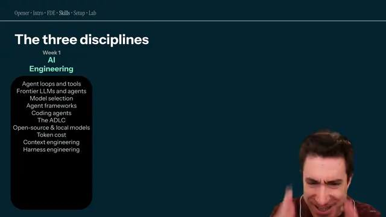

但真正要动手的是 P006–P008，它们构成一条完整的"Day 1 落地链路"：

1. **P006**：在你机器上装四个东西——VS Code、Git、Node（讲师要求 26 或更高）、UV（Astral 出的 Python 包管理器，讲师顺口提了一句"现在归 OpenAI 了"）。
2. **P007**：在 VS Code 里装 Python 和 Jupyter 两个扩展 → 建 `~/projects` → `git clone` 课程仓库 `undercover` → 用 VS Code 正确打开这个文件夹（讲师反复强调这一步"fiddly"）→ `uv sync` 生成 `.venv` → 手写 `.env` 放 OpenRouter key → **保存**。
3. **P008**：打开 `Setup/setup.ipynb`，选对 kernel（`undercover 3.12.12`），`Shift+Enter` 逐格执行：先验证 key，再用 OpenAI Python 客户端连 OpenRouter 说一句 "Hi there"，然后定义一个带"只允许读迷宫站点"护栏的 `read_web_page` 函数，把它写成 JSON tool 交给模型，看模型返回 `tool_call`，处理完再回调模型拿到网页摘要，最后用 `run_agent` 循环最多 25 次，让模型自己一步步走迷宫，直到拿到终点那句话。

所以这一节的产品不是"知识点"，而是**一条可验证的状态机**：四个工具装好 → 仓库在本地 → 虚拟环境在本地 → key 在本地 → notebook 在本地跑通 → Agent 在本地跑通。任何一环断了，P008 的 cell 就会以 `ModuleNotFoundError`、`NameError` 或 key error 的形式报出来。


---

## 2. 讲师原话（带出处）

关于"为什么要装这四个"：

> "我们要安装 VS Code、Git、Node（用于服务端 JavaScript 的 JavaScript 运行时），以及 UV，这个出色的 Python 包管理器。如果你的电脑上这四个里任何一个还没装，那就需要跟我一起把这些步骤走一遍。"
> —— p006 [00:05]

关于 Windows 上的 Git 检查：

> "输入 git-version 来确认你已经装了。我这边是有的，我装了 git，它给出了一个不错的提示信息。但你也可能遇到提示说没有安装 git。如果遇到这种情况，就需要运行这条命令……wingit install-id git.git。"
> —— p006 [02:26]

关于 Node 版本：

> "先试试 node --version，看看有没有安装 node……我这边是 node v26，这个版本不错，这个版本或更高版本都完全没问题。"
> —— p006 [03:14]

关于 UV：

> "最后该安装 uv 了，这是来自 astral 的出色包管理器，现在恰好归 open ai 所有。首先运行 uv --version，看看是不是已经装好了。"
> —— p006 [03:50]

关于克隆仓库：

> "在 VS Code 的终端里，我们要运行这条命令：git clone。然后跟上你在这里看到的这个仓库，它叫 undercover。如果这个名字听起来很神秘，那它就是故意要显得神秘。我明天会揭晓 undercover 项目到底是什么。"
> —— p007 [00:16]

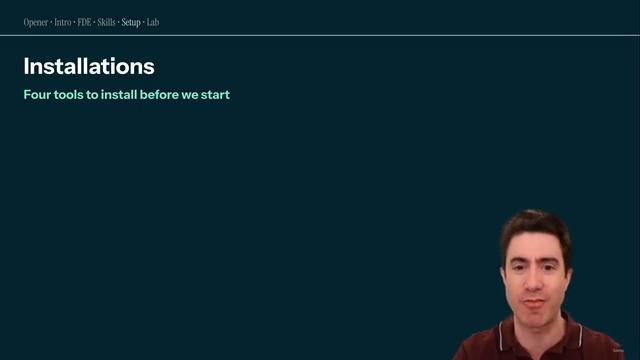

关于"打开文件夹"这个坑：

> "找到 projects，你应该就能在那里看到 undercover。但要注意，不要双击 undercover，只需单击选中它，点一下选中 undercover，然后往下看，在 Mac 上按钮是 open，在 PC 上按钮是 select folder。"
> —— p007 [06:45]

关于 `uv sync`：

> "接下来我直接输入命令 UV sync。这会告诉 UV 构建一个完整的环境。好了，完成了，它已经构建好了一个环境。我们之所以知道这一点，是因为这个小小的 .venv 文件夹出现了，这个文件夹里包含了一整套依赖包。"
> —— p007 [08:25]

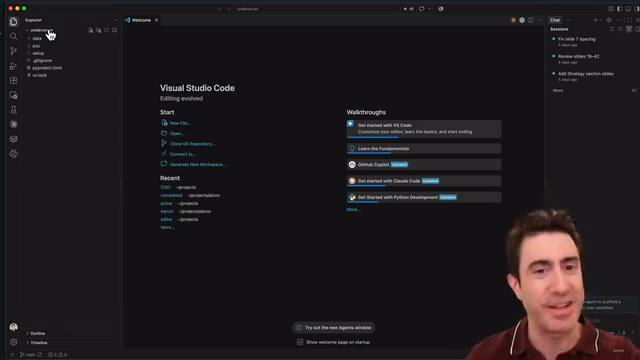

关于 `.env` 必须叫这个名字：

> "你需要在这片空白区域的某个地方右键单击，输入 new file，选择 new file，然后文件名必须叫 .env——一个点，也就是句点，加上 env 这三个字母，不能叫别的名字。"
> —— p007 [09:31]

关于"没保存等于没改"：

> "你看到 .env 文件右上角那个小白点了吗？那个小白点是在告诉你，你改过这个文件，但还没有保存……粘贴好密钥之后，一定要记得按 Ctrl S（PC）或 Command S（Mac）保存。"
> —— p007 [11:41]

关于 kernel：

> "首先要做的是设置所谓的内核，也就是 notebook 背后运行的是哪个版本的 Python……你要选的是带星号的那个，undercover 3.12.12。"
> —— p008 [00:29]

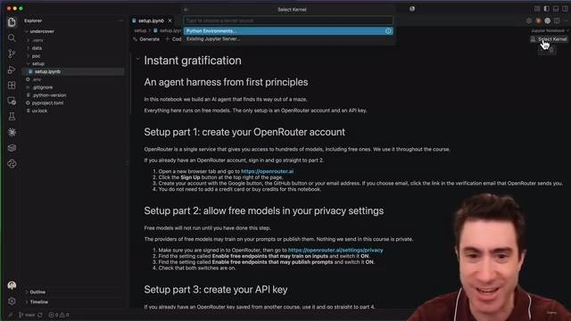

关于 `NameError` 的真正原因：

> "如果你遇到所谓的 name error，也就是报错说某个名字没有定义，那通常意味着你还没有运行这个 notebook 里的所有单元格……单元格在 notebook 里排的顺序不重要，重要的是你执行它们的顺序。"
> —— p008 [02:26]

关于 tool calling 的本质：

> "我们想要的是让 LLM 调用那个 Python 函数。怎么做呢？我们把它用 JSON 描述成一个工具，然后把这个工具提供给 LLM。同时我们再写一个函数 handle tool call，当 LLM 说“是的，我想用那个工具”时，我们就执行这个函数。"
> —— p008 [03:40]

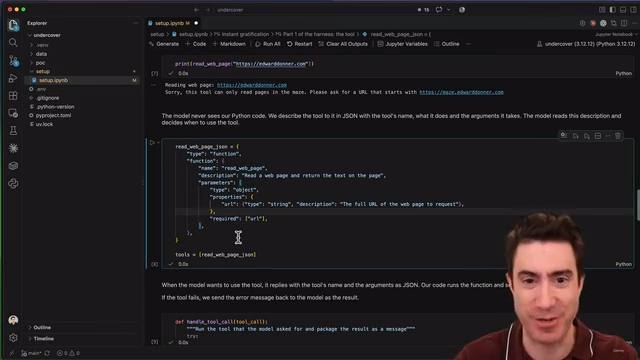

关于最后那个 agent 循环：

> "这就是同一个 run agent 函数。它把流程放进一个最多循环 25 次的循环里，不断调用免费的 LLM，尝试走完给它的挑战，而在这个例子里，挑战是一个迷宫。"
> —— p008 [05:54]

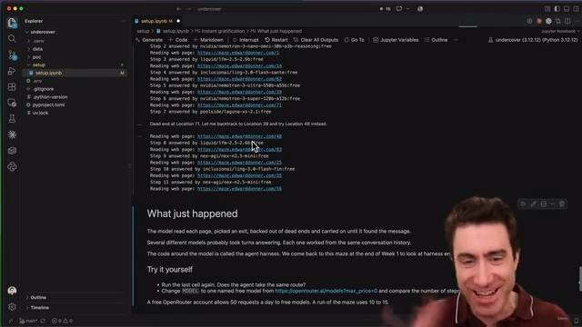

关于钱：

> "这门课的典型学习者预计会花 10 美元……整门课程始终都有免费选项、免费 API，从来不需要在 API 上花一分钱。"
> —— p008 [08:01]

关于招聘市场的数字（这是他给"为什么要练这两类经验"的依据）：

> "我研究了来自全球 184 家雇主的 316 个不同职位招聘，其中 88% 直接与需要 AI 工程相关，79% 与 AI 架构相关，95% 需要前置部署工程……41%，几乎一半，需要这五个领域全部具备，48% 至少需要其中四个。"
> —— p005 [06:04]

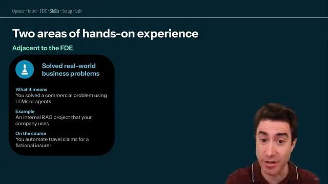

---

## 3. 从零复现

下面按"一台干净的机器"来写。Windows 和 macOS 分叉的地方会标出来，其余步骤完全一致——讲师在 P007 开头也说了 "我们不再有隔阂了"。

### 步骤 0：前置账号（不在本节，但缺了会卡住）

P008 开头讲师说 "我们已经注册好了 OpenRouter 账号，也确认了允许使用免费模型之类的设置"。也就是说 OpenRouter 账号和 key 是在 P005 之前的课里搞定的。本节你只需要手里有一个 **以 `sk-or-v1` 开头** 的 key。如果你没有，去 OpenRouter 建一个，并确认免费模型可用——**具体建 key 的界面操作，P5–P8 没讲**。

### 步骤 1：装 VS Code

浏览器打开 `code.visualstudio.com`，下载对应平台安装包，一路下一步。装完启动，如果没看到欢迎页，Windows 按 `Ctrl+Shift+N`，Mac 按 `Cmd+Shift+N` 开新窗口。讲师说你要用 Cursor 或别的 VS Code 衍生 IDE 也完全可以。

### 步骤 2：装 Git 并验证

打开 VS Code 内置终端：菜单 Terminal → New Terminal，或快捷键 `` Ctrl+Shift+` ``（反引号，不是单引号，在键盘左上角）。

```bash
git --version
```

- 有版本号 → 过。
- Windows 报"不是内部或外部命令"：

```powershell
winget install --id Git.Git -e
```

- macOS 一般会弹窗让你装 Command Line Tools，点安装即可。
- **装完必须开一个新终端**（`Ctrl+Shift+`` ` 或菜单），再 `git --version`。讲师特意说了这一步，还说极端情况下要重启电脑。

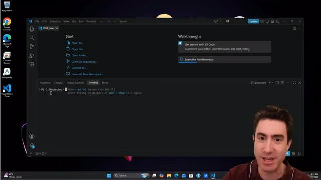

### 步骤 3：装 Node（26 或更高）

```bash
node --version
```

没装或版本低于 26：

```powershell
# Windows
winget install --id OpenJS.NodeJS -e
```

```bash
# macOS，二选一
brew install node@26     # 需要先有 Homebrew
nvm install 26           # 讲师说这是"recommended bulletproof way"
```

`nvm` 是 Node Version Manager，管多版本 Node。装完同样**开新终端**再验证。

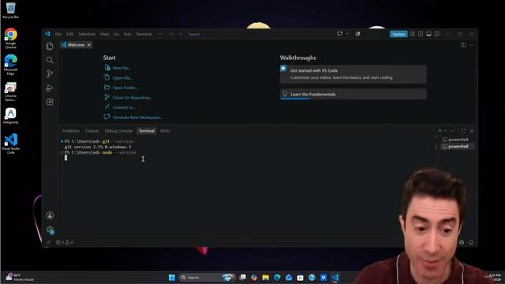

> 给前端同学的一句类比：`nvm` 之于 Node，相当于后面 `uv` 之于 Python。你现在做的事，本质上是给两个运行时各装一个版本管理器。

### 步骤 4：装 UV

```bash
uv --version
```

没有的话：

```powershell
# Windows PowerShell（讲师让你去 docs.astral.sh 复制当前命令，以官网为准）
powershell -ExecutionPolicy ByPass -c "irm https://astral.sh/uv/install.ps1 | iex"
```

```bash
# macOS / Linux
curl -LsSf https://astral.sh/uv/install.sh | sh
```

装完开新终端，`uv --version` 应有输出。

### 步骤 5：装两个 VS Code 扩展

`Cmd/Ctrl+Shift+X` 打开 Extensions：

1. 搜 `Python`，认准 **Microsoft** 发布的那一个，点 Install。
2. 搜 `Jupyter`（J-U-P-Y-T-E-R），同样认准 **Microsoft**，点 Install。

讲师特别提醒：列表里有一堆同名扩展，别装错发布者。

### 步骤 6：建 projects 目录并克隆仓库

在 VS Code 终端里，先确认自己在哪：

```bash
pwd
```

Windows 上会显示 `C:\Users\你的用户名`，Mac 上是 `/Users/你的用户名`。不在家目录就先回去：

```bash
cd ~
pwd
```

建目录（已经有了会报错，忽略即可）：

```bash
mkdir projects
cd projects
pwd
```

克隆：

```bash
git clone https://github.com/ed-donner/undercover
cd undercover
```

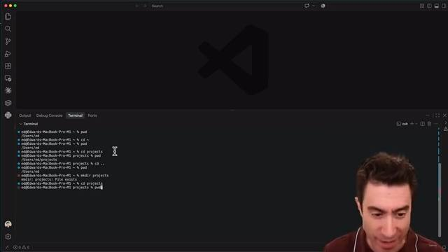

### 步骤 7：用 VS Code"正确地"打开这个文件夹（最容易错的一步）

1. 菜单 File → New Window。
2. 点欢迎页上的 **Open**（Mac）/ **Open Folder**（Windows）。
3. 导航到 `主目录/projects`，找到 `undercover`。
4. **单击选中它，不要双击进去。**
5. 点右下角 **Open**（Mac）/ **Select Folder**（Windows）。

判断成功的唯一标准：左侧 Explorer 面板最顶端显示的是 `undercover`。如果显示的是 `projects` 或者别的名字，说明你打开的是父目录，回去重做第 3–5 步。

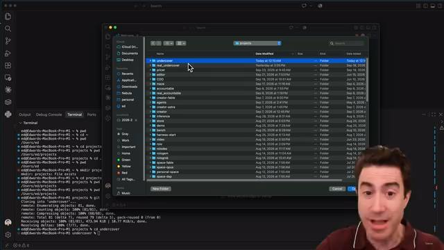

### 步骤 8：`uv sync` 建环境

在 `undercover` 的终端里（`pwd` 应该以 `/undercover` 结尾）：

```bash
uv sync
```

跑完后项目根目录会出现 `.venv/`。讲师说，如果仓库里指定了 Python 3.12.12 而你没装这个版本，UV 会自己在后台把 Python 装上——"这真的很棒。而且它一直都能用，几乎总是能用。"


### 步骤 9：创建 `.env` 并写入 key

在 VS Code 左侧 Explorer 的**空白处右键 → New File**，文件名**必须**是：

```
.env
```

一个点 + `env`，前面没有名字，后面没有 `.txt`。然后写入一行：

```
OPENROUTER_API_KEY=sk-or-v1-你的真实key
```

**然后按 `Ctrl+S`（Mac 是 `Cmd+S`）保存。** 讲师用"右上角的小白点"来判断是否已保存：白点消失 = 已落盘。

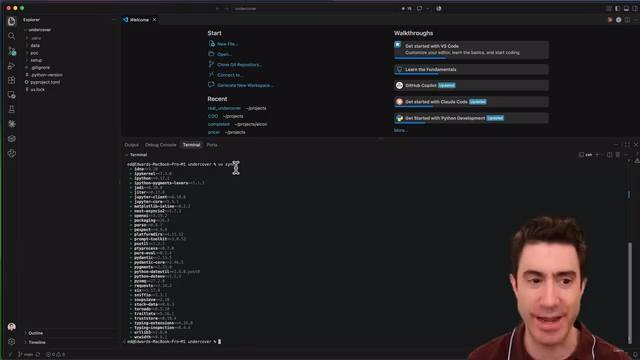

几个他在这一分钟里反复强调的点：

- key 必须**从 OpenRouter 直接复制**，不要先粘到 Word 或备忘录里，那会把 `-` 变成"—"、把普通字符变成 Unicode 特殊字符，最后就是 key error。
- 变量名是 `OPENROUTER_API_KEY`。
- 文件名不能是 `.env.txt`、`env`、`.environment`。

### 步骤 10：打开 notebook 并选 kernel

在 Explorer 里展开 `Setup` 文件夹，点开 `setup.ipynb`（屏幕上标题写着 Instant gratification）。右上角点 **Select Kernel** → **Python Environments** → 选带星号的那个 **undercover 3.12.12**。

选对的标志：notebook 右上角显示 `undercover 3.12.12` / `Python 3.12.12`。


### 步骤 11：从上到下逐格 `Shift+Enter`

顺序很重要。讲师的原话是："它们在笔记本里是什么顺序并不重要，重要的是你执行它们的顺序。"

你会依次看到：

1. import 类 cell 无报错 → 说明 kernel 对了。
2. key 检查 cell 打印出 "OpenRouter API 密钥已存在，并以 sk-or-v1... 开头" 之类。
3. "Hi there" cell 返回模型的问候。
4. `read_web_page` 护栏 cell：读 `maze.edwarddonner.com` 正常返回内容；读别的站点返回 "抱歉，这个工具只能用来读取迷宫中的页面。"
5. tool 定义 + `handle_tool_call` 定义 cell。
6. 请求模型"读迷宫页"的 cell → 返回一个 `tool_call`，函数名 `read_web_page`，参数里是迷宫 URL。
7. 处理 tool call 再回调模型的 cell → 返回网页内容摘要。
8. `run_agent` cell → 模型开始一步步走迷宫，中途会出现 dead end（讲师那次的死路在 location 71），最后返回终点那句话。

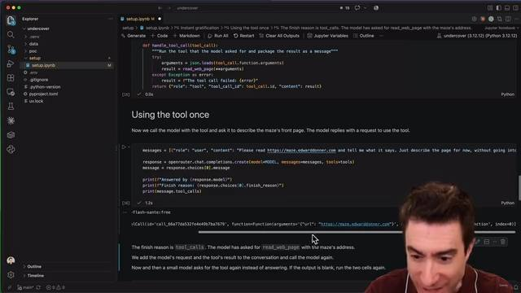

---

## 4. 完整代码

> 说明：P006–P008 的代码都在仓库的 notebook 里，**逐字稿没有逐字念出单元格源码**。下面第 4.1、4.2 是与逐字稿一一对应的真实文件/命令，可直接用；第 4.3 是**按逐字稿描述的行为重建的等价脚本**，用途是让你在没有 notebook 的情况下也能验证同一条链路，它不是讲师原代码的复制。原版请以 `undercover` 仓库里的 `Setup/setup.ipynb` 为准。

### 4.1 `.env`（项目根目录，完整文件）

```dotenv
# 文件路径：~/projects/undercover/.env
# 这个文件不在仓库里，需要你自己创建；文件名必须是 .env
# 变量名必须是 OPENROUTER_API_KEY；值以 sk-or-v1 开头
OPENROUTER_API_KEY=<你的 key，以 sk-or-v1 开头>
```

保存后请确认：文件名没有 `.txt` 后缀，行尾没有多余空格，粘贴过程中没有把 `-` 变成 `—`。

### 4.2 环境准备命令清单（可整段粘贴）

```bash
# ---------- Windows (PowerShell) ----------
winget install --id Git.Git -e
winget install --id OpenJS.NodeJS -e
powershell -ExecutionPolicy ByPass -c "irm https://astral.sh/uv/install.ps1 | iex"
# 关掉终端，重新开一个，然后逐条验证：
git --version
node --version
uv --version

# ---------- macOS ----------
xcode-select --install          # 提供 git
brew install node@26            # 或 nvm install 26
curl -LsSf https://astral.sh/uv/install.sh | sh
git --version
node --version
uv --version

# ---------- 两个平台通用 ----------
cd ~
mkdir -p projects
cd projects
git clone https://github.com/ed-donner/undercover
cd undercover
uv sync                          # 结束后应出现 .venv/
```

### 4.3 等价验证脚本 `setup_local.py`（**课里没有这段代码，以下为示意**）

放在 `~/projects/undercover/` 下，用 `uv run python setup_local.py` 执行。

```python
"""
文件路径：~/projects/undercover/setup_local.py
说明：课里是 Setup/setup.ipynb 逐格执行，逐字稿未给出单元格源码。
      本文件按逐字稿描述的行为（验 key → 打招呼 → 带护栏的网页读取
      → JSON tool 定义 → tool call 处理 → 最多 25 轮的 agent 循环）
      重建为单文件脚本，便于直接运行验证链路是否打通。
"""

import json
import os
import re
import urllib.request

from dotenv import load_dotenv
from openai import OpenAI

# ---------- 0. 载入 .env ----------
load_dotenv(override=True)

API_KEY = os.getenv("OPENROUTER_API_KEY")
if API_KEY:
    print(f"OpenRouter API key exists and begins {API_KEY[:9]}")
else:
    print("OpenRouter API key not set —— 检查 .env 文件名和变量名")
    raise SystemExit(1)

# OpenRouter 的 OpenAI 兼容端点。逐字稿没有念出这个 URL，
# 这里用的是 OpenRouter 的标准 base_url，请以仓库代码为准。
client = OpenAI(base_url="https://openrouter.ai/api/v1", api_key=API_KEY)

# 课里用的是免费模型（讲师原话是 "OpenRooter slash free"）。
MODEL = "openrouter/free"

# ---------- 1. 先说一句 "Hi there" ----------
resp = client.chat.completions.create(
    model=MODEL,
    messages=[{"role": "user", "content": "Hi there"}],
)
print("[greeting]", resp.choices[0].message.content)

# ---------- 2. 带护栏的网页读取 ----------
ALLOWED_HOST = "maze.edwarddonner.com"


def read_web_page(url: str) -> str:
    """只允许读取迷宫站点，其它 URL 一律拒绝。"""
    if ALLOWED_HOST not in url:
        return "Sorry, this tool can only be used to read pages in the maze."
    try:
        with urllib.request.urlopen(url, timeout=30) as r:
            html = r.read().decode("utf-8", errors="ignore")
    except Exception as e:  # 网络问题不应该让 agent 崩掉
        return f"Failed to read {url}: {e}"
    text = re.sub(r"<script.*?</script>", " ", html, flags=re.S | re.I)
    text = re.sub(r"<style.*?</style>", " ", text, flags=re.S | re.I)
    text = re.sub(r"<[^>]+>", " ", text)
    return re.sub(r"\s+", " ", text).strip()


print("[guardrail-ok]", read_web_page("https://maze.edwarddonner.com")[:120])
print("[guardrail-blocked]", read_web_page("https://example.com"))

# ---------- 3. 把 Python 函数描述成 JSON tool ----------
read_web_page_tool = {
    "type": "function",
    "function": {
        "name": "read_web_page",
        "description": "Read the contents of a web page and return its visible text.",
        "parameters": {
            "type": "object",
            "properties": {
                "url": {
                    "type": "string",
                    "description": "The full URL of the page to read.",
                }
            },
            "required": ["url"],
        },
    },
}


def handle_tool_call(tool_call) -> str:
    """模型说要用哪个工具，我们就在这里真正执行它。"""
    if tool_call.function.name == "read_web_page":
        args = json.loads(tool_call.function.arguments)
        return read_web_page(args["url"])
    return f"Unknown tool: {tool_call.function.name}"


# ---------- 4. 单次请求，期待模型返回 tool_call ----------
messages = [
    {
        "role": "user",
        "content": "Please read maze.edwarddonner.com and tell me what it says",
    }
]
resp = client.chat.completions.create(
    model=MODEL, messages=messages, tools=[read_web_page_tool]
)
msg = resp.choices[0].message
print("[tool-call-request]", msg.tool_calls)

# ---------- 5. 处理 tool call，再回调一次模型 ----------
if msg.tool_calls:
    messages.append(msg.model_dump(exclude_none=True))
    for tc in msg.tool_calls:
        result = handle_tool_call(tc)
        messages.append(
            {"role": "tool", "tool_call_id": tc.id, "content": result}
        )
    resp = client.chat.completions.create(
        model=MODEL, messages=messages, tools=[read_web_page_tool]
    )
    print("[summary]", resp.choices[0].message.content)

# ---------- 6. 最多 25 轮的 agent 循环 ----------
SYSTEM_PROMPT = (
    "You are an agent solving a puzzle. "
    "Look at the web page given to you and do what it says. "
    "Use the read_web_page tool whenever you need to read a page."
)


def run_agent(task: str, max_steps: int = 25) -> str:
    convo = [
        {"role": "system", "content": SYSTEM_PROMPT},
        {"role": "user", "content": task},
    ]
    last = ""
    for step in range(1, max_steps + 1):
        resp = client.chat.completions.create(
            model=MODEL, messages=convo, tools=[read_web_page_tool]
        )
        msg = resp.choices[0].message
        convo.append(msg.model_dump(exclude_none=True))

        if not msg.tool_calls:
            last = msg.content or ""
            print(f"[step {step}] FINAL: {last}")
            return last

        for tc in msg.tool_calls:
            result = handle_tool_call(tc)
            print(f"[step {step}] {tc.function.name}({tc.function.arguments})")
            convo.append(
                {"role": "tool", "tool_call_id": tc.id, "content": result}
            )
    print(f"[warn] hit max_steps={max_steps}")
    return last


if __name__ == "__main__":
    run_agent("Have a look at maze.edwarddonner.com and do what it says")
```

### 4.4 复现后的目录结构

```text
~/projects/undercover/
├── .env                      # 4.1 你自己创建，必须保存
├── .venv/                    # uv sync 生成，不要提交到 git
├── Setup/
│   └── setup.ipynb           # 讲师在 P008 点开的 notebook
├── (仓库自带的其他目录与依赖清单文件，逐字稿未逐个念出文件名，以实际仓库为准)
└── setup_local.py            # 4.3 可选，课里没有
```

---

## 5. 逐行解释

**`.env` 为什么必须叫 `.env`。** 讲师在 P007 花了整整一分钟在这上面，原因是 Python 的 `load_dotenv()` 默认只找这个确切文件名。你叫 `env`、`config.env`、`.env.local`，它都不会自动加载（`.env.local` 需要显式传参）。加载失败的直接后果是 `os.getenv("OPENROUTER_API_KEY")` 返回 `None`，然后 OpenAI 客户端初始化时抛 key 缺失错误。在 Node 世界里，这等价于 `dotenv` 只认 `.env`、变量从 `process.env.XXX` 读——同一个心智模型。

**为什么变量名是大写的 `OPENROUTER_API_KEY`。** 环境变量的惯例是全大写加下划线。`load_dotenv()` 不会改变大小写，所以你在 `.env` 里写什么，`os.getenv` 就得用什么。讲师念的时候是 "OPENROUTER_API_KEY"，实际写法就是 `OPENROUTER_API_KEY`。

**为什么"白点消失"这件事值得单独讲。** VS Code 编辑器和磁盘上的文件是两份东西。`Ctrl+S` 之前，`.env` 在磁盘上可能是空的或不存在，而 notebook 的 `load_dotenv()` 读的是磁盘。这就是"我明明填了 key 却报错"的头号原因。前端同学应该很熟悉这个：改完 `.env` 不重启 dev server，`process.env` 不会更新——只不过这里连保存都没做。

**`uv sync` 到底做了什么。** 它读仓库里的依赖清单，算出需要哪些包、哪些版本，然后创建 `.venv/` 并把包装进去；如果清单里钉了 Python 3.12.12 而系统没有，它连 Python 解释器一起装。讲师说"看到 `.venv` 这个文件夹出现，就说明成了"。类比 Node：`uv sync` ≈ `npm install` / `pnpm install`，`.venv` ≈ `node_modules`，区别是 Python 的虚拟环境还隔离了解释器本身。

**kernel 是什么。** notebook 本身只是文本，真正执行代码的是背后那个 Python 进程，这就是 kernel。你机器上可能装了十来个 Python，选错 kernel 的典型症状是：`import openai` 报 `ModuleNotFoundError`，但你在终端里 `uv run python -c "import openai"` 又是好的。讲师给出的判断标准非常具体——右上角必须显示 `undercover 3.12.12`。类比前端：相当于你 `nvm use` 到了错误的 Node 版本，`node_modules` 对不上。

**`NameError` 不是 bug，是执行顺序问题。** notebook 的 cell 之间没有编译期依赖检查，你在第 5 格用了第 3 格定义的 `handle_tool_call`，但你没运行第 3 格，运行时就会 `NameError: name 'handle_tool_call' is not defined`。讲师的原话把这件事说得最清楚：重要的不是 cell 在文件里的顺序，是你按 `Shift+Enter` 的顺序。

**tool calling 的三段式消息结构。** 这是整个 lab 的技术核心，也是"LLM 怎么变成 agent"的全部秘密：

1. 你在请求里带上 `tools=[read_web_page_tool]`，告诉模型"有这么个函数可用"，描述是 JSON Schema。
2. 模型不直接执行任何东西，它返回一条 `assistant` 消息，里面带 `tool_calls`，说明"我想调 `read_web_page`，参数是 `{"url": "..."}`"。**执行是你做的。**
3. 你把执行结果作为一条 `role: "tool"`、带 `tool_call_id` 的消息追加回 `messages`，再请求一次模型。模型这次看到结果，才生成自然语言回答。

`run_agent` 就是把这个三段式包进 `for step in range(1, 26)`。讲师说"up to 25 times"——这个上限是防止模型在迷宫里无限打转烧钱。每次循环模型看到的是不断变长的对话历史，所以它"记得"自己走过哪些路，才能在 location 71 撞死路之后 backtracking。

**那个 guardrail 为什么重要。** `read_web_page` 里判断 `ALLOWED_HOST not in url` 就返回拒绝语。这是最朴素的工具级护栏：模型可以请求任意 URL，但真正执行的人是你，你在这里设了一道白名单。讲师把它称为 "这有点类似于设置了一道防护栏"。

**成本那条线的算术。** 讲师给的数字是：典型学习者 $10；如果每个节点都选更大更强的选项，$20 以上；但"永远不需要花一分钱"。他这一节用的模型是免费档，所以他能说"我们不会为此付一分钱"。

---

## 6. 复现检查清单

按顺序打勾，任何一项不过就不要往下走。

- [ ] `git --version` 有输出（且是在**新开的**终端里）
- [ ] `node --version` ≥ v26
- [ ] `uv --version` 有输出
- [ ] VS Code 扩展列表里 Python（Microsoft）和 Jupyter（Microsoft）都是已安装状态
- [ ] `~/projects/undercover` 存在
- [ ] VS Code 左侧 Explorer **最顶端**显示 `undercover`（不是 `projects`）
- [ ] `uv sync` 执行完毕，项目根目录出现 `.venv/`
- [ ] 项目根目录有 `.env`，文件名无 `.txt` 后缀
- [ ] `.env` 里有一行 `OPENROUTER_API_KEY=sk-or-v1...`
- [ ] 该行末尾无空格，`-` 是半角连字符
- [ ] **已按 `Ctrl/Cmd+S` 保存，编辑器标签页没有小白点**
- [ ] notebook 右上角显示 `undercover 3.12.12`
- [ ] 第一个 import cell 跑通，无 `ModuleNotFoundError`
- [ ] key 检查 cell 打印出 "密钥已存在，并以 sk-or-v1... 开头"
- [ ] "Hi there" cell 拿到模型回复
- [ ] `read_web_page("https://maze.edwarddonner.com")` 返回迷宫内容
- [ ] `read_web_page("https://example.com")` 返回 "抱歉，这个工具只能用来读取迷宫中的页面。"
- [ ] 单次请求 cell 返回的 `tool_calls` 里函数名是 `read_web_page`
- [ ] 处理 tool call 后的 cell 返回网页摘要
- [ ] `run_agent` 跑完，最终输出是那句"欢迎来到课程开始"的话

---

## 7. 课里没讲但你会撞上的

1. **`.env` 在 Explorer 里"看不见"。** VS Code 默认会把点开头的文件显示出来，但某些配置/主题下会被隐藏。如果新建后找不到，检查 `files.exclude` 设置。**课里没讲这个。**
2. **Windows 上没有 `winget`。** 极简版 Windows 或缺 Microsoft Store 的镜像会缺 App Installer。此时只能去 Git 和 Node 官网下 exe 安装包。**课里没讲。**
3. **`git clone` 卡住或超时。** 网络受限环境下 GitHub 直连可能失败。课里没讲代理、镜像或 SSH 方式。**课里没讲。**
4. **免费模型 429 / 限流。** 免费档在高峰期限流是常态，`run_agent` 的 25 轮里任何一轮撞上都可能抛异常。上面 4.3 的脚本没有加退避重试，生产代码需要。**课里没讲。**
5. **免费模型不支持 tool calling。** 讲师演示时确实拿到了 `tool_calls`，但不是所有免费模型都支持 function calling；如果返回的是纯文本而不是 `tool_calls`，先换模型再怀疑代码。**课里没讲怎么排查。**
6. **`.env` 被提交进 git。** 仓库一般自带 `.gitignore`，但你应该自己确认 `.env` 在里面。key 一旦推到公开仓库就等于泄露，需要立刻在 OpenRouter 后台 revoke。**讲师只说了"要小心"，没有讲 `.gitignore` 和 revoke 流程。**
7. **Node 26 这个具体版本号。** 讲师演示时是 v26，但你看到这份文档时 LTS 可能已经往前走了。他给的标准是"26 或更高"。
8. **`uv sync` 之后 `python` 命令仍然指向系统 Python。** 正确姿势是用 `uv run python xxx.py`，或者让 VS Code 的 kernel 指向 `.venv`。**课里没讲 `uv run`。**
9. **OpenRouter 的 base_url。** 逐字稿只说"用 OpenAI Python 客户端连 OpenRouter"，没有念 URL。我上面用的是 `https://openrouter.ai/api/v1`，如果仓库里写的是别的，以仓库为准。
10. **`.venv` 要不要提交。** 不要。它和 `node_modules` 是同一类东西。**课里没讲。**
11. **讲师提到的"316 份招聘帖"统计。** 那是他做市场调研的结果，用来论证"人工智能工程 + 人工智能架构 + 前向部署工程师 + 真实商业问题 + 客户交付"这五项的组合价值；其中 41% 的岗位要求全部五项，48% 要求至少四项，只有约 10% 要求两到三项。这跟环境搭建无关，但解释了为什么这门课第一周就要你跑通一个能演示的 agent——它是你日后发 LinkedIn 帖子的素材。
12. **他提到的另一个建议：把课程项目"改成你自己的"。** 原话是最好能"以某种方式修改它，让它成为你自己的东西，把它应用到业务中稍微不同的领域"。这一点在 P005 里讲了，但在 P008 的 lab 里没有对应的改造步骤。