# AI FDE 课程文档 · Week 2 Day 1：困难数据集、Langfuse 追踪、打分与实验对比

> 覆盖 P050–P052。目标：从零跑通「困难理赔数据集 → Langfuse 追踪 → 打分（含错误成本）→ 跑实验对比 baseline 与 payout tool 两个版本」的完整流程。

---

## 1. 这一节做什么

这一节把前面学过的「理赔决策 agent」升级成一个**可度量、可对比**的实验系统。具体做四件事：

1. **换一个更难的 25 条理赔数据集**（harder claims），让 agent 不再轻松拿高分，暴露真实问题。
2. **用 Langfuse 追踪一次 agent 调用**：一次 `invoke` 背后其实是多次 LLM 调用 + 一次工具调用，在 Langfuse 的 Tracing 页面里逐层看清楚。
3. **给 agent 打分**：不再只是「对/错」，而是引入**错误成本**（wrongful decline 罚 $1500、无谓转人工罚 $50），并计算 Cohen's kappa、precision/recall、straight-through rate。
4. **跑两组实验并对比**：baseline（agent 自己算钱）vs payout tool（把算钱交给 Python 工具），用 Langfuse 的 Experiments 页面做决策——这个工具到底要不要上。

执行顺序上，建议先跑通「加载 harder 数据集 → 定义 `record_decision` 工具 → 单次 `invoke` 并确认 Langfuse Tracing 有链路」，再进入「打分函数 → 上传数据集 → `run_experiment`」；最后才加 `calculate_payout` 跑第二组实验。这样每一步的失败都能被定位在较小的范围内，不会把数据、工具、追踪、实验四类问题混在一起。每个阶段的产出物也要明确：数据集阶段产出 25/25/25 的对齐检查；追踪阶段产出一条能逐层展开的 trace；打分阶段产出混淆矩阵和错误成本；实验阶段产出 baseline 与 payout tool 两组可对比记录。

核心结论（P052 结尾）：payout tool 版本把「决策或金额出错」的案例从 36 降到 8，错误成本从 $5300 降到 $640，代价是 LLM 成本从 0.6 美分涨到 1 美分。这是一个清晰的业务取舍。换句话说，这一节不是只教「怎么调模型」，而是教「怎么用数据证明一个工具该不该上」：先把困难样本摆出来，再把调用链看清楚，再用业务成本打分，最后用实验页面对比。对前端同学来说，可以把它类比成「先准备一组边界用例，再给请求链路打点，再写单条校验和整表汇总，最后用 A/B 实验页做取舍」。

---

## 2. 讲师原话（带出处）

> "我们首先会构建一个数据集，其中包含一组难度更高的 25 条理赔申请。然后我们会在 Langfuse 中跟踪整个过程，看看会发生什么。"
> —— p050 [00:00]

> "我们将对一个智能体进行评分，看看如何对它犯下的错误施加惩罚，包括我们已经计算的成本、之前介绍过的精确率和召回率，以及卡帕系数和直通率。"
> —— p050 [00:26]

> "然后我们会在 Langfuse 中运行实验，先跑原始基线方案，再跑一个增加了额外工具的改进方案，看看效果如何。我们会比较实验结果，以便做出决定：到底要不要使用这个工具？"
> —— p050 [00:26]

> "我们会再次使用 GPT-6 Luna。它非常便宜……而且实际上，在这个实验里我会把推理设为无。"
> —— p050 [01:23]

> "我们已经加载了 25 条理赔申请及其 25 个真实标签，还有来自客户的 25 份保单文件。"
> —— p050 [02:14]

> "在判断保险保单是否包含特殊条款时，会有很多棘手的问题，比如是否存在免赔额，以及免赔额何时已经用完。"
> —— p050 [02:43]

> "人工审核人员说，那间上锁的公寓不是公众可以进入的。财物当时无人看管。警方是在夜间被叫来的……而你能看到这里的微妙之处：其他一些保险公司已经部分退还了这笔理赔中的部分款项。"
> —— p050 [03:08]–[03:33]

> "如果你这样做，并用 `parse_docstring=True` 修饰它，那就是在告诉 LangChain，我们希望它把这些描述提供给每个字段。"
> —— p050 [04:44]

> "我原本以为，只是这样写、不写 `parse_docstring=True`，就会自动读入这些内容……但事实并非如此，你必须传入 `docstring=True`。"
> —— p050 [05:14]

> "我们要创建一个叫作 Langfuse 处理器的对象……这是 Langfuse 中的一个对象，你可以把它传给 LangChain。"
> —— p050 [06:55]

> "我们拿到智能体，调用 `invoke`，告诉它我们要它为其中一条理赔申请生成一条用户提示，然后传入这个回调。"
> —— p050 [07:25]

> "在我们的代码中只有一次 `invoke` 调用，但却发生了多次大语言模型调用。"
> —— p050 [09:18]

> "业务方告诉我们，如果发生这种情况[错误拒赔]，我们应该被扣 1,500 美元……如果它不必要地把某件事转交给人工处理……惩罚会小一些，但仍然是一种惩罚，是 50 美元。"
> —— p051 [00:00]–[00:29]

> "科恩卡帕系数……它基本上会重新分配结果，所以在我们的案例中，25 条理赔申请里有 14 条应该被批准；我们要确保，如果一个智能体只是对所有申请都回答“批准”，我们不会把它显示成好像有 50% 那么好。"
> —— p051 [01:02]

> "智能体的结果对应列，真实结果对应行。"
> —— p051 [02:00]

> "直通率是一个指标，表示智能体能够直接批准或拒绝的理赔申请占多大百分比，而不需要转交人工处理。"
> —— p051 [02:40]

> "我们会开始把难度更高的数据集作为平台中的数据集上传……`langfuse.create_dataset_item`。"
> —— p051 [03:06]

> "`score_claim` 会返回一些数据，这些数据将与每一条理赔申请关联……`score_run` 会在所有数据都准备好、可以分析整套结果时被调用一次。"
> —— p051 [04:32]–[04:50]

> "我们即将调用 `langfuse.run_experiment`。我们会把全部数据项、任务，以及 `score_claim` 和 `score_run` 传给它。"
> —— p051 [04:50]

> "我会有一个名为 `calculate_payout` 的函数，并把它作为一个工具提供出来，装备给我们的智能体，让它能够用代码完成业务逻辑，而不是靠自己的思考和推理来完成。"
> —— p052 [00:00]

> "它把各项金额加起来，扣除已经支付的金额，然后确定赔付金额为 24.97 美元。"
> —— p052 [01:01]

> "基线方案在 36 个案例中把决定或金额弄错了，而使用赔付工具后的版本在 8 个案例中把决定或金额弄错了。"
> —— p052 [03:44]

> "决策准确率从 84% 提升到了 96%……从混淆矩阵直接读出的准确率从 52% 提升到了 89%……基线工具产生的罚金为 5,300 美元……赔付工具的罚金则一路降到了 640 美元。"
> —— p052 [04:13]–[05:13]

> "对赔付工具来说，唯一略微变差的指标是成本稍微高了一点，从 0.6 美分变成了 1 美分。"
> —— p052 [05:40]

---

## 3. 从零复现

### 3.1 环境准备

**目录结构**（讲师在 `undercover` 仓库的 `labs` 目录下，`week2/day1`）：

```
undercover/
├── .env
└── labs/
    └── week2/
        └── day1/
            ├── week2_day1.ipynb        # 主 notebook
            └── business_logic.py       # 讲师把 calculate_payout 的底层逻辑放在独立模块
```

> 讲师原话：「I've shoved into a different module right over here. It's just some hokey business logic that we can imagine we just coded up.」（p052 [00:15]）—— 这个模块的具体内容课里没有逐行展示，下面第 4 节给出一个**能跑通的等价实现**，标注为「课里没给完整源码，以下为等价示意」。

**`.env` 文件**（讲师强调 key 要放进 `.env` 并保存）：

```bash
OPENROUTER_API_KEY=sk-or-v1-xxxxxxxxxxxxxxxxxxxxxxxx
LANGFUSE_PUBLIC_KEY=pk-lf-xxxxxxxxxxxxxxxx
LANGFUSE_SECRET_KEY=sk-lf-xxxxxxxxxxxxxxxx
LANGFUSE_HOST=https://cloud.langfuse.com
```

> 讲师原话：「making sure that my open router key is in the .env file and I've saved it and you can always use a different provider if you would prefer.」（p050 [01:46]）

**依赖版本**（讲师没报版本号，以下为可跑通的最小集合，装的时候按你环境实际锁定）：

```bash
pip install langchain langchain-openai langfuse python-dotenv pandas
```

**Jupyter kernel**：讲师在 VS Code 里先「set kernel」选 `undercover` kernel（p050 [00:55]）。你本地对应就是选你装了上面依赖的那个 Python 环境。

**命令解释：** `pip install ...` 这行不是「装完就万事大吉」，而是把 notebook 运行所需的 LangChain、OpenAI 兼容客户端、Langfuse SDK、`.env` 加载器、pandas 一起装进当前环境；最关键的是，**装依赖的 Python 环境必须和 Jupyter kernel 是同一个**。如果 `pip install` 跑在一个环境、notebook kernel 选的是另一个环境，后面就会出现「明明装了 `langfuse` 却 import 失败」的典型问题。**常见错误与排查：**先跑 `import sys; print(sys.executable)` 看当前 kernel 的解释器路径，再在终端里用同一个解释器执行 `pip install`；如果 VS Code 里换过 kernel，记得重启 notebook kernel。**与前端的对照：**这就像你装了依赖但 `node` 实际跑的是另一个版本，或者浏览器调试目标选错；先确认运行时，再排查代码。

### 3.2 第一步：导入 + 连接 Langfuse

讲师先跑 imports，再加载 `.env`，然后创建 Langfuse client，看到「connected successfully to Langfuse」才算就绪（p050 [01:46]–[02:14]）。

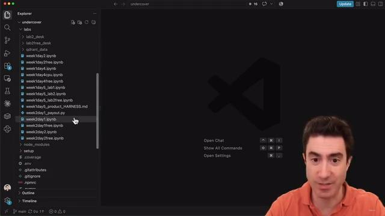

这里的检查点不是「代码没报错」这么简单，而是三件事同时成立：`.env` 已被 `load_dotenv()` 读到、`Langfuse()` 能拿到公钥/私钥、网络能访问 `LANGFUSE_HOST`。如果打印连接成功后页面仍看不到 trace，先别改业务代码，优先检查 key 是否贴错、`.env` 是否保存、host 是否指向你实际使用的 Langfuse 实例。**常见错误与排查：**把 key 写进 notebook 而不是 `.env`，换机器后容易丢；`.env` 文件没放在当前工作目录，`load_dotenv()` 找不到；复制 key 时带了空格或引号。**前端对照：**类似初始化 SDK 时 baseURL 和 token 不匹配，请求会静默失败或打到错误环境。

### 3.3 第二步：加载 harder 数据集

讲师加载的是名为 `harder` 的数据集：25 条 claims、25 条 ground truth、25 份 policy 文档。决策分布是 **14 approve / 5 decline / 6 refer**（p050 [02:43]、p051 [02:10]）。

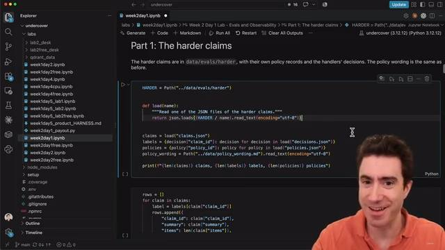

看一条样例（罗马入室盗窃案）：描述很长、索赔项很多，人类 handler 的判断是「locked apartment 不是公众可进入的、物品无人看管、警察是夜里被叫来的」，然后做了一堆数学计算得出赔付额。**坑点在于**：有其他保险公司已经部分赔付过，agent 必须把这部分扣掉（p050 [03:08]–[03:33]）。

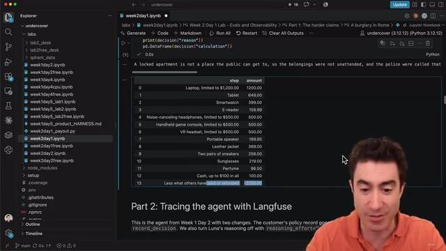

加载阶段最重要的不是「能 print 出列表」，而是**三份数据在索引上严格对齐**：第 i 条 claim 对应第 i 条 ground truth 和第 i 份 policy。否则后面打分时会出现「拿 A 的答案对 B 的标准答案」，指标全乱。**常见错误与排查：**用 `zip` 前先打印三个长度；抽样打印 `claim_id` 和对应 ground truth，确认不是错位；如果数据里有嵌套字段，先用 `json.dumps(..., ensure_ascii=False)` 看一眼结构。**前端对照：**类似列表渲染时 `key` 错位，页面看似有数据，实际每条记录都挂到了错误的行上。

### 3.4 第三步：构建 agent + record_decision 工具

讲师这次**不再把 policy record 做成工具**，而是直接塞进 user prompt：「there's not all that much point in that so now we're going back to just shoving the policy record in here.」（p050 [04:10]）

工具是 `record_decision`，参数有 claim、rationale、decision（decision 是 Literal）。docstring 用 Google style，并且**必须**加 `parse_docstring=True`，否则 LangChain 会把整段 docstring 当成函数描述，而不是逐字段描述（p050 [04:44]–[05:44]）。

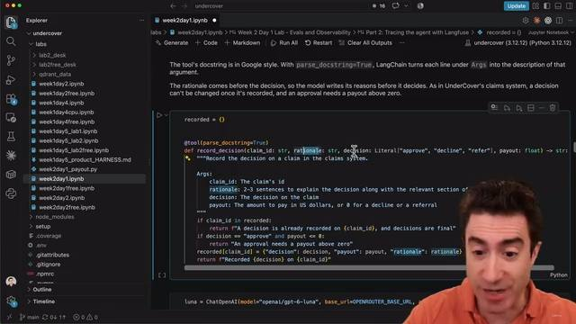

**命令解释：** `@tool(parse_docstring=True)` 的作用是让 LangChain 解析 Google style docstring 里的 `Args:` 段落，把每个参数描述挂到工具 schema 上；模型调用工具时看到的不是一整段说明，而是「claim 是什么、rationale 是什么、decision 可选值是什么」。**常见错误与排查：**只写 `@tool` 不写 `parse_docstring=True`，字段描述会丢失；docstring 缩进不符合 Google style，解析可能不完整；`Literal` 的可选值拼写要和后续解析逻辑一致。**前端对照：**类似表单 schema 只给了整体 label，却没给每个字段的 label 和 enum，调用方只能猜。

### 3.5 第四步：创建 Langfuse handler 并 invoke

关键点：**Langfuse 是追踪方，LangChain 是执行方**。Langfuse handler 是 Langfuse 的对象，交给 LangChain 当 callback 用（p050 [06:55]）。

```python
handler = CallbackHandler()
result = agent.invoke(
    {"messages": [{"role": "user", "content": user_prompt}]},
    config={"callbacks": [handler]},
)
```

跑完后去 Langfuse 左侧导航点 **Tracing**，从下往上读（最下面是时间上最早的）。会看到：`langgraph` → `ChatOpenAI` → 工具调用 `record_decision` → 又一次 `ChatOpenAI` 出最终答案。讲师特别说明：虽然代码里用的是 LangChain 的 `create_agent`，但 LangChain 底层驱动的是 LangGraph（p050 [08:13]）。

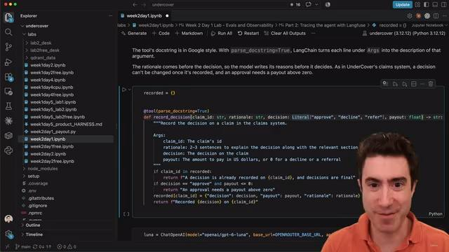

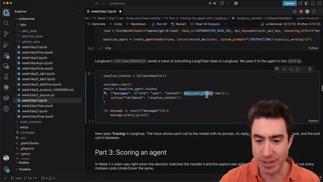

**命令解释：** `config={"callbacks": [handler]}` 是把 Langfuse 的 callback 挂到这次 `invoke` 上；一次 `invoke` 在代码里只有一行，但内部会经历「模型决定调用工具 → 工具返回 → 模型再输出」多次 LLM 调用，所以 Tracing 里是多层而不是一条。**常见错误与排查：**handler 没传进 `config`，页面不会有 trace；传了但没 flush，短脚本退出前可能没上报；在 notebook 里重复创建 handler，容易把多次运行混在一起看。**前端对照：**类似在请求拦截器里挂日志中间件，挂上后一次页面请求会展开成多个子请求和子事件。

### 3.6 第五步：打分（错误成本 + kappa + confusion matrix）

讲师定义 `mistake_cost(answer, expected)`：wrongful decline 罚 $1500，无谓 refer 罚 $50，其余按混淆矩阵规则累加（p051 [00:00]–[00:29]）。

然后做了一个「approve everything」的对照 agent，用来看混淆矩阵长什么样：agent 把所有东西都塞进 approve 那一列，truth 是 14 approve / 5 decline / 6 refer，所以 14/25 正确，accuracy 看着还行，但 kappa = 0（p051 [01:02]–[02:40]）。

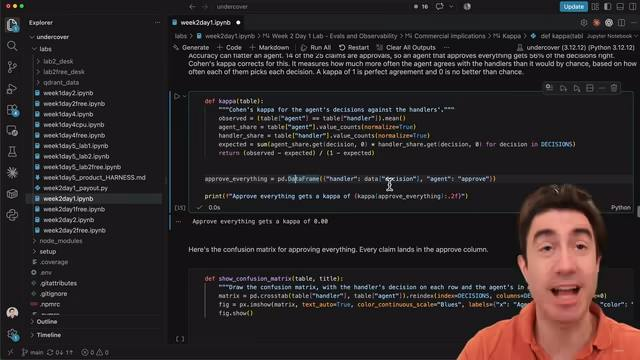

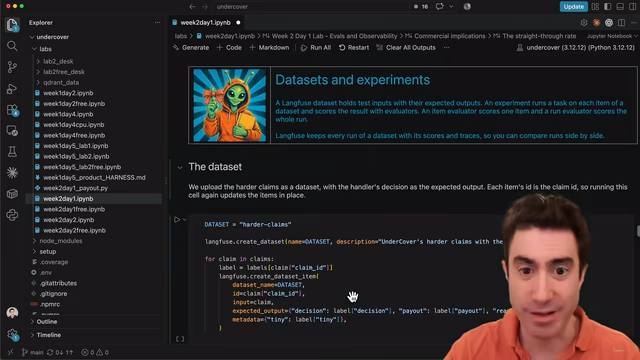

打分阶段要先把「规则」和「汇总」分开：`mistake_cost` 是单条规则，用几个手写样例就能验证；混淆矩阵和 kappa 是汇总规则，必须用「全 approve」这种极端 agent 做对照，确认指标没有虚高。**常见错误与排查：**把 agent/truth 的行列搞反，矩阵看着像对但方向错了；`mistake_cost` 只测了相等情况，没测 `(approve, decline)` 和 `(approve, refer)`；kappa 公式里 `pe` 算错，导致全 approve 的 agent 拿不到 0。**前端对照：**单条校验类似表单字段 validator，整表指标类似列表跑完后的 reducer/aggregate，最好用固定 fixture 做单测。

### 3.7 第六步：上传数据集到 Langfuse 并跑实验

上传用 `langfuse.create_dataset_item`，dataset 名 `harder_claims`，每条带 claim_id、input、expected_output（p051 [03:06]）。

然后 `langfuse.run_experiment`，传 items、task（`baseline_task` 或 `payout_tool_task`）、`score_claim`（逐条打分）、`score_run`（整表汇总）。讲师自己把 `n_times` 设成 3 跑三遍降噪，给学员的建议是设成 1（p051 [03:34]、[07:03]）。

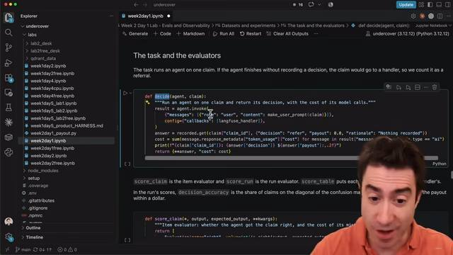

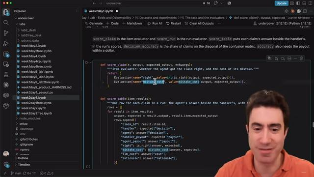

**命令解释：** `create_dataset_item` 是把本地样本登记到 Langfuse 数据集，后续实验可复用；`run_experiment` 是拿数据集里的 items 逐条跑 `task`，再用 `evaluators` 逐条打分、用 `run_evaluators` 整表汇总。**常见错误与排查：**上传后页面看不到，先检查 dataset 名是否一致、host 是否一致；`run_experiment` 报参数错误，先看当前 SDK 签名；`n_times=1` 时结果波动大，不要拿单次数字和讲师多次平均数字硬比。**前端对照：**类似把测试用例登记到用例库，再用测试运行器逐条执行，单条断言和整表报告是两个钩子。

### 3.8 第七步：加 payout tool，跑第二组实验

`calculate_payout(policy_id, benefit, lines, others_contributing)` 调 `business_logic.py` 里的函数算钱。讲师给的例子：baggage benefit，几项要退，其中 $100 已由他人支付，算出 payout = $24.97（p052 [01:01]）。

新建 `payout_agent`，system prompt 里加一句「Use the payout tool to work out the payout」，其余不变。`payout_tool_task` 就是 `decide(payout_agent, ...)`。再跑一次 `run_experiment`（p052 [01:31]–[02:19]）。

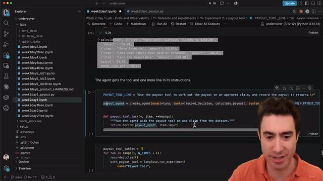

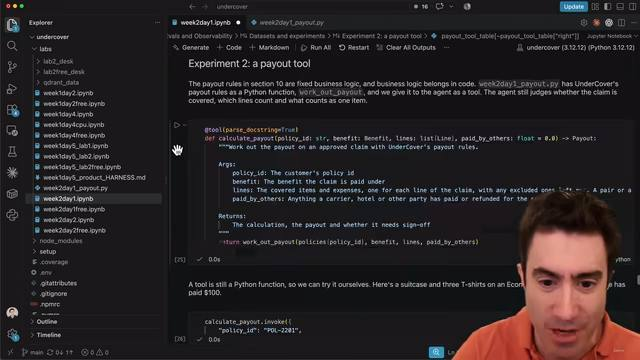

加工具时先做「工具自身可验证」：用讲师那个例子直接 `calculate_payout.invoke(...)`，确认输出 `24.97`，再把它交给 agent。否则 agent 调错工具时，你分不清是模型判断错，还是工具算错。**常见错误与排查：**工具参数类型写成 `list[dict]` 但实际传了 JSON 字符串；`others_contributing` 语义搞反；工具 docstring 没描述清楚字段，模型不会传参。**前端对照：**类似把纯计算逻辑抽成工具函数，先单测函数，再做页面集成测试。

### 3.9 第八步：对比两组实验，做决策

讲师把两组结果并排打印，得到关键数字（p052 [03:44]–[05:40]）：

| 指标 | baseline | payout tool |
|---|---|---|
| 决策或金额出错案例数 | 36 | 8 |
| decision accuracy | 84% | 96% |
| 混淆矩阵 accuracy | 52% | 89% |
| precision | 1.0 | 1.0 |
| recall | 较低 | 明显更高 |
| kappa | 较低 | 更高 |
| 错误成本（越低越好） | $5300 | $640 |
| straight-through rate | 65% | 73% |
| LLM 成本 | 0.6 美分 | 1 美分 |

结论：payout tool 全面胜出，唯一变差的是 LLM 成本翻倍，但这是业务上可接受的取舍。

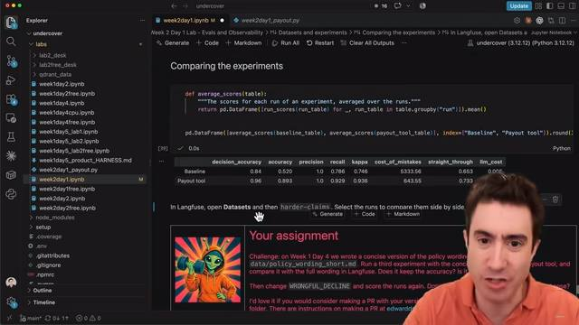

最后去 Langfuse 的 Datasets → `harder_claims` → Experiments 标签页，能看到 3 条 baseline + 3 条 payout tool 记录，可以点 **Compare** 做逐条对比（p052 [06:10]–[07:45]）。

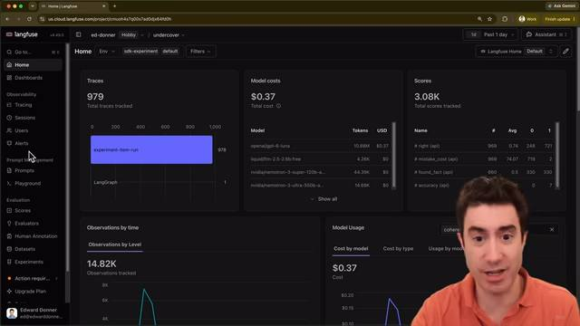

对比时不要只看一个总分，要同时看「错误成本是否下降」「recall 是否提升」「LLM 成本是否可接受」「straight-through rate 是否提升」。如果结论和讲师一致，就把取舍写清楚：多花一点 LLM 成本，换来错误成本大幅下降；如果暂时不一致，先检查数据对齐、解析逻辑、`n_times` 和金额统计口径。**前端对照：**类似 A/B 实验页，不能只看点击率一个指标，要同时看转化、失败率、成本和样本量。

---

## 4. 完整代码

> 说明：讲师在 notebook 里逐段演示，没有一次性给出完整文件。下面按 notebook 的 cell 顺序整理成**可直接保存运行**的完整代码。`business_logic.py` 的完整源码课里没给，下面给的是**等价示意实现**，能跑通、能复现 $24.97 这个例子。

### 4.1 `business_logic.py`（课里没给完整源码，以下为等价示意）

```python
# business_logic.py
# 课里没给完整源码，以下为等价示意实现，能复现讲师举的 $24.97 例子。

def calculate_payout_logic(policy_id: str, benefit: str, lines: list[dict], others_contributing: bool) -> float:
    """
    简化版理赔计算：
    - 把 lines 里每一项的 amount 加起来
    - 如果 others_contributing=True，扣掉 lines 里标记为 paid_by_others 的金额
    - 按 benefit 类型套一个简单的免赔额规则（示意）
    """
    total = sum(item["amount"] for item in lines)

    if others_contributing:
        already_paid = sum(item.get("paid_by_others", 0) for item in lines)
        total -= already_paid

    # 示意：baggage benefit 有 $0 免赔额，其他 benefit 有 $100 免赔额
    deductible = 0 if benefit == "baggage" else 100
    payout = max(total - deductible, 0)

    return round(payout, 2)
```

这段代码只是等价示意，不要把它当成讲师原版逐行源码。使用前先跑讲师例子，确认输出 `24.97`；如果你的业务规则不同，替换逻辑后要重新验证边界：金额为空、`others_contributing=False`、扣减后为负数、四舍五入到两位小数。**常见错误与排查：**`lines` 里没有 `paid_by_others` 时用 `.get` 避免 KeyError；`benefit` 大小写不一致导致免赔额规则没命中；`round` 之前出现浮点误差。**前端对照：**类似把金额计算抽成纯函数，先单测示例，再接页面。

### 4.2 主 notebook：`week2_day1.ipynb`（按 cell 顺序）

**Cell 1 — 导入与连接**

```python
import os
import json
import pandas as pd
from dotenv import load_dotenv

from langchain_openai import ChatOpenAI
from langchain.agents import create_agent
from langchain_core.tools import tool
from langfuse import Langfuse
from langfuse.langchain import CallbackHandler

load_dotenv()

langfuse = Langfuse()
print("Connected to Langfuse successfully")
```

**Cell 2 — 加载 harder 数据集**

```python
# 讲师从仓库里加载 harder 数据集；这里用本地 JSON 复现同样的结构。
# 课里没给数据文件本体，你需要自己准备 25 条 claim + 25 条 ground truth + 25 份 policy。
with open("harder_claims.json", "r", encoding="utf-8") as f:
    harder = json.load(f)

claims = harder["claims"]              # 25 条
ground_truth = harder["ground_truth"]  # 25 条
policies = harder["policies"]          # 25 份

print(f"Loaded {len(claims)} claims, {len(ground_truth)} labels, {len(policies)} policies")
```

**Cell 3 — 定义 record_decision 工具（注意 `parse_docstring=True`）**

```python
from typing import Literal

@tool(parse_docstring=True)
def record_decision(claim: str, rationale: str, decision: Literal["approve", "decline", "refer"]) -> str:
    """Record the final decision for a claim.

    Args:
        claim: The claim id being decided.
        rationale: Short reasoning for the decision.
        decision: One of approve, decline, or refer.
    """
    return f"Recorded {decision} for claim {claim}: {rationale}"
```

**Cell 4 — 构建 baseline agent**

```python
SYSTEM_PROMPT = (
    "You are a claims handler. Read the policy record and the claim, "
    "then choose a decision: approve, decline, or refer. "
    "Always call record_decision with your final answer."
)

llm = ChatOpenAI(
    model="gpt-6-luna",
    openai_api_key=os.environ["OPENROUTER_API_KEY"],
    openai_api_base="https://openrouter.ai/api/v1",
    reasoning_effort="none",
)

baseline_agent = create_agent(
    model=llm,
    tools=[record_decision],
    system_prompt=SYSTEM_PROMPT,
)
```

**Cell 5 — 单次 invoke + Langfuse 追踪**

```python
handler = CallbackHandler()

user_prompt = f"Policy record:\n{policies[0]}\n\nClaim:\n{claims[0]}"

result = baseline_agent.invoke(
    {"messages": [{"role": "user", "content": user_prompt}]},
    config={"callbacks": [handler]},
)
print(result)
```

**Cell 6 — 错误成本函数**

```python
WRONGFUL_DECLINE_PENALTY = 1500
NEEDLESS_REFER_PENALTY = 50

def mistake_cost(answer: str, expected: str) -> float:
    """answer/expected 都是 'approve' / 'decline' / 'refer' 之一。"""
    if answer == expected:
        return 0.0
    if expected == "approve" and answer == "decline":
        return WRONGFUL_DECLINE_PENALTY
    if expected == "approve" and answer == "refer":
        return NEEDLESS_REFER_PENALTY
    # 其余错法课里没细讲，这里按 0 处理；实际以你的业务规则为准
    return 0.0
```

**Cell 7 — 混淆矩阵绘制**

```python
import matplotlib.pyplot as plt
import numpy as np

LABELS = ["approve", "decline", "refer"]

def draw_confusion_matrix(pairs, title="Confusion matrix"):
    """pairs: [(agent_answer, truth), ...]；agent 是列，truth 是行。"""
    mat = np.zeros((3, 3), dtype=int)
    for ans, truth in pairs:
        mat[LABELS.index(truth), LABELS.index(ans)] += 1
    fig, ax = plt.subplots(figsize=(5, 4))
    ax.imshow(mat, cmap="Blues")
    ax.set_xticks(range(3)); ax.set_xticklabels(LABELS)
    ax.set_yticks(range(3)); ax.set_yticklabels(LABELS)
    ax.set_xlabel("Agent said"); ax.set_ylabel("Truth")
    for i in range(3):
        for j in range(3):
            ax.text(j, i, str(mat[i, j]), ha="center", va="center")
    ax.set_title(title)
    plt.show()
    return mat
```

**Cell 8 — 上传数据集到 Langfuse**

```python
DATASET_NAME = "harder_claims"
TINY = False  # 讲师：tiny=False 表示跑全部 25 条

items_to_upload = claims if not TINY else claims[:5]

for claim, gt, policy in zip(items_to_upload, ground_truth, policies):
    langfuse.create_dataset_item(
        dataset_name=DATASET_NAME,
        id=claim["claim_id"],
        input={"claim": claim, "policy": policy},
        expected_output=gt,
    )
print(f"Uploaded {len(items_to_upload)} items to dataset {DATASET_NAME}")
```

**Cell 9 — decide 函数 + score_claim + score_run**

```python
def decide(agent, claim, policy):
    user_prompt = f"Policy record:\n{policy}\n\nClaim:\n{claim}"
    result = agent.invoke({"messages": [{"role": "user", "content": user_prompt}]})
    # 从工具调用里取 decision；课里没展示具体解析代码，这里按 record_decision 的返回格式解析
    for msg in result["messages"]:
        if getattr(msg, "name", None) == "record_decision":
            content = msg.content  # "Recorded approve for claim X: ..."
            return content.split()[1]
    return "refer"

def score_claim(input, output, expected_output):
    """逐条打分：返回 evaluation 对象列表。"""
    return [
        {"name": "is_right", "value": 1.0 if output == expected_output else 0.0},
        {"name": "mistake_cost", "value": mistake_cost(output, expected_output)},
    ]

def score_table(results):
    """把 results 转成带 mistake_cost 的表。"""
    rows = []
    for r in results:
        rows.append({
            "claim_id": r["item"].id,
            "agent": r["output"],
            "truth": r["item"].expected_output,
            "mistake_cost": mistake_cost(r["output"], r["item"].expected_output),
        })
    return pd.DataFrame(rows)

def run_scores(table):
    """整表汇总：accuracy / precision / recall / kappa / 错误成本 / straight-through / LLM 成本。"""
    n = len(table)
    correct = (table["agent"] == table["truth"]).sum()
    accuracy = correct / n

    tp = ((table["agent"] == "approve") & (table["truth"] == "approve")).sum()
    fp = ((table["agent"] == "approve") & (table["truth"] != "approve")).sum()
    fn = ((table["agent"] != "approve") & (table["truth"] == "approve")).sum()
    precision = tp / (tp + fp) if (tp + fp) else 0.0
    recall = tp / (tp + fn) if (tp + fn) else 0.0

    # Cohen's kappa（课里说公式简单，没逐行展示；这里按标准公式实现）
    po = accuracy
    pe = sum(
        (table["truth"] == c).sum() * (table["agent"] == c).sum()
        for c in LABELS
    ) / (n * n)
    kappa = (po - pe) / (1 - pe) if pe != 1 else 0.0

    straight_through = ((table["agent"] == "approve") | (table["agent"] == "decline")).sum() / n

    return {
        "accuracy": accuracy,
        "precision": precision,
        "recall": recall,
        "kappa": kappa,
        "mistake_cost_total": table["mistake_cost"].sum(),
        "straight_through": straight_through,
    }

def score_run(results):
    table = score_table(results)
    return run_scores(table)
```

**Cell 10 — baseline 实验**

```python
def baseline_task(item):
    return decide(baseline_agent, item.input["claim"], item.input["policy"])

N_TIMES = 1  # 讲师自己用 3，建议学员用 1

baseline_results = langfuse.run_experiment(
    name="baseline",
    dataset_name=DATASET_NAME,
    task=baseline_task,
    evaluators=[score_claim],
    run_evaluators=[score_run],
    n_times=N_TIMES,
)
print(baseline_results)
```

**Cell 11 — payout tool + payout agent**

```python
from business_logic import calculate_payout_logic

@tool(parse_docstring=True)
def calculate_payout(policy_id: str, benefit: str, lines: list[dict], others_contributing: bool) -> float:
    """Calculate the payout for a claim using business rules.

    Args:
        policy_id: The policy id.
        benefit: The benefit category, e.g. baggage.
        lines: List of claim line items, each with amount and optional paid_by_others.
        others_contributing: Whether another insurer has already paid part of it.
    """
    return calculate_payout_logic(policy_id, benefit, lines, others_contributing)

# 讲师给的示例：baggage benefit，几项要退，$100 已由他人支付 → $24.97
example_lines = [
    {"amount": 50.00},
    {"amount": 74.97, "paid_by_others": 100.00},
]
print(calculate_payout.invoke({
    "policy_id": "P-001",
    "benefit": "baggage",
    "lines": example_lines,
    "others_contributing": True,
}))
# 期望输出 24.97

PAYOUT_SYSTEM_PROMPT = SYSTEM_PROMPT + " Use the payout tool to work out the payout."

payout_agent = create_agent(
    model=llm,
    tools=[record_decision, calculate_payout],
    system_prompt=PAYOUT_SYSTEM_PROMPT,
)
```

**Cell 12 — payout tool 实验**

```python
def payout_tool_task(item):
    return decide(payout_agent, item.input["claim"], item.input["policy"])

payout_results = langfuse.run_experiment(
    name="payout_tool",
    dataset_name=DATASET_NAME,
    task=payout_tool_task,
    evaluators=[score_claim],
    run_evaluators=[score_run],
    n_times=N_TIMES,
)
print(payout_results)
```

**Cell 13 — 对比两组结果**

```python
def count_wrong(results):
    """统计「决策或金额出错」的案例数。金额对比课里没展示具体字段，这里只统计决策错。"""
    wrong = 0
    for r in results:
        if r["output"] != r["item"].expected_output:
            wrong += 1
    return wrong

print("baseline wrong:", count_wrong(baseline_results))
print("payout_tool wrong:", count_wrong(payout_results))
```

> 注意：讲师说的「36 vs 8」是**决策或金额**都算错，金额对比的具体实现课里没展示。上面这个函数只统计决策错，数字会和讲师的不完全一致——这是正常的，别硬凑。

**Cell 14 — 可选：清空 Langfuse traces**

```python
# 讲师：完全可选，想从头再来时用
# langfuse.flush()
# 具体清空 API 课里没展示，以 Langfuse 官方文档为准
```

按 cell 顺序运行时，建议每跑完一个关键 cell 就做一次小检查：Cell 1 看连接、Cell 2 看 25/25/25、Cell 3 看工具 schema、Cell 5 看 Tracing、Cell 8 看数据集页面、Cell 10 和 Cell 12 看 Experiments 页面。**常见错误与排查：**notebook 里改了函数但没重新执行依赖它的 cell，导致旧函数还在内存里；`import` 缓存导致 `business_logic.py` 改了没生效，必要时重启 kernel；上传数据集重复执行可能生成重复记录，复现时先确认 dataset 名和 id 策略。**前端对照：**类似改了模块但热更新没生效，先确认运行时加载的是最新代码。

---

## 5. 逐行解释

**`@tool(parse_docstring=True)`**
这是本节最容易踩的坑。不加这个参数，LangChain 会把整段 docstring 当成**函数描述**，而不是把 `Args:` 下每个字段的描述关联到对应参数。讲师自己也是被 Claude Code review 时才发现的（p050 [05:14]–[05:44]）。加了之后，模型看到的工具 schema 里每个参数都有独立描述，工具调用准确率会更好。排查时可以直接打印工具 schema，确认每个字段的 `description` 是否出现；如果没有，先检查缩进和 `Args:` 格式。前端对照：类似表单 schema 的字段级 description，缺了它调用方只能靠猜。

**`reasoning_effort="none"`**
讲师明确说这个 lab 把 reasoning 关掉，为了更便宜（p050 [01:23]）。GPT-6 Luna 本身很便宜，关掉 reasoning 后整个实验只要几美分。这里要注意：关掉 reasoning 不是「一定更好」，而是这个 lab 的成本取舍；如果换任务或换模型，是否保留 reasoning 要重新实验。前端对照：类似关闭某个昂贵的预计算步骤，先看成本收益。

**`CallbackHandler()` 交给 `config={"callbacks": [...]}`**
Langfuse 是追踪方，LangChain 是执行方。handler 是 Langfuse 的对象，通过 callback 机制挂到 LangChain 上。一次 `invoke` 会触发多次 callback，所以 Langfuse 里看到的是多层调用链，而不是一条（p050 [09:18]）。如果页面没有 trace，先查 handler 是否真的传入 `config`，再查 flush 和 host。前端对照：类似请求拦截器，挂上后一次请求展开成多个子事件。

**`mistake_cost` 的方向性**
注意 `expected == "approve" and answer == "decline"` 才罚 $1500。反过来（该 decline 却 approve）课里没给罚则，说明业务上更怕「错误拒赔」而不是「错误赔付」——这是业务 appetite 的体现（p051 [00:46]）。验证时至少手写三组：相等返回 0、`(decline, approve)` 返回 1500、`(refer, approve)` 返回 50。前端对照：类似不同错误码对应不同告警等级，方向不能反。

**Cohen's kappa**
为什么需要它：14/25 应该 approve，一个「全 approve」的 agent 也能拿 56% accuracy，看着不差。kappa 用 `(po - pe) / (1 - pe)` 把随机猜测的基线扣掉，全 approve 的 agent kappa = 0（p051 [01:02]）。实现时注意 `pe` 是按每个类别的 truth 分布和 agent 分布相乘后求和，别只算 approve 一类。前端对照：类似把「随机基线」扣掉后的指标，防止类别不平衡时指标虚高。

**混淆矩阵的方向**
「agent 是列，truth 是行」（p051 [02:00]）。画图时 `mat[truth_idx, agent_idx] += 1`，别搞反。验证方法：构造一条 truth=approve、agent=decline 的样例，看它是否落在「行 approve、列 decline」的位置。前端对照：类似表格行列索引，错了不会报错但结果全偏。

**`score_claim` vs `score_run`**
`score_claim` 每条数据调一次，返回逐条 evaluation；`score_run` 整表调一次，返回汇总指标。这是 Langfuse `run_experiment` 的两个不同钩子（p051 [04:32]–[04:50]）。如果逐条分数有、整表汇总没有，先查 `run_evaluators` 是否传对。前端对照：单条 validator 和整表 aggregate reducer 的分工。

**`calculate_payout` 为什么值得做成工具**
讲师的核心论点：deductible、已由他方赔付的扣减，这类**确定性数学**应该交给 Python，不该让 LLM 用自然语言推理（p051 [09:26]、p052 [00:00]）。实验数据证明了这个论点：错误成本从 $5300 降到 $640。前端对照：把纯计算逻辑抽成工具函数，先单测再集成。

**precision 两组都是 1.0**
说明两个 agent 都**没有**把不该 approve 的 approve 了。payout tool 的提升全在 recall 上——它更少把该 approve 的 decline 或 refer 掉（p052 [04:41]）。如果 precision 掉了，说明 agent 开始乱 approve，这时要查工具是否给了错误金额或错误建议。

**LLM 成本翻倍**
payout tool 多了工具调用，token 更多，成本从 0.6 美分到 1 美分。这是唯一变差的指标，但相对错误成本从 $5300 降到 $640，完全不值一提（p052 [05:40]）。前端对照：类似多一次网络请求换更低的业务失败率，决策要看总成本。

**给前端同学的类比**
- Langfuse 的 callback ≈ 你在前端挂的 middleware / interceptor，每个请求经过时打点。
- `score_claim` ≈ 单条记录的 validator；`score_run` ≈ 整个列表跑完后的 aggregate reducer。
- Cohen's kappa ≈ 把「随机基线」扣掉后的 F1，防止类别不平衡时指标虚高。
- 这里没有锁/事务/并发问题；如果以后要并发跑实验，注意 Langfuse client 的 flush 时机。

---

## 6. 复现检查清单

跑完对照打勾，每条后面给出验证方式：

- [ ] `.env` 里 `OPENROUTER_API_KEY` / `LANGFUSE_PUBLIC_KEY` / `LANGFUSE_SECRET_KEY` / `LANGFUSE_HOST` 四个都填了，保存了  
  **怎么验证：**在 notebook 里打印「变量是否存在」，不要直接打印完整 key；确认 `.env` 在当前工作目录，必要时用 `load_dotenv(dotenv_path=...)` 指定路径。
- [ ] Jupyter kernel 选的是装了依赖的那个环境  
  **怎么验证：**跑 `import sys; print(sys.executable)`，再在终端用同一路径的解释器执行 `pip show langfuse`。
- [ ] `langfuse = Langfuse()` 后打印出连接成功  
  **怎么验证：**看打印；再发一次最小 trace 或单次 invoke，确认 Langfuse 页面有记录。
- [ ] harder 数据集加载出 25 / 25 / 25  
  **怎么验证：**分别 `len(claims)`、`len(ground_truth)`、`len(policies)`，并抽样打印 claim_id 与对应 ground truth。
- [ ] `record_decision` 工具带 `parse_docstring=True`  
  **怎么验证：**打印工具 schema，确认每个参数有独立 description；没有就检查 docstring 缩进和 `Args:` 格式。
- [ ] 单次 `invoke` 后 Langfuse Tracing 页面能看到 `langgraph` → `ChatOpenAI` → `record_decision` → `ChatOpenAI` 这条链  
  **怎么验证：**在 Tracing 页面展开最外层，从下往上读；确认 handler 已传入 `config`，且运行后已 flush。
- [ ] `mistake_cost` 对 `(approve, decline)` 返回 1500，对 `(approve, refer)` 返回 50  
  **怎么验证：**手写三组断言：相等返回 0、错误拒赔返回 1500、无谓转人工返回 50。
- [ ] 混淆矩阵方向正确：agent 是列，truth 是行  
  **怎么验证：**构造一条 truth=approve、agent=decline 的样例，确认落在「行 approve、列 decline」。
- [ ] `langfuse.create_dataset_item` 跑完，Langfuse Datasets 页面能看到 `harder_claims`  
  **怎么验证：**检查 dataset 名大小写、host、上传打印数量；页面里抽查一条 input/expected_output。
- [ ] `run_experiment` 跑完，Experiments 标签页有 baseline 记录  
  **怎么验证：**看 run 名称、数据集、时间；确认 `task` 返回了可解析的 decision。
- [ ] `calculate_payout.invoke(...)` 对讲师那个例子输出 `24.97`  
  **怎么验证：**直接调用工具并 `print` 结果；再测 `others_contributing=False` 和空 lines 边界。
- [ ] payout tool 实验跑完，Experiments 标签页有 payout_tool 记录  
  **怎么验证：**确认 `payout_agent` 的工具列表包含 `record_decision` 和 `calculate_payout`，run 名称与 baseline 区分。
- [ ] 两组结果对比：decision accuracy 明显上升、错误成本明显下降  
  **怎么验证：**并排打印两组汇总指标；先确认统计口径一致，再比较数字。
- [ ] Langfuse 里能点 Compare 做逐条对比  
  **怎么验证：**在 Datasets → `harder_claims` → Experiments 里选中两组 run，逐条看输出和分数差异。

---

## 7. 课里没讲但你会撞上的

下面把上面 10 个坑整理成「现象 / 原因 / 怎么办」表：

| 现象 | 原因 | 怎么办 |
|---|---|---|
| 执行 Cell 2 直接报错，找不到 harder 数据集本体 | 讲师从 `undercover` 仓库加载，课里没给 JSON 文件内容；本地没有同结构文件 | 自己准备 25 条 claim + 25 条 ground truth + 25 份 policy，结构参考第 4.2 节 Cell 2；先用 `len()` 检查 25/25/25 对齐，再跑后续 |
| 想逐行核对 `calculate_payout` 但找不到完整源码 | 讲师说逻辑被「shoved into a different module」，课里没逐行展示 | 用第 4.1 节等价示意实现先跑通，再按自己的业务规则替换；先验证讲师例子输出 `24.97` |
| `decide` 解析不出 decision，或总返回 refer | 课里没展示从 agent 输出抠 decision 的代码；工具返回格式可能不同 | 按第 4.2 节 Cell 9 的 `split()[1]` 解析；若你改了 `record_decision` 返回格式，同步改解析逻辑，并打印 `result["messages"]` 检查工具消息 |
| 自己统计的「错误案例数」和讲师 36 / 8 对不上 | 讲师说的是「决策或金额」都算错，金额对比实现课里没展示；Cell 13 只统计决策错 | 别硬凑数字；先确认统计口径，再决定是否补金额对比；对比时记录你的口径 |
| 不知道 Cohen's kappa 怎么算 | 讲师说公式简单、可自己查，课里没逐行展示 | 按标准公式 `(po - pe) / (1 - pe)` 实现，参考 Cell 9；用「全 approve」对照检查 kappa 是否接近 0 |
| 想清空 Langfuse traces 但找不到 API | 讲师说结尾有 cell 会 wipe traces，但没展示具体调用 | Cell 14 只留占位；以 Langfuse 官方文档为准，先确认当前 SDK 的清空/删除接口再执行 |
| `n_times` 用 1 时结果波动大，和讲师数字有出入 | 讲师自己用 3 跑三遍降噪，并明确说可以设成 1；单次结果噪声更大 | 复现时先按 1 跑通，再按 3 观察稳定性；对比时别被单次数字带偏，记录 `n_times` |
| 换 provider 或模型后调用失败 | 模型名 `gpt-6-luna` 是课程里通过 OpenRouter 调用的名字；换 provider 后模型名和 base URL 会变 | 同步改 `ChatOpenAI` 的 `model` 与 `openai_api_base`，并确认 key 环境变量名一致 |
| `run_experiment` 参数报错 | 不同版本 langfuse SDK 的参数名可能略有差异（`evaluators` / `run_evaluators` / `n_times`） | 锁版本；跑前 `help(langfuse.run_experiment)` 看签名；按报错逐个对齐参数名 |
| 并发 invoke 后 trace 顺序乱或触发 rate limit | 讲师做法是串行跑；并发请求会让 trace 顺序不可控，并可能撞限流 | 复现阶段保持串行；确需并发时限制并发数、检查 flush 时机，并以 Langfuse 文档为准 |