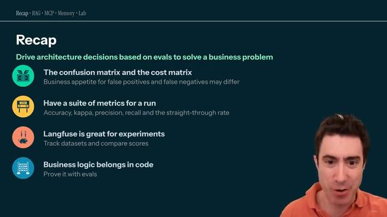
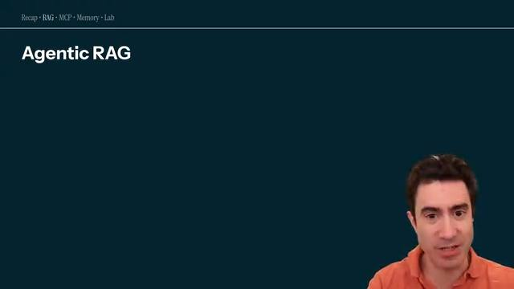
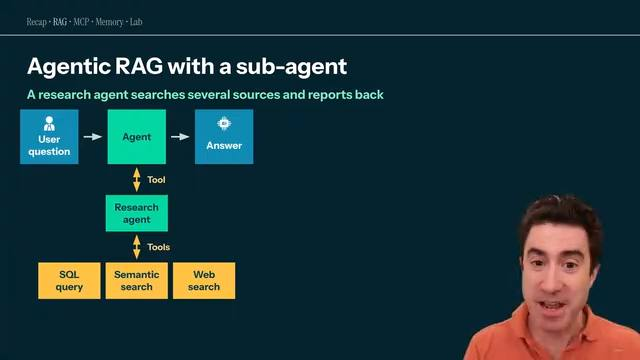
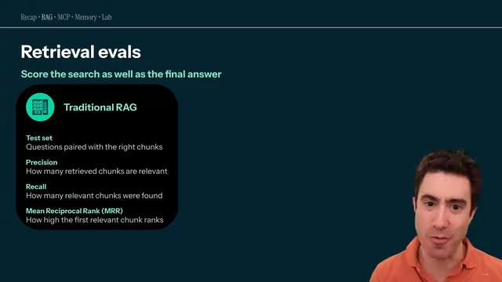
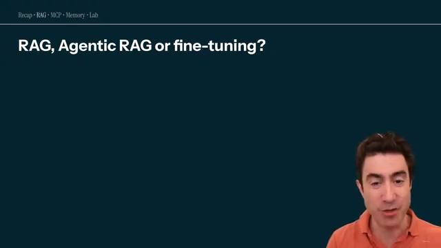
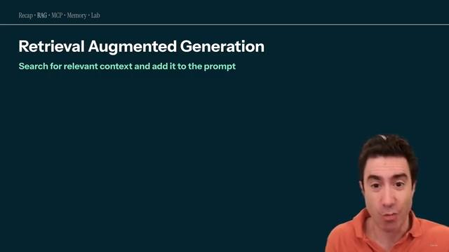
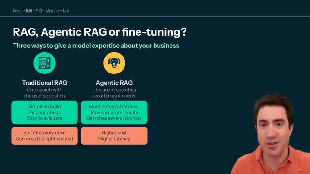

# AI FDE（BV1rJnm64Eq3）P053–P055：RAG → Agentic RAG → 评估与选型

> **文档使用说明（先读这段）**
> P053–P055 这三段是**纯讲解**，逐字稿里没有一条终端命令、没有一个可运行文件，讲师全程在白板/幻灯片层面推导架构。按本课程的文档规范，第 4 节「完整代码」不编造实现，而是把讲师给出的方案落成**可直接拿去写代码的产物**：组件职责表、设计决策表、接口契约草案、容量估算表、评估指标表，另附一段**明确标注为「课里没有代码，以下为示意」**的契约骨架。
> 如果你想「照着跑起来」，你跑的不是某个 demo 仓库，而是第 6 节那份检查清单：把表填成你自己业务的数据，再按第 3 节的推导走一遍。

---

## 1. 这一节做什么

这三讲在整门课里承担的是**「把 RAG 讲透，然后立刻把它降级为一个工具」**的任务。

讲师开场先交代了今天的完整议程：定义 RAG 与 Agentic RAG、铺开 MCP 架构并比较传输机制、说明为什么给 agent 上 MCP、最后做一个「带长期记忆 + Agentic RAG + MCP」的 agent。**但实际在 P053–P055 这三段里，只落地了第一件事**——RAG 与 Agentic RAG 的定义、内部机制、评估方式和与 Fine-tuning 的对比。MCP 的架构与传输机制只在 P053 的议程里被点名、在 P054 结尾被预告（"马上就来。"），**具体内容课里没讲**，在后面几讲。

所以本节你要拿到的产出是四样东西：

1. 一个能对着白板讲清楚的**两盒模型**：绿盒（自回归主 LLM，只吃文本）和黄盒（embedding + 向量检索，只处理数字）。这是整节课最容易讲错、也最容易被面试官追问的地方。
2. 一条**从「传统 RAG 单趟流水线」到「Agent + 检索工具」到「主 Agent + 研究子 Agent」的演进路径**，以及每一步为什么值得、代价是什么。
3. 一套**评估口径**：传统 RAG 用 MRR / Precision / Recall；Agentic RAG 换成 retrieved facts、搜索次数、cost、latency。
4. 一张**三选一决策表**：传统 RAG / Agentic RAG / Fine-tuning，什么场景选哪个，为什么现在 fine-tuning 变得罕见。

本节**不含**：向量数据库选型、embedding 模型选型、chunk size 的具体数值、MCP 协议细节、Langfuse 的具体操作。这些讲师要么没讲，要么留给了别的周。



---

## 2. 讲师原话（带出处）

按论证顺序摘，不按页码顺序。

**关于 RAG 是什么、voodoo 在哪：**

> "这是你能想到的最简单的办法……你可以从我们任意一个数据库里取出相关信息，补充到提示词中。"
> —— p053 [04:30]

> "人们有时会困惑，以为对大语言模型的那次调用里有什么玄学……但事实完全就是我说的那样。无非是：这是用户的问题，这是数据库里可能相关的材料。"
> —— p053 [05:15]

> "所以，如果说检索增强生成里真有什么玄学，那全都在那个黄色框里。"
> —— p053 [05:45]

**关于检索为什么要靠 embedding、以及主 LLM 不吃向量：**

> "它是另一种大语言模型，称为嵌入模型，也叫编码器……它能接收一段文本，比如“从纽约到伦敦要花多少钱”这句话，并把它变成一组数字。"
> —— p053 [07:36]

> "它通常包含一千多个数字。所以，它就像多维空间中的一个点。"
> —— p053 [08:03]

> "我想再澄清一次：对绿色大语言模型的那次调用，也就是自回归模型、普通大语言模型，并不涉及数字。不会有任何向量传进去。很多人会混淆，以为向量信息以某种方式传到了那个绿色框里。"
> —— p053 [11:24]

**关于传统 RAG 的短板与「家庭手工业」：**

> "随着检索增强生成流行起来，围绕如何实现那个黄色框，曾经发展出一整套专门技术……查询重写……语义分块……查询扩展……重排序……分层检索增强生成、图检索增强生成……而在智能体检索增强生成兴起之后，这些大多已经不再重要。"
> —— p054 [00:40]

**关于 Agentic RAG 的定义：**

> "让智能体自己决定要运行哪些类型的搜索……当然，我们会给智能体配备一个工具，一个让它能做语义搜索的工具。"
> —— p054 [01:59]

> "它可以自己写查询……它可以先做一次查询，如果返回的结果不好，就重写查询再试。它有自主性。"
> —— p054 [03:12]



**关于把检索拆成研究子 Agent：**

> "你经常会看到有人更进一步，把检索拆成一个单独的子智能体……这通常称为研究智能体。"
> —— p054 [04:22]

> "这意味着研究智能体可以查看并使用它各种不同的工具，也可以丢弃一些没用的研究结果。这样就不会污染主智能体的上下文。"
> —— p054 [06:18]

**关于 Agent 之间怎么通信（辟谣）：**

> "最常见的方式无疑就是工具调用。你给主智能体配备一个调用研究智能体的工具。在这个工具里，你准确描述研究智能体做什么……它之所以知道，是因为这些内容写在该工具的文档字符串和描述里。就这么简单。"
> —— p054 [08:49]



**关于评估口径：**

> "在检索过程返回的所有文本块中，那些本应相关的文本块里，实际有多少比例真的相关？所以，如果它返回了 10 个文本块，其中 9 个是好的……那精确率就是 90%。"
> —— p055 [00:57]

> "如果数据库里实际有 20 个有用的文本块，但我们只返回了其中 8 个……那 8 比 20，就是召回率。"
> —— p055 [01:21]

> "这是因为大语言模型并不介意你发给它几个不相关的文本块，它会直接忽略。但当然，如果它拿不到相关数据，就会很在意。所以通常来说，召回率比精确率更重要。"
> —— p055 [01:49]



**关于 Agentic RAG 的评估与代价：**

> "你最后要看的是：有多少相关记忆被检索出来，它做了哪些类型的搜索，当然还有成本和延迟……这就是智能体检索增强生成的一大缺点：它可能很贵，也可能很耗时。"
> —— p055 [02:18]

**关于 Fine-tuning 为什么变少了：**

> "如果你有一千条关于业务的事实，并希望模型学会这一千条事实，那么微调并不是正确做法，因为你可以把这一千条事实放进提示词里，也可以让智能体去逐条查找这些事实。"
> —— p055 [07:27]

> "如今前沿模型已经非常强大，很少能找到它们还不具备、而你又有足够数据可以明显提升效果的技能。"
> —— p055 [09:06]

**关于「听起来像训练但其实是推理时」的那件事：**

> "智能体 harness 可以做某种实施后评审，并重写它的 Markdown 文档、状态和记忆，把经验教训纳入其中，这非常常见。听起来很像训练……但神经网络权重并没有改变。这完全是一种推理时技术。"
> —— p055 [10:46]



---

## 3. 从零复现（把讲师的推导一步步走一遍）

这一节不写「知识点」，写**推导**。你按 3.1 到 3.8 走一遍，等于把讲师那一小时的思路自己重跑了一次。

### 3.1 需求：先说清楚要解决的是什么

用户的原始诉求只有一句话：

> "从纽约飞往伦敦的机票价格是多少？"

不带任何检索地把这句话丢给主 LLM，讲师的原话是——"它只会试着从训练数据和模式匹配中找出点东西。它可能对，也可能不对。"（p053 [04:01]）

所以需求被定义成一个**召回问题**，不是生成问题：**在生成之前，先把和这个问题语义相关的资料找出来，塞进 prompt。** 这句话是本节所有设计的锚点。后面无论是传统 RAG 还是 Agentic RAG，目标函数完全一样，变的只是「谁来发起检索、检索几次、检索什么」。

### 3.2 约束：四条硬边界

| # | 约束 | 讲师依据 | 对你设计的影响 |
|---|---|---|---|
| C1 | 主 LLM 只吃文本，不吃向量 | p053 [11:24] "没有数字。没有任何向量会进入那个位置。" | 向量只存在于检索侧，绝不能出现在最终 prompt 里 |
| C2 | 用户的问法千变万化 | p053 [06:24]：可以说 London、可以说「英格兰的首都」、可以说 Heathrow / Gatwick、可以说 cost 也可以说 price | 字符串匹配（`LIKE '%London%'`）必然漏召回 |
| C3 | 语义相近 ≠ 用词相同 | p053 [08:33] "那两句话共有的词不多，但最终会彼此靠得很近。" | 必须引入 embedding 模型做语义检索 |
| C4 | 传统 RAG 是**单趟**的 | p053 [12:16] "只需要过一遍这个流程。" | 一次没检索到，就没有第二次机会 |

C4 是后面所有演进的分水岭。请把它记住。

### 3.3 估算：把口径算成数字

讲师在这里给了两个算例，都不难，但要在脑子里能复现：

**Precision（p055 [00:57]）**：检索返回 10 个 chunk，其中 9 个是相关的。

```
precision = 相关且被返回的 chunk 数 / 被返回的 chunk 总数 = 9 / 10 = 90%
```

**Recall（p055 [01:21]）**：库里有 20 个真正有用的 chunk，这次只召回了 8 个。

```
recall = 被召回的相关 chunk 数 / 库里所有相关 chunk 数 = 8 / 20 = 40%
```

讲师紧接着给了一句非常重要的判断：**在 RAG 场景里 recall 比 precision 重要**，理由是 "大语言模型并不介意你给它发送几个不相关的文本块。所以我们就直接忽略它们。但当然，如果它拿不到相关数据，大语言模型会非常在意。"（p055 [01:49]）。这句反直觉——一般工程里 precision 是更被关心的那个，但在 RAG 里因为下游是一个宽容的 LLM，反过来成立。

> **注意**：上面公式是这两个例子的算术还原。讲师**没有**给出 MRR 的具体计算式，只说它 "它衡量你呈现相关内容并把它们排在列表靠前位置的效果如何。"（p055 [00:00]）。MRR 的标准定义请查资料，课里没讲。

再往下是 Agentic RAG 的估算。讲师没给公式，只给了变量（p055 [02:18]）：最终检索到的相关记忆条数、做了哪几类搜索、cost、latency。**下面这张表是本文作者按讲师描述的流程补的，讲师未给具体数值**：

| 场景 | 每次问答的固定调用数 | 不确定性来源 |
|---|---|---|
| 传统 RAG | 1 次 query embedding + 1 次向量检索 + 1 次主 LLM | 无。调用次数恒定，cost/latency 可预估 |
| Agentic RAG（单 agent） | 1 次主 LLM 启动 + n × (1 次检索 tool + 1 次主 LLM 读结果) + 1 次主 LLM 收尾，n ≥ 1 且未知 | n 由模型自己决定，讲师原话 "它可能会自行决定，而这些会在你意想不到的时候进行大量搜索。"（p055 [05:58]） |
| Agentic RAG + 研究子 Agent | 上面全部 × 子 agent 内的多次工具调用（语义检索 / 网页搜索 / SQL / 业务工具） | n 之外再加一层：子 agent 内部调用几次也不确定 |

结论很清楚：**Agentic RAG 的 cost 与 latency 不是「贵一点」，而是「从可预估变成不可预估」。** 这就是讲师反复强调必须上评估的原因。

### 3.4 方案 A：传统 RAG（两盒流水线）

按讲师 p053 [10:19]–[11:24] 的描述，重建完整流程：

**离线阶段（一次性 + 持续增补）**

1. 把全部资料切成 chunk。讲师原话："你可以把它拆成不同大小的文本块，小的、中等的、大的，随你便。"（p053 [10:19]）。**具体多大，课里没讲。**
2. 每个 chunk 过 embedding 模型，得到一个向量。注意：**原文也留着**，"你也保留文本块本身，同时拥有与该文本块关联的向量。"
3. 把 `(chunk 文本, 向量)` 一起写进向量数据库。

**在线阶段（每次用户提问都跑一遍）**

4. 把用户问题过**同一个** embedding 模型，得到 query 向量。
5. 在向量库里找距离最近的若干个 chunk。
6. 把这些 chunk 的**原文**（不是向量！）拼进 prompt，形如：「用户问了 X，这里有一些可能相关的信息：……，请据此回答」。
7. 调主 LLM，拿答案返回。

第 6 步是整个流程里最容易写错的一步。讲师强调了两遍：绿盒收到的只有文本。



### 3.5 方案 B：Agentic RAG（把检索降级为一个工具）

讲师的定义极短："让智能体决定它想运行哪些类型的搜索。"（p054 [01:59]）。落到实现上，变化只有一处：

**第 4–5 步不再是主流程的一部分，而是一个工具。**

主流程变成：

1. 用户问题 → 主 Agent（一个带工具调用的 LLM）。
2. 主 Agent 自己决定要不要调 `retrieve_context`，以及**用什么文本**去调。
3. 拿到结果后，它可以选择再调一次、换个说法再调、或者直接回答。

讲师把这件事的价值拆得很细（p054 [03:12]–[04:22]）：

- **自己改写 query**：用户说 "飞往希思罗机场要多少钱？"，agent 可以自己拼出 "从纽约市各个机场到LHR的机票价格"。这正是传统 RAG 时代要单独做一个「query rewriting」模块干的事——现在它免费了。
- **多次检索**：一次没捞到，改个说法再来。
- **边搜边学**："它可以进行一些搜索，了解一些情况，然后根据目前已学到的内容优化查询并生成新的查询。"

讲师对「那些 cottage industry 技术」的判断非常直接：它们 "在智能体式检索增强生成出现之后，基本上已经变得无关紧要了。"（p054 [00:40]）。这句话的含义是——**不要先去实现 query rewriting / query expansion / re-ranking / hierarchical RAG / graph RAG 这一堆，先上一个裸的 agent + 一个检索工具，然后用评估说话。**

### 3.6 方案 C：主 Agent + 研究子 Agent

再往上一层，讲师给的结构是（p054 [04:52]–[06:48]）：

- 主 Agent 仍然只有**一个**工具，但这个工具不是 `retrieve_context`，而是 `research`（"请去针对这个用户的问题做调研。"）。
- 调 `research` 实际会启动**另一个 agent**（子 agent）。
- 子 agent 自己挂一堆工具：语义检索、网页搜索、SQL 查结构化库、翻 markdown、业务工具。
- 子 agent 返回的不是原始 chunk，而是**一份研究简报**（"一份经过充分调研的简报"）。
- 主 Agent 拿简报作答。

这么做换来三件事：

1. **多源**：vector + SQL + web 混着查。
2. **上下文隔离**：子 agent 翻过的一堆垃圾不进入主 agent 的 context window，只有高信号内容回去。讲师原话："它不会污染主智能体的上下文。"（p054 [06:18]）。
3. **可并行**：像任何 deep research agent 一样，多个工具可以同时跑（"它可以并行完成其中的很多工作。"）。

**关键提醒**：讲师紧接着就泼了冷水——"在这些额外工具中加入研究智能体的理由，不应是因为它花哨而强大……而应是因为它能提升你的评测表现。"（p054 [07:09]，逐字稿把 evals 转写成了 evils）。**先做最简版本，用量化提升换复杂度。** 这是本节的工程纪律。

### 3.7 通信机制：不要被 A2A 唬住

这段是纯辟谣，但对前端转 AI 的人特别有用，因为很容易被术语劝退。

讲师的判断（p054 [07:38]–[10:46]）：

- Google 一年前放出的 **A2A（逐字稿写作 "A to A"，Agent to Agent）**，解决的是「不同团队、不同框架、不同云（Azure 上的微软栈 ↔ AWS 上的另一套）的异构 agent 互相发现与通信」。
- "in my opinion, it's not a pressing problem today"。
- 你自己的主 agent 和研究子 agent 之间，**没有任何神秘之处**：最常见的就是一次普通的 tool call。你在那个 tool 的 description / docstring 里写清楚「这个工具会委派给一个研究子 agent」，模型就知道了。
- 其他方式也有：比如 Claude Code 之间互相写 markdown 文件通信（讲师明确举了这个例子）。
- 真的要和别人写的、跑在别处的 agent 通信？"it's called mcp"。

所以在本节的复现里，你**不需要**引入任何 agent-to-agent 协议。一个 `research` 工具定义就够了。

### 3.8 取舍：三选一

| 维度 | 传统 RAG | Agentic RAG | Fine-tuning |
|---|---|---|---|
| 干预时机 | 推理时 | 推理时 | **训练时，改权重** |
| 检索次数 | 1 次（单趟） | 多次，模型决定 | 不适用 |
| 能否自改 query | 不能（需外挂模块） | 能 | 不适用 |
| 多源（vector+SQL+web） | 难，要自己拼 | 能 | 不适用 |
| 成本 | 低、可预估 | 高、**不可预估** | 一次性极高 + 持续投入 |
| 延迟 | 快 | 慢 | 推理时不变 |
| 可评估性 | 好（MRR / P / R） | 差（口径模糊，见下） | 需要另一套 |
| 适合的活 | 固定问答、FAQ、单库检索 | 复杂问题、多源、需要反复试探 | **学「怎么做事」，不是「记住事实」** |

Fine-tuning 那一列是讲师花时间最多的部分，因为大量人第一反应是「我有一堆公司数据，那我微调一下不就行了」。讲师的反驳链是这样的（p055 [06:27]–[09:59]）：

1. 训练不是往模型里塞事实，训练是让它**学会泛化**。"它并不是仅仅通过浏览所有这些维基百科页面，就学会如何原封不动地输出维基百科页面的副本。"
2. 如果你的目标是「让模型知道这 1000 条事实」，答案是塞 prompt 或者让 agent 去查，不是微调。
3. 只有当你的目标是「让它从这 1000 条事实里学到通用规律，从而能回答那 1000 条之外的无穷多条相似事实」时，微调才成立。
4. 而且这件事越来越罕见，因为：贵、耗时、要持续做、每出一个新基座模型可能都要重做一遍、需要顶尖的调参能力、不做就会 drift。
5. 还有一条讲师自己加的更微妙的原因："如今的前沿模型非常强大，很难找到这样一种技能：它们还不具备，同时你又有足够的数据能够带来明显提升。"——两个条件要同时满足：模型不会 + 你有足够数据能改变它。同时满足的场景很少。
6. 就算满足，前沿模型靠 few-shot 也常常能「现场学会」。"在推理时给几个示例，它们就能直接建立关联。"

然后是全节最漂亮的一个 twist（p055 [10:46]）：**现在真正在发生、而且极其常见的「训练」，是 agent harness 的自我改进**——做完一次任务后做 post implementation review，重写自己的 markdown、state、memories，把经验吃进去。听起来完全像训练，但 "神经网络的权重并没有改变。这完全是一种推理时技术。" 很多人在松散地把这个叫 training。**这就是今天真正该用的「让 agent 变强」的手段。**



---

## 4. 完整代码（本节无代码，以下为可落地产物）

再次声明：**P053–P055 的逐字稿里没有一行代码、没有一条命令。** 下面五张表和一段契约骨架是把讲师口述的方案翻译成工程语言，可以直接拿去当设计文档评审。

### 4.1 组件职责表

| 组件 | 输入 | 输出 | 绝对不能做的事 |
|---|---|---|---|
| Embedding 模型（黄盒左半） | 一段文本（chunk 或 query） | 一个向量（讲师：通常 >1000 维） | 不能生成自然语言回答 |
| 向量数据库（黄盒右半） | query 向量 | 最相近的 k 条 chunk 的**原文** | 不能把向量直接交给主 LLM |
| 主 LLM（绿盒） | 用户问题 + 若干 chunk 原文 + 指令 | 自然语言回答 | 不接受向量、不知道检索是怎么做的 |
| 检索工具 `retrieve_context` | 一段查询文本 | `RetrievedChunk[]` | 不能自己编 chunk，只能返回库里的原文 |
| 研究子 Agent（可选） | 用户问题 | 一份研究简报（文本） | 不能把中间垃圾全倒给主 Agent |
| 主 Agent | 用户问题 | 回答 / 工具调用 | 不能绕过工具直接访问数据库 |

最后两行是讲师在 p053 [11:24] 和 p054 [06:18] 反复强调的边界。

### 4.2 设计决策表

| # | 决策 | 选它 | 不选它的后果 | 依据 |
|---|---|---|---|---|
| D1 | 先做传统 RAG，还是直接上 Agentic RAG？ | **从传统 RAG 起步**，用它当基线 | 没有基线，你无法证明多花的 token 换来了什么 | 讲师：先上最简版本，用 evals 说话（p054 [07:09]） |
| D2 | 检索放在主流程还是做成工具？ | **做成工具** | 检索变成写死的单趟，遇不到就是遇不到 | p054 [02:15] |
| D3 | 要不要实现 query rewriting 模块？ | **不实现**，交给 agent | 重复造轮子，还多一层抽象 | p054 [00:40] 与 [03:12] |
| D4 | 要不要拆研究子 Agent？ | **默认不拆**，只在评估证明有效时拆 | 多一层 agent 就是多一层 cost、latency、不可预测 | p054 [07:09] |
| D5 | 子 Agent 的工具集合多大？ | 按问题类型给（vector / SQL / web），一个都不多给 | 工具越多，决策空间越大，行为越难预测 | p054 [05:48] |
| D6 | 主 Agent 怎么调子 Agent？ | **普通 tool call**，description 里写明「委派」 | 引入 A2A 之类的协议，成本高且当前无收益 | p054 [08:49] 与 [10:16] |
| D7 | 评估用 Recall 还是 Precision？ | **传统 RAG 优先盯 Recall** | 盯错指标，会为了去掉几个无关 chunk 而漏掉关键事实 | p055 [01:49] |
| D8 | Agentic RAG 用什么指标？ | retrieved facts / 搜索次数 / cost / latency | 沿用 MRR 会因为「来源已经不清晰」而失效 | p055 [02:47] |
| D9 | 要不要微调？ | **默认不要** | 贵、慢、要持续维护、换基座就重做 | p055 [08:15] |
| D10 | 想让 agent 变强怎么办？ | **让 harness 做复盘并重写自己的 markdown / state / memory** | 去做真微调，投入产出比极差 | p055 [10:46] |

### 4.3 接口 / 数据模型草案

```ts
// 课里没有代码，以下为示意：把讲师口述的「两盒模型」落成类型

/** 向量数据库里的一条记录：文本和向量必须成对存在（p053 [10:19] "You keep the chunk of text as well"） */
export interface ChunkRecord {
  chunkId: string;
  /** 原始文本。注意：真正进 prompt 的是这个字段，不是 vector */
  text: string;
  /** embedding 模型输出的向量。只在这里存在，永远不进入主 LLM 的 prompt */
  vector: number[];
  /** 来源标识，用于 citation 与人工排查 */
  source: string;
}

/** 检索工具返回给 agent 的一条结果 */
export interface RetrievedChunk {
  chunkId: string;
  text: string;
  /** 相似度分数。字段名请以你实际用的向量库输出为准 */
  score: number;
  source: string;
}

/** 检索工具的入参：注意只有文本，没有向量（向量在工具内部生成） */
export interface RetrieveContextArgs {
  /** 由 agent 自己决定的检索语句，可以与用户原问题完全不同 */
  query: string;
  /** 返回条数。上限建议在工具层兜住，别让模型要 100 条 */
  topK?: number;
}
```

### 4.4 工具契约草案（讲师明确说过要写 description）

讲师原话："在那个工具中，你会准确描述那个研究智能体做什么。而那个智能体会像调用任何其他工具一样调用那个工具。它知道调用那个工具实际上就是把任务委派给一个子智能体。它之所以知道，是因为工具描述里的文档字符串对此作了解释。"（p054 [08:49]）

```json
[
  {
    "name": "retrieve_context",
    "description": "在你的知识库中做语义检索，返回与 query 语义最接近的若干文本片段。当你需要事实性依据（价格、政策、配置、条款）才能回答时调用。可以多次调用：如果第一次返回的内容不足以回答，请改写 query（换同义词、换更具体的实体名、拆成子问题）后再调一次。返回的是原文片段，不是摘要。",
    "parameters": {
      "type": "object",
      "properties": {
        "query": {
          "type": "string",
          "description": "检索语句。请使用陈述性、信息密集的表达，而不是用户的原话口语，例如把「去希思罗机场贵吗」写成「纽约至伦敦希思罗机场的机票价格」。"
        },
        "topK": {
          "type": "integer",
          "description": "返回条数，默认 5，最大 20。"
        }
      },
      "required": ["query"]
    }
  },
  {
    "name": "research",
    "description": "把一个需要多源调研的问题委派给研究子 agent。子 agent 会自行决定做几次语义检索、是否查询结构化数据库、是否上网搜索，并把结论整理成一份研究简报返回。注意：调用本工具就等于把任务委派出去，你收到的是经过提炼的简报，不是原始资料。只有当问题需要跨多个信息源、或单次检索明显不够时才使用。",
    "parameters": {
      "type": "object",
      "properties": {
        "question": {
          "type": "string",
          "description": "需要调研的完整问题描述，包含已知约束。"
        }
      },
      "required": ["question"]
    }
  }
]
```

### 4.5 检索工具的实现骨架（示意，含讲师没讲但必需的工程护栏）

```ts
// 课里没有代码，以下为示意。讲师只讲了「工具内部做 embedding + 向量检索」，
// 超时、重试、条数上限属于本文补充的工程写法，不是你在这三讲里学到的东西。

import type { RetrievedChunk, RetrieveContextArgs, ChunkRecord } from './types';

const TOP_K_HARD_LIMIT = 20;   // 工具层兜底，不信任模型传上来的数字
const TIMEOUT_MS = 8_000;

/** 伪接口：换成你实际使用的 embedding 服务 / 向量库客户端 */
declare function embed(text: string): Promise<number[]>;
declare function searchByVector(vector: number[], topK: number): Promise<ChunkRecord[]>;

export async function retrieveContext(args: RetrieveContextArgs): Promise<RetrievedChunk[]> {
  const query = args.query?.trim();
  if (!query) return [];

  const topK = Math.min(args.topK ?? 5, TOP_K_HARD_LIMIT);

  // 黄盒第一步：query → 向量（与建库时用的必须是同一个 embedding 模型）
  const vector = await embed(query);

  // 黄盒第二步：最近邻检索
  const hits = await withTimeout(searchByVector(vector, topK), TIMEOUT_MS);

  // 关键：只把 text 交出去，vector 留在这里。
  // 对应讲师强调的「进绿盒的只有文本」（p053 [11:24]）
  return hits.map((h) => ({
    chunkId: h.chunkId,
    text: h.text,
    score: 0, // 真实分数以你的向量库返回字段为准，我这里不臆造字段名
    source: h.source,
  }));
}

async function withTimeout<T>(p: Promise<T>, ms: number): Promise<T> {
  return await Promise.race([
    p,
    new Promise<T>((_, reject) => setTimeout(() => reject(new Error('retrieve timeout')), ms)),
  ]);
}
```

> **给前端的一句话**：讲师说研究子 Agent 可以「并行地跑多个工具」（p054 [06:48]）。在 Node 里那就是 `Promise.all` / `Promise.allSettled` 的典型场景——注意用 `allSettled`，因为一个网页搜索超时不应该把整个调研拖垮。这不是讲师讲的内容，是我按 JS 习惯补的落地方式。

### 4.6 评估指标表

| 方案 | 指标 | 讲师给的算法 / 口径 | 数据来源 |
|---|---|---|---|
| 传统 RAG | MRR | 衡量相关内容有没有被排在列表前面（**具体公式课里没讲**） | p055 [00:00] |
| 传统 RAG | Precision | 返回 10 条、9 条相关 → 90% | p055 [00:57] |
| 传统 RAG | Recall | 库里有 20 条相关、只召回 8 条 → 40% | p055 [01:21] |
| 两者 | 测试集 | 人工整理 golden questions + answers（"精心整理一套包含标准问题和答案的测试集。"） | p055 [00:29] |
| Agentic RAG | retrieved facts | 最终检索到的相关记忆条数（讲师称 lab 里会跟一个 "found fact" 指标，**具体名以 lab 实际代码为准**） | p055 [02:18] / [02:18]–[02:47] |
| Agentic RAG | search behavior | 做了哪几类搜索 | p055 [02:18] |
| Agentic RAG | cost | 每次问答的总 token 与调用成本 | p055 [02:18] |
| Agentic RAG | latency | 端到端耗时 | p055 [02:18] |

讲师还解释了**为什么 Agentic RAG 不再看 recall**（p055 [02:47]）：它可能同时查数据库、查网页，还会自己改写 query、自己总结，"所以突然间，事情就不那么清楚了：你到底在召回什么？来源是什么？"。也就是说，**分母已经不明确了**。这是本节最容易被忽略的一句，但它是你设计评估表的前提。

---

## 5. 逐行解释

### 5.1 为什么 D1 是「先传统 RAG」

这不是保守，是**为了让 D9 和 D4 有判断依据**。讲师在 p054 [07:09] 把话说死了：加子 agent、加工具的理由，只能是它「measurably improve your retrieval and your results」。如果一开始就上多 agent，你手上没有基线数字，任何一次性能退化你都无法归因，也无法说服别人这个复杂度花得值。前端做性能优化也是同一个道理：先测 LCP 再改。

### 5.2 为什么 D3「不实现 query rewriting」

传统 RAG 时代 query rewriting 是刚需，因为检索是写死的一步，用户问什么就检索什么，问法不对就必然漏。但 agent 天生会改写——它调工具时传的 `query` 参数跟用户原话完全可以是两个东西。你手写一个 rewriting 模块，等于把一个 agent 已经免费具备的能力再实现一遍，还多一次 LLM 调用。讲师的原话是这些技术 "基本上已经变得无关紧要了。"（p054 [00:40]）。

### 5.3 为什么 D7 是「传统 RAG 盯 Recall」

因为下游的绿盒是宽容的：给它几条无关的 chunk，它会自己忽略；但漏掉关键那一条，它就只能靠训练数据瞎猜。讲师在 p055 [01:49] 直接给了因果链。这也是为什么传统 RAG 的调参方向通常是**加大 topK**——代价是 prompt 变长，但换来的是 recall 提升。

### 5.4 为什么 D8 要把 Agentic RAG 的指标整个换掉

看 4.6 的表就明白：传统 RAG 的分母是「库里所有相关 chunk」，这是一个**静态、可数**的量。Agentic RAG 里，子 agent 可能做了 3 次语义检索 + 1 次 SQL + 1 次网页搜索，最后返回的是一段自己写的总结——「相关 chunk 总数」这个分母根本不存在了。所以只能退回到更粗糙但可测的口径：捞到几条有用事实、搜了几次、花了多少钱、用了多久。讲师没有给更好的方案，他也说了这块比传统 RAG 难评估得多。

### 5.5 为什么 D6 只是「普通 tool call」

再回到 p054 [08:49] 那段。讲师的论证结构是：**agent 之间的通信难点不在协议，在于「它怎么知道该把活交出去」**。而这个问题的答案是——写在工具描述里。模型看到 `research` 的 description 说「调用本工具等于把任务委派给研究子 agent」，它自然就知道自己在委派。反过来，如果你用了 A2A 这种跨平台协议去连接你自己那两个跑在同一进程里的 agent，你付出的是协议栈、序列化、服务发现，换来的是零。

### 5.6 为什么 D9 默认不做微调

把讲师的三层论证拆开看：

- **第一层（目标错配）**：微调改变的是模型「怎么说话、怎么推理」的倾向，不是「知道哪些事实」。你想让它知道 1000 条业务事实 → 塞 prompt 或做 RAG。你想让它学会一种新技能，使得它能处理无限多没见过的相似问题 → 才考虑微调。讲师原话在 p055 [07:27]。
- **第二层（成本）**：贵、慢、要持续、换基座重来、不维护就 drift（p055 [08:15]）。
- **第三层（没必要）**：模型太强了，你能找到「它不会 + 你有足够数据能改变它」这两个条件同时成立的问题，概率很低（p055 [09:06]）。而且就算找到了，few-shot 通常也能搞定。

### 5.7 为什么 D10 是「改写自己的 markdown」

这是全节最反直觉的一条，值得多写两句。传统的认知是：要让 agent 变强 = 训练。但讲师指出，现实中最常见的「变强」是 **harness 在 task 结束后做复盘，把自己的 markdown / state / memories 重写一遍**（p055 [10:46]）。神经网络权重一个都没动，纯粹是运行时把经验写成文本、下次读回来。

**这对你意味着什么**：如果你要做的「学习型 agent」，你的工程量在**文件读写和状态结构设计**上，不在 GPU 上。这是一个前端背景的人完全能独立扛下来的活。

### 5.8 关于 4.5 那段示意代码里的两处「非讲师内容」

明确划清界限，免得你把它们当成课程结论：

- `TOP_K_HARD_LIMIT = 20`：讲师没提过条数上限。这是我按「工具层不能完全信任模型参数」的常规做法加的。
- `withTimeout`：讲师完全没讲超时/重试。Agentic RAG 会调很多次工具，任何一个慢工具都会把端到端延迟拉爆——这是必然会撞上的问题，但解法得你自己定。

---

## 6. 复现检查清单

本节没有可执行的 demo，所以清单是**认知复现 + 你自己的项目落地**双重检查。

### A. 概念复现（不看书能答出来才算过）

- [ ] 能画出黄盒（embedding + 向量库）和绿盒（主 LLM）两个方框，并说出**哪个方框里会出现数字**。
- [ ] 能说清楚「进绿盒的只有 chunk 的原文，没有任何向量」。
- [ ] 能说出为什么 `LIKE '%London%'` 这种字符串匹配必然漏召回，并举出讲师的两个例子（「英格兰的首都」「Heathrow / Gatwick」）。
- [ ] 能说清楚传统 RAG 的在线阶段是**单趟**的，这是它和 Agentic RAG 的核心分界。
- [ ] 能一句话定义 Agentic RAG：agent 决定搜什么、搜几次。
- [ ] 能说出研究子 Agent 的三个收益：多源、上下文隔离、可并行。
- [ ] 能解释为什么讲师说 A2A「今天不是紧迫问题」，以及「自己两个 agent 之间用什么通信」。

### B. 算一遍

- [ ] 手上没有纸笔，心算出让 precision = 90%、recall = 40% 的两组数字。
- [ ] 说出为什么 RAG 里 recall 通常比 precision 重要，并能解释这跟「下游是个宽容的 LLM」的关系。
- [ ] 说出为什么 Agentic RAG 里 recall 变得不好算了（分母消失）。

### C. 填自己的表

- [ ] 4.1 组件职责表：把「向量数据库」那一列换成你实际要用的产品，「绝对不能做的事」那一列原样保留。
- [ ] 4.2 设计决策表：D1–D10 逐行写「我同意 / 我不同意，因为……」。不同意的行，写下你要做的对比实验。
- [ ] 4.3 数据模型：`ChunkRecord` 里的 `score` 字段名，去查你实际向量库的返回格式后改成真实字段名（不要照抄我的）。
- [ ] 4.4 工具描述：把 `retrieve_context` 的 description 改写成你业务的语言，保留「可以多次调用、改写 query」这段。
- [ ] 4.6 评估表：先用**传统 RAG** 跑通 golden set，算出你自己的 MRR / P / R 三个数字。

### D. 验证你是否真的听懂了演进逻辑

- [ ] 写下「为什么加了 research 子 agent 之后主 agent 的 context window 更干净了」，一句话。
- [ ] 写下「为什么讲师说 query rewriting 这个模块现在可以不要了」。
- [ ] 写下「在什么情况下你会真的考虑 fine-tuning」——必须同时满足两个条件，写出来。

### E. 落到工程上

- [ ] 建了 `golden-questions.json`，至少 20 条，带标准答案与出处。
- [ ] 检索工具实现了条数上限和超时。
- [ ] 记录了每次问答的调用次数、token 数、端到端耗时。
- [ ] 有一条「只跑一次检索」的基线，和一个「agent 自主检索」的对照。

---

## 7. 课里没讲但你会撞上的

按撞上概率排序。

**1. MCP 的架构和传输机制对比——本节没讲。**
P053 的议程明确列了 "阐述 MCP 架构并比较各种传输机制。"，但 P053–P055 里只有两句预告："它叫MCP，马上就会讲到。"（p054 [10:16]）。真正的 MCP 内容在后面。**别在这三讲里找。**

**2. chunk 切多大、切多少、重叠多少。**
讲师只说 "小的、中等的、大的，随你便"（p053 [10:19]）。没有数字。这是一切 RAG 项目的第一个实际难题，也是 recall 崩盘的最常见原因。你得自己拿 golden set 去试。

**3. 向量维度、embedding 模型选型、模型要不要和建库时保持一致。**
讲师只说 embedding 输出「通常一千多个数字」，并强调建库和查询用的是同一类模型。**一致性的具体要求（必须同一个模型 / 同一版本）他没展开**，但这是工程上最致命的坑之一：建库用 A 模型、查询换 B 模型，检索结果会完全无意义，而且**不会报错**。

**4. 向量数据库选什么。**
讲师全程只说 "一个向量数据库"，没有提名任何产品。pgvector / 专用向量库 / 内存实现怎么选，课里没讲。

**5. 距离度量（余弦 / 内积 / L2）以及「相似度分数」到底是什么。**
完全没提。所以你抄我上面代码里的 `score` 时一定要去查你实际用的库。

**6. Agentic RAG 的死循环与预算控制。**
讲师说它可能 "在你意想不到的时候进行大量搜索"（p055 [05:58]），承认了这个风险，**但没给解法**。你需要自己设最大工具调用次数、最大 token 预算、超时。这是 Agentic RAG 从 demo 走向可用的必经一关，而课程在这里留白了。

**7. 并行工具调用的工程实现。**
讲师只说了子 agent「可以并行」（p054 [06:48]），没说怎么实现。前端视角：`Promise.allSettled` 而不是 `Promise.all`，因为部分失败要能降级。

**8. Agentic RAG 的评估具体怎么落地。**
讲师说 lab 里会跟一个 found fact 指标，但**这三讲里没有给出它的定义、计算方式、标注流程**。你也别指望 MRR 能直接搬过来。

**9. A2A 协议本身的任何细节。**
讲师提到它存在、提到它解决异构 agent 互通、提到它「今天不紧迫」，然后**明确转向说自己那两个 agent 用 tool call 就行**。协议内容一概没讲。

**10. Langfuse 在这些指标上的具体操作。**
P053 开场回顾了昨天用 Langfuse 做实验和可观测性，但 P053–P055 这三讲里**没有再出现 Langfuse 的操作界面或代码**。

**11. 「agent harness 自我改进」的具体实现。**
p055 [10:46] 讲了这个模式极其常见、极其值得做，但**没有给出任何目录结构、文件格式、复盘 prompt**。这是本节信息密度最高、实操材料最少的一段——你得自己想：记忆存成几个 markdown？什么时候触发复盘？怎么防止它把错误经验也写进去？

**12. 并发与「锁」。**
这三讲完全没涉及多用户同时发问、向量库写入时的并发、agent 状态文件的并发写。如果你真按第 10 条去实现「agent 重写自己的 markdown」，多个请求同时复盘会互相覆盖文件——**在 Node 里这就是 `fs.writeFile` 的竞态**，常规解法是写临时文件 + `rename`（原子替换），或者用一个进程内的写入队列串行化。这属于本课范围之外、但你一定会遇到的问题，先记着。

---

**一句话收尾**：这三讲没有一行能跑的命令，但它决定了你后面所有 AI 应用工程的默认姿势——**先做最笨的 RAG，量出基线；把检索降级成工具交给 agent；只有在评估数字逼你的时候，才加子 agent、加工具、加复杂度；永远不要用微调去解决一个「查一下就有」的问题。**