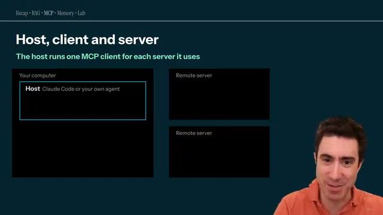
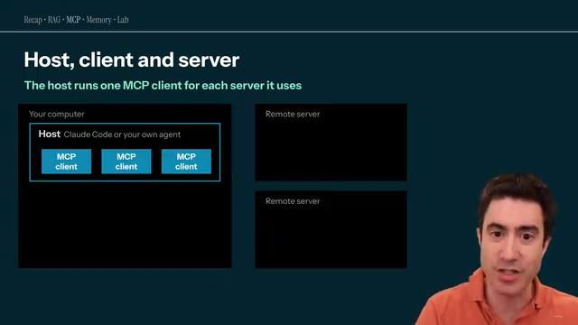
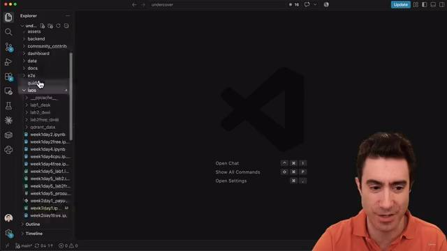
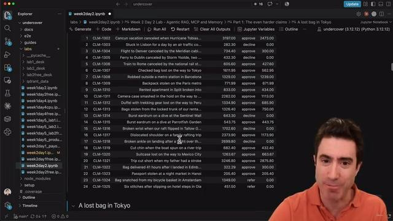
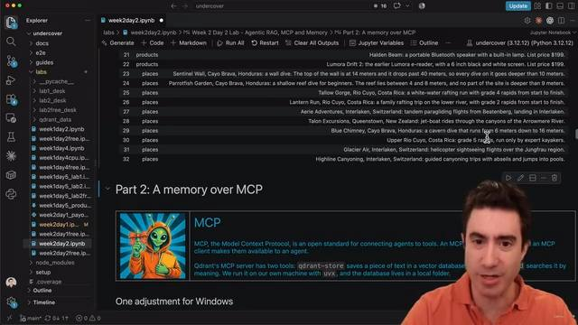
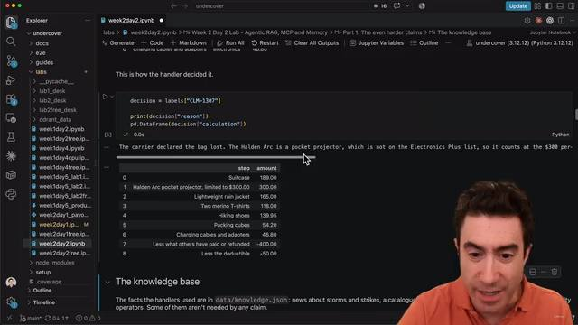

# AI FDE · P056–P058 复现文档：用 MCP 给 Agent 接工具，并用 Agantic RAG 做长期记忆

> 读者定位：前端转 AI 应用工程师。涉及「进程/子进程」「标准输入输出」的地方，我会顺手给出 Node 里的对应物，方便你类比。

---

## 1. 这一节做什么

这三节（P056、P057、P058）是把上周「MCP 当 Claude Code 的外挂」的那个视角翻过来：**这次是你自己写的应用（host）去消费别人的 MCP server**，再用 MCP 把「长期记忆」接进 Agent，最后在一个 claim 审核（理赔/裁决）任务上做对照实验。

拆成四件事：

1. **P056** 讲清 MCP 的角色分工：host / MCP client / MCP server 到底谁是谁，以及「本地 STDIO」和「远程 streamable HTTP」两种传输方式。最后落到一个关键问题——既然大多数本地 MCP server 只是在替你去调云上的 API，那为什么不直接自己调 API？讲师的答案是：MCP server 提供的是**用自然语言描述的工具签名**，它把 API 翻译成 LLM 能读懂、能生成 token 去调用的一坨 JSON。
2. **P057** 讲「怎么用」：你只需要拿到几个**参数**（command + args，或者一个 URL），塞进 host 就完事。uvx 是 Python 侧的、npx 是 Node 侧的；远程的用 URL + OAuth。
3. **P058** 讲 Agent memory：短期记忆就是对话历史，长期记忆是跨会话持久、通常通过**工具**去查（markdown 文件 / SQL / 自定义查询 / 语义搜索）。讲师建议先从一种做起，不要一上来就搞 AWS Bedrock Agent Core 那套「semantic / preferences / summary / episodic」四分类。
4. **P058 后半** 是实验：一个 even harder 数据集（25 claims / 25 labels / 25 policies），一份约 33 条的 `knowledge.json`，用 Qdrant 的 MCP server 在本地起一个向量库，把知识灌进长期记忆，再看 Agent 裁决是否变好。

**产出物**：一个能跑的 notebook（`Labs/Week 2/Day 2`，旁边有 free 模型 twin）、一份 MCP 参数配置、一个本地 Qdrant 数据目录。

**注意**：本课逐字稿里**没有给出 notebook 的完整源码**，也没有给出 `knowledge.json` 的字段结构。所以第 4 节我会把「逐字稿里确实口述过的参数」写成可直接保存的文件，凡是逐字稿没交代的，一律标注「课里没讲」，并告诉你该去哪儿核对，不替你编。

---

## 2. 讲师原话

> "当然，正如我们上周所说，MCP 是 Anthropic 提出的标准。它是一个把 AI 应用连接到工具、也连接到数据的标准。……Anthropic 把它描述为 AI 应用的 USB-C 端口。"
> —— p056 [00:29] ~ [00:48]

（MCP 是 Anthropic 提出、用来把 AI 应用接到工具和数据的标准，Anthropic 自己把它比作「AI 应用的 USB-C 口」。）

> "MCP 这个协议实际上允许你为智能体配备三类不同的功能……包括工具、资源……以及提示词……但事实证明，只有工具这一类真正流行起来。"
> —— p056 [01:43] ~ [01:59]

（协议层面有 tools / resources / prompts 三件套，但真正火起来的只有 tools。）

> "在 MCP 的语境里，MCP 宿主有非常具体的含义。宿主就是 AI 应用，会有一些工具接入其中。……宿主的一个例子是 Claude Code 这样的应用……另一个例子是我们即将用 LangChain 构建的智能体。"
> —— p056 [04:11] ~ [04:25]

（host 不是「主机」，是那个 AI 应用本身——Claude Code、ChatGPT、Claude 桌面版、你即将用 LangChain 搭的 agent 都是 host。）

> "在你的宿主里……有一些代码，能够启动所谓的 MCP 客户端……我们每想连接一个 MCP 服务器，就会创建一个对应的客户端。"
> —— p056 [06:26] ~ [07:06]

（host 里有一段代码负责起 MCP client，**一个 server 配一个 client**。）

> "MCP 客户端……随后会生成一个 MCP 服务器，实际上是在你的电脑上把它作为一个独立进程启动，并通过标准输入输出与它连接……这种连接方式称为 STDIO。"
> —— p056 [07:25] ~ [08:11]

（client 会把 server 作为一个**独立进程**拉起来，通过标准输入输出通信，这就是 STDIO 传输。）

> "它不使用标准输入输出，而是使用一种不同的传输方式，称为 streamable HTTP。……MCP 客户端可以直接连接到运行在其他地方的 MCP 服务器。"
> —— p056 [10:07] ~ [10:37]

（远程那套叫 streamable HTTP，client 直接连远端 server；此外还有个更老的 SSE，基本被 streamable HTTP 取代了。）

> "这就是黄色方框所提供的东西……它接收一个 API，并把它转换成自然语言和数据类型，同时用更多语言描述要做什么。"
> —— p056 [13:46] ~ [14:16]

（这是全段的核心：MCP server 那层「黄盒子」干的事，就是把 API 翻译成自然语言描述 + 数据类型，让 LLM 知道「什么时候用、怎么调」。）

> "因此，使用一个 MCP 服务器——任何人的 MCP 服务器——的方式，就是搞清楚它的参数。……第一个是在说，uvx 是命令，接着 mcp server qdrant 是下一个参数。……npx 的意思是在 npm 仓库里查找这个名为 playwright/mcp 的开源框架。"
> —— p057 [00:00] ~ [02:39]

（用 MCP server 就是拿到它的**参数**：command + 紧跟的参数。uvx 对应 Python 包，npx 对应 Node 包。）

> "使用 MCP 有三种常见方式……一是把 ChatGPT 和 Claude 这类 AI 应用连接到各种集成……其次，如果你自己在构建 AI 智能体……LangChain 会替你完成这件事……第三种方式……是使用 Claude Code 或任何其他编码智能体。"
> —— p057 [05:34] ~ [07:19]

（三种常见用法：① 把 ChatGPT/Claude 这类应用接到 Canva/Figma/Notion 这类集成；② 自己搭 agent 时框架帮你起 client；③ 拿 Claude Code 这类 coding agent 接 MCP。第四种「自己写 MCP server」较少见，本课不做。）

> "如果你在构建自己的 AI 智能体，并试图为它配备你自己编写的工具——你的工具、你的智能体——那么在这种情况下就没有 MCP 的用武之地。……你只需用一个工具装饰它，然后使用 LangChain 的 create agent，把它传进去，就完成了。"
> —— p057 [12:01] ~ [12:41]

（自己写的工具不需要套 MCP：直接用工具装饰器 + `create_agent` 传进去就完事。MCP 是给「别人的工具」用的。）

> "有短期记忆，它只是对传入智能体的对话历史的一个花哨说法。……长期记忆则是你如何把有用的上下文组织起来传进去，其中包含能在不同对话之间持续存在的信息。"
> —— p058 [00:00] ~ [00:29]

（短期记忆 = 对话历史；长期记忆 = 跨会话留存、通过工具查出来的上下文。）

> "我个人的建议是，至少一开始要保持简单。……先从一种长期记忆开始，只有在能更好地解决你的业务问题时，才增加不同的类别。"
> —— p058 [01:56] ~ [02:36]

（讲师明确反对一上来就上多类记忆，先从一种开始。）

> "它属于一种长期记忆，会使用通用的检索增强生成，并且会使用 MCP，也就是 Qdrant MCP 服务器。"
> —— p058 [02:36] ~ [03:06]

（今天的 lab：单一类型长期记忆 + Agantic RAG + Qdrant MCP server。）

---





---

## 3. 从零复现

### 3.1 前置环境

| 组件 | 用途 | 版本 |
|---|---|---|
| Python + `uv` | 提供 `uvx`，用于跑 Python 写的本地 MCP server | 课里没讲版本号 |
| Node.js + `npx` | 跑 Node 写的本地 MCP server（Playwright） | 课里没讲版本号 |
| VS Code + Jupyter | 打开 lab notebook | 课里没讲版本号 |
| OpenRouter API key | 调模型（课上用的模型叫 Luna） | 课里只说了环境变量名相关的一句话，具体变量名以 notebook 为准 |
| Langfuse | 观测/追踪（昨天已配好） | 课里没讲版本号 |

`uvx` 不是什么新东西，就是 UV 的「跑一个工具」命令：它以包名去建一个**隔离的 Python 环境**、装依赖、然后运行。逐字稿原话是 "UVX 实际上是和 UV 关联的一个特殊命令……它会构建一个隔离的 Python 环境，包含所有需要的依赖，然后运行它。"。你把它理解成 `npx` 的 Python 版就行。

在 Node 侧的类比（给你这种前端背景的人）：
- `npx @playwright/mcp@latest` ≈ `npm exec`：临时拉包 + 执行，不污染你的项目依赖。
- MCP client 起 server 的「spawn 独立进程」，在 Node 里就是 `child_process.spawn()`；「走 stdin/stdout」就是拿到 `child.stdin` / `child.stdout` 两个流来回读写，不是 HTTP。

### 3.2 拿到 MCP server 的参数（P057 的核心）

讲师说得很直白：」the way you use an MCP server … is just by finding out its parameters … just the name of a little bit of text that describes how to find the MCP server, how to install it, how to run it"。

**本地 STDIO 形态**，逐字稿里出现了两个实例：

| server | command | 紧跟的参数 | 说明 |
|---|---|---|---|
| Qdrant（今天 lab 用） | `uvx` | `mcp-server-qdrant`（逐字稿口述为 "mcp server qdrant"，实际包名拼写请以 PyPI 为准） | 本地向量库，语义搜索 |
| Playwright（上周用过） | `npx` | `playwright/mcp`（逐字稿口述为 "playwright/mcp"，实际包名/scope 请以 npm 为准） | 驱动浏览器，约 15 个工具 |

**远程 streamable HTTP 形态**：参数就是一个 URL。逐字稿举例是 Context7（免费服务，给 coding agent 喂最新 API 文档）；另外提到 Atlassian（JIRA）和 GitHub 的 MCP server，都支持 OAuth 登录，登录后 agent 用你自己的账号数据。

### 3.3 把参数塞进 host

三种 host 的接法（P057 明说这三种都行）：

1. **Claude Code / Claude Desktop / ChatGPT**：把参数填进去就行，它会自己安装、连接、list tools、call tool。
2. **你自己用 LangChain 写的 agent**：框架内建了 MCP client，"你甚至不用碰它。LangChain 会替你完成。" —— 它替你 spawn 进程、走 STDIO、连上就能用。
3. **Coding agent**（第三种用法，上周已经做过）。

这一步的具体文件长什么样，见第 4 节。

### 3.4 进 notebook（P058 的实操顺序）

讲师的操作序列可以逐条照抄：

1. VS Code 打开 `Labs` 目录 → 进到 `Week 2` → 打开 `Day 2` 的 `.ipynb`。旁边有一个「free twin」notebook，用免费模型的那份。
2. 选 kernel（"现在，和往常一样，我们要选择内核。"）。
3. notebook 分四块：**even harder dataset** / **memory over MCP** / **teaching the agent to learn new memories** / **running some experiments**。
4. 先跑 imports 和取 key 的那一格：确认 OpenRouter API key 在、Langfuse 能连上。模型用 Luna，**低 reasoning effort**（"我想这次我们会使用较低的推理强度。"）。
5. 装载数据集：25 claims、25 labels、25 policies。看几眼数据长什么样。
6. **Windows 专用 hack 单元**：讲师原话是 "在 Windows 上这样做在技术上有些小问题……除非你运行这里这个小变通，否则它不会起作用。"；Mac 上跑这段是 no-op，会打印类似「not Windows so nothing to do here」的信息（原话 "它提示当前不是 Windows，因此这里无需做任何操作。"）。Windows 上它会应用一段 Windows 适配。
7. **清空向量库目录**：存储位置是 `Labs` 下的一个目录，逐字稿口述为 "cudrant data"（Qdrant 官方拼写是 `qdrant`，实际目录名以 notebook 里的路径为准）。先删掉它，保证从零开始（"所以实际上我会把这一部分单独拆出来，然后现在就运行这个，把它清除掉。"）。**第二次跑删目录不会报错**（"如果你第二次运行它，它不会失败，这没关系。"）。
8. 跑 memory over MCP 那一段：MCP client 拉起 Qdrant server，server 在你的机器上建库。
9. 读 `knowledge.json`（约 33 条，主题是 events / products / places），灌进向量库。
10. 回到 claims 跑实验，对比「有记忆 / 无记忆」。









> 上面这张对应讲师的「删目录」动作。请注意逐字稿原话是 "我们用来存储记忆、也就是向量数据库的位置，会是 Labs 文件夹下名为 Qdrant Data 的文件夹。"，也就是 **Labs 目录下的一个子目录**；`qdrant` 的正确拼写与最终目录名，以你拿到的 notebook 为准。

---

## 4. 完整代码

### 4.1 先说清楚边界

- 逐字稿**没有**贴 notebook 的任何一格源码，也没有贴 `knowledge.json` 的字段。
- 逐字稿**只**口述了两类参数（`uvx mcp-server-qdrant`、`npx playwright/mcp`）和一个远程 URL 的概念。
- 因此下面第 4.2 节是我能给到「可保存、可运行」的部分；4.3 / 4.4 是**结构示意**，凡不是讲师说过的字段，我一律标注。

### 4.2 可直接保存：MCP 参数配置

逐字稿只说了「参数是 command + 紧跟的参数」，没有展示 JSON 键名。下面用的是 **Claude Code 的标准 `.mcp.json` 结构**；`mcpServers` 这个键名逐字稿里没出现，请以你所用的 host 文档为准。

文件路径：项目根目录 `.mcp.json`

```json
{
  "mcpServers": {
    "qdrant": {
      "command": "uvx",
      "args": ["mcp-server-qdrant"]
    },
    "playwright": {
      "command": "npx",
      "args": ["playwright/mcp@latest"]
    }
  }
}
```

等价的命令行验证方式（不进 host，先确认这两个命令本身能跑起来）：

```bash
# Python 侧：uvx 会建隔离环境、装包、运行
uvx mcp-server-qdrant --help

# Node 侧：npx 会临时拉包并执行
npx playwright/mcp@latest --help
```

> 版本号：逐字稿在 Playwright 那里说了「take the latest version」，所以写 `@latest`；Qdrant 那条**课里没讲版本**，不写 pin。上表的包名拼写也请以 PyPI / npm 实际条目为准（讲师是口述的，逐字稿音译成 "mcp server qdrant" / "playwright slash mcp"）。

### 4.3 结构示意：`knowledge.json`（**字段名课里没讲，以下是示意**）

讲师只说了三件事：约 33 条、主题是 events / products / places、这份文件是「随着和 handler 的对话慢慢积累下来的知识，被我们攒进了一个文件」。

```json
[
  {
    "id": "k001",
    "type": "event",
    "text": "2024 年某月某地飓风导致航班大规模取消。"
  },
  {
    "id": "k002",
    "type": "product",
    "text": "Holden Ark 是一款口袋投影仪（pocket projector）。"
  },
  {
    "id": "k003",
    "type": "place",
    "text": "Skylark 是某航司在某地区的行李承运方。"
  }
]
```

> 上面 `id` / `type` / `text` 三个字段是**示意**，逐字稿没提。真实字段请打开 lab 里的 `knowledge.json` 看一眼再改代码。讲师举的两个具体知识点是：Holden Ark 是 pocket projector；以及它不在「Electronics Plus」这份保单的承保清单里。

### 4.4 结构示意：MCP client 侧的调用形态（**课里没有给出代码，以下为示意**）

逐字稿说 LangChain 内置了 MCP client 会自动 spawn 进程，但没写 API 名。下面只是让你看懂「list tools → call tool」这两个动作在代码里长什么样，**不是讲师给的代码**：

```python
# 示意，不是课里的代码
from langchain_mcp_adapters.client import MultiServerMCPClient

client = MultiServerMCPClient({
    "qdrant": {"command": "uvx", "args": ["mcp-server-qdrant"], "transport": "stdio"}
})

tools = await client.get_tools()   # 对应讲师的 "list what tools you're able to provide me"
```

> 这个 import 路径和 `get_tools()` 名字都**没有**在逐字稿里出现过，属于示意，实际以你安装的 LangChain 版本为准。逐字稿确认的只有两件事：① 每个 server 配一个 client；② server 只有两种能力——**list tools** 和 **call tool**（"通常，MCP 服务器能做的就是……回答两个问题……列出你能提供给我哪些工具……我想调用其中一个工具。"）。

---

## 5. 逐行解释

**`"command": "uvx"`**
这是「怎么启动这个 server」的第一段。`uvx` 的存在意义是隔离：它会把 `mcp-server-qdrant` 装进一个**独立的 Python 环境**再运行，不碰你项目自己的 venv。对应讲师原话 "如果是 Python，通常只需使用 UV，也就是说它处在自己隔离的环境中。"。不这么做的后果：某个 server 依赖的版本和你项目依赖打架，你会花一整天在 `pip install` 地狱里，而不是在写 agent。

**`"args": ["mcp-server-qdrant"]`**
第二个参数是包名。讲师把它讲成一句话命令："uvx 是命令，而 mcp server qdrant 是下一个参数。这就是你需要在命令行输入的内容。" 所以这个 JSON 本质上就是把你会在终端敲的那一条命令拆成两个字段。

**`"command": "npx"` + `["playwright/mcp@latest"]`**
Node 侧等价物。讲师原话："npx 相当于 Node 版的 UVX……npx 的意思是到 NPM 仓库里查找这个名为 playwright/mcp 的开源框架……获取它的最新版本，安装并运行。" `@latest` 就是「take the latest version」的直接翻译。**为什么这里用 `@latest` 而 Qdrant 那条不写**：因为讲师只在 Playwright 这句里说了 latest，我不替 Qdrant 编版本。

**`"mcpServers"` 这一层**
逐字稿**没出现**这个键名，它是 Claude Code 的标准写法。之所以要一层 map 而不是数组，是因为一个 host 可以同时接好几个 server，需要给每个起名字 —— 这正好对应讲师说的 "我们即将把它连接到三个不同的 MCP 服务器……然后在我们的宿主程序中，我们会创建三个 MCP 客户端。我们想要连接的每个 MCP 服务器都会对应创建一个客户端。"

**远程那段为什么没有代码**
因为远程的参数「就是一个 URL」。讲师原话 "在这种情况下，你的参数里会有一个这样的 URL……你只是在告诉 Claude Code 或其他程序去连接那个 URL，而那个 URL 会响应 list tools 和 call tool。"。URL 的具体形态（路径、是否需要 token）课里没讲；能确定的是远程 server 支持 **OAuth** 登录（"OAuth 流程是这些远程 MCP 服务器的一项非常强大的功能。"），所以你没有把 JIRA 密码交给 Claude Code。

**为什么实验要用 Qdrant 的 STDIO 而不是远程**
讲师给了理由：本地跑省钱且方便（"如果你用的是别人的算力，就得更别人付费。而用这种方式，你只需要执行 pip install 之类的操作。"），而且这是一种「轻量进程 + 调云 API」的典型形态。**但**你必须清楚：跑在本地 ≠ 安全，"关键在于，你是在本地运行一些开源代码。因此，你需要理解这些风险。"。

**为什么先删向量库目录**
因为实验要对照「没有记忆时」和「有记忆时」的表现。不删的话上一轮灌进去的 33 条知识还在，你就测不出「教它之前」的基线。讲师强调删了之后「no memories, no directory」，然后 MCP server 会重新把这个目录建出来 —— 也就是说**建库这件事是 server 干的，不是你手写脚本干的**，这正是他反复强调的"MCP 把原本需要一周的基础设施工作压缩成了几个参数。"。

**为什么 Windows 要那段 hack**
课里没讲 hack 的具体内容，只讲了原因：在 Windows 上「从 notebook 里跑 MCP」有点 glitchy，不加这段就跑不通；Mac 上是空操作。所以这段代码是**平台适配层**，不是业务逻辑。你在 Linux/Mac 上跑看到「nothing to do here」是正常的，别以为是报错。

**为什么讲师不建议一开始就搞四类记忆**
原话是担心重复和误判："你可能会在不同记忆存储中遇到重复信息，或者发现你的智能体查错了地方。它以为某样东西是情景记忆，但实际上它是一种偏好，或者属于语义记忆。" 四分类（semantic / preferences / summary / episodic，来自 AWS Bedrock Agent Core 的最佳实践）是**规模上来之后**的优化，不是起点。起点就是今天的做法：一种长期记忆 + 语义搜索。

---

## 6. 复现检查清单

按顺序打勾，任何一项不过就别往下走：

- [ ] `uv --version` 能跑；`uvx mcp-server-qdrant --help` 不报「package not found」（包名拼写以 PyPI 为准）
- [ ] `node --version` / `npx --version` 能跑；`npx playwright/mcp@latest --help` 能拉到包（首次会慢，等它下完）
- [ ] host 侧的 MCP 配置文件已保存，参数是 `command` + `args` 两个字段（远程则是一个 URL）
- [ ] host 启动后能看到这个 server 的 **tool 列表**（这是 `list tools` 生效的证据）
- [ ] VS Code 里打开了 `Labs/Week 2/Day 2` 的 notebook，并选好了 kernel
- [ ] 旁边的 free 模型 twin notebook 也在（用免费模型时可切）
- [ ] imports + 取 key 那一格跑通：OpenRouter key 在、Langfuse 连得上
- [ ] 模型设为 Luna、reasoning effort 设为 low
- [ ] 25 claims / 25 labels / 25 policies 全部加载成功，数量对得上
- [ ] Windows 用户跑过了那格 hack 并看到「已应用 Windows 调整」类提示；Mac/Linux 用户看到 no-op 提示属正常
- [ ] 向量库目录（`Labs` 下，逐字稿口述 cudrant_data，实际以 notebook 为准）已被删除
- [ ] 跑完 memory over MCP 那格后，该目录**被重新创建出来**（说明 Qdrant server 真的建库了）
- [ ] `knowledge.json` 加载成功，条目数约 33
- [ ] 灌库后做一次语义检索，能召回相关知识（比如搜「pocket projector」能命中 Holden Ark 那条）
- [ ] 有记忆 / 无记忆两组实验都跑完，Langfuse 里能看到 trace

---

## 7. 课里没讲但你会撞上的

1. **`uvx` 的首跑延迟**。它要先建环境、装包。第一次跑 `uvx mcp-server-qdrant` 卡住 30 秒以上是正常的，别急着 Ctrl-C。`npx` 同理。课里没提这点。
2. **包名/目录名的拼写差异**。逐字稿是口述的（"cudrant"、"playwright slash mcp"），你实际去 PyPI / npm / lab 仓库核对一次，能省半小时。文档里我全部标注了「以实际为准」。
3. **文本里有 `cudrant_data` 目录删不掉**。Windows 上如果 Qdrant 进程还活着，目录会被占用。课里没说怎么处理；通常做法是先确认没有残留的 server 进程，再删。
4. **上下文被工具吃掉**。讲师明确警告过 MCP 最大的坑是 context 占用："众所周知，MCP 服务器会占用大量上下文空间……如果你使用 Playwright 之类的东西，工具会非常多。"。所以接 Playwright 这种 15 个工具的 server 时，别同时再接三四个大的。
5. **`knowledge.json` 灌进去之后召回质量差**。课里没讲 chunk 策略、embedding 模型选型，也没讲是否需要 rerank。这是 Agantic RAG 的常规坑，不是本课的重点，但不解决的话你会以为「MCP 没生效」。
6. **Windows 上 hack 之后的副作用**。课里只说了「它能让你跑通」，具体改了什么没讲。建议把那段 hack 单独开一格，跑之前用 git 记一次状态，出问题好回滚。
7. **认证类远程 server 的 OAuth 回调**。JIRA / GitHub 这种，讲师只说了「会弹一个窗口让你登录」。你在本地跑 notebook 时，回调端口被占、浏览器打不开是常见事，课里没讲。
8. **自己写的工具不要套 MCP**。这是最容易被新手搞反的一点。原话："如果你在构建自己的 AI 智能体，并试图为它配备你自己编写的工具……那么在整个方案里就没有 MCP 的位置。" 自己写的工具就是加装饰器 + `create_agent`。MCP 的成本是一整个进程边界，别为了「统一」把自己的 5 行工具也包成 server。
9. **MCP server 的质量参差不齐**。讲师说得很直白：Playwright 有微软背书，"有些则没有得到特别好的支持。"，让你像审一个 npm 包一样审它：GitHub stars、issue 数、最后更新时间。如果你只是「AI 用户」而不是工程师，这一步最容易跳过。
10. **`resources` 和 `prompts` 这两条路**。协议里有，但讲师说基本没人用（"工具是唯一真正流行起来的部分。"）。你想用可以，但别指望找到成熟的生态和文档。